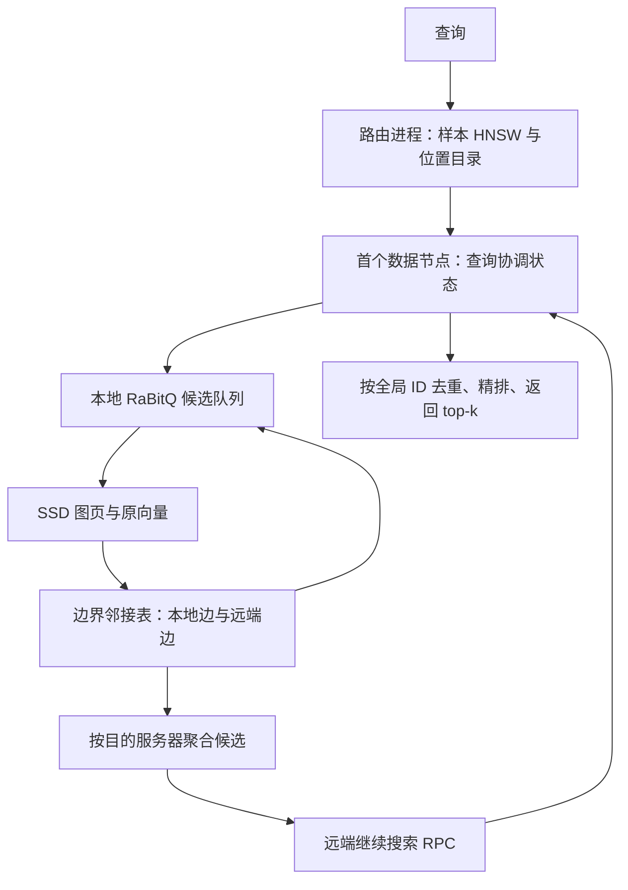
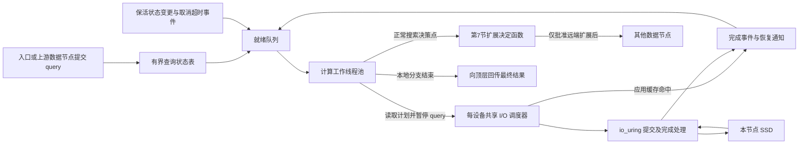
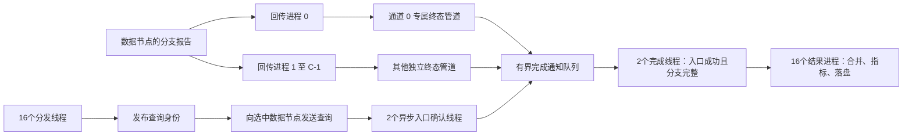
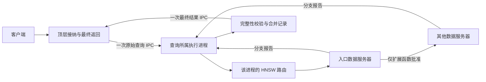

# DHDGS 设计与执行方案

2026-10-18 当前要求更新：质量目标调整为平均 Recall@10≥0.95，降低搜索预算，并继续按 p99 优先、QPS 次之选参。新增 `native` C++ 完整本地搜索循环：每台数据节点上的每个查询分支固定由一个计算线程执行，多查询并行；SSD 聚合线程不执行扩展选择。历史 0.99 目标的实验保留为对照，原生实现与并行方式见第 6.14 节。

2026-10-18 通信优化：第 11 节已实现非阻塞派发收尾、有界并发控制回传、响应携带续租、共享回调服务和连接复用。跨节点搜索仍须经扩展选择函数批准。新配置默认 `peer.communication.mode: optimized`，缺失该配置组的旧 YAML 显式迁移为 legacy，便于复现实验。验证与限制见第 11.9 节及 [对照报告](test/control_path_20261018/REPORT.md)。

初稿日期：2026-10-15；实现进度更新：2026-10-17。状态：设计提案，已实现端到端小规模 HNSW/RaBitQ/Vamana/磁盘/TCP 原型；外存规模化构建和物理多机性能尚未验证。已实现模块和运行方式见 [README.md](README.md)。

2026-10-17 实现更新：第 6.12 节的首阶段异步独立读取与查询暂停/恢复已实现，提供 io_uring、专用 I/O 线程池和同步基线。实际配置、已实现范围及后续项目见第 6.12.12 节；默认仍保留 blocking，未将异步性能优势视为既定结论。

已确认实验条件：200M 条、2560 维数据向量；200K 条查询；4 台服务器，每台约 1 TB 内存。用户接受高召回 ANN，第一质量目标采用 Recall@10≥0.99，在此约束下优化 QPS 与延迟。距离定义、数据路径/格式、CPU/SSD/网络与部署方式仍待确定。“越高越好”以 recall–QPS–latency 曲线呈现，不预设未经测量的 QPS 承诺。

进一步确认：向量由 ESM2_3B 生成，尚未归一化；允许搜索停滞时使用备用路由入口，并要求统计触发率与额外开销。模型名称不等同于已确定的距离语义，cosine 与原始 L2 的最终选择仍需根据任务或已有 ground truth 确定。

数据规模更新：当前可访问的是 `gene_database/Data/seq_2M/seq_2M` 下正在传输的 2M 轻量子集，配有 200K 库内查询及两套排除自身的 top-100 标签；此前的 200M 作为较大验证规模，长期系统目标为百亿级。格式与只读抽查结果见 [DATA_INSPECTION.md](DATA_INSPECTION.md)。不能把四台服务器的 2M/200M 容量预算直接外推为百亿可部署配置；需要全局 64 位 ID、流式构建、受限缓存/查询状态及显式路由/编码内存预算。

2026-10-16 更新：base 文件长度已达到完整声明，新的随机抽查通过；全量内容 checksum/精确 top-k 仍未验证。实际部署调整为 **3 台数据服务器 + 1 台待就绪的独立路由服务器**。三台数据机硬件与存储/网络实测配置见 [HARDWARE.md](HARDWARE.md)；下文 4 数据分片容量例子保留为早期假设，不作为当前部署配置。2M 三分片平均原向量约 6.83 GB/台，当前可用 SSD 空间支持轻量实验。

## 1. 目标、约束与研究定位

目标是以样本 HNSW 找到数据图入口，在 SSD 上的分布式近邻图中搜索，通过边界副本连接分片，并用 RaBitQ 降低内存占用和估距成本。保持首跳单数据节点，支持必要时跨节点扩展。

必须区分以下性质：

- **可达性**：任意入口能沿有向边到达整个图，需要显式验证和修复。
- **搜索质量**：可达不代表有限 beam、有限跳数下能找到真近邻。HNSW、Vamana 和量化估距都属于 ANN 环节。
- **调度正确性**：被延后的远端候选不能静默丢失；但改变扩展次序，在有限 beam/预算下仍可能改变搜索结果。
- **精确 top-k**：需要覆盖所有可能优于当前结果的数据。全量精确扫描是可靠的校验/兜底路径；候选精排本身不能恢复未访问的真近邻。

“几跳到达最近邻”和“完全不牺牲召回率”应先转化为可测量目标，不能作为任意数据分布上的定理。分别记录图扩展深度、跨服务器串行跳数、并行 RPC 轮数和访问节点总量。

推荐研究问题：在固定召回率下，自适应边界复制与通信成本调度，能否减少 RPC、SSD 读取和 p95/p99？同时测量索引构建时间与额外空间。

## 2. 已核对的代码与文献

| 来源 | 已核对内容 | DHDGS 的使用方式 |
| --- | --- | --- |
| [DiskANN 原论文](https://papers.nips.cc/paper/2019/file/09853c7fb1d3f8ee67a61b6bf4a7f8e6-Paper.pdf)，§3 | 已使用最近多个中心形成重叠分片，独立建 Vamana 后合并出边；内存压缩向量、SSD 原向量与邻接表、beam I/O | 复用算法基础；原论文合并后在单机 SSD 查询，DHDGS 将图保留在多机上查询 |
| [C++ DiskANN](../Reference_Code/DiskANN_cpp/src/pq_flash_index.cpp) | `cached_beam_search` 内通过 `compute_dists` 和 PQ 表估距；SSD 读取已有多扇区处理 | 复用建图和 I/O 经验；需要可暂停搜索状态与量化接口，不能只替换文件后缀 |
| [RaBitQ 原论文](https://arxiv.org/abs/2405.12497)，§3 | 随机正交旋转、无偏估计与概率误差界 | 正确实现估距；理论假设与实际旋转实现分开说明 |
| [多比特 RaBitQ](https://doi.org/10.1145/3725413) | 支持更高精度量化的研究依据 | 1/2/4/8 bit 消融；不预先认定 1 bit 足够 |
| [RaBitQ core API](../Reference_Code/RaBitQ-Library/docs/docs/rabitq/core_api.md) | 本地源码提供独立 C++17 core：requirements / encode / prepare_query / compute，支持紧凑布局 | 直接接入底层估距，不依赖其 IVF 或 HNSW 索引来冒充 DiskANN |
| [旋转实现](../Reference_Code/RaBitQ-Library/docs/docs/rabitq/rotator.md)、[精排说明](../Reference_Code/RaBitQ-Library/docs/docs/rabitq/reranking.md) | FHT/Kac 是均匀随机正交旋转的结构化近似；误差区间不是确定性下界 | 默认高效旋转，保存实际状态；误差区间仅作启发式调度 |
| [Pyramid 论文](https://arxiv.org/abs/1906.10602)，Algorithm 3 | 样本上 k-means，中心构建 meta-HNSW，底层图再划分 | 借鉴层次路由。用户指定的“真实样本构建 HNSW”是不同设计，按用户方案实现 |
| [本地 Pyramid 说明](../Reference_Code/Pyramid/Pyramid_REFERENCE.md) | 第三方 MPI 实现，并非已确认的作者官方实现 | 参考通信流程，不直接作为系统基座；论文细节以论文原文为准 |
| [现有 pyramid_rabitq](../pyramid_rabitq/README.md) | 当前是样本图划分 + RaBitQ-IVF + 共享存储读取节点 | 可参考数据读取与实验工具；DHDGS 独立目录，因为底层检索和节点职责不同 |

实现开始时记录参考源码的提交或内容校验和，并保留许可证。第一阶段没有修改或编译参考代码。第二阶段已经链接 RaBitQ core 并验证端到端原型，参考库仍未修改；使用的版本及许可证见 [THIRD_PARTY.md](THIRD_PARTY.md)。

## 3. 推荐架构与边界



- C++17/20：建图适配、RaBitQ、SSD I/O、候选队列、RPC 数据面。
- Python：数据准备、采样/聚类编排、配置、进程启动、精确 ground truth 与实验分析。
- 第一版：静态数据集、N 个逻辑分片对应 N 台数据服务器、一个路由角色；物理部署允许路由角色独立或共置。
- 用多进程、独立 SSD 文件、真实 TCP RPC 完成单机联调，再迁移多机。多进程结果不当作多机性能。
- 初始建议二进制 gRPC/Protobuf，持久连接和异步请求。备选是 MPI：适合集群批量构建，但在线服务与故障处理约束较多。
- 第一版不实现在线插入删除、过滤、自动迁移和高可用；预留索引版本、逻辑分片与物理位置映射。

路由 HNSW 的 level-0 顶点是**真实样本向量**，每个顶点映射到一个或多个数据节点及该向量的本地 ID。不是将整个 HNSW 底层压缩成 N 个服务器顶点。

按当前条件 N=4，每个分片主数据约 50M 点。k-means 不保证最终分片等量，即使初始 ID 分配均匀；第一版报告实际容量和查询负载偏斜，暂不引入自动负载均衡。

## 4. 距离与可调重叠分片

### 4.1 距离契约

本提案公式采用平方 L2。若目标为 cosine，对非零数据和查询统一 L2 归一化，则 $d_{\mathrm{L2}}^2 = 2 - 2\cos(x,y)$，排序一致；聚类使用该空间的欧氏 k-means。球面 k-means 可作为另一项明确的实验配置。

未经归一化的最大内积不能直接套用本文的 Voronoi 距离和几何解释，需要另行确定聚类与转换方案。零向量、非有限值、重复 ID 必须有显式输入处理策略。

ESM2_3B 数据的推荐实验主方案是 cosine，通过归一化后的平方 L2 实现；原始 L2 作为对照。该推荐不是 ESM2 官方唯一距离约定，也不表示模长一定没有生物学信息。ANN recall 衡量相对于所选距离的精确近邻集合的还原程度，不等于同源性、功能相似性等生物学检索质量；若要比较距离语义，应使用独立的生物学标签或任务指标。

仓库核对结果：`Reference_Code/ERAST/pipeline/emb_optimized.py` 的 ESM 路径对有效残基表示取平均，排除特殊 token，相关输出段未做 L2 归一化；这只是可用生成脚本的行为，尚不能确认当前全部数据由该路径生成。现有 `tools/build_seq_ann_gpu.py` 同时支持 cosine 和 euclidean，CLI 的 `--metric` 默认是 euclidean；`tools/sampled_seq_ann.py` 为两种距离分开保存结果。因此不能依据模型名称或输出目录名称直接复用 ground truth，必须检查其 metric、归一化和 self-exclusion 元数据。

若采用 cosine，在索引构建的数据预处理阶段与在线查询入口执行一致的归一化，之后聚类、HNSW、Vamana、RaBitQ 和精排都使用同一度量空间；源向量文件保持原始值。原始 L2 对照使用独立配置与索引版本，不能直接复用 cosine 图和结果标签。零范数输入默认报告错误，不以任意单位向量替代。

设总向量数为 M、维度 D=2560、中心为 c_1,...,c_N。令：

$$
d_j(x)=\|x-c_j\|_2^2,\qquad a(x)=\arg\min_j(d_j(x),j).
$$

`a(x)` 为主归属；距离并列按中心 ID 决定。即使没有副本，每个向量也恰有一个主归属。

### 4.2 推荐：按几何边界裕量决定副本

对 j≠a(x) 定义：

$$
h_j(x)=\frac{d_j(x)-d_{a(x)}(x)}{2\|c_j-c_{a(x)}\|_2},\qquad
\gamma_j(x)=\frac{h_j(x)}{s_{a(x),j}}.
$$

其中 $s_{ij}=\max((r_i+r_j)/2,\varepsilon_s)$，r_i 是样本主归属簇内向量到中心的 RMS 半径。ε_s 随全局数据尺度确定，防止退化除零。

**解释**：h_j 是 x 到两个中心等距超平面的非负垂直距离。γ 越小，越靠近这个分片边界。相比仅用距离比值，它显式考虑中心间距与局部尺度，避免高维距离集中导致所有分片看起来都相近。

中心相同或极近时不直接除以小数：先重初始化退化/空簇。若不同数据点不足以支撑 N 个有效簇，应报错或经配置减少有效分片，不能静默产生无效中心。

给定阈值 τ：

$$
A_\tau(x)=\{a(x)\}\cup
\operatorname{take}_{C_{max}-1}
\{j\ne a(x):\gamma_j(x)\le\tau\}.
$$

副归属按 `(γ_j,j)` 排序。C_max 是固定安全上限，初始建议 3、且不超过 N；不是需要用户日常调整的主旋钮。中心及尺度固定时，增大 τ 使归属集合嵌套扩大。明显偏向某个中心的向量仍唯一归属，边界向量复制到若干相邻分片。

γ 最小的副中心不一定是原始距离第二小的中心，因为归一化考虑了边界距离和簇尺度；这是明确的几何选择，须与直接距离差基线比较，而不能把两者混称为同一算法。

### 4.3 对用户只暴露一个主要参数：overlap_fraction = ρ

ρ∈[0,1] 表示**目标多归属向量比例**，而不是平均副本数或随机查询的跨机概率。

定义 $b(x)=\min_{j\ne a(x)}\gamma_j(x)$。在独立校准样本上取 b 的 ρ 分位数作为 τ，使：

$$
\Pr_{x\sim\text{数据分布}}(|A_\tau(x)|>1)\approx\rho.
$$

- 推荐确定性划分，不需要每次构建重新掷硬币。概率解释来自数据分布。
- ρ=0 特判为主归属唯一，即使中心距离并列也不复制；ρ=1 且 N≥2 时每点至少双归属。
- 分位点大量并列时，用 `(b(x), hash(seed,global_id))` 做稳定排序；每个副归属用 `(γ_j(x),同一hash)` 与阈值比较，避免阈值处复制率突增。
- 样本校准只能近似达到全量目标。报告实际 `ρ_observed`，不能把配置值当实测值。
- 若要求全量比例严格等于 floor(ρM)/M，增加一轮分布式标量统计/选择确定阈值；不需要再次传输原向量，但需要读取/保存分片分数。固定中心与尺度后仍满足单调性。

定义平均副本因子：

$$
RF=\frac1M\sum_x|A(x)|,\qquad
1+\rho_{observed}\le RF\le1+(C_{max}-1)\rho_{observed}.
$$

例如 C_max=3、实际 20% 的向量多归属，则 RF 在 1.2～1.4 之间。桥接修复采用额外边，不额外复制原向量，因而不改变该关系。N=1 时 RF=1、没有边界。

### 4.4 可选对照方案

| 方法 | 定义 | 取舍 |
| --- | --- | --- |
| 相对距离差 | `(d_j-d_a)/max(d_a,ε)≤τ` | 易实现；受高维距离集中和 d_a≈0 影响，应作为基线 |
| 固定最近 r 个中心 | 每点始终复制到 r 个中心 | 原始 DiskANN 式构建对照；冗余固定，不能区分内部点和边界点 |
| 随机平滑归属 | 主归属必保留，副归属概率 `p_j=exp(-γ_j/τ)` | τ→0 时仅保留几何并列点；τ=0 另行规定唯一主归属。副本量有随机波动，需固定哈希保证可复现；应用上限后概率改变 |

推荐几何裕量 + ρ 校准。若用户所说的“概率”必须指真正的 Bernoulli 随机复制，再采用第三种，并重新校准其实际副本比例。

## 5. 构建流程、通信与连通性

1. 按全局整数 ID 排序并均匀分为 N 个初始范围。全局 ID 使用 uint64，不通过 float 传递；本地紧凑 ID 可在容量允许时用 uint32。
2. 各服务器以固定采样概率做可复现采样，路由端收集样本、训练 N 个中心，并计算簇尺度。校准样本与训练样本建议分开。
3. 广播中心、尺度、版本及采样规则。各服务器分块计算向量到 N 个中心的距离，执行重叠划分；不物化 M×N 距离矩阵。计算量约 O(MND)，中心较多时需评估 BLAS/GPU 的构建加速。
4. 执行**一次逻辑上的大向量 all-to-all shuffle**。向每个归属节点传向量，已在本地的副本不走网络。实际使用有背压的分块流，不要求单条消息容纳全部数据。
5. 接收端建立 `global_id → local_id`，回传样本的新位置。路由 HNSW 用样本原向量构建，位置 payload 在版本发布前完整更新；缺少代表样本的分片补充 medoid 样本。
6. 各分片建 Vamana。默认构建/RobustPrune 使用原始精确距离，查询候选排序使用 RaBitQ，避免把建图量化误差与搜索量化误差混在一起。构建超出 RAM 时使用 DiskANN 的分块构建/合并策略并核算峰值内存。
7. 对多归属顶点 x，收集所有归属节点的出边并按全局 ID 合并：`E(x)=union_{s∈A(x)} E_s(x)`。每份 x 的副本保存相同版本的完整并集。只发到相关副本持有者，不向全 N 台广播。
8. 每条远端边保存目标全局 ID、可用位置、编码引用/必要估距元数据。第一版保留边并集，度数最多约 C_max·R；不能按 R 静默截断跨片边。后续才研究带分片覆盖约束的剪枝。
9. 验证每个本地图的强连通性，并以受保护边连接其 SCC，使图内部可以到达入口及门户。以实际跨片边构建分片图，检查连通性；缺失时用中心距离引导的双向生成树桥接，优先选近边界端点。连通性证据是实际图遍历结果，不是中心图本身。
10. 修复后的完整邻接表再次同步给边界副本持有者；验证从规定入口的可达性、ID/位置有效性、边集一致性、RaBitQ 元数据与校验和后，发布不可变 manifest。

第 9 步中，若每个本地图强连通且分片之间有双向连通的桥边，则全局有向图强连通。修复边单独保存并禁止普通剪枝删除。生成树仅保证可达，不能保证少跳；额外近邻分片桥接应通过实验确定。

采样、广播中心、shuffle、边交换、连通性修复和发布都涉及通信。因此可以做到一次主要的向量重分布，不能宣称整个构建过程只发生一次网络通信。

## 6. RaBitQ 与 SSD 集成

### 6.1 量化契约

建议第一版使用全局共享旋转与每个向量的**主中心**作为编码中心。同一全局 ID 的所有副本与远端编码缓存共用同一编码、中心 ID、校正因子和旋转版本，跨分片估距可比较，也无需重复编码副本。

查询只旋转一次，并按实际使用的中心缓存 query state。数据、中心、查询必须在同一旋转空间。必须保存实际旋转状态，不能仅记录 seed 后假定跨平台完全重现。

接入 `rabitqlib::core` 的紧凑 `SplitPacked` 布局。先做逐向量估距适配，再测不规则图候选的批量处理；FastScan 的 32 向量布局不一定适合稀疏随机邻居，不能预设一定更快。

一位估距的核心形式为：

$$
\widehat d(q,x)=\|q-c\|^2+\|x-c\|^2
-2\|q-c\|\|x-c\|\frac{\langle\bar u_x,u_q\rangle}{\langle\bar u_x,u_x\rangle},
$$

其中 u 是归一化残差，bar-u 是旋转量化后的单位方向映回同一空间。实际使用库中包含范数与偏差校正的实现；仅用符号汉明距离不是 RaBitQ 距离估计。

零残差使用库的专门处理。多比特使用对应编码/估计公式。算法比较包含 1/2/4/8 bit；2560 维有利于误差界中的维度项，但不能仅凭维度保证任意数据上的近邻排序。

### 6.2 空间与页布局

不含校正因子、ID、中心 ID、对齐和图结构时，每点大小为：

| 表示 | 2560 维每点大小 |
| --- | --- |
| float32 原向量 | 10,240 B = 10 KiB |
| RaBitQ 1 bit/dim | 320 B |
| RaBitQ 2 bit/dim | 640 B |
| RaBitQ 4 bit/dim | 1,280 B |
| RaBitQ 8 bit/dim | 2,560 B |

本地库默认按 32 维对齐，2560 不需要为该约束扩展到 4096 维；仍以 `rotator->size()` 实际值为准。共享边界编码与副本也计入内存。

例如 1 亿点的 1-bit 裸编码总量为 32 GB（十进制），尚未乘 RF、尚未加元数据。路由采样比例 p 的原向量内存约 `p·M·10240 B`，不能不看内存预算直接设置很高采样比。

当前 200M 数据的容量预算如下，统一采用十进制 GB/TB，均匀分片、RF=1，未计元数据和构建临时空间：

| 项目 | 全集 | 每台（4 台） |
| --- | --- | --- |
| 原向量 float32 | 2.048 TB | 512 GB |
| 1-bit 编码 | 64 GB | 16 GB |
| 2-bit 编码 | 128 GB | 32 GB |
| 4-bit 编码 | 256 GB | 64 GB |
| 8-bit 编码 | 512 GB | 128 GB |
| R=64、uint32 本地邻接 ID | 51.2 GB | 12.8 GB |

ρ=0.1、C_max=3 时 RF 约 1.1～1.2，原向量平均每台约 563.2～614.4 GB；真实数值受分片偏斜影响，不能据平均值承诺容量足够。3 页节点布局还有对齐空间，边界并集和保护边另计。

该硬件容量可能使完整原向量工作集进入缓存。必须同时报告自然缓存状态和有明确限制的进程/页缓存内存预算下的 SSD 结果；先明确实验方式，不能为了制造磁盘访问而直接修改共享服务器的系统缓存设置。按样本比例 0.1%/0.5%/1% 做路由消融时，分别是 200K/1M/2M 样本，裸原向量约 2.048/10.24/20.48 GB，HNSW 边与管理结构另计。

早期 SSD 提案参考 DiskANN 多扇区固定节点记录，并考虑将边界并集放入 sidecar。**当前实现使用 DHDGS 自定义格式**：`nodes.bin` 内每条记录包含完整 float32 向量、uint32 出度、uint64 全局邻居 ID 数组及填充，边界并集和保护边已经包含在该邻居数组内；位置归属与量化编码另存。文件有一个对齐后的头部，记录长度为 `ceil((4D+4+8R_max)/page_bytes)*page_bytes`，其中 R_max 是分片实际最大出度。当前 2560 维测试索引的记录长度为 12,288 B，不能把它理解为每顶点只读一个 4 KiB 页，也不等同于上游 DiskANN 的原生文件格式。

必须测量这种布局的读放大。第二个候选是邻接页与原向量文件分离：搜索先读邻接表，候选精排时批量读取原向量，代价是改变距离细化时机和额外定位逻辑。两种布局需要相同召回下比较，不能假定分离总是更好。

RAM 保存本地 RaBitQ 码、元数据、有限热图页缓存、有限边界/远端码缓存与查询状态。大规模远端边的编码 sidecar 可按页落盘，缓存必须有字节上限；不能在每条边内重复嵌入 320～2560 B 编码。

实现至少包括量化文件生成/加载、查询预处理、候选估距、scratch 内存、缓存和版本校验；PQ 与 RaBitQ 文件格式不可互相冒充。保留 PQ 对照路径，便于判断质量和速度收益。

### 6.3 SSD 访问聚合：范围与当前基线

2026-10-16 新增，2026-10-17 补充第 6.12 节，**以下 6.3–6.12 保留完整实验设计；2026-10-17 已落实其中异步独立读取阶段，精确实现范围见 6.12.12，其他优化仍为计划**。首先保持 1 bit RaBitQ、现有图、记录格式和跨节点访问链不变，单独研究 I/O。布局重排、图向量分离和改变搜索策略作为后续独立实验，避免无法判断收益来源。

当前路径见 `python/dhdgs/index.py` 的 `Shard.read` 与 `Shard._expand`：每轮选择若干顶点，逐个查询应用 LRU，未命中则同步调用一次 `os.pread(fd, record_bytes, offset)`，解析并计算距离后继续下一条。RaBitQ 编码常驻 RAM。同步基线中一批 4 个未缓存顶点对应 4 次读取、48 KiB 返回数据；新增 resumable 路径也保留这四条独立读取，通过节点内 reactor 异步提交和恢复查询。两者都尚未合并相邻区间或复用不同 query 的在途读取。

必须分别命名三种机制：

| 机制 | 做什么 | 主要希望改善什么 | 不代表什么 |
| --- | --- | --- | --- |
| 异步批量提交 | 一次向内核提交多个独立文件偏移的读取 | 减少提交开销，利用 SSD 并发，缩短同轮串行等待 | 不保证减少读取字节或设备命令数 |
| 连续区间合并 | 将相邻或足够接近的记录读成一个区间，再切片 | 减少应用读请求及固定开销 | 跨间隙合并会多读无关内容 |
| 在途读复用 | 同一不可变记录的一次读取供多个等待者使用 | 减少并发查询间的重复读请求 | 不等于全局去重图扩展或共享查询预算 |

网络种子聚合与上述机制独立。普通 buffered I/O 仍经过 OS 页缓存；一个应用读取区间也不对应固定数量的 SSD 命令，所有收益需要分应用层与设备层观测。

### 6.4 首选路径：已选候选异步取数，搜索按确定顺序消费

推荐先引入数据节点内部的 `read_many` 抽象，输入为已经由搜索选定的一轮顶点，不让 I/O 层自行增添图扩展候选。起步版本不跨轮预取、不等待凑满批、不改变 `search.local_beam`，也不将搜索中间状态发回路由器。

一次本地轮次的拟议流程为：

1. 在搜索侧按原有规则固定候选列表、顺序和预算额度；轮内按全局 ID 去重。给每条记录保留原始序号。
2. 命中应用缓存的记录直接就绪；其余按 `(索引 epoch, 分片, 文件, offset, length)` 查询在途表。键中必须包含文件身份，不能跨分片仅按全局 ID 复用读取。
3. 对仍需读取的记录建立请求，按文件偏移排序只用于规划 I/O；查询候选顺序不随之改变。先支持独立读取，再按 6.5 的条件可选合并。
4. 在设备和查询额度内批量异步提交；额度不足的请求进入有界队列。同一轮的请求数可以大于设备可用额度，分批发出，不能静默丢弃。
5. 完成事件校验长度、记录边界和索引版本，并恢复到原始候选槽位。全部所需记录就绪后，按原先顺序计算精确距离、登记出边并合并候选。
6. 同步保留错误与取消状态；读失败不能当成“空邻居”。统计预算区分预约、完成和取消，记录完成消费后才标记扩展完成。

候选集相同且使用固定消费顺序，可以隔离 I/O 的影响；不过完整分布式系统还有基于墙钟等待的远端触发条件，即使顶点消费顺序不变，读盘变快也可能改变跨机决策。因此分两级验证：固定动作序列回放验证读取等价；在线 adaptive 模式重新测量 recall、访问路径和远端触发原因。不能承诺仅替换 I/O 就使每个在线查询返回完全相同的结果。

第 6.12 节先实现不同 query 之间的 CPU/I/O 流水线，同一 query 仍按固定轮次消费。后续才实验同一 query 内“完成一个就处理一个”：已完成记录的距离计算可以先做，但保持确定性模式的候选提交屏障；提前开放新邻居或启动下一轮属于搜索调度变化，必须单独开关。一个 beam 的数据依赖仍然存在，不能预先知道尚未读出邻接表的下一跳。

后端优先考虑 C++ `io_uring`，通过 Python/C++ 边界一次提交整批，等待时释放 GIL。先使用普通读取语义，记录内核、文件系统及实际后端；buffered 异步读取的底层执行方式也需实测。受限环境保留同步 `pread` 基线，可选有界线程池作为过渡对照；线程池不是原生异步 I/O 的等价性能保证。`preadv` 面向从一个文件偏移开始的连续数据分散到多个缓冲区，不能单凭它实现任意多个不连续文件偏移的读取。

### 6.5 连续区间合并：收益与读放大共同约束

顶点 u 的文件区间为：

$$
I(u)=[H+\operatorname{location}(u)S,\ H+(\operatorname{location}(u)+1)S),
$$

其中 H 为文件头长度，S 为分片固定记录长度。仅在同一文件、同一 epoch 内合并。对按偏移排序的一组未缓存记录 G，定义：

$$
B_{use}(G)=\sum_{u\in G}|I(u)|,\quad
B_{span}(G)=\max_{u\in G}\operatorname{end}(I(u))-
\min_{u\in G}\operatorname{start}(I(u)),\quad
A_{merge}(G)=B_{span}(G)/B_{use}(G).
$$

`B_use` 是本轮确实请求的完整记录字节，包括记录自身填充；`A_merge` 衡量跨间隙合并额外引入的放大，不等于向量有效载荷读放大或设备物理读放大。默认实验先只允许完全连续的记录，即 `max_gap_bytes=0`、`max_read_amplification=1.0`。

合并需同时满足：相邻间隙上限、区间总字节上限、读放大上限以及缓冲池额度。启用跨间隙实验时，再要求基于实测模型的预计完成时间改善超过安全裕量：

$$
\widehat T_{separate}(G\mid QD,\text{cache regime})-
\widehat T_{merged}(G\mid QD,\text{cache regime})>\delta_t.
$$

两侧都用相同在途深度与缓存实验条件下的批完成时间估计；不能拿串行独立读的耗时和并发合并读比较，从而夸大合并收益。OS 页缓存命中通常无法逐请求事前准确获知，模型只使用可观测信息并记录预测误差，不能假定有精确缓存预言器。

例：12 KiB 定长记录中，本地序号 `[100,101,102,103]` 可以从 4 个读取合成一个 48 KiB 读取，应用请求数减少 75%，请求字节不变；但物理设备命令数量和延迟未必同比降低。序号 `[100,102]` 合并为 36 KiB，会替代两个共 24 KiB 的请求，`A_merge=1.5`；在随机 IOPS 紧张时可能有利，也可能因带宽浪费而变慢。序号 `[100,900,1700,2500]` 跨度约 28 MiB，不能为节省三个请求就读取整个区间。

第一版不把间隙中的未请求记录当作新候选，不额外扣图扩展预算，也不默认放入应用缓存。合并缓冲区切成记录后，只缓存已请求记录，防止一次小记录缓存引用长期钉住整个大缓冲区。若选择拷贝，则单独记录拷贝字节、CPU 耗时及峰值内存。文件长度、offset 溢出和短读均需要显式检查。

当前记录按 ID 排列，图邻居未必连续；因此预计异步独立读取比大范围连续合并更普遍适用。空间合并收益首先取决于真实查询 trace 中的文件偏移局部性，不能据邻居在向量空间接近就推断其磁盘位置接近。

### 6.6 设备级额度、跨查询复用与生命周期

每个物理 SSD 设置总在途请求数与总在途字节上限，同时限制每个查询的在途请求数。多个逻辑分片落在同一设备时共享设备额度；单机多节点测试不能给每个进程各自完整设备额度，再把过载结果当作多机性能。实现时可由共享 I/O 服务统一调度，或由实验启动器明确分配保守配额；跨进程的在途读复用需要共享服务等显式进程间机制，不能假定进程内表具有该能力。

缓冲池内存粗略满足 `在途区间字节 + 完成但未消费字节 + 拷贝暂存字节`，此外计入请求对象和等待队列。必须对完成未消费数据背压，而不只限制已提交请求数。每查询采用公平轮转或字节配额，避免一个大 beam 抢占整块 SSD；不同大小合并请求需按字节核算。初版不为跨查询聚合主动延迟请求，只复用已经相遇的在途读取。

同一 epoch 下的相同记录由多个查询请求时，一次文件读取对应的 future 可以挂多个等待者。只有读取结果共享，每个查询仍独立更新 top-k、预算和出边状态；分摊 I/O 字节与等待者数分别记录，避免每个等待者都把完整文件读取计入系统总量。是否实际访问 SSD 仍取决于缓存。复用范围先限进程内，不增加跨节点去重协议。

某个查询超时或取消，只移除其等待关系；还有其他等待者时不能取消共享读取。所有等待者都取消后可以尝试取消，但不能假设内核一定尚未完成 I/O。只有收到完成/取消确认后才能回收 DMA/读取缓冲区；迟到完成不应重新激活已结束查询。索引卸载需等待引用释放，不能提前关闭文件或复用缓冲区。短读、I/O 错误和后端不可用都产生显式状态；后端回退需记录原因，不能把同步回退的实验标成异步结果。

### 6.7 与跨机选择函数、预算及召回率的关系

SSD 聚合属于数据节点内部执行能力，不改变第 7 节的职责：路由节点只负责入口、保活及最终合并；节点 1 派发节点 2 后继续本地搜索，节点 2 不携带节点 1 未完成的本地候选，也不回访已访问服务器。

本地动作的成本模型应从“每顶点平均耗时乘数量”升级为：

$$
\widehat C_L(a)=\widehat t_{queue}(a)+
\widehat t_{batch}(m,B,QD,h)+\widehat t_{CPU}(a),
$$

其中 m 是合并后的读请求数，B 是请求字节，QD 是设备在途深度，h 是应用缓存/在途复用情况。`t_batch` 采用同类批次完成时间的在线估计；启用 CPU/I/O 重叠后改用动作完成时间估计，不能将重叠耗时直接相加。冷启动模型由校准结果初始化，并保留预测误差。适应新的本地成本后，`remote_weight` 的数值和实际跨机率关系也可能变化，需要重新校准。

2026-10-17 按用户明确要求修订：**本机 I/O 调度器没有跨机派发权限，也不得通过定时器或恢复事件提前调用远端扩展决策。** 只有搜索执行器到达正常扩展决策点，调用第 7 节函数并得到允许远端扩展的结果，才能发送新的远端查询分支。等待本地 SSD、设备排队、读取完成或出错、工作线程空闲均不能自行触发远端扩展。控制线程仅继续保活、取消、超时处理和已授权通信的交付。

首阶段同一 query 保持原轮次：选定本地 beam 后，等待本轮读取并完成消费，再到下一正常搜索决策点重新评估；其他 query 可以在此期间执行，不借机提前派发该 query 的远端分支。第 7 节已有等待阈值也仅在正常扩展决策函数内检查，不新增独立的远端定时派发器。派发权限与预算拆分仍需串行化，已预约的本地额度不能再次交给远端；超时取消的预约必须有结算记录。

I/O 批大小、设备队列深度与图搜索 beam 是不同参数。增大前两者不应暗中增大扩展预算；增大 beam 或跨轮预取会改变探索轨迹和无用读比例，单独作为算法实验。仅完成数据读取不算图扩展完成，不能提前写入 `expanded`；父子节点之间现有 seen 快照语义也不会因在途读复用变为实时全局顶点去重。

### 6.8 预计收益、上限与可能退化的情况

对一批 m 个互不依赖的冷读取，现状近似串行等待 `sum(t_i)`；并发提交在设备有余量时可能接近该批最慢读取的完成时间加提交/排队开销。若只有 4 个独立请求且延迟相近，单轮纯 I/O 等待的理想化缩短可接近 4 倍；**这不是 SSD 或查询整体的性能承诺**，也不包含前后图搜索的依赖轮次。

若当前查询端到端延迟中可优化、未被其他工作覆盖的 I/O 等待比例为 f，假定其缩短 s 倍且其余成本不变，则整体加速上限模型为：

$$
Speedup\approx\frac{1}{(1-f)+f/s}.
$$

例如 f=0.6、s=3 时约 1.67 倍；f=0.1 时仅约 1.07 倍。f 必须来自端到端关键路径或受控对照，不能使用多个并行分支的 `pread_ms` 之和除以查询延迟估算。

| 假设 | 可能收益 | 可能退化及验证重点 |
| --- | --- | --- |
| 异步独立读取 | SSD 利用率、冷查询单轮等待、吞吐改善 | 高并发已打满设备时 QPS 不再提升；深队列恶化 p99 |
| 连续区间合并 | 减少提交和处理小请求的固定开销 | 合并减少并行度，或大读拖延小读；需同 QD 对照 |
| 有界跨间隙合并 | IOPS 受限时以少量多读换更少请求 | 带宽、缓存污染、拷贝和内存占用上升 |
| 在途读复用 | 热门入口/邻居的重复读取下降 | 冷且分散的查询复用率低；锁与引用管理反成开销 |
| CPU/I/O 重叠 | 隐藏部分读等待或估距时间 | 顺序与预算复杂度增加，过度预取造成无用读 |

当前小索引及 2M 数据相对于机器 RAM 很小，缓存热态下新增异步队列和缓冲管理可能更慢。必须保留同步基线及缓存快速路径，不能仅凭“用了 io_uring”判定优化成功。跨机网络/结果回传占主导时，SSD 优化对端到端延迟的影响也有限。

### 6.9 拟议 YAML 参数（尚不可直接使用）

所有新参数计划加入现有统一 YAML 的 `storage.io` 下，扩展 schema、校验和实验快照后才能使用；目前配置校验不接受这些新字段。本次仅列出讨论值，不创建第二份配置，不修改当前默认行为。现有 `storage.page_bytes`、`storage.cache_bytes_per_shard`、`search.local_beam` 保留各自语义。

| 拟议参数 | 起步讨论值或扫描范围 | 含义 |
| --- | --- | --- |
| `backend` | `sync_pread` 基线；`io_uring` 对照；可选 `thread_pool` | 实际读取后端，报告实际生效值及回退原因 |
| `direct_io` | false；true 单独实验 | 绕过常规文件数据页缓存的读取方式，需校验文件系统支持与真实对齐要求 |
| `max_submit_requests` | 4；扫描 1/4/8/16 | 每次最多提交多少读区间，不增加搜索 beam |
| `max_inflight_per_query` | 4；扫描 1/4/8 | 单查询最多在途区间数 |
| `max_inflight_per_device` | 扫描 8/16/32/64 | 物理设备共享请求额度，不能按逻辑分片重复放大 |
| `max_inflight_bytes_per_device` | 起步 4 MiB | 在途读取总字节上限，与请求数上限同时生效 |
| `buffer_pool_bytes_per_device` | 起步 16 MiB | 在途及完成未消费缓冲区总预算，额外拷贝暂存需纳入核算 |
| `max_pending_requests_per_device` | 起步 1024 | 有界等待队列；满时背压/显式过载，不能丢候选 |
| `worker_threads` | 线程池后端扫描 2/4/8 | 仅线程池后端使用，不等于设备队列深度 |
| `coalesce` | false 基线 / true | 是否合并文件区间 |
| `max_gap_bytes` | 0；随后扫描 12288/24576 | 最大相邻记录间隙；示例基于当前 12 KiB 记录 |
| `max_read_bytes` | 起步 64 KiB；扫描 64/128/256 KiB | 单个合并区间上限，至少容纳一条记录 |
| `max_read_amplification` | 1.0；随后扫描 1.25/1.5 | 跨间隙合并读放大上限 |
| `min_predicted_saving_us` | 0/5/10，模型校准后使用 | 跨间隙合并的预计收益裕量，无可靠模型时禁用跨间隙合并 |
| `inflight_dedup` | false / true 消融 | 进程内在途读复用 |
| `completion_policy` | `round_ordered`；后续 `as_ready` | 固定轮内消费顺序或完成即推进搜索；后者需独立质量验证 |
| `prefetch_rounds` | 0 | 首阶段禁止跨轮推测性预取 |

初版不设置人为凑批等待；现有候选准备好就提交。实验若涉及共享设备额度，需要同时记录设备映射、进程数与配额分配。配置合法性检查应覆盖单条记录、单次最大读取、在途字节和缓冲预算的相容性；direct I/O 的内存地址、offset 和长度对齐以文件系统要求为准，不能只看到 `page_bytes=4096` 就认为满足所有条件。

### 6.10 实验、指标与共同决策门槛

按照“正确性 → 固定读取轨迹 → 完整搜索 → 多机”的顺序执行，实验记录统一放在 `test/ssd_aggregation_<timestamp>/`，包括完整 YAML 快照、索引/代码版本、设备映射、原始逐 query 指标、汇总和实验结论。本次不运行以下实验。

1. **读取正确性**：同一索引对比原 `pread` 与批量读取的记录字节、向量、邻居、精确距离；覆盖乱序完成、重复 ID、缓存命中、部分批次、最后一条记录、短读/错误、取消、共享等待者及版本切换。核验预算和内存引用生命周期。固定动作回放的结果应一致。
2. **轨迹局部性**：先收集真实查询每轮选定 ID、offset、缓存状态和时序，统计连续记录比例、可合并批大小、间隙分布、在途相同记录重叠率。根据这些数据决定是否值得做跨间隙合并或跨查询复用，避免直接扫描全部参数组合。
3. **I/O 消融**：同步基线；异步独立读；异步 + 仅连续合并；异步 + 受限间隙合并；独立加入在途复用。保持同一记录请求轨迹、数据和缓存条件，先比较请求数、请求字节、批完成时间与 CPU 成本。回放只用于内核收益判断，不代替 ANN 质量实验。
4. **缓存与真实 SSD**：分别报告自然热缓存、应用缓存关闭但 OS 缓存保留、受控冷态或受限文件缓存、direct I/O 对照。只关闭应用缓存不能称为冷 SSD。2M 数据很可能完全驻留页缓存；需要隔离的内存限制或工作集设计，并验证设备读取量。不得直接清空共享服务器系统缓存；若后续环境操作需要权限，再提出具体实验方案。direct I/O 的结果也不等同于部署中的普通 buffered 冷态。
5. **搜索质量与负载**：固定图、1 bit 编码、查询集、随机种子和预算做配对实验，再分别在相同 Recall@10 工作点比较。覆盖 0.70–0.99 曲线，目标 0.99 用独立验证查询及置信区间报告。扫描单查询、并发与固定到达率；报告 offered/completed QPS、超时、拒绝率及成功率，不能只汇总成功查询而隐藏过载。按用户决定的质量/延迟取舍选择参数。
6. **调度交互**：先固定远端动作回放，再开启第 7 节自适应逻辑；比较条件触发/强制触发比例、远端权重、访问链、跨机次数、备用入口率和重复顶点工作。验证本地等待不阻塞保活与取消；远端等待阈值只在正常扩展决策点检查，I/O 或定时事件不得新增、提前调用跨机决策或绕过其结果发送请求。
7. **真实多机复验**：单机多个节点共享同一 SSD 的结论，只适用于共享设备；三台机器各自 NVMe 型号不同，需要按机校准 QD 和成本，报告各节点利用率、队列等待、CPU/NUMA 配额，不能按同一标称配置假定能力相同。

除已有逐 query 延迟、recall、RPC、扩展数和阶段均值外，拟新增下列可归因指标：

| 层次 | 指标与定义 |
| --- | --- |
| 逻辑读取 | 请求记录数、唯一记录数、应用缓存命中数、在途复用等待者数、实际新发起记录数 |
| 区间聚合 | 合并前/后区间数、记录数/区间分布、`B_use`、`B_span`、间隙字节、`sum(B_span)/sum(B_use)`；分母为零时标记不适用 |
| 提交与设备额度 | 提交调用数、每次提交请求数、在途请求/字节时间分布、队列等待均值及 p95/p99、背压和拒绝次数 |
| 时间 | 准备/合并 CPU、提交开销、提交到完成、完成到消费、整轮就绪等待、拷贝、精确计算与 RaBitQ；逐 query 及总体均值同时保留 |
| 无用工作 | 超时/取消后完成的字节、预取未消费字节（启用预取后）、读取但未扩展记录数及原因 |
| 物理设备 | 设备读字节、读 IOPS、延迟/队列/利用率；说明采样来源，块层统计不等于 NAND 内部访问次数 |
| 资源 | 缓冲池峰值、完成未消费峰值、应用缓存占用、CPU 时间、拷贝字节与内存带宽影响 |

保持 `pread_calls` 的原语义，只统计真正的 pread 调用；异步后端新增通用文件读请求和提交指标，不将 SQE 数冒充 syscall 数。跨查询复用的系统实际读只计一次，逐 query 分别报告逻辑需求、等待时间与明确规则下分摊的字节，保证总量可对账。共享设备上的 OS 计数可能包含其他进程流量；记录背景负载，无法精确归因时只报告设备窗口汇总，不捏造逐 query 物理读字节。

并行分支和异步读的累计服务时间可超过端到端延迟。延迟占比使用有明确定义的关键路径/互斥区间统计，累计工作量单列；任何未能可靠归因的部分标为未知或等待，不能通过简单相加生成“磁盘占比”。新增跟踪开销也需要详细 trace 开/关对照。

共同决策时先看正确性与质量是否满足预设门槛，再看相同召回下 p50/p95/p99、QPS、CPU、读字节和内存的变化及置信区间。如果异步只改善冷态，就保留为冷态选项；如果合并减少请求却提高 p99 或大量多读，则缩小间隙/区间上限或关闭。首阶段不承诺具体加速倍数，不因某一次平均延迟下降就修改最终默认值。

### 6.11 推荐实施顺序与后续可选方向

建议讨论后按以下顺序推进，每阶段先提交实验记录再共同确定下一阶段参数：

- **A：基线与观测**。完善读取轨迹与设备映射，核实热缓存/真实 SSD 区别，不改变搜索行为。
- **B：异步独立读取**。按第 6.12 节引入共享 I/O 调度器、有界 `read_many` 和 query 暂停/恢复，保持同一 query 的固定消费顺序，提供同步基线；先验证数据与预算正确，再测计算线程、QD 与查询并发。
- **C：仅连续合并**。保留现有磁盘布局，不多读间隙，比较独立并发读和合并读。跨查询复用作为单独消融，不与其捆绑发布。
- **D：受限间隙与流水线**。仅在轨迹及成本模型支持时实验间隙读取；完成即推进、CPU/I/O 重叠及预取分别验证召回和浪费，不直接扩大 beam。
- **E：布局研究**。若 ID 排列导致局部性很低，再比较分片内按图邻域/聚类重排记录，保持全局 ID 和边集不变，仅重建 ID→offset 映射及发布新索引版本。记录重排成本、临时空间和恢复验证；它不应与 I/O 后端改造混为同一项收益。

图邻接表与完整向量分离属于更大的存储设计实验：先读紧凑图页、只对需要的候选读原向量，可能显著降低 2560 维场景的读取带宽，也可能引入额外随机读并改变精排/停止条件。该方向需要独立布局版本、相同召回对照与容量预算，暂不纳入第一阶段。边界副本、受保护边、RaBitQ 1 bit 和跨服务器不回访规则均不因 I/O 聚合自动改变。

### 6.12 第三种方式的详细设计：跨 query 的不连续请求异步批量提交

2026-10-17，应用户要求补充。本节的“第三种”对应讨论中的三种跨线程聚合方式：**相同记录复用、相邻记录合并、不连续请求批量提交**，指最后一种，不是第 6.3 节表格的第三行。本节以“不连续请求批量提交 + 不同 query 之间的流水线”为首阶段方案；读取复用和区间合并通过独立开关后续加入。

本节保留设计目标与后续扩展方案。首阶段已实现 `io_uring` 和可恢复查询，具体接口及已开放配置以第 6.12.12 节为准；表中其余提议参数尚不能写入严格校验的运行 YAML。

用户确认的边界：本节调度只针对本机请求聚合与流水线。删除此前“等待本地 I/O 时用定时事件唤醒远端派发决策”的提案；跨机扩展由第 7 节函数在正常搜索决策点唯一决定，避免 I/O 调度提前占用网络和远端计算资源。

#### 6.12.1 目标、非目标与三个并发维度

目标是让多个 query 共享数据节点的 SSD 读取能力：计算线程产生读取请求后即可执行其他就绪 query，I/O 完成后再恢复原 query。既提高冷读时的设备利用率，也控制设备排队和完成后等待，按用户已选择的 **p99 优先、QPS 次之** 标准评估。

定义三个独立的容量变量：

| 符号 | 对应资源 | 作用 |
| --- | --- | --- |
| W | 计算工作线程数 | 同时推进多少个就绪查询分支；不包含 I/O reactor 与控制线程 |
| A | 活跃查询上限 | 包含就绪、运行、等待 I/O 等状态；每查询状态占用必须有界 |
| D | 每物理设备的在途读请求上限 | 限制已被内核接受但尚未完成的文件读取，同时受字节与缓冲池额度限制 |

例如 `W=4、A=64、D=32` 表示 4 个计算线程维护最多 64 个查询状态，并允许最多 32 个文件读请求在途；三者不要求相等。这是说明性配置，不是经过多机实验的推荐值。更多 query 只有在到达负载足够、且确有等待可覆盖时才能提供额外并行性。

[线程实验](test/worker_threads_20261016T233213/SUMMARY.md) 中的 1 线程优势仅适用于现有缓存热态 Python 原型；不能推导新状态机或真实多机下 W 也必须为 1。反过来，也不能因为机器核心多就将 W、A、D 一起调大。第一阶段固定图、1 bit 编码、12 KiB 记录、搜索 beam 与预算，不跨轮推测性预取，不修改邻接表与副本布局。

#### 6.12.2 数据节点内的组件与责任边界



- **查询状态表**保存每个 `(query_request_id, branch_id)` 的 frontier、seen、top-k、访问链、预算、轮次及等待状态。不得将这些中间状态交给顶层逐批协调。
- **计算工作线程池**只推进就绪任务，读取未完成时不执行阻塞 `future.get()` 或在 Python 中等待。每个分支由单一执行者修改，可在不同线程之间恢复，但不能同时由两个线程推进。
- **设备 I/O 调度器**接受各查询已选定的读取计划，做缓存检查、公平排队与额度分配；初版不按文件偏移重排查询优先级，也不主动增加读取对象。
- **原生 I/O reactor**拥有 ring、文件注册/引用、请求表和缓冲池，提交 SQE，处理 CQE 并发布有界事件。它不直接维护 Python frontier、不执行 RaBitQ，也不在完成回调中等待网络。
- **控制与传输组件**继续处理保活、取消、结果回传，以及扩展决定函数已经批准的数据节点派发。它们不自行选择远端候选、不通过控制事件提前运行扩展函数。控制事件通过查询 mailbox 参与状态串行化；独立于数据读取队列，但仍共享机器资源，不能承诺零干扰。

初版每个数据节点进程、每个使用的设备配置一个 reactor，减少 ring 所有权和缓冲区回收的复杂度。单机多分片进程共享同一设备时，由启动器分配总和不超过设备预算的进程额度；后续可研究进程间共享 I/O 服务。仅创建多个进程内 ring 不等于已经实现物理设备统一调度。真实三机各自管理本机设备，不跨服务器合并 SSD 请求。

#### 6.12.3 一轮查询的暂停与恢复过程

1. **选择**：工作线程获得分支执行权，按既有调度与 tie-break 选出本轮本地候选，冻结顺序，预约相应扩展预算。首次实现每分支最多一轮未消费的本地读取。
2. **规划**：生成包含 global ID、文件引用、offset、length、原始槽位的 `ReadBatch`；检查本地归属与 epoch。应用缓存命中也进入相同的槽位就绪机制。
3. **提交或背压**：原生接口只做有界的入队操作，返回 `accepted` 或 `backpressure`。被背压的分支进入容量等待状态，而不是让计算线程阻塞；读取计划和已预约预算仍由该分支持有。
4. **暂停**：查询发布本轮 `WAIT_IO` 状态，交还工作线程。工作线程可以推进另一个 query，不能在提交接口后立即同步等待结果。
5. **取数**：reactor 从不同 query 的就绪请求中公平取出一批 SQE；每条仍可以指向完全不同的文件偏移。设备额度不足时只提交能容纳的部分，剩余请求保留。
6. **完成**：CQE 按请求 ID 找到本轮槽位，校验读取长度与文件生命周期。第一阶段整轮全部成功后才发布一次数据就绪事件；失败则发布显式错误并开始回收其余读取。
7. **恢复与消费**：计算线程通过事件获得分支执行权，按冻结顺序解析向量、计算精确距离、登记邻居并做 RaBitQ 估距，更新候选及完成预算。消费完成的记录释放缓冲引用，之后开始下一轮或结束分支。

恢复不是从头重新搜索，不重新路由，也不重新计算已完成的扩展。原 query 的候选、预算和访问链保留。等待数据期间，分支仍可处理取消、保活状态变化和查询超时；不生成远端候选等待到期的派发事件。这些控制事件不得令同一分支重入执行本地消费或提前调用扩展决定函数。

例：Q1 需要 A、B，Q2 需要 X、Y，四条记录在磁盘上不连续。调度器可以先提交 A、X、B、Y；Q2 的两条先完成，则先恢复 Q2，无需等待 Q1。Q1 内部仍按 A、B 消费。两个 query 共提交 4 个读取、48 KiB；减少的是逐条等待和可能的提交开销，并没有变成一次 48 KiB 连续读，也不承诺四个设备命令同时完成。

#### 6.12.4 查询状态、事件关联与一次性唤醒

建议将以下状态落实为显式枚举及可检查的不变量：

| 状态 | 含义 | 下一步 |
| --- | --- | --- |
| `READY` | 已在就绪队列，等待计算资源 | 原子获得执行权后进入 RUNNING |
| `RUNNING` | 唯一执行者正在推进分支 | 交回就绪队列、等待容量、等待 I/O 或结束 |
| `WAIT_CAPACITY` | 读取计划已准备，尚未取得必要资源 | 收到容量通知后重新尝试，不忙轮询 |
| `WAIT_IO` | 存在尚未消费的本地读取轮次 | 处理数据就绪/错误/取消/保活/查询超时，不执行远端扩展决策 |
| `DRAINING` | 已超时、取消或失败，停止发新工作 | 等待不可取消的读取完成并释放资源 |
| `DONE` / `FAILED` / `CANCELLED` | 分支计算终态 | 按原控制协议交付报告，释放引用后回收上下文 |

事件关联至少包含 `(query_id, branch_id, context_generation, round_id, request_id, slot_id, epoch)`。请求 ID 在仍可能收到迟到完成时不得复用；上下文 generation 防止旧事件命中新建查询对象。每个分支最多持有一个执行权、一个就绪队列引用；多个 I/O 完成和定时器事件到达时合并唤醒，不能重复启动该分支。

执行权与本地轮次的 I/O 状态分开保存：WAIT_IO 分支因控制事件暂时获得执行权，并不意味着本地记录已经就绪，也不意味着获得提前跨机扩展的机会。事件处理后若本轮仍未完成，继续等待；若完成事件同时到达，则由当前执行者或下一次唯一唤醒消费，不能漏唤醒或重复消费。

必须处理“读取在提交返回前已经完成”的竞争：先安装 round/slot 和等待计数，再将请求交给 reactor；完成线程只发布事件并更新受保护的槽位状态，分支的执行权交接通过原子状态/锁完成。缓存全命中也走相同规则，允许当前执行者继续推进，但不能递归执行无限多个即时完成回调。

原生 request 表只持有稳定的原生句柄与引用，不把临时 Python 对象指针直接放入 `user_data`。所有 Python 搜索状态变更由计算线程完成；原生完成线程不依赖获得 GIL 才能排空 CQ。C++ 量化对象的只读访问与 scratch 线程安全需要审计，每查询/每工作线程独享可变 query state，不能把共享量化器误当作共享 scratch。

#### 6.12.5 io_uring 的提交、完成与后端边界

建议新增原生接口 `submit_read_batch(plan)`、`drain_completions(limit)`、`cancel_batch(handle)`、`device_stats()`。接口为设计名，尚未实现。`submit_read_batch` 成功只表示调度器接收计划；分别统计排队、写入 SQ、被内核接受、CQE 返回、query 恢复与消费，不能把入队当作读盘完成。

初版由单个 reactor 管理每个 ring 的 SQ/CQ，跨 query 请求通过有界生产者队列进入。每个读 SQE 指定本地 fd、offset、长度和缓冲区。起步使用普通 READ，不设置跨独立 query 的 linked-request 顺序依赖；一个 query 的错误不能级联取消另一个 query 的读取。注册文件/固定缓冲、SQPOLL、IOPOLL 分别作为后续实验，初版不默认启用占用专用 CPU 的轮询模式。

每轮事件循环先回收已完成的请求与额度，再从可执行请求队列取出至多 `max_submit_requests` 个请求提交；没有新请求时用可唤醒等待处理完成、生产者通知和下一定时期限，不持续忙轮询。就绪请求不足批大小时立即提交，不设置凑批等待。一次 submit 可能被内核部分接受，需要按实际接受数记账、继续推进其余 SQE，不能重复提交已接受请求。

CQE 的 `res` 为读取结果；只有长度符合记录要求才可将其交给搜索消费。负错误码、短读、提交失败都进入显式错误路径，初版不把短读补零，也不在不确定已提交状态下盲目重试。对临时背压重试只能作用于确认未被接受的请求；真正 I/O 错误的重试需独立政策和预算，本阶段先以失败可见为准。

普通 buffered I/O 可能由页缓存满足，也可能在内核工作线程执行阻塞部分，`io_uring` API 本身不保证完全由设备异步处理。direct I/O 对照需要检验文件系统、地址、偏移、长度对齐，保留相同查询语义并单独记录缓存差异。后端探测在启动时完成；不可用时按配置明确报错或使用有界线程池后端，报告实际模式。运行中的请求不能未经清理直接切换后端。

线程池兼容后端由专用 I/O 线程执行同步 pread，完成后产生同样的事件；它仍让计算线程释放出来，但会使用额外阻塞线程。`sync_pread` 保留为完整基线，不能把其结果标注为原生异步性能。

#### 6.12.6 公平调度、背压与缓冲池死锁预防

初版采用每 query 队列与按字节计费的 deficit round-robin：每次轮到 query 增加固定 quantum，若首请求长度不超过其额度且设备/查询额度足够则允许提交，扣除相应字节后轮转。各 query 权重初始相同，quantum 起步取一条记录长度或一轮记录字节，作为配置实验。它提供请求调度层公平性，不保证不同 query 完成时间相同。

对设备 d 的在途集合以及查询 q，始终满足：

$$
\sum_q n_{q,d}^{\mathrm{inflight}}\le D_d,
\qquad n_{q,d}^{\mathrm{inflight}}\le D_q,
\qquad \sum_{r\in\mathcal I_d}\mathrm{bytes}(r)\le B_d.
$$

设备在途计数指已经被内核接受、尚未完成的文件读请求，不是 SSD 内部命令数。SQ 容量、等待计划数量与上述在途额度分别受限；不能只扩大 ring 就绕过每 query 上限。容量释放唤醒等待者，不让所有线程反复争抢同一额度。初版不实施在线自动扩队列或 deadline 优先抢占，先用固定额度验证 p99。

**整轮屏障必须防止缓冲池死锁**：如果很多 query 都持有部分已完成记录，并等待剩余读取取得缓冲，而所有缓冲已被这些部分轮次占满，就可能无人完成、无人释放。起步方案是在接纳一轮读取前，为该轮全部输出及必要暂存预留容量；设备在途深度可以小于该轮记录数，但其余读取所需内存已经有保证。内存不足的轮次留在 WAIT_CAPACITY，不先拿少量缓冲后无限等待。

以 `beam=4`、每记录 12 KiB 为例，一轮原始记录需 48 KiB；64 轮同时获准至少需要 3 MiB 原始记录空间，尚未包含复制、请求对象、候选状态、量化 scratch 与缓存。配置必须保证至少一轮能完成。缓存记录使用期间的 pin/reference 也需计入可用内存核算，不能因 LRU 驱逐而产生悬空引用。

完成但未消费的缓冲仍占池额度；只有消费或安全取消完成后才归还。完成队列与恢复队列需要预留可表达所有已接纳请求/轮次的通知容量，或使用可合并的每轮槽位标志；reactor 不能因计算线程暂未消费而阻塞排空 CQ。已接受的完成事件不得丢弃。暂停新读、优先消费完成记录、及时处理取消是背压恢复路径。

计算工作也需要公平：一次取得分支执行权只推进有界的顶点数/一个阶段，然后检查取消和待处理控制事件，必要时重新入队。时间片是检查点间的软上限，不能强制抢占已经运行的原生计算调用；较大的估距批需研究分块及 scratch 复用。该限制用于防止缓存命中 query 长时间占用计算线程，不改变选定候选的消费顺序。

若一轮消费分为多个计算片，保存消费游标、暂存精确距离和邻居集合；保持原轮内顺序，并在整轮准备完成后统一提交新 frontier。让出线程不等于提前公开部分邻居或启动下一轮，否则会把跨 query 流水线悄悄变成同一 query 内的搜索顺序变化。

#### 6.12.7 本机 I/O 与扩展决定函数的边界、预算及终止协议

**只允许搜索执行器在正常扩展决策点调用第 7 节函数，并依据返回结果派发远端分支。** 本机 I/O 调度器只接收本地文件读取计划和发布读取完成/错误事件，没有远端地址选择、远端计算预约或查询派发接口。

若搜索函数本轮选择本地 beam，则 query 按 `选择本地 → 提交读取 → WAIT_IO → 消费本轮 → 下一搜索决策点` 推进。I/O 等待期间，即使已有远端候选、等待时间增加、设备繁忙或有空闲工作线程，也不提前调用扩展函数、不发送新远端分支。保活、取消和查询超时仍可正常处理。I/O 出错按失败/取消协议处理，不自动把查询转移到其他服务器。

若搜索函数在正常决策点批准远端扩展，则通过原传输组件派发，父节点继续本地搜索。已有请求的协议重试沿用原批准动作，不重新运行候选选择或额外占用远端分支预算。建议给每次批准记录 decision ID、原因、目标节点和预算，并将新派发请求关联到该记录；I/O 通知本身不能作为派发理由。

第 7 节既有 `max_wait_ms`、本地耗尽及备用入口规则仍归搜索决定函数管理，本次不增删其算法规则；等待阈值不再解释为独立定时器在 I/O 期间强制派发的实时保证。本节只约束调用位置和权限，不引入新的跨机调度器。

节点 1 派发节点 2 时，本节点已提交的读取仍归节点 1 负责，完成后继续消费。节点 2 丢弃属于节点 1 的待处理本地候选，不接收 fd、ring token、buffer 指针或本地未完成轮次。唯一的继续派发权限与访问链按现有协议传递，不因 I/O 完成或线程恢复而重新生成派发权。

对单个分支收到的扩展额度，建议使用显式账本：

$$
B_{\mathrm{grant}}=
B_{\mathrm{free}}+B_{\mathrm{reserved}}+B_{\mathrm{consumed}}+
B_{\mathrm{delegated}}+B_{\mathrm{retired}}.
$$

- free：尚未使用，可预约或转交。
- reserved：本地已冻结候选的额度，包含等待容量、在途或已完成但未消费的记录。
- consumed：本分支已完成扩展的额度。
- delegated：已经交给直接子分支的额度；不能再被父分支使用。
- retired：终止时不再使用的额度，或按明确规则结算的取消额度。

这是每个分支的守恒式；核算整棵分支链时按子分支报告展开 delegated，不能将父 delegated 和子 consumed 重复计入全局消耗。派发和本地预约由同一执行者原子更新，子分支只获得 free 的一部分。仅仅完成文件读取不将 reserved 记为 consumed；必须完成该顶点的距离及出边登记。终止后的剩余额度结算为 unused/retired，不因为切换工作线程而重置预算。

正常完成要求本地轮次已消费或有明确取消结算、没有未处理的终止相关事件、子分支清单已经登记。顶层仍等待分支报告闭合。查询超时后先停止新搜索并按协议通知终态，后台继续安全排空无法取消的读取；报告应区分查询终止时计数与稍后资源清理计数，不能把仍在途的读取标记为已完成或凭空归零。第一阶段不实现进程崩溃恢复或 exactly-once 持久化协议。

终态搜索报告一经提交保持不可变；迟到的 I/O 清理计数进入以 query/request ID 关联的独立节点诊断账本，不向顶层重发内容改变的同一终态报告。诊断保留期和条目数也需有界，不能为等待诊断导出而无限保留完整搜索上下文。

#### 6.12.8 取消、版本和缓冲区生命周期

取消可以发生在 WAIT_CAPACITY、SQ 待提交、内核执行、CQE 已到但 query 尚未消费等阶段。未提交请求可直接撤销；已提交请求发起取消后，必须等待目标请求的最终完成状态，不能只看到取消操作自身的 CQE 就复用目标缓冲。每个请求的完成/取消只结算一次额度，取消与正常完成竞争时用请求状态确保幂等。

逻辑终态与资源释放分开：迟到完成只释放引用并记录终止后读取字节，不再将 query 放回搜索队列。文件和索引 epoch 引用随请求持有，旧索引卸载必须等待相关请求释放，不能复用 fd 编号后仍按旧 token 解释完成。缓冲区在内核仍可能写入时禁止返回池。

后续启用在途复用时，为同一读取维护独立 waiter：取消 Q1 不影响仍等待该记录的 Q2；所有 waiter 都撤销时才尝试取消底层读取。复用不能让某个查询绕过其逻辑在途/内存额度，设备实际读取只计一次。第一阶段关闭该功能，以便独立验证基础异步状态机。

#### 6.12.9 配置方案与现有参数的兼容

继续只使用现有统一 YAML。第 6.9 节的 `storage.io.*` 控制 I/O 后端与设备额度，本节增加查询执行与恢复调度参数；实现 schema 前以下内容不可直接作为运行配置。已有 `search.execution: peer` 继续表示跨节点协议，不用它表示是否异步读盘。

| 参数 | 首阶段建议/扫描 | 语义与校验 |
| --- | --- | --- |
| `peer.execution_model`（新增） | `blocking` 基线 / `resumable` 候选 | 每 query 占用线程，或按事件暂停恢复；切换时同时记录实际后端 |
| `peer.worker_threads`（已有） | 1/2/4/8/16，必要时扩至32 | W；resumable 模式下仅计算线程，不能按活跃 query 数自动创建线程 |
| `peer.max_active_queries`（已有） | 先保持128，之后64/128/256 | A；现有未确认终态占用也计入入站容量，报告细分状态 |
| `peer.resume_quantum_vertices`（新增） | 起步等于 local_beam | 每次恢复最多消费的顶点数；达到后可让出线程，不提前提交下一轮 |
| `peer.resume_quantum_us`（新增） | 先扫描100/500/1000 | 软检查时间片；不承诺在原生函数中硬抢占 |
| `storage.io.reactor_threads_per_device`（新增） | 固定1作为初版 | ring 唯一所有者，后续才研究多 ring/NUMA 分组 |
| `storage.io.max_submit_requests` | 1/4/8/16 | 一次提交的上限，允许混合 query；不足时立即发 |
| `storage.io.max_inflight_per_query` | 1/2/4/8 | D_q，首阶段最多一轮，不因此扩大 beam |
| `storage.io.max_inflight_per_device` | 8/16/32/64 | D，单机多进程需分配设备总额度 |
| `storage.io.fair_quantum_bytes`（新增） | 起步等于 record_bytes | 按字节轮转的配额；不同记录长度时用同设备统一字节单位 |
| `storage.io.max_completion_events_per_poll`（新增） | 32/64/128 | 每轮处理上限，兼顾提交和取消，不能饿死完成处理 |
| `storage.io.max_batch_wait_us`（新增） | 固定0 | 首阶段不人为等待其他 query 凑批 |
| `storage.io.fallback_backend`（新增） | `error` 或 `thread_pool` | 启动探测失败策略；不得静默改变实验后端 |

第 6.9 节的在途字节、缓冲池、等待队列等上限仍须同时配置和校验，新增参数不覆盖它们。起步 `completion_policy=round_ordered`、`prefetch_rounds=0`、`coalesce=false`、`inflight_dedup=false`，先隔离异步独立读取的收益；之后单独开启复用和连续合并。实验启动快照同时记录 W、A、D、客户端并发、实际后端、物理设备映射、CPU/NUMA 和 BLAS 线程，避免只记录一个“线程数”。

#### 6.12.10 收益假设与 p99 风险

同步实现中，W 个工作线程可能全部阻塞，仍有就绪 query 无法得到计算资源。可恢复模型将“计算占用”和“等待占用”分开：查询等待 SSD 不继续占用计算线程，同时其他 query 能补充后续读取，减少计算与设备相互等待的空隙。多条请求可在一次提交调用中进入内核，但批大小取决于当时已有就绪工作，不能保证每次都形成满批。

若应用文件读请求到达率为 $\lambda_r$、从内核接受到完成的平均驻留时间为 $T_r$，稳态下在途数量的观察关系为：

$$
L_r=\lambda_r\,\mathbb E[T_r].
$$

该式用于理解所需并发和核对统计，不用于无限增加 D：$T_r$ 会随队列深度和缓存状态改变，必须用实测曲线找工作点。文件请求数也不能直接替代 SSD 硬件 IOPS。吞吐最终仍受 CPU、设备带宽、设备随机读能力、数据节点负载偏斜和控制通信限制。

预期改善包括冷态等待隐藏、计算线程利用率、提交开销与有界排队；不连续批量提交本身不减少原始读取字节，也不减少图搜索跳数。热缓存下可能没有收益，甚至因事件队列、锁、缓冲管理和 Python/C++ 转换而退化。后续原生化候选队列是独立优化，不预先计入本方案效果。

对 p99，最需要防止的风险是设备过深排队、完成事件积压、计算线程长时间不让出、等待整轮最慢记录，以及控制事件被延迟。即使平均延迟改善，也必须比较 p99、p99.9、最大值、超时/拒绝率和每轮波动。已有线程实验出现的控制通信错误需要单独归因；不能把它们造成的尾延迟归为 SSD，也不能承诺本方案自动修复控制面。

#### 6.12.11 验证顺序、指标与验收条件

建议先形成可比较的四个版本，所有版本固定图、数据、编码与搜索参数：

| 版本 | 实验内容 | 可归因的收益 |
| --- | --- | --- |
| A | 现有 blocking + sync_pread | 完整基线 |
| B | resumable + 有界阻塞 I/O 线程池 | 查询暂停/恢复与计算等待解耦，单列额外 I/O 线程成本 |
| C | resumable + io_uring，独立不连续读取 | 在同一状态机上验证原生提交与完成处理 |
| D | C 分别加入在途复用、连续合并 | 各项独立消融，最后才评估组合 |

先通过确定性读取回放与故障注入：乱序完成、提交前即时完成、缓存全命中、部分提交、SQ/CQ 压力、读失败、取消竞争、迟到完成、epoch 卸载、整轮缓冲不足，以及本地等待和正常扩展决策的边界。验证字节/距离/邻接一致、每分支单执行者、无丢失唤醒、预算守恒、无重复节点启动，以及有限资源下能继续推进或明确失败。模拟完成事件只能证明状态机正确，真实 io_uring 集成和设备性能需分别验证。

新增权限验收：在扩展函数尚未执行或未批准远端的测试中，反复注入容量释放、部分读取完成、远端候选等待阈值经过、工作线程空闲等事件，新增远端分支请求数必须为零。只有消费本轮并到达正常搜索决策点、函数批准之后，才允许出现对应 decision ID 的派发；协议重试与新派发分别计数。该检查用于阻止本机流水线通过额外跨机工作换取表面上的延迟改善。

再交叉扫描 W 与 D，分层选择 A 和客户端并发，不一次扫描所有参数。先固定到达负载比较 p99，再测接近容量时的 QPS/排队与拒绝；保留现有闭环结果作对照，开环请求延迟需从计划到达或实际 admission 起点明确计时，报告两者差异，避免遗漏发压等待。

指标在第 6.10 节基础上增加：query 就绪等待、WAIT_CAPACITY、WAIT_IO、完成到恢复、控制事件迟到、暂停/恢复次数、每次提交涉及 query 数、批大小分布、各状态查询数、缓冲预约/使用/完成未消费峰值、取消后读取字节及后端回退原因。同步 `pread_ms` 与异步 submit→CQE 驻留时间不同，不能直接替换同名字段；后者包含内核/设备等待且各请求可重叠。CPU 采用实际运行片段累计，不能用跨线程的 `thread_time` 起止相减。记录 request、batch、round、query 四级关联以便追踪关键路径。

每 query 延迟分解采用互斥的状态时间区间；控制事件恢复与 I/O 等待重叠时按明确定义拆分，累计 I/O/CPU 工作量另列。物理读量仍由进程/设备窗口核对；指标不完整时保留成功请求的延迟和召回，资源均值使用完整样本并注明样本数。测试记录继续放在 `test/async_ssd_<timestamp>/`，保存完整 YAML、源码/索引哈希、设备信息与原始逐查询数据。

最后在三台真实数据机上复验：分别校准设备额度和 W，测试正常缓存、可证实的 SSD 读取以及分片负载不均；至少比较无跨机和有跨机查询的分布。按独立校准集冻结候选，再以独立查询验证平均 Recall@10≥0.99 和不确定性；满足质量后优先选择更低且可重复的 p99，再比较 QPS。不将现有 4096 条索引的热态结果外推为全量或多机最优。

验收时应能明确回答：计算线程是否确实在等待 I/O 时执行了其他 query；跨 query 提交批大小是否值得其管理开销；相同读取工作下设备等待与 CPU 空闲是否减少；控制面与跨机预算是否保持正确；提升是否只存在于特定缓存/负载条件。没有这些证据，保留同步基线，不将候选异步配置自动设为最终默认值。

#### 6.12.12 首阶段实现范围与使用方式（2026-10-17）

实际执行链是 `peer_search.branch_steps → resumable.BranchTask → async_io.LocalIO → _native.AsyncReader / ThreadReader`。`branch_steps` 也是原 blocking 驱动使用的搜索循环，因此本次没有复制另一套跨节点选择算法。每次 yield 冻结一轮本地候选；整轮记录到齐并按原顺序完成精排/邻居估距后，才能再次调用扩展决定函数。I/O 层不导入网络或搜索策略模块。

已实现内容：

- **查询暂停/恢复**：等待 I/O 释放计算线程，每次恢复消费一个完整 beam。计算线程数与活跃 query 数、I/O 深度分离；保活沿用独立控制线程。跨节点传输完成通过回调结算，异步计算线程不等待传输 Future。
- **原生后端**：C++/liburing 普通 buffered READ，单 reactor 管理 SQ/CQ；一次提交可包含不同查询、不同偏移的独立读取。跟踪内核实际接受数，未接受 SQ 尾部由后续 submit 继续推进，不重新分配 token。CQE 错误、短读显式失败。通过 eventfd 立即唤醒 reactor；`completion_poll_ms` 是取消/租约检查的最长空闲等待间隔，不是人为凑批时间。未启用 SQPOLL、IOPOLL、固定缓冲或 O_DIRECT。
- **兼容后端**：专用线程池执行 pread，完成事件同样唤醒 reactor。提交到该线程池的请求受设备/查询额度限制，未采用无限制工作队列。仅启动探测失败时允许按配置回退，并报告原因；运行中错误不会切换后端。
- **背压与公平**：一轮开始前预约 `2 × 本轮唯一记录数 × record_bytes`，覆盖原生缓冲到 Python bytes 的暂时双份空间，包括缓存引用的保守额度。完成未消费仍占额度，消费后释放。固定长度记录采用一记录一轮的 round-robin，等价于 quantum 为 record_bytes 的等权字节 DRR。`max_pending_batches` 限制等待、在途、完成未消费的全部已接纳轮次，超出则明确拒绝，避免无界排队。
- **取消/关闭**：取消停止新读取和查询推进；已提交读保留缓冲，最终完成后只清理并记录迟到读取，不恢复该查询。首阶段不发内核 ASYNC_CANCEL；选择排空已有读。后端持有独立 fd 引用，退出时先排空已接受读，再关闭 ring/fd；数据节点关闭等待查询执行片与传输结束。不会因 I/O 失败自动转发远端。
- **派发审计**：搜索决定生成 `decision_id`，子分支、派发事件与决定记录关联；顶层检查最终清单中的每个子分支有唯一的对应批准记录。这是结果审计，顶层仍不参加中间扩展决策。

运行时在同一个完整 YAML 中设置：

```yaml
search:
  execution: peer
network:
  transport: tcp
peer:
  execution_model: resumable
  worker_threads: 1
storage:
  io:
    backend: io_uring
    fallback_backend: error
    worker_threads: 2
    max_submit_requests: 8
    max_inflight_per_query: 4
    max_inflight_per_device: 8
    max_inflight_bytes_per_device: 98304
    buffer_pool_bytes_per_device: 4194304
    max_pending_batches: 128
    max_completion_events_per_poll: 64
    completion_poll_ms: 1
```

这是覆盖项说明，**不是可独立加载的完整配置**；完整字段见 `configs/dhdgs.yaml` 以及测试目录中的 `experiment.yaml` / `resolved.yaml`。`storage.io.worker_threads` 仅作用于 thread_pool。以上三个同机进程合计最多 24 条在途读、288 KiB 在途数据、12 MiB 轮次预约容量。它们是每进程分配的额度，**没有跨进程统一设备信号量**。启动器输出按文件系统设备号汇总的配额；不同分区可能共用物理 SSD，部署者仍须结合挂载信息分配总额度。真实多机分别使用自己的本地配额。

`peer.execution_model: blocking` 保留原同步 pread；`resumable` 必须配合 peer/TCP，不能用进程内 local 模拟冒充异步数据服务。修改这些配置不需要重建索引。旧 v1 YAML 若同时缺少 execution_model 和 storage.io，则加载为 blocking，并从当前唯一默认 YAML 补齐不生效的 I/O 配置；快照记录迁移和实际参数。部分缺失的新配置、未知字段仍报错，历史文件不会被覆盖。

实际 API 为 `LocalIO.submit(ids, epoch, query_key, cancelled) → Future[ReadBatch]`、`ReadBatch.release()`、原生 `submit/poll/close`。完成事件可以乱序，但一个查询的整轮屏障不变。线程池/原生完成通知只排入计算队列，不直接运行搜索生成器。每个生成器始终只有一个执行者，支持全缓存或提交前已完成的即时回调。

节点新增实际后端、回退原因、提交批大小/涉及查询数分布、在途与缓冲峰值、完成未消费字节峰值、迟到读取字节及有界近期迟到记录。近期诊断最多保存 max_pending_batches 条，不保留完整搜索上下文。逐查询新增恢复排队、I/O 等待、执行片 wall/CPU、传输收尾时间；详细 trace 关联 query/branch、轮次、record token、偏移及 submit/completion 时间。字段及并行计时限制见 `METRICS.md`。

仍待独立实现/实验：跨 query 在途去重、连续区间合并、预取、direct I/O、可调整计算子时间片、共享设备服务、注册缓冲池。当前“缓冲池”是字节预约限额和独立分配缓冲，并非预分配复用的固定池。未开放的 proposal 参数包括 `resume_quantum_*`、`fair_quantum_bytes`、`max_batch_wait_us` 等；实际固定为每片一个 beam、每次一记录轮转、零凑批等待。部分提交处理有实现，但尚未通过内核级故障注入穷尽验证；不能将普通读取测试视为所有内核异常路径均获验证。

实验记录见 [test/async_ssd_20261017](test/async_ssd_20261017/SUMMARY.md)。功能正确性、同机热页缓存性能和真实 SSD/多机收益分开评价；后两者不能由前者推断。默认没有切换到异步模式。

### 6.13 只读路径、CPU 并行和物理 SSD 验证（2026-10-18）

**实现范围。** 向量、图、量化编码和位置目录在服务期间只读，候选状态由各查询分支独占。关闭应用缓存时，同步 `Shard.read` 和异步缓存检查不获取应用缓存锁；扩展统计改为 C++ 原子计数，移除了原先每批扩展使用的分片统计互斥锁。监控读取 `/proc` 时不再持有该锁，索引文件总字节在初始化时计算。默认 `storage.cache_bytes_per_shard: 0`；已有实验 YAML 保留原值。

HNSW 查询外层的 Python 互斥锁已移除；`ef_search` 在该 Router 第一次查询时固定，随后查询不再写 hnswlib 的共享 `ef_`。修改 YAML 后创建新 Engine/重启入口即可调整 `ef_search`，不需要重建索引；服务中的同一 Router 拒绝换 ef、重新加载或插入。hnswlib 自身的访问标记池仍有短同步，这不是“整个系统绝对无锁”的实现。

**保留的同步。** 可选共享 LRU 会写缓存目录和淘汰状态；若配置容量非零，仍使用独立缓存锁。分支登记、幂等去重、租约、取消、完成状态、连接帧收发和异步缓冲区生命周期也会并发写，保留必要同步。直接删除这些锁可能破坏节点不回访、预算和内存生命周期。原子计数仍属于同步；当前平台是否原生 lock-free 在节点指标 `expansion_counters_lock_free` 中报告。

**GIL 与多核。** 当前使用启用 GIL 的 CPython。GIL 是每个解释器进程的执行锁，不是向量文件读锁；多个 Python 工作线程不能同时执行需要 GIL 的搜索代码。已有 RaBitQ 原生评分区间释放 GIL，`pread` 等待也可释放 GIL，但邻居收集、候选维护和扩展决策仍回到 Python。移除应用互斥锁不等于移除 GIL。

本地搜索状态、邻居处理、RaBitQ 查询预计算和候选队列迁入 C++ 的实现见第 6.14 节。边界派发仍由第 7 节函数决定，入口只管理生命周期和合并结果。原生热循环不得在 GIL 释放期间修改 Python 对象。备选是多个工作进程共享只读 mmap，单独管理各查询的动态状态；需要解决分支路由与节点级去重，不能简单增加多个无协调进程。

增加 CPU 亲和性范围只表示允许使用那些核；`peer.worker_threads` 的实际计算并行能力取决于执行模式。旧 Python 模式受 GIL 限制；native 模式中的搜索热循环释放 GIL。固定召回、查询负载与 I/O 配置后需重新扫描线程数；NUMA 绑定和多进程方案尚未实现。

**为什么物理读取为零。** 现有 `nodes.bin` 使用 `O_RDONLY`，同步、线程池和 io_uring 后端都走 buffered I/O，未实现 `O_DIRECT`。Linux 可以从内存页缓存满足文件读取；应用缓存设为零不影响 OS 页缓存，io_uring 本身也不会绕过它。完整 2M 索引约 26.42 GiB，三台大内存机器容易容纳其热点页。构建、校验哈希和之前的查询都可能提前加载文件页。

逐查询 `file_read_bytes` 表示逻辑读取字节；进程 `storage_read_bytes` 来自 `/proc/<pid>/io` 的 `read_bytes`，表示内核归属于该进程的存储层读取。其测量窗口增量为零不代表没调用读接口，也不代表索引没存 SSD；同样不能作为 SSD IOPS/延迟结论。新节点指标明确报告 `storage_access: buffered`、`os_page_cache_bypassed: false`，并传入 benchmark 节点记录。

后续物理 SSD 实验应并列区分：热 buffered 基线、受控冷缓存/内存预算、direct I/O。建议先实现显式 `O_DIRECT` 模式，使用满足文件系统要求的偏移/长度/缓冲区对齐及有界缓冲池；当前 Python bytes 和 C++ vector 缓冲区不能直接假定对齐。同步与 io_uring 都应覆盖，启动时验证实际模式，不能失败后静默退回 buffered。保留小规模结果等价验证，再进行全量性能实验，同时记录逻辑字节、进程物理字节、设备读取/IOPS/队列深度及内存预算。direct I/O 绕过 OS 文件页缓存，仍可能命中设备自身缓存；不能把所有设备内部行为称为 NAND 实测。

本轮不清空共享机器全局页缓存，也不把仅关闭应用缓存的测试称为冷 SSD 测试。去锁正确性记录见 [read_path_locks_20261018](test/read_path_locks_20261018/SUMMARY.md)。

### 6.14 原生完整搜索循环与固定查询线程

**代码边界。** `cpp/search_loop.hpp` 实现候选维护、已发现集合、局部/远端分组、效用和概率选择、强制触发、单向转发权、预算切分、精排、邻居遍历、RaBitQ 估距、备用入口、路径与最终 top-k。`python/dhdgs/native_search.py` 仅适配初始状态、协议派发、聚合 I/O 和报告；不运行候选循环或决定是否派发远端。入口的 HNSW、控制协议和最终合并沿用既有职责。

**线程归属。** 每台数据节点的工作池有 `peer.worker_threads` 个计算线程。一个分支从开始到完成始终运行在同一个 OS 线程中；原生报告记录 `compute_thread_id` 与 `compute_thread_migrations`。不同分支可以使用不同 CPU 核。未实现 OS 核绑定，因此“固定线程”不等于固定物理核。跨机扩展仍允许父节点继续本地搜索、子节点另有一个计算线程；每个节点只接收该查询一次。


**流水执行。** Native 模式不使用旧 resumable 驱动把计算片段重新分配到任意工作线程。原查询线程提交当前轮确定的本地 ID 后等待自己的 Future；等待释放 GIL，不忙轮询。其他计算线程推进其他查询，I/O reactor 同时提交、处理已到达的读取。完成只唤醒原查询线程，reactor 不遍历图、计算距离或触发远端搜索。固定线程的代价是 I/O 等待期间该计算线程不接管另一查询；计算线程数需根据 CPU 与 I/O 等待比例实测。

聚合层复用第 6.12 节的跨查询轮转、请求数/字节数配额、完成通知与背压。一批 io_uring 提交可包含多个查询的读取；当前仍是一条记录一个 SQE，尚未实现相邻范围合并或不同查询相同记录去重。线程池后端作为可用对照，`sync_pread` 则直接在查询的 C++ 线程读取。

**内存与 GIL。** 编码、位置和归属目录由多个查询共享且只读；候选、seen、top-k、查询旋转和临时缓冲由查询独占。RaBitQ 每个分支只旋转/预计算一次，再复用到所有批次。原生计算区间释放 GIL；进入 Python 协议派发或 I/O 适配边界时短暂重新获取，Future 等待再次释放。异步路径只在读取批次获准后建立 C++ 记录副本，计算消费后先释放副本再归还该批次配额，沿用双份记录内存预留。同步路径的临时记录缓冲上界为每工作线程 `local_beam × record_bytes`。

取消、租约和截止时间通过原子 `SearchControl` 从控制线程传到 C++，每轮及逐记录检查；不依赖逐顶点 Python 回调。生命周期和 I/O 缓冲管理仍保留必要同步。扩展计数为原子字段，并发采样不是跨全部字段的事务快照，查询结束后的累计计数用于完整性核验。

**随机与正确性。** 使用预生成的 NumPy PCG64 随机流，按实际概率决策次数消费；子分支种子按相同消费位置推导。单个查询只向一个后继转交继续访问未访问节点的权利，父节点继续本地搜索；父节点候选不传入子节点。更快的计算会改变按实际时间测得的成本与等待，因此即使随机流一致，自适应分支选择也可能改变，必须重新测召回。

**配置和验收。** `peer.execution_model: native` 为新默认；`blocking` 和 `resumable` 保留作 Python 对照。Native 要求 `search.execution: peer`、应用缓存关闭。`storage.io.backend` 选择 `sync_pread`、`io_uring` 或 `thread_pool`；聚合异步后端通过 TCP 数据服务使用。本机 local 模式为同步执行模拟，不代表跨节点并行或网络性能。本轮从预算 96/128/192/256 校准：128 的平均召回为 94.92%，192 为 96.41%；按达标后最低 p99 选 192/frontier64，再在独立 1024 条查询验证。默认每节点8个计算线程；完整结果和可重放参数见 [native_search_20261018](test/native_search_20261018/PLAN.md)。

验收包括：Python/C++ 本地扩展与距离一致性、子分支预算守恒、节点不回访、派发决定可追溯、固定计算线程、跨查询 I/O 聚合、取消与缓冲释放、同步/线程池/io_uring 结果一致性及完整数据集独立质量验证。性能对照需保持预算、候选池和客户端并发一致，区分算法预算收益与语言实现收益。所有后端目前仍是 buffered I/O，原生改造不自动使物理读取变为非零。

## 7. 跨机扩展选择函数

### 7.1 查询状态

顶层 HNSW 仅选择首个入口、维护查询保活、接收最终 top-k 并去重合并；不接收逐批 frontier，不调度数据节点扩展。每个查询对每个数据节点最多启动一次搜索。查询携带有序 `visited_nodes`，下一节点必须尚未访问。

采用一条访问链和可并行的本地搜索：节点 1 派发至节点 2 后，节点 1 继续自己的本地队列，但失去向远端派发的权限；节点 2 可以在需要时继续派发至节点 3。每节点最多一个后继，唯一的继续派发权限随查询传递，因此无需顶层逐次协调，也不会产生兄弟分支竞相启动同一服务器的情况。对 N 台数据服务器，有效跨节点启动至多 N−1 次；重试及保活不计入这一上界。

每次发送 query、目标节点种子、属于其他未访问节点的待处理候选、seen 快照、访问路径、剩余备用入口额度与预算。父节点未扩展的本地候选留在父节点执行，不进入子节点的待处理队列。子节点发现仅属于先前已访问节点的候选时丢弃；当前节点拥有本地副本的顶点可以直接读取，不产生回访 RPC。数据节点按 query ID 再作一次入站去重；相同任务重试只返回 ACK，不重新执行。最终分支清单验证节点唯一性及预算守恒。

查询上下文缓存、实时全局顶点去重尚未实现，父节点派发之后新发现的副本仍可能与子节点重复扩展，这与重复启动数据节点不同。重复顶点工作计入预算并单独记录。父节点先扣除子节点预算再发送，暂不回收本地搜索结束后未使用的额度。备用入口只由仍持有派发权限的节点使用，全查询共享次数上限。

数据节点通过独立控制线程上报涉及的节点 ID 与分支状态，顶层扩展保活范围。各分支结束后提交最终 top-k、预算账本和子分支清单；顶层检查整个分支树已闭合才完成查询。最终诊断数据允许包含扩展 ID 与 trace，不用于顶层逐步控制搜索。控制线程与计算分离，但仍共享 CPU、GIL 和网络资源，不能保证零干扰。协议状态保存在内存中，尚无节点崩溃恢复。

边界点有相同完整邻接并集时，按 `(epoch, global_id)` 去重扩展即可；但必须先保证所有出边已登记为待处理后，才标记该点完成。`discovered`、`expanded`、`queued_remote`、`inflight`、`completed` 状态不能混用。若采用分片私有邻接表，则必须按 `(global_id, shard_id)` 跟踪扩展，否则会漏边。

### 7.2 收益与代价

将一次动作 a 定义为一个本地 SSD beam，或发往同一服务器的一批远端种子。对候选 v 定义：

$$
\ell(v)=\widehat d(q,v)-\kappa\sigma(v),\qquad
g(v)=\left[\frac{T-\ell(v)}{s_q}\right]_+ + \eta.
$$

- T 是当前已精排至少 k 个结果后的第 k 小平方距离；不足 k 时用当前有限候选距离的稳健尺度初始化，并禁止据此终止。
- σ 是同距离单位的估计误差尺度，由独立校准数据或 RaBitQ 因子获得；不把其误认为严格标准差或确定性界。
- s_q>0 是查询候选距离的稳健尺度，避免不同数据尺度下优先级失控。
- κ 控制探索不确定候选，η>0 给暂时看起来不近的桥接点基础探索价值。

动作收益 $G(a)=\sum_{v\in\operatorname{unique}(a)}g(v)$；只在相同目的节点内聚合，同 ID 去重。相邻种子收益相关，可后续加入多样性折扣；初版把该和视为启发式分数，不能称为已证明的期望召回增益。

用实测 EWMA 估计完成成本，统一为毫秒：

$$
C(a)=\begin{cases}
t_{queue,local}+t_{SSD}(pages(a))+t_{CPU}(a),&\text{本地},\\
RTT_s+\frac{bytes_{req}(a)+bytes_{resp}(a)}{BW_s}
+t_{queue,s}+t_{SSD,s}(a)+t_{CPU,s}(a),&\text{远端}.
\end{cases}
$$

网络带宽换算为 bytes/ms，CPU 和 I/O 若并行重叠，以完成时间的实测模型校准，不能机械重复计费。冷查询上下文包含 10 KiB 原向量等开销，热上下文只发送 token 与增量。

最终优先级：

$$
U(a)=\frac{G(a)}{\max(C(a),\epsilon_t)}
\left(1+\frac{wait(a)}{W_{max}}\right).
$$

在默认 `scheduler.mode: adaptive` 下，先取效用最大的远端动作，其效用记为 U_R，本地动作效用记为 U_L。使用用户可调权重 w 与温度 τ 决定发起远端分支的概率：

$$
P_R=\operatorname{sigmoid}\!\left(\frac{\log w+\log U_R-\log U_L}{\tau}\right),
\qquad P_R\big|_{\tau=1}=\frac{wU_R}{U_L+wU_R}.
$$

`remote_weight` 对应 w≥0，`probability_temperature` 对应 τ>0；w=0 时直接定义 P_R=0。U_R=U_L、τ=1 时，w=0.25、1、4 分别产生 20%、50%、80% 的条件触发概率。随机数小于 P_R 时异步派发远端种子，否则先执行一个本地 beam，下轮重新评估。原数据节点在派发后继续本地执行，不等待远端搜索完成，也不再向任何远端派发。`remote_selection: threshold` 提供确定性对照：仅在 wU_R>U_L 时选择远端。

这是尚未派发且同时有可执行本地与未访问远端工作时的条件概率，不是查询跨机率。远端等待达到 `max_wait_ms` 或本地耗尽时仍优先派发，因此 w=0 不意味着完全禁止跨机；分支名额及全局预算始终约束发送。默认 `max_wait_ms: 1.0` 可能使大量决策被强制发送规则接管，需统计决策原因后共同校准这些参数。每次决策记录效用、概率、随机抽样值、目的节点及触发原因。

当前每个目的节点使用固定上限批大小；本地服务成本按每顶点 EWMA 更新，远端成本加配置 RTT 与估算的 query/seen/种子传输量。远端实时排队、独立服务成本、热上下文及多批大小优化仍待实验和实现，以上完整 C(a) 为目标模型。

该函数选择的是“单位时间的潜在搜索收益”，不是严格的最小延迟最优解。参数用验证集选定，测试集只作最终评价。

### 7.3 批处理、终止与召回边界

- 同一服务器的边界候选合并为一次 RPC，按条数/字节设上限。
- 尚未派发的节点上，等待达到 W_max 优先派发；本地队列耗尽时选择未访问的远端。每节点最多派发一次，分支名额和预算始终约束发送。候选等待按本节点实际入队时间计算，随消息传入新节点后重新开始计时。
- 每轮给远端探索保留机会，远端任务不能因本地总有新候选而无限饥饿。并发饱和时 W_max 是触发界，不是无条件完成时限。
- 预算按一次查询全局计算，不能每次跳服务器重置。超时/预算耗尽返回明确原因与实际计数。
- 不能因为 `ell(v)>T` 就永久丢弃该顶点的图扩展：它可能是通往近邻区域的门户，即使距离为精确值也一样。
- 正常结束检查本地、远端待发、在途请求与结果合并。高召回 ANN 模式可以按明确的 beam/预算规则截断，但必须统计截断的待处理量；不能把预算结束包装成“所有有效候选已处理”。
- RPC 使用批次 ID 去重、索引版本校验、显式重试/失败状态；丢失响应不当作空结果。

**三种验证模式**：

1. `reference_order`：固定全局排序、tie-break、beam 轮次和停止规则；只对已确定的一轮工作批量取数，等待整轮后按固定次序合并。应与单进程同图模拟器得到同样结果；跨轮机会调度关闭。
2. `adaptive_ann`：启用上述 U、异步继续搜索、可调预算。追求同召回下更低开销，但不承诺与参考搜索逐查询相同。
3. `exact_scan`：每个主归属数据只精确计算一次并合并 top-k，作为 ground truth 与精确兜底。若不扫描全量而用几何下界跳过分片，必须证明下界覆盖分片内所有数据并正确处理副本。

首跳单节点，用户已确认允许备用入口。路由器保留其他候选入口；若连续若干扩展轮次无候选质量改善、或当前入口工作耗尽但尚未满足搜索停止规则，在全局预算内启用尚未访问的备用入口。触发阈值由校准集确定，不能用在线不可知的真实 recall 判断停滞，也不能因当前结果不足 k 而错误宣布成功。

备用入口与跨机图扩展共享去重状态、索引 epoch 和全局预算。记录 `fallback_trigger_rate`、每查询额外入口数、额外 RPC/字节/SSD 页数以及触发原因。延迟和召回收益通过开启/关闭备用入口的配对实验估计；异步并行期间无法把所有耗时简单相加当作其端到端贡献。

## 8. 实施里程碑与验收

| 阶段 | 实现内容 | 完成标准 |
| --- | --- | --- |
| P0：问题定义 | 明确数据、metric、硬件、质量目标；固定参考版本；生成配置与协议草案 | 训练/校准/测试查询分开，精确 ground truth 可复现，内存/SSD 预算可计算 |
| P1：分片与算法验证 | Python 实现裕量归属、ρ 校准、shuffle 清单、图分片模拟器和调度 trace | 唯一主归属、集合嵌套、重复率/副本界、退化输入、桥接后可达性验证通过 |
| P2：单机 SSD 内核 | C++ Vamana/DiskANN 适配；RaBitQ codec；原向量精排；真实文件 I/O；可暂停搜索 | 2560 维估距与质量测试、保存加载一致性、I/O 计数；PQ/RaBitQ 同条件基线可运行 |
| P3：分布式全局图 | 实际 shuffle、样本位置更新、边界并集、受保护桥接、TCP RPC、全局 ID 去重 | 2/3/4 进程跨节点找到人工构造的真近邻；reference_order 与单进程同图一致 |
| P4：自适应调度 | 本地/远端代价模型、批处理、异步 continuation、公平发送与终止检测 | 不丢任务、不重复扩展、空队列/在途/失败场景正确；形成同召回对照曲线 |
| P5：真实多机实验 | 实际 2560 维数据、SSD 和网络；配置扫描、消融、结果归档 | 给出 recall–latency–QPS–space 曲线与置信区间；报告是否达到事先设定目标 |

依赖顺序为 P0→P1→P2→P3→P4→P5。P1 模拟器和单机多进程只用于正确性，不据此声称已完成高性能分布式数据库。第一条端到端可运行链路在 P3，性能判断在 P5。

建议目录（后续实现，不表示已经存在）：

```text
DHDGS/
  cpp/{quantization,graph,storage,search,rpc,router}/
  python/dhdgs/{partition,build,benchmark}/
  proto/ configs/ tests/ benchmarks/ docs/
  CMakeLists.txt pyproject.toml
```

## 9. 实验与观测

完整的待验证方法、实验对照与决策流程见 [EXPERIMENTS.md](EXPERIMENTS.md)，包含 E01–E20。按用户要求，分片函数、尺度、RaBitQ 位数/旋转、SSD 布局、收益/成本调度及其参数均视为待验证假设。执行时先通过正确性检查，再提供公平对照与实测证据，在距离语义、分片、内核、分布式调度和最终工作点的阶段交流中共同决定；探索性实现不自动成为最终默认方案。

至少包含：随机分片全节点检索、唯一聚类分片、固定两副本、裕量重叠、立即远端扩展、固定本地优先、收益/成本调度、PQ 对比 RaBitQ、不同 bit 数。区分与单机 DiskANN 的容量对照、与同一分布式图的调度对照。

对照应分别固定搜索工作量和固定召回率；批处理改变执行顺序时，不能只拿相同 beam 参数就宣称公平。

采集 Recall@k、QPS、p50/p95/p99、串行跨机跳数、RPC 数/字节、batch 大小、队列等待、SSD 页数/读取字节、cache hit、CPU 时间、全局候选数、精排数、各分片访问频率、RF、边界度数、构建时间与峰值内存。

采用独立查询集。存在相同向量/距离并列时预先约定 ground truth tie policy，避免把合法并列结果计为错误。重复多个 seed；同时报告冷/热缓存与索引工作集超过 RAM 的结果。并发测试记录 offered load 和 completed QPS，避免因闭环负载掩盖尾延迟。

200K 查询对 200M 数据做全量精确 ground truth，涉及 4×10^13 个向量对、约 1.024×10^17 个坐标对处理，不能实现成 Python 双重循环或物化全距离矩阵。先确认是否已有可信 ground truth/GPU；使用分块 BLAS/GPU 精确 top-k 合并，L2 公式的数值误差和临界并列需验证。先对少量独立查询做精确试验，验证流水线后再扩到完整评测规模。

如果 200K 查询是固定测试集，不从中悄悄调参；优先另取校准查询。若没有独立校准集，建议经明确约定划分 10K 校准 + 190K 测试，固定 seed 和 ID 清单。最终每个工作点以 Recall@10≥0.99 为门槛，报告实测值与统计不确定性；未达标的配置保留为曲线上的失败工作点。

预设扫描范围可为 ρ={0,0.05,0.1,0.2,0.3}、RaBitQ bits={1,2,4,8}、SSD beam={2,4,8}；具体参数以数据与资源预算为准。R、构建 L、搜索 L、批大小、等待上限须保留在配置，不写死为性能承诺。

## 10. 需要共同确定的事项

1. 距离：已知 ESM2_3B、未归一化；建议 cosine（归一化后平方 L2）为主方案、原始 L2 为对照。还需核对实际池化方式、已有 ground truth 的 metric，以及应用是否有既定距离要求。
2. 数据：已知 200M 数据与 200K 查询；仍需路径/格式、查询来源、独立校准集、是否有重复 ID/零向量及已有 ground truth。
3. 环境：已知 N=4、每台约 1 TB RAM；仍需 SSD/CPU、网络带宽和 RTT、GPU 可用性，以及能否运行常驻服务。
4. 质量：已选高召回 ANN，采用 Recall@10≥0.99。严格参考模式用于调度验证，不要求在线服务始终返回精确 top-k。
5. 容量：允许 RF 的范围是多少？ρ 默认可从 0.1 试起，但最终由质量和容量共同确定。
6. 运行方式：推荐 C++ 数据面 + Python 工具、TCP RPC；若只运行 Slurm 批量实验，MPI 也是可行选择。
7. 路由策略：已确认允许备用入口，统计触发率与额外开销；触发条件和入口数量在统一全局预算下校准。
8. 第一版是否接受静态不可变索引？若需要在线写入，应提前调整边界副本与邻接表版本协议。

尚未答复的项目保持“提案”状态，不把推荐值写成用户已确认需求。

## 当前原型与目标架构的差异

实现进展与限制以 [README.md](README.md)、第 6.12.12、6.14、7.1、11 节及对应测试记录为准，早期 [PHASE2_RESULTS.md](PHASE2_RESULTS.md) 仅代表当时原型。本设计中外存建图、图向量分离布局、PQ 对照及多机 shuffle 等仍是后续目标；当前使用内存 Vamana 构建、合并邻接表的固定记录及预先物化的分片。查询已采用数据节点自主搜索、单次节点访问链和可并行本地分支，顶层负责入口、保活与最终合并，不再逐批中央协调。读取提供同步 pread、线程池与 io_uring；后两者支持已选读取的跨查询提交聚合，尚未实现相邻区间合并/在途去重。原生查询仍由固定计算线程等待 I/O，Python resumable 提供执行片恢复。当前强连通保护采用分片双向环与中心 MST 桥接，不能由此推导有限预算召回保证。

## 11. 2026-10-18：解除通信等待与计算线程的耦合

### 11.1 实测依据与目标

在完整 2M 索引、预算 200、2000 条查询的本机三进程实验中，每节点搜索线程池上限 256，全部请求成功，QPS 375.17、p99 5.270 秒；数据进程平均仅消耗 6.347 CPU 核当量。每查询累计搜索 CPU 11.573 ms，分支执行墙钟 14.326 ms，派发收尾等待 868.658 ms。697 个有子分支的父分支，其派发收尾平均等待 2492.559 ms；没有子分支的分支几乎不等待。该等待尚未分解为派发排队与 socket 各阶段，不能把它全归因于网络或 GIL。

同轮共有 16424 次 RPC，其中 heartbeat 2156、主动 lease 6177、正常结束 cancel 2697；三类合计约 67%。结果回传包含详细 trace，约 102.4 MB。优化目标是减少关键路径等待、提高有效计算并行度和同召回下的吞吐；不以忙轮询、重复计算或改变预算制造 CPU 满载。

### 11.2 不可改变的正确性约束

- 远端任务只能来自第 7 节扩展选择函数的批准。网络连接池和控制调度器无权创建、提前触发或增加远端搜索。
- 每个查询在每个数据节点最多进入一次；父节点继续本地搜索，子分支不携带已访问节点的私有候选。
- 全局预算、分支名额、去重身份和索引 epoch 保持校验。重试使用相同 query_id、branch_id、token 和内容，目标节点幂等接纳。
- 原生搜索分支仍由一个固定计算线程执行；本轮只让它在计算结束后不再等待派发确认，不将一个分支并行拆给多个计算线程。
- 入口只负责路由、存活管理、分支清单检查和最终合并，不恢复逐扩展协调。只有清单中的全部分支及派发结果满足条件，才返回成功。
- 租约到期、显式取消、派发失败和丢失确认仍有明确处理；不能用删除确认机制换取低延迟。

### 11.3 非阻塞派发收尾

计算任务结束后，将本地报告和派发 future 保存到分支记录，置为 waiting_transfer，立即释放计算工作线程。派发完成回调检查所有 future；全部完成且成功才发布完整分支报告，失败则发布显式错误。完成回调只能执行状态转移，不执行图扩展。完成检查必须幂等，并覆盖“派发在注册回调之前已经完成”、关闭、取消、失败及多个回调交错。

query_transfer_finalize_wait_ms 保留为分支生命周期的等待时间，但不再代表占用计算线程。另记录 peer_transfer_queue_ms、peer_pool_wait_ms、peer_connect_ms、peer_send_ms、peer_response_wait_ms、peer_transfer_wall_ms、连接新建/复用次数。以上是墙钟阶段，含调度等待，不能标作纯物理网络时间。

### 11.4 有界并发控制发送

控制调度线程只管理到期时间、涉及节点变更、终态优先级和过期记录；实际发送由独立有界线程池承担。每个分支最多一个控制消息在途，整个节点限制排队加在途的控制任务数。结果/错误和涉及节点变更及时发送，普通心跳按每分支的下次到期时间发送，不因任意其他查询唤醒而重复发送所有心跳。

某个慢端点不能阻塞整个节点的控制调度；单消息仍有超时。终态产生时若旧心跳正在发送，旧心跳完成后必须发现版本/状态变化并及时补发终态。结果未确认前不可因心跳响应而错误释放接纳名额。关闭时先停止调度，等待/取消已接纳任务，再关闭连接和分片。

### 11.5 合并续租与正常结束清理

优化模式使用“数据节点 heartbeat/result → 入口响应携带 lease”的主要续租路径，入口不再周期性对每个节点重复发送 peer_lease。涉及节点列表仍随控制消息更新；新子节点继承初始租约并自行回报，入口注册其身份。入口消失时无法再续租，计算受租约和全局期限限制。

入口收到完整终态清单后直接结束查询，不再向已经终态的全部节点同步发送 peer_cancel。超时、错误和显式取消仍执行取消通知。正常完成后保存有界、带期限的身份/报告摘要墓碑，使丢失响应后的重复终态仍能幂等获得确认；关闭的查询不重新创建执行状态。统计快照与正在处理的回调互斥，避免“结果已看见但最后一次回调计数未入账”的竞态。

批量跨查询心跳包为后续优化，首轮先消除双向重复续租并对单分支控制发送去重，以便隔离收益。

### 11.6 共享入口回调端点与连接池

同进程、同配置的 Engine 共享一个回调服务，按 query_id 与 token 分发到查询会话。服务生命周期由 Engine 引用管理，不随每条查询创建/销毁监听线程；查询结束只注销会话并保留有界墓碑。活跃会话和墓碑分开管理，不逐查询重复创建监听端口。

数据节点之间、入口与数据节点、数据节点与入口的 RPC 可使用有界持久连接池。每个连接同时只允许一个请求/响应，借用归还由连接池管理，不在同一字节流上并发混写；失败连接关闭，重试仍由上层幂等协议管理。每端点限制连接数，并限制端点总数与空闲连接占用；等待连接计入独立时间。首轮采用多连接并发，不引入需要新帧格式的同连接多请求复用。

### 11.7 参数、兼容与暂不实施的内容

新增 peer.communication 配置组，全部参数保存在 YAML：mode（legacy/optimized）、transfer_workers、control_workers、max_pending_control、reuse_connections、connections_per_endpoint、max_connection_endpoints。legacy 用于旧协议行为对照；旧归档 YAML 缺少整个配置组时显式迁移为 legacy 并记录来源。新的默认 YAML 使用 optimized，最终建议工作点依据实验报告确定。

详细 trace 开关沿用 metrics.detailed_trace。首轮保持 trace 开启，避免同时改变工作负载；trace 采样/精简结果回传另作独立消融。本轮不改 SSD 布局、RaBitQ、扩展概率函数或 C++ 搜索循环，不宣称已实现原生查询在等待 SSD 时的暂停/恢复。该项仍需独立状态机设计与实验。

### 11.8 验证与实验

先进行正确性测试：派发未完成时计算线程可执行下一查询；派发先完成/后完成/失败的终态仅发布一次；重复提交、丢失 ACK 后重试；共享端点中多查询隔离、错误 token、关闭后迟到消息；慢控制端点不堵塞其他查询；取消、租约到期、退出；无正常结束 cancel 和无周期主动 lease；新旧模式下预算与召回。

再以同一完整索引、同一 2000 查询清单、预算 200、线程池和接纳上限一致，比较 legacy 与 optimized。记录成功和失败、Recall@10、QPS、p50/p95/p99、计算与派发阶段、CPU 核当量、RPC 数/字节、连接复用、线程数、节点负载、物理读。至少保留本轮同步读取/热缓存范围，不外推为真实 SSD 或物理三机结果。模式切换会改变时间相关扩展决策，因此允许具体路径不同，必须重新核验召回与预算，不能只比较时延。

本节设计已执行，实际实现范围与性能结论见下节；跨查询心跳批量发送、原生 SSD 暂停/恢复仍未实施。

### 11.9 实现、验收结果与剩余瓶颈

已实现第 11.3–11.6 节，源码分别位于 `peer.py`、`peer_rpc.py`、`head_hub.py`，并接入 `search.py`、`resumable.py`、`config.py` 和指标导出。连接池借出空闲连接前检测已关闭或异常可读状态，失败连接不放回；这一检测不保证网络随后不会断开，派发仍依赖幂等重试和明确失败。保留短时生命周期/连接池状态锁，完成回调只检查已完成 future，不持锁阻塞等待网络。

87 项回归测试通过，涵盖单计算线程不被派发收尾占据、派发完成竞态/失败/取消、慢控制端点隔离、共享回调身份与冲突终态、连接容量/断开检测、旧 YAML 兼容，以及原生与 io_uring 路径。两轮新旧模式配对实验共 8000 条请求全部成功，逐条核验预算、节点去重、扩展批准、固定原生线程和召回。

最终代码的第二轮采用完整 2M 索引、本机三个 TCP 数据进程、2000 个客户端并发槽、2000 条固定不同查询、预算 200、每节点计算线程池上限 256：

| 指标 | legacy | optimized |
| --- | --- | --- |
| 平均 Recall@10 | 97.015% | 97.040% |
| QPS | 352.72 | 436.61 |
| 平均延迟 | 3721.64 ms | 2552.34 ms |
| p99 | 5606.81 ms | 4533.35 ms |
| 协议 RPC / query | 8.556 | 3.370 |
| 三个数据进程总平均 CPU 核当量 | 6.272 | 6.835 |
| 派发线程池排队累计均值 / query | 903.68 ms | 483.41 ms |
| 计算就绪排队累计均值 / query | 7.23 ms | 432.96 ms |

p99 降低约 19.15%，QPS 提高约 23.78%；第一轮方向相同，完整数据见 [报告及图表](test/control_path_20261018/REPORT.md)。两次短窗口不能作为稳态容量或统计显著性的结论，且此次同时更改多项通信机制，尚无逐项消融。心跳次数在两轮中波动，稳定消除的是正常查询的主动 lease 与 cancel，不能声称全部控制消息都稳定下降。

CPU 仍远未满载，派发队列与计算就绪等待仍明显；某些阶段增加，不能宣称已经消除所有同步开销。优化后的派发收尾平均仍等待 563.86 ms/query，但不再占用计算工作线程。协议字节只从约 69.36 KB/query 降到 68.49 KB/query，详细结果/trace 仍占大量回传流量；减少小控制消息次数并不等于等比例减少字节。

本次为同步 buffered pread、热页缓存、详细 trace 开启，物理读取增量为 0；不能作为真实三机网络或冷 SSD 结果。下一步应独立扫描派发线程和连接容量、做 trace 开/关及结果载荷消融、细分控制路径 CPU/排队，再评估心跳合包。原生 SSD continuation、多查询线程轮转仍是单独设计项。所有优化继续以平均 Recall@10≥0.95、无失败为门槛，优先 p99，再比较 QPS；不改变“远端扩展由扩展函数批准”的约束。

### 11.10 接收端有界接纳队列与快速确认

将接收连接线程与计算线程池提交解耦：接收端完成校验、身份去重、容量预约，将分支记录及队列条目原子发布后即可返回 accepted。独立接纳调度线程领取条目，负责 workers.submit；接收线程不再等待线程池提交锁或按需建线程。确认代表进程内接纳成功，不代表搜索完成或持久化成功。重复请求返回原接纳结果，不能再次入队。

新增 YAML `peer.admission.mode: direct | buffered` 与 `queue_capacity`。容量按“已接纳但尚未开始执行”的总任务数计算，包含已从接纳队列转交计算线程池的任务，不能靠清空前端队列绕过上限；运行中和等待结果确认的分支仍受 max_active_queries 限制。队列满时在发布查询身份前明确拒绝，不留下半接纳记录。取消、租约过期和关闭时，已接纳任务必须进入明确失败状态，不可静默丢弃；后台提交异常也必须通过原控制协议回报。

接纳调度只启动已经由入口或扩展函数批准的分支，不生成远端工作。父分支收到 accepted 后即可结算派发；入口继续等待子分支最终结果。保留 direct 对照，旧 YAML 缺失 admission 配置组时迁移为 direct。现有计算线程池、派发线程池与控制线程池先保持不变，隔离本次接纳队列的效果。

将初次就绪等待拆成 query_admission_queue_ms（创建接纳记录到开始提交计算线程池）与 query_executor_start_wait_ms（提交开始到工作线程进入），二者均是墙钟时间，后者不是纯线程池内部排队。native 初次 query_ready_queue_ms 为二者之和；resumable 另外累加后续恢复等待。统计接纳队列深度、等待初次执行的任务数和峰值、容量拒绝次数。

先验证接收确认不被阻塞的 submit 拖住、重复/冲突提交、容量拒绝不留身份、排队取消/过期、提交失败和退出，再固定完整2M索引及2000查询做 direct/buffered 对照。并列报告源节点派发/收尾等待、目标端就绪等待和端到端p99，防止把等待转移误报为整体提速。

实施结果：该队列及指标已实现，95项回归通过。真实TCP测试确认后台submit被阻塞时接收端仍能返回accepted；原生与Python可恢复路径均覆盖，后台首次提交失败也能明确结束并关闭。新YAML默认buffered，旧配置迁移为direct；默认容量128，高并发实验单独使用2048。

两轮完整2M、本机三进程、每组2000查询的对照共8000请求全部成功，均达到平均Recall@10≥0.95。第一轮direct→buffered，第二轮交换顺序。第二轮源端派发收尾累计均值579.58→115.24ms/query，派发队列497.95→98.50ms/query；目标端ready则427.92→1482.87ms/query。p99从4500.33降至4241.68ms，QPS从440.24增至466.01，但平均延迟从2519.13升至2873.58ms。两轮方向一致，仍是短窗口结果，不能推导稳态容量或统计显著性。

接纳队列实现了“快速确认、异步计算启动”，并未消除后台提交/GIL/按需建线程瓶颈；单接纳调度线程仍需调用原计算线程池，部分等待被转移到该队列。按用户p99优先目标保留buffered及direct对照，后续须单独优化/验证计算任务启动。详细配置、阶段拆分、节点负载与图表见 [接纳队列实验报告](test/admission_queue_20261018/REPORT.md)。

### 11.11 接收、发送与计算职责隔离及启动时间戳

数据节点的监听/连接处理线程负责接收入口与邻接数据节点的请求、解码、接纳去重、续租/取消处理及协议ACK。计算线程只执行一个分支的搜索，扩展函数批准远程工作后将任务放入发送队列；搜索结束发布报告，由控制发送路径回报入口。计算线程不调用socket、不获取TCP连接、不等待发送完成或远端ACK。磁盘读取属于本地搜索路径，不受TCP职责划分影响。入口自身的路由与首次派发不是数据节点计算线程。

新增 `peer.sender.mode: queued | executor` 与 `transfer_queue_capacity`。queued模式在服务接收请求前启动固定的transfer与control发送工作线程；submit仅执行短临界区入队，不调用ThreadPoolExecutor.submit、不按需建线程。两组发送队列独立，避免一个慢远端派发挤占所有结果回传执行者；它们仍可以使用原有有界连接池。transfer队列容量只计算等待任务，另外最多有transfer_workers个执行任务。control队列受原有max_pending_control（排队加在途）总量限制。队列满或关闭立即显式失败，不允许静默丢弃扩展函数批准的分支；父查询因此回报失败。退出时取消未开始的发送并完成其future状态，等待已开始的发送在既有超时内退出。native、blocking及resumable均复用submit_transfer，resumable入队失败必须撤销pending计数以避免退出死等。

旧YAML缺少整个sender组时显式迁移为executor，保留旧实验行为。queued只在optimized通信模式生效，legacy保留旧语义。本次发送路径对照中的计算线程池保留原有按需启动策略，不把其他计算任务启动优化混入同一组结果。

详细trace开启时采集accepted、enqueued、dequeued、submit状态锁进入/获得、submit进入/返回及提交线程CPU时钟、worker进入/获得状态锁、Python调用原生代码、C++入口及释放GIL开始搜索等时间戳。新增executor_adjust_enter/return、线程数before/after定位按需建线程区间。该钩子调用原ThreadPoolExecutor实现，不重写其提交算法；依赖当前Python标准库的_adjust_thread_count内部方法，升级Python需运行相应回归。submit进入到adjust进入包含提交锁、Future/工作项创建及入队，不能全部称为锁等待；adjust区间包含空闲检查或建线程，结合线程数量变化解释。

提交返回可能晚于worker启动甚至搜索结束。全部启动事件保存在节点诊断记录，测试结束通过metrics导出并按request_id、branch_id关联；不追改已经回传的分支报告。额外记录远程任务入队边界、发送线程ID与开始/结束时刻，以及控制发送的排队、启动、消息构造和RPC返回事件。这些记录用于验证TCP发送者不是计算线程，而不是把网络墙钟误当纯网络耗时。接收线程ID也保留以核验职责。

实验先运行仅增加启动时间戳的现有实现，再用相同最终代码做executor/queued对照，保持完整2M索引、2000条查询、每节点256计算线程、16派发/16控制线程、预算200及热页缓存。分别审计队列驻留、前序submit对等待区间的覆盖、submit墙钟/CPU、按需建线程、工作线程到C++启动间隔；同时报告端到端p99、平均延迟、QPS和召回，不用队列等待下降代替整体性能结论。详见 [时间戳与发送解耦实验](test/execution_timestamps_20261018/REPORT.md)。

实施与验证：103项回归通过，诊断基线及最终发送对照共8000请求全部成功。旧发送模式中约99.5%的任务接纳队列等待与同节点前序submit调用重叠；这定位了单接纳线程的串行提交通道，尚不等于证明每个内部锁/GIL的时间占比。同代码executor→queued对照中，计算线程远端提交平均10.884→0.024ms，QPS 457.23→491.70，p99 4319.70→4026.80ms，平均延迟2865.15→2779.10ms，Recall@10 97.045%→96.990%。每组2000请求、短突发热缓存窗口，不代表稳态最优。节点0的worker入口到C++开始从0.35增至24.83ms，主要落在进入查询状态临界区之前；保留这一退化，不能只报提交排队下降。实验源码已冻结并校验实验前哈希，后续计算执行器改动不归入此对照。

### 11.12 等待瓶颈消融：计算启动与连接池预约

本轮目标是减少查询等待，以 Recall@10≥0.95、无失败为门槛，优先 p99，再比较 QPS。不能仅凭某个队列耗时下降宣布优化有效：队列可能只是向下一阶段转移。完整配置、冻结源码、逐查询数据、回归日志及图表保存在 [等待瓶颈实验](test/compute_startup_20261018/REPORT.md)。

**测量口径。** 对本机三个数据进程使用同一单调时钟，将每个查询切为客户端开始→根分支接纳→所有分支报告就绪→最后一次结果发送函数开始→API 返回四段。四段互斥、可相加；多分支的计算、派发和等待累计时间不能加到该总时延上。报告就绪表示本地搜索及该分支派发收尾已完成，不代表结果已发送。pool_wait_ms 包含连接池临界区、容量等待、健康探测和线程调度，不等于纯连接容量等待；send/response 也包含序列化、接收处理及调度，不等于纯网络时延。物理多机必须使用时钟域检查及节点内时长，不能直接相减未同步的单调时间戳。

**计算启动。** 新增 `peer.compute.mode: executor | prestarted | fixed`，及 `queue_capacity`。executor 保留按需启动的标准线程池；prestarted 在开始服务之前用屏障确保所有标准池工作线程已启动；fixed 使用预启动固定工作线程和有界任务队列，提交只入队，不按需建线程、不进入标准 ThreadPoolExecutor 的提交路径。fixed 的 worker 领取一个分支后完整执行 native 搜索，未引入同一分支在多个计算线程间迁移。`executor_enqueue_ns`、`executor_dequeue_ns` 直接记录固定队列驻留。初始化成本计入服务启动，不从系统成本中隐去。Future 完成及用户回调在队列锁外执行；关闭可排空或取消排队工作，异常回调不能消耗掉工作线程容量。

fixed 当前仅允许 native 模式；resumable 的后续重新入队需要另行设计容量预约，不能直接套用。固定队列容量只计算排队工作；接纳容量另按全部已接纳但未开始工作计数。推荐 peer.compute.queue_capacity 不小于 peer.admission.queue_capacity，否则已接纳任务仍可能在后台提交时显式失败。旧 YAML 缺失 compute 组时迁移为 executor。新增模式是可复现实验选项，并非宣称所有负载下 fixed 都优于标准线程池。

最初 256 线程对照中，预启动将每分支 submit 均值由 2.551 ms 降至约 0.026 ms，但端到端 p99 没有改善；固定队列 8/16/32/64/128/256 线程扫描也未消除秒级尾延迟。该否定结果说明，仅优化计算启动不足以完成本轮目标。32 线程作为后续连接池实验的固定条件，而非宣称物理三机的全局最优线程数。

**已验证的共享连接池瓶颈。** 原连接池在全池 Condition 锁内执行空闲 socket 的 select 健康探测和 close。即使 select(timeout=0) 不等待网络，其系统调用仍可能释放 GIL；返回时等待 GIL/调度期间池锁仍被占用。其他目标的连接借用、归还也因此排队。多个控制发送线程受阻，结果发送队列继续积压。故障注入测试直接阻塞 select/close，验证新实现下其他 endpoint 仍可借还；负载对照进一步验证实际时延收益，不把理论推断等同于每个线程的精确 GIL 等待占比。

新增 `peer.connection_pool.probe_mode: locked | reserved`，同时作用于数据节点与入口 HeadHub 的持久连接池。reserved 的过程为：

1. 在池锁内定位 endpoint、检查容量、将 borrowed 增加一次，并摘取一个空闲 socket。预约期间该 endpoint 不得逐出。
2. 在锁外探测 socket；失效时在锁外关闭，维持同一个预约，继续领取该 endpoint 的其他空闲 socket，或返回“需要新建连接”。
3. 探测后重新检查池是否关闭。异常和关闭竞态必须归还一次预约、通知容量等待者并清理已摘 socket，不能泄漏额度。
4. 归还时仅在锁内减少 borrowed、更新空闲表及通知等待者，失效 socket 在锁外关闭。全池关闭和 endpoint 逐出同样先在锁内摘取，后在锁外关闭。

保持每目标 `0 <= borrowed <= connections_per_endpoint`，一个借用 socket 同时只供一个 RPC 使用。这里只缩短共享资源的临界区，不移除连接归属与容量保护。已有超时不是覆盖全部调度/系统调用的硬截止时间；本次保持该语义一致。locked 保留为消融对照，旧 YAML 缺组时明确迁移为 locked，避免旧实验行为随默认值改变。

两轮相反顺序的同代码对照中，locked→reserved 的 p99 分别为 4533.91→3814.40 ms、4543.91→3885.88 ms；平均延迟分别为 3010.67→1978.29 ms、2972.61→1984.54 ms。所有 8000 查询成功，Recall@10 约 97%。全部报告就绪至最后发送开始的均值从 1374.52/1325.95 ms 降至 215.48/204.50 ms；结果 RPC 的 pool_wait 均值从约 23–24 ms 降至 0.30–0.34 ms。入口接纳等其他阶段仍有等待，不能称为无等待系统。

**首次心跳的可选合并。** `peer.control.initial_heartbeat_delay_ms` 范围为 0 至 heartbeat_interval_ms。0 保持原行为；正值仅延后新接纳且没有状态变化的首次心跳，初始化签名为“无子分支、无结果、无错误”。扩展函数批准并登记子分支、结果完成或出错会改变签名，立即进入既有控制发送调度，不等待首次心跳定时。长任务到期仍发送心跳，接纳时的初始 lease 及 lease>3×interval 检查保留。该参数是最早可发送时间，实际还受控制轮询、容量和调度影响。入口已知根分支，子分支通过父拓扑变化通知入口；此优化不能省略拓扑变更通知或最后结果。旧 YAML 缺组时迁移为 0，legacy 模式保持旧路径。

**线程状态表方案及边界。** 可以用单调度线程与每工作线程的任务槽实现计算派发：工作线程把本地结果交给异步控制路径后将状态变为 IDLE，不等待跨机 ACK 或入口返回；唯一调度者写入任务槽并发布 READY；工作线程领取并标为 RUNNING，完成后再发布 IDLE。C++ 实现需要原子状态及 release/acquire 可见性，保证看到 READY 即能读取完整任务，看到 IDLE 即能安全复用任务槽。多调度者需要 CAS 预约或其他互斥协议，不能用普通“先读空闲、再写任务”代替；空闲 worker 应等待通知，不忙轮询。有界队列便于实现容量限制和明确拒绝，状态表方案仍需待分配队列和唤醒协议，也可能付出扫描及缓存一致性成本。这是后续计算派发的对照候选，当前未实现，不能将其列为本轮性能收益来源。线程自身状态表也不能替代多个线程共享的连接池预约。只读向量、图和距离计算路径继续不因本轮优化增加共享数据锁。

**最终配置与验证范围。** 连接池 reserved 已成为通用 YAML 默认；compute 保留通用 executor/8 线程，避免把某一突发负载的线程数直接推广至所有部署。本轮完整 2M、本机三进程、2000 客户端并发的推荐实验 YAML 为 [control_delay/experiment.yaml](test/compute_startup_20261018/control_delay/experiment.yaml)：fixed 计算32线程、派发16线程、控制16线程、接纳及计算队列2048、连接上限8/目标、初次心跳延后1000 ms。首心跳延后的 p99 两轮为3669.82/3673.39 ms，相应0延迟为3684.29/3888.46 ms；幅度有波动，通用默认仍为0，不将这项小收益说成主要瓶颈修复。增加控制线程至32、派发线程至32/64均未改善本次p99，故没有采用。

133项完整回归通过；20组负载共40000计时查询全部成功，逐查询核验真值、全局预算、节点不重复进入、扩展函数批准以及分支固定计算线程，并检查队列无拒绝及所有测试进程退出。每阶段冻结源码和配置，先做单变量对照，再做逆序复验。所有负载均为热OS页缓存、同步buffered pread、详细trace开启的短突发窗口，物理读取增量为0；未重新构建索引，未在本轮部署至另外两台物理服务器，也未证明稳态容量或全局最优线程数。入口接纳与远程派发排队仍是后续优化方向；不得用本轮结果宣称线程状态表、跨查询原生continuation或冷SSD性能已经验证。详见 [最终结论与查询时间线](test/compute_startup_20261018/SUMMARY.md)。

### 11.13 事件控制调度、计算完成交接与等待诊断

本轮优化围绕“已具备继续执行条件的工作为什么仍等待”展开。将接纳确认、计算执行、远端派发和最终结果回传分别记录，不把父子分支累计等待直接相加到查询总延迟上。目标仍以 Recall@10≥0.95、无失败为门槛，优先 p99，再比较 QPS。短突发、热页缓存实验的结论不直接推广到冷 SSD 或物理三机稳态流量。

**事件驱动控制路径。** 新增 peer.control.scheduler: scan | event。event 将状态变化以 key 写入去重 dirty 队列，只检查发生变化的分支；心跳、记录保留和 tombstone 到期使用带 generation 的定时堆。过期堆条目按需清理并定期压缩，避免每次唤醒遍历全部保留记录。结果与普通心跳分别排入 ready 队列，已知结果优先；发送并发仍受 max_pending_control 约束。该调度只发送已存在分支的状态，不选择远端搜索目标，不生成网络搜索分支。

本地搜索完成后，计算线程调用 local_done，把报告、已批准派发对应的 Future 列表及完成时刻交给控制路径，随后返回执行器。计算线程不获取 runtime 状态锁来完成报告、不注册派发完成回调，也不等待 TCP ACK。控制路径取得报告所有权，登记 waiting_transfer；Future 回调只发送 dirty 通知。全部 Future 已完成后才读取结果并发布最终报告，出错则发布失败。新消费的 LocalDone 在本 turn 直接检查，不先排到普通 dirty 队列尾部。

保留 peer.control.max_events_per_turn：0 表示不限制每来源的本轮数量，正整数分别限制 LocalDone、dirty、到期 timer 的消费量。已有 ready 工作先尝试发送，然后处理新事件，再选择发送；有剩余工作立即进入下一 turn。这是公平性和批量开销的消融参数，不能称为每 turn 硬时延上限。本轮通用默认保留 0；是否采用有限值由相同负载下的 p99 和完整等待拆分决定。由于 0 也具有 ready 预发和 LocalDone 同 turn 处理，它是同代码无界对照，不等于改动前逐字节实现。

**接纳路径。** active_count 缓存尚未终态 ACK 的记录数，accept 不再为容量检查遍历全部 records；ACK 和过期移除只释放一次额度。执行配置签名在 runtime 创建时缓存，查询仍校验签名；配置在该 runtime 生命周期中不可原地更改。peer.admission.queue_lock: shared | independent 提供队列锁消融：independent 仅用独立短锁保护 queue/notify，容量、身份去重及状态仍受原状态锁保护。accept 在状态锁内完成记录发布和容量预约，再按 state→queue 入队；消费端释放 queue 后才进入 _submit_branch，避免锁顺序反转。

close 同样在状态锁内发布 stop，并按相同锁顺序通知队列，保证已通过接纳检查的任务先完成发布。已接纳任务在关闭时得到明确失败或正常完成，不可在空队列退出与迟到入队之间丢失。关闭依次排空计算和派发、join 控制线程，再强制消费晚到 LocalDone；最终排空不受 cap 限制。原 scan、legacy 路径保留，legacy 清理后重新获取发送快照，避免已移除记录再次 ACK 导致容量重复释放。

**减少无用 Python 对象。** native 数据节点在 code_membership.npy 存在时直接由紧凑 membership 构造 C++ SearchShard，不再创建相同 owner 信息的 Python 大字典及逐向量 list。该目录在此路径未被搜索读取，因此不改变拓扑、量化、候选顺序或数据布局。Python/resumable 和无 sidecar 的旧索引继续保留兼容目录。减少对象及 GC 扫描对象数量是合理机制解释；实际查询尾延迟收益必须由相同负载对照和 GC 时间线验证。

**观测开关。** metrics.trace_query_ids 只为指定查询保留逐批次/逐读明细，metrics.lifecycle_trace 为全部查询保留低体积生命周期记录；二者均不改变搜索算法。metrics.gc_trace 开启有界进程级 GC 回调，输出 generation、开始/结束时间、墙钟及线程 CPU、回收数量。GC 继续按原策略运行。runtime.python_switch_interval_ms 控制 Python 进程级解释器切换间隔；不是给某个 query 分配 CPU 配额，也不能保证线程即时唤醒。同进程所有服务必须一致，实验扫描应放到独立进程；通用默认保持 5.0 ms。

**时间拆分。** 查询阶段必须使用同一时钟域内的单调时间戳，逐分支区分：

| 区间 | 定义与限制 |
| --- | --- |
| accepted→dequeued | 接纳队列驻留，包含消费者调度和可能的锁竞争。 |
| dequeued→submit_enter | 出队后状态检查及提交前处理；submit_state_lock_enter/acquired 可进一步定位。 |
| executor_enqueue→dequeue | fixed 计算队列内的真实驻留；不同于 submit 调用总墙钟。 |
| worker_enter→native_search_start | 开始工作到进入 C++ 搜索，包括状态检查、适配及 GIL。 |
| native_loop_done→native_gil_reacquired | 原生循环结束后重新获取 GIL 的区间，不等于 SSD 时间。 |
| local_done_enqueued→dequeued | 本地报告交给控制路径后等待被消费。 |
| local_done_dequeued→consumed | 消费者获取状态锁和登记报告的区间。 |
| local_done_consumed→finalize_enter | 等待派发就绪及控制路径再次处理的合并区间，应结合 Future/transfer 时间戳解释。 |
| finalize_enter→acquired | 真正消费最终报告的那次状态锁等待；未完成 Future 的早期探测不覆盖该记录。 |
| finalize_acquired→report_ready | 最终统计、状态校验及报告发布。 |
| report_ready→结果发送→API返回 | 控制容量/发送队列、RPC、入口接收合并和 API 返回；多分支按关键路径分析。 |

阶段 wall 与 thread CPU 配合解释；wall−CPU 不能直接命名为某一个锁或 GIL 等待。不同服务器的单调时钟不可直接相减。全过程继续核验预算守恒、节点不重复访问、每个远端分支对应批准决策、原生分支固定计算线程、队列拒绝、失败率及所有进程正常退出。最终默认值和推荐实验 YAML 根据完整实验报告确定；未达到目标的等待保留在报告中，不将等待转移称为消除。

**接纳消费者数量。** `peer.admission.dispatch_threads` 控制从已接纳队列领取并提交计算任务的线程数，默认及旧配置迁移值为 1。消费者使用同一队列的受保护 popleft，每个分支只能被领取一次；接纳额度直到计算工作线程真正开始才释放。多个消费者只处理不同分支的提交，不把同一个原生分支拆分到多个计算线程，也不额外批准远程扩展。关闭会唤醒并 join 全部消费者。跨不同 query 的计算开始顺序可能变化，不保证严格 FIFO；该参数要与接纳队列、计算队列及结果发送等待一起衡量，不能仅看接纳队列变短。

**无派发完成分支的可选发布快路径。** `peer.control.completion_fast_path` 只用于 event 控制路径。计算线程完成本地搜索且 Future 列表为空时，尝试非阻塞获取状态锁；成功则执行极短的报告发布与取消/租约校验，释放锁后把已发布 key 放进专用 SimpleQueue；失败立即退回原 LocalDone 队列，不等待锁。存在远端派发 Future 时始终使用原异步结算路径，不能因“当前看起来完成”在计算线程读取或等待 Future。成功发布只减少完成事件消费等待，不代表入口已经收到结果。

控制线程在每轮较早阶段消费该已发布通知、刷新 ready 状态并选择发送，避免将省下的完成队列时间全部转移到普通 dirty 队列末尾。计算线程不调用 dirty()，因此不获取 dirty 去重锁；Event 通知与必要的 Python 报告操作仍受解释器调度影响，快路径不是硬实时保证。记录命中、锁忙回退、有 Future 回退数量，分别核验线程释放、完成到报告及报告到发送延迟；仅靠命中率或报告提早就绪不能认定系统更快。默认/旧配置迁移保持 false，是否启用由同代码 off/on 复验决定。

**实验结果与验收边界（2026-10-18）。** 用户要求的是系统等待低于100ms，不是仅计算线程释放低于100ms。本轮34次运行、68000个计时查询全部成功，199项完整回归通过。条件固定为完整seq_2M索引、本机三个TCP数据进程、2000查询突发提交、全局搜索预算200、top-k=10、平均Recall@10≥0.95；使用热OS页缓存和同步buffered pread。物理读取计数增量为0，本轮没有验证冷SSD或物理三机性能。

本轮起点p99为3802.15ms、QPS513.42；最终推荐配置的两次复验p99为1689.73/1673.59ms、QPS1147.83/1159.10、Recall@10为96.995%/97.010%。这是多个修改和观测配置的组合收益，不归因于单个补丁。相同代码的scan/GIL5ms/全详细追踪对照p99仍为3613.60/3508.58ms，说明详细追踪及解释器调度不可忽略；减少详细轨迹不删除逐query基础指标，全体生命周期计时仍开启。

最新展示轮中，原生循环终止到计算线程可复用平均2.37ms、p99 20.60ms、最大34.61ms。计算线程的本地任务结束条件仍是候选队列耗尽或预算耗尽；之后只交接本地报告，不等待任何子分支、远端ACK或入口merge。固定查询734744的根节点在362.58ms已经释放计算线程，子节点960.56ms才开始原生搜索，直接证明父计算线程没有占着线程等子分支。

但该轮接纳队列等待平均447.14ms/p99 825.14ms，完成事件等待消费平均131.18ms/p99 316.95ms，报告就绪到发送平均291.03ms/p99 782.83ms。已观测队列区间按query取并集并扣除与同query原生搜索/路由重叠部分后，平均1197.89ms、p99 1646.80ms，1987/2000条超过100ms。这不是完整纯off-CPU剖析，但已足以确认**系统等待低于100ms尚未达成**。队列间存在重叠，不能相加；它们也不等同于CPU忙轮询。

同代码对照未支持下列配置：计算线程32→128、连接数2→32、接纳消费者1→4/16、独立接纳队列锁、固定线程池下直接接纳，以及控制消费cap64/8。有限cap缩短部分发送等待，却增加完成或接纳等待；不能将搬移积压称为解决。最后off/on/on/off完成发布快路径对照中，off的p99为1689.73/1673.59ms，on为1808.32/1706.37ms，故保持关闭。成功try-lock只有382/2698及58/2699个分支；非阻塞锁尝试不保证整个Python发布路径没有调度开销。

本负载推荐配置见 [fastoff/experiment.yaml](test/wait_latency_20261018/fastoff/experiment.yaml)：fixed/32计算线程、派发/控制各16线程、接纳/计算队列2048、buffered/shared/1接纳消费者、reserved连接池且每目标2连接、event/cap0控制、完成快路径关闭、GIL切换0.1ms。通用默认保持GIL5ms及原计算线程配置，不将突发负载最优值无验证地推广到其他机器。事件调度成为新配置默认；旧配置缺失该字段时迁移为scan。

剩余瓶颈集中在Python接纳、完成事件和结果发送通道。最新轮接纳持锁区间平均0.063ms、p99 0.121ms，报告发布平均0.022ms、p99 0.087ms；不能把数百毫秒积压全部归因于这些短临界区。增加线程及移除一个队列并未提高整体服务速率。后续需要验证原生接纳/完成队列、消息编码和状态转换，减少不同职责争用同一解释器；仍须保持去重、取消、租约、预算与结果可靠回传。该方向**尚未实现或验证达标**，不是本轮已完成收益。详细负结果、源码冻结、逐query审计与完整时序图见 [等待时延实验报告](test/wait_latency_20261018/SUMMARY.md)。

### 11.14 同目标网络请求聚合：设计与离线机会评估

本节是网络批量协议的设计，**尚未接入运行时**；当前 QueuedSender 仍逐任务调用RPC。已有TCP持久连接只复用连接，不能把多个peer_submit自动变成一个应用层RPC。`network.batch_size` 是既有图扩展等协议的限制，不是本节的跨query派发聚合参数。

**聚合边界。** 只有扩展函数批准、已分配全局预算并生成完整child identity的远端任务才进入批量队列。聚合不得产生远端候选、提前探测其他服务器、改变remote_weight、重新分配搜索预算或合并查询候选。分组键至少包含目标endpoint、协议版本/能力与消息类别；不同目标使用不同批次，不经过路由器中转。一个批次可以包含多个query，但每个query/branch仍独立接纳、执行、取消和完成。数据节点计算线程只入队，继续本地搜索；本地结束后释放，与批次发送及ACK无关。

**队列与时间窗口。** 不让16个发送worker各自等待凑批，这会分散可聚合请求并占用发送能力。在每个数据节点增加一个事件驱动聚合器，按目标维护待发队列；发送worker只领取已封闭批次并执行网络I/O。第一条请求到达时启动该目标的窗口，后续到达不延长最早请求的截止时间。满足任一条件就封闭批次：

1. 最老请求等待达到 `max_delay_ms`；
2. 条目数量达到 `max_items`；
3. 加入下一条后编码大小将超过 `max_bytes`，先封闭当前批次；
4. 最早的派发/查询/租约截止时间接近，按安全余量提前发送；已经失效的条目单独失败，不等待凑批；
5. 关闭时按已有策略排空或明确取消，不遗留Future。

封闭时刻可表示为 `min(首项入队时刻 + Δ, 满条目时刻, 满字节时刻, 最早期限 - 安全余量)`，但这只是聚合器的目标就绪时刻。OS/GIL调度、发送队列、连接池等待仍可能使真实发送更晚，不能承诺实际额外等待硬性不超过Δ。队列空时使用Condition/事件定时休眠，禁止忙轮询；目标间用轮转或最早截止时间调度，不能让热点目标饿死其他目标。

建议保留三种对照：`off`逐条发送；`opportunistic`不主动等待，只合并发送者领取时已经排队的同目标请求；`window`允许最多Δ的主动凑批。低负载/单查询时opportunistic不会主动增加凑批时间；window即使最终只有一条，也可能增加整个窗口等待。因此不能先假定window总比opportunistic更快。发送队列背压、待发送条目数和在途条目数仍应按任务而非批次数限制，不能通过把16个任务装进一个批次绕过容量限制。

**拟议参数（尚非当前可加载的生产配置）。** 待实现字段为 `peer.sender.batching.mode`、`max_delay_ms`、`max_items`、`max_bytes`、`deadline_margin_ms`，统一放在主YAML。首轮候选值为off/opportunistic/window、Δ=0.05/0.1/0.2/0.5/1.0ms、8/16条、256KiB上限；安全余量需结合已有超时设置验证，不能用无限延后兜底。max_bytes必须小于network.max_message_bytes并为请求和ACK留出空间。通用默认应保持off直到端到端实验显示收益。

**批量协议与逐项ACK。** 新消息可定义为 `peer_submit_batch`，包含batch_id及原始state数组；每个state保留query_request_id、branch_id、token、epoch、visited_nodes、work_grant、向量及扩展批准关联。接收端先验证外层长度/版本，再对每条独立调用接纳逻辑，返回与条目identity绑定的accepted/duplicate/error列表。接纳成功即排入计算队列，绝不等搜索完成才ACK；但一个批次的总ACK仍需等该批接纳检查结束，因此批次不可无界增大。个别接纳失败不能撤回同批已接纳项，也不能让它们静默消失。

响应必须校验条目数和identity，不能仅凭返回顺序错误匹配。连接断开可能发生在接收端已接纳部分或全部条目之后：使用原branch identity重试，依赖已有幂等接纳；禁止重新生成child identity。明确成功项不再重试，明确失败项按既有错误策略终结；未知状态项在预算和截止时间内幂等重试。每个任务保留独立Future，批次ACK拆分后逐项完成。序列化、socket I/O和Future回调不得在聚合队列锁或查询状态锁内执行。新版客户端向旧接收端发送前须确认协议能力，不能把不支持批量误判成普通临时网络错误反复重试。

**能节省什么。** 若m个请求各携带有效载荷P，单请求额外开销为H，则逐条约为 `m × (P + H)`，批量约为 `m × P + H_batch`。不同查询的2560维float32向量各10240字节，批量不会把这些不同向量变成一个向量。预计主要减少应用消息头、ACK次数、连接池借还、消息编解码固定开销及系统调用；一个RPC仍可能分成多个TCP报文，不能把RPC数量直接当作网卡包数。现有持久连接已减少握手成本，不能重复记为聚合收益。压缩/共享字段编码是另外的对照，不应与第一轮批量实验混在一起。

**结果回传和控制消息。** 首轮仅验证已批准的跨数据节点派发。后续可独立验证同一head endpoint的多个查询结果聚合，它可能减少更多控制RPC，但直接影响API返回时刻；需要更严格的延迟门槛。keep-alive、cancel和接近租约到期的消息不进入普通搜索凑批窗口。不同查询的续租/取消语义不能相互覆盖，也不能因聚合降低原有发送优先级。

**指标。** 分开记录logical_transfer_count（被批准派发的任务）、physical_batch_rpc_count（真实批量RPC，含重试）、batch_items分布、主动凑批等待、聚合器调度超时、封闭批次等待发送、连接池等待、接收端逐项接纳、ACK返回及实际编码字节。每批物理字节只计一次；逐query若分摊固定头部须注明分摊方法、保证总和守恒，不能给m条查询各记一遍整批字节。每query的批量等待可归属自身，整批耗时不能乘以条目数后冒充系统墙钟。入口根RPC、派发RPC、结果/心跳RPC仍分项报告。

**离线机会评估。** 已对20261018T200500的2000-query运行回放695条已批准派发，按实际source→target和入队时间分组。max_items=16、估计字节上限256KiB时，Δ=0.2/0.5/1/2ms分别形成642/592/542/466批，派发RPC理论减少7.63%/14.82%/22.01%/32.95%。该轮全协议RPC为5455次，0.2ms窗口只少53次，即全协议约0.97%；1ms窗口只少153次，即约2.80%。单查询只有一次跨节点派发时不存在跨query凑批收益。

回放假设聚合器准时运行、发送能力无限，使用固定历史入队时刻，不模拟反馈、连接池和接收端开销。字节门槛使用原独立请求大小加预留头部估计，未构造新协议编码；因而这些数字是机会分析，不是实际网络字节、QPS或延迟改善，不构成性能上下界。实际聚合也可能改变任务到达时刻及启发式决策，需重测召回和预算。原始来源哈希、参数、CSV和脚本见 [网络聚合离线分析](test/network_batching_20261018/REPORT.md)。

**实际实施后的验收。** 先覆盖同目标/异目标、时间/条目/字节触发、计时不被后来请求延后、过期取消、部分失败、ACK丢失重试去重、未知批量协议、队列满、关闭排空及指标守恒。随后固定完整索引、预算200和查询集，对off/opportunistic/window做相反顺序复验；保留并发1、适中并发和2000突发。以Recall@10≥0.95、无失败、端到端p99优先，同时检查所有等待阶段，避免新增凑批等待或接纳队列恶化被RPC下降掩盖。单机仅可验证协议和软件开销，真实网络收益必须再到物理三机测试。完成这些验证之前不宣称此方案解决11.13中的百毫秒接纳积压。

### 11.15 C++ 完成事件、报告控制和非阻塞发送（已实现，2026-10-18）

本节落实11.13节后续方向中的完成/报告路径。目的是消除搜索结束后等待Python控制消费者、报告物化及Python发送worker的长队列。查询接纳、计算任务提交、已批准的远程分支派发和入口merge仍在Python；不能称为整个系统已经无GIL。网络聚合仍是11.14节的待实施设计，本节不引入凑批延迟，也不提前扩展远端。

**启用方式。** 完整YAML设置 `peer.control.scheduler: native`。校验同时要求 `peer.execution_model: native`、`network.transport: tcp`、`storage.io.backend: sync_pread`、`peer.communication.mode: optimized`、`reuse_connections: true`、`peer.control.completion_fast_path: false`，不支持的组合明确报错。已有event/scan及异步SSD路径继续可用，通用配置默认保留event；本次实测配置见 [load_native/experiment.yaml](test/native_control_20261018/load_native/experiment.yaml)。无需重建索引，但必须重新编译并重启进程。

**职责与数据所有权。**

1. Python接纳分支时登记NativeController及ControlTicket，共享原子的取消/租约SearchControl。身份、预算、路径和返回endpoint在此时确定。
2. 原有计算线程在C++执行完整搜索循环。候选耗尽或预算耗尽后，在尚未重新获取GIL时构造完整原生Value报告，包含top-k、预算、决策、路径、计数及选中查询的批次轨迹；把所有权移交给Ticket后，只返回少量诊断字段。完整报告不再绕回Python字典。
3. 每个数据进程一个C++事件线程接收LocalDone、Child、TransferDone、取消及RPC完成事件。消费一个命令后即检查可发送工作，不先扫描全部查询或等待本轮所有完成事件。timer heap处理心跳、重试和保留期，结果优先于普通心跳。
4. 每个数据进程另有一个C++ TCP reactor，使用非阻塞socket、poll和eventfd。MessagePack编码在原生控制路径完成，reactor负责部分发送/接收、持久连接、超时及ACK。等待socket或下一事件时阻塞休眠，不为每个query创建原生发送线程，不进行持续忙轮询。
5. Python计算线程不等待子分支、派发ACK或入口merge。若本地已结束而已批准的派发尚未确认，报告由控制线程保存为waiting_transfer；派发回调通知TransferDone后才发布成功，失败则回传错误。计算线程返回Python执行器时仍可能等待GIL，但报告发送已不依赖该返回。

原生实现位于 `cpp/native_control.*`、`cpp/native_wire.*`；搜索交接位于 `cpp/search_loop.hpp`。原生网络回调不调用Python。入口继续使用现有协议接收并合并多分支结果，没有重新引入协调搜索节点。

**线程安全和容量。** 分支状态主要由单事件线程维护；命令队列、快照/登记、终态通知和网络队列仍以短互斥区保证所有权转移与状态一致性。取消/租约为共享原子状态。这里减少的是跨GIL调度和多线程重复操作，并未宣称无锁。状态锁内编码可能使登记/快照暂时等待，因此不可把该实现视为硬实时；终态通知使用独立锁，正常容量回收不需要复制所有报告。

`max_pending_control`限制原生在途控制RPC，`connections_per_endpoint`限制每目标连接并发，`max_connection_endpoints`限制连接缓存，`network.max_message_bytes`限制帧大小，`control_timeout_seconds`限制RPC超时。活动连接不会被LRU淘汰，空闲连接可回收。接纳、计算、远程派发仍采用已有YAML容量限制。内部命令队列记录depth/peak，当前没有独立硬容量；正常请求量受接纳额度约束，不能把它描述为任意事件洪峰下的有界队列。

`control_workers`、`max_events_per_turn`在native控制路径不决定线程数量或批大小；固定为一个事件线程加一个reactor。`connection_pool.probe_mode`仍控制Python入口/派发池，不控制原生reactor。`sender.mode`仍决定Python远程派发实现，不能据此认为native控制还使用Python发送worker。

**可靠性。** 每分支至多一个控制RPC在途；心跳在途时完成报告，ACK后立即发送结果。已发布报告在重试期间冻结，丢失ACK重发同一份内容，避免入口去重冲突。帧长度、类型、UTF-8、嵌套深度和请求ID均校验；从未发送且超出编码限制的结果变成明确小错误，已经可能被入口接收的报告不被改写。ACK续租直接更新原子SearchControl；失败重试仍受查询期限/保留期约束。关闭先围住取消状态，停止原生网络并回收事件所有权；运行期取消及派发失败明确进入失败路径。进程退出不承诺跨进程持久化恢复。

**测量结论。** 冻结同一构建后，完整seq_2M、本机三个TCP数据进程、热页缓存、32计算线程/节点、预算200、2000查询同时释放，按event/native/native/event运行四次。另用同一条查询做两次单请求对照。222项回归通过，8002条计时请求全部成功，预算、远端决策来源、单节点单次访问及固定计算线程审计通过；队列排空、原生event_errors为0。

| 指标 | Python event（两轮范围） | C++ native（两轮范围） |
|---|---:|---:|
| API平均延迟 | 1349.12–1373.98 ms | 776.32–779.58 ms |
| API p99 | 1700.46–1731.30 ms | 1257.43–1286.67 ms |
| QPS | 1118.72–1138.03 | 1479.79–1516.39 |
| 平均Recall@10 | 97.000–97.010% | 97.000–97.005% |
| 完成事件队列p99（分支） | 312.41–557.47 ms | 0.64–0.77 ms |
| 报告就绪→发送p99（分支） | 611.38–712.23 ms | 0.69–13.93 ms |
| 接纳队列p99（分支） | 837.87–863.77 ms | 734.48–735.23 ms |

两轮均值比较，p99约降低25.9%，QPS约提高32.8%。这只是两轮工程对照，不是统计显著性结论。实际峰值在途分别1989/1992和1946/1945，所有组均配置2000工作线程同时释放，未通过降低负载改善结果。提前完成使实际峰值可低于配置值。

原生完成队列最大1.77ms，报告就绪到发送最大86.73ms；但仍有派发确认和接纳等待。原生循环结束→工作线程可复用p99为12.56/19.29ms，最大25.72/29.69ms。已观测队列区间按query取并集并扣除与同query路由/搜索重叠后，原生组p99仍为1212.10/1240.87ms，1929/1893条查询超过100ms。因此**报告控制等待显著改善，系统等待低于100ms尚未达成**。

原生路径及时发送Child关联心跳，四轮中native的心跳697/699次，event为96/59次；结果RPC数和实际分支数匹配。平均总RPC约从2.73–2.75增到3.05，平均协议字节仅从约31.49KB增到31.60KB。不能将此次收益归因为RPC聚合或网络字节减少。后续可研究保活去重，但必须保证入口获知涉及节点。

本次物理读取增量为0，验证的是热页缓存路径而非冷SSD或物理三机性能。查询734744的父节点在462.84ms已释放计算线程，子节点1063.63ms才开始搜索；其报告控制排队很短，而子节点接纳等待547.73ms。下一阶段应独立验证Python接纳/提交、入口连接池及远程派发通路，不能继续把这些积压解释为本地计算线程等子分支。完整配置、源码哈希、逐query审计、负载范围及时间线见 [本轮报告](test/native_control_20261018/REPORT.md)。

### 11.16 同时在途并发与等待的运行边界（实测，2026-10-18）

在11.15节C++控制路径上，固定完整seq_2M、本机三TCP数据进程、每节点32计算线程、搜索预算200、2000条总查询，扫描客户端同时在途上限1/16/32/64/128/256/512/1000/2000。按降序及升序各重复一次，正式18轮36000条请求全部成功，平均Recall@10为96.980%–97.090%。本轮只修改实验驱动和报告，没有修改生产搜索逻辑或默认配置。

并发2000的QPS约1514、API p99约1258–1259ms；并发64的QPS约1473、API p99为93.52–94.70ms；并发32的QPS为1348–1385、API p99为51.43–51.49ms。增加到128以上没有持续吞吐收益，而分支接纳→计算线程的p99从并发32的17–18ms、64的48–49ms增到2000的719–723ms。低搜索算术耗时不意味着整个任务启动/通信路径具备无限服务速率；低于饱和点的并发可以显著减少排队。

沿用已观测等待区间按query取并集并扣除与同query路由/原生搜索重叠的口径，并发32的两轮最大值为29.12/41.83ms，并发64为80.57/80.79ms，各档4000条中均无等待超过100ms；并发128有964/4000条超限。64是本次已测试档位中满足该观测条件的最高并发，未扫描65–127，不能声称它是精确阈值或未来请求的硬保证。并发32的完整提交后API最大值也低于100ms（两轮64.93/81.71ms），尾延迟余量更大；64则已有API超过100ms，不能把“已观测等待小于100ms”与“完整API小于100ms”混为一谈。

如果希望尽量维持吞吐且已观测等待低于100ms，可在此工作负载采用64作为实验候选；它保留并发2000约97.3%的吞吐。若优先尾延迟及余量，32保留约90.3%吞吐。16的API p99约29–31ms但吞吐约1100QPS；1的API p99约18–19ms但吞吐仅约81QPS。此处没有自动更改线上并发或声称全局最优。

**不得隐藏客户端积压。** 实验假设2000条需求同时就绪，受限客户端在一个请求返回后才提交下一条。每query同时记录START→提交的积压、提交→返回的API和START→返回的完整时间，三者满足后两段相加关系。并发32虽然提交后API很短，但整批需求到完成p99仍约1384–1436ms；并发64约1300–1313ms，与并发2000约1305–1307ms接近。因此本次结论是控制系统内部排队的工作点，而非让同批2000条需求全部在100ms内完成。实际应用应另外做固定到达率开放负载、突发和更长时间测试，观测上游积压与拒绝率。

测试驱动保持20客户端进程和40条预热；指定数量的工作线程预分配互不重叠的查询，避免取任务锁成为负载生成瓶颈。并发小于20时部分进程只预热。初始共享计数器驱动在高并发下发生额外串行化，已归档为无效对照并排除，最终扫描核验实际在途峰值。数据服务物理读取增量均为0，结果限于热页缓存、本机TCP环境。完整图表、客户端积压、节点负载和逐query审计见 [并发实验报告](test/concurrency_20261018/REPORT.md)。

## 持久三机服务、查询配置下发与结果回收（2026-10-19）

实际拓扑为 Intel-35 的独立 head 进程加 data-0 进程、Intel-32 的 data-1 进程、Intel-30 的 data-2 进程。每个数据节点初始 6 个查询工作线程；搜索继续执行既有 C++ 循环和原生完成报告逻辑。新增管理面不参与候选扩展，也不会提前触发跨机搜索。数据节点仍只有经过扩展函数批准才派发分支。head 管理配置、入口、keep-alive 和结果合并；管理接口不回收搜索中间 frontier。

入口为 `tools/cluster_service.py head/data`；`tools/manage_cluster.py` 负责仅部署代码、编译、启动；`tools/cluster_ctl.py` 将实验请求发往 head。一个 `cluster.yaml` 描述三个端点、原有完整索引路径、线程/预算、管理与实验参数；独立请求 YAML 描述本轮负载或热参数补丁。可执行命令及目录说明见 [部署操作手册](test/managed_cluster_20261019/README.md)。

### 热参数与一致性

`managed_node.HOT_FIELDS` 是显式白名单，包含搜索预算/top-k/frontier/beam/备用入口，路由 ef_search/entry_candidates，扩展启发式参数（含 remote_weight），查询 worker_threads/child_budget_fraction/max_branches。构建参数、索引/距离定义、网络端口、I/O 后端、控制器类型及辅助线程池不能在本协议热更新；不支持的键直接拒绝。哈希版本包含全套热参数；查询 state 携带版本，子分支保留版本，节点拒绝不匹配的提交。

配置切换流程：

1. head 获取管理操作独占权，阻止新提交，等待已有 head 查询结束。
2. 检查各数据节点已无运行、排队、未确认报告、未完成派发等工作，检查索引 epoch。
3. 暂停节点接收，逐节点 prepare：验证候选配置，创建新的 PeerRuntime，保留旧运行时以便回滚。Shard、索引 fd、原生图/量化数据保留，进程不重启。改变 `routing.ef_search` 时，head 在排空后单独重新加载 HNSW 对象，因为原生 Router 在首次查询后固定 ef 以支持并发只读；不重新加载数据节点图。
4. 全部 prepare 成功后 commit；节点持久化已提交热参数，但仍暂停接收。
5. head 持久化选择的全局配置，切换自身查询配置，再 finalize 节点并 resume。全部节点返回一致版本后 head 恢复接收。
6. 失败后 head 保持不可查询并保存事务日志。`recover` 中止尚未完成的节点事务，重新将 head 最后持久化的配置应用到全部节点；提交过程中不能向混合配置集群继续发新查询。

这是一套受控实验环境的排空式更新协议，切换会短暂停服，不是无需停顿的双版本并发服务，也不提供多 head 的共识。进程重新启动时恢复自己保存的热参数，但数据节点/head 默认保持暂停，必须执行 recover。配置文件落盘采用临时文件、文件 fsync 和原子替换；不宣称断电级跨机器事务持久性。运行时控制锁仅保护版本切换/请求入场，不包围原生搜索和 SSD 读操作。

### 测试与指标回收

head 的 benchmark 接口使用同一个持久 HNSW Engine，按固定 validation 查询集合产生指定并发；不再为每次实验重新启动数据服务。以查询提交到完成的客户端单调时间测延迟；另外显式记录假设整批需求同时就绪时的客户端积压和完整完成时延，避免通过降低并发隐藏等待。该发生器与 head 同进程，有 Python 调度与 GIL 的负载上限，吞吐结论需要说明发生器条件；后续可加独立客户端开放负载。

每次实验预热后从全部节点获取基线，正式查询结束并排空后获取最终快照。快照在节点上序列化为固定字节流，带 snapshot_id、长度、SHA256；head 分块拉取并验证完整性后再存档。归档包括每查询原始结果/分支/局部时间戳、延迟/召回 CSV、阶段均值、节点进程与运行时快照、节点 CPU/磁盘负载、有效配置/版本、预算/节点重访/head 不扩展的审计。所有文件集中在 Intel-35 `test/managed_cluster_20261019/runs/`，每轮独立目录。

跨主机单调时钟不能直接相减；阶段统计只使用节点内已计算的时长，端到端使用 head 的时钟。物理 I/O 通过同一节点 `/proc/<pid>/io` 前后差值，逻辑读取通过查询报告，二者分别保存。进程 CPU 核数均值使用节点自身快照时间窗口，包含采集边界开销。应用层网络字节不含 TCP/IP 头、内核重传及测试后管理快照流量。复用索引的构建时间从原 manifest 导出，不能解释成本轮构建或部署耗时。

### 验证与限制

集成测试覆盖真实本机 TCP 下的鉴权、不可变参数拒绝、版本不匹配拒绝、运行中变更拒绝、更新前后 PID/fd 不变、事务重复命令、部分 commit 失败后暂停及 recover、查询/benchmark 与分块拉取。远端部署另需确认三个主机的原生模块、索引 epoch 与可达性，测试时热更新后再次比对 PID/fd。Intel-32 不可达时必须明确报告三机验收未完成，不允许将本机替代节点的结果标成物理三机性能。

### 当前部署拓扑修订：Intel-35 / Intel-30（2026-10-19）

按新的实验要求，HNSW head 与data-0以独立进程运行在Intel-35；data-1与data-2以独立进程运行在Intel-30。用户编号1/2/3分别对应内部ID0/1/2，索引ID与分区不变。每数据进程32个查询工作线程，head测试客户端并发128；搜索预算保持200。data-1的既有完整分片从Intel-35复制至Intel-30，发布前逐文件核验SHA256，不重新划分或建图。

同机两个数据进程采用不同端口、独立部署根目录、PID文件、状态文件及日志；它们可以共享已编译的只读程序release。顶层配置事务与分块指标回收仍按三个逻辑节点执行。同机跨进程派发仍由原扩展函数决定，不增加预先远端扩展。

两个Intel-30数据进程共享物理CPU、内存带宽与SSD；32线程是每进程查询线程数，辅助线程另计。当前协议RPC指标按逻辑节点统计，Intel-30上的节点间RPC不等同于跨物理机网络传输。性能报告应明确物理拓扑，不与三物理机结果混称。当前配置、命令与验收记录见 [两机三节点部署](test/managed_35_30_20261019/README.md)。

### 单机与两机吞吐差异：入口与控制面消融（实测，2026-10-19）

本轮固定完整seq_2M、每数据节点32查询线程、总客户端并发128、预算200及同一2000条查询，分别改变数据进程物理布局、入口连接容量和入口进程数。主矩阵与补充对照共54000条正式查询，另4000条用于CPU剖析；正式查询全部成功，各组平均Recall@10为96.955%–97.065%。下表为每组3轮的QPS中位数；单机指三个数据进程均在Intel-35，两机指当前Intel-35一个、Intel-30两个数据进程。

| 入口布局 | 每目标入口连接数 | 单机QPS | 两机QPS |
|---|---:|---:|---:|
| 单head，当前基线 | 2 | 313.57 | 293.53 |
| 单head | 16 | 491.83 | 469.55 |
| 单head | 64 | 515.36 | 486.63 |
| 20个独立实验入口 | 每进程2 | 1422.72 | 1099.73 |

**历史高吞吐与当前持久服务不能直接按物理拓扑比较。** 历史压测采用20个入口进程，当前是一个持久head。20入口同时增加独立GIL、入口连接总容量、回调端点及处理线程；本轮确认的是入口布局的影响，未把收益单独归因于GIL。它只用于诊断，不替换用户要求的单逻辑head部署。

**当前主要等待在入口连接获取和调度。** 之前正式2000查询的入口池等待占客户端延迟总和91.43%；其中query 836095总延迟4723.50ms、连接获取4678.09ms，却只访问Intel-35本地data-0。新两机实验中入口连接2→64使平均入口池等待328.37→11.18ms、QPS提高约65.8%。Python连接池对各目标共享Condition，释放时notify_all，存在跨目标唤醒及非FIFO竞争。pool_wait还包括重新获得调度和健康检查，不能解释成单把锁持续持有几秒；Condition等待睡眠，不是主动忙轮询。每目标2条连接限制在途提交RPC，不限制同时计算的查询数。

**扩大连接会暴露后续完成路径的容量限制。** 两机入口2→64时，入口ACK后等齐报告的平均区间10.38→205.30ms，原生计算累计均值仍约10.7–10.9ms。保持入口64、仅把原生回传连接2→16，虽然回传池等待下降，报告发送→ACK等待却增大，QPS从486.63降到455.22，p99从513.12增到1171.07ms。因此不能仅靠继续增加连接解决问题。证据指向单head Python入口/完成处理及共享调度能力；尚未独立量化GIL、业务处理、内核调度与TCP的各自份额。另做的2000查询CPU剖析中，入口2→64令head内核CPU秒14.43→1.81，与调度竞争减轻一致，但未进行内核事件级归因。

**物理布局的剩余影响仍需区分因素。** 相同单head布局下两机QPS低约4.5%–6.4%，20入口下低约22.7%。后者数据节点接纳等待累计均值52.54→73.98ms，计算切片10.92→11.74ms。Intel-35和Intel-30的CPU代际、核数、NUMA及Python版本不同，不能把全部差值算作网络损耗。空闲ping平均0.108ms不代表负载下TCP性能。本轮物理存储读增量均为0，结论限于热页缓存。

**后续优化设计（本轮尚未实现）。** 优先将head入口按目标独立排队、定向唤醒、公平分配，并拆分入口/数据间派发/完成回传的容量参数。随后评估单逻辑head的原生消息解码、生命周期管理、merge和ACK，以及有界异步接纳；保持head不扩展候选、远端分支仅由扩展函数批准、本地计算结束即释放计算线程。入口64仅是实验候选，未确定最优。再统一运行时并固定CPU/NUMA，隔离Intel-30的接纳和计算差异。验收仍须报告上游积压、端到端p99、QPS、召回及失败，避免把等待从一个队列转移到另一个队列称作优化。

正式服务源码及配置未改，三个数据节点PID保持，32线程/节点、客户端并发128、预算200保留；临时实验进程均已停止。完整控制变量、逐轮结果、时间分解图与审计见 [吞吐瓶颈实验报告](test/qps_topology_20261019/REPORT.md)。

### Intel-32恢复后的三物理机复测（2026-10-19）

当前服务进一步调整为Intel-35独立head与data-0、Intel-32 data-1、Intel-30 data-2。三个节点仍为每节点32查询线程、客户端并发128、预算200，复用完整2M索引及相同源码；Intel-32分片逐文件SHA256核验。三机服务就绪后正常停止旧两机服务，测试后保留三机服务，部署配置和操作见 [三机部署手册](test/managed_three_hosts_20261019/README.md)。

本轮不实施上一节的入口调度优化，入口及回传连接容量仍为每目标2。3轮共6000条正式查询全部成功，Recall@10为96.985%–97.035%；QPS为374.46/303.01/299.51，p99为1932.14/3062.50/3072.62ms。后两轮head入口连接等待占客户端延迟总和91.92%/92.10%，而数据节点就绪队列累计均值仅0.535ms，计算切片累计均值12.211ms。增加物理节点并未解决入口排队；前述按目标公平排队和单head控制路径优化仍是优先方向。

固定查询734744的API为158.677ms，其中入口池等待99.766ms，收到入口ACK到提交函数返回48.316ms；该区间包含RPC收尾、连接归还和调用线程调度，不能当作纯网络或远端计算时间。Intel-30/Intel-32分支原生循环分别8.247/2.526ms，工作线程在各自接纳后9.904/3.464ms已释放，没有等顶层merge才释放。跨机时延图采用head端到端互斥分解及各数据节点独立相对时间轴，不跨主机相减单调时钟。

三个数据节点正式测量窗口物理读取增量仍为0，本轮为热页缓存测试；复用索引的历史构建时间单独标注。完整逐query指标、网络/磁盘/图深度/节点负载及单查询图见 [三机测试报告](test/managed_three_hosts_20261019/REPORT.md)。系统等待低于100ms尚未达成；未将本轮与之前不同时间的两机结果差值宣称为稳定拓扑收益。

### 顶层入口FIFO预约及定向唤醒（已实现，2026-10-19）

本节落实入口等待优化。`peer.connection_pool.head_scheduling`可选`fifo`或`broadcast`，规范YAML使用fifo；历史配置缺少该字段时保持broadcast，不静默改变旧实验。该字段只影响head通信池，不影响数据节点间派发、原生结果回传或搜索扩展决定函数。执行签名排除这一head专用字段，搜索预算、节点参数等仍参与签名校验。切换策略需要重新启动head，尚未纳入在线热参数白名单。

旧池在连接归还时对一个共享Condition调用notify_all，等待不同目标的线程一起醒来争抢状态锁，新的借用者也可能抢在旧等待者前面。FIFO实现为每个目标维护独立等待队列，每个等待者持有一个私有Event。在短注册表锁内按目标队首分配借用名额并取出可复用socket，然后只唤醒已获得预约的等待者。新到请求不能抢占已预约名额；不够容量的目标不会阻塞其他尚有容量的目标。没有新增查询线程，也不通过增加连接容量获得本次收益。

注册表仍使用短锁保护连接所有权及计数，不是无锁实现；socket健康探测、close和实际RPC都在该锁外。预约计入borrowed，因此探测期间目标不会被缓存淘汰。池满时只淘汰borrowed为0的目标。等待截止、探测失败、关闭与预约同时发生时，未发出的请求退出并恰好归还一次名额；关闭会唤醒所有仍等待的请求，已经借出的连接在调用者归还时关闭。正常归还不进行广播唤醒。FIFO保证池内同目标的预约顺序，不承诺操作系统调度公平、查询完成顺序或任意负载下的硬延迟上界。

补充`rpc_finally_enter_ns/rpc_release_done_ns/pool_release_ms/pool_release_lock_wait_ms`，将“收到ACK但提交函数未返回”拆成归还连接与调用返回阶段。旧wall_ms定义保持，另加wall_including_release_ms。这避免把Python池归还等待错误归给远端接纳、物理网络或数据计算。

同一三机数据服务、每节点32线程、并发128、预算200、每目标2条入口连接，按broadcast/fifo/fifo/broadcast/broadcast/fifo运行6组，共12000条正式查询，全部成功。三轮中位数比较：入口平均等待331.51→33.38ms，归还连接平均6.14→0.83ms，QPS293.07→490.28，p99 3127.57→580.10ms。旧归还区间中状态锁获取平均5.80ms，提供了此前ACK后收尾慢的直接证据。所有搜索参数及连接容量保持不变。

仍需明确限制：FIFO组入口等待p99中位数253.59ms，提交后等齐报告均值187.39ms，尚未达到系统等待低于100ms；不能称为所有等待已解决。公平排队减少了旧版少量查询长时间饥饿，但更多查询分担中等长度的排队，API超过100ms的请求数可能增加。首轮预热前曾因head新配置字段进入旧执行签名而被明确拒绝，修正后加入兼容性测试；无效尝试单独归档，不混入正式性能结果。

247项回归中245项通过、2项跳过，包括FIFO顺序、异目标前进、关闭/超时与预约竞态、失效socket、连接容量和执行签名兼容。对照数据及归还计时见 `test/entry_fifo_20261019/`；三机常驻服务发布后另行复验，保留同查询时间图和原有全部指标。

**三机正式发布复验。** 已将源码`44b6d3aa4029a18f8a40`发布到Intel-35/32/30，每机核对623个源码文件全部一致；旧版服务在新服务就绪后停止。三轮6000条查询全部成功，QPS448.63/474.33/467.62，p99为605.88/577.69/558.85ms，Recall@10为97.000%–97.015%，仍使用32线程/节点、并发128、预算200及每目标2连接。当前三机常驻服务配置位于`test/managed_fifo_three_20261019/cluster.yaml`。

原固定查询734744在新版第1轮耗时242.35ms，比旧轮158.68ms更慢，仍原样保留展示：归还入口连接缩短到4.98ms，但入口池等待152.11ms，入口返回后等齐报告70.24ms。Intel-32本地计算线程在接纳后5.88ms已释放，报告就绪后仍待发送约55.59ms，进一步表明后续控制通路仍需优化。不能只比较单个已改善的阶段，也不能用该查询代表整体p99；本轮收益集中在吞吐和极端长尾。完整原始指标、分面时延图与部署命令见 [新版三机报告](test/managed_fifo_three_20261019/REPORT.md)。

### 顶层独立报告接收进程（2026-10-19）

增加 `peer.head_receiver_processes`，缺省或0沿用主进程中的接收线程；1–32启动对应数量的独立接收进程。主进程仍只加载一份HNSW并负责入口路由及最终top-k合并。接收进程只持有查询生命周期、参与节点、分支信用和最终报告，不持有向量索引或搜索候选队列。此参数不参与数据执行签名，当前需重启head生效，不属于在线搜索参数热更新范围。

采用multiprocessing spawn，避免fork复制运行中线程及锁。固定 `head_port` 时接收进程依次监听 `head_port+i`；为0时各自取得动态端口。配置中的advertise地址必须可从所有数据节点访问，固定端口范围须预留且不能与管理端口冲突。每个查询按轮转方式固定分配给一个接收进程，初始派发前通过本机IPC注册身份并等待确认，随后把该进程端点放入查询的head_endpoint；后续分支沿用同一端点。因此同一查询的心跳、分支报告与重试均落在同一生命周期所有者，不需要接收进程之间同步查询状态。

接收进程复用原有token校验、分支树验证、预算守恒、节点不重复访问和报告去重逻辑，直接向数据节点回复ACK/lease。缺少任何已宣告子分支时不会提前完成。收齐后将查询转为有界终态记录，再通过msgpack IPC一次性发布完整终态报告包；迟到或ACK丢失后的重试由终态记录回复，不再次交付主进程。主进程最终合并top-k并汇总原有指标。仅参与节点集合变化可产生小型IPC通知，不把每次心跳或每个分支报告转发给主进程等待它回复ACK。不同数据节点依旧只在扩展决定函数批准后派发查询；接收进程数量不改变远端扩展概率、搜索预算或本地计算线程释放条件。

父进程每个接收进程配置一个IPC读线程及一个写线程，有界命令队列容量由既有max_active_queries推导，避免查询关闭在持有自身状态锁时堵塞于IPC写入。接收进程内部仍有TCP接收线程及短状态锁；本方案不声称无锁。注册失败必须在发送初始搜索前失败；接收进程退出要唤醒其负责的查询并返回明确错误，不伪造完整top-k。接收进程故障时无法确认的参与节点按全部可能节点发送取消控制消息，这不会启动新的搜索。正常关闭停止并回收子进程。

新增逐查询 `stats.head_receiver`：registration_ms是本机注册往返墙钟时间；first/last_callback_dispatch_ns从完整消息解码后进入处理开始，不能据此测量内核接收队列或解码前等待；terminal_publish_ns记录收齐及ACK处理后的终态发布开始；terminal_parent_received_ns记录父进程收到并解码终态；terminal_parent_applied_ns记录更新父进程状态准备唤醒查询。后三者用于区分IPC序列化、通道及主进程调度等待与状态应用开销。它们属于同一Intel-35时钟域并携带clock_domain；不能拿来直接减去Intel-30/32的单调时钟。原有all_reports_received_ns是查询线程从wait返回的时间，不等同于最后一个网络字节到达时间。

实验必须保持单逻辑HNSW、同一三数据节点、每节点32查询线程、并发128、预算200及同一2000查询不变，对比0/1/2/4/8个接收进程，每组重复3轮并交错顺序。以p99优先，再看QPS、召回、失败及API超过100ms比例；记录注册和IPC耗时，避免把等待转移称作消除。每端点回传连接容量仍为2；增加接收进程也增加回调端点总容量，不能把收益全部归因于GIL。P=1与P=0保持一个回调端点，更适合检验独立进程隔离的作用。原有数据节点负载、网络/逻辑读取、物理读计数及单查询图继续保留；测试结果见 `test/head_receivers_20261019/`。

**接收进程数消融结果。** 共15组30000条查询全部成功。0/1/2/4/8个额外接收进程的QPS中位数分别473.89/586.14/527.29/480.93/476.20，端到端p99中位数544.03/318.20/396.40/363.02/386.97ms。按p99优先选择1个额外接收进程，而不是盲目增加到8个；主进程仍是独立HNSW入口。同条件下1进程组QPS提高23.7%、p99降低41.5%，数据分支报告就绪至发送均值中位数145.35→28.80ms。但API超过100ms的查询数中位数1690→1954/2000，仍需保留这项负面结果。

**剩余瓶颈和后续实验。** 新增注册往返在1进程组均值中位数95.62ms，终态发布到主进程收到23.22ms；4/8进程组后者约90/93ms。主进程仍有128个查询线程和IPC读写线程，报告隔离并未消除主进程串行处理与调度压力。数字不能全部归因于GIL；需要下一步拆分注册命令的父进程入队/出队、子进程收取/确认和父进程确认处理时间，结合队列深度与CPU剖析，再决定是否批量注册或调整主进程事件处理。暂未采用异步未确认注册，以避免初始搜索已经派发而查询身份尚不可用的竞态。不能为了达到100ms目标而漏掉注册时间或提前结束计时。本次只发布已测得较优的1进程配置，等待低于100ms的目标仍未满足。

接收端的查询budget/slots在每次注册时传入，支持现有管理接口热更新搜索预算和分支数。聚合终态包超过max_message_bytes时向主进程返回明确错误，不静默丢包或永久等待；回归覆盖此路径。管理status新增接收进程身份/队列状态，benchmark新增head_process_load分别记录主进程和接收进程CPU/RSS，避免新增进程资源消耗漏计。

**独立接收版三机常驻发布复验。** release `e95ae9a20cb21654c601` 已部署到Intel-35/32/30，三机各624个源码文件逐一核验一致；新服务就绪后已停止上一版FIFO服务。当前配置改为 `test/managed_receivers_three_20261019/cluster.yaml`，Intel-35增加1个报告接收进程，数据节点仍各32线程。三轮6000条正式查询全部成功，QPS564.69/564.23/602.04，p99为346.95/350.04/310.91ms，Recall@10为97.005%–97.060%。新增接收进程平均占用约0.48–0.53核、RSS约36MiB，主进程约1.69–1.74核。

固定查询734744在本轮第1次测试API为201.47ms，其中注册往返155.36ms，终态发布→主进程收到23.67ms；两个数据分支本地原生循环约2.90/10.26ms，工作线程在各自接纳后3.92/11.45ms已释放。该例不代表整体p99，也没有达到100ms等待目标。新指标把注册排队暴露出来，下一轮应优先拆解注册命令和确认队列，而非继续增加接收进程数。完整图表和部署指令见 [独立接收版三机报告](test/managed_receivers_three_20261019/REPORT.md)及[进程数消融](test/head_receivers_20261019/REPORT.md)。

### 注册确认分通道与顶层事件续执行（2026-10-19）

本节优化上一版新增的注册等待。顶层API仍可同步调用，但内部工作线程只执行已经就绪的路由与最终合并阶段；等待注册、初始派发ACK及最终报告时，查询保存为带Future的状态，不占用这些工作线程。外层客户端/API线程可能仍阻塞等待返回，会释放CPU与GIL。该改动不改变每个数据查询分支由一个计算线程执行的规则。

新增可选YAML参数：`peer.head_receiver_ipc: shared|split`；`peer.head_query_workers: 0`保持同步入口，正数启用对应数量的续执行工作线程；`peer.head_entry_workers`控制每个接收进程的初始派发线程，缺省4。启用续执行要求独立接收进程数大于0且IPC=split。这些参数均仅影响head，排除于数据执行签名；需重启head生效，不需要重建索引。缺字段的历史配置保持旧行为。

**分通道。** 命令/小型确认保留双向控制管道，终态报告另用单向管道、独立写锁和父进程读线程。接收进程处理注册确认时不会等待另一个查询持有的终态管道写锁；终态通道背压也不会阻塞控制确认。两者仍共享各自进程的Python运行时，不承诺完全不竞争GIL。专项测试人为堵住1MiB终态报告的接收，确认后续注册仍可完成。

**续执行协议。** 主进程路由后仅保留本地查询身份与接收进程归属，将身份、信用额度及一次初始搜索状态组合为start_query命令。接收进程先建立并校验该查询状态，随后把初始派发交给有界QueuedSender；不会在注册成功前向数据节点发查询，也不需要先返回注册ACK让主进程再发一次请求。派发任务仅完成入口peer_submit并记录其ACK；接收进程自身不是数据搜索协调器，不接收活跃候选队列，不决定跨数据节点扩展。其本机入队/注册和入口派发属于同一逻辑head的入口职责。

父进程只有在初始派发成功与完整分支报告同时满足时才将查询标为可续执行，防止报告比派发ACK先到而提前返回或漏计入口开销。Future完成回调只把合并阶段放入就绪队列，不在IPC读线程中执行结果合并或网络工作。报告错误、入口派发失败、接收进程死亡和查询截止均明确结束Future并走取消/清理路径。截止时间由单个Condition+最小堆线程等待最近期限，不采用每查询计时线程或忙轮询；已完成查询的旧堆项受限清理。

**并发与资源。** QueryFlow保留包含路由排队、IPC等待、数据执行和合并排队在内的全部查询状态，max_active_queries约束内部容量；阶段队列每个活跃查询至多一个就绪任务。测试的128个客户端槽位直到完整API返回才释放，未将等待状态移出并发统计。线程数量变化只发生在顶层，数据节点仍各32个查询工作线程。总API计时包含初次阶段排队和末次恢复排队，避免把释放工作线程冒充减少实际查询时延。取消会恢复生成器执行finally，清理查询状态，不直接丢弃上下文。

**测量。** 注册新增parent_enqueued/dequeued、receiver_received、registered、ack_publish、ack_parent_received/applied、register_return等同机时间点；command_transit包含命令序列化、管道背压和子进程调度，不能当作纯拷贝时间。续执行模式不执行同步注册ACK往返，registration_ms记录的阻塞时间为0，并用registration_mode=receiver_continuation明确区分；registration_ready_ms另记录从主进程分配身份至子进程注册完成的真实就绪延迟，不将其隐藏。entry_enqueued_ns到初始派发开始表示入口派发队列；head_stage_queue_ms及head_stage_resume_queue_ms分别记录首阶段和终态就绪后的排队；query_ready_ns只有在入口ACK与全部报告齐备后设置。原有网络RPC/字节计数保留，入口RPC虽然移到head的接收子进程发送，仍只计一次；IPC属于本机内部传输，不混算为跨机协议字节。

同一host/time-namespace才允许对上述跨进程单调时钟做差，数据节点时间仍独立。CPU时间按路由和恢复阶段分别取线程CPU差值后累加，不能跨两个工作线程直接相减thread_time。端到端client_wall包含所有内部等待；路由区间还需结合head_stage_queue_ms区分初次排队。

**实验证据与取舍。** 分通道6组12000查询、续执行12组24000查询均全部成功。单独shared→split的QPS中位数569.19→548.11、p99为319.52→413.22ms，虽然注册实际就绪88.42→4.26ms，端到端尾延迟恶化，故未单独发布。随后旧同步路径/续执行1/2/4线程的QPS中位数571.13/539.00/603.33/592.27，p99为334.98/298.62/259.61/303.90ms。按p99优先选择2个顶层工作线程，仍为1个接收进程、4个初始派发线程、每节点32数据查询线程及并发128。

2线程续执行组注册实际就绪均值中位数1.12ms，终态IPC3.25ms；首次和合并就绪队列仍分别约76.99/76.44ms，已计入完整API，不能称为所有等待已解决。独立直接计时的2000查询全部成功：路由准备阶段均值1.21ms线程CPU、2.49ms墙钟；合并阶段0.30ms线程CPU、0.86ms墙钟；路由准备内部HNSW约0.585ms线程CPU、入口RaBitQ约0.081ms。后两项已包含在路由准备中，不能重复相加。墙钟与CPU之差不能全部解释成GIL，仍包含操作系统调度和其他阻塞。现有证据表明剩余队列与顶层就绪阶段处理容量及调度有关，未将其归咎于数据计算线程等待子分支。

cProfile诊断遭遇Python3.12 profiling实例冲突及不一致的跨线程累计结果，相关记录保留但未用于正式性能或CPU占比；替代诊断使用显式thread_time_ns/monotonic_ns分段计时。所有正式对照未启用该剖析器。完整对照、参数与负面结果见 [注册与续执行优化报告](test/head_continuation_20261019/REPORT.md)。发布前最终282项回归280通过、2跳过，包含超时、取消、接收进程死亡、终态早于入口ACK、控制通道不被大报告堵塞、单工作线程管理多挂起查询及热更新预算。

**三机常驻发布复验。** release `48ce87a4c06579b884d8` 已部署到Intel-35/32/30，各机625个源码文件逐一核验一致。当前常驻配置为 `test/managed_continuation_three_20261019/cluster.yaml`：Intel-35保留单HNSW主进程、1个独立接收进程及data-0，Intel-32为data-1，Intel-30为data-2；顶层2个续执行线程、接收进程4个初始派发线程，数据节点仍各32查询线程。新服务就绪后已停止上一版独立接收服务，查询和搜索预算保持2000条/轮、并发128、预算200。三轮6000条查询全部成功，预算和访问审计通过，测试后各查询状态排空且进程保持运行。

三轮QPS为600.25/643.76/642.21，p99为262.31/261.43/242.43ms，Recall@10为97.055%/97.015%/97.030%。发布复验中位数为642.21 QPS、261.43ms p99；它是独立复验，不能与其他实验窗口直接相减作为优化因果收益。前述交错受控消融的QPS改善约5.6%、p99降低约22.5%才是本轮优化的对照依据。

固定查询734744在第1轮的完整API为238.093ms：首次顶层就绪排队122.146ms、HNSW路由及入口估距2.646ms、准备请求0.260ms、IPC命令排队/传输及注册0.573ms、初始派发队列0.060ms、入口RPC 0.819ms、等待入口确认交付及完整报告18.775ms、顶层合并就绪排队91.288ms、合并与生命周期清理0.445ms、唤醒调用线程及返回1.080ms。上述区间互斥并完整覆盖API；注册实际就绪另从身份预留时刻计为0.606ms。两个顶层就绪队列累计213.433ms，说明此次确实改善了注册与交付通道，但等待低于100ms仍未达成。

6000查询的首次/合并就绪队列均值分别84.817/84.498ms；数据节点计算就绪队列累计均值仅0.754ms。下一轮需针对顶层路由准备和合并的处理容量、两阶段共享队列的调度顺序做独立消融，记录每阶段服务时间、队列深度和调度延迟，再决定是否拆分队列或将更多入口处理移入原生代码；本轮没有把这些待验证措施当作已实现收益。9个节点测量窗口的物理读取增量均为0，结果限于热页缓存。完整逐查询指标、所有节点负载、互斥时序图、部署与复测命令见 [注册与续执行三机发布报告](test/managed_continuation_three_20261019/REPORT.md)。

### 单进程顶层流水线（2026-10-20）

根据新的进程结构要求，增加 `peer.head_pipeline.enabled` 可选执行路径。启用时顶层只有一个业务进程，不启动报告接收子进程，也不创建进程间管道；必须同时设置 `head_receiver_processes: 0`、`head_query_workers: 0`，使用optimized TCP peer协议。Intel-35上的data-0仍是独立数据进程。历史执行路径保留用于受控对照，不能用缺少新字段的旧配置静默开启流水线。

处理顺序为：接收队列→HNSW路由队列→派发队列→查询状态表→分支结果接收→top-k合并队列→返回。每个查询以Future保存生命周期；路由与合并分别有固定大小、独立的工作线程池，分别由 `route_workers` 和 `merge_workers` 控制，不再共用一个就绪队列。全部等待中的查询仍计入 `max_active_queries`；拥塞时明确拒绝，不能通过无限排队掩盖过载。

接收队列由Condition保护，`receive_min`、`receive_max` 限制动态接收线程在1至4之间。以接收队列与路由队列的积压较大者作为信号，每 `receive_backlog` 个任务增加一个目标接收线程，达到上限后不再增加；空闲且无明显路由积压时按 `receive_idle_ms` 缩减至下限。接收线程仅负责解析/接纳和将请求交给路由队列，不等待完整结果。增加接收线程不能消除下游路由能力不足，必须记录各队列等待及峰值，不能只看接收速度。HTTP查询也使用该接收池；收到请求后保存等待响应的socket并释放接收线程。结果由单个响应工作线程写回，避免慢客户端在合并线程中阻塞。管理接口也经过接收池解析，长管理操作交给单独一个管理线程；否则仅剩1个接收线程时，benchmark预热调用search会等待自己接收池中的任务，形成死锁。管理线程与响应线程均在同一进程中，不是额外HNSW进程。

HNSW线程执行向量准备、路由、入口估距、初始预算/备用入口准备，然后把任务放进由Condition保护的派发队列。`dispatch_workers` 个派发线程每次取一个查询，先在共享状态表创建并注册身份、token、预算及参与节点，再向初始数据节点发送peer_submit。状态注册必须先于网络派发。入口ACK只表示接纳成功，不等于搜索完成；结果早于入口ACK时先保存，只有完整分支报告和入口成功同时满足，才标为ready并向独立合并队列投递一次。一个分支报告的到来不能直接标记整个查询完成，继续使用原BranchRegistry进行分支树、节点不重复访问、预算守恒和报告去重校验。

结果接收采用单线程selector和非阻塞socket，逐连接保存不完整帧和待发送ACK；一个连接只发送部分报文时不阻塞其他连接。`callback_connections` 限制连接数，消息长度继续由max_message_bytes限制。报告写入共享状态表后只通知合并队列，不执行top-k排序。查询表使用短注册表锁，各查询使用delivery_lock，分支注册表内部仍使用自己的锁；不在注册表锁内执行远端RPC。已完成查询保留有界身份与报告摘要，丢失ACK后的重试不重复合并，冲突的终态报告明确拒绝。

单独心跳线程读取状态表，根据heartbeat_interval_ms向仍运行的已知参与节点发送peer_lease；报告已完成的节点不继续续租。心跳连接池与入口派发连接池分开，网络调用在查询状态锁之外。数据节点原有心跳/报告ACK继续携带lease，以兼容已有协议；新增主动续租也计入control_rpc_count及协议字节，不隐去其额外网络开销。心跳和取消控制不会触发搜索扩展，跨节点分支仍只能由原扩展函数批准。

压测通过异步API维持固定128个在途查询，完成一个才补入下一个，不在顶层重新创建128个阻塞调用线程。全部接收、路由、派发、合并排队计入API延迟，压测结果消费等待也计入；测试指标仍保留客户端积压。该比较评估整个用户指定的单进程流水线，不能把所有收益或损失单独归因于删除IPC。新增逐查询 `head_pipeline` 纳秒时间点及 `head_receive_queue_ms`、`head_route_queue_ms`、`head_dispatch_queue_ms`、`head_merge_queue_ms`；数据主机时钟仍不与顶层做差。

实验采用相同三台数据服务器、完整seq_2M索引、每节点32线程、并发128、预算200、同一2000查询与32预热；交错旧顶层与单进程路由1/2/4线程，每组重复3轮。先检验正确性、所有分支完整结束、入口HTTP接收不被等待占满、动态线程上限、取消和超时，再比较端到端p99与QPS，并保留各节点CPU、网络/磁盘/计算、图跳数和单查询时序。实验工件置于 `test/head_pipeline_20261019/`（实验跨午夜，目录保留启动日期）。

**实验结果与决策。** 初轮12组24000查询、ACK补充9组18000查询均全部成功，但每轮复用同一回调端口引入了数据节点缓存旧连接的少量控制传输重试。最终另做9组18000查询，逐轮使用独立端口，27个节点窗口控制传输错误增量及正式查询对应失败控制事件均为0。旧双进程顶层QPS/p99中位数606.48/286.14ms；单进程1路由、1合并、4派发、排队ACK为523.95/368.89ms；同配置立即尝试非阻塞ACK为535.93/415.67ms。按p99选择单进程排队ACK组，但相对旧版p99增加28.9%、QPS降低13.6%，不将此模式自动替换到更快的常驻服务。两种ACK策略通过 `head_pipeline.ack_inline` 保留，原型没有证明立即发送ACK稳定改善完整查询。

旧版首次/合并就绪队列均值83.923/83.716ms；所选单进程组接收/路由/派发/合并队列均值0.967/193.083/3.380/0.270ms。合并排队已明显减少，但等待集中到路由队列；预备实验中继续增加Python路由线程至2/4没有改善p99。数据节点报告发送到ACK均值由约1.34–1.97ms变为3.24–4.74ms，报告发送队列也有增长，详见control_transport.csv。单进程共享Python运行时、控制处理及内核调度可能共同造成该现象，尚未独立量化GIL占比，不能把全部差值归因于IPC或网络。数据计算就绪队列均值仍低于1ms，非计算线程等待其他分支才释放的问题。

固定query734744在所选组首次正式运行API为247.445ms，其中路由队列203.947ms、路由及初始请求准备2.072ms、派发队列0.255ms、入口RPC 1.370ms、等待完整报告39.128ms、合并队列0.083ms、合并清理0.295ms，其余接纳/状态注册/返回区间完整保留。该查询Recall@10为100%，各组平均约97.0%；系统等待低于100ms仍未达成。最终298项回归全部通过，另32条真实HTTP查询（16并发）及HTTP管理启动32查询benchmark均成功，实测接收线程峰值2、无接收子进程。

新模式的可运行配置为 `test/head_pipeline_final_20261020/candidate.yaml`；只启动Intel-35上的候选顶层，复用现有三台数据服务，全部参数在YAML内。当前常驻入口仍为上一节的双进程版；临时测试入口已关闭。性能矩阵后仅修正满容量时完成回调立即提交下一查询的容量释放顺序、添加CSV排队列，两项均经最终回归/HTTP验证，不另行宣称性能收益。完整结论、原始指标、负面结果与图表见 [单进程顶层最终实验报告](test/head_pipeline_final_20261020/REPORT.md)，启动和热配置说明见该目录README.md。

### 路由线程复用与16线程排队定位（2026-10-20）

路由线程的释放点是`head_hub.enqueue(dispatch)`返回后生成器`yield operation`，`PipelineFlow._step()`注册完成回调后退出。等待中的查询保留状态记录和容量槽位，不保留工作线程；结果由独立merge线程池处理。不得让路由线程在派发ACK、结果或其他分支完成上阻塞。测试中分别阻塞派发、入口ACK和结果完成通知：1个路由线程均完成128条真实查询的路由，随后仍可执行哨兵任务，放行前128个输出Future均未完成；入队返回至路由任务返回均值0.00497/0.01241/0.00690ms。放行后384条全部成功；新增回归测试固化该语义。

按用户要求将流水线`route_workers`配置值改为16，并保留本轮16线程候选配置`test/route_worker_release_20261020/candidate.yaml`。未改变已运行入口进程。完整seq_2M、三台数据服务器各32线程、并发128、预算200，同2000查询与32预热，以1/16/16/1/1/16交错对照。12000查询全部成功，预算、节点不重访与指标审计通过；18个节点窗口控制错误增量为0。

1线程路由准备段平均1.924ms，相当于约520次/秒的服务容量，QPS中位数492.48，128在途请求使单线程队列持续积压；队列均值206.178ms。16线程将路由队列均值降至0.813ms、p99由296.740降至8.348ms，因此不能继续将新版本的主要等待称为路由排队。但完整查询p99中位数由387.74增至611.24ms，QPS降至408.54，完整结果就绪等待成为主要限制。路由排队和完整查询延迟必须分开验收。

路由工作包括向量准备、HNSW、RaBitQ入口估距、候选/备用入口和状态构造、配置签名、派发入队。测试包装器测得1线程完整系统路由驻留均值1.877ms、线程CPU0.970ms，其中HNSW调用墙钟0.717ms、CPU0.516ms；派发入队仅0.031ms，不能解释206ms队列。隔离完整路由准备（到首次yield结束，不发送）时，1/16线程处理率1137.52/1345.25次每秒；只调用HNSW为2007.03/11916.11次每秒。原生HNSW搜索释放GIL，没有覆盖整段搜索的应用级互斥；完整Python准备链路及共享运行时的扩展性明显弱于HNSW本身。墙钟减线程CPU不能直接视作GIL时间，仍包含OS调度及其他阻塞，本轮未测得这些等待的精确比例。原`routing_wall_ms`包含提交后的排队，不得当作纯HNSW耗时，应使用新增阶段时间点或调用级测量。

16线程下，顶层派发开始至完整结果就绪均值由34.734ms增至290.351ms；数据计算就绪等待仍约0.5ms，本地分支生命周期累计均值约13ms。按正式查询筛选数据节点控制事件，结果发送pool_wait均值由13.763增至202.504ms，发送到ACK由3.803增至8.908ms；原生报告就绪至实际发送由17.497增至253.469ms。当前每数据节点对顶层只有2条在途控制连接，每条等待ACK后才能复用，控制调度另有`max_pending_control: 64`上限；顶层单selector结果线程负责解码、验证、状态更新及ACK，与路由准备共享Python运行时。路由更快放行使下游承受更集中流量，回传服务容量不足导致等待转移。发送pool_wait是请求等连接/发送机会，不是计算线程忙等或某把Python锁长期被持有。

后续优化应分别消融报告连接上限和接收/处理能力，不能只扩队列或增加路由线程；增连接也可能把积压转移到接收端。同时考虑按配置版本缓存签名、合并路由准备的原生调用，降低Python边界和调度开销；保持单顶层业务进程及现有分支终止验证。上述后续措施尚未实施。当前实验为热页缓存，物理读取增量0，等待低于100ms目标仍未达成。完整原始证据、隔离实验、平均时序图与限制见[路由线程排队定位报告](test/route_worker_release_20261020/REPORT.md)。

### 直接分发、异步确认与结果进程池（2026-10-20）

按用户后续确认实现可选`peer.head_direct`模式：16个分发**线程**、2个确认**线程**、16个结果处理**进程**。此模式与旧接收子进程、head_query_workers和head_pipeline模式互斥。入口HNSW仍在一个主进程内，结果处理使用spawn进程池；它取代上一节“所有工作都在单进程内”的实验要求，但不增加独立查询协调搜索节点。

分发线程贯穿请求接收、路由与请求发送，不再经历独立的路由就绪队列和路由后的派发队列。HTTP请求已在分发线程内时直接开始路由，不二次投入同一线程池；内部异步API直接提交分发任务。保留线程池的有界请求接纳容量，排队和拒绝都不能隐藏。注册query/branch身份、预算及回调端口后发送完整peer_submit；发送完成便将socket交给确认模块，不调用recv或等待ACK。当前实现入口每查询新建连接，确认后关闭，尚未实现初始连接跨线程复用。

两个确认线程各有一个asyncio事件循环和回调端口，查询按注册顺序分配；查询的所有数据分支沿用该回调端口。确认线程负责异步入口ACK读取、超时重传、主动lease以及数据报告接收。新参数`ack_timeout_ms: 1000`、`submit_retries: 1`控制确认和重传；每次重传保持request_id、branch_id、token、预算及消息内容不变，依靠数据节点已有幂等接纳，不产生新搜索分支。明确的拒绝或错误报文不当作丢ACK重传。结果先于入口ACK时暂存，只有入口成功及完整分支树校验均完成才投入结果队列。心跳继续只确认已知参与节点，不能触发远端搜索扩展。

结果队列由`result_queue_capacity`限制，16个工作进程执行共同的`aggregate_reports`实现：top-k去重排序、查询指标汇总、逐进程JSONL持久化及生成返回对象。主入口完成Future并传输HTTP响应，不在其中重新计算top-k。索引不传给结果进程；全部进程完成初始化和BLAS线程限制后才开始压测。完整结果仍经过IPC，输入队列与IPC、输出IPC/调度、写盘均单独记录。进程池失败传播为查询失败，不把未处理的查询标为成功。查询接纳继续受max_active_queries限制，满容量明确失败。

`head_direct`配置包含enabled、distribution_threads、confirmation_threads、result_processes、ack_timeout_ms、submit_retries、result_queue_capacity、startup_timeout_seconds、save_results和results_directory。线程/进程数属于顶层启动配置；现有数据搜索预算、ef、remote_weight、数据工作线程等热配置保持兼容。head_direct不参与数据执行签名，已有三台数据服务无需重部署或重建索引。

**实测结果。** 同一完整seq_2M、三台数据服务器各32线程、并发128、预算200、2000查询与32预热，旧16路由流水线和新模式交错各3轮。12000条查询全部成功，平均Recall@10均约97.022%，无预算越界、节点重访或正式查询入口重传；18个节点窗口控制错误增量为0。旧/新QPS中位数414.21/325.41，完整p99中位数632.67/1264.55ms，新方案未改善整体等待。新分发队列平均4.901ms，结果队列与输入IPC3.641ms，结果处理0.903ms（含写JSONL0.559ms），返回IPC3.894ms；最大区间仍为请求发送后等待确认与完整报告354.299ms。顶层全部业务进程平均CPU核数1.542→2.064，RSS之和约0.893→1.467GiB；结果工作进程合计只用约0.49核，没有证据表明结果计算进程不足。

正式查询的数据节点结果发送pool_wait由197.410增至229.215ms，发送至ACK由8.918增至19.921ms；原生报告就绪到控制调度选中由47.748增至57.034ms。虽然合并移到进程池，确认线程的socket事件、解码、分支验证、ACK和结果消息投递仍与分发准备及IPC管理共享Python运行时。结果与这段控制链路容量不足相符，未独立量化GIL和OS调度占比。入口发送开始至ACK均值54.21ms，异步等待不占分发线程，包含新建连接和确认调度影响，不能当作纯RTT。分发发送完成至返回平均0.392ms，故障注入验证ACK被阻塞也能复用分发线程；真实数据节点丢ACK后的再次提交返回duplicate:true。

最终313项回归通过，另32真实HTTP查询和HTTP管理发起32查询压测成功，确认16个结果进程以及查询、管理、指标拉取和正常关闭。额外修复Python 3.12关闭顺序：先关闭持久回调连接、取消连接任务，再await Server.wait_closed，避免退出等待120秒socket超时；此修复不计为查询性能收益。结果worker日志为返回前快照，最终写盘/IPC耗时以主入口逐查询记录为准。物理读取增量0，结论限于热缓存，等待低于100ms仍未达成。

本模式保留供进一步消融，不自动替换更快的常驻入口。下一步应针对确认/报告接收与ACK能力、初始连接复用和控制连接上限做独立实验，不能继续仅增加结果进程。完整报告、随机query179965的531.412ms时序图、所有原始指标、配置与启动指令见[直接分发实验报告](test/direct_distribution_20261020/REPORT.md)。候选配置为该目录candidate.yaml，默认16/2/16。

### 独立回传通道与报告队列（2026-10-20）

本节针对 `wait for confirmation + reports`。该区间从入口发送完成到完整报告可交给结果进程为止，包含数据节点实际搜索、数据节点报告就绪/连接排队、网络传输、入口 ACK 处理、报告校验和完成通知；不能把整个区间称为纯网络时间或纯消息队列时间。此前直接分发版有两个回调端点，并非只有一条 TCP 连接；每数据节点对每端点最多两条持久连接，每连接等待上一条 ACK 后才能发送下一条。结果合并虽在独立进程，收包、校验、ACK 和完成回调仍在主进程的确认事件循环执行。

新增 `peer.head_direct.queued_reports`，保留原16分发线程、2确认线程、16结果处理进程。启用后增加独立的回传接收通道及2个完成线程。查询注册时按轮询选择一个通道，全部分支沿用这个端点；完整报告始终在同一接收者内验证。一个通道的慢连接、部分帧或合并工作不应阻塞其他通道。通道只接收扩展函数已产生的分支报告，不主动调度远端搜索。

实现保留两种接收后端用于消融：

- `report_backend: thread`：每通道独立 asyncio 事件循环及有界 inbox；队列满时暂停入队并由 TCP 形成背压，不先成功 ACK 再丢弃。校验并将报告写入查询注册表后发送 ACK，再投递完成通知。共享 Python 运行时仍是限制，因此不预设增加通道就会改善性能。
- `report_backend: process`：每通道由一个独立接收进程持有 TCP 监听端点、查询注册表及终态摘要。每条持久连接独立接收；完成分支树校验后的整查询报告通过该通道专属的终态 IPC 管道回传。身份/节点成员控制消息使用另一条管道，不与大结果共用。每通道各自有父侧终态读取线程，主进程短暂更新状态后将完成通知入队；完整合并和落盘仍由原16个结果进程完成。接收进程属于附加资源，负载统计必须计入，不能仍宣称总共只有16个子进程。



**注册不能引入新的同步往返。** 进程后端同时提供 `report_registration: ipc/shared`。IPC 模式沿用显式注册/ACK，可作为对照；shared 模式使用顶层同机共享内存表。每通道按 `max_active_queries` 分配固定容量的身份表，记录 query_id、随机 token、root_id、root_node、该查询预算和分支额度。采用开放寻址及删除墓碑，固定记录上限1024字节，超过上限明确失败。写入和读取由每通道一个进程锁保护，锁内只复制小记录，不执行网络、结果管道写入或完整报告校验。顶层必须完成共享记录发布后才发送入口请求，因此即使报告比入口 ACK 更早到达，接收进程也能认证并创建正确的查询状态，无需分发线程等待注册确认。预算来自查询自身记录，支持热更新，不偷用接收进程启动时的旧预算。

共享表不是无锁协议。它避免的是注册消息的往返和主线程唤醒，不是删除必要的并发保护。取消先撤销共享记录，再发送接收侧清理命令；从未创建的查询此后不能凭迟到报告重新注册。接收侧创建与取消使用同一短注册锁，消除先查表、后取消、再创建的竞态。已经成功完成的查询由接收进程保留有界 token 和报告摘要墓碑，相同报告重试不会重复合并，冲突终态明确拒绝。

**ACK 与完成语义。** ACK 表示报告已校验并转移到接收侧拥有的查询状态，不表示整个查询已成功或结果已经持久化。完整分支树、预算守恒、节点不重访及入口接纳 ACK 仍全部验证；缺少任一项不会进入成功返回。ACK 写失败也会推进已接管报告的完成判断，允许发送方幂等重试。接收进程死亡/IPC失败通过 Future 使查询明确失败，不能静默返回不完整 top-k；此版不提供接收进程崩溃后的透明恢复。结果进程失败继续传播为查询失败。

完成通知按查询合并，多次分支报告或入口 ACK 更新最多保留一个待处理通知。完成线程执行终态判断并推进生成器；socket 事件循环和终态 IPC 读取线程不执行整查询结果封装/后续续执行。查询状态在等待期间占用接纳容量，但不占用分发或数据计算线程。每通道连接上限由 `report_connections_per_channel` 限定；thread 后端 inbox 的 `report_queue_capacity` 是消息数上限，此外每条消息受 `max_message_bytes` 限制。process 后端的报告存储受查询接纳数、分支数及单消息大小限制，终态管道使用内核背压；`report_queue_capacity` 不控制该管道字节容量。主进程结果进程池仍使用原 `result_queue_capacity`。

**新增时间证据。** 每查询 `stats.head_receiver.report_receipts` 保存完整消息解码后进入处理、开始校验、校验完成及 ACK 写入返回的同机时间点；后者仅表示本地写入完成，不等于对端已收到。线程后端额外记录入队返回时间。进程后端保留 `terminal_publish_ns`、`terminal_parent_received_ns` 和 `terminal_parent_applied_ns`，覆盖编码、管道背压、传输、父进程解码及调度；`completion_queue_ms` 是多次完成通知排队的累计值，不是互斥关键路径段。数据侧继续使用自己的时钟测量连接池排队和发送到 ACK。顶层各进程时钟域校验一致；从不使用 Intel-35 时间减 Intel-32/30 时间。

**完成通知队列的消融与修正。** 共享注册的4通道预备实验中，数据侧连接排队与发送到ACK已经分别降至约1.3ms和2.1ms，但完成通知队列累计均值仍约340ms；不能只报告网络改善。增加 `completion_dispatch: queued/inline`：queued保留上述独立完成线程作为对照；inline让专属终态管道的消费线程在“完整报告+入口成功”条件成立后直接提交合并进程池，去掉主进程内的重复完成排队。这个消费线程不负责数据网络ACK，接收进程已先完成ACK；不同通道有独立管道和消费者。它只做终态验证、生命周期清理及结果池投递，top-k和持久化仍在结果进程。若入口ACK最后到达，由确认线程投递给完成线程，避免在确认事件循环执行续执行。仅有入口ACK且无完整报告时不再投入无效完成通知；错误仍立即传播。这不取消身份注册、分支树校验或全局超时。

**父侧状态也按通道隔离。** 原 ProcessHeadHub 的所有读取线程共用全局 sessions/pending 锁。额外16完成线程的诊断中，注销等待该锁均值9.08ms、实际持锁处理仅0.007ms；这只是等待位置证据，不能等同于持锁执行了9ms计算。最终每个通道增加自己的 sessions/pending 表和锁，报告查找、注册确认读取、通道故障传播均访问该通道。全局表只负责接纳/所属通道/总览，禁止持全局锁再等待查询锁或执行网络和IPC。注册/注销更新全局成员关系后释放全局锁，再更新通道表；故障处理中先快照该通道会话，再在锁外触发失败。完成路径还移除了仅为查通道编号而再次获取全局锁的操作。

进程后端只有实际使用异步初始派发时才启动自己的 deadline watchdog；direct 模式由确认线程已有的 deadline/lease 逻辑负责，不再每个查询唤醒一个没有任何截止时间任务的线程。独立消融表明，仅去掉该空监控线程未改善性能，不能把它作为已证实的性能瓶颈。额外记录 `receiver_unregister_lock_wait_ms` 和 `receiver_unregister_lock_held_ms`，用于区分抢锁和短临界区工作。

全部参数在 YAML 中：`queued_reports`、`report_backend`、`report_registration`、`result_channels`、`report_queue_capacity`、`report_connections_per_channel`、`completion_threads`、`completion_dispatch`。回传端口从 `head_port + confirmation_threads` 起连续分配，确认线程保留原端口范围；配置检查端口溢出。通道/后端为顶层启动配置，搜索参数继续在线修改。数据协议和索引未改变，已有三台数据服务无需重建或重部署。受控实验与最终选择见[多通道回传实验报告](test/report_channels_20261020/REPORT.md)。

**最终实测与边界。** 同一三机完整seq_2M、每数据节点32线程、并发128、预算200，原直接分发与4进程通道交错各3轮2000查询，12000条全部成功、Recall约97%，18个节点窗口控制错误增量为0。新方案采用process后端、shared注册、4通道、2完成线程及queued完成调度，按通道隔离父侧状态。确认/报告等待均值341.250→313.587ms，6000查询合并p99为905.650→494.806ms；完整p99各轮中位数894.074→590.836ms。但QPS中位数341.740→304.655，完整平均延迟364.872→416.192ms，因此只是尾延迟及回传瓶颈改善，不能宣布整体吞吐优化成功。

数据节点报告连接等待平均221.176→1.633ms，发送至ACK20.533→3.062ms；最终注销全局锁等待均值0.050ms、持锁0.010ms。剩余终态IPC/父侧调度平均25.459ms、完成队列累计253.769ms、结果池输入队列/IPC40.643ms，仍明显超过100ms目标。额外8通道、16完成线程、直接消费、1ms Python切换间隔等负面消融均保留；不能把未成功的调整当作推荐优化。总计41轮82000正式查询、372项最终回归，以及64条真实HTTP/管理功能查询通过。所有实验为热页缓存，物理读取增量0。

候选配置在 `test/report_channels_20261020/candidate.yaml`，可按既定p99优先策略继续实验；由于吞吐下降及等待目标未达成，不替换更快的旧常驻入口。随机query179965完整API为469.803ms，其中确认/报告区间402.114ms；报告已附同机时钟的互斥时序图和剩余248.022ms完成消费等待，未隐藏等待转移。数据节点计算线程的本地终止/释放规则保持不变。

### 按查询划分顶层执行进程，减少控制链交接（2026-10-20）

**目标与验收。** 数据搜索应成为主要工作量；外围控制链应能承接搜索产生的报告。不能用某一队列变短代替整体改善。本轮固定完整 seq_2M、预算 200、每数据节点 32 查询线程、并发 128、同一 2000 查询，比较完整 p99、QPS、召回、失败、控制错误及资源开销。用户在本轮将优先级更新为 **QPS 优先**，维持 Recall@10 至少约 95% 和无失败，完整报告 p99 代价；前面的 p99 优先探索结果保留，不作为最终选型规则。工件统一放在 `test/control_capacity_20261020/`。

**结果合并就地执行的消融。** 增加可选 `peer.head_direct.result_backend: process/inline`。inline 仅允许搭配独立进程报告接收者：报告验证及网络 ACK 仍在接收进程，父侧终态消费者或完成工作线程直接进行合并和记录，不再往返结果进程池。取消的只是 IPC 交接，逐查询记录、完整报告树校验、预算和身份验证保留。初步实验显示单靠此项仍不能解决共享 Python 运行时的容量限制，因此它保留为消融选项，而不是无条件推荐模式。

**查询所属进程。** 新增 `peer.head_lanes` 模式。顶层主进程只做有界接纳，将原始查询交给一个执行进程，接收最终结果。每个执行进程在同一台顶层机器内持有只读 HNSW/RaBitQ 路由索引，并独立完成路由、入口派发、keep-alive、报告校验和合并。查询按当前在途数选择较空闲的健康进程，相同在途数时轮转；一旦分配不在这些进程之间迁移。路由目标和跨数据服务器扩展仍完全由原算法决定，不把顶层进程选择当作图搜索调度。



所属进程内复用现有异步查询流水线，等待报告时只保留状态，不占路由线程。报告接收 reactor 与合并线程分离，计算/文件输出不在 TCP ACK 路径上执行。主进程不再接收分支报告、逐查询注册确认或完成通知，也没有额外结果计算进程池。每个进程独立使用 Python 运行时，因此路由准备与报告处理不再全都竞争主进程的同一个 GIL。主进程输入/输出 IPC、解码及返回仍有成本，不能宣称零开销。

**容量、失败与关闭。** `max_active_queries` 在父进程统一限制所有已接纳但尚未释放的查询；输入队列也有上界。取消和超时发给原所属进程，容量保留至终态确认或进程失败，不因 Future 提前取消而无限接纳新工作。父进程从提交时计全局超时，包含 IPC 排队。管道故障或子进程退出使所属查询明确失败，禁止自动在其他进程重发搜索；未来新查询可选择剩余健康进程。失败进程的存量数据分支由取消或既有 lease 超时回收，没有新增跨节点扩展。关闭先停止接纳、取消在途任务再关闭管道和进程。此版不提供进程失效的透明恢复。

**配置和资源。** `peer.head_lanes` 包含 `enabled`、`processes`、`route_threads`、`dispatch_threads`、`callback_connections`、`startup_timeout_seconds`、`save_results`、`results_directory`。它与其他顶层执行模式互斥。回调端口从 `head_port` 起连续分配，每个进程独立复用到数据节点的连接。`processes` 属于启动设置，当前不在查询高峰期间动态创建进程；动态通信资源控制不能以创建额外搜索分支为手段。索引不重建，但各进程会加载只读路由索引及位置表，RSS、CPU 和启动时间必须计入实验。

原查询参数热更新仍经集群停流事务执行；数据节点准备并提交后，顶层在无在途查询时通知各所属进程更新配置。若 HNSW ef 改变，进程内更换 Router 实例。所有进程确认成功后才恢复接纳。任一失败使集群保持暂停，不能以新旧配置混用返回成功。

**度量。** `stats.head_lane` 记录父侧提交、所属进程收到查询、完整结果处理结束、父侧收到结果四个时间点，均在顶层同机已校验时钟域。`input_queue_ipc_ms`、`worker_pipeline_ms`、`output_ipc_ms` 互斥覆盖 API 内部时间；原进程内分解保存在 `worker_latency_breakdown_ms` 和 `head_pipeline`，它们是父级分段的细分，不再次相加。压测另计客户端消费者开销、接纳前积压及从 offered 到完成时间。`head_lane_write_ms` 记录所属进程的逐查询 JSONL 写入。网络字节仍区分应用协议与实际链路流量，热缓存 pread 不能解释为 SSD 介质读延迟。

**数据侧交接消融。** 顶层容量提高后，单独检查数据节点的接纳排队、executor 排队和原生搜索。已有 `peer.admission.mode: direct` 可直接向预启动、有界的 FixedComputeExecutor 投递，接纳后返回 ACK，不等待搜索执行；这可能消除一个重复派发队列。是否采用必须比较同负载真实三节点实验，并检查 ACK 时间、队列容量、错误和召回。不能仅因为接纳队列名消失就认为等待已消失。

最终受控数据、选型、随机查询图和剩余限制见 [控制链容量优化报告](test/control_capacity_20261020/REPORT.md)。

固定并发128的最终三轮对照中，四个查询所属进程的QPS中位数为1168.58，较快旧入口为604.73；平均Recall@10约97%，24000个计时请求全部成功。增加数据接纳队列独立锁仅比原接纳方式高约0.26%，不构成可靠收益。直接绕过缓冲接纳队列反而降低吞吐、增加尾延迟，保留作负面消融，不作为推荐。

**持续吞吐必须核算去重保留容量。** 扩大为每轮10000请求后发现，原 `max_tombstones=4096`、`max_active_queries=2048`、`retention_seconds=60` 配置在连续压测中产生 `Peer dedup retention capacity exceeded`。终态确认后仍保留分支记录以处理幂等重传，计入 `records` 上限6144；不能仅按同时在途查询数估算容量。某数据节点每秒接纳分支数为 λ、保留时间为 T、同时活动数为 A 时，完整记录容量至少覆盖 `λ × T + A`，还需留出突发和过期处理延迟的余量。此处 λ 是该节点实际分支到达率，不是整集群QPS除以节点数，因为路由不均衡且查询可跨节点。

本轮隔离容量实验将 `max_tombstones` 提高至131072，保持60秒保留期与2048活动查询上限；不缩短去重窗口，也不清除存量记录来掩盖持续容量问题。现有命名同时控制墓碑上限和完整记录保留上限，报告应明确这一点。完整诊断快照随保留记录增加，将 `network.max_message_bytes` 提高至128MiB以容纳有界的管理帧；不是每次搜索都发送128MiB。上述设置均在YAML中，需要数据节点启动时应用，不能仅修改head配置。内存、快照体积和清理开销需继续跟踪，增大上限不等于实现了更紧凑的终态记录。失败压测完整保留，不列为满足无失败约束的候选。

**QPS优先的选型与持续运行验收。** 扩大容量后的每轮10000请求双向扫描，新模式128/256/512/1024并发的QPS中位数分别891.68/1102.84/467.39/382.14，选择256；同配置100000次连续请求189.65秒全部成功、Recall97.0204%，但全程527.28QPS、p99 6238.23ms。前30秒约1081–1171QPS，随后出现多次低谷，因此选中值只是短测候选，不代表持续最优或容量承诺。全体查询完整报告等待均值393.21ms，占81.06%；末尾保留分支中Intel-32接纳等待约1577ms，而原生搜索约13ms。仍需实验定位数据接纳、终态记录保留/释放和GC/GIL的因果关系，不能宣布纯搜索已成为唯一瓶颈。

本轮224000个正式最终对照/容量扫描/连续验收请求成功，388项回归及64条HTTP/管理功能查询通过。失败启动及旧去重容量失败轮次另行保留。候选、QPS选型规则、全部时序图和CSV在报告目录；临时服务已关闭，原常驻入口保持可用，没有把未通过持续性能验证的候选作为默认发布。


## 23. 固定搜索线程的等待定位与动态控制服务（2026-10-20）

搜索线程扩容实验不支持“计算线程不够是当前主要瓶颈”：每节点32/64/128搜索线程、客户端并发256、预算200的9轮短测中，32线程时原生搜索并发峰值仅16–26，工作线程满池时间最高约0.252%；128线程中位QPS只提高约3.7%，等待没有稳定改善。该证据排除的是线程池容量不足这一解释，不能排除搜索的内存带宽/缓存限制。数据见 `test/compute_threads_20261020/`。

### 23.1 等待位置与必要的结构修复

接纳队列是“已接受但尚未启动”的任务队列。原实现只有一个消费者，取队列元素与接收线程、工作线程的状态更新共用 runtime.lock。每个消费者反复经历获取锁、取一个任务、再次获取状态锁、提交计算池。单次取锁只有毫秒级，也会限制每秒提交的数量，并使后面几十个查询累计等待数十至数百毫秒。队列驻留时间不能等同持锁时间或CPU忙等。

新增同机时间戳：`admission_lock_enter_ns`、`admission_lock_acquired_ns`、`admission_lock_cpu_ns`、`admission_waited_empty`、`admission_thread_id`；结合既有 `submit_state_lock_*`、`executor_enqueue/dequeue_ns`、`worker_state_lock_acquired_ns` 拆分。Condition等待空队列后的唤醒/重获锁不包含在最初的锁获取区间内，不能把两者混淆；GC和OS调度仍可能叠加。

`NativeController.take_updates()` 的C++绑定释放GIL取走终态更新，再恢复GIL并转换Python对象。原accept在持有runtime.lock时执行此调用，恢复GIL的延迟也阻挡状态表的其他访问。新增 `peer.adaptive_services.mirror_outside_lock` 对照开关：先在状态锁外取更新，再在状态锁内应用更新、检查容量、发布身份和入队。只移动更新的获取/转换，不取消容量与身份一致性保护。并发取回的更新可能按不同顺序应用；ACK计数幂等，expired移除至多一次，已删除记录的迟到ACK忽略，过期身份仍由tombstone防重放。管理端完整快照仍需停流采集，不能高频用全表快照驱动扩缩容。

### 23.2 动态算法

`AdaptiveServicePool`仅用于控制服务，不替换FixedComputeExecutor。每个搜索分支仍由一个搜索线程执行本地循环，候选耗尽或预算耗尽即释放；原生完成控制继续独立运行。动态服务不改变搜索预算、跨机扩展函数、访问过的节点集合或父子分支语义。

按配置采样周期观察每个控制队列：队列长度Q、最老任务等待W、忙碌服务线程A、现存线程C、窗口到达率lambda、服务时间EWMA S。服务时间包含线程执行该任务期间的锁/网络等待，是并行度需求估计，不是纯CPU时间。使用纯文本公式，避免Markdown公式渲染差异：

```text
S <- alpha * 本次服务墙钟时间 + (1-alpha) * S
C_need = ceil((lambda + Q / W_target) * S / utilization_target)

若 Q>0 且 W>W_target 且 A>=C，且已经经过冷却期：
    若下游仍有余量：C_target <- min(C_max, max(C+1, min(C_need, C+growth_step)))
    否则：不扩容，记录 blocked_growth
若队列为空且服务线程均空闲持续 downscale_idle_ms：
    C_target <- max(C_min, C_target-1)
```

这是有界试探控制，不是最优QPS的数学保证。增长一步默认1，避免突发导致线程暴涨；缩容有滞后，空闲线程自行退出，运行中任务不会被抢占或丢弃。搜索下游压力使用固定计算池的active/queued短快照：已有计算任务排队或搜索线程满时不扩接纳服务，避免把等待简单搬到计算池。队列本身有界；满时显式拒绝，不能悄悄丢弃已批准的分支。

动态接纳使用独立短队列锁，池中任务只执行原接纳提交操作。查询容量仍按所有尚未开始搜索的任务计数，直到计算线程实际进入才释放；取消、租约过期、关闭和提交异常走既有终态报告。也提供顶层派发和数据侧远程派发的可选动态池，但它们只发送已经批准的任务，不能为填满线程而启动远程搜索。

### 23.3 配置、观测与采用条件

所有参数在 `configs/dhdgs.yaml` 的 `peer.adaptive_services` 中：总开关enabled，三个服务开关admission/head_dispatch/transfer，各自min/max，sample_interval_ms、target_wait_ms、cooldown_ms、downscale_idle_ms、growth_step、target_utilization、ewma_weight、history_size及独立的mirror_outside_lock。默认关闭，保持既有配置行为；旧YAML可以省略整个配置组。启用动态接纳必须使用buffered、independent队列和fixed计算池。

数据节点metrics导出 `adaptive_admission`、派发池 `send_queues`：当前/峰值线程数、目标线程、队列、完成数、拒绝数、被下游抑制扩容次数和有界事件历史。每个事件包括同机时间、调整前后数量、原因、队列长度/最老等待、忙碌数、到达率与服务EWMA。顶层所属进程关闭时额外保存派发池统计到各lane的services.json，避免每查询复制整段控制历史。

实验必须分开比较：原共享锁单消费者、仅增加消费者、独立锁、锁外获取终态更新、动态接纳、再开启顶层/远程动态派发。固定搜索线程、数据、客户端并发、预算、召回约束、路由进程数。检查端到端QPS/p99和全部阶段，接纳等待下降而ACK/状态锁/计算池等待增加不算完成。长测必须覆盖终态保留期以发现GC/记录回收影响；热缓存物理读取为零的结论不能外推到冷SSD。

本轮实验和最终采用结论记录在 `test/adaptive_wait_20261020/REPORT.md`。实现保留独立对照开关，未经重复实验确认的配置不直接替换常驻集群。

### 23.4 实验揭示的第二处瓶颈：远程派发连接容量与公平性

不能只看 `query_ready_queue_ms`。取消分支专属提交路径中的多余全局状态锁后，一轮10k请求的累计就绪等待下降到约1.29ms，但QPS反而下降；沿长尾逐项跟踪发现，查询304311总时延2332.39ms中，远程派发排队805.06ms、连接池等待1467.35ms，而真正发送0.31ms、等待远端ACK14.41ms。原生计算线程在本地循环结束后约0.20ms已可复用，原生完成队列也约0.10ms就消费了完成事件。长等待来自尚未完成的子分支派发，不是计算线程等待其他线程释放。

数据侧原ConnectionPool的容量为每目标2条连接，release使用notify_all，多个发送线程竞争空闲槽，新到任务能够越过旧等待者。顶层已有FIFO连接分配，但数据侧此前未使用。新增 `peer.connection_pool.data_scheduling: broadcast | fifo`，旧配置缺省broadcast保留对照。FIFO在唤醒前把槽位直接交给指定等待者，避免抢占；不同目标队列独立授予，不让满载目标阻塞空闲目标。

新增动态连接容量，而不仅增加发送线程：

```text
对每个目标e，最小容量Cmin，最大容量Cmax：
若有等待请求，最老连接等待>target_wait_ms，且borrowed>=当前容量：
    经过cooldown_ms后，容量增加growth_step，最多Cmax
若目标无等待且无借出连接，持续空闲downscale_idle_ms：
    容量减1，最少Cmin；关闭超额空闲socket
```

配置：`peer.adaptive_services.connections`、`connections_min`、`connections_max`，默认2到8，共用采样、阈值、冷却、空闲缩容和事件历史参数。`enabled && connections` 选择AdaptiveConnectionPool（内含FIFO），只改变已批准请求的并行网络资源。新连接仅由真实等待请求按原RPC路径建立，控制器不会自行发送查询、改变访问节点集合或提高搜索预算。缩容不回收借出的socket，不中断请求；超时/异常/关闭必须归还一次且仅一次预约。事件记录区分目标endpoint、容量前后值、等待数、最老等待和借出数；指标为 `peer_lifecycle.adaptive_connections`。

提交路径的可选 `submit_without_state_lock` 只适用于native+fixed。单消费者领取保证每个分支仅一个提交者；该小段仅读取已发布记录、检查取消并写分支私有compute_submit_at，不修改共享身份表或容量计数，因此可以不占runtime.lock。取消仍由原生循环再次检查，未移除身份发布、容量预约和开始执行时的共享同步。所有消融开关默认关闭；最终是否启用按同负载对照决定。

本轮已观察到：直接动态扩大接纳池到8线程虽降低接纳排队，却加重状态锁竞争并降低总QPS。因此它作为实验选项保留，不作为“有排队就加线程”的推荐策略。动态分配应针对当前受限的资源种类：连接等待增加有界连接容量；共享锁/GIL串行段先改结构，不通过无限增加线程解决。

### 23.5 分支启动所有权与心跳的历史记录扫描

`start_without_state_lock`（仅native+fixed）允许工作线程更新其独占分支的启动时间、running状态及就绪耗时，不再排队获取全局runtime.lock。共享pending_start额度仍由新的admission_accounting_lock保护，递减幂等；接收方增加额度也使用这把短锁，且身份发布仍由runtime.lock串行化。accounting锁内无网络、原生调用或等待其他任务。状态快照不是所有字段的事务快照，停流判定同时检查固定计算池active/queued，不能仅看到pending为零就认定查询完成。

另一个可随运行时间放大的串行工作是旧lease()：持有runtime.lock扫描全部保留记录寻找query_id。本协议每query在每数据服务器至多保留一个分支，已有query_visits索引能够直接定位，因此改为O(1)查询，不再让心跳成本与终态保留数量线性增长。过期身份尚在query_visits但records已移除时返回found=false；token校验、租约更新、取消原生控制和完成控制的语义不变。该修改消除明确的历史扫描，但实际对长测吞吐/尾延迟的贡献仍需用持续负载测量，不能仅凭复杂度变化声称已解决全部等待。

### 23.6 顶层派发资源与TCP对照

消除某一层等待后必须重测全链路：一次分支独立启动实验的启动锁区间已降至约0.01–0.05ms，但顶层派发队列均值达到137.83ms。数据侧增连接不能替代顶层自己的连接及发送容量。`peer.adaptive_services.head_connections` 将同一个FIFO容量控制器用于PipelineHub入口连接池；`head_dispatch` 则调整该池上游的派发服务线程。心跳有独立固定连接池，不与入口查询竞争连接。数据侧`connections`与顶层`head_connections`可以分别开关，保持消融清晰。

容量上限按**每进程、每目标**计算。4个head_lanes进程、每目标上限8时，顶层对一个数据节点最多32条入口连接；不是全局只有8条。数据侧每个PeerRuntime另有自己的每目标容量。空闲缩容实际关闭socket，也使对端对应的持久接收连接退出；不取消借出的连接，不关闭仍在处理的查询。

增加 `network.rpc_tcp_nodelay`（旧配置缺省false）作为Python池化RPC新连接的TCP_NODELAY对照。原C++回传客户端已有TCP_NODELAY，这个开关不改变其行为，也不改变消息格式、搜索预算或应用层计数。响应等待包含网络栈、对端处理及本地调度，不能仅凭延迟峰值断言Nagle/延迟ACK是原因；只有同配置对照才能判断该选项是否有收益。

最终建议与是否启用动态资源以本轮REPORT.md的重复实验为准。尚未证明能提高QPS的开关保持实验性质，不将单次较快或某个队列变短当成系统吞吐优化完成。

### 23.7 根据消融结果修订的全链路反馈方案（设计，尚未接入运行控制）

本轮本地伸缩执行器已经实现，但“队列等待超过阈值便扩容”不能保证全系统QPS提高：多个实验中等待从接纳队列移到状态锁、远程连接或顶层派发。本节给出下一层控制设计，**不能将其误读为当前服务已经具备全局收益判断与回滚**。现有默认enabled=false，保留可复现的实验开关。

控制变量是各控制服务的线程数/每目标连接容量；每节点搜索计算线程固定32，检索预算、扩展函数、访问去重及数据分片不作为控制变量。

1. **定位和筛选。** 从已完成请求的阶段记录及轻量计数观察最老等待、p95等待、服务槽占用和完成速率。跨分支累计等待不直接当成端到端占比；不同机器的monotonic时间不能相减。已被实验证明主要受共享锁限制的接纳线程扩容暂不参与自动候选，先处理串行路径。
2. **单项探测。** 每次只选择一个阶段/目标，将其容量增加1；其他控制器在探测窗口内保持容量稳定。新资源仅处理已有任务，不生成远程扩展，不迁移正在执行的查询。不把增加上游线程造成的下游积压算收益。
3. **稳定后评估。** 预热/过渡窗口结束后，比较多个连续窗口的成功查询完成率QPS，并报告p99、错误、资源数量及所有队列。以超过预先设定的噪声容忍幅度的稳定QPS提升作为接受条件；召回采用离线验证/固定canary验证，线上无真值时不得声称能逐请求验证Recall。协议预算、失败与节点访问审计始终启用。
4. **回滚与冷却。** QPS下降、发生错误或多窗口没有实际收益时，恢复旧容量并进入该阶段的冷却期，避免因为同一队列仍有等待而反复扩大资源。缩容不取消借出的连接或运行任务，需等待其完成；统计过渡窗口，不能把这段成本隐藏。
5. **低负载回收。** 无明显积压持续一段时间后减1资源，确认完成率不下降且等待没有显著恶化，再保留缩容结果。保留配置的min/max和全局资源预算。

用纯文本表示核心接受规则：

```text
gain = (QPS_after - QPS_before) / QPS_before
accept_upscale = gain > epsilon
                 AND 多个窗口趋势一致
                 AND failed_queries == 0
                 AND 预算/去重/质量约束通过
否则 rollback，再冷却；计算线程数始终不变。
```

该策略的关键是全链路收益验证。当前已经完成的是阶段观测、带界限的本地执行器和上述消融实验；尚需实现轻量全局反馈通道、单项探测状态机与运行中资源上限更新后，才能把它称为自动提高QPS的系统级控制器。在这些接口完成并验证前，不把当前局部阈值控制作为默认优化上线。

**候选排序与控制周期。** 后续控制器每秒读取增量计数和有界等待直方图，不读取完整查询状态表；每10秒形成一个评估窗口。对每个阶段/目标s记录p95队列等待W_s、服务槽占用U_s、队列Q_s和独立串行等待指标。候选需满足 `W_s > W_target`、有真实积压、`U_s >= 0.8`、下游有余量及主机预算允许。对候选以 `max(0, W_s/W_target-1) * U_s` 排序，分数只决定试探顺序，不解释为预期QPS收益。接纳线程已在消融中显示共享锁限制，暂不参与自动扩容；发送线程忙于等连接时优先试探连接容量，不能将被阻塞的发送线程误认为计算服务饱和。

状态机为 `OBSERVE -> PROBE -> SETTLE -> EVALUATE -> KEEP/ROLLBACK -> COOLDOWN`。基线3个窗口、变更后1个过渡窗口、3个评估窗口，一次只加1资源；以窗口QPS中位数提升超过5%、窗口趋势一致、p99恶化不超过5%、零失败及协议审计通过为初始采用条件。上述数值是待校准的设计参数，不是本轮实测最优值。若到达负载或查询组成显著变化、窗口样本不足，结果记为不可比较并回到旧容量，不能把负载自然下降归功于扩容。闭环压测只固定在途并发，因此应比较相同并发与查询集；线上输入不足时QPS受输入速率限制，不用“没有QPS增长”推断资源一定无用，转为满足等待目标后的资源回收。

低负载连续3个窗口后只回收1资源，验证完成率/等待后再继续；允许等待在途任务自然结束，不强行关闭借出的socket。每个资源回退后冷却60秒。Intel-35顶层和本地数据节点的新增线程/连接/RSS共用同一个主机预算，不能按进程各自扩到最大再假定主机仍有余量。预算数值须依据主机实测填入；未填入时全局控制器不得启用。

运行接口应以`资源ID + 配置版本 + 目标容量`幂等更新，回报实际容量和在途数。控制变更只影响后续取任务/借连接，不能重启索引、修改召回预算或触发远端搜索。每次试探记录基线/评估窗口、原因、变更资源、失败/回退原因和所有阶段指标；控制采样与日志开销也需计入性能对照。设计参数集中保存在 [feedback_design.yaml](test/adaptive_wait_20261020/feedback_design.yaml)，该文件明确为尚未接入的设计配置，不是可直接启用的生产开关。

### 23.8 持续对照与控制器需要排除的暂停

本轮22轮10k短测加两轮100k持续对照共420000个正式请求，全部成功、Recall@10约97%、协议预算与节点访问审计通过。计算线程固定每节点32、并发256、预算200。短测仅增加接纳线程、双侧动态网络资源或顶层进程数均没有稳定QPS收益；数据FIFO动态2–8连接交错两轮主要改善p99（固定连接中位约1079ms、动态约506ms），QPS差异不稳定，实验扩容默认关闭。

100k默认实现整体对照中，旧source与新source_v6的QPS为737.86/876.11，平均时延346.49/291.67ms，p99为4941.85/1625.66ms，累计搜索线程CPU均值11.84/11.90ms。新版包含O(1)lease修复及其他默认路径的观测/计数变化，不是lease逐行单因素对照；只有一对长测，不把18.74%的QPS改善宣称为稳定收益。新版累计就绪等待均值仍189.04ms，未达到等待低于100ms的要求。原始结果、完整指标与图表见[本轮报告](test/adaptive_wait_20261020/REPORT.md)。

长期记录积累还揭示**进程级暂停**：新版Intel-32某次接纳锁等待733.281ms，其中701.938ms与同进程generation-2 GC暂停重叠；对应GC线程CPU701.212ms。Intel-30亦有288.556ms锁等待与284.801ms GC重叠。此类暂停会使Python接纳、提交与控制线程一起不能推进，不能用增加同进程线程解决。后续全局控制器应将与长GC重叠的窗口标记为结构性暂停，暂停扩容试探，而不是错误估计为服务槽不足。GC事件是有界历史，覆盖不完整时不能将未匹配解释为没有暂停。

新版最长查询430229共2668.251ms，数据分支原生循环分别2.337/9.727ms，Intel-32接纳队列465.621ms，顶层输出IPC区间2026.634ms。当前IPC区间包含序列化、lane发送锁/管道及父进程接收/解码/调度，尚未细分，不能直接断言网络或某一把锁为原因。需增加发送准备、发送锁取得、发送返回、接收前后、解码结束和父进程GC时间点，再决定这个阶段的资源适配器；不会因一个宽区间偏大就增加远端查询或合并进程。

下一步结构优化候选为缩减长期保留的Python对象图，将终态改为必要的紧凑身份/去重摘要，完整实验指标异步流式保留。必须保持原防重放有效期、取消与结果重试语义，并测试RSS是否有界；不通过简单禁用GC、缩短去重期限或停止记录测试数据来制造性能提升。此生命周期改造和上述IPC细分本轮尚未实现，不能与已经实现的FIFO/局部伸缩执行器混淆。

## 24. 接纳路径的锁拆分与原生注册（2026-10-20）

依据[LOCKS.md](LOCKS.md)的D1→C1/C2嵌套审计，实现可选的两段状态锁：短锁预留查询身份和active/pending额度，锁外注册native控制分支，短锁再次检查取消/停止并入接纳队列。原生注册自身仍有mutex；`peer.locking.native_register_release_gil`允许它在转换完Python参数后释放GIL等待，返回前恢复GIL。`split_native_registration`只能用于native搜索、native控制及buffered接纳。

重复请求引用同一个注册Future，锁外等待其成功再返回duplicate ACK；冲突请求仍拒绝。失败回退、原生身份已存在的失败报告、停止与提交竞态、注册期间取消和过期均保留单一所有者处理，不能通过取消共享一致性保护换取速度。清理过期记录只在锁内修改表，最后引用的释放延后到锁外；不会改变去重期限和日志完整性。两参数都在统一YAML中，默认关闭，先通过同源消融决定采用范围。

为验证第23节发现的顶层长尾，补充结果打包、Pipe写锁、接收及解码时间戳，并在每次benchmark前后保存父进程GC事件。该测量不删除H8消息帧写锁，也不改变查询扩展策略。完整协议边界与指标含义见LOCKS.md第10节；配置、冻结源码、三机二进制清单和实验结果位于`test/lock_optimization_20261020/`。

### 24.1 实测结果及采用决定

同源同二进制、完整seq_2M三机、每节点32搜索线程、并发256、预算200，完成6轮10k短测及一对100k持续对照，共260000正式请求。全部成功、Recall@10约97%、协议审计通过；406项回归通过。查询集是2000条验证向量循环，不将请求数量当作独立向量数量。指标与图见[锁优化报告](test/lock_optimization_20261020/REPORT.md)。

| 方案 | 两轮短测QPS中位数 | 两轮短测p99中位数 ms |
|---|---:|---:|
| 基线 | 1275.91 | 503.89 |
| 仅原生注册释放GIL | 1290.18 | 487.31 |
| 完整拆分并释放GIL | 1178.85 | 588.16 |

100k持续对照基线/拆分的QPS为955.12/961.27，p99为1523.36/1599.76ms。吞吐仅增加0.64%，p99增加5.01%，未证明整体收益；两个开关继续默认false。不能宣称本轮已经使系统等待低于100ms。

局部效果与全局效果应分开：短测D1平均持锁区间由约0.2–0.3ms降为预留/提交各约0.02ms，但多一次取得锁及GIL交接后，队列等待并未稳定降低。注册C++状态mutex平均等待约0.03–0.06ms。接纳队列还包含消费者唤醒、重新获取锁及Python/OS调度，当前不能把其墙钟时间完全归为某一把锁。

H8写锁等待短测p99约0.002ms，而整体输出IPC p99约140–162ms。12号拆分短测的一条诊断查询输出IPC 208.33ms，其中202.61ms与父进程generation-2 GC重叠。因此不能将输出IPC长尾解释为Pipe写锁竞争，更不能删掉多写者的消息完整性保护。

100k基线父进程GC累计墙钟约19.06秒、GC线程CPU约17.56秒；压测父进程保留全部完整查询结果，RSS约6.49GiB。这部分属于实际测到的压测结果生命周期成本，不能直接外推为生产服务的固有查询开销。数据节点也有保留终态对象及GC暂停。现有GC环仅保留最近1024事件，长测早期暂停可能丢失；没有匹配到慢查询的事件不代表没有GC。

节点侧同样有直接证据：Intel-32基线一次申请D1至取得D1的827.80ms区间中，752.59ms与同进程GC重叠；拆分版本的578.56ms区间中，561.62ms与GC重叠。数据保留trace中，Intel-32接纳均值257.01→134.96ms，同时Intel-35为36.58→161.12ms，说明等待会转移。不能将申请至取得的全部墙钟解释为mutex自身独占，也不能将单节点排队下降当作全局优化完成。

后续优先处理终态和测试结果的对象生命周期：必要防重放/重试信息采用紧凑结构，完整指标流式归档，保持防重放有效期和测试完整性；增加独立长暂停事件保留。该结构改造在本节实验时尚未实现，不通过关闭GC或丢弃测试记录制造收益。后续原生运行时与压测结果流式归档的实现见第25节；原生数据节点仍保留完整终态，不等于已经完成紧凑摘要改造。动态资源控制应把GC暂停窗口排除在扩容判断之外。热缓存物理读取与逻辑pread分开解释；节点保留trace的统计不是所有长测分支的完整分布，不相减跨机器monotonic时间。

## 25. 在线查询运行时迁移至 C++（2026-10-20）

### 25.1 已实现范围与使用边界

本节实现的是可选的 C++ 查询运行时，区别于此前仅将图搜索循环移入 C++。代码位于 [native_runtime.cpp](cpp/native_runtime.cpp)、[native_head.cpp](cpp/native_head.cpp)、[native_server.cpp](cpp/native_server.cpp) 和 [runtime_bindings.hpp](cpp/runtime_bindings.hpp)。Python 仍负责 YAML、索引加载、部署与配置事务、HTTP/API 边界和离线报告；本项目仍构建 pybind11 扩展，不是已经完全脱离 Python 的独立可执行程序。

启用后，以下查询工作不调用 Python API：

- 顶层 HNSW、路由样本 RaBitQ 估距、初始分支与预算构造、入口 RPC、心跳与确认重试。
- 数据节点 MessagePack 解析、身份与容量校验、去重、有界工作队列、完整图搜索、远端子分支构造和发送。
- 顶层分支清单校验、终止判定、重复结果校验、全局 top-k 合并、结果及统计构造。

主循环抽取为 `SearchShard::run_value`，旧 Python 适配器与新运行时共用同一份实现。新路径不在边界扩展处回调 Python；NumPy 整数 SeedSequence/PCG64 的随机序列以 C++ 兼容实现保留，子分支随机种子仍按已经消耗的 draw 数量生成。HNSW 的 ef 在启动时固定，运行期间只读；配置变更停流后替换路由对象。

第一版原生运行时**只支持 TCP + peer + native search/control + sync_pread**。异步 `io_uring` / `thread_pool` I/O 仍可通过旧运行时使用；配置验证拒绝不支持的组合，不能把旧 Python I/O 回调悄悄接回原生热路径。数据文件、图边布局、SSD 读取粒度和本地/远端扩展函数保持原设计。

### 25.2 线程与所有权

```text
Python API / HTTP 边界
  -> C++ 路由队列 -> route_threads 个路由线程
  -> 原生入口 RPC 队列 -> 非阻塞网络线程处理发送和 ACK
       路由线程提交后即可取下一个请求

数据节点 TCP reactor -> 原生接收池 -> 身份校验、登记、计算队列
  -> peer.worker_threads 个固定计算线程
       每分支固定一个线程；不同查询并行
       扩展函数授权后：构造子分支 -> 原生 RPC 队列
       父分支继续；子分支禁止带入父节点本地候选、禁止重访
       本地候选耗尽或预算耗尽 -> complete 入队 -> 立即释放计算线程
  -> 独立完成控制器等待必要的子分支 ACK、回传终态

顶层结果 TCP reactor -> 原生接收池 -> 每查询结果表/清单校验
  -> merge_threads 个合并线程 -> 原生最终结果队列
  -> Python 最终结果适配线程 -> Future / 调用方
```

计算线程不等待子节点搜索结束，也不等待跨节点派发的网络 ACK。预算转交仍由搜索扩展函数决定，网络队列和维护线程不能擅自触发远端搜索。每目标连接可承载多个先后到达的请求，每条连接仅一个在途 RPC；reactor 非阻塞维护多条连接，并不是只有一条串行结果信道。

队列有上限，空队列用 condition_variable 休眠，socket 用 poll/eventfd 等待；没有循环扫描线程状态表的忙等。顶层周期维护只遍历活动查询，完成身份使用到期队列回收，避免每轮扫描全部保留终态。原生数据节点的完整终态仍按既定 retention 保留，因此仍有原生内存成本，只是不再形成 Python 循环 GC 的对象图。

### 25.3 同步与故障语义

本实现保留必要的短临界区：数据身份表、工作队列、每查询结果表、网络完成队列，以及原生控制器内部状态。数据接纳仍可能在原生身份锁内注册原生控制分支；本轮消除的是该路径对 Python/GIL 的依赖，没有声称所有嵌套锁都已消失。向量搜索、pread、距离计算和实际网络等待不持有数据身份表锁。

重复请求以规范化 MessagePack 状态的 SHA-256 判断：相同 query/branch 与相同状态幂等确认；冲突状态、同一 query 的其他分支、过期重放拒绝。身份、active 额度和计算任务发布按统一临界区完成，计算队列满时保留已登记身份并回传明确失败，不能静默丢任务或重复执行。租约/取消用原子状态供搜索线程检查。

顶层必须验证：token、报告节点、重复终态一致性、parent/visited 路径、每节点至多一次、每父至多一个 child、work/slot 守恒、唯一远端授权 decision，以及最终无 orphan。所有分支清单完整且入口确认完成后才合并成功结果；错误、超时和关闭返回明确失败并取消已知节点。允许结果先于父报告到达，不能因网络顺序误判完成。

旧 TCP 帧格式保持为四字节长度加 MessagePack；C++ 与 Python 数据节点/顶层可分别启用并做互通测试。管理回调在独立管理线程获取 GIL，普通接纳/搜索线程不回调管理代码。`admin_shutdown` 的关闭信号在 ACK 写出后触发，避免服务先退出导致调用方收到连接重置。

配置事务仍先暂停接纳、确认无在途工作，构造新运行时，再 commit/resume；`Shard` 和索引文件描述符保留。原生传输层用共享门锁保护运行时引用与 revision，切换时等待正在接纳的消息退出，不能把旧配置查询送进新运行时。

### 25.4 YAML 开关与容量

完整参数仍在 [configs/dhdgs.yaml](configs/dhdgs.yaml)。模板保持旧 pilot 的默认行为；原生部署配置至少需要：

```yaml
native_runtime:
  data_enabled: true
  head_enabled: true
  receive_threads: 4
  receive_queue_capacity: 4096
  max_connections: 4096
  compute_queue_capacity: 4096
  network_queue_capacity: 4096
  connections_per_endpoint: 32
  route_threads: 16
  merge_threads: 4
```

同时设置 `network.transport: tcp`、`search.execution: peer`、`peer.execution_model: native`、`peer.control.scheduler: native`、`peer.communication.mode: optimized`、`storage.io.backend: sync_pread`。原生顶层取代 Python 的 head_lanes/head_direct/head_pipeline，这三个 enabled 以及 head_receiver_processes/head_query_workers 均须关闭或为0。数据计算线程数仍使用 `peer.worker_threads`，仍可通过顶层管理 API 在不重读索引的配置事务中更改。

`receive_threads` 控制每进程的原生消息处理池；顶层和各数据节点分别实例化。`connections_per_endpoint` 控制原生入口/派发客户端，已有原生完成控制器继续使用 `peer.communication` 的连接/容量设置。`route_threads` 与 `merge_threads` 分别控制顶层路由和合并。上述运行时结构参数需要重建服务，未加入查询参数的在线 HOT_FIELDS；不能声称这些容量均已支持不停机调整。

### 25.5 指标与验证口径

原有 per-query 结果、recall、预算/重复扩展、搜索深度、图边/SSD 逻辑读取、RaBitQ/精确距离、RPC/字节及分支报告继续记录。新增顶层 `native_head_timestamps`、`native_latency_ms`、`api_submit_ms`、`api_result_delivery_ms`、路由/合并 CPU 时间及数据节点 `compute_released_ns`。原生完成与 Python 调用方拿到结果是两个时刻：Python 被 GIL 或 GC 暂停时，前者可以完成，后者仍会等待；端到端延迟必须包括这段等待。

如果返回时仍有未完成的心跳 RPC，`control_inflight_at_return` 会明确标记，`metrics_complete` 为 false；不为了凑齐遥测而占用计算线程或阻塞成功查询，也不把尚未收到的字节编造为完整计数。分支等待相加不等于端到端占比；跨主机 monotonic 不能直接相减。页缓存命中下物理 SSD 读取可能为0，不据此宣称已验证冷 SSD 性能。

压测的完整结果在计时期间逐条写入临时 MessagePack 流，释放已完成结果的 Python 引用；计时结束后再读取、生成原有 JSON/CSV。两个后端使用相同的记录方式，不关闭 GC、不减少查询指标或防重放时间。该改动避免压测进程积累所有结果造成的长 GC，但并未消除最终 API 数据转换与归档的计算成本。

验证包括：旧/新搜索结果与指标对照、PCG64 逐值兼容、固定计算线程、不重访/预算守恒、乱序/重复/冲突报告、分帧 TCP、取消/超时、关闭、丢 ACK 重试、冷热配置事务和结果回收；另有持住 Python GIL 时原生全链路仍能完成的检查。测试与性能对照集中在 [cpp_runtime_20261020](test/cpp_runtime_20261020/PLAN.md)，实际配置、已完成结果和限制以该目录报告为准，不能把未来实验计划写成已通过。

### 25.6 已完成实验与剩余等待

完整记录见 [C++ 迁移报告](test/cpp_runtime_20261020/REPORT.md)。Intel-35/32/30 三机沿用 seq_2M 全量索引，每节点32计算线程、客户端并发256、预算200、top-k10，按 Python/C++/C++/Python 顺序各执行10000次查询。每轮使用同一组2000条验证查询循环5次；四轮均无失败，Recall@10 为97.012%–97.043%，完整指标、不重访、预算守恒、无路由器主动扩展四项审计通过。

| 运行时 | 两轮 QPS | 两轮客户端 p99（ms） | 两轮累计分支就绪等待 p99（ms） |
|---|---|---|---|
| 原 Python 控制路径 | 1137.00 / 1153.81 | 362.93 / 494.24 | 200.96 / 435.06 |
| 新 C++ 运行时 | 1277.47 / 1464.74 | 279.44 / 233.50 | 4.64 / 5.80 |

两轮 QPS 中位值增加19.7%，两轮客户端 p99 中位值下降40.2%。这些是每轮约7–9秒的短测结果，且迁移同时改变顶层进程拓扑与连接组织，不是只改变编程语言的单变量消融，不构成长期容量保证。最终回归运行418项，其中416项通过、2项跳过。

C++ 原生提交至合并完成的 p99 为52.70/37.15ms，最终 Python API 交付仍需平均7.65/10.42ms；压测完成队列中已就绪结果等候消费平均177.18/149.33ms。新增 `api_future_done_ns` 与 `benchmark_consumer_wait_ms` 保留这段等待，客户端延迟继续计入，不能用原生完成 p99 冒充端到端 p99。下一步需细分最终对象转换、压测消费、序列化归档和持续运行的资源开销，不能据本轮结果断言数据节点搜索计算已成为瓶颈，也不能宣布全部等待低于100ms。

本轮为热页缓存，物理读取增量为0；仍有每查询200次 pread、2,457,600字节逻辑读取，因此未验证冷SSD性能。沿用已有索引，没有新的构建时间或构建加速结论。旧 Python `adaptive_services` 不控制新原生固定线程池，本轮两后端均关闭该功能。新代码已分别在三机编译并验证，独立实验服务结束后关闭；220xx常驻服务没有替换。启用配置参考报告及其完整 YAML。

## 26. Intel-35 内存暂存与独立结果处理（2026-10-20）

### 26.1 查询完成与实验处理分离

原压测循环会在查询之间构造完整Python结果树、计算召回、打包归档，再补充提交新查询；`benchmark consumer`因此成为负载发生器中的串行工作。现在保留计算与协议语义，将完整记录的解码、召回、JSON/CSV与汇总计算移入独立程序。

原生顶层通过 `CompletedRecord` 提供结果所有权句柄。普通 `search/search_async` 继续解码为原Python返回值，接口不变；压测使用 `search_capture_async`，只转交完整C++结果对象的所有权及API提交/交付时间，不展开全部Python统计对象，也不在此编码MessagePack。对象内保留top-k、全部分支报告、预算/网络/磁盘/计算指标及原始时间戳，不能只留top-k或丢掉控制信息。C++按STL容器容量、map节点、字符串及分配余量计算保守内存计费值，随句柄一起返回。

```text
C++ 完成全局合并
  -> 完整C++结果所有权转交 -> 压测Future完成
  -> 轻量完成通知 -> 补充下一条查询 -> Intel-35原生对象暂存区

全部查询结束、采集服务快照（或暂存区满）
  -> C++结果逐条编码至memfd，同时释放对应原生对象
  -> 独立程序继承memfd文件描述符
  -> 解码、计算召回、写JSON分片
  -> 独立报告程序读取分片 -> JSONL.gz、CSV、summary.json
```

主暂存区持有原生对象引用；排空时编码至Linux匿名内存文件`memfd`，正常捕获不向SSD上的临时结果文件写入。继承文件描述符通过 `subprocess` 的exec/pass_fds完成，不在持有活跃线程的Python服务中fork后继续运行Python解释器。独立处理器没有查询派发能力，不进入搜索控制流程。原生对象计费与负载提交仍有真实成本；编码与内存拷贝推迟到排空阶段，没有宣称记录完全免费。编码在拥有对象的顶层进程中完成，独立程序通过memfd接收完整编码包，负责解码、JSON和统计；独立程序不能直接解引用另一个进程的C++地址。

### 26.2 YAML容量与溢出处理

配置仍在主YAML中：

```yaml
benchmark_results:
  memory_limit_bytes: 4294967296
  json_shard_bytes: 67108864
  processor_timeout_seconds: 1800
```

第一项默认4GiB，限制的是“原生对象保守计费 + 已编码memfd帧”的保留量。每条原生对象另预留4096字节，覆盖Python所有权句柄、查询元信息和容器条目。原生对象估算不等于malloc实际占用，但会计入容器capacity、map节点、字符串容量（含SSO的保守多计）和分配余量；报告同时给出原生计费峰值与编码缓冲峰值。它不是整个Intel-35进程或机器RSS上限：索引、服务原有终态保留、在途结果、最多一个并发窗口的完成通知、当前编码记录的临时空间、管理快照和报告进程工作内存另计，memfd物理页也有页对齐开销。

追加一条记录会超过该上限时，先排空已有整批：逐条编码并释放原生对象，将memfd交给独立处理程序输出标准JSON数组分片；成功后截断并复用memfd。分片目标大小由 `json_shard_bytes` 控制，保留完整记录，不把一条查询拆成无法独立读取的残片。单条原生对象的计费大于上限时立即单独编码/处理，记为 `oversized_native_records`；若编码帧也超限，通过有界OS管道直接交给处理程序并记为 `oversized_records`。这些超大单条只作为当前工作对象，不加入有界保留区；单条JSON也允许超过分片目标，独占一个分片。

该版本只有一个暂存区，没有无限writer队列。溢出期间会出现显式背压：等待该批处理完再复用内存；数据节点和原生查询工作线程继续运行，但压测补发速率可能受到影响。记录 `overflow_wall_ms`、`overflow_batches`、每批开始/结束时间及字节数，不将溢出负载隐藏在“免费后台工作”中。正常内存足够的运行，结果编码和JSON处理都发生在所有查询完成后。旧非原生顶层仍兼容此存储机制，但需要在Python端将已有结果对象编码，不能声称也绕过了其对象转换成本。

### 26.3 文件格式、时间戳与失败处理

帧格式为两个大端uint64长度（元信息长度、结果包长度）、MessagePack元信息、完整MessagePack结果、一个大端uint64暂存完成时间。元信息含job、提交时间、Future完成时间、负载循环观察时间、原生API提交/交付时间与捕获模式；原始结果内部时间戳完整保留。

- `client_end_ns/api_future_done_ns`：完整原生结果所有权已经交付Future的时刻。服务延迟和新QPS计时使用这一内存交接边界，包含原生完成至计费/交付的时间，不直接取更早的native_ready；它不是外部HTTP客户端收到JSON响应的时刻。
- `benchmark_observed_end_ns`：负载循环取走完成通知的时刻。
- `benchmark_consumer_wait_ms`：上述两时刻之差，保留为压测诊断，移出查询服务延迟。
- `capture_stored_ns`：原生结果进入主暂存区的时刻；背压可能发生在它之前。`encoded_stored_ns`表示后续编码帧写入memfd/流式管道的时刻。
- `result_encoding_timestamps`及`result_encoding_phase=deferred_archive`：编码起止时间。它们可在全部查询结束以后，不应被算入查询阶段的耗时占比。
- 原有 `native_head_timestamps`、各分支独立主机时间戳保持原值，不跨机相减。

`latency_definition`在汇总中明确标为 `submit_to_api_future_done; archive consumption excluded`；另存 `benchmark_observed_latency_ms`，便于与旧consumer-inclusive口径对照。新QPS的墙钟仍覆盖实际提交间隙和过程中发生的归档背压，不能据此认为负载发生器没有任何影响。对比旧版本时，应从其已记录的 `api_future_done_ns` 重新计算同口径延迟。

处理器逐条转换并写入 `queries.part-xxxxx-xxxxx.json`，每个文件是标准JSON数组；完成后原子改名，`capture_manifest.json`记录已成功分片。报告进程逐条读取分片，仅为精确分位数保留标量/阶段摘要，不把全部分支树和时间戳对象长期加载到内存。原有 `queries.jsonl.gz`、CSV、节点负载和summary继续生成；记录按完成/捕获顺序存储，`job`用于恢复提交顺序。

处理失败、帧截断、记录数量/身份不一致都会报错，不产生成功汇总。尚未处理的memfd内容尽可能保存为 `capture-unprocessed.bin`；超大单条失败保存独立原始帧，供诊断恢复。磁盘无法写入时明确失败，不承诺在断电、主进程被SIGKILL或主机崩溃时保留纯内存数据。独立处理程序有超时，管道写入与进程等待均受限制。

程序入口为 [process_benchmark_results.py](tools/process_benchmark_results.py)。管理benchmark自动在查询结束后运行它；查询及快照采集结束后释放查询接纳门，普通查询与安全配置事务可以在归档期间继续进行。该benchmark管理调用仍等待自己的最终报告；单独的benchmark锁防止第二个benchmark同时保留另一大批结果。每查询计算资源不等待报告。已有分片可在不重新查询的情况下生成另一份报告：

```sh
PYTHONPATH=python .venv/bin/python tools/process_benchmark_results.py \
  --directory test/<本次运行目录> \
  --output-directory test/<新的报告目录>
```

新的输出目录必须不存在，避免覆盖既有实验。普通查询API与管理参数事务保持原行为；暂存设置是实验参数，不是数据节点在线搜索参数。

### 26.4 验证口径

本轮测试与实测结果集中在 [memory_capture_20261020](test/memory_capture_20261020/PLAN.md)。先验证时间戳、分片、容量和失败保留，再做同数据、同线程、同预算的三机对照；完整回归记录实际通过数量。查询完成延迟、压测通知等待、暂存开销和独立分析耗时分别报告，不能因计时边界变化而宣称等量提速；冷SSD、长测及内存/磁盘溢出负载需要分开实验。

### 26.5 本轮实测

完整结果见 [内存暂存报告](test/memory_capture_20261020/REPORT.md)。三机32计算线程/节点、并发256、预算200、全量seq_2M，10000请求全部成功，Recall@10为97.035%。按Future边界重算旧/新QPS为1400.17/6112.22；完成通知队列平均等待从161.308ms降至0.030ms，原生完成到结果交付平均0.303ms。保留原生对象、将编码也后移是最终方案；只暂存编码包的中间方案仍存在交付排队，未作为最终实现。

暂存计费峰值2.40GiB，配置4GiB，无容量排空；逐条确认全部查询结束后才开始编码。查询窗口1.636秒，编码、JSON和完整报告分别在之后执行。新服务完成p99为89.85ms、最大128.37ms；旧版按同Future边界p99为72.07ms，不能宣称服务p99本身下降。配置并发相同但提交节奏与实际吞吐改变；旧记录观察p99为269.48ms，新为90.13ms。此为热缓存单轮短测，不是持续容量或外部HTTP端到端SLA。

8MiB本地容量验证触发62次排空，2000请求无失败、记录完整，吞吐降至240.56QPS，证明过小容量会造成真实背压。437项回归中435通过、2跳过；独立程序可在搜索服务关闭后重建相同完整查询记录与统计。普通查询/配置更新在报告期间继续执行的管理门调整另有真实TCP集成测试。容量排空时间包含记录收集阶段，可能跨越最后一条查询完成时刻，不能与查询窗口直接作互斥相加。

## 27. 数据节点完成控制与结果网络动态扩容（2026-10-21）

### 27.1 范围与状态归属

`native_runtime.adaptive_control`为可选配置，旧YAML缺失该块时保持单控制线程/单结果网络事件循环。搜索线程数量由`peer.worker_threads`独立控制，本方案不修改搜索预算、远端扩展选择、候选队列或父子分支终止规则。

扩容单位是一个控制单元（lane）：一个完成/心跳控制线程、独立命令队列和状态锁，以及一个结果/心跳RPC网络事件循环与连接池。扩容增加两个原生线程；启用动态控制另有一个监测线程。不能向同一全局状态锁后简单增添消费者，否则控制处理仍然串行。

分支注册时选择命令队列深度与网络待处理请求数之和较小的单元，平局轮转。同一分支的start、child、transfer_done、complete、renew、cancel及RPC回调始终发送到原单元；已注册身份通过目录固定归属，重试不能落到新单元形成重复分支。目录使用弱引用并周期清理；跨单元不迁移未完成查询、计时器、保留状态或在途RPC。注册选择与关闭/缩容使用短的单元管理锁协调；该锁不覆盖搜索循环。

### 27.2 动态算法与参数

所有参数位于`configs/dhdgs.yaml`的`native_runtime.adaptive_control`：

|参数|初始实验值|作用|
|---|---:|---|
|enabled|false|默认关闭，保留同二进制消融|
|min_lanes|1|最少控制单元|
|max_lanes|8|最大控制单元，校验范围1至64|
|command_queue_high|4|单元命令队列扩容阈值|
|network_pending_high|4|单元结果网络待处理请求扩容阈值|
|high_samples|2|连续达到阈值的采样次数|
|sample_interval_ms|20|检查周期|
|cooldown_ms|100|相邻扩容最短间隔|
|idle_ms|1000|没有命令和网络请求持续多久后尝试回收|

每次采样，只要任一单元的命令深度或网络pending达到对应阈值，计为高负载；连续满足high_samples、冷却结束且未达上限，增加一个单元。新单元只接收后续注册的分支，因此不会立即加速已进入旧单元的在途结果。监测与单元创建不在搜索工作线程上执行。

缩容先要求整体命令/网络队列空闲达到idle_ms，再检查待回收单元没有保留分支、在途RPC及活动控制请求。只有满足条件才停止两个线程并回收。**保留期没有结束时不强行缩容**，防止丢失重试身份、结果确认或过期事件；所以线程数量不会在流量刚下降时立即回到min_lanes。停止整个运行时会停止监测并关闭所有单元。

### 27.3 容量与观测

每个单元继承`peer.communication.max_pending_control`及`connections_per_endpoint`，因此总结果通道容量随单元数增大，上限为max_lanes乘以每单元容量。它同时扩展控制计算和结果网络资源；不能把增益全部归因于CPU线程。子分支派发使用DataRuntime自己的网络客户端，本方案不扩展它，也不会在扩展选择函数之前触发远端查询。

`native_control.adaptive_control`快照包含当前/峰值单元数、扩容/缩容次数、最近128次扩缩容事件及各单元统计；旧控制总计和分支列表聚合输出，回收单元的计数及待消费更新继续保留。完成命令依然先暂存pending_report，待子分支接纳ACK与派发错误状态确定后发布。计算线程不等待控制线程完成报告或网络ACK。

### 27.4 验证要求

功能验证覆盖同一身份重复注册、分支顺序、扩容后全部结果确认、父报告等待派发确认、保留期清理后缩容、过期更新不丢失、关闭与重复关闭。性能实验在三台机器使用同一新版源码和各机原生编译模块，固定搜索64线程、路由16线程、连接配置、预算200、客户端并发256、相同10000请求，对比enabled=false/true并逆序复测。记录真实扩容次数、每单元负载、完成命令等待、结果发送前等待、QPS、p99、召回和失败；不能因队列缩短便宣称端到端提速。报告位于`test/adaptive_control_20261021`。

## 28. 统一的自适应网络模块（2026-10-21，已实现）

### 28.1 模块边界及线程职责

实现位于 [native_network.hpp](cpp/native_network.hpp) 和 [native_network.cpp](cpp/native_network.cpp)，命名空间为 `dhnet`。`Client` 封装非阻塞请求发送及其响应接收，`Server` 封装请求接收、handler 派发和响应发送；共同使用一个配置策略。发送请求不是创建一个阻塞线程等待 ACK，而是把有界请求交给网络事件循环，由 socket 就绪事件推进，完成后调用原有回调。

原生在线路径的接入范围如下：

|调用位置|模块承担的通信|
|---|---|
|顶层 `HeadRuntime` 的 entries 客户端|HNSW 路由后的入口请求及 ACK|
|顶层 leases 客户端|查询租约、确认与取消请求及响应|
|顶层接收服务|数据节点的状态、完成报告及其响应|
|数据节点 `DataRuntime` 客户端|由扩展选择函数批准的子分支派发及 ACK|
|数据节点完成控制器客户端|状态、心跳相关消息、结果报告及响应|
|数据节点 `ManagedTransport`|入口/邻居请求、租约、管理请求的接收与响应|

这里的“统一”是复用收发实现、配置和统计格式，**不是一个进程只有一组全局共享线程**。入口、租约、跨节点派发、结果报告仍有独立逻辑客户端，隔离它们的队列和连接。Python 管理客户端、旧 Python 查询实现和构建期数据分发工具未迁入该模块；在线原生接收服务可以继续兼容它们的协议。

控制线程负责分支状态机，搜索线程负责搜索，网络线程负责收发，接收 handler 负责原有接纳或报告处理。网络扩容不改变搜索线程数、预算、访问去重、父子分支关系及重试语义，尤其**不得在扩展选择函数作出决定之前创建远端搜索任务**。为避免控制单元和网络池嵌套扩容，当前禁止 `adaptive_control.enabled` 与 `network_module.enabled` 同时为 true；使用新模块时控制单元保持原来的单单元结构。

### 28.2 YAML 参数与上限的作用范围

所有参数在 `configs/dhdgs.yaml` 的 `native_runtime.network_module` 中。启用相应节点的 `native_runtime.head_enabled/data_enabled` 才会使用对应原生路径。缺少该块或 `enabled: false` 时沿用单事件循环和旧通道限制，便于同二进制对照。

|参数|模板值|作用|
|---|---:|---|
|enabled|false|是否应用新模块的资源策略与监测|
|send_min_reactors / send_max_reactors|1 / 4|**每个逻辑客户端**的发送事件循环范围；每个循环一个 C++ 线程|
|receive_min_reactors / receive_max_reactors|1 / 4|**每个监听服务**的接收事件循环范围|
|handlers_per_receive_reactor|4|每个接收循环附属的数据处理线程数|
|connections_per_endpoint_per_reactor|128|每个发送循环到每个目标的最大连接数；按需创建，容量实测见28.6|
|send_queue_capacity|4096|每个逻辑客户端全部循环共享的待处理请求上限，含排队、编码预留和在途；还受原协议通道上限约束，取两者较小值|
|receive_queue_capacity_per_reactor|4096|每个接收循环的数据 handler 等待队列上限；活动任务另计|
|max_receive_connections|4096|一个监听服务的全部循环共享的连接总上限，扩容不放大此上限|
|send_pending_high|8|任一发送循环达到此 pending 数视为高负载|
|receive_queue_high|4|任一接收循环的 handler 排队数达到此值视为高负载|
|high_samples|2|连续高负载采样次数|
|sample_interval_ms|20|监测周期|
|cooldown_ms|100|扩容动作的最小间隔|
|idle_ms|1000|整体持续空闲后开始缩容的等待时间|

将 min=max 可固定线程数，启用模块仍保留同样的队列/连接策略。修改上述策略目前需重新创建服务，即重启相关进程；它们不属于已有查询参数的在线 patch 白名单。**运行中线程数在预设范围内自动变化，无需重新部署。** 不能把启动时配置能力描述为已实现所有阈值的热更新。

假设进程有 C 个逻辑发送客户端、R 个接收循环、每循环 H 个 handler，发送事件循环线程总数为各客户端当前循环数之和，接收侧线程为 R×(1+H)。数据节点每接收循环另有一个管理处理线程；顶层无此管理 handler。启用策略后每个逻辑客户端和每个监听服务各增加一个监测线程。搜索、路由、合并、控制及 Python API 线程另外计算。不能将 `send_max_reactors: 4` 解释为整个进程最多四个网络线程。

发送连接上界为“逻辑客户端数×每客户端循环数×目标数×每循环每目标连接数”，还受旧客户端的目标数量限制。接收数据等待容量上界为“接收循环数×每循环队列容量”，管理队列独立且有界。请求仍受原协议单消息字节上限约束；这些数量限制不是精确 RSS 字节上限。

### 28.3 扩缩容算法

下面使用纯文本公式，避免 Markdown 数学渲染差异。

```text
发送压力：busy_tx = max(pending[i]) >= send_pending_high
接收压力：busy_rx = max(handler_queued[i]) >= receive_queue_high
连续计数：high = busy ? high + 1 : 0
扩容条件：high >= high_samples AND 已过 cooldown_ms AND 当前数 < max
扩容动作：增加一个事件循环，清零连续计数，记录事件
```

每次发送在短的池管理锁内选择 pending 最少的循环，平局轮转，预留该循环和客户端总额度。编码、网络入队和完成回调在此锁外运行；提交失败回退预留。容量耗尽直接拒绝提交，由既有调用者执行原有错误/重试策略，不无限积压、不启动另一个搜索分支。监测线程用条件变量定时休眠，不进行忙轮询。

接收端各循环通过 Linux `SO_REUSEPORT` 监听同一端口，新的连接由内核分配。每条已建立连接仍归原循环独占，保持字节帧和响应顺序。**扩容不会将旧长连接上的积压自动迁移到新循环**；只有新连接才可利用新循环。发送池增长时按需建立的新连接有助于分散，但并不保证均匀。监测当前只依据 handler 队列，不直接判断 socket 编解码瓶颈、CPU 饱和度或 RTT，因此不能认为任何网络等待都会触发扩容。

发送缩容要求整个逻辑客户端持续没有 pending 达到 `idle_ms`，且待回收循环预留数为零；从选择集合移除后在锁外关闭其空闲连接并回收线程。接收缩容要求没有活动/排队 handler，且请求计数持续不变达到 `idle_ms`：先选择一个循环停止监听，保持其已有连接继续收发；确认监听停止、连接归零、handler 空闲后才能关闭回收。每次保留至少 min 个仍接纳连接的循环。

排空中的循环仍计入 max，防止持续扩缩容累积无限线程。长连接有流量或尚未达到既有网络空闲超时时，缩容可能延迟；不主动断开仍在服务的连接来追求线程数下降。完整关闭则按既有协议取消/结束待处理请求，执行完成回调，拒绝后续提交。

### 28.4 指标、锁和验证

发送快照包含 enabled、当前/峰值 reactors、scale_ups/scale_downs、pending、pending_limit、各循环 pending 和最近128条扩缩容事件；接收快照在原服务指标下增加 `network_module`，含 draining、各循环统计和扩缩容事件。回收接收循环后仍保留请求、错误、拒绝计数；worker 活动统计只表示当前存活循环。顶层指标提供 `network_entry/network_lease/receiver`，数据生命周期提供 `network_send/native_control.network_send`；接收 transport 另有 metrics 接口。

锁审计见 [LOCKS.md 第14节](LOCKS.md)。专项真实 TCP 测试覆盖：发送与接收增长、同端口排空缩容、缩容后继续服务、接受请求结果身份完整、客户端跨循环总容量、接收跨循环总连接上限、关闭以及非法配置拒绝。完整回归444项，442通过、2跳过。

三机性能对照在 [test/network_module_20261021](test/network_module_20261021/REPORT.md)，固定64搜索线程/节点、路由16线程、预算200、并发256，每轮10000请求，按“关闭、固定单循环、动态、动态、固定、关闭”顺序运行。固定和动态组的每循环每目标连接数同为32；关闭组保留原各通道连接配置，不能把关闭与动态的全部差异归因于线程增长。检查实际扩容及失败、召回、p99、QPS、各阶段等待、CPU和磁盘读，不因功能通过就默认宣称性能提升。短测/热缓存结果不代表长期稳定吞吐或冷SSD能力。

### 28.5 本轮结果与启用决策

六轮60000请求全部成功，Recall@10约97.0%。关闭、固定单循环、动态组的两轮平均QPS分别为5789.01、5860.08、6065.05；每轮p99的均值分别为84.01、85.47、120.82ms。动态相对固定组吞吐增加约3.50%，但尾延迟变差，未满足优先降低p99的选择标准，故默认继续关闭。

动态组各数据节点结果发送排队均值降至0.06–0.89ms；同时顶层合并队列等待升至14.28/16.33ms，固定组为0.64/2.18ms。该现象表明局部网络优化没有等量改善端到端延迟，不能据此唯一归因于某把锁或CPU资源。当前控制算法没有端到端p99反馈，后续需分别验证线程上限、通道策略与接收/合并配额。

补充一轮10000请求验证最终管理快照：顶层入口发送、报告接收都从1增至4并回收至1；租约客户端保持1；数据节点接收增至4，快照时仍有持久连接而未完成回收；派发和报告发送增长后已缩回1。节点快照新增 `network_receiver`，顶层管理状态新增 `native_head`；完整事件见实验目录 `network_observed.json`。加上补充轮共70000正式请求零失败，最终444项回归中442通过、2跳过。测试服务退出后确认原有220xx端口仍可连接。

### 28.6 连接容量扩大（2026-10-21）

用户要求扩大网络连接容量后，三机固定收发各一个事件循环，保持64搜索线程/节点、路由16、合并4、并发256、预算200，分别测试每目标连接32/128/256，各两轮10000请求。32组结果通道pending上限64；128/256组提升为1024，避免连接上限增大后仍被旧接纳容量约束。此为容量组合实验，不能把全部收益归因于连接数。完整报告见 [network_connections_20261021](test/network_connections_20261021/REPORT.md)。

三组平均QPS为5600.17/5719.18/5261.64，每轮p99均值为116.29/119.84/135.04ms；全部60000请求成功，Recall@10约97%。128组各节点结果发送队列均值0.125–0.988ms，32组1.644–8.469ms。选128作为扩大后的容量配置；它不是已经证明的p99最优配置，自动增加至256没有带来收益。RPC响应等待仍包含接收、应用处理和网络调度，不能因发送排队接近1ms就断言“网络无瓶颈”。

模板同步调整 `native_runtime.connections_per_endpoint`、`native_runtime.network_module.connections_per_endpoint_per_reactor`、`peer.communication.connections_per_endpoint` 为128，`peer.communication.max_pending_control` 为1024。保留网络模块默认关闭；启用时仍按原1–4范围自动调节，固定线程实验的部署配置另存 `test/network_connections_20261021/expanded_plan.yaml`，其中模块启用且min=max=1。接收总连接上限4096未扩大，当前实验没有触发该上限。源码与索引不变，网络参数不在在线patch白名单，已运行服务须排空重启后才使用新配置。

远端SSH会话的文件描述符软上限为1024、硬上限1048576。此次测试无请求失败；更高并发或启用多个发送循环时必须同时留足文件描述符额度。部署启动前建议在同一shell执行 `ulimit -n 65536`，仅提高该服务继承的进程限制，不更改机器全局设置。连接数为上限，按需建连，不预建128或256条空连接。测试计划及最终20项网络/原生控制回归通过，原始配置和结果保留在实验目录。

实验报告同时提供每轮p99附近真实查询的时序图：从本轮全部查询中选取延迟最接近本轮p99的记录，注明样本与分位数差值，保留顶层互斥阶段和各节点本地时钟分支轨迹。不同主机时钟不直接相减，重叠阶段不重复累加。`test/network_connections_20261021/run_sweep.py`已在每轮实验结束后调用`plot_p99.py`生成PNG/SVG、原始样本和阶段CSV/JSON；已有六轮结果均已补图。

## 29. 父分支独立报告，由顶层等待并合并（2026-10-21，已实现）

### 29.1 移除父报告对子任务接纳ACK的依赖

原生数据节点此前已在本地搜索结束后释放搜索线程，子节点也一直直接向顶层发送自己的报告；问题是父节点控制器要等自身派发出去的任务全部收到接纳ACK，才发布父报告。此前图中的“Finalize / pending transfer”包含这一依赖等待，不是CPU生成报告的独占时间。本节取代第27节中“父报告等待派发确认”的旧要求。

现在 `native_runtime.early_parent_report: true` 时，`Ticket::complete`处理本地完成命令后即可发布不可变报告，不再以`pending_transfers == 0`为前提，网络模块异步发送至顶层。父节点不收集子节点top-k，也不通过子节点ACK决定父报告能否发布。它仍执行原有派发重试和故障处理，但这些操作独立于本地结果交付。

```text
父节点：扩展函数批准子任务 -> 登记子分支 -> 异步派发子任务
        本地搜索完成 -> 生成本地报告 -> 立即使报告可发送 -> 顶层
子节点：接纳任务 -> 本地搜索完成 -> 独立发送本地报告 -> 顶层
顶层：  记录分支声明 + 收集报告 -> 核验分支树完整 -> 去重、合并top-k
```

模板默认开启；历史YAML缺少该字段时按false解释，以保持旧实验可复现。该参数作用于原生完成控制器，本轮使用C++顶层和C++数据节点；未将旧Python顶层协议描述为同等升级。启动时读取，改变后需排空并重启对应运行时。关闭开关可用同一二进制重现等待ACK的对照路径。

“立即”表示不再等待子任务接纳ACK这一逻辑条件，并非保证零墙钟等待。已有完成命令队列、网络队列、编码、OS调度仍存在；同一分支已有心跳在途时，报告仍须等该控制消息回调后发送，避免破坏原有单分支控制消息顺序。顶层入口ACK和响应发送完成条件也未在本轮删除。

### 29.2 顶层如何知道还有报告未到达

每次子任务派发先向完成控制器登记描述符，包含`branch_id`、`parent_branch_id`、`node_id`及原有预算/路径元数据。心跳和结果控制报文均携带`children`清单与`involved_nodes`；最终父报告也携带完整清单。因此即使中间心跳丢失，父报告仍会声明全部应等待的子分支。只靠周期心跳快照决定查询结束是不安全的。

顶层按query/token验证消息，合并已声明分支目录，将涉及节点加入租约维护集合。父报告到达后，若已声明子报告未齐，查询保持未完成；子报告先于父报告到达也可暂存。只有根报告及递归子分支完整、节点与父子关系合法、全局预算/分支配额/访问路径通过原有校验，才进入合并队列。相同分支的重复声明必须一致，报告重传必须保持相同内容；冲突被拒绝。最终合并仍由顶层执行。

父分支停止搜索后不会再产生新子任务；子分支登记和本地完成在控制命令队列中保持顺序。这个顺序连同最终清单，防止“父报告先到，顶层误认为没有子任务而提前返回”。扩展概率、远端选择函数、预算和禁止重复访问规则保持原语义，网络模块不额外触发搜索。

### 29.3 迟到ACK、失败、重传与状态回收

正常迟到ACK只更新父节点保留记录中的派发计数，不修改已发送报告，也不新增成功确认消息。若父报告发布后才获知派发失败，控制器另发`transfer_failure: true`、`reports: []`的诊断通知；独立重试，不能把原报告改成另一个内容再重发。

接纳ACK丢失/超时不能证明子任务没有执行。顶层记录迟到失败：若合法子报告随后到达，仍可完成查询；若声明的子报告一直缺失，则全局期限到达后显式失败，错误包含`child report missing after transfer failure`，不返回冒充完整结果的局部top-k。真正的其他终止错误仍按原有失败协议处理。

原报告ACK与迟到错误通知ACK分别登记，避免后者重复释放活动任务额度，或前者错误确认尚未发送的错误通知。未结束派发的保留记录不被普通保留期清理；派发回调刷新保留时刻。网络请求本身仍受超时/重试和容量约束，搜索线程不为这些控制状态忙等。

### 29.4 提前交付时的指标完整性

报告仍包含本分支top-k及距离、身份与父子关系、访问节点、预算授予/消耗/剩余、扩展决策/轨迹以及搜索、IO、网络和时间戳统计；详细字段受原有跟踪配置控制。它不包含等待子节点完成后收集的子节点结果。

父报告可能早于派发RPC结束，因而不能伪造最终响应耗时和收发字节。新增`pending_transfers_at_publication`和`transfer_metrics_complete`标记。顶层保留`metrics_complete_excluding_pending_transfers`，在线指标未齐时`metrics_complete=false`，不以此延迟正确搜索结果。

实验归档独立于在线路径：查询全部结束并按现有流程等待网络静止后，从节点`peer_lifecycle.transfer_records`获取最终计数，离线按query/branch匹配补齐RPC次数、重试、连接、字节和派发阶段时长。最终`queries.jsonl.gz`与汇总使用补齐后的指标；原始捕获的`queries.part-*.json`（本轮压缩为`.json.gz`）不改写。补齐记录保存`peer_transfer_at_publication`、`transfer_metrics_source`和`metrics_complete_at_delivery`，不修改用户结果交付时间，也不将迟到派发时长加到端到端延迟中。

找不到保留记录或仍有未结束派发时，离线指标仍标为不完整；其他原因导致的指标不完整不会被覆盖为完整。此补齐针对派发计数，不承诺覆盖查询交付之后的所有异常控制通知流量。状态保留期和快照时机须足以覆盖实验；不能在生产高频复制全部报告来代替查询服务。

### 29.5 验证及三机实测

真实TCP代理测试分别扣住子任务ACK、扣住子任务请求、延迟后拒绝子任务，验证：ACK未返回也能收齐报告完成；子任务未执行不能提前成功；子任务失败不会静默返回不完整结果。控制器专项测试覆盖报告不可变、丢失结果ACK后的重传、迟到错误独立通知、活动额度只释放一次以及待派发记录保留。全回归450项，448通过、2跳过；其后补充的2项离线指标核对测试均通过。

三机采用同一份源码、各机本地编译扩展，每节点64搜索线程、路由16线程、合并4线程、并发256、预算200、每目标连接128，固定一个收发事件循环。按“等待ACK、提前、提前、等待ACK”顺序各运行10000请求。40000请求零失败，Recall@10约97.0%，协议审计通过。完整记录及各轮p99时序图见[本轮报告](test/early_parent_report_20261021/REPORT.md)。

|指标|等待子ACK|父报告提前发布|
|---|---:|---:|
|两轮平均QPS|5354.13|5481.98|
|各轮p99的均值（ms）|130.43|140.88|
|父分支完成命令处理至报告就绪均值（两轮，ms）|5.5734 / 10.7571|0.0083 / 0.0087|
|同一区间p99（两轮，ms）|102.1245 / 83.4462|0.0242 / 0.0268|
|报告实际开始发送早于子ACK的父分支（两轮）|0 / 0|584 / 1087|

两轮提前组共7027个有子任务的父分支，其中1671个报告实际发送早于子ACK；其余可能ACK本来就先返回，或报告仍在心跳/发送调度路径等待。在线1797/1876条查询的指标未齐，离线后均补齐；所有父报告最终派发RPC次数与收发字节均与节点快照一致。

这证明移除了父报告对子ACK的等待依赖，**没有证明稳定提升整体QPS或降低p99**：本轮QPS均值增加2.39%，p99均值反而上升8.01%。每轮仅约两秒且主要命中热缓存，不是长期稳态或冷SSD结论。按用户要求保留新的报告语义，不能据此声称已经达到全部等待低于100ms。

第二轮提前组全体p99附近样本正好跨节点：query 1261403，延迟129.832886ms，父分支报告发布0.028141ms，但Intel-32接收至接纳仍为51.167621ms，搜索循环墙钟72.313129ms。后者不是纯CPU时间。下一步应独立验证接收handler/接纳调度和搜索墙钟中CPU、IO、调度的组成，而非继续把这段长尾解释为父子报告等待。


## 30. 三机线程布局的实验校准（2026-10-21）

### 30.1 有效参数与比较条件

线程增加可能同时放大锁竞争、OS调度、连接回调及缓存争用，不能将搜索线程数视为吞吐的线性倍数。本轮固定4093380的应用源码和各机编译扩展，使用Intel-35顶层加数据节点0、Intel-32数据节点1、Intel-30数据节点2。实验使用独立37751–37753端口，保留原220xx服务。

全量seq_2M索引、2560维、top10、搜索预算200、并发256、相同2000条验证查询，预热200次。先筛选搜索线程64/128/256与网络循环1/2/4的组合，再分别细调搜索、数据接收处理、数据发送、顶层收发、路由与合并线程。网络模块固定min=max，动态控制单元关闭且保持1，避免同时变化造成混淆。搜索线程最小细调到32；这些数量指每个数据节点，而非三节点合计。

连接总额度按每个逻辑发送客户端、每个目标固定为128，随发送循环数平均分配；接收handler排队总容量固定4096。发送客户端相互独立，例如派发与报告各自拥有TX循环，配置中的TX数量不是进程网络线程总数。网络模块的接收reactor、数据handler、管理handler也应分别计数。sync_pread路径没有使用的IO池参数及旧Python线程参数不作为本轮有效旋钮。

### 30.2 验证及记录规则

每轮短测10000请求，穿插基线；筛选出的两组候选与基线分别交替进行3轮50000请求。以确认轮次QPS中位数识别所测空间最高吞吐配置，同时报告范围、各轮p99、Recall、真实进程线程数、CPU、逻辑/物理读取量、网络和跳数。它不是穷举全部参数交互得到的全局最优。服务延迟不包含客户端等待并发额度的backlog，完整批次等待另外记录。

每轮要求零查询失败、Recall≥95%、预算与禁止重复访问规则审计通过。结果先在内存暂存，测量后离线处理；本轮所有轮次无暂存溢出。慢请求和慢轮次不得删除；交付时仍有心跳RPC在途的网络计数单独标记不完整，不能据此过滤性能样本。原始交付时间戳保持不变，离线网络计数补齐另存，压缩前后SHA256校验。

最高吞吐确认轮次中选择QPS最接近中位数的一轮，绘制全体p99附近查询及跨节点查询中最接近同一p99的查询。不同主机的单调时钟不能直接相减，各节点独立绘图；计算线程释放后的报告控制等待不能计作占用搜索线程。

### 30.3 实测布局及性能取舍

共45轮、810000次正式查询，全部成功，Recall@10约97.03%。三组确认配置每组3轮50000请求：

|布局|QPS中位数|QPS范围|各轮p99中位数ms|
|---|---:|---:|---:|
|基线：搜索64，数据/顶层TX=RX=1|5592.52|5171.52–5626.02|99.51|
|搜索32，数据/顶层TX=RX=4|5527.43|5287.39–5808.15|117.89|
|搜索32，数据TX=1/RX=4，顶层TX=RX=4|5972.80|5453.62–6621.83|116.03|

最高测得中位QPS的配置为：每数据节点搜索32、接收reactor4、每reactor请求handler4、每逻辑发送客户端TX1；顶层路由16、合并4、接收reactor4、每reactor报告handler4、每逻辑发送客户端TX4。数据节点“搜索:请求handler:接收reactor:派发TX:报告TX:完成控制”为`32:16:4:1:1:1`；顶层“路由:合并:报告handler:接收reactor:入口TX:租约TX”为`16:4:16:4:4:4`。管理handler与辅助线程另计，此配置实测数据进程各65线程、顶层进程54线程。

该配置相对基线QPS中位数增加6.80%，但各轮p99中位数增加16.60%。QPS范围重叠，三次短时间确认不能证明统计显著或稳定提升；按最高吞吐保存候选，若保持此前最低p99优先，则当前基线更合适。没有自动替换生产默认值。简单同时增加搜索与网络线程未带来普遍收益。

### 30.4 p99样本揭示的剩余等待

最高吞吐布局的代表轮次confirm_r1_c2，全体p99附近查询query_id=1024132、job=20992延迟116.026244ms、Recall@10=1.00，且有跨节点分支。Intel-32父分支接收排队及校验83.944ms、接纳与注册12.965ms，其中接纳状态锁等待12.866ms；计算队列及设置0.192ms、搜索循环15.925ms。完成命令等待0.028ms、报告发布前控制0.016ms、报告调度及编码0.495ms、发送队列0.021ms。顶层路由队列仅0.013ms、HNSW计算0.653ms、派发0.070ms、合并队列0.012ms。

这说明当前p99样本仍受数据节点接纳路径影响，不能把所有瓶颈归为搜索计算。83.944ms包含handler排队及调度/校验，未进一步分离前不能全部归因某一把锁；12.866ms状态锁等待则由直接时间戳支持。此轮只比较线程配置，未修改锁实现，以保证组间可比。热缓存命中占主导，也不能据此推断冷SSD性能。

详细报告、全部扫描结果、原始样本与图见[test/thread_layout_20261021/REPORT.md](test/thread_layout_20261021/REPORT.md)，参数范围见[sweep.yaml](test/thread_layout_20261021/sweep.yaml)。最高吞吐布局及比例见[best_layout.yaml](test/thread_layout_20261021/best_layout.yaml)，复用配置分别见[best_data_plan.yaml](test/thread_layout_20261021/best_data_plan.yaml)与[best_head_plan.yaml](test/thread_layout_20261021/best_head_plan.yaml)。网络计数不完整标记单独保留；全部最终确认轮次该标记为完整。
