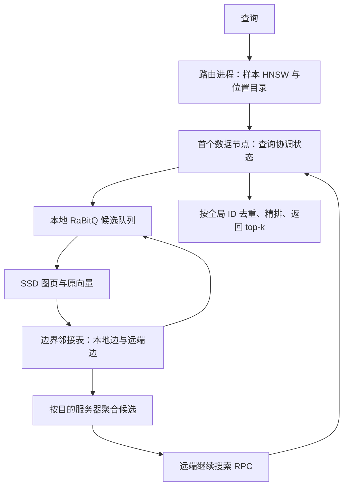
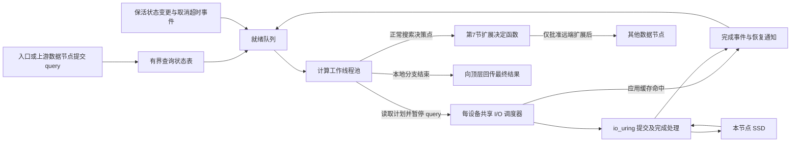
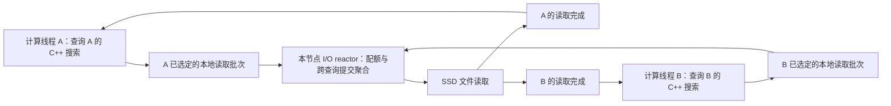
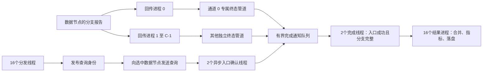
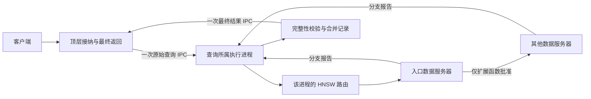
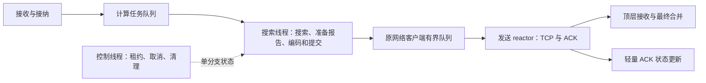
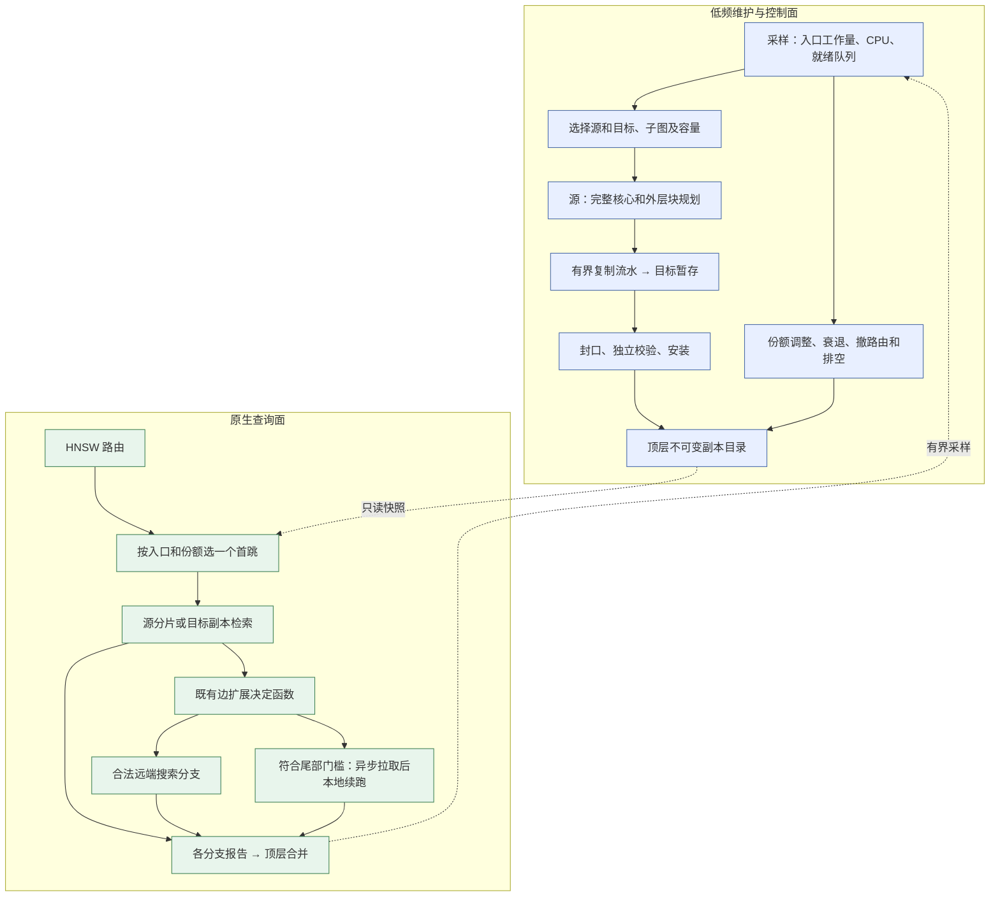

> 2026-11-05 数据保留状态更新（维护，非实验）：`pull_sync_compare_20261105`与`candidate_stalls_20261104`完整保留；更早实验清理原始流、逐查询记录和编译缓存，报告/图表/汇总/源码/配置保留。长期回放输入与最新实验共用依赖保留。历史原始数据可用性以[清理清单](test/storage_cleanup_keep_latest2_20261105/README.md)及各轮`RAW_DATA_CLEANUP.md`为准；未改变实验结论。

> 2026-10-29 数据保留状态更新（维护，非实验）：按实验所属日期清理 2026-10-28 之前的原始捕获、全量逐查询明细、节点快照及周期采样，包括关联临时目录和 Intel-31 的四份旧归档。报告、图表、汇总、配置和选定查询样本保留；10 月 28 日起的实验文件不在清理范围内。旧原始数据保留/恢复说明以[本次清理记录](test/storage_cleanup_before_20261028_20261029/README.md)为准，已删明细无法由剩余文件完整恢复。

> 2026-10-27原始测试数据清理：按用户要求删除 test 中的大体积原始捕获、逐查询明细、运行采样和测试二进制；保留报告、图表、汇总及选定查询样本。历史“已保留原始数据”的描述以[清理记录](test/storage_cleanup_20261027/README.md)为准；不改变实验结论或原测量时间。

# DHDGS 设计与执行方案

<a id="baseline-original-128-20261105"></a>
## 当前基线：原成本分支，预算128（2026-11-05，用户决策，非新实验）

后续运行和实验使用原成本分支策略，`search.max_expansions: 128` 是每查询的全局展开预算，沿用既有分支预算传递和总量核对，不是每分支各128。质量目标为平均 Recall@10 约0.95；压测模板的 `experiment.search_budget` 同步为128，避免覆盖回200。主配置、无LB吞吐模板、动态副本模板和pilot均采用该预算，历史冻结配置保留原值。

原策略关闭 `peer.remote_pull.enabled` 与 `peer.candidate_sync` 的 `enabled`、`nonblocking_start`、`early_result`、`coalesce_pending` 五个开关。RDMA 数据拉取和候选同步源码、指标与实验配置保留，暂停维护及后续性能实验，除非用户重新要求。`dhdgs_lb_pull_sync.yaml` 保留旧预算200及开启开关，用于历史复现。节点间 `native_runtime.network_module.transport: rdma` 消息传输、已验证的共享CPU绑定和有界API响应批次等返回路径修复继续保留；负载均衡研究仍开放。

依据[五档预算对照](test/budget_sweep_after_return_20261105/REPORT.md)，原策略D128的两次600K正式查询合并为 Recall@10=95.1130%、QPS=29,755.84、p99=128.381ms。条件为C1536、beam11、每数据节点64线程、无LB、暖缓存；更换数据、图或其他参数后仍测量召回，不承诺预算128总能达到95%。此次仅调整配置与维护方向，没有新增性能测量或更换历史部署入口的发布快照。

原策略保留历史区域授权，同一物理节点可能有多次授权报告（D128对照为4,998/1.2M查询），不能声称仍具有同步方案的唯一物理分支保证。用户选择原策略覆盖此前继续优化/消融pull与sync的计划；该决策优先于下文历史章节的后续建议，状态见 [Research.md](Research.md#maintenance-baseline-20261105)。

**当前负载均衡实现总览（2026-11-03）见 [§66](#load-balancing-current-20261103)**：统一说明热点观测、完整局域副本、布局与容量、流水复制、入口分流、回源/RDMA 拉取及衰退回收。当前优化优先级为质量约束下提高 QPS，并检查源节点净卸载与就绪排队；早期章节的 p99 优先、消息式拉取等描述保留为历史阶段。总览明确区分通用配置默认值、可选实现、已测工作点和仅输出建议的规划器。

研究闭环（2026-10-26）：待解决问题、候选优化及成功/失败尝试统一维护于 [Research.md](Research.md)。验证可行的方法在本文件写明最终机制、实现、配置、适用范围和实验依据，并回链研究ID；随后在Research中标记具体问题或优化已解决。现有局部优化§43.1/§43.5对应 [R004尝试记录](Research.md#r004)，其验证不代表整个线程扩展问题已解决；[R001负载均衡](Research.md#r001)仍在研究，尚未验收动态子图复制方案。历史提案以各节明确标注的状态为准。

2026-10-18 当前要求更新：质量目标调整为平均 Recall@10≥0.95，降低搜索预算，并继续按 p99 优先、QPS 次之选参。新增 `native` C++ 完整本地搜索循环：每台数据节点上的每个查询分支固定由一个计算线程执行，多查询并行；SSD 聚合线程不执行扩展选择。历史 0.99 目标的实验保留为对照，原生实现与并行方式见第 6.14 节。

2026-10-18 通信优化：第 11 节已实现非阻塞派发收尾、有界并发控制回传、响应携带续租、共享回调服务和连接复用。跨节点搜索仍须经扩展选择函数批准。新配置默认 `peer.communication.mode: optimized`，缺失该配置组的旧 YAML 显式迁移为 legacy，便于复现实验。验证与限制见第 11.9 节及 [对照报告](test/control_path_20261018/REPORT.md)。

初稿日期：2026-10-15；实现进度更新：2026-10-17。状态：设计提案，已实现端到端小规模 HNSW/RaBitQ/Vamana/磁盘/TCP 原型；外存规模化构建和物理多机性能尚未验证。已实现模块和运行方式见 [README.md](README.md)。

2026-10-17 实现更新：第 6.12 节的首阶段异步独立读取与查询暂停/恢复已实现，提供 io_uring、专用 I/O 线程池和同步基线。实际配置、已实现范围及后续项目见第 6.12.12 节；默认仍保留 blocking，未将异步性能优势视为既定结论。

已确认实验条件：200M 条、2560 维数据向量；200K 条查询；4 台服务器，每台约 1 TB 内存。用户接受高召回 ANN，第一质量目标采用 Recall@10≥0.99，在此约束下优化 QPS 与延迟。距离定义、数据路径/格式、CPU/SSD/网络与部署方式仍待确定。“越高越好”以 recall–QPS–latency 曲线呈现，不预设未经测量的 QPS 承诺。

进一步确认：向量由 ESM2_3B 生成，尚未归一化；允许搜索停滞时使用备用路由入口，并要求统计触发率与额外开销。模型名称不等同于已确定的距离语义，cosine 与原始 L2 的最终选择仍需根据任务或已有 ground truth 确定。

数据规模更新：当前可访问的是 `gene_database/Data/seq_2M/seq_2M` 下正在传输的 2M 轻量子集，配有 200K 库内查询及两套排除自身的 top-100 标签；此前的 200M 作为较大验证规模，长期系统目标为百亿级。格式与只读抽查结果见 [DATA_INSPECTION.md](DATA_INSPECTION.md)。不能把四台服务器的 2M/200M 容量预算直接外推为百亿可部署配置；需要全局 64 位 ID、流式构建、受限缓存/查询状态及显式路由/编码内存预算。

2026-10-16 更新：base 文件长度已达到完整声明，新的随机抽查通过；全量内容 checksum/精确 top-k 仍未验证。实际部署调整为 **3 台数据服务器 + 1 台待就绪的独立路由服务器**。三台数据机硬件与存储/网络实测配置见 [HARDWARE.md](HARDWARE.md)；下文 4 数据分片容量例子保留为早期假设，不作为当前部署配置。2M 三分片平均原向量约 6.83 GB/台，当前可用 SSD 空间支持轻量实验。

## 1. 目标、约束与研究定位

目标是以样本 HNSW 找到数据图入口，在 SSD 上的分布式近邻图中搜索，通过边界副本连接分片，并用 RaBitQ 降低内存占用和估距成本。保持首跳单数据节点，支持必要时跨节点扩展。

必须区分以下性质：

- **可达性**：任意入口能沿有向边到达整个图，需要显式验证和修复。
- **搜索质量**：可达不代表有限 beam、有限跳数下能找到真近邻。HNSW、Vamana 和量化估距都属于 ANN 环节。
- **调度正确性**：被延后的远端候选不能静默丢失；但改变扩展次序，在有限 beam/预算下仍可能改变搜索结果。
- **精确 top-k**：需要覆盖所有可能优于当前结果的数据。全量精确扫描是可靠的校验/兜底路径；候选精排本身不能恢复未访问的真近邻。

“几跳到达最近邻”和“完全不牺牲召回率”应先转化为可测量目标，不能作为任意数据分布上的定理。分别记录图扩展深度、跨服务器串行跳数、并行 RPC 轮数和访问节点总量。

推荐研究问题：在固定召回率下，自适应边界复制与通信成本调度，能否减少 RPC、SSD 读取和 p95/p99？同时测量索引构建时间与额外空间。

## 2. 已核对的代码与文献

| 来源 | 已核对内容 | DHDGS 的使用方式 |
| --- | --- | --- |
| [DiskANN 原论文](https://papers.nips.cc/paper/2019/file/09853c7fb1d3f8ee67a61b6bf4a7f8e6-Paper.pdf)，§3 | 已使用最近多个中心形成重叠分片，独立建 Vamana 后合并出边；内存压缩向量、SSD 原向量与邻接表、beam I/O | 复用算法基础；原论文合并后在单机 SSD 查询，DHDGS 将图保留在多机上查询 |
| [C++ DiskANN](../Reference_Code/DiskANN_cpp/src/pq_flash_index.cpp) | `cached_beam_search` 内通过 `compute_dists` 和 PQ 表估距；SSD 读取已有多扇区处理 | 复用建图和 I/O 经验；需要可暂停搜索状态与量化接口，不能只替换文件后缀 |
| [RaBitQ 原论文](https://arxiv.org/abs/2405.12497)，§3 | 随机正交旋转、无偏估计与概率误差界 | 正确实现估距；理论假设与实际旋转实现分开说明 |
| [多比特 RaBitQ](https://doi.org/10.1145/3725413) | 支持更高精度量化的研究依据 | 1/2/4/8 bit 消融；不预先认定 1 bit 足够 |
| [RaBitQ core API](../Reference_Code/RaBitQ-Library/docs/docs/rabitq/core_api.md) | 本地源码提供独立 C++17 core：requirements / encode / prepare_query / compute，支持紧凑布局 | 直接接入底层估距，不依赖其 IVF 或 HNSW 索引来冒充 DiskANN |
| [旋转实现](../Reference_Code/RaBitQ-Library/docs/docs/rabitq/rotator.md)、[精排说明](../Reference_Code/RaBitQ-Library/docs/docs/rabitq/reranking.md) | FHT/Kac 是均匀随机正交旋转的结构化近似；误差区间不是确定性下界 | 默认高效旋转，保存实际状态；误差区间仅作启发式调度 |
| [Pyramid 论文](https://arxiv.org/abs/1906.10602)，Algorithm 3 | 样本上 k-means，中心构建 meta-HNSW，底层图再划分 | 借鉴层次路由。用户指定的“真实样本构建 HNSW”是不同设计，按用户方案实现 |
| [本地 Pyramid 说明](../Reference_Code/Pyramid/Pyramid_REFERENCE.md) | 第三方 MPI 实现，并非已确认的作者官方实现 | 参考通信流程，不直接作为系统基座；论文细节以论文原文为准 |
| [现有 pyramid_rabitq](../pyramid_rabitq/README.md) | 当前是样本图划分 + RaBitQ-IVF + 共享存储读取节点 | 可参考数据读取与实验工具；DHDGS 独立目录，因为底层检索和节点职责不同 |

实现开始时记录参考源码的提交或内容校验和，并保留许可证。第一阶段没有修改或编译参考代码。第二阶段已经链接 RaBitQ core 并验证端到端原型，参考库仍未修改；使用的版本及许可证见 [THIRD_PARTY.md](THIRD_PARTY.md)。

## 3. 推荐架构与边界



- C++17/20：建图适配、RaBitQ、SSD I/O、候选队列、RPC 数据面。
- Python：数据准备、采样/聚类编排、配置、进程启动、精确 ground truth 与实验分析。
- 第一版：静态数据集、N 个逻辑分片对应 N 台数据服务器、一个路由角色；物理部署允许路由角色独立或共置。
- 用多进程、独立 SSD 文件、真实 TCP RPC 完成单机联调，再迁移多机。多进程结果不当作多机性能。
- 初始建议二进制 gRPC/Protobuf，持久连接和异步请求。备选是 MPI：适合集群批量构建，但在线服务与故障处理约束较多。
- 第一版不实现在线插入删除、过滤、自动迁移和高可用；预留索引版本、逻辑分片与物理位置映射。

路由 HNSW 的 level-0 顶点是**真实样本向量**，每个顶点映射到一个或多个数据节点及该向量的本地 ID。不是将整个 HNSW 底层压缩成 N 个服务器顶点。

按当前条件 N=4，每个分片主数据约 50M 点。k-means 不保证最终分片等量，即使初始 ID 分配均匀；第一版报告实际容量和查询负载偏斜，暂不引入自动负载均衡。

## 4. 距离与可调重叠分片

### 4.1 距离契约

本提案公式采用平方 L2。若目标为 cosine，对非零数据和查询统一 L2 归一化，则 $d_{\mathrm{L2}}^2 = 2 - 2\cos(x,y)$，排序一致；聚类使用该空间的欧氏 k-means。球面 k-means 可作为另一项明确的实验配置。

未经归一化的最大内积不能直接套用本文的 Voronoi 距离和几何解释，需要另行确定聚类与转换方案。零向量、非有限值、重复 ID 必须有显式输入处理策略。

ESM2_3B 数据的推荐实验主方案是 cosine，通过归一化后的平方 L2 实现；原始 L2 作为对照。该推荐不是 ESM2 官方唯一距离约定，也不表示模长一定没有生物学信息。ANN recall 衡量相对于所选距离的精确近邻集合的还原程度，不等于同源性、功能相似性等生物学检索质量；若要比较距离语义，应使用独立的生物学标签或任务指标。

仓库核对结果：`Reference_Code/ERAST/pipeline/emb_optimized.py` 的 ESM 路径对有效残基表示取平均，排除特殊 token，相关输出段未做 L2 归一化；这只是可用生成脚本的行为，尚不能确认当前全部数据由该路径生成。现有 `tools/build_seq_ann_gpu.py` 同时支持 cosine 和 euclidean，CLI 的 `--metric` 默认是 euclidean；`tools/sampled_seq_ann.py` 为两种距离分开保存结果。因此不能依据模型名称或输出目录名称直接复用 ground truth，必须检查其 metric、归一化和 self-exclusion 元数据。

若采用 cosine，在索引构建的数据预处理阶段与在线查询入口执行一致的归一化，之后聚类、HNSW、Vamana、RaBitQ 和精排都使用同一度量空间；源向量文件保持原始值。原始 L2 对照使用独立配置与索引版本，不能直接复用 cosine 图和结果标签。零范数输入默认报告错误，不以任意单位向量替代。

设总向量数为 M、维度 D=2560、中心为 c_1,...,c_N。令：

$$
d_j(x)=\|x-c_j\|_2^2,\qquad a(x)=\arg\min_j(d_j(x),j).
$$

`a(x)` 为主归属；距离并列按中心 ID 决定。即使没有副本，每个向量也恰有一个主归属。

### 4.2 推荐：按几何边界裕量决定副本

对 j≠a(x) 定义：

$$
h_j(x)=\frac{d_j(x)-d_{a(x)}(x)}{2\|c_j-c_{a(x)}\|_2},\qquad
\gamma_j(x)=\frac{h_j(x)}{s_{a(x),j}}.
$$

其中 $s_{ij}=\max((r_i+r_j)/2,\varepsilon_s)$，r_i 是样本主归属簇内向量到中心的 RMS 半径。ε_s 随全局数据尺度确定，防止退化除零。

**解释**：h_j 是 x 到两个中心等距超平面的非负垂直距离。γ 越小，越靠近这个分片边界。相比仅用距离比值，它显式考虑中心间距与局部尺度，避免高维距离集中导致所有分片看起来都相近。

中心相同或极近时不直接除以小数：先重初始化退化/空簇。若不同数据点不足以支撑 N 个有效簇，应报错或经配置减少有效分片，不能静默产生无效中心。

给定阈值 τ：

$$
A_\tau(x)=\{a(x)\}\cup
\operatorname{take}_{C_{max}-1}
\{j\ne a(x):\gamma_j(x)\le\tau\}.
$$

副归属按 `(γ_j,j)` 排序。C_max 是固定安全上限，初始建议 3、且不超过 N；不是需要用户日常调整的主旋钮。中心及尺度固定时，增大 τ 使归属集合嵌套扩大。明显偏向某个中心的向量仍唯一归属，边界向量复制到若干相邻分片。

γ 最小的副中心不一定是原始距离第二小的中心，因为归一化考虑了边界距离和簇尺度；这是明确的几何选择，须与直接距离差基线比较，而不能把两者混称为同一算法。

### 4.3 对用户只暴露一个主要参数：overlap_fraction = ρ

ρ∈[0,1] 表示**目标多归属向量比例**，而不是平均副本数或随机查询的跨机概率。

定义 $b(x)=\min_{j\ne a(x)}\gamma_j(x)$。在独立校准样本上取 b 的 ρ 分位数作为 τ，使：

$$
\Pr_{x\sim\text{数据分布}}(|A_\tau(x)|>1)\approx\rho.
$$

- 推荐确定性划分，不需要每次构建重新掷硬币。概率解释来自数据分布。
- ρ=0 特判为主归属唯一，即使中心距离并列也不复制；ρ=1 且 N≥2 时每点至少双归属。
- 分位点大量并列时，用 `(b(x), hash(seed,global_id))` 做稳定排序；每个副归属用 `(γ_j(x),同一hash)` 与阈值比较，避免阈值处复制率突增。
- 样本校准只能近似达到全量目标。报告实际 `ρ_observed`，不能把配置值当实测值。
- 若要求全量比例严格等于 floor(ρM)/M，增加一轮分布式标量统计/选择确定阈值；不需要再次传输原向量，但需要读取/保存分片分数。固定中心与尺度后仍满足单调性。

定义平均副本因子：

$$
RF=\frac1M\sum_x|A(x)|,\qquad
1+\rho_{observed}\le RF\le1+(C_{max}-1)\rho_{observed}.
$$

例如 C_max=3、实际 20% 的向量多归属，则 RF 在 1.2～1.4 之间。桥接修复采用额外边，不额外复制原向量，因而不改变该关系。N=1 时 RF=1、没有边界。

### 4.4 可选对照方案

| 方法 | 定义 | 取舍 |
| --- | --- | --- |
| 相对距离差 | `(d_j-d_a)/max(d_a,ε)≤τ` | 易实现；受高维距离集中和 d_a≈0 影响，应作为基线 |
| 固定最近 r 个中心 | 每点始终复制到 r 个中心 | 原始 DiskANN 式构建对照；冗余固定，不能区分内部点和边界点 |
| 随机平滑归属 | 主归属必保留，副归属概率 `p_j=exp(-γ_j/τ)` | τ→0 时仅保留几何并列点；τ=0 另行规定唯一主归属。副本量有随机波动，需固定哈希保证可复现；应用上限后概率改变 |

推荐几何裕量 + ρ 校准。若用户所说的“概率”必须指真正的 Bernoulli 随机复制，再采用第三种，并重新校准其实际副本比例。

## 5. 构建流程、通信与连通性

1. 按全局整数 ID 排序并均匀分为 N 个初始范围。全局 ID 使用 uint64，不通过 float 传递；本地紧凑 ID 可在容量允许时用 uint32。
2. 各服务器以固定采样概率做可复现采样，路由端收集样本、训练 N 个中心，并计算簇尺度。校准样本与训练样本建议分开。
3. 广播中心、尺度、版本及采样规则。各服务器分块计算向量到 N 个中心的距离，执行重叠划分；不物化 M×N 距离矩阵。计算量约 O(MND)，中心较多时需评估 BLAS/GPU 的构建加速。
4. 执行**一次逻辑上的大向量 all-to-all shuffle**。向每个归属节点传向量，已在本地的副本不走网络。实际使用有背压的分块流，不要求单条消息容纳全部数据。
5. 接收端建立 `global_id → local_id`，回传样本的新位置。路由 HNSW 用样本原向量构建，位置 payload 在版本发布前完整更新；缺少代表样本的分片补充 medoid 样本。
6. 各分片建 Vamana。默认构建/RobustPrune 使用原始精确距离，查询候选排序使用 RaBitQ，避免把建图量化误差与搜索量化误差混在一起。构建超出 RAM 时使用 DiskANN 的分块构建/合并策略并核算峰值内存。
7. 对多归属顶点 x，收集所有归属节点的出边并按全局 ID 合并：`E(x)=union_{s∈A(x)} E_s(x)`。每份 x 的副本保存相同版本的完整并集。只发到相关副本持有者，不向全 N 台广播。
8. 每条远端边保存目标全局 ID、可用位置、编码引用/必要估距元数据。第一版保留边并集，度数最多约 C_max·R；不能按 R 静默截断跨片边。后续才研究带分片覆盖约束的剪枝。
9. 验证每个本地图的强连通性，并以受保护边连接其 SCC，使图内部可以到达入口及门户。以实际跨片边构建分片图，检查连通性；缺失时用中心距离引导的双向生成树桥接，优先选近边界端点。连通性证据是实际图遍历结果，不是中心图本身。
10. 修复后的完整邻接表再次同步给边界副本持有者；验证从规定入口的可达性、ID/位置有效性、边集一致性、RaBitQ 元数据与校验和后，发布不可变 manifest。

第 9 步中，若每个本地图强连通且分片之间有双向连通的桥边，则全局有向图强连通。修复边单独保存并禁止普通剪枝删除。生成树仅保证可达，不能保证少跳；额外近邻分片桥接应通过实验确定。

采样、广播中心、shuffle、边交换、连通性修复和发布都涉及通信。因此可以做到一次主要的向量重分布，不能宣称整个构建过程只发生一次网络通信。

## 6. RaBitQ 与 SSD 集成

### 6.1 量化契约

建议第一版使用全局共享旋转与每个向量的**主中心**作为编码中心。同一全局 ID 的所有副本与远端编码缓存共用同一编码、中心 ID、校正因子和旋转版本，跨分片估距可比较，也无需重复编码副本。

查询只旋转一次，并按实际使用的中心缓存 query state。数据、中心、查询必须在同一旋转空间。必须保存实际旋转状态，不能仅记录 seed 后假定跨平台完全重现。

接入 `rabitqlib::core` 的紧凑 `SplitPacked` 布局。先做逐向量估距适配，再测不规则图候选的批量处理；FastScan 的 32 向量布局不一定适合稀疏随机邻居，不能预设一定更快。

一位估距的核心形式为：

$$
\widehat d(q,x)=\|q-c\|^2+\|x-c\|^2
-2\|q-c\|\|x-c\|\frac{\langle\bar u_x,u_q\rangle}{\langle\bar u_x,u_x\rangle},
$$

其中 u 是归一化残差，bar-u 是旋转量化后的单位方向映回同一空间。实际使用库中包含范数与偏差校正的实现；仅用符号汉明距离不是 RaBitQ 距离估计。

零残差使用库的专门处理。多比特使用对应编码/估计公式。算法比较包含 1/2/4/8 bit；2560 维有利于误差界中的维度项，但不能仅凭维度保证任意数据上的近邻排序。

### 6.2 空间与页布局

不含校正因子、ID、中心 ID、对齐和图结构时，每点大小为：

| 表示 | 2560 维每点大小 |
| --- | --- |
| float32 原向量 | 10,240 B = 10 KiB |
| RaBitQ 1 bit/dim | 320 B |
| RaBitQ 2 bit/dim | 640 B |
| RaBitQ 4 bit/dim | 1,280 B |
| RaBitQ 8 bit/dim | 2,560 B |

本地库默认按 32 维对齐，2560 不需要为该约束扩展到 4096 维；仍以 `rotator->size()` 实际值为准。共享边界编码与副本也计入内存。

例如 1 亿点的 1-bit 裸编码总量为 32 GB（十进制），尚未乘 RF、尚未加元数据。路由采样比例 p 的原向量内存约 `p·M·10240 B`，不能不看内存预算直接设置很高采样比。

当前 200M 数据的容量预算如下，统一采用十进制 GB/TB，均匀分片、RF=1，未计元数据和构建临时空间：

| 项目 | 全集 | 每台（4 台） |
| --- | --- | --- |
| 原向量 float32 | 2.048 TB | 512 GB |
| 1-bit 编码 | 64 GB | 16 GB |
| 2-bit 编码 | 128 GB | 32 GB |
| 4-bit 编码 | 256 GB | 64 GB |
| 8-bit 编码 | 512 GB | 128 GB |
| R=64、uint32 本地邻接 ID | 51.2 GB | 12.8 GB |

ρ=0.1、C_max=3 时 RF 约 1.1～1.2，原向量平均每台约 563.2～614.4 GB；真实数值受分片偏斜影响，不能据平均值承诺容量足够。3 页节点布局还有对齐空间，边界并集和保护边另计。

该硬件容量可能使完整原向量工作集进入缓存。必须同时报告自然缓存状态和有明确限制的进程/页缓存内存预算下的 SSD 结果；先明确实验方式，不能为了制造磁盘访问而直接修改共享服务器的系统缓存设置。按样本比例 0.1%/0.5%/1% 做路由消融时，分别是 200K/1M/2M 样本，裸原向量约 2.048/10.24/20.48 GB，HNSW 边与管理结构另计。

早期 SSD 提案参考 DiskANN 多扇区固定节点记录，并考虑将边界并集放入 sidecar。**当前实现使用 DHDGS 自定义格式**：`nodes.bin` 内每条记录包含完整 float32 向量、uint32 出度、uint64 全局邻居 ID 数组及填充，边界并集和保护边已经包含在该邻居数组内；位置归属与量化编码另存。文件有一个对齐后的头部，记录长度为 `ceil((4D+4+8R_max)/page_bytes)*page_bytes`，其中 R_max 是分片实际最大出度。当前 2560 维测试索引的记录长度为 12,288 B，不能把它理解为每顶点只读一个 4 KiB 页，也不等同于上游 DiskANN 的原生文件格式。

必须测量这种布局的读放大。第二个候选是邻接页与原向量文件分离：搜索先读邻接表，候选精排时批量读取原向量，代价是改变距离细化时机和额外定位逻辑。两种布局需要相同召回下比较，不能假定分离总是更好。

RAM 保存本地 RaBitQ 码、元数据、有限热图页缓存、有限边界/远端码缓存与查询状态。大规模远端边的编码 sidecar 可按页落盘，缓存必须有字节上限；不能在每条边内重复嵌入 320～2560 B 编码。

实现至少包括量化文件生成/加载、查询预处理、候选估距、scratch 内存、缓存和版本校验；PQ 与 RaBitQ 文件格式不可互相冒充。保留 PQ 对照路径，便于判断质量和速度收益。

### 6.3 SSD 访问聚合：范围与当前基线

2026-10-16 新增，2026-10-17 补充第 6.12 节，**以下 6.3–6.12 保留完整实验设计；2026-10-17 已落实其中异步独立读取阶段，精确实现范围见 6.12.12，其他优化仍为计划**。首先保持 1 bit RaBitQ、现有图、记录格式和跨节点访问链不变，单独研究 I/O。布局重排、图向量分离和改变搜索策略作为后续独立实验，避免无法判断收益来源。

当前路径见 `python/dhdgs/index.py` 的 `Shard.read` 与 `Shard._expand`：每轮选择若干顶点，逐个查询应用 LRU，未命中则同步调用一次 `os.pread(fd, record_bytes, offset)`，解析并计算距离后继续下一条。RaBitQ 编码常驻 RAM。同步基线中一批 4 个未缓存顶点对应 4 次读取、48 KiB 返回数据；新增 resumable 路径也保留这四条独立读取，通过节点内 reactor 异步提交和恢复查询。两者都尚未合并相邻区间或复用不同 query 的在途读取。

必须分别命名三种机制：

| 机制 | 做什么 | 主要希望改善什么 | 不代表什么 |
| --- | --- | --- | --- |
| 异步批量提交 | 一次向内核提交多个独立文件偏移的读取 | 减少提交开销，利用 SSD 并发，缩短同轮串行等待 | 不保证减少读取字节或设备命令数 |
| 连续区间合并 | 将相邻或足够接近的记录读成一个区间，再切片 | 减少应用读请求及固定开销 | 跨间隙合并会多读无关内容 |
| 在途读复用 | 同一不可变记录的一次读取供多个等待者使用 | 减少并发查询间的重复读请求 | 不等于全局去重图扩展或共享查询预算 |

网络种子聚合与上述机制独立。普通 buffered I/O 仍经过 OS 页缓存；一个应用读取区间也不对应固定数量的 SSD 命令，所有收益需要分应用层与设备层观测。

### 6.4 首选路径：已选候选异步取数，搜索按确定顺序消费

推荐先引入数据节点内部的 `read_many` 抽象，输入为已经由搜索选定的一轮顶点，不让 I/O 层自行增添图扩展候选。起步版本不跨轮预取、不等待凑满批、不改变 `search.local_beam`，也不将搜索中间状态发回路由器。

一次本地轮次的拟议流程为：

1. 在搜索侧按原有规则固定候选列表、顺序和预算额度；轮内按全局 ID 去重。给每条记录保留原始序号。
2. 命中应用缓存的记录直接就绪；其余按 `(索引 epoch, 分片, 文件, offset, length)` 查询在途表。键中必须包含文件身份，不能跨分片仅按全局 ID 复用读取。
3. 对仍需读取的记录建立请求，按文件偏移排序只用于规划 I/O；查询候选顺序不随之改变。先支持独立读取，再按 6.5 的条件可选合并。
4. 在设备和查询额度内批量异步提交；额度不足的请求进入有界队列。同一轮的请求数可以大于设备可用额度，分批发出，不能静默丢弃。
5. 完成事件校验长度、记录边界和索引版本，并恢复到原始候选槽位。全部所需记录就绪后，按原先顺序计算精确距离、登记出边并合并候选。
6. 同步保留错误与取消状态；读失败不能当成“空邻居”。统计预算区分预约、完成和取消，记录完成消费后才标记扩展完成。

候选集相同且使用固定消费顺序，可以隔离 I/O 的影响；不过完整分布式系统还有基于墙钟等待的远端触发条件，即使顶点消费顺序不变，读盘变快也可能改变跨机决策。因此分两级验证：固定动作序列回放验证读取等价；在线 adaptive 模式重新测量 recall、访问路径和远端触发原因。不能承诺仅替换 I/O 就使每个在线查询返回完全相同的结果。

第 6.12 节先实现不同 query 之间的 CPU/I/O 流水线，同一 query 仍按固定轮次消费。后续才实验同一 query 内“完成一个就处理一个”：已完成记录的距离计算可以先做，但保持确定性模式的候选提交屏障；提前开放新邻居或启动下一轮属于搜索调度变化，必须单独开关。一个 beam 的数据依赖仍然存在，不能预先知道尚未读出邻接表的下一跳。

后端优先考虑 C++ `io_uring`，通过 Python/C++ 边界一次提交整批，等待时释放 GIL。先使用普通读取语义，记录内核、文件系统及实际后端；buffered 异步读取的底层执行方式也需实测。受限环境保留同步 `pread` 基线，可选有界线程池作为过渡对照；线程池不是原生异步 I/O 的等价性能保证。`preadv` 面向从一个文件偏移开始的连续数据分散到多个缓冲区，不能单凭它实现任意多个不连续文件偏移的读取。

### 6.5 连续区间合并：收益与读放大共同约束

顶点 u 的文件区间为：

$$
I(u)=[H+\operatorname{location}(u)S,\ H+(\operatorname{location}(u)+1)S),
$$

其中 H 为文件头长度，S 为分片固定记录长度。仅在同一文件、同一 epoch 内合并。对按偏移排序的一组未缓存记录 G，定义：

$$
B_{use}(G)=\sum_{u\in G}|I(u)|,\quad
B_{span}(G)=\max_{u\in G}\operatorname{end}(I(u))-
\min_{u\in G}\operatorname{start}(I(u)),\quad
A_{merge}(G)=B_{span}(G)/B_{use}(G).
$$

`B_use` 是本轮确实请求的完整记录字节，包括记录自身填充；`A_merge` 衡量跨间隙合并额外引入的放大，不等于向量有效载荷读放大或设备物理读放大。默认实验先只允许完全连续的记录，即 `max_gap_bytes=0`、`max_read_amplification=1.0`。

合并需同时满足：相邻间隙上限、区间总字节上限、读放大上限以及缓冲池额度。启用跨间隙实验时，再要求基于实测模型的预计完成时间改善超过安全裕量：

$$
\widehat T_{separate}(G\mid QD,\text{cache regime})-
\widehat T_{merged}(G\mid QD,\text{cache regime})>\delta_t.
$$

两侧都用相同在途深度与缓存实验条件下的批完成时间估计；不能拿串行独立读的耗时和并发合并读比较，从而夸大合并收益。OS 页缓存命中通常无法逐请求事前准确获知，模型只使用可观测信息并记录预测误差，不能假定有精确缓存预言器。

例：12 KiB 定长记录中，本地序号 `[100,101,102,103]` 可以从 4 个读取合成一个 48 KiB 读取，应用请求数减少 75%，请求字节不变；但物理设备命令数量和延迟未必同比降低。序号 `[100,102]` 合并为 36 KiB，会替代两个共 24 KiB 的请求，`A_merge=1.5`；在随机 IOPS 紧张时可能有利，也可能因带宽浪费而变慢。序号 `[100,900,1700,2500]` 跨度约 28 MiB，不能为节省三个请求就读取整个区间。

第一版不把间隙中的未请求记录当作新候选，不额外扣图扩展预算，也不默认放入应用缓存。合并缓冲区切成记录后，只缓存已请求记录，防止一次小记录缓存引用长期钉住整个大缓冲区。若选择拷贝，则单独记录拷贝字节、CPU 耗时及峰值内存。文件长度、offset 溢出和短读均需要显式检查。

当前记录按 ID 排列，图邻居未必连续；因此预计异步独立读取比大范围连续合并更普遍适用。空间合并收益首先取决于真实查询 trace 中的文件偏移局部性，不能据邻居在向量空间接近就推断其磁盘位置接近。

### 6.6 设备级额度、跨查询复用与生命周期

每个物理 SSD 设置总在途请求数与总在途字节上限，同时限制每个查询的在途请求数。多个逻辑分片落在同一设备时共享设备额度；单机多节点测试不能给每个进程各自完整设备额度，再把过载结果当作多机性能。实现时可由共享 I/O 服务统一调度，或由实验启动器明确分配保守配额；跨进程的在途读复用需要共享服务等显式进程间机制，不能假定进程内表具有该能力。

缓冲池内存粗略满足 `在途区间字节 + 完成但未消费字节 + 拷贝暂存字节`，此外计入请求对象和等待队列。必须对完成未消费数据背压，而不只限制已提交请求数。每查询采用公平轮转或字节配额，避免一个大 beam 抢占整块 SSD；不同大小合并请求需按字节核算。初版不为跨查询聚合主动延迟请求，只复用已经相遇的在途读取。

同一 epoch 下的相同记录由多个查询请求时，一次文件读取对应的 future 可以挂多个等待者。只有读取结果共享，每个查询仍独立更新 top-k、预算和出边状态；分摊 I/O 字节与等待者数分别记录，避免每个等待者都把完整文件读取计入系统总量。是否实际访问 SSD 仍取决于缓存。复用范围先限进程内，不增加跨节点去重协议。

某个查询超时或取消，只移除其等待关系；还有其他等待者时不能取消共享读取。所有等待者都取消后可以尝试取消，但不能假设内核一定尚未完成 I/O。只有收到完成/取消确认后才能回收 DMA/读取缓冲区；迟到完成不应重新激活已结束查询。索引卸载需等待引用释放，不能提前关闭文件或复用缓冲区。短读、I/O 错误和后端不可用都产生显式状态；后端回退需记录原因，不能把同步回退的实验标成异步结果。

### 6.7 与跨机选择函数、预算及召回率的关系

SSD 聚合属于数据节点内部执行能力，不改变第 7 节的职责：路由节点只负责入口、保活及最终合并；节点 1 派发节点 2 后继续本地搜索，节点 2 不携带节点 1 未完成的本地候选，也不回访已访问服务器。

本地动作的成本模型应从“每顶点平均耗时乘数量”升级为：

$$
\widehat C_L(a)=\widehat t_{queue}(a)+
\widehat t_{batch}(m,B,QD,h)+\widehat t_{CPU}(a),
$$

其中 m 是合并后的读请求数，B 是请求字节，QD 是设备在途深度，h 是应用缓存/在途复用情况。`t_batch` 采用同类批次完成时间的在线估计；启用 CPU/I/O 重叠后改用动作完成时间估计，不能将重叠耗时直接相加。冷启动模型由校准结果初始化，并保留预测误差。适应新的本地成本后，`remote_weight` 的数值和实际跨机率关系也可能变化，需要重新校准。

2026-10-17 按用户明确要求修订：**本机 I/O 调度器没有跨机派发权限，也不得通过定时器或恢复事件提前调用远端扩展决策。** 只有搜索执行器到达正常扩展决策点，调用第 7 节函数并得到允许远端扩展的结果，才能发送新的远端查询分支。等待本地 SSD、设备排队、读取完成或出错、工作线程空闲均不能自行触发远端扩展。控制线程仅继续保活、取消、超时处理和已授权通信的交付。

首阶段同一 query 保持原轮次：选定本地 beam 后，等待本轮读取并完成消费，再到下一正常搜索决策点重新评估；其他 query 可以在此期间执行，不借机提前派发该 query 的远端分支。第 7 节已有等待阈值也仅在正常扩展决策函数内检查，不新增独立的远端定时派发器。派发权限与预算拆分仍需串行化，已预约的本地额度不能再次交给远端；超时取消的预约必须有结算记录。

I/O 批大小、设备队列深度与图搜索 beam 是不同参数。增大前两者不应暗中增大扩展预算；增大 beam 或跨轮预取会改变探索轨迹和无用读比例，单独作为算法实验。仅完成数据读取不算图扩展完成，不能提前写入 `expanded`；父子节点之间现有 seen 快照语义也不会因在途读复用变为实时全局顶点去重。

### 6.8 预计收益、上限与可能退化的情况

对一批 m 个互不依赖的冷读取，现状近似串行等待 `sum(t_i)`；并发提交在设备有余量时可能接近该批最慢读取的完成时间加提交/排队开销。若只有 4 个独立请求且延迟相近，单轮纯 I/O 等待的理想化缩短可接近 4 倍；**这不是 SSD 或查询整体的性能承诺**，也不包含前后图搜索的依赖轮次。

若当前查询端到端延迟中可优化、未被其他工作覆盖的 I/O 等待比例为 f，假定其缩短 s 倍且其余成本不变，则整体加速上限模型为：

$$
Speedup\approx\frac{1}{(1-f)+f/s}.
$$

例如 f=0.6、s=3 时约 1.67 倍；f=0.1 时仅约 1.07 倍。f 必须来自端到端关键路径或受控对照，不能使用多个并行分支的 `pread_ms` 之和除以查询延迟估算。

| 假设 | 可能收益 | 可能退化及验证重点 |
| --- | --- | --- |
| 异步独立读取 | SSD 利用率、冷查询单轮等待、吞吐改善 | 高并发已打满设备时 QPS 不再提升；深队列恶化 p99 |
| 连续区间合并 | 减少提交和处理小请求的固定开销 | 合并减少并行度，或大读拖延小读；需同 QD 对照 |
| 有界跨间隙合并 | IOPS 受限时以少量多读换更少请求 | 带宽、缓存污染、拷贝和内存占用上升 |
| 在途读复用 | 热门入口/邻居的重复读取下降 | 冷且分散的查询复用率低；锁与引用管理反成开销 |
| CPU/I/O 重叠 | 隐藏部分读等待或估距时间 | 顺序与预算复杂度增加，过度预取造成无用读 |

当前小索引及 2M 数据相对于机器 RAM 很小，缓存热态下新增异步队列和缓冲管理可能更慢。必须保留同步基线及缓存快速路径，不能仅凭“用了 io_uring”判定优化成功。跨机网络/结果回传占主导时，SSD 优化对端到端延迟的影响也有限。

### 6.9 拟议 YAML 参数（尚不可直接使用）

所有新参数计划加入现有统一 YAML 的 `storage.io` 下，扩展 schema、校验和实验快照后才能使用；目前配置校验不接受这些新字段。本次仅列出讨论值，不创建第二份配置，不修改当前默认行为。现有 `storage.page_bytes`、`storage.cache_bytes_per_shard`、`search.local_beam` 保留各自语义。

| 拟议参数 | 起步讨论值或扫描范围 | 含义 |
| --- | --- | --- |
| `backend` | `sync_pread` 基线；`io_uring` 对照；可选 `thread_pool` | 实际读取后端，报告实际生效值及回退原因 |
| `direct_io` | false；true 单独实验 | 绕过常规文件数据页缓存的读取方式，需校验文件系统支持与真实对齐要求 |
| `max_submit_requests` | 4；扫描 1/4/8/16 | 每次最多提交多少读区间，不增加搜索 beam |
| `max_inflight_per_query` | 4；扫描 1/4/8 | 单查询最多在途区间数 |
| `max_inflight_per_device` | 扫描 8/16/32/64 | 物理设备共享请求额度，不能按逻辑分片重复放大 |
| `max_inflight_bytes_per_device` | 起步 4 MiB | 在途读取总字节上限，与请求数上限同时生效 |
| `buffer_pool_bytes_per_device` | 起步 16 MiB | 在途及完成未消费缓冲区总预算，额外拷贝暂存需纳入核算 |
| `max_pending_requests_per_device` | 起步 1024 | 有界等待队列；满时背压/显式过载，不能丢候选 |
| `worker_threads` | 线程池后端扫描 2/4/8 | 仅线程池后端使用，不等于设备队列深度 |
| `coalesce` | false 基线 / true | 是否合并文件区间 |
| `max_gap_bytes` | 0；随后扫描 12288/24576 | 最大相邻记录间隙；示例基于当前 12 KiB 记录 |
| `max_read_bytes` | 起步 64 KiB；扫描 64/128/256 KiB | 单个合并区间上限，至少容纳一条记录 |
| `max_read_amplification` | 1.0；随后扫描 1.25/1.5 | 跨间隙合并读放大上限 |
| `min_predicted_saving_us` | 0/5/10，模型校准后使用 | 跨间隙合并的预计收益裕量，无可靠模型时禁用跨间隙合并 |
| `inflight_dedup` | false / true 消融 | 进程内在途读复用 |
| `completion_policy` | `round_ordered`；后续 `as_ready` | 固定轮内消费顺序或完成即推进搜索；后者需独立质量验证 |
| `prefetch_rounds` | 0 | 首阶段禁止跨轮推测性预取 |

初版不设置人为凑批等待；现有候选准备好就提交。实验若涉及共享设备额度，需要同时记录设备映射、进程数与配额分配。配置合法性检查应覆盖单条记录、单次最大读取、在途字节和缓冲预算的相容性；direct I/O 的内存地址、offset 和长度对齐以文件系统要求为准，不能只看到 `page_bytes=4096` 就认为满足所有条件。

### 6.10 实验、指标与共同决策门槛

按照“正确性 → 固定读取轨迹 → 完整搜索 → 多机”的顺序执行，实验记录统一放在 `test/ssd_aggregation_<timestamp>/`，包括完整 YAML 快照、索引/代码版本、设备映射、原始逐 query 指标、汇总和实验结论。本次不运行以下实验。

1. **读取正确性**：同一索引对比原 `pread` 与批量读取的记录字节、向量、邻居、精确距离；覆盖乱序完成、重复 ID、缓存命中、部分批次、最后一条记录、短读/错误、取消、共享等待者及版本切换。核验预算和内存引用生命周期。固定动作回放的结果应一致。
2. **轨迹局部性**：先收集真实查询每轮选定 ID、offset、缓存状态和时序，统计连续记录比例、可合并批大小、间隙分布、在途相同记录重叠率。根据这些数据决定是否值得做跨间隙合并或跨查询复用，避免直接扫描全部参数组合。
3. **I/O 消融**：同步基线；异步独立读；异步 + 仅连续合并；异步 + 受限间隙合并；独立加入在途复用。保持同一记录请求轨迹、数据和缓存条件，先比较请求数、请求字节、批完成时间与 CPU 成本。回放只用于内核收益判断，不代替 ANN 质量实验。
4. **缓存与真实 SSD**：分别报告自然热缓存、应用缓存关闭但 OS 缓存保留、受控冷态或受限文件缓存、direct I/O 对照。只关闭应用缓存不能称为冷 SSD。2M 数据很可能完全驻留页缓存；需要隔离的内存限制或工作集设计，并验证设备读取量。不得直接清空共享服务器系统缓存；若后续环境操作需要权限，再提出具体实验方案。direct I/O 的结果也不等同于部署中的普通 buffered 冷态。
5. **搜索质量与负载**：固定图、1 bit 编码、查询集、随机种子和预算做配对实验，再分别在相同 Recall@10 工作点比较。覆盖 0.70–0.99 曲线，目标 0.99 用独立验证查询及置信区间报告。扫描单查询、并发与固定到达率；报告 offered/completed QPS、超时、拒绝率及成功率，不能只汇总成功查询而隐藏过载。按用户决定的质量/延迟取舍选择参数。
6. **调度交互**：先固定远端动作回放，再开启第 7 节自适应逻辑；比较条件触发/强制触发比例、远端权重、访问链、跨机次数、备用入口率和重复顶点工作。验证本地等待不阻塞保活与取消；远端等待阈值只在正常扩展决策点检查，I/O 或定时事件不得新增、提前调用跨机决策或绕过其结果发送请求。
7. **真实多机复验**：单机多个节点共享同一 SSD 的结论，只适用于共享设备；三台机器各自 NVMe 型号不同，需要按机校准 QD 和成本，报告各节点利用率、队列等待、CPU/NUMA 配额，不能按同一标称配置假定能力相同。

除已有逐 query 延迟、recall、RPC、扩展数和阶段均值外，拟新增下列可归因指标：

| 层次 | 指标与定义 |
| --- | --- |
| 逻辑读取 | 请求记录数、唯一记录数、应用缓存命中数、在途复用等待者数、实际新发起记录数 |
| 区间聚合 | 合并前/后区间数、记录数/区间分布、`B_use`、`B_span`、间隙字节、`sum(B_span)/sum(B_use)`；分母为零时标记不适用 |
| 提交与设备额度 | 提交调用数、每次提交请求数、在途请求/字节时间分布、队列等待均值及 p95/p99、背压和拒绝次数 |
| 时间 | 准备/合并 CPU、提交开销、提交到完成、完成到消费、整轮就绪等待、拷贝、精确计算与 RaBitQ；逐 query 及总体均值同时保留 |
| 无用工作 | 超时/取消后完成的字节、预取未消费字节（启用预取后）、读取但未扩展记录数及原因 |
| 物理设备 | 设备读字节、读 IOPS、延迟/队列/利用率；说明采样来源，块层统计不等于 NAND 内部访问次数 |
| 资源 | 缓冲池峰值、完成未消费峰值、应用缓存占用、CPU 时间、拷贝字节与内存带宽影响 |

保持 `pread_calls` 的原语义，只统计真正的 pread 调用；异步后端新增通用文件读请求和提交指标，不将 SQE 数冒充 syscall 数。跨查询复用的系统实际读只计一次，逐 query 分别报告逻辑需求、等待时间与明确规则下分摊的字节，保证总量可对账。共享设备上的 OS 计数可能包含其他进程流量；记录背景负载，无法精确归因时只报告设备窗口汇总，不捏造逐 query 物理读字节。

并行分支和异步读的累计服务时间可超过端到端延迟。延迟占比使用有明确定义的关键路径/互斥区间统计，累计工作量单列；任何未能可靠归因的部分标为未知或等待，不能通过简单相加生成“磁盘占比”。新增跟踪开销也需要详细 trace 开/关对照。

共同决策时先看正确性与质量是否满足预设门槛，再看相同召回下 p50/p95/p99、QPS、CPU、读字节和内存的变化及置信区间。如果异步只改善冷态，就保留为冷态选项；如果合并减少请求却提高 p99 或大量多读，则缩小间隙/区间上限或关闭。首阶段不承诺具体加速倍数，不因某一次平均延迟下降就修改最终默认值。

### 6.11 推荐实施顺序与后续可选方向

建议讨论后按以下顺序推进，每阶段先提交实验记录再共同确定下一阶段参数：

- **A：基线与观测**。完善读取轨迹与设备映射，核实热缓存/真实 SSD 区别，不改变搜索行为。
- **B：异步独立读取**。按第 6.12 节引入共享 I/O 调度器、有界 `read_many` 和 query 暂停/恢复，保持同一 query 的固定消费顺序，提供同步基线；先验证数据与预算正确，再测计算线程、QD 与查询并发。
- **C：仅连续合并**。保留现有磁盘布局，不多读间隙，比较独立并发读和合并读。跨查询复用作为单独消融，不与其捆绑发布。
- **D：受限间隙与流水线**。仅在轨迹及成本模型支持时实验间隙读取；完成即推进、CPU/I/O 重叠及预取分别验证召回和浪费，不直接扩大 beam。
- **E：布局研究**。若 ID 排列导致局部性很低，再比较分片内按图邻域/聚类重排记录，保持全局 ID 和边集不变，仅重建 ID→offset 映射及发布新索引版本。记录重排成本、临时空间和恢复验证；它不应与 I/O 后端改造混为同一项收益。

图邻接表与完整向量分离属于更大的存储设计实验：先读紧凑图页、只对需要的候选读原向量，可能显著降低 2560 维场景的读取带宽，也可能引入额外随机读并改变精排/停止条件。该方向需要独立布局版本、相同召回对照与容量预算，暂不纳入第一阶段。边界副本、受保护边、RaBitQ 1 bit 和跨服务器不回访规则均不因 I/O 聚合自动改变。

### 6.12 第三种方式的详细设计：跨 query 的不连续请求异步批量提交

2026-10-17，应用户要求补充。本节的“第三种”对应讨论中的三种跨线程聚合方式：**相同记录复用、相邻记录合并、不连续请求批量提交**，指最后一种，不是第 6.3 节表格的第三行。本节以“不连续请求批量提交 + 不同 query 之间的流水线”为首阶段方案；读取复用和区间合并通过独立开关后续加入。

本节保留设计目标与后续扩展方案。首阶段已实现 `io_uring` 和可恢复查询，具体接口及已开放配置以第 6.12.12 节为准；表中其余提议参数尚不能写入严格校验的运行 YAML。

用户确认的边界：本节调度只针对本机请求聚合与流水线。删除此前“等待本地 I/O 时用定时事件唤醒远端派发决策”的提案；跨机扩展由第 7 节函数在正常搜索决策点唯一决定，避免 I/O 调度提前占用网络和远端计算资源。

#### 6.12.1 目标、非目标与三个并发维度

目标是让多个 query 共享数据节点的 SSD 读取能力：计算线程产生读取请求后即可执行其他就绪 query，I/O 完成后再恢复原 query。既提高冷读时的设备利用率，也控制设备排队和完成后等待，按用户已选择的 **p99 优先、QPS 次之** 标准评估。

定义三个独立的容量变量：

| 符号 | 对应资源 | 作用 |
| --- | --- | --- |
| W | 计算工作线程数 | 同时推进多少个就绪查询分支；不包含 I/O reactor 与控制线程 |
| A | 活跃查询上限 | 包含就绪、运行、等待 I/O 等状态；每查询状态占用必须有界 |
| D | 每物理设备的在途读请求上限 | 限制已被内核接受但尚未完成的文件读取，同时受字节与缓冲池额度限制 |

例如 `W=4、A=64、D=32` 表示 4 个计算线程维护最多 64 个查询状态，并允许最多 32 个文件读请求在途；三者不要求相等。这是说明性配置，不是经过多机实验的推荐值。更多 query 只有在到达负载足够、且确有等待可覆盖时才能提供额外并行性。

[线程实验](test/worker_threads_20261016T233213/SUMMARY.md) 中的 1 线程优势仅适用于现有缓存热态 Python 原型；不能推导新状态机或真实多机下 W 也必须为 1。反过来，也不能因为机器核心多就将 W、A、D 一起调大。第一阶段固定图、1 bit 编码、12 KiB 记录、搜索 beam 与预算，不跨轮推测性预取，不修改邻接表与副本布局。

#### 6.12.2 数据节点内的组件与责任边界



- **查询状态表**保存每个 `(query_request_id, branch_id)` 的 frontier、seen、top-k、访问链、预算、轮次及等待状态。不得将这些中间状态交给顶层逐批协调。
- **计算工作线程池**只推进就绪任务，读取未完成时不执行阻塞 `future.get()` 或在 Python 中等待。每个分支由单一执行者修改，可在不同线程之间恢复，但不能同时由两个线程推进。
- **设备 I/O 调度器**接受各查询已选定的读取计划，做缓存检查、公平排队与额度分配；初版不按文件偏移重排查询优先级，也不主动增加读取对象。
- **原生 I/O reactor**拥有 ring、文件注册/引用、请求表和缓冲池，提交 SQE，处理 CQE 并发布有界事件。它不直接维护 Python frontier、不执行 RaBitQ，也不在完成回调中等待网络。
- **控制与传输组件**继续处理保活、取消、结果回传，以及扩展决定函数已经批准的数据节点派发。它们不自行选择远端候选、不通过控制事件提前运行扩展函数。控制事件通过查询 mailbox 参与状态串行化；独立于数据读取队列，但仍共享机器资源，不能承诺零干扰。

初版每个数据节点进程、每个使用的设备配置一个 reactor，减少 ring 所有权和缓冲区回收的复杂度。单机多分片进程共享同一设备时，由启动器分配总和不超过设备预算的进程额度；后续可研究进程间共享 I/O 服务。仅创建多个进程内 ring 不等于已经实现物理设备统一调度。真实三机各自管理本机设备，不跨服务器合并 SSD 请求。

#### 6.12.3 一轮查询的暂停与恢复过程

1. **选择**：工作线程获得分支执行权，按既有调度与 tie-break 选出本轮本地候选，冻结顺序，预约相应扩展预算。首次实现每分支最多一轮未消费的本地读取。
2. **规划**：生成包含 global ID、文件引用、offset、length、原始槽位的 `ReadBatch`；检查本地归属与 epoch。应用缓存命中也进入相同的槽位就绪机制。
3. **提交或背压**：原生接口只做有界的入队操作，返回 `accepted` 或 `backpressure`。被背压的分支进入容量等待状态，而不是让计算线程阻塞；读取计划和已预约预算仍由该分支持有。
4. **暂停**：查询发布本轮 `WAIT_IO` 状态，交还工作线程。工作线程可以推进另一个 query，不能在提交接口后立即同步等待结果。
5. **取数**：reactor 从不同 query 的就绪请求中公平取出一批 SQE；每条仍可以指向完全不同的文件偏移。设备额度不足时只提交能容纳的部分，剩余请求保留。
6. **完成**：CQE 按请求 ID 找到本轮槽位，校验读取长度与文件生命周期。第一阶段整轮全部成功后才发布一次数据就绪事件；失败则发布显式错误并开始回收其余读取。
7. **恢复与消费**：计算线程通过事件获得分支执行权，按冻结顺序解析向量、计算精确距离、登记邻居并做 RaBitQ 估距，更新候选及完成预算。消费完成的记录释放缓冲引用，之后开始下一轮或结束分支。

恢复不是从头重新搜索，不重新路由，也不重新计算已完成的扩展。原 query 的候选、预算和访问链保留。等待数据期间，分支仍可处理取消、保活状态变化和查询超时；不生成远端候选等待到期的派发事件。这些控制事件不得令同一分支重入执行本地消费或提前调用扩展决定函数。

例：Q1 需要 A、B，Q2 需要 X、Y，四条记录在磁盘上不连续。调度器可以先提交 A、X、B、Y；Q2 的两条先完成，则先恢复 Q2，无需等待 Q1。Q1 内部仍按 A、B 消费。两个 query 共提交 4 个读取、48 KiB；减少的是逐条等待和可能的提交开销，并没有变成一次 48 KiB 连续读，也不承诺四个设备命令同时完成。

#### 6.12.4 查询状态、事件关联与一次性唤醒

建议将以下状态落实为显式枚举及可检查的不变量：

| 状态 | 含义 | 下一步 |
| --- | --- | --- |
| `READY` | 已在就绪队列，等待计算资源 | 原子获得执行权后进入 RUNNING |
| `RUNNING` | 唯一执行者正在推进分支 | 交回就绪队列、等待容量、等待 I/O 或结束 |
| `WAIT_CAPACITY` | 读取计划已准备，尚未取得必要资源 | 收到容量通知后重新尝试，不忙轮询 |
| `WAIT_IO` | 存在尚未消费的本地读取轮次 | 处理数据就绪/错误/取消/保活/查询超时，不执行远端扩展决策 |
| `DRAINING` | 已超时、取消或失败，停止发新工作 | 等待不可取消的读取完成并释放资源 |
| `DONE` / `FAILED` / `CANCELLED` | 分支计算终态 | 按原控制协议交付报告，释放引用后回收上下文 |

事件关联至少包含 `(query_id, branch_id, context_generation, round_id, request_id, slot_id, epoch)`。请求 ID 在仍可能收到迟到完成时不得复用；上下文 generation 防止旧事件命中新建查询对象。每个分支最多持有一个执行权、一个就绪队列引用；多个 I/O 完成和定时器事件到达时合并唤醒，不能重复启动该分支。

执行权与本地轮次的 I/O 状态分开保存：WAIT_IO 分支因控制事件暂时获得执行权，并不意味着本地记录已经就绪，也不意味着获得提前跨机扩展的机会。事件处理后若本轮仍未完成，继续等待；若完成事件同时到达，则由当前执行者或下一次唯一唤醒消费，不能漏唤醒或重复消费。

必须处理“读取在提交返回前已经完成”的竞争：先安装 round/slot 和等待计数，再将请求交给 reactor；完成线程只发布事件并更新受保护的槽位状态，分支的执行权交接通过原子状态/锁完成。缓存全命中也走相同规则，允许当前执行者继续推进，但不能递归执行无限多个即时完成回调。

原生 request 表只持有稳定的原生句柄与引用，不把临时 Python 对象指针直接放入 `user_data`。所有 Python 搜索状态变更由计算线程完成；原生完成线程不依赖获得 GIL 才能排空 CQ。C++ 量化对象的只读访问与 scratch 线程安全需要审计，每查询/每工作线程独享可变 query state，不能把共享量化器误当作共享 scratch。

#### 6.12.5 io_uring 的提交、完成与后端边界

建议新增原生接口 `submit_read_batch(plan)`、`drain_completions(limit)`、`cancel_batch(handle)`、`device_stats()`。接口为设计名，尚未实现。`submit_read_batch` 成功只表示调度器接收计划；分别统计排队、写入 SQ、被内核接受、CQE 返回、query 恢复与消费，不能把入队当作读盘完成。

初版由单个 reactor 管理每个 ring 的 SQ/CQ，跨 query 请求通过有界生产者队列进入。每个读 SQE 指定本地 fd、offset、长度和缓冲区。起步使用普通 READ，不设置跨独立 query 的 linked-request 顺序依赖；一个 query 的错误不能级联取消另一个 query 的读取。注册文件/固定缓冲、SQPOLL、IOPOLL 分别作为后续实验，初版不默认启用占用专用 CPU 的轮询模式。

每轮事件循环先回收已完成的请求与额度，再从可执行请求队列取出至多 `max_submit_requests` 个请求提交；没有新请求时用可唤醒等待处理完成、生产者通知和下一定时期限，不持续忙轮询。就绪请求不足批大小时立即提交，不设置凑批等待。一次 submit 可能被内核部分接受，需要按实际接受数记账、继续推进其余 SQE，不能重复提交已接受请求。

CQE 的 `res` 为读取结果；只有长度符合记录要求才可将其交给搜索消费。负错误码、短读、提交失败都进入显式错误路径，初版不把短读补零，也不在不确定已提交状态下盲目重试。对临时背压重试只能作用于确认未被接受的请求；真正 I/O 错误的重试需独立政策和预算，本阶段先以失败可见为准。

普通 buffered I/O 可能由页缓存满足，也可能在内核工作线程执行阻塞部分，`io_uring` API 本身不保证完全由设备异步处理。direct I/O 对照需要检验文件系统、地址、偏移、长度对齐，保留相同查询语义并单独记录缓存差异。后端探测在启动时完成；不可用时按配置明确报错或使用有界线程池后端，报告实际模式。运行中的请求不能未经清理直接切换后端。

线程池兼容后端由专用 I/O 线程执行同步 pread，完成后产生同样的事件；它仍让计算线程释放出来，但会使用额外阻塞线程。`sync_pread` 保留为完整基线，不能把其结果标注为原生异步性能。

#### 6.12.6 公平调度、背压与缓冲池死锁预防

初版采用每 query 队列与按字节计费的 deficit round-robin：每次轮到 query 增加固定 quantum，若首请求长度不超过其额度且设备/查询额度足够则允许提交，扣除相应字节后轮转。各 query 权重初始相同，quantum 起步取一条记录长度或一轮记录字节，作为配置实验。它提供请求调度层公平性，不保证不同 query 完成时间相同。

对设备 d 的在途集合以及查询 q，始终满足：

$$
\sum_q n_{q,d}^{\mathrm{inflight}}\le D_d,
\qquad n_{q,d}^{\mathrm{inflight}}\le D_q,
\qquad \sum_{r\in\mathcal I_d}\mathrm{bytes}(r)\le B_d.
$$

设备在途计数指已经被内核接受、尚未完成的文件读请求，不是 SSD 内部命令数。SQ 容量、等待计划数量与上述在途额度分别受限；不能只扩大 ring 就绕过每 query 上限。容量释放唤醒等待者，不让所有线程反复争抢同一额度。初版不实施在线自动扩队列或 deadline 优先抢占，先用固定额度验证 p99。

**整轮屏障必须防止缓冲池死锁**：如果很多 query 都持有部分已完成记录，并等待剩余读取取得缓冲，而所有缓冲已被这些部分轮次占满，就可能无人完成、无人释放。起步方案是在接纳一轮读取前，为该轮全部输出及必要暂存预留容量；设备在途深度可以小于该轮记录数，但其余读取所需内存已经有保证。内存不足的轮次留在 WAIT_CAPACITY，不先拿少量缓冲后无限等待。

以 `beam=4`、每记录 12 KiB 为例，一轮原始记录需 48 KiB；64 轮同时获准至少需要 3 MiB 原始记录空间，尚未包含复制、请求对象、候选状态、量化 scratch 与缓存。配置必须保证至少一轮能完成。缓存记录使用期间的 pin/reference 也需计入可用内存核算，不能因 LRU 驱逐而产生悬空引用。

完成但未消费的缓冲仍占池额度；只有消费或安全取消完成后才归还。完成队列与恢复队列需要预留可表达所有已接纳请求/轮次的通知容量，或使用可合并的每轮槽位标志；reactor 不能因计算线程暂未消费而阻塞排空 CQ。已接受的完成事件不得丢弃。暂停新读、优先消费完成记录、及时处理取消是背压恢复路径。

计算工作也需要公平：一次取得分支执行权只推进有界的顶点数/一个阶段，然后检查取消和待处理控制事件，必要时重新入队。时间片是检查点间的软上限，不能强制抢占已经运行的原生计算调用；较大的估距批需研究分块及 scratch 复用。该限制用于防止缓存命中 query 长时间占用计算线程，不改变选定候选的消费顺序。

若一轮消费分为多个计算片，保存消费游标、暂存精确距离和邻居集合；保持原轮内顺序，并在整轮准备完成后统一提交新 frontier。让出线程不等于提前公开部分邻居或启动下一轮，否则会把跨 query 流水线悄悄变成同一 query 内的搜索顺序变化。

#### 6.12.7 本机 I/O 与扩展决定函数的边界、预算及终止协议

**只允许搜索执行器在正常扩展决策点调用第 7 节函数，并依据返回结果派发远端分支。** 本机 I/O 调度器只接收本地文件读取计划和发布读取完成/错误事件，没有远端地址选择、远端计算预约或查询派发接口。

若搜索函数本轮选择本地 beam，则 query 按 `选择本地 → 提交读取 → WAIT_IO → 消费本轮 → 下一搜索决策点` 推进。I/O 等待期间，即使已有远端候选、等待时间增加、设备繁忙或有空闲工作线程，也不提前调用扩展函数、不发送新远端分支。保活、取消和查询超时仍可正常处理。I/O 出错按失败/取消协议处理，不自动把查询转移到其他服务器。

若搜索函数在正常决策点批准远端扩展，则通过原传输组件派发，父节点继续本地搜索。已有请求的协议重试沿用原批准动作，不重新运行候选选择或额外占用远端分支预算。建议给每次批准记录 decision ID、原因、目标节点和预算，并将新派发请求关联到该记录；I/O 通知本身不能作为派发理由。

第 7 节既有 `max_wait_ms`、本地耗尽及备用入口规则仍归搜索决定函数管理，本次不增删其算法规则；等待阈值不再解释为独立定时器在 I/O 期间强制派发的实时保证。本节只约束调用位置和权限，不引入新的跨机调度器。

节点 1 派发节点 2 时，本节点已提交的读取仍归节点 1 负责，完成后继续消费。节点 2 丢弃属于节点 1 的待处理本地候选，不接收 fd、ring token、buffer 指针或本地未完成轮次。唯一的继续派发权限与访问链按现有协议传递，不因 I/O 完成或线程恢复而重新生成派发权。

对单个分支收到的扩展额度，建议使用显式账本：

$$
B_{\mathrm{grant}}=
B_{\mathrm{free}}+B_{\mathrm{reserved}}+B_{\mathrm{consumed}}+
B_{\mathrm{delegated}}+B_{\mathrm{retired}}.
$$

- free：尚未使用，可预约或转交。
- reserved：本地已冻结候选的额度，包含等待容量、在途或已完成但未消费的记录。
- consumed：本分支已完成扩展的额度。
- delegated：已经交给直接子分支的额度；不能再被父分支使用。
- retired：终止时不再使用的额度，或按明确规则结算的取消额度。

这是每个分支的守恒式；核算整棵分支链时按子分支报告展开 delegated，不能将父 delegated 和子 consumed 重复计入全局消耗。派发和本地预约由同一执行者原子更新，子分支只获得 free 的一部分。仅仅完成文件读取不将 reserved 记为 consumed；必须完成该顶点的距离及出边登记。终止后的剩余额度结算为 unused/retired，不因为切换工作线程而重置预算。

正常完成要求本地轮次已消费或有明确取消结算、没有未处理的终止相关事件、子分支清单已经登记。顶层仍等待分支报告闭合。查询超时后先停止新搜索并按协议通知终态，后台继续安全排空无法取消的读取；报告应区分查询终止时计数与稍后资源清理计数，不能把仍在途的读取标记为已完成或凭空归零。第一阶段不实现进程崩溃恢复或 exactly-once 持久化协议。

终态搜索报告一经提交保持不可变；迟到的 I/O 清理计数进入以 query/request ID 关联的独立节点诊断账本，不向顶层重发内容改变的同一终态报告。诊断保留期和条目数也需有界，不能为等待诊断导出而无限保留完整搜索上下文。

#### 6.12.8 取消、版本和缓冲区生命周期

取消可以发生在 WAIT_CAPACITY、SQ 待提交、内核执行、CQE 已到但 query 尚未消费等阶段。未提交请求可直接撤销；已提交请求发起取消后，必须等待目标请求的最终完成状态，不能只看到取消操作自身的 CQE 就复用目标缓冲。每个请求的完成/取消只结算一次额度，取消与正常完成竞争时用请求状态确保幂等。

逻辑终态与资源释放分开：迟到完成只释放引用并记录终止后读取字节，不再将 query 放回搜索队列。文件和索引 epoch 引用随请求持有，旧索引卸载必须等待相关请求释放，不能复用 fd 编号后仍按旧 token 解释完成。缓冲区在内核仍可能写入时禁止返回池。

后续启用在途复用时，为同一读取维护独立 waiter：取消 Q1 不影响仍等待该记录的 Q2；所有 waiter 都撤销时才尝试取消底层读取。复用不能让某个查询绕过其逻辑在途/内存额度，设备实际读取只计一次。第一阶段关闭该功能，以便独立验证基础异步状态机。

#### 6.12.9 配置方案与现有参数的兼容

继续只使用现有统一 YAML。第 6.9 节的 `storage.io.*` 控制 I/O 后端与设备额度，本节增加查询执行与恢复调度参数；实现 schema 前以下内容不可直接作为运行配置。已有 `search.execution: peer` 继续表示跨节点协议，不用它表示是否异步读盘。

| 参数 | 首阶段建议/扫描 | 语义与校验 |
| --- | --- | --- |
| `peer.execution_model`（新增） | `blocking` 基线 / `resumable` 候选 | 每 query 占用线程，或按事件暂停恢复；切换时同时记录实际后端 |
| `peer.worker_threads`（已有） | 1/2/4/8/16，必要时扩至32 | W；resumable 模式下仅计算线程，不能按活跃 query 数自动创建线程 |
| `peer.max_active_queries`（已有） | 先保持128，之后64/128/256 | A；现有未确认终态占用也计入入站容量，报告细分状态 |
| `peer.resume_quantum_vertices`（新增） | 起步等于 local_beam | 每次恢复最多消费的顶点数；达到后可让出线程，不提前提交下一轮 |
| `peer.resume_quantum_us`（新增） | 先扫描100/500/1000 | 软检查时间片；不承诺在原生函数中硬抢占 |
| `storage.io.reactor_threads_per_device`（新增） | 固定1作为初版 | ring 唯一所有者，后续才研究多 ring/NUMA 分组 |
| `storage.io.max_submit_requests` | 1/4/8/16 | 一次提交的上限，允许混合 query；不足时立即发 |
| `storage.io.max_inflight_per_query` | 1/2/4/8 | D_q，首阶段最多一轮，不因此扩大 beam |
| `storage.io.max_inflight_per_device` | 8/16/32/64 | D，单机多进程需分配设备总额度 |
| `storage.io.fair_quantum_bytes`（新增） | 起步等于 record_bytes | 按字节轮转的配额；不同记录长度时用同设备统一字节单位 |
| `storage.io.max_completion_events_per_poll`（新增） | 32/64/128 | 每轮处理上限，兼顾提交和取消，不能饿死完成处理 |
| `storage.io.max_batch_wait_us`（新增） | 固定0 | 首阶段不人为等待其他 query 凑批 |
| `storage.io.fallback_backend`（新增） | `error` 或 `thread_pool` | 启动探测失败策略；不得静默改变实验后端 |

第 6.9 节的在途字节、缓冲池、等待队列等上限仍须同时配置和校验，新增参数不覆盖它们。起步 `completion_policy=round_ordered`、`prefetch_rounds=0`、`coalesce=false`、`inflight_dedup=false`，先隔离异步独立读取的收益；之后单独开启复用和连续合并。实验启动快照同时记录 W、A、D、客户端并发、实际后端、物理设备映射、CPU/NUMA 和 BLAS 线程，避免只记录一个“线程数”。

#### 6.12.10 收益假设与 p99 风险

同步实现中，W 个工作线程可能全部阻塞，仍有就绪 query 无法得到计算资源。可恢复模型将“计算占用”和“等待占用”分开：查询等待 SSD 不继续占用计算线程，同时其他 query 能补充后续读取，减少计算与设备相互等待的空隙。多条请求可在一次提交调用中进入内核，但批大小取决于当时已有就绪工作，不能保证每次都形成满批。

若应用文件读请求到达率为 $\lambda_r$、从内核接受到完成的平均驻留时间为 $T_r$，稳态下在途数量的观察关系为：

$$
L_r=\lambda_r\,\mathbb E[T_r].
$$

该式用于理解所需并发和核对统计，不用于无限增加 D：$T_r$ 会随队列深度和缓存状态改变，必须用实测曲线找工作点。文件请求数也不能直接替代 SSD 硬件 IOPS。吞吐最终仍受 CPU、设备带宽、设备随机读能力、数据节点负载偏斜和控制通信限制。

预期改善包括冷态等待隐藏、计算线程利用率、提交开销与有界排队；不连续批量提交本身不减少原始读取字节，也不减少图搜索跳数。热缓存下可能没有收益，甚至因事件队列、锁、缓冲管理和 Python/C++ 转换而退化。后续原生化候选队列是独立优化，不预先计入本方案效果。

对 p99，最需要防止的风险是设备过深排队、完成事件积压、计算线程长时间不让出、等待整轮最慢记录，以及控制事件被延迟。即使平均延迟改善，也必须比较 p99、p99.9、最大值、超时/拒绝率和每轮波动。已有线程实验出现的控制通信错误需要单独归因；不能把它们造成的尾延迟归为 SSD，也不能承诺本方案自动修复控制面。

#### 6.12.11 验证顺序、指标与验收条件

建议先形成可比较的四个版本，所有版本固定图、数据、编码与搜索参数：

| 版本 | 实验内容 | 可归因的收益 |
| --- | --- | --- |
| A | 现有 blocking + sync_pread | 完整基线 |
| B | resumable + 有界阻塞 I/O 线程池 | 查询暂停/恢复与计算等待解耦，单列额外 I/O 线程成本 |
| C | resumable + io_uring，独立不连续读取 | 在同一状态机上验证原生提交与完成处理 |
| D | C 分别加入在途复用、连续合并 | 各项独立消融，最后才评估组合 |

先通过确定性读取回放与故障注入：乱序完成、提交前即时完成、缓存全命中、部分提交、SQ/CQ 压力、读失败、取消竞争、迟到完成、epoch 卸载、整轮缓冲不足，以及本地等待和正常扩展决策的边界。验证字节/距离/邻接一致、每分支单执行者、无丢失唤醒、预算守恒、无重复节点启动，以及有限资源下能继续推进或明确失败。模拟完成事件只能证明状态机正确，真实 io_uring 集成和设备性能需分别验证。

新增权限验收：在扩展函数尚未执行或未批准远端的测试中，反复注入容量释放、部分读取完成、远端候选等待阈值经过、工作线程空闲等事件，新增远端分支请求数必须为零。只有消费本轮并到达正常搜索决策点、函数批准之后，才允许出现对应 decision ID 的派发；协议重试与新派发分别计数。该检查用于阻止本机流水线通过额外跨机工作换取表面上的延迟改善。

再交叉扫描 W 与 D，分层选择 A 和客户端并发，不一次扫描所有参数。先固定到达负载比较 p99，再测接近容量时的 QPS/排队与拒绝；保留现有闭环结果作对照，开环请求延迟需从计划到达或实际 admission 起点明确计时，报告两者差异，避免遗漏发压等待。

指标在第 6.10 节基础上增加：query 就绪等待、WAIT_CAPACITY、WAIT_IO、完成到恢复、控制事件迟到、暂停/恢复次数、每次提交涉及 query 数、批大小分布、各状态查询数、缓冲预约/使用/完成未消费峰值、取消后读取字节及后端回退原因。同步 `pread_ms` 与异步 submit→CQE 驻留时间不同，不能直接替换同名字段；后者包含内核/设备等待且各请求可重叠。CPU 采用实际运行片段累计，不能用跨线程的 `thread_time` 起止相减。记录 request、batch、round、query 四级关联以便追踪关键路径。

每 query 延迟分解采用互斥的状态时间区间；控制事件恢复与 I/O 等待重叠时按明确定义拆分，累计 I/O/CPU 工作量另列。物理读量仍由进程/设备窗口核对；指标不完整时保留成功请求的延迟和召回，资源均值使用完整样本并注明样本数。测试记录继续放在 `test/async_ssd_<timestamp>/`，保存完整 YAML、源码/索引哈希、设备信息与原始逐查询数据。

最后在三台真实数据机上复验：分别校准设备额度和 W，测试正常缓存、可证实的 SSD 读取以及分片负载不均；至少比较无跨机和有跨机查询的分布。按独立校准集冻结候选，再以独立查询验证平均 Recall@10≥0.99 和不确定性；满足质量后优先选择更低且可重复的 p99，再比较 QPS。不将现有 4096 条索引的热态结果外推为全量或多机最优。

验收时应能明确回答：计算线程是否确实在等待 I/O 时执行了其他 query；跨 query 提交批大小是否值得其管理开销；相同读取工作下设备等待与 CPU 空闲是否减少；控制面与跨机预算是否保持正确；提升是否只存在于特定缓存/负载条件。没有这些证据，保留同步基线，不将候选异步配置自动设为最终默认值。

#### 6.12.12 首阶段实现范围与使用方式（2026-10-17）

实际执行链是 `peer_search.branch_steps → resumable.BranchTask → async_io.LocalIO → _native.AsyncReader / ThreadReader`。`branch_steps` 也是原 blocking 驱动使用的搜索循环，因此本次没有复制另一套跨节点选择算法。每次 yield 冻结一轮本地候选；整轮记录到齐并按原顺序完成精排/邻居估距后，才能再次调用扩展决定函数。I/O 层不导入网络或搜索策略模块。

已实现内容：

- **查询暂停/恢复**：等待 I/O 释放计算线程，每次恢复消费一个完整 beam。计算线程数与活跃 query 数、I/O 深度分离；保活沿用独立控制线程。跨节点传输完成通过回调结算，异步计算线程不等待传输 Future。
- **原生后端**：C++/liburing 普通 buffered READ，单 reactor 管理 SQ/CQ；一次提交可包含不同查询、不同偏移的独立读取。跟踪内核实际接受数，未接受 SQ 尾部由后续 submit 继续推进，不重新分配 token。CQE 错误、短读显式失败。通过 eventfd 立即唤醒 reactor；`completion_poll_ms` 是取消/租约检查的最长空闲等待间隔，不是人为凑批时间。未启用 SQPOLL、IOPOLL、固定缓冲或 O_DIRECT。
- **兼容后端**：专用线程池执行 pread，完成事件同样唤醒 reactor。提交到该线程池的请求受设备/查询额度限制，未采用无限制工作队列。仅启动探测失败时允许按配置回退，并报告原因；运行中错误不会切换后端。
- **背压与公平**：一轮开始前预约 `2 × 本轮唯一记录数 × record_bytes`，覆盖原生缓冲到 Python bytes 的暂时双份空间，包括缓存引用的保守额度。完成未消费仍占额度，消费后释放。固定长度记录采用一记录一轮的 round-robin，等价于 quantum 为 record_bytes 的等权字节 DRR。`max_pending_batches` 限制等待、在途、完成未消费的全部已接纳轮次，超出则明确拒绝，避免无界排队。
- **取消/关闭**：取消停止新读取和查询推进；已提交读保留缓冲，最终完成后只清理并记录迟到读取，不恢复该查询。首阶段不发内核 ASYNC_CANCEL；选择排空已有读。后端持有独立 fd 引用，退出时先排空已接受读，再关闭 ring/fd；数据节点关闭等待查询执行片与传输结束。不会因 I/O 失败自动转发远端。
- **派发审计**：搜索决定生成 `decision_id`，子分支、派发事件与决定记录关联；顶层检查最终清单中的每个子分支有唯一的对应批准记录。这是结果审计，顶层仍不参加中间扩展决策。

运行时在同一个完整 YAML 中设置：

```yaml
search:
  execution: peer
network:
  transport: tcp
peer:
  execution_model: resumable
  worker_threads: 1
storage:
  io:
    backend: io_uring
    fallback_backend: error
    worker_threads: 2
    max_submit_requests: 8
    max_inflight_per_query: 4
    max_inflight_per_device: 8
    max_inflight_bytes_per_device: 98304
    buffer_pool_bytes_per_device: 4194304
    max_pending_batches: 128
    max_completion_events_per_poll: 64
    completion_poll_ms: 1
```

这是覆盖项说明，**不是可独立加载的完整配置**；完整字段见 `configs/dhdgs.yaml` 以及测试目录中的 `experiment.yaml` / `resolved.yaml`。`storage.io.worker_threads` 仅作用于 thread_pool。以上三个同机进程合计最多 24 条在途读、288 KiB 在途数据、12 MiB 轮次预约容量。它们是每进程分配的额度，**没有跨进程统一设备信号量**。启动器输出按文件系统设备号汇总的配额；不同分区可能共用物理 SSD，部署者仍须结合挂载信息分配总额度。真实多机分别使用自己的本地配额。

`peer.execution_model: blocking` 保留原同步 pread；`resumable` 必须配合 peer/TCP，不能用进程内 local 模拟冒充异步数据服务。修改这些配置不需要重建索引。旧 v1 YAML 若同时缺少 execution_model 和 storage.io，则加载为 blocking，并从当前唯一默认 YAML 补齐不生效的 I/O 配置；快照记录迁移和实际参数。部分缺失的新配置、未知字段仍报错，历史文件不会被覆盖。

实际 API 为 `LocalIO.submit(ids, epoch, query_key, cancelled) → Future[ReadBatch]`、`ReadBatch.release()`、原生 `submit/poll/close`。完成事件可以乱序，但一个查询的整轮屏障不变。线程池/原生完成通知只排入计算队列，不直接运行搜索生成器。每个生成器始终只有一个执行者，支持全缓存或提交前已完成的即时回调。

节点新增实际后端、回退原因、提交批大小/涉及查询数分布、在途与缓冲峰值、完成未消费字节峰值、迟到读取字节及有界近期迟到记录。近期诊断最多保存 max_pending_batches 条，不保留完整搜索上下文。逐查询新增恢复排队、I/O 等待、执行片 wall/CPU、传输收尾时间；详细 trace 关联 query/branch、轮次、record token、偏移及 submit/completion 时间。字段及并行计时限制见 `METRICS.md`。

仍待独立实现/实验：跨 query 在途去重、连续区间合并、预取、direct I/O、可调整计算子时间片、共享设备服务、注册缓冲池。当前“缓冲池”是字节预约限额和独立分配缓冲，并非预分配复用的固定池。未开放的 proposal 参数包括 `resume_quantum_*`、`fair_quantum_bytes`、`max_batch_wait_us` 等；实际固定为每片一个 beam、每次一记录轮转、零凑批等待。部分提交处理有实现，但尚未通过内核级故障注入穷尽验证；不能将普通读取测试视为所有内核异常路径均获验证。

实验记录见 [test/async_ssd_20261017](test/async_ssd_20261017/SUMMARY.md)。功能正确性、同机热页缓存性能和真实 SSD/多机收益分开评价；后两者不能由前者推断。默认没有切换到异步模式。

### 6.13 只读路径、CPU 并行和物理 SSD 验证（2026-10-18）

**实现范围。** 向量、图、量化编码和位置目录在服务期间只读，候选状态由各查询分支独占。关闭应用缓存时，同步 `Shard.read` 和异步缓存检查不获取应用缓存锁；扩展统计改为 C++ 原子计数，移除了原先每批扩展使用的分片统计互斥锁。监控读取 `/proc` 时不再持有该锁，索引文件总字节在初始化时计算。默认 `storage.cache_bytes_per_shard: 0`；已有实验 YAML 保留原值。

HNSW 查询外层的 Python 互斥锁已移除；`ef_search` 在该 Router 第一次查询时固定，随后查询不再写 hnswlib 的共享 `ef_`。修改 YAML 后创建新 Engine/重启入口即可调整 `ef_search`，不需要重建索引；服务中的同一 Router 拒绝换 ef、重新加载或插入。hnswlib 自身的访问标记池仍有短同步，这不是“整个系统绝对无锁”的实现。

**保留的同步。** 可选共享 LRU 会写缓存目录和淘汰状态；若配置容量非零，仍使用独立缓存锁。分支登记、幂等去重、租约、取消、完成状态、连接帧收发和异步缓冲区生命周期也会并发写，保留必要同步。直接删除这些锁可能破坏节点不回访、预算和内存生命周期。原子计数仍属于同步；当前平台是否原生 lock-free 在节点指标 `expansion_counters_lock_free` 中报告。

**GIL 与多核。** 当前使用启用 GIL 的 CPython。GIL 是每个解释器进程的执行锁，不是向量文件读锁；多个 Python 工作线程不能同时执行需要 GIL 的搜索代码。已有 RaBitQ 原生评分区间释放 GIL，`pread` 等待也可释放 GIL，但邻居收集、候选维护和扩展决策仍回到 Python。移除应用互斥锁不等于移除 GIL。

本地搜索状态、邻居处理、RaBitQ 查询预计算和候选队列迁入 C++ 的实现见第 6.14 节。边界派发仍由第 7 节函数决定，入口只管理生命周期和合并结果。原生热循环不得在 GIL 释放期间修改 Python 对象。备选是多个工作进程共享只读 mmap，单独管理各查询的动态状态；需要解决分支路由与节点级去重，不能简单增加多个无协调进程。

增加 CPU 亲和性范围只表示允许使用那些核；`peer.worker_threads` 的实际计算并行能力取决于执行模式。旧 Python 模式受 GIL 限制；native 模式中的搜索热循环释放 GIL。固定召回、查询负载与 I/O 配置后需重新扫描线程数；NUMA 绑定和多进程方案尚未实现。

**为什么物理读取为零。** 现有 `nodes.bin` 使用 `O_RDONLY`，同步、线程池和 io_uring 后端都走 buffered I/O，未实现 `O_DIRECT`。Linux 可以从内存页缓存满足文件读取；应用缓存设为零不影响 OS 页缓存，io_uring 本身也不会绕过它。完整 2M 索引约 26.42 GiB，三台大内存机器容易容纳其热点页。构建、校验哈希和之前的查询都可能提前加载文件页。

逐查询 `file_read_bytes` 表示逻辑读取字节；进程 `storage_read_bytes` 来自 `/proc/<pid>/io` 的 `read_bytes`，表示内核归属于该进程的存储层读取。其测量窗口增量为零不代表没调用读接口，也不代表索引没存 SSD；同样不能作为 SSD IOPS/延迟结论。新节点指标明确报告 `storage_access: buffered`、`os_page_cache_bypassed: false`，并传入 benchmark 节点记录。

后续物理 SSD 实验应并列区分：热 buffered 基线、受控冷缓存/内存预算、direct I/O。建议先实现显式 `O_DIRECT` 模式，使用满足文件系统要求的偏移/长度/缓冲区对齐及有界缓冲池；当前 Python bytes 和 C++ vector 缓冲区不能直接假定对齐。同步与 io_uring 都应覆盖，启动时验证实际模式，不能失败后静默退回 buffered。保留小规模结果等价验证，再进行全量性能实验，同时记录逻辑字节、进程物理字节、设备读取/IOPS/队列深度及内存预算。direct I/O 绕过 OS 文件页缓存，仍可能命中设备自身缓存；不能把所有设备内部行为称为 NAND 实测。

本轮不清空共享机器全局页缓存，也不把仅关闭应用缓存的测试称为冷 SSD 测试。去锁正确性记录见 [read_path_locks_20261018](test/read_path_locks_20261018/SUMMARY.md)。

### 6.14 原生完整搜索循环与固定查询线程

**代码边界。** `cpp/search_loop.hpp` 实现候选维护、已发现集合、局部/远端分组、效用和概率选择、强制触发、单向转发权、预算切分、精排、邻居遍历、RaBitQ 估距、备用入口、路径与最终 top-k。`python/dhdgs/native_search.py` 仅适配初始状态、协议派发、聚合 I/O 和报告；不运行候选循环或决定是否派发远端。入口的 HNSW、控制协议和最终合并沿用既有职责。

**线程归属。** 每台数据节点的工作池有 `peer.worker_threads` 个计算线程。一个分支从开始到完成始终运行在同一个 OS 线程中；原生报告记录 `compute_thread_id` 与 `compute_thread_migrations`。不同分支可以使用不同 CPU 核。未实现 OS 核绑定，因此“固定线程”不等于固定物理核。跨机扩展仍允许父节点继续本地搜索、子节点另有一个计算线程；每个节点只接收该查询一次。



**流水执行。** Native 模式不使用旧 resumable 驱动把计算片段重新分配到任意工作线程。原查询线程提交当前轮确定的本地 ID 后等待自己的 Future；等待释放 GIL，不忙轮询。其他计算线程推进其他查询，I/O reactor 同时提交、处理已到达的读取。完成只唤醒原查询线程，reactor 不遍历图、计算距离或触发远端搜索。固定线程的代价是 I/O 等待期间该计算线程不接管另一查询；计算线程数需根据 CPU 与 I/O 等待比例实测。

聚合层复用第 6.12 节的跨查询轮转、请求数/字节数配额、完成通知与背压。一批 io_uring 提交可包含多个查询的读取；当前仍是一条记录一个 SQE，尚未实现相邻范围合并或不同查询相同记录去重。线程池后端作为可用对照，`sync_pread` 则直接在查询的 C++ 线程读取。

**内存与 GIL。** 编码、位置和归属目录由多个查询共享且只读；候选、seen、top-k、查询旋转和临时缓冲由查询独占。RaBitQ 每个分支只旋转/预计算一次，再复用到所有批次。原生计算区间释放 GIL；进入 Python 协议派发或 I/O 适配边界时短暂重新获取，Future 等待再次释放。异步路径只在读取批次获准后建立 C++ 记录副本，计算消费后先释放副本再归还该批次配额，沿用双份记录内存预留。同步路径的临时记录缓冲上界为每工作线程 `local_beam × record_bytes`。

取消、租约和截止时间通过原子 `SearchControl` 从控制线程传到 C++，每轮及逐记录检查；不依赖逐顶点 Python 回调。生命周期和 I/O 缓冲管理仍保留必要同步。扩展计数为原子字段，并发采样不是跨全部字段的事务快照，查询结束后的累计计数用于完整性核验。

**随机与正确性。** 使用预生成的 NumPy PCG64 随机流，按实际概率决策次数消费；子分支种子按相同消费位置推导。单个查询只向一个后继转交继续访问未访问节点的权利，父节点继续本地搜索；父节点候选不传入子节点。更快的计算会改变按实际时间测得的成本与等待，因此即使随机流一致，自适应分支选择也可能改变，必须重新测召回。

**配置和验收。** `peer.execution_model: native` 为新默认；`blocking` 和 `resumable` 保留作 Python 对照。Native 要求 `search.execution: peer`、应用缓存关闭。`storage.io.backend` 选择 `sync_pread`、`io_uring` 或 `thread_pool`；聚合异步后端通过 TCP 数据服务使用。本机 local 模式为同步执行模拟，不代表跨节点并行或网络性能。本轮从预算 96/128/192/256 校准：128 的平均召回为 94.92%，192 为 96.41%；按达标后最低 p99 选 192/frontier64，再在独立 1024 条查询验证。默认每节点8个计算线程；完整结果和可重放参数见 [native_search_20261018](test/native_search_20261018/PLAN.md)。

验收包括：Python/C++ 本地扩展与距离一致性、子分支预算守恒、节点不回访、派发决定可追溯、固定计算线程、跨查询 I/O 聚合、取消与缓冲释放、同步/线程池/io_uring 结果一致性及完整数据集独立质量验证。性能对照需保持预算、候选池和客户端并发一致，区分算法预算收益与语言实现收益。所有后端目前仍是 buffered I/O，原生改造不自动使物理读取变为非零。

## 7. 跨机扩展选择函数

### 7.1 查询状态

顶层 HNSW 仅选择首个入口、维护查询保活、接收最终 top-k 并去重合并；不接收逐批 frontier，不调度数据节点扩展。每个查询对每个数据节点最多启动一次搜索。查询携带有序 `visited_nodes`，下一节点必须尚未访问。

采用一条访问链和可并行的本地搜索：节点 1 派发至节点 2 后，节点 1 继续自己的本地队列，但失去向远端派发的权限；节点 2 可以在需要时继续派发至节点 3。每节点最多一个后继，唯一的继续派发权限随查询传递，因此无需顶层逐次协调，也不会产生兄弟分支竞相启动同一服务器的情况。对 N 台数据服务器，有效跨节点启动至多 N−1 次；重试及保活不计入这一上界。

每次发送 query、目标节点种子、属于其他未访问节点的待处理候选、seen 快照、访问路径、剩余备用入口额度与预算。父节点未扩展的本地候选留在父节点执行，不进入子节点的待处理队列。子节点发现仅属于先前已访问节点的候选时丢弃；当前节点拥有本地副本的顶点可以直接读取，不产生回访 RPC。数据节点按 query ID 再作一次入站去重；相同任务重试只返回 ACK，不重新执行。最终分支清单验证节点唯一性及预算守恒。

查询上下文缓存、实时全局顶点去重尚未实现，父节点派发之后新发现的副本仍可能与子节点重复扩展，这与重复启动数据节点不同。重复顶点工作计入预算并单独记录。父节点先扣除子节点预算再发送，暂不回收本地搜索结束后未使用的额度。备用入口只由仍持有派发权限的节点使用，全查询共享次数上限。

数据节点通过独立控制线程上报涉及的节点 ID 与分支状态，顶层扩展保活范围。各分支结束后提交最终 top-k、预算账本和子分支清单；顶层检查整个分支树已闭合才完成查询。最终诊断数据允许包含扩展 ID 与 trace，不用于顶层逐步控制搜索。控制线程与计算分离，但仍共享 CPU、GIL 和网络资源，不能保证零干扰。协议状态保存在内存中，尚无节点崩溃恢复。

边界点有相同完整邻接并集时，按 `(epoch, global_id)` 去重扩展即可；但必须先保证所有出边已登记为待处理后，才标记该点完成。`discovered`、`expanded`、`queued_remote`、`inflight`、`completed` 状态不能混用。若采用分片私有邻接表，则必须按 `(global_id, shard_id)` 跟踪扩展，否则会漏边。

### 7.2 收益与代价

将一次动作 a 定义为一个本地 SSD beam，或发往同一服务器的一批远端种子。对候选 v 定义：

$$
\ell(v)=\widehat d(q,v)-\kappa\sigma(v),\qquad
g(v)=\left[\frac{T-\ell(v)}{s_q}\right]_+ + \eta.
$$

- T 是当前已精排至少 k 个结果后的第 k 小平方距离；不足 k 时用当前有限候选距离的稳健尺度初始化，并禁止据此终止。
- σ 是同距离单位的估计误差尺度，由独立校准数据或 RaBitQ 因子获得；不把其误认为严格标准差或确定性界。
- s_q>0 是查询候选距离的稳健尺度，避免不同数据尺度下优先级失控。
- κ 控制探索不确定候选，η>0 给暂时看起来不近的桥接点基础探索价值。

动作收益 $G(a)=\sum_{v\in\operatorname{unique}(a)}g(v)$；只在相同目的节点内聚合，同 ID 去重。相邻种子收益相关，可后续加入多样性折扣；初版把该和视为启发式分数，不能称为已证明的期望召回增益。

用实测 EWMA 估计完成成本，统一为毫秒：

$$
C(a)=\begin{cases}
t_{queue,local}+t_{SSD}(pages(a))+t_{CPU}(a),&\text{本地},\\
RTT_s+\frac{bytes_{req}(a)+bytes_{resp}(a)}{BW_s}
+t_{queue,s}+t_{SSD,s}(a)+t_{CPU,s}(a),&\text{远端}.
\end{cases}
$$

网络带宽换算为 bytes/ms，CPU 和 I/O 若并行重叠，以完成时间的实测模型校准，不能机械重复计费。冷查询上下文包含 10 KiB 原向量等开销，热上下文只发送 token 与增量。

最终优先级：

$$
U(a)=\frac{G(a)}{\max(C(a),\epsilon_t)}
\left(1+\frac{wait(a)}{W_{max}}\right).
$$

在默认 `scheduler.mode: adaptive` 下，先取效用最大的远端动作，其效用记为 U_R，本地动作效用记为 U_L。使用用户可调权重 w 与温度 τ 决定发起远端分支的概率：

$$
P_R=\operatorname{sigmoid}\!\left(\frac{\log w+\log U_R-\log U_L}{\tau}\right),
\qquad P_R\big|_{\tau=1}=\frac{wU_R}{U_L+wU_R}.
$$

`remote_weight` 对应 w≥0，`probability_temperature` 对应 τ>0；w=0 时直接定义 P_R=0。U_R=U_L、τ=1 时，w=0.25、1、4 分别产生 20%、50%、80% 的条件触发概率。随机数小于 P_R 时异步派发远端种子，否则先执行一个本地 beam，下轮重新评估。原数据节点在派发后继续本地执行，不等待远端搜索完成，也不再向任何远端派发。`remote_selection: threshold` 提供确定性对照：仅在 wU_R>U_L 时选择远端。

这是尚未派发且同时有可执行本地与未访问远端工作时的条件概率，不是查询跨机率。远端等待达到 `max_wait_ms` 或本地耗尽时仍优先派发，因此 w=0 不意味着完全禁止跨机；分支名额及全局预算始终约束发送。默认 `max_wait_ms: 1.0` 可能使大量决策被强制发送规则接管，需统计决策原因后共同校准这些参数。每次决策记录效用、概率、随机抽样值、目的节点及触发原因。

当前每个目的节点使用固定上限批大小；本地服务成本按每顶点 EWMA 更新，远端成本加配置 RTT 与估算的 query/seen/种子传输量。远端实时排队、独立服务成本、热上下文及多批大小优化仍待实验和实现，以上完整 C(a) 为目标模型。

该函数选择的是“单位时间的潜在搜索收益”，不是严格的最小延迟最优解。参数用验证集选定，测试集只作最终评价。

### 7.3 批处理、终止与召回边界

- 同一服务器的边界候选合并为一次 RPC，按条数/字节设上限。
- 尚未派发的节点上，等待达到 W_max 优先派发；本地队列耗尽时选择未访问的远端。每节点最多派发一次，分支名额和预算始终约束发送。候选等待按本节点实际入队时间计算，随消息传入新节点后重新开始计时。
- 每轮给远端探索保留机会，远端任务不能因本地总有新候选而无限饥饿。并发饱和时 W_max 是触发界，不是无条件完成时限。
- 预算按一次查询全局计算，不能每次跳服务器重置。超时/预算耗尽返回明确原因与实际计数。
- 不能因为 `ell(v)>T` 就永久丢弃该顶点的图扩展：它可能是通往近邻区域的门户，即使距离为精确值也一样。
- 正常结束检查本地、远端待发、在途请求与结果合并。高召回 ANN 模式可以按明确的 beam/预算规则截断，但必须统计截断的待处理量；不能把预算结束包装成“所有有效候选已处理”。
- RPC 使用批次 ID 去重、索引版本校验、显式重试/失败状态；丢失响应不当作空结果。

**三种验证模式**：

1. `reference_order`：固定全局排序、tie-break、beam 轮次和停止规则；只对已确定的一轮工作批量取数，等待整轮后按固定次序合并。应与单进程同图模拟器得到同样结果；跨轮机会调度关闭。
2. `adaptive_ann`：启用上述 U、异步继续搜索、可调预算。追求同召回下更低开销，但不承诺与参考搜索逐查询相同。
3. `exact_scan`：每个主归属数据只精确计算一次并合并 top-k，作为 ground truth 与精确兜底。若不扫描全量而用几何下界跳过分片，必须证明下界覆盖分片内所有数据并正确处理副本。

首跳单节点，用户已确认允许备用入口。路由器保留其他候选入口；若连续若干扩展轮次无候选质量改善、或当前入口工作耗尽但尚未满足搜索停止规则，在全局预算内启用尚未访问的备用入口。触发阈值由校准集确定，不能用在线不可知的真实 recall 判断停滞，也不能因当前结果不足 k 而错误宣布成功。

备用入口与跨机图扩展共享去重状态、索引 epoch 和全局预算。记录 `fallback_trigger_rate`、每查询额外入口数、额外 RPC/字节/SSD 页数以及触发原因。延迟和召回收益通过开启/关闭备用入口的配对实验估计；异步并行期间无法把所有耗时简单相加当作其端到端贡献。

## 8. 实施里程碑与验收

| 阶段 | 实现内容 | 完成标准 |
| --- | --- | --- |
| P0：问题定义 | 明确数据、metric、硬件、质量目标；固定参考版本；生成配置与协议草案 | 训练/校准/测试查询分开，精确 ground truth 可复现，内存/SSD 预算可计算 |
| P1：分片与算法验证 | Python 实现裕量归属、ρ 校准、shuffle 清单、图分片模拟器和调度 trace | 唯一主归属、集合嵌套、重复率/副本界、退化输入、桥接后可达性验证通过 |
| P2：单机 SSD 内核 | C++ Vamana/DiskANN 适配；RaBitQ codec；原向量精排；真实文件 I/O；可暂停搜索 | 2560 维估距与质量测试、保存加载一致性、I/O 计数；PQ/RaBitQ 同条件基线可运行 |
| P3：分布式全局图 | 实际 shuffle、样本位置更新、边界并集、受保护桥接、TCP RPC、全局 ID 去重 | 2/3/4 进程跨节点找到人工构造的真近邻；reference_order 与单进程同图一致 |
| P4：自适应调度 | 本地/远端代价模型、批处理、异步 continuation、公平发送与终止检测 | 不丢任务、不重复扩展、空队列/在途/失败场景正确；形成同召回对照曲线 |
| P5：真实多机实验 | 实际 2560 维数据、SSD 和网络；配置扫描、消融、结果归档 | 给出 recall–latency–QPS–space 曲线与置信区间；报告是否达到事先设定目标 |

依赖顺序为 P0→P1→P2→P3→P4→P5。P1 模拟器和单机多进程只用于正确性，不据此声称已完成高性能分布式数据库。第一条端到端可运行链路在 P3，性能判断在 P5。

建议目录（后续实现，不表示已经存在）：

```text
DHDGS/
  cpp/{quantization,graph,storage,search,rpc,router}/
  python/dhdgs/{partition,build,benchmark}/
  proto/ configs/ tests/ benchmarks/ docs/
  CMakeLists.txt pyproject.toml
```

## 9. 实验与观测

完整的待验证方法、实验对照与决策流程见 [EXPERIMENTS.md](EXPERIMENTS.md)，包含 E01–E20。按用户要求，分片函数、尺度、RaBitQ 位数/旋转、SSD 布局、收益/成本调度及其参数均视为待验证假设。执行时先通过正确性检查，再提供公平对照与实测证据，在距离语义、分片、内核、分布式调度和最终工作点的阶段交流中共同决定；探索性实现不自动成为最终默认方案。

至少包含：随机分片全节点检索、唯一聚类分片、固定两副本、裕量重叠、立即远端扩展、固定本地优先、收益/成本调度、PQ 对比 RaBitQ、不同 bit 数。区分与单机 DiskANN 的容量对照、与同一分布式图的调度对照。

对照应分别固定搜索工作量和固定召回率；批处理改变执行顺序时，不能只拿相同 beam 参数就宣称公平。

采集 Recall@k、QPS、p50/p95/p99、串行跨机跳数、RPC 数/字节、batch 大小、队列等待、SSD 页数/读取字节、cache hit、CPU 时间、全局候选数、精排数、各分片访问频率、RF、边界度数、构建时间与峰值内存。

采用独立查询集。存在相同向量/距离并列时预先约定 ground truth tie policy，避免把合法并列结果计为错误。重复多个 seed；同时报告冷/热缓存与索引工作集超过 RAM 的结果。并发测试记录 offered load 和 completed QPS，避免因闭环负载掩盖尾延迟。

200K 查询对 200M 数据做全量精确 ground truth，涉及 4×10^13 个向量对、约 1.024×10^17 个坐标对处理，不能实现成 Python 双重循环或物化全距离矩阵。先确认是否已有可信 ground truth/GPU；使用分块 BLAS/GPU 精确 top-k 合并，L2 公式的数值误差和临界并列需验证。先对少量独立查询做精确试验，验证流水线后再扩到完整评测规模。

如果 200K 查询是固定测试集，不从中悄悄调参；优先另取校准查询。若没有独立校准集，建议经明确约定划分 10K 校准 + 190K 测试，固定 seed 和 ID 清单。最终每个工作点以 Recall@10≥0.99 为门槛，报告实测值与统计不确定性；未达标的配置保留为曲线上的失败工作点。

预设扫描范围可为 ρ={0,0.05,0.1,0.2,0.3}、RaBitQ bits={1,2,4,8}、SSD beam={2,4,8}；具体参数以数据与资源预算为准。R、构建 L、搜索 L、批大小、等待上限须保留在配置，不写死为性能承诺。

## 10. 需要共同确定的事项

1. 距离：已知 ESM2_3B、未归一化；建议 cosine（归一化后平方 L2）为主方案、原始 L2 为对照。还需核对实际池化方式、已有 ground truth 的 metric，以及应用是否有既定距离要求。
2. 数据：已知 200M 数据与 200K 查询；仍需路径/格式、查询来源、独立校准集、是否有重复 ID/零向量及已有 ground truth。
3. 环境：已知 N=4、每台约 1 TB RAM；仍需 SSD/CPU、网络带宽和 RTT、GPU 可用性，以及能否运行常驻服务。
4. 质量：已选高召回 ANN，采用 Recall@10≥0.99。严格参考模式用于调度验证，不要求在线服务始终返回精确 top-k。
5. 容量：允许 RF 的范围是多少？ρ 默认可从 0.1 试起，但最终由质量和容量共同确定。
6. 运行方式：推荐 C++ 数据面 + Python 工具、TCP RPC；若只运行 Slurm 批量实验，MPI 也是可行选择。
7. 路由策略：已确认允许备用入口，统计触发率与额外开销；触发条件和入口数量在统一全局预算下校准。
8. 第一版是否接受静态不可变索引？若需要在线写入，应提前调整边界副本与邻接表版本协议。

尚未答复的项目保持“提案”状态，不把推荐值写成用户已确认需求。

## 当前原型与目标架构的差异

实现进展与限制以 [README.md](README.md)、第 6.12.12、6.14、7.1、11 节及对应测试记录为准，早期 [PHASE2_RESULTS.md](PHASE2_RESULTS.md) 仅代表当时原型。本设计中外存建图、图向量分离布局、PQ 对照及多机 shuffle 等仍是后续目标；当前使用内存 Vamana 构建、合并邻接表的固定记录及预先物化的分片。查询已采用数据节点自主搜索、单次节点访问链和可并行本地分支，顶层负责入口、保活与最终合并，不再逐批中央协调。读取提供同步 pread、线程池与 io_uring；后两者支持已选读取的跨查询提交聚合，尚未实现相邻区间合并/在途去重。原生查询仍由固定计算线程等待 I/O，Python resumable 提供执行片恢复。当前强连通保护采用分片双向环与中心 MST 桥接，不能由此推导有限预算召回保证。

## 11. 2026-10-18：解除通信等待与计算线程的耦合

### 11.1 实测依据与目标

在完整 2M 索引、预算 200、2000 条查询的本机三进程实验中，每节点搜索线程池上限 256，全部请求成功，QPS 375.17、p99 5.270 秒；数据进程平均仅消耗 6.347 CPU 核当量。每查询累计搜索 CPU 11.573 ms，分支执行墙钟 14.326 ms，派发收尾等待 868.658 ms。697 个有子分支的父分支，其派发收尾平均等待 2492.559 ms；没有子分支的分支几乎不等待。该等待尚未分解为派发排队与 socket 各阶段，不能把它全归因于网络或 GIL。

同轮共有 16424 次 RPC，其中 heartbeat 2156、主动 lease 6177、正常结束 cancel 2697；三类合计约 67%。结果回传包含详细 trace，约 102.4 MB。优化目标是减少关键路径等待、提高有效计算并行度和同召回下的吞吐；不以忙轮询、重复计算或改变预算制造 CPU 满载。

### 11.2 不可改变的正确性约束

- 远端任务只能来自第 7 节扩展选择函数的批准。网络连接池和控制调度器无权创建、提前触发或增加远端搜索。
- 每个查询在每个数据节点最多进入一次；父节点继续本地搜索，子分支不携带已访问节点的私有候选。
- 全局预算、分支名额、去重身份和索引 epoch 保持校验。重试使用相同 query_id、branch_id、token 和内容，目标节点幂等接纳。
- 原生搜索分支仍由一个固定计算线程执行；本轮只让它在计算结束后不再等待派发确认，不将一个分支并行拆给多个计算线程。
- 入口只负责路由、存活管理、分支清单检查和最终合并，不恢复逐扩展协调。只有清单中的全部分支及派发结果满足条件，才返回成功。
- 租约到期、显式取消、派发失败和丢失确认仍有明确处理；不能用删除确认机制换取低延迟。

### 11.3 非阻塞派发收尾

计算任务结束后，将本地报告和派发 future 保存到分支记录，置为 waiting_transfer，立即释放计算工作线程。派发完成回调检查所有 future；全部完成且成功才发布完整分支报告，失败则发布显式错误。完成回调只能执行状态转移，不执行图扩展。完成检查必须幂等，并覆盖“派发在注册回调之前已经完成”、关闭、取消、失败及多个回调交错。

query_transfer_finalize_wait_ms 保留为分支生命周期的等待时间，但不再代表占用计算线程。另记录 peer_transfer_queue_ms、peer_pool_wait_ms、peer_connect_ms、peer_send_ms、peer_response_wait_ms、peer_transfer_wall_ms、连接新建/复用次数。以上是墙钟阶段，含调度等待，不能标作纯物理网络时间。

### 11.4 有界并发控制发送

控制调度线程只管理到期时间、涉及节点变更、终态优先级和过期记录；实际发送由独立有界线程池承担。每个分支最多一个控制消息在途，整个节点限制排队加在途的控制任务数。结果/错误和涉及节点变更及时发送，普通心跳按每分支的下次到期时间发送，不因任意其他查询唤醒而重复发送所有心跳。

某个慢端点不能阻塞整个节点的控制调度；单消息仍有超时。终态产生时若旧心跳正在发送，旧心跳完成后必须发现版本/状态变化并及时补发终态。结果未确认前不可因心跳响应而错误释放接纳名额。关闭时先停止调度，等待/取消已接纳任务，再关闭连接和分片。

### 11.5 合并续租与正常结束清理

优化模式使用“数据节点 heartbeat/result → 入口响应携带 lease”的主要续租路径，入口不再周期性对每个节点重复发送 peer_lease。涉及节点列表仍随控制消息更新；新子节点继承初始租约并自行回报，入口注册其身份。入口消失时无法再续租，计算受租约和全局期限限制。

入口收到完整终态清单后直接结束查询，不再向已经终态的全部节点同步发送 peer_cancel。超时、错误和显式取消仍执行取消通知。正常完成后保存有界、带期限的身份/报告摘要墓碑，使丢失响应后的重复终态仍能幂等获得确认；关闭的查询不重新创建执行状态。统计快照与正在处理的回调互斥，避免“结果已看见但最后一次回调计数未入账”的竞态。

批量跨查询心跳包为后续优化，首轮先消除双向重复续租并对单分支控制发送去重，以便隔离收益。

### 11.6 共享入口回调端点与连接池

同进程、同配置的 Engine 共享一个回调服务，按 query_id 与 token 分发到查询会话。服务生命周期由 Engine 引用管理，不随每条查询创建/销毁监听线程；查询结束只注销会话并保留有界墓碑。活跃会话和墓碑分开管理，不逐查询重复创建监听端口。

数据节点之间、入口与数据节点、数据节点与入口的 RPC 可使用有界持久连接池。每个连接同时只允许一个请求/响应，借用归还由连接池管理，不在同一字节流上并发混写；失败连接关闭，重试仍由上层幂等协议管理。每端点限制连接数，并限制端点总数与空闲连接占用；等待连接计入独立时间。首轮采用多连接并发，不引入需要新帧格式的同连接多请求复用。

### 11.7 参数、兼容与暂不实施的内容

新增 peer.communication 配置组，全部参数保存在 YAML：mode（legacy/optimized）、transfer_workers、control_workers、max_pending_control、reuse_connections、connections_per_endpoint、max_connection_endpoints。legacy 用于旧协议行为对照；旧归档 YAML 缺少整个配置组时显式迁移为 legacy 并记录来源。新的默认 YAML 使用 optimized，最终建议工作点依据实验报告确定。

详细 trace 开关沿用 metrics.detailed_trace。首轮保持 trace 开启，避免同时改变工作负载；trace 采样/精简结果回传另作独立消融。本轮不改 SSD 布局、RaBitQ、扩展概率函数或 C++ 搜索循环，不宣称已实现原生查询在等待 SSD 时的暂停/恢复。该项仍需独立状态机设计与实验。

### 11.8 验证与实验

先进行正确性测试：派发未完成时计算线程可执行下一查询；派发先完成/后完成/失败的终态仅发布一次；重复提交、丢失 ACK 后重试；共享端点中多查询隔离、错误 token、关闭后迟到消息；慢控制端点不堵塞其他查询；取消、租约到期、退出；无正常结束 cancel 和无周期主动 lease；新旧模式下预算与召回。

再以同一完整索引、同一 2000 查询清单、预算 200、线程池和接纳上限一致，比较 legacy 与 optimized。记录成功和失败、Recall@10、QPS、p50/p95/p99、计算与派发阶段、CPU 核当量、RPC 数/字节、连接复用、线程数、节点负载、物理读。至少保留本轮同步读取/热缓存范围，不外推为真实 SSD 或物理三机结果。模式切换会改变时间相关扩展决策，因此允许具体路径不同，必须重新核验召回与预算，不能只比较时延。

本节设计已执行，实际实现范围与性能结论见下节；跨查询心跳批量发送、原生 SSD 暂停/恢复仍未实施。

### 11.9 实现、验收结果与剩余瓶颈

已实现第 11.3–11.6 节，源码分别位于 `peer.py`、`peer_rpc.py`、`head_hub.py`，并接入 `search.py`、`resumable.py`、`config.py` 和指标导出。连接池借出空闲连接前检测已关闭或异常可读状态，失败连接不放回；这一检测不保证网络随后不会断开，派发仍依赖幂等重试和明确失败。保留短时生命周期/连接池状态锁，完成回调只检查已完成 future，不持锁阻塞等待网络。

87 项回归测试通过，涵盖单计算线程不被派发收尾占据、派发完成竞态/失败/取消、慢控制端点隔离、共享回调身份与冲突终态、连接容量/断开检测、旧 YAML 兼容，以及原生与 io_uring 路径。两轮新旧模式配对实验共 8000 条请求全部成功，逐条核验预算、节点去重、扩展批准、固定原生线程和召回。

最终代码的第二轮采用完整 2M 索引、本机三个 TCP 数据进程、2000 个客户端并发槽、2000 条固定不同查询、预算 200、每节点计算线程池上限 256：

| 指标 | legacy | optimized |
| --- | --- | --- |
| 平均 Recall@10 | 97.015% | 97.040% |
| QPS | 352.72 | 436.61 |
| 平均延迟 | 3721.64 ms | 2552.34 ms |
| p99 | 5606.81 ms | 4533.35 ms |
| 协议 RPC / query | 8.556 | 3.370 |
| 三个数据进程总平均 CPU 核当量 | 6.272 | 6.835 |
| 派发线程池排队累计均值 / query | 903.68 ms | 483.41 ms |
| 计算就绪排队累计均值 / query | 7.23 ms | 432.96 ms |

p99 降低约 19.15%，QPS 提高约 23.78%；第一轮方向相同，完整数据见 [报告及图表](test/control_path_20261018/REPORT.md)。两次短窗口不能作为稳态容量或统计显著性的结论，且此次同时更改多项通信机制，尚无逐项消融。心跳次数在两轮中波动，稳定消除的是正常查询的主动 lease 与 cancel，不能声称全部控制消息都稳定下降。

CPU 仍远未满载，派发队列与计算就绪等待仍明显；某些阶段增加，不能宣称已经消除所有同步开销。优化后的派发收尾平均仍等待 563.86 ms/query，但不再占用计算工作线程。协议字节只从约 69.36 KB/query 降到 68.49 KB/query，详细结果/trace 仍占大量回传流量；减少小控制消息次数并不等于等比例减少字节。

本次为同步 buffered pread、热页缓存、详细 trace 开启，物理读取增量为 0；不能作为真实三机网络或冷 SSD 结果。下一步应独立扫描派发线程和连接容量、做 trace 开/关及结果载荷消融、细分控制路径 CPU/排队，再评估心跳合包。原生 SSD continuation、多查询线程轮转仍是单独设计项。所有优化继续以平均 Recall@10≥0.95、无失败为门槛，优先 p99，再比较 QPS；不改变“远端扩展由扩展函数批准”的约束。

### 11.10 接收端有界接纳队列与快速确认

将接收连接线程与计算线程池提交解耦：接收端完成校验、身份去重、容量预约，将分支记录及队列条目原子发布后即可返回 accepted。独立接纳调度线程领取条目，负责 workers.submit；接收线程不再等待线程池提交锁或按需建线程。确认代表进程内接纳成功，不代表搜索完成或持久化成功。重复请求返回原接纳结果，不能再次入队。

新增 YAML `peer.admission.mode: direct | buffered` 与 `queue_capacity`。容量按“已接纳但尚未开始执行”的总任务数计算，包含已从接纳队列转交计算线程池的任务，不能靠清空前端队列绕过上限；运行中和等待结果确认的分支仍受 max_active_queries 限制。队列满时在发布查询身份前明确拒绝，不留下半接纳记录。取消、租约过期和关闭时，已接纳任务必须进入明确失败状态，不可静默丢弃；后台提交异常也必须通过原控制协议回报。

接纳调度只启动已经由入口或扩展函数批准的分支，不生成远端工作。父分支收到 accepted 后即可结算派发；入口继续等待子分支最终结果。保留 direct 对照，旧 YAML 缺失 admission 配置组时迁移为 direct。现有计算线程池、派发线程池与控制线程池先保持不变，隔离本次接纳队列的效果。

将初次就绪等待拆成 query_admission_queue_ms（创建接纳记录到开始提交计算线程池）与 query_executor_start_wait_ms（提交开始到工作线程进入），二者均是墙钟时间，后者不是纯线程池内部排队。native 初次 query_ready_queue_ms 为二者之和；resumable 另外累加后续恢复等待。统计接纳队列深度、等待初次执行的任务数和峰值、容量拒绝次数。

先验证接收确认不被阻塞的 submit 拖住、重复/冲突提交、容量拒绝不留身份、排队取消/过期、提交失败和退出，再固定完整2M索引及2000查询做 direct/buffered 对照。并列报告源节点派发/收尾等待、目标端就绪等待和端到端p99，防止把等待转移误报为整体提速。

实施结果：该队列及指标已实现，95项回归通过。真实TCP测试确认后台submit被阻塞时接收端仍能返回accepted；原生与Python可恢复路径均覆盖，后台首次提交失败也能明确结束并关闭。新YAML默认buffered，旧配置迁移为direct；默认容量128，高并发实验单独使用2048。

两轮完整2M、本机三进程、每组2000查询的对照共8000请求全部成功，均达到平均Recall@10≥0.95。第一轮direct→buffered，第二轮交换顺序。第二轮源端派发收尾累计均值579.58→115.24ms/query，派发队列497.95→98.50ms/query；目标端ready则427.92→1482.87ms/query。p99从4500.33降至4241.68ms，QPS从440.24增至466.01，但平均延迟从2519.13升至2873.58ms。两轮方向一致，仍是短窗口结果，不能推导稳态容量或统计显著性。

接纳队列实现了“快速确认、异步计算启动”，并未消除后台提交/GIL/按需建线程瓶颈；单接纳调度线程仍需调用原计算线程池，部分等待被转移到该队列。按用户p99优先目标保留buffered及direct对照，后续须单独优化/验证计算任务启动。详细配置、阶段拆分、节点负载与图表见 [接纳队列实验报告](test/admission_queue_20261018/REPORT.md)。

### 11.11 接收、发送与计算职责隔离及启动时间戳

数据节点的监听/连接处理线程负责接收入口与邻接数据节点的请求、解码、接纳去重、续租/取消处理及协议ACK。计算线程只执行一个分支的搜索，扩展函数批准远程工作后将任务放入发送队列；搜索结束发布报告，由控制发送路径回报入口。计算线程不调用socket、不获取TCP连接、不等待发送完成或远端ACK。磁盘读取属于本地搜索路径，不受TCP职责划分影响。入口自身的路由与首次派发不是数据节点计算线程。

新增 `peer.sender.mode: queued | executor` 与 `transfer_queue_capacity`。queued模式在服务接收请求前启动固定的transfer与control发送工作线程；submit仅执行短临界区入队，不调用ThreadPoolExecutor.submit、不按需建线程。两组发送队列独立，避免一个慢远端派发挤占所有结果回传执行者；它们仍可以使用原有有界连接池。transfer队列容量只计算等待任务，另外最多有transfer_workers个执行任务。control队列受原有max_pending_control（排队加在途）总量限制。队列满或关闭立即显式失败，不允许静默丢弃扩展函数批准的分支；父查询因此回报失败。退出时取消未开始的发送并完成其future状态，等待已开始的发送在既有超时内退出。native、blocking及resumable均复用submit_transfer，resumable入队失败必须撤销pending计数以避免退出死等。

旧YAML缺少整个sender组时显式迁移为executor，保留旧实验行为。queued只在optimized通信模式生效，legacy保留旧语义。本次发送路径对照中的计算线程池保留原有按需启动策略，不把其他计算任务启动优化混入同一组结果。

详细trace开启时采集accepted、enqueued、dequeued、submit状态锁进入/获得、submit进入/返回及提交线程CPU时钟、worker进入/获得状态锁、Python调用原生代码、C++入口及释放GIL开始搜索等时间戳。新增executor_adjust_enter/return、线程数before/after定位按需建线程区间。该钩子调用原ThreadPoolExecutor实现，不重写其提交算法；依赖当前Python标准库的_adjust_thread_count内部方法，升级Python需运行相应回归。submit进入到adjust进入包含提交锁、Future/工作项创建及入队，不能全部称为锁等待；adjust区间包含空闲检查或建线程，结合线程数量变化解释。

提交返回可能晚于worker启动甚至搜索结束。全部启动事件保存在节点诊断记录，测试结束通过metrics导出并按request_id、branch_id关联；不追改已经回传的分支报告。额外记录远程任务入队边界、发送线程ID与开始/结束时刻，以及控制发送的排队、启动、消息构造和RPC返回事件。这些记录用于验证TCP发送者不是计算线程，而不是把网络墙钟误当纯网络耗时。接收线程ID也保留以核验职责。

实验先运行仅增加启动时间戳的现有实现，再用相同最终代码做executor/queued对照，保持完整2M索引、2000条查询、每节点256计算线程、16派发/16控制线程、预算200及热页缓存。分别审计队列驻留、前序submit对等待区间的覆盖、submit墙钟/CPU、按需建线程、工作线程到C++启动间隔；同时报告端到端p99、平均延迟、QPS和召回，不用队列等待下降代替整体性能结论。详见 [时间戳与发送解耦实验](test/execution_timestamps_20261018/REPORT.md)。

实施与验证：103项回归通过，诊断基线及最终发送对照共8000请求全部成功。旧发送模式中约99.5%的任务接纳队列等待与同节点前序submit调用重叠；这定位了单接纳线程的串行提交通道，尚不等于证明每个内部锁/GIL的时间占比。同代码executor→queued对照中，计算线程远端提交平均10.884→0.024ms，QPS 457.23→491.70，p99 4319.70→4026.80ms，平均延迟2865.15→2779.10ms，Recall@10 97.045%→96.990%。每组2000请求、短突发热缓存窗口，不代表稳态最优。节点0的worker入口到C++开始从0.35增至24.83ms，主要落在进入查询状态临界区之前；保留这一退化，不能只报提交排队下降。实验源码已冻结并校验实验前哈希，后续计算执行器改动不归入此对照。

### 11.12 等待瓶颈消融：计算启动与连接池预约

本轮目标是减少查询等待，以 Recall@10≥0.95、无失败为门槛，优先 p99，再比较 QPS。不能仅凭某个队列耗时下降宣布优化有效：队列可能只是向下一阶段转移。完整配置、冻结源码、逐查询数据、回归日志及图表保存在 [等待瓶颈实验](test/compute_startup_20261018/REPORT.md)。

**测量口径。** 对本机三个数据进程使用同一单调时钟，将每个查询切为客户端开始→根分支接纳→所有分支报告就绪→最后一次结果发送函数开始→API 返回四段。四段互斥、可相加；多分支的计算、派发和等待累计时间不能加到该总时延上。报告就绪表示本地搜索及该分支派发收尾已完成，不代表结果已发送。pool_wait_ms 包含连接池临界区、容量等待、健康探测和线程调度，不等于纯连接容量等待；send/response 也包含序列化、接收处理及调度，不等于纯网络时延。物理多机必须使用时钟域检查及节点内时长，不能直接相减未同步的单调时间戳。

**计算启动。** 新增 `peer.compute.mode: executor | prestarted | fixed`，及 `queue_capacity`。executor 保留按需启动的标准线程池；prestarted 在开始服务之前用屏障确保所有标准池工作线程已启动；fixed 使用预启动固定工作线程和有界任务队列，提交只入队，不按需建线程、不进入标准 ThreadPoolExecutor 的提交路径。fixed 的 worker 领取一个分支后完整执行 native 搜索，未引入同一分支在多个计算线程间迁移。`executor_enqueue_ns`、`executor_dequeue_ns` 直接记录固定队列驻留。初始化成本计入服务启动，不从系统成本中隐去。Future 完成及用户回调在队列锁外执行；关闭可排空或取消排队工作，异常回调不能消耗掉工作线程容量。

fixed 当前仅允许 native 模式；resumable 的后续重新入队需要另行设计容量预约，不能直接套用。固定队列容量只计算排队工作；接纳容量另按全部已接纳但未开始工作计数。推荐 peer.compute.queue_capacity 不小于 peer.admission.queue_capacity，否则已接纳任务仍可能在后台提交时显式失败。旧 YAML 缺失 compute 组时迁移为 executor。新增模式是可复现实验选项，并非宣称所有负载下 fixed 都优于标准线程池。

最初 256 线程对照中，预启动将每分支 submit 均值由 2.551 ms 降至约 0.026 ms，但端到端 p99 没有改善；固定队列 8/16/32/64/128/256 线程扫描也未消除秒级尾延迟。该否定结果说明，仅优化计算启动不足以完成本轮目标。32 线程作为后续连接池实验的固定条件，而非宣称物理三机的全局最优线程数。

**已验证的共享连接池瓶颈。** 原连接池在全池 Condition 锁内执行空闲 socket 的 select 健康探测和 close。即使 select(timeout=0) 不等待网络，其系统调用仍可能释放 GIL；返回时等待 GIL/调度期间池锁仍被占用。其他目标的连接借用、归还也因此排队。多个控制发送线程受阻，结果发送队列继续积压。故障注入测试直接阻塞 select/close，验证新实现下其他 endpoint 仍可借还；负载对照进一步验证实际时延收益，不把理论推断等同于每个线程的精确 GIL 等待占比。

新增 `peer.connection_pool.probe_mode: locked | reserved`，同时作用于数据节点与入口 HeadHub 的持久连接池。reserved 的过程为：

1. 在池锁内定位 endpoint、检查容量、将 borrowed 增加一次，并摘取一个空闲 socket。预约期间该 endpoint 不得逐出。
2. 在锁外探测 socket；失效时在锁外关闭，维持同一个预约，继续领取该 endpoint 的其他空闲 socket，或返回“需要新建连接”。
3. 探测后重新检查池是否关闭。异常和关闭竞态必须归还一次预约、通知容量等待者并清理已摘 socket，不能泄漏额度。
4. 归还时仅在锁内减少 borrowed、更新空闲表及通知等待者，失效 socket 在锁外关闭。全池关闭和 endpoint 逐出同样先在锁内摘取，后在锁外关闭。

保持每目标 `0 <= borrowed <= connections_per_endpoint`，一个借用 socket 同时只供一个 RPC 使用。这里只缩短共享资源的临界区，不移除连接归属与容量保护。已有超时不是覆盖全部调度/系统调用的硬截止时间；本次保持该语义一致。locked 保留为消融对照，旧 YAML 缺组时明确迁移为 locked，避免旧实验行为随默认值改变。

两轮相反顺序的同代码对照中，locked→reserved 的 p99 分别为 4533.91→3814.40 ms、4543.91→3885.88 ms；平均延迟分别为 3010.67→1978.29 ms、2972.61→1984.54 ms。所有 8000 查询成功，Recall@10 约 97%。全部报告就绪至最后发送开始的均值从 1374.52/1325.95 ms 降至 215.48/204.50 ms；结果 RPC 的 pool_wait 均值从约 23–24 ms 降至 0.30–0.34 ms。入口接纳等其他阶段仍有等待，不能称为无等待系统。

**首次心跳的可选合并。** `peer.control.initial_heartbeat_delay_ms` 范围为 0 至 heartbeat_interval_ms。0 保持原行为；正值仅延后新接纳且没有状态变化的首次心跳，初始化签名为“无子分支、无结果、无错误”。扩展函数批准并登记子分支、结果完成或出错会改变签名，立即进入既有控制发送调度，不等待首次心跳定时。长任务到期仍发送心跳，接纳时的初始 lease 及 lease>3×interval 检查保留。该参数是最早可发送时间，实际还受控制轮询、容量和调度影响。入口已知根分支，子分支通过父拓扑变化通知入口；此优化不能省略拓扑变更通知或最后结果。旧 YAML 缺组时迁移为 0，legacy 模式保持旧路径。

**线程状态表方案及边界。** 可以用单调度线程与每工作线程的任务槽实现计算派发：工作线程把本地结果交给异步控制路径后将状态变为 IDLE，不等待跨机 ACK 或入口返回；唯一调度者写入任务槽并发布 READY；工作线程领取并标为 RUNNING，完成后再发布 IDLE。C++ 实现需要原子状态及 release/acquire 可见性，保证看到 READY 即能读取完整任务，看到 IDLE 即能安全复用任务槽。多调度者需要 CAS 预约或其他互斥协议，不能用普通“先读空闲、再写任务”代替；空闲 worker 应等待通知，不忙轮询。有界队列便于实现容量限制和明确拒绝，状态表方案仍需待分配队列和唤醒协议，也可能付出扫描及缓存一致性成本。这是后续计算派发的对照候选，当前未实现，不能将其列为本轮性能收益来源。线程自身状态表也不能替代多个线程共享的连接池预约。只读向量、图和距离计算路径继续不因本轮优化增加共享数据锁。

**最终配置与验证范围。** 连接池 reserved 已成为通用 YAML 默认；compute 保留通用 executor/8 线程，避免把某一突发负载的线程数直接推广至所有部署。本轮完整 2M、本机三进程、2000 客户端并发的推荐实验 YAML 为 [control_delay/experiment.yaml](test/compute_startup_20261018/control_delay/experiment.yaml)：fixed 计算32线程、派发16线程、控制16线程、接纳及计算队列2048、连接上限8/目标、初次心跳延后1000 ms。首心跳延后的 p99 两轮为3669.82/3673.39 ms，相应0延迟为3684.29/3888.46 ms；幅度有波动，通用默认仍为0，不将这项小收益说成主要瓶颈修复。增加控制线程至32、派发线程至32/64均未改善本次p99，故没有采用。

133项完整回归通过；20组负载共40000计时查询全部成功，逐查询核验真值、全局预算、节点不重复进入、扩展函数批准以及分支固定计算线程，并检查队列无拒绝及所有测试进程退出。每阶段冻结源码和配置，先做单变量对照，再做逆序复验。所有负载均为热OS页缓存、同步buffered pread、详细trace开启的短突发窗口，物理读取增量为0；未重新构建索引，未在本轮部署至另外两台物理服务器，也未证明稳态容量或全局最优线程数。入口接纳与远程派发排队仍是后续优化方向；不得用本轮结果宣称线程状态表、跨查询原生continuation或冷SSD性能已经验证。详见 [最终结论与查询时间线](test/compute_startup_20261018/SUMMARY.md)。

### 11.13 事件控制调度、计算完成交接与等待诊断

本轮优化围绕“已具备继续执行条件的工作为什么仍等待”展开。将接纳确认、计算执行、远端派发和最终结果回传分别记录，不把父子分支累计等待直接相加到查询总延迟上。目标仍以 Recall@10≥0.95、无失败为门槛，优先 p99，再比较 QPS。短突发、热页缓存实验的结论不直接推广到冷 SSD 或物理三机稳态流量。

**事件驱动控制路径。** 新增 peer.control.scheduler: scan | event。event 将状态变化以 key 写入去重 dirty 队列，只检查发生变化的分支；心跳、记录保留和 tombstone 到期使用带 generation 的定时堆。过期堆条目按需清理并定期压缩，避免每次唤醒遍历全部保留记录。结果与普通心跳分别排入 ready 队列，已知结果优先；发送并发仍受 max_pending_control 约束。该调度只发送已存在分支的状态，不选择远端搜索目标，不生成网络搜索分支。

本地搜索完成后，计算线程调用 local_done，把报告、已批准派发对应的 Future 列表及完成时刻交给控制路径，随后返回执行器。计算线程不获取 runtime 状态锁来完成报告、不注册派发完成回调，也不等待 TCP ACK。控制路径取得报告所有权，登记 waiting_transfer；Future 回调只发送 dirty 通知。全部 Future 已完成后才读取结果并发布最终报告，出错则发布失败。新消费的 LocalDone 在本 turn 直接检查，不先排到普通 dirty 队列尾部。

保留 peer.control.max_events_per_turn：0 表示不限制每来源的本轮数量，正整数分别限制 LocalDone、dirty、到期 timer 的消费量。已有 ready 工作先尝试发送，然后处理新事件，再选择发送；有剩余工作立即进入下一 turn。这是公平性和批量开销的消融参数，不能称为每 turn 硬时延上限。本轮通用默认保留 0；是否采用有限值由相同负载下的 p99 和完整等待拆分决定。由于 0 也具有 ready 预发和 LocalDone 同 turn 处理，它是同代码无界对照，不等于改动前逐字节实现。

**接纳路径。** active_count 缓存尚未终态 ACK 的记录数，accept 不再为容量检查遍历全部 records；ACK 和过期移除只释放一次额度。执行配置签名在 runtime 创建时缓存，查询仍校验签名；配置在该 runtime 生命周期中不可原地更改。peer.admission.queue_lock: shared | independent 提供队列锁消融：independent 仅用独立短锁保护 queue/notify，容量、身份去重及状态仍受原状态锁保护。accept 在状态锁内完成记录发布和容量预约，再按 state→queue 入队；消费端释放 queue 后才进入 _submit_branch，避免锁顺序反转。

close 同样在状态锁内发布 stop，并按相同锁顺序通知队列，保证已通过接纳检查的任务先完成发布。已接纳任务在关闭时得到明确失败或正常完成，不可在空队列退出与迟到入队之间丢失。关闭依次排空计算和派发、join 控制线程，再强制消费晚到 LocalDone；最终排空不受 cap 限制。原 scan、legacy 路径保留，legacy 清理后重新获取发送快照，避免已移除记录再次 ACK 导致容量重复释放。

**减少无用 Python 对象。** native 数据节点在 code_membership.npy 存在时直接由紧凑 membership 构造 C++ SearchShard，不再创建相同 owner 信息的 Python 大字典及逐向量 list。该目录在此路径未被搜索读取，因此不改变拓扑、量化、候选顺序或数据布局。Python/resumable 和无 sidecar 的旧索引继续保留兼容目录。减少对象及 GC 扫描对象数量是合理机制解释；实际查询尾延迟收益必须由相同负载对照和 GC 时间线验证。

**观测开关。** metrics.trace_query_ids 只为指定查询保留逐批次/逐读明细，metrics.lifecycle_trace 为全部查询保留低体积生命周期记录；二者均不改变搜索算法。metrics.gc_trace 开启有界进程级 GC 回调，输出 generation、开始/结束时间、墙钟及线程 CPU、回收数量。GC 继续按原策略运行。runtime.python_switch_interval_ms 控制 Python 进程级解释器切换间隔；不是给某个 query 分配 CPU 配额，也不能保证线程即时唤醒。同进程所有服务必须一致，实验扫描应放到独立进程；通用默认保持 5.0 ms。

**时间拆分。** 查询阶段必须使用同一时钟域内的单调时间戳，逐分支区分：

| 区间 | 定义与限制 |
| --- | --- |
| accepted→dequeued | 接纳队列驻留，包含消费者调度和可能的锁竞争。 |
| dequeued→submit_enter | 出队后状态检查及提交前处理；submit_state_lock_enter/acquired 可进一步定位。 |
| executor_enqueue→dequeue | fixed 计算队列内的真实驻留；不同于 submit 调用总墙钟。 |
| worker_enter→native_search_start | 开始工作到进入 C++ 搜索，包括状态检查、适配及 GIL。 |
| native_loop_done→native_gil_reacquired | 原生循环结束后重新获取 GIL 的区间，不等于 SSD 时间。 |
| local_done_enqueued→dequeued | 本地报告交给控制路径后等待被消费。 |
| local_done_dequeued→consumed | 消费者获取状态锁和登记报告的区间。 |
| local_done_consumed→finalize_enter | 等待派发就绪及控制路径再次处理的合并区间，应结合 Future/transfer 时间戳解释。 |
| finalize_enter→acquired | 真正消费最终报告的那次状态锁等待；未完成 Future 的早期探测不覆盖该记录。 |
| finalize_acquired→report_ready | 最终统计、状态校验及报告发布。 |
| report_ready→结果发送→API返回 | 控制容量/发送队列、RPC、入口接收合并和 API 返回；多分支按关键路径分析。 |

阶段 wall 与 thread CPU 配合解释；wall−CPU 不能直接命名为某一个锁或 GIL 等待。不同服务器的单调时钟不可直接相减。全过程继续核验预算守恒、节点不重复访问、每个远端分支对应批准决策、原生分支固定计算线程、队列拒绝、失败率及所有进程正常退出。最终默认值和推荐实验 YAML 根据完整实验报告确定；未达到目标的等待保留在报告中，不将等待转移称为消除。

**接纳消费者数量。** `peer.admission.dispatch_threads` 控制从已接纳队列领取并提交计算任务的线程数，默认及旧配置迁移值为 1。消费者使用同一队列的受保护 popleft，每个分支只能被领取一次；接纳额度直到计算工作线程真正开始才释放。多个消费者只处理不同分支的提交，不把同一个原生分支拆分到多个计算线程，也不额外批准远程扩展。关闭会唤醒并 join 全部消费者。跨不同 query 的计算开始顺序可能变化，不保证严格 FIFO；该参数要与接纳队列、计算队列及结果发送等待一起衡量，不能仅看接纳队列变短。

**无派发完成分支的可选发布快路径。** `peer.control.completion_fast_path` 只用于 event 控制路径。计算线程完成本地搜索且 Future 列表为空时，尝试非阻塞获取状态锁；成功则执行极短的报告发布与取消/租约校验，释放锁后把已发布 key 放进专用 SimpleQueue；失败立即退回原 LocalDone 队列，不等待锁。存在远端派发 Future 时始终使用原异步结算路径，不能因“当前看起来完成”在计算线程读取或等待 Future。成功发布只减少完成事件消费等待，不代表入口已经收到结果。

控制线程在每轮较早阶段消费该已发布通知、刷新 ready 状态并选择发送，避免将省下的完成队列时间全部转移到普通 dirty 队列末尾。计算线程不调用 dirty()，因此不获取 dirty 去重锁；Event 通知与必要的 Python 报告操作仍受解释器调度影响，快路径不是硬实时保证。记录命中、锁忙回退、有 Future 回退数量，分别核验线程释放、完成到报告及报告到发送延迟；仅靠命中率或报告提早就绪不能认定系统更快。默认/旧配置迁移保持 false，是否启用由同代码 off/on 复验决定。

**实验结果与验收边界（2026-10-18）。** 用户要求的是系统等待低于100ms，不是仅计算线程释放低于100ms。本轮34次运行、68000个计时查询全部成功，199项完整回归通过。条件固定为完整seq_2M索引、本机三个TCP数据进程、2000查询突发提交、全局搜索预算200、top-k=10、平均Recall@10≥0.95；使用热OS页缓存和同步buffered pread。物理读取计数增量为0，本轮没有验证冷SSD或物理三机性能。

本轮起点p99为3802.15ms、QPS513.42；最终推荐配置的两次复验p99为1689.73/1673.59ms、QPS1147.83/1159.10、Recall@10为96.995%/97.010%。这是多个修改和观测配置的组合收益，不归因于单个补丁。相同代码的scan/GIL5ms/全详细追踪对照p99仍为3613.60/3508.58ms，说明详细追踪及解释器调度不可忽略；减少详细轨迹不删除逐query基础指标，全体生命周期计时仍开启。

最新展示轮中，原生循环终止到计算线程可复用平均2.37ms、p99 20.60ms、最大34.61ms。计算线程的本地任务结束条件仍是候选队列耗尽或预算耗尽；之后只交接本地报告，不等待任何子分支、远端ACK或入口merge。固定查询734744的根节点在362.58ms已经释放计算线程，子节点960.56ms才开始原生搜索，直接证明父计算线程没有占着线程等子分支。

但该轮接纳队列等待平均447.14ms/p99 825.14ms，完成事件等待消费平均131.18ms/p99 316.95ms，报告就绪到发送平均291.03ms/p99 782.83ms。已观测队列区间按query取并集并扣除与同query原生搜索/路由重叠部分后，平均1197.89ms、p99 1646.80ms，1987/2000条超过100ms。这不是完整纯off-CPU剖析，但已足以确认**系统等待低于100ms尚未达成**。队列间存在重叠，不能相加；它们也不等同于CPU忙轮询。

同代码对照未支持下列配置：计算线程32→128、连接数2→32、接纳消费者1→4/16、独立接纳队列锁、固定线程池下直接接纳，以及控制消费cap64/8。有限cap缩短部分发送等待，却增加完成或接纳等待；不能将搬移积压称为解决。最后off/on/on/off完成发布快路径对照中，off的p99为1689.73/1673.59ms，on为1808.32/1706.37ms，故保持关闭。成功try-lock只有382/2698及58/2699个分支；非阻塞锁尝试不保证整个Python发布路径没有调度开销。

本负载推荐配置见 [fastoff/experiment.yaml](test/wait_latency_20261018/fastoff/experiment.yaml)：fixed/32计算线程、派发/控制各16线程、接纳/计算队列2048、buffered/shared/1接纳消费者、reserved连接池且每目标2连接、event/cap0控制、完成快路径关闭、GIL切换0.1ms。通用默认保持GIL5ms及原计算线程配置，不将突发负载最优值无验证地推广到其他机器。事件调度成为新配置默认；旧配置缺失该字段时迁移为scan。

剩余瓶颈集中在Python接纳、完成事件和结果发送通道。最新轮接纳持锁区间平均0.063ms、p99 0.121ms，报告发布平均0.022ms、p99 0.087ms；不能把数百毫秒积压全部归因于这些短临界区。增加线程及移除一个队列并未提高整体服务速率。后续需要验证原生接纳/完成队列、消息编码和状态转换，减少不同职责争用同一解释器；仍须保持去重、取消、租约、预算与结果可靠回传。该方向**尚未实现或验证达标**，不是本轮已完成收益。详细负结果、源码冻结、逐query审计与完整时序图见 [等待时延实验报告](test/wait_latency_20261018/SUMMARY.md)。

### 11.14 同目标网络请求聚合：设计与离线机会评估

本节是网络批量协议的设计，**尚未接入运行时**；当前 QueuedSender 仍逐任务调用RPC。已有TCP持久连接只复用连接，不能把多个peer_submit自动变成一个应用层RPC。`network.batch_size` 是既有图扩展等协议的限制，不是本节的跨query派发聚合参数。

**聚合边界。** 只有扩展函数批准、已分配全局预算并生成完整child identity的远端任务才进入批量队列。聚合不得产生远端候选、提前探测其他服务器、改变remote_weight、重新分配搜索预算或合并查询候选。分组键至少包含目标endpoint、协议版本/能力与消息类别；不同目标使用不同批次，不经过路由器中转。一个批次可以包含多个query，但每个query/branch仍独立接纳、执行、取消和完成。数据节点计算线程只入队，继续本地搜索；本地结束后释放，与批次发送及ACK无关。

**队列与时间窗口。** 不让16个发送worker各自等待凑批，这会分散可聚合请求并占用发送能力。在每个数据节点增加一个事件驱动聚合器，按目标维护待发队列；发送worker只领取已封闭批次并执行网络I/O。第一条请求到达时启动该目标的窗口，后续到达不延长最早请求的截止时间。满足任一条件就封闭批次：

1. 最老请求等待达到 `max_delay_ms`；
2. 条目数量达到 `max_items`；
3. 加入下一条后编码大小将超过 `max_bytes`，先封闭当前批次；
4. 最早的派发/查询/租约截止时间接近，按安全余量提前发送；已经失效的条目单独失败，不等待凑批；
5. 关闭时按已有策略排空或明确取消，不遗留Future。

封闭时刻可表示为 `min(首项入队时刻 + Δ, 满条目时刻, 满字节时刻, 最早期限 - 安全余量)`，但这只是聚合器的目标就绪时刻。OS/GIL调度、发送队列、连接池等待仍可能使真实发送更晚，不能承诺实际额外等待硬性不超过Δ。队列空时使用Condition/事件定时休眠，禁止忙轮询；目标间用轮转或最早截止时间调度，不能让热点目标饿死其他目标。

建议保留三种对照：`off`逐条发送；`opportunistic`不主动等待，只合并发送者领取时已经排队的同目标请求；`window`允许最多Δ的主动凑批。低负载/单查询时opportunistic不会主动增加凑批时间；window即使最终只有一条，也可能增加整个窗口等待。因此不能先假定window总比opportunistic更快。发送队列背压、待发送条目数和在途条目数仍应按任务而非批次数限制，不能通过把16个任务装进一个批次绕过容量限制。

**拟议参数（尚非当前可加载的生产配置）。** 待实现字段为 `peer.sender.batching.mode`、`max_delay_ms`、`max_items`、`max_bytes`、`deadline_margin_ms`，统一放在主YAML。首轮候选值为off/opportunistic/window、Δ=0.05/0.1/0.2/0.5/1.0ms、8/16条、256KiB上限；安全余量需结合已有超时设置验证，不能用无限延后兜底。max_bytes必须小于network.max_message_bytes并为请求和ACK留出空间。通用默认应保持off直到端到端实验显示收益。

**批量协议与逐项ACK。** 新消息可定义为 `peer_submit_batch`，包含batch_id及原始state数组；每个state保留query_request_id、branch_id、token、epoch、visited_nodes、work_grant、向量及扩展批准关联。接收端先验证外层长度/版本，再对每条独立调用接纳逻辑，返回与条目identity绑定的accepted/duplicate/error列表。接纳成功即排入计算队列，绝不等搜索完成才ACK；但一个批次的总ACK仍需等该批接纳检查结束，因此批次不可无界增大。个别接纳失败不能撤回同批已接纳项，也不能让它们静默消失。

响应必须校验条目数和identity，不能仅凭返回顺序错误匹配。连接断开可能发生在接收端已接纳部分或全部条目之后：使用原branch identity重试，依赖已有幂等接纳；禁止重新生成child identity。明确成功项不再重试，明确失败项按既有错误策略终结；未知状态项在预算和截止时间内幂等重试。每个任务保留独立Future，批次ACK拆分后逐项完成。序列化、socket I/O和Future回调不得在聚合队列锁或查询状态锁内执行。新版客户端向旧接收端发送前须确认协议能力，不能把不支持批量误判成普通临时网络错误反复重试。

**能节省什么。** 若m个请求各携带有效载荷P，单请求额外开销为H，则逐条约为 `m × (P + H)`，批量约为 `m × P + H_batch`。不同查询的2560维float32向量各10240字节，批量不会把这些不同向量变成一个向量。预计主要减少应用消息头、ACK次数、连接池借还、消息编解码固定开销及系统调用；一个RPC仍可能分成多个TCP报文，不能把RPC数量直接当作网卡包数。现有持久连接已减少握手成本，不能重复记为聚合收益。压缩/共享字段编码是另外的对照，不应与第一轮批量实验混在一起。

**结果回传和控制消息。** 首轮仅验证已批准的跨数据节点派发。后续可独立验证同一head endpoint的多个查询结果聚合，它可能减少更多控制RPC，但直接影响API返回时刻；需要更严格的延迟门槛。keep-alive、cancel和接近租约到期的消息不进入普通搜索凑批窗口。不同查询的续租/取消语义不能相互覆盖，也不能因聚合降低原有发送优先级。

**指标。** 分开记录logical_transfer_count（被批准派发的任务）、physical_batch_rpc_count（真实批量RPC，含重试）、batch_items分布、主动凑批等待、聚合器调度超时、封闭批次等待发送、连接池等待、接收端逐项接纳、ACK返回及实际编码字节。每批物理字节只计一次；逐query若分摊固定头部须注明分摊方法、保证总和守恒，不能给m条查询各记一遍整批字节。每query的批量等待可归属自身，整批耗时不能乘以条目数后冒充系统墙钟。入口根RPC、派发RPC、结果/心跳RPC仍分项报告。

**离线机会评估。** 已对20261018T200500的2000-query运行回放695条已批准派发，按实际source→target和入队时间分组。max_items=16、估计字节上限256KiB时，Δ=0.2/0.5/1/2ms分别形成642/592/542/466批，派发RPC理论减少7.63%/14.82%/22.01%/32.95%。该轮全协议RPC为5455次，0.2ms窗口只少53次，即全协议约0.97%；1ms窗口只少153次，即约2.80%。单查询只有一次跨节点派发时不存在跨query凑批收益。

回放假设聚合器准时运行、发送能力无限，使用固定历史入队时刻，不模拟反馈、连接池和接收端开销。字节门槛使用原独立请求大小加预留头部估计，未构造新协议编码；因而这些数字是机会分析，不是实际网络字节、QPS或延迟改善，不构成性能上下界。实际聚合也可能改变任务到达时刻及启发式决策，需重测召回和预算。原始来源哈希、参数、CSV和脚本见 [网络聚合离线分析](test/network_batching_20261018/REPORT.md)。

**实际实施后的验收。** 先覆盖同目标/异目标、时间/条目/字节触发、计时不被后来请求延后、过期取消、部分失败、ACK丢失重试去重、未知批量协议、队列满、关闭排空及指标守恒。随后固定完整索引、预算200和查询集，对off/opportunistic/window做相反顺序复验；保留并发1、适中并发和2000突发。以Recall@10≥0.95、无失败、端到端p99优先，同时检查所有等待阶段，避免新增凑批等待或接纳队列恶化被RPC下降掩盖。单机仅可验证协议和软件开销，真实网络收益必须再到物理三机测试。完成这些验证之前不宣称此方案解决11.13中的百毫秒接纳积压。

### 11.15 C++ 完成事件、报告控制和非阻塞发送（已实现，2026-10-18）

本节落实11.13节后续方向中的完成/报告路径。目的是消除搜索结束后等待Python控制消费者、报告物化及Python发送worker的长队列。查询接纳、计算任务提交、已批准的远程分支派发和入口merge仍在Python；不能称为整个系统已经无GIL。网络聚合仍是11.14节的待实施设计，本节不引入凑批延迟，也不提前扩展远端。

**启用方式。** 完整YAML设置 `peer.control.scheduler: native`。校验同时要求 `peer.execution_model: native`、`network.transport: tcp`、`storage.io.backend: sync_pread`、`peer.communication.mode: optimized`、`reuse_connections: true`、`peer.control.completion_fast_path: false`，不支持的组合明确报错。已有event/scan及异步SSD路径继续可用，通用配置默认保留event；本次实测配置见 [load_native/experiment.yaml](test/native_control_20261018/load_native/experiment.yaml)。无需重建索引，但必须重新编译并重启进程。

**职责与数据所有权。**

1. Python接纳分支时登记NativeController及ControlTicket，共享原子的取消/租约SearchControl。身份、预算、路径和返回endpoint在此时确定。
2. 原有计算线程在C++执行完整搜索循环。候选耗尽或预算耗尽后，在尚未重新获取GIL时构造完整原生Value报告，包含top-k、预算、决策、路径、计数及选中查询的批次轨迹；把所有权移交给Ticket后，只返回少量诊断字段。完整报告不再绕回Python字典。
3. 每个数据进程一个C++事件线程接收LocalDone、Child、TransferDone、取消及RPC完成事件。消费一个命令后即检查可发送工作，不先扫描全部查询或等待本轮所有完成事件。timer heap处理心跳、重试和保留期，结果优先于普通心跳。
4. 每个数据进程另有一个C++ TCP reactor，使用非阻塞socket、poll和eventfd。MessagePack编码在原生控制路径完成，reactor负责部分发送/接收、持久连接、超时及ACK。等待socket或下一事件时阻塞休眠，不为每个query创建原生发送线程，不进行持续忙轮询。
5. Python计算线程不等待子分支、派发ACK或入口merge。若本地已结束而已批准的派发尚未确认，报告由控制线程保存为waiting_transfer；派发回调通知TransferDone后才发布成功，失败则回传错误。计算线程返回Python执行器时仍可能等待GIL，但报告发送已不依赖该返回。

原生实现位于 `cpp/native_control.*`、`cpp/native_wire.*`；搜索交接位于 `cpp/search_loop.hpp`。原生网络回调不调用Python。入口继续使用现有协议接收并合并多分支结果，没有重新引入协调搜索节点。

**线程安全和容量。** 分支状态主要由单事件线程维护；命令队列、快照/登记、终态通知和网络队列仍以短互斥区保证所有权转移与状态一致性。取消/租约为共享原子状态。这里减少的是跨GIL调度和多线程重复操作，并未宣称无锁。状态锁内编码可能使登记/快照暂时等待，因此不可把该实现视为硬实时；终态通知使用独立锁，正常容量回收不需要复制所有报告。

`max_pending_control`限制原生在途控制RPC，`connections_per_endpoint`限制每目标连接并发，`max_connection_endpoints`限制连接缓存，`network.max_message_bytes`限制帧大小，`control_timeout_seconds`限制RPC超时。活动连接不会被LRU淘汰，空闲连接可回收。接纳、计算、远程派发仍采用已有YAML容量限制。内部命令队列记录depth/peak，当前没有独立硬容量；正常请求量受接纳额度约束，不能把它描述为任意事件洪峰下的有界队列。

`control_workers`、`max_events_per_turn`在native控制路径不决定线程数量或批大小；固定为一个事件线程加一个reactor。`connection_pool.probe_mode`仍控制Python入口/派发池，不控制原生reactor。`sender.mode`仍决定Python远程派发实现，不能据此认为native控制还使用Python发送worker。

**可靠性。** 每分支至多一个控制RPC在途；心跳在途时完成报告，ACK后立即发送结果。已发布报告在重试期间冻结，丢失ACK重发同一份内容，避免入口去重冲突。帧长度、类型、UTF-8、嵌套深度和请求ID均校验；从未发送且超出编码限制的结果变成明确小错误，已经可能被入口接收的报告不被改写。ACK续租直接更新原子SearchControl；失败重试仍受查询期限/保留期约束。关闭先围住取消状态，停止原生网络并回收事件所有权；运行期取消及派发失败明确进入失败路径。进程退出不承诺跨进程持久化恢复。

**测量结论。** 冻结同一构建后，完整seq_2M、本机三个TCP数据进程、热页缓存、32计算线程/节点、预算200、2000查询同时释放，按event/native/native/event运行四次。另用同一条查询做两次单请求对照。222项回归通过，8002条计时请求全部成功，预算、远端决策来源、单节点单次访问及固定计算线程审计通过；队列排空、原生event_errors为0。

| 指标 | Python event（两轮范围） | C++ native（两轮范围） |
|---|---:|---:|
| API平均延迟 | 1349.12–1373.98 ms | 776.32–779.58 ms |
| API p99 | 1700.46–1731.30 ms | 1257.43–1286.67 ms |
| QPS | 1118.72–1138.03 | 1479.79–1516.39 |
| 平均Recall@10 | 97.000–97.010% | 97.000–97.005% |
| 完成事件队列p99（分支） | 312.41–557.47 ms | 0.64–0.77 ms |
| 报告就绪→发送p99（分支） | 611.38–712.23 ms | 0.69–13.93 ms |
| 接纳队列p99（分支） | 837.87–863.77 ms | 734.48–735.23 ms |

两轮均值比较，p99约降低25.9%，QPS约提高32.8%。这只是两轮工程对照，不是统计显著性结论。实际峰值在途分别1989/1992和1946/1945，所有组均配置2000工作线程同时释放，未通过降低负载改善结果。提前完成使实际峰值可低于配置值。

原生完成队列最大1.77ms，报告就绪到发送最大86.73ms；但仍有派发确认和接纳等待。原生循环结束→工作线程可复用p99为12.56/19.29ms，最大25.72/29.69ms。已观测队列区间按query取并集并扣除与同query路由/搜索重叠后，原生组p99仍为1212.10/1240.87ms，1929/1893条查询超过100ms。因此**报告控制等待显著改善，系统等待低于100ms尚未达成**。

原生路径及时发送Child关联心跳，四轮中native的心跳697/699次，event为96/59次；结果RPC数和实际分支数匹配。平均总RPC约从2.73–2.75增到3.05，平均协议字节仅从约31.49KB增到31.60KB。不能将此次收益归因为RPC聚合或网络字节减少。后续可研究保活去重，但必须保证入口获知涉及节点。

本次物理读取增量为0，验证的是热页缓存路径而非冷SSD或物理三机性能。查询734744的父节点在462.84ms已释放计算线程，子节点1063.63ms才开始搜索；其报告控制排队很短，而子节点接纳等待547.73ms。下一阶段应独立验证Python接纳/提交、入口连接池及远程派发通路，不能继续把这些积压解释为本地计算线程等子分支。完整配置、源码哈希、逐query审计、负载范围及时间线见 [本轮报告](test/native_control_20261018/REPORT.md)。

### 11.16 同时在途并发与等待的运行边界（实测，2026-10-18）

在11.15节C++控制路径上，固定完整seq_2M、本机三TCP数据进程、每节点32计算线程、搜索预算200、2000条总查询，扫描客户端同时在途上限1/16/32/64/128/256/512/1000/2000。按降序及升序各重复一次，正式18轮36000条请求全部成功，平均Recall@10为96.980%–97.090%。本轮只修改实验驱动和报告，没有修改生产搜索逻辑或默认配置。

并发2000的QPS约1514、API p99约1258–1259ms；并发64的QPS约1473、API p99为93.52–94.70ms；并发32的QPS为1348–1385、API p99为51.43–51.49ms。增加到128以上没有持续吞吐收益，而分支接纳→计算线程的p99从并发32的17–18ms、64的48–49ms增到2000的719–723ms。低搜索算术耗时不意味着整个任务启动/通信路径具备无限服务速率；低于饱和点的并发可以显著减少排队。

沿用已观测等待区间按query取并集并扣除与同query路由/原生搜索重叠的口径，并发32的两轮最大值为29.12/41.83ms，并发64为80.57/80.79ms，各档4000条中均无等待超过100ms；并发128有964/4000条超限。64是本次已测试档位中满足该观测条件的最高并发，未扫描65–127，不能声称它是精确阈值或未来请求的硬保证。并发32的完整提交后API最大值也低于100ms（两轮64.93/81.71ms），尾延迟余量更大；64则已有API超过100ms，不能把“已观测等待小于100ms”与“完整API小于100ms”混为一谈。

如果希望尽量维持吞吐且已观测等待低于100ms，可在此工作负载采用64作为实验候选；它保留并发2000约97.3%的吞吐。若优先尾延迟及余量，32保留约90.3%吞吐。16的API p99约29–31ms但吞吐约1100QPS；1的API p99约18–19ms但吞吐仅约81QPS。此处没有自动更改线上并发或声称全局最优。

**不得隐藏客户端积压。** 实验假设2000条需求同时就绪，受限客户端在一个请求返回后才提交下一条。每query同时记录START→提交的积压、提交→返回的API和START→返回的完整时间，三者满足后两段相加关系。并发32虽然提交后API很短，但整批需求到完成p99仍约1384–1436ms；并发64约1300–1313ms，与并发2000约1305–1307ms接近。因此本次结论是控制系统内部排队的工作点，而非让同批2000条需求全部在100ms内完成。实际应用应另外做固定到达率开放负载、突发和更长时间测试，观测上游积压与拒绝率。

测试驱动保持20客户端进程和40条预热；指定数量的工作线程预分配互不重叠的查询，避免取任务锁成为负载生成瓶颈。并发小于20时部分进程只预热。初始共享计数器驱动在高并发下发生额外串行化，已归档为无效对照并排除，最终扫描核验实际在途峰值。数据服务物理读取增量均为0，结果限于热页缓存、本机TCP环境。完整图表、客户端积压、节点负载和逐query审计见 [并发实验报告](test/concurrency_20261018/REPORT.md)。

## 持久三机服务、查询配置下发与结果回收（2026-10-19）

实际拓扑为 Intel-35 的独立 head 进程加 data-0 进程、Intel-32 的 data-1 进程、Intel-30 的 data-2 进程。每个数据节点初始 6 个查询工作线程；搜索继续执行既有 C++ 循环和原生完成报告逻辑。新增管理面不参与候选扩展，也不会提前触发跨机搜索。数据节点仍只有经过扩展函数批准才派发分支。head 管理配置、入口、keep-alive 和结果合并；管理接口不回收搜索中间 frontier。

入口为 `tools/cluster_service.py head/data`；`tools/manage_cluster.py` 负责仅部署代码、编译、启动；`tools/cluster_ctl.py` 将实验请求发往 head。一个 `cluster.yaml` 描述三个端点、原有完整索引路径、线程/预算、管理与实验参数；独立请求 YAML 描述本轮负载或热参数补丁。可执行命令及目录说明见 [部署操作手册](test/managed_cluster_20261019/README.md)。

### 热参数与一致性

`managed_node.HOT_FIELDS` 是显式白名单，包含搜索预算/top-k/frontier/beam/备用入口，路由 ef_search/entry_candidates，扩展启发式参数（含 remote_weight），查询 worker_threads/child_budget_fraction/max_branches。构建参数、索引/距离定义、网络端口、I/O 后端、控制器类型及辅助线程池不能在本协议热更新；不支持的键直接拒绝。哈希版本包含全套热参数；查询 state 携带版本，子分支保留版本，节点拒绝不匹配的提交。

配置切换流程：

1. head 获取管理操作独占权，阻止新提交，等待已有 head 查询结束。
2. 检查各数据节点已无运行、排队、未确认报告、未完成派发等工作，检查索引 epoch。
3. 暂停节点接收，逐节点 prepare：验证候选配置，创建新的 PeerRuntime，保留旧运行时以便回滚。Shard、索引 fd、原生图/量化数据保留，进程不重启。改变 `routing.ef_search` 时，head 在排空后单独重新加载 HNSW 对象，因为原生 Router 在首次查询后固定 ef 以支持并发只读；不重新加载数据节点图。
4. 全部 prepare 成功后 commit；节点持久化已提交热参数，但仍暂停接收。
5. head 持久化选择的全局配置，切换自身查询配置，再 finalize 节点并 resume。全部节点返回一致版本后 head 恢复接收。
6. 失败后 head 保持不可查询并保存事务日志。`recover` 中止尚未完成的节点事务，重新将 head 最后持久化的配置应用到全部节点；提交过程中不能向混合配置集群继续发新查询。

这是一套受控实验环境的排空式更新协议，切换会短暂停服，不是无需停顿的双版本并发服务，也不提供多 head 的共识。进程重新启动时恢复自己保存的热参数，但数据节点/head 默认保持暂停，必须执行 recover。配置文件落盘采用临时文件、文件 fsync 和原子替换；不宣称断电级跨机器事务持久性。运行时控制锁仅保护版本切换/请求入场，不包围原生搜索和 SSD 读操作。

### 测试与指标回收

head 的 benchmark 接口使用同一个持久 HNSW Engine，按固定 validation 查询集合产生指定并发；不再为每次实验重新启动数据服务。以查询提交到完成的客户端单调时间测延迟；另外显式记录假设整批需求同时就绪时的客户端积压和完整完成时延，避免通过降低并发隐藏等待。该发生器与 head 同进程，有 Python 调度与 GIL 的负载上限，吞吐结论需要说明发生器条件；后续可加独立客户端开放负载。

每次实验预热后从全部节点获取基线，正式查询结束并排空后获取最终快照。快照在节点上序列化为固定字节流，带 snapshot_id、长度、SHA256；head 分块拉取并验证完整性后再存档。归档包括每查询原始结果/分支/局部时间戳、延迟/召回 CSV、阶段均值、节点进程与运行时快照、节点 CPU/磁盘负载、有效配置/版本、预算/节点重访/head 不扩展的审计。所有文件集中在 Intel-35 `test/managed_cluster_20261019/runs/`，每轮独立目录。

跨主机单调时钟不能直接相减；阶段统计只使用节点内已计算的时长，端到端使用 head 的时钟。物理 I/O 通过同一节点 `/proc/<pid>/io` 前后差值，逻辑读取通过查询报告，二者分别保存。进程 CPU 核数均值使用节点自身快照时间窗口，包含采集边界开销。应用层网络字节不含 TCP/IP 头、内核重传及测试后管理快照流量。复用索引的构建时间从原 manifest 导出，不能解释成本轮构建或部署耗时。

### 验证与限制

集成测试覆盖真实本机 TCP 下的鉴权、不可变参数拒绝、版本不匹配拒绝、运行中变更拒绝、更新前后 PID/fd 不变、事务重复命令、部分 commit 失败后暂停及 recover、查询/benchmark 与分块拉取。远端部署另需确认三个主机的原生模块、索引 epoch 与可达性，测试时热更新后再次比对 PID/fd。Intel-32 不可达时必须明确报告三机验收未完成，不允许将本机替代节点的结果标成物理三机性能。

### 当前部署拓扑修订：Intel-35 / Intel-30（2026-10-19）

按新的实验要求，HNSW head 与data-0以独立进程运行在Intel-35；data-1与data-2以独立进程运行在Intel-30。用户编号1/2/3分别对应内部ID0/1/2，索引ID与分区不变。每数据进程32个查询工作线程，head测试客户端并发128；搜索预算保持200。data-1的既有完整分片从Intel-35复制至Intel-30，发布前逐文件核验SHA256，不重新划分或建图。

同机两个数据进程采用不同端口、独立部署根目录、PID文件、状态文件及日志；它们可以共享已编译的只读程序release。顶层配置事务与分块指标回收仍按三个逻辑节点执行。同机跨进程派发仍由原扩展函数决定，不增加预先远端扩展。

两个Intel-30数据进程共享物理CPU、内存带宽与SSD；32线程是每进程查询线程数，辅助线程另计。当前协议RPC指标按逻辑节点统计，Intel-30上的节点间RPC不等同于跨物理机网络传输。性能报告应明确物理拓扑，不与三物理机结果混称。当前配置、命令与验收记录见 [两机三节点部署](test/managed_35_30_20261019/README.md)。

### 单机与两机吞吐差异：入口与控制面消融（实测，2026-10-19）

本轮固定完整seq_2M、每数据节点32查询线程、总客户端并发128、预算200及同一2000条查询，分别改变数据进程物理布局、入口连接容量和入口进程数。主矩阵与补充对照共54000条正式查询，另4000条用于CPU剖析；正式查询全部成功，各组平均Recall@10为96.955%–97.065%。下表为每组3轮的QPS中位数；单机指三个数据进程均在Intel-35，两机指当前Intel-35一个、Intel-30两个数据进程。

| 入口布局 | 每目标入口连接数 | 单机QPS | 两机QPS |
|---|---:|---:|---:|
| 单head，当前基线 | 2 | 313.57 | 293.53 |
| 单head | 16 | 491.83 | 469.55 |
| 单head | 64 | 515.36 | 486.63 |
| 20个独立实验入口 | 每进程2 | 1422.72 | 1099.73 |

**历史高吞吐与当前持久服务不能直接按物理拓扑比较。** 历史压测采用20个入口进程，当前是一个持久head。20入口同时增加独立GIL、入口连接总容量、回调端点及处理线程；本轮确认的是入口布局的影响，未把收益单独归因于GIL。它只用于诊断，不替换用户要求的单逻辑head部署。

**当前主要等待在入口连接获取和调度。** 之前正式2000查询的入口池等待占客户端延迟总和91.43%；其中query 836095总延迟4723.50ms、连接获取4678.09ms，却只访问Intel-35本地data-0。新两机实验中入口连接2→64使平均入口池等待328.37→11.18ms、QPS提高约65.8%。Python连接池对各目标共享Condition，释放时notify_all，存在跨目标唤醒及非FIFO竞争。pool_wait还包括重新获得调度和健康检查，不能解释成单把锁持续持有几秒；Condition等待睡眠，不是主动忙轮询。每目标2条连接限制在途提交RPC，不限制同时计算的查询数。

**扩大连接会暴露后续完成路径的容量限制。** 两机入口2→64时，入口ACK后等齐报告的平均区间10.38→205.30ms，原生计算累计均值仍约10.7–10.9ms。保持入口64、仅把原生回传连接2→16，虽然回传池等待下降，报告发送→ACK等待却增大，QPS从486.63降到455.22，p99从513.12增到1171.07ms。因此不能仅靠继续增加连接解决问题。证据指向单head Python入口/完成处理及共享调度能力；尚未独立量化GIL、业务处理、内核调度与TCP的各自份额。另做的2000查询CPU剖析中，入口2→64令head内核CPU秒14.43→1.81，与调度竞争减轻一致，但未进行内核事件级归因。

**物理布局的剩余影响仍需区分因素。** 相同单head布局下两机QPS低约4.5%–6.4%，20入口下低约22.7%。后者数据节点接纳等待累计均值52.54→73.98ms，计算切片10.92→11.74ms。Intel-35和Intel-30的CPU代际、核数、NUMA及Python版本不同，不能把全部差值算作网络损耗。空闲ping平均0.108ms不代表负载下TCP性能。本轮物理存储读增量均为0，结论限于热页缓存。

**后续优化设计（本轮尚未实现）。** 优先将head入口按目标独立排队、定向唤醒、公平分配，并拆分入口/数据间派发/完成回传的容量参数。随后评估单逻辑head的原生消息解码、生命周期管理、merge和ACK，以及有界异步接纳；保持head不扩展候选、远端分支仅由扩展函数批准、本地计算结束即释放计算线程。入口64仅是实验候选，未确定最优。再统一运行时并固定CPU/NUMA，隔离Intel-30的接纳和计算差异。验收仍须报告上游积压、端到端p99、QPS、召回及失败，避免把等待从一个队列转移到另一个队列称作优化。

正式服务源码及配置未改，三个数据节点PID保持，32线程/节点、客户端并发128、预算200保留；临时实验进程均已停止。完整控制变量、逐轮结果、时间分解图与审计见 [吞吐瓶颈实验报告](test/qps_topology_20261019/REPORT.md)。

### Intel-32恢复后的三物理机复测（2026-10-19）

当前服务进一步调整为Intel-35独立head与data-0、Intel-32 data-1、Intel-30 data-2。三个节点仍为每节点32查询线程、客户端并发128、预算200，复用完整2M索引及相同源码；Intel-32分片逐文件SHA256核验。三机服务就绪后正常停止旧两机服务，测试后保留三机服务，部署配置和操作见 [三机部署手册](test/managed_three_hosts_20261019/README.md)。

本轮不实施上一节的入口调度优化，入口及回传连接容量仍为每目标2。3轮共6000条正式查询全部成功，Recall@10为96.985%–97.035%；QPS为374.46/303.01/299.51，p99为1932.14/3062.50/3072.62ms。后两轮head入口连接等待占客户端延迟总和91.92%/92.10%，而数据节点就绪队列累计均值仅0.535ms，计算切片累计均值12.211ms。增加物理节点并未解决入口排队；前述按目标公平排队和单head控制路径优化仍是优先方向。

固定查询734744的API为158.677ms，其中入口池等待99.766ms，收到入口ACK到提交函数返回48.316ms；该区间包含RPC收尾、连接归还和调用线程调度，不能当作纯网络或远端计算时间。Intel-30/Intel-32分支原生循环分别8.247/2.526ms，工作线程在各自接纳后9.904/3.464ms已释放，没有等顶层merge才释放。跨机时延图采用head端到端互斥分解及各数据节点独立相对时间轴，不跨主机相减单调时钟。

三个数据节点正式测量窗口物理读取增量仍为0，本轮为热页缓存测试；复用索引的历史构建时间单独标注。完整逐query指标、网络/磁盘/图深度/节点负载及单查询图见 [三机测试报告](test/managed_three_hosts_20261019/REPORT.md)。系统等待低于100ms尚未达成；未将本轮与之前不同时间的两机结果差值宣称为稳定拓扑收益。

### 顶层入口FIFO预约及定向唤醒（已实现，2026-10-19）

本节落实入口等待优化。`peer.connection_pool.head_scheduling`可选`fifo`或`broadcast`，规范YAML使用fifo；历史配置缺少该字段时保持broadcast，不静默改变旧实验。该字段只影响head通信池，不影响数据节点间派发、原生结果回传或搜索扩展决定函数。执行签名排除这一head专用字段，搜索预算、节点参数等仍参与签名校验。切换策略需要重新启动head，尚未纳入在线热参数白名单。

旧池在连接归还时对一个共享Condition调用notify_all，等待不同目标的线程一起醒来争抢状态锁，新的借用者也可能抢在旧等待者前面。FIFO实现为每个目标维护独立等待队列，每个等待者持有一个私有Event。在短注册表锁内按目标队首分配借用名额并取出可复用socket，然后只唤醒已获得预约的等待者。新到请求不能抢占已预约名额；不够容量的目标不会阻塞其他尚有容量的目标。没有新增查询线程，也不通过增加连接容量获得本次收益。

注册表仍使用短锁保护连接所有权及计数，不是无锁实现；socket健康探测、close和实际RPC都在该锁外。预约计入borrowed，因此探测期间目标不会被缓存淘汰。池满时只淘汰borrowed为0的目标。等待截止、探测失败、关闭与预约同时发生时，未发出的请求退出并恰好归还一次名额；关闭会唤醒所有仍等待的请求，已经借出的连接在调用者归还时关闭。正常归还不进行广播唤醒。FIFO保证池内同目标的预约顺序，不承诺操作系统调度公平、查询完成顺序或任意负载下的硬延迟上界。

补充`rpc_finally_enter_ns/rpc_release_done_ns/pool_release_ms/pool_release_lock_wait_ms`，将“收到ACK但提交函数未返回”拆成归还连接与调用返回阶段。旧wall_ms定义保持，另加wall_including_release_ms。这避免把Python池归还等待错误归给远端接纳、物理网络或数据计算。

同一三机数据服务、每节点32线程、并发128、预算200、每目标2条入口连接，按broadcast/fifo/fifo/broadcast/broadcast/fifo运行6组，共12000条正式查询，全部成功。三轮中位数比较：入口平均等待331.51→33.38ms，归还连接平均6.14→0.83ms，QPS293.07→490.28，p99 3127.57→580.10ms。旧归还区间中状态锁获取平均5.80ms，提供了此前ACK后收尾慢的直接证据。所有搜索参数及连接容量保持不变。

仍需明确限制：FIFO组入口等待p99中位数253.59ms，提交后等齐报告均值187.39ms，尚未达到系统等待低于100ms；不能称为所有等待已解决。公平排队减少了旧版少量查询长时间饥饿，但更多查询分担中等长度的排队，API超过100ms的请求数可能增加。首轮预热前曾因head新配置字段进入旧执行签名而被明确拒绝，修正后加入兼容性测试；无效尝试单独归档，不混入正式性能结果。

247项回归中245项通过、2项跳过，包括FIFO顺序、异目标前进、关闭/超时与预约竞态、失效socket、连接容量和执行签名兼容。对照数据及归还计时见 `test/entry_fifo_20261019/`；三机常驻服务发布后另行复验，保留同查询时间图和原有全部指标。

**三机正式发布复验。** 已将源码`44b6d3aa4029a18f8a40`发布到Intel-35/32/30，每机核对623个源码文件全部一致；旧版服务在新服务就绪后停止。三轮6000条查询全部成功，QPS448.63/474.33/467.62，p99为605.88/577.69/558.85ms，Recall@10为97.000%–97.015%，仍使用32线程/节点、并发128、预算200及每目标2连接。当前三机常驻服务配置位于`test/managed_fifo_three_20261019/cluster.yaml`。

原固定查询734744在新版第1轮耗时242.35ms，比旧轮158.68ms更慢，仍原样保留展示：归还入口连接缩短到4.98ms，但入口池等待152.11ms，入口返回后等齐报告70.24ms。Intel-32本地计算线程在接纳后5.88ms已释放，报告就绪后仍待发送约55.59ms，进一步表明后续控制通路仍需优化。不能只比较单个已改善的阶段，也不能用该查询代表整体p99；本轮收益集中在吞吐和极端长尾。完整原始指标、分面时延图与部署命令见 [新版三机报告](test/managed_fifo_three_20261019/REPORT.md)。

### 顶层独立报告接收进程（2026-10-19）

增加 `peer.head_receiver_processes`，缺省或0沿用主进程中的接收线程；1–32启动对应数量的独立接收进程。主进程仍只加载一份HNSW并负责入口路由及最终top-k合并。接收进程只持有查询生命周期、参与节点、分支信用和最终报告，不持有向量索引或搜索候选队列。此参数不参与数据执行签名，当前需重启head生效，不属于在线搜索参数热更新范围。

采用multiprocessing spawn，避免fork复制运行中线程及锁。固定 `head_port` 时接收进程依次监听 `head_port+i`；为0时各自取得动态端口。配置中的advertise地址必须可从所有数据节点访问，固定端口范围须预留且不能与管理端口冲突。每个查询按轮转方式固定分配给一个接收进程，初始派发前通过本机IPC注册身份并等待确认，随后把该进程端点放入查询的head_endpoint；后续分支沿用同一端点。因此同一查询的心跳、分支报告与重试均落在同一生命周期所有者，不需要接收进程之间同步查询状态。

接收进程复用原有token校验、分支树验证、预算守恒、节点不重复访问和报告去重逻辑，直接向数据节点回复ACK/lease。缺少任何已宣告子分支时不会提前完成。收齐后将查询转为有界终态记录，再通过msgpack IPC一次性发布完整终态报告包；迟到或ACK丢失后的重试由终态记录回复，不再次交付主进程。主进程最终合并top-k并汇总原有指标。仅参与节点集合变化可产生小型IPC通知，不把每次心跳或每个分支报告转发给主进程等待它回复ACK。不同数据节点依旧只在扩展决定函数批准后派发查询；接收进程数量不改变远端扩展概率、搜索预算或本地计算线程释放条件。

父进程每个接收进程配置一个IPC读线程及一个写线程，有界命令队列容量由既有max_active_queries推导，避免查询关闭在持有自身状态锁时堵塞于IPC写入。接收进程内部仍有TCP接收线程及短状态锁；本方案不声称无锁。注册失败必须在发送初始搜索前失败；接收进程退出要唤醒其负责的查询并返回明确错误，不伪造完整top-k。接收进程故障时无法确认的参与节点按全部可能节点发送取消控制消息，这不会启动新的搜索。正常关闭停止并回收子进程。

新增逐查询 `stats.head_receiver`：registration_ms是本机注册往返墙钟时间；first/last_callback_dispatch_ns从完整消息解码后进入处理开始，不能据此测量内核接收队列或解码前等待；terminal_publish_ns记录收齐及ACK处理后的终态发布开始；terminal_parent_received_ns记录父进程收到并解码终态；terminal_parent_applied_ns记录更新父进程状态准备唤醒查询。后三者用于区分IPC序列化、通道及主进程调度等待与状态应用开销。它们属于同一Intel-35时钟域并携带clock_domain；不能拿来直接减去Intel-30/32的单调时钟。原有all_reports_received_ns是查询线程从wait返回的时间，不等同于最后一个网络字节到达时间。

实验必须保持单逻辑HNSW、同一三数据节点、每节点32查询线程、并发128、预算200及同一2000查询不变，对比0/1/2/4/8个接收进程，每组重复3轮并交错顺序。以p99优先，再看QPS、召回、失败及API超过100ms比例；记录注册和IPC耗时，避免把等待转移称作消除。每端点回传连接容量仍为2；增加接收进程也增加回调端点总容量，不能把收益全部归因于GIL。P=1与P=0保持一个回调端点，更适合检验独立进程隔离的作用。原有数据节点负载、网络/逻辑读取、物理读计数及单查询图继续保留；测试结果见 `test/head_receivers_20261019/`。

**接收进程数消融结果。** 共15组30000条查询全部成功。0/1/2/4/8个额外接收进程的QPS中位数分别473.89/586.14/527.29/480.93/476.20，端到端p99中位数544.03/318.20/396.40/363.02/386.97ms。按p99优先选择1个额外接收进程，而不是盲目增加到8个；主进程仍是独立HNSW入口。同条件下1进程组QPS提高23.7%、p99降低41.5%，数据分支报告就绪至发送均值中位数145.35→28.80ms。但API超过100ms的查询数中位数1690→1954/2000，仍需保留这项负面结果。

**剩余瓶颈和后续实验。** 新增注册往返在1进程组均值中位数95.62ms，终态发布到主进程收到23.22ms；4/8进程组后者约90/93ms。主进程仍有128个查询线程和IPC读写线程，报告隔离并未消除主进程串行处理与调度压力。数字不能全部归因于GIL；需要下一步拆分注册命令的父进程入队/出队、子进程收取/确认和父进程确认处理时间，结合队列深度与CPU剖析，再决定是否批量注册或调整主进程事件处理。暂未采用异步未确认注册，以避免初始搜索已经派发而查询身份尚不可用的竞态。不能为了达到100ms目标而漏掉注册时间或提前结束计时。本次只发布已测得较优的1进程配置，等待低于100ms的目标仍未满足。

接收端的查询budget/slots在每次注册时传入，支持现有管理接口热更新搜索预算和分支数。聚合终态包超过max_message_bytes时向主进程返回明确错误，不静默丢包或永久等待；回归覆盖此路径。管理status新增接收进程身份/队列状态，benchmark新增head_process_load分别记录主进程和接收进程CPU/RSS，避免新增进程资源消耗漏计。

**独立接收版三机常驻发布复验。** release `e95ae9a20cb21654c601` 已部署到Intel-35/32/30，三机各624个源码文件逐一核验一致；新服务就绪后已停止上一版FIFO服务。当前配置改为 `test/managed_receivers_three_20261019/cluster.yaml`，Intel-35增加1个报告接收进程，数据节点仍各32线程。三轮6000条正式查询全部成功，QPS564.69/564.23/602.04，p99为346.95/350.04/310.91ms，Recall@10为97.005%–97.060%。新增接收进程平均占用约0.48–0.53核、RSS约36MiB，主进程约1.69–1.74核。

固定查询734744在本轮第1次测试API为201.47ms，其中注册往返155.36ms，终态发布→主进程收到23.67ms；两个数据分支本地原生循环约2.90/10.26ms，工作线程在各自接纳后3.92/11.45ms已释放。该例不代表整体p99，也没有达到100ms等待目标。新指标把注册排队暴露出来，下一轮应优先拆解注册命令和确认队列，而非继续增加接收进程数。完整图表和部署指令见 [独立接收版三机报告](test/managed_receivers_three_20261019/REPORT.md)及[进程数消融](test/head_receivers_20261019/REPORT.md)。

### 注册确认分通道与顶层事件续执行（2026-10-19）

本节优化上一版新增的注册等待。顶层API仍可同步调用，但内部工作线程只执行已经就绪的路由与最终合并阶段；等待注册、初始派发ACK及最终报告时，查询保存为带Future的状态，不占用这些工作线程。外层客户端/API线程可能仍阻塞等待返回，会释放CPU与GIL。该改动不改变每个数据查询分支由一个计算线程执行的规则。

新增可选YAML参数：`peer.head_receiver_ipc: shared|split`；`peer.head_query_workers: 0`保持同步入口，正数启用对应数量的续执行工作线程；`peer.head_entry_workers`控制每个接收进程的初始派发线程，缺省4。启用续执行要求独立接收进程数大于0且IPC=split。这些参数均仅影响head，排除于数据执行签名；需重启head生效，不需要重建索引。缺字段的历史配置保持旧行为。

**分通道。** 命令/小型确认保留双向控制管道，终态报告另用单向管道、独立写锁和父进程读线程。接收进程处理注册确认时不会等待另一个查询持有的终态管道写锁；终态通道背压也不会阻塞控制确认。两者仍共享各自进程的Python运行时，不承诺完全不竞争GIL。专项测试人为堵住1MiB终态报告的接收，确认后续注册仍可完成。

**续执行协议。** 主进程路由后仅保留本地查询身份与接收进程归属，将身份、信用额度及一次初始搜索状态组合为start_query命令。接收进程先建立并校验该查询状态，随后把初始派发交给有界QueuedSender；不会在注册成功前向数据节点发查询，也不需要先返回注册ACK让主进程再发一次请求。派发任务仅完成入口peer_submit并记录其ACK；接收进程自身不是数据搜索协调器，不接收活跃候选队列，不决定跨数据节点扩展。其本机入队/注册和入口派发属于同一逻辑head的入口职责。

父进程只有在初始派发成功与完整分支报告同时满足时才将查询标为可续执行，防止报告比派发ACK先到而提前返回或漏计入口开销。Future完成回调只把合并阶段放入就绪队列，不在IPC读线程中执行结果合并或网络工作。报告错误、入口派发失败、接收进程死亡和查询截止均明确结束Future并走取消/清理路径。截止时间由单个Condition+最小堆线程等待最近期限，不采用每查询计时线程或忙轮询；已完成查询的旧堆项受限清理。

**并发与资源。** QueryFlow保留包含路由排队、IPC等待、数据执行和合并排队在内的全部查询状态，max_active_queries约束内部容量；阶段队列每个活跃查询至多一个就绪任务。测试的128个客户端槽位直到完整API返回才释放，未将等待状态移出并发统计。线程数量变化只发生在顶层，数据节点仍各32个查询工作线程。总API计时包含初次阶段排队和末次恢复排队，避免把释放工作线程冒充减少实际查询时延。取消会恢复生成器执行finally，清理查询状态，不直接丢弃上下文。

**测量。** 注册新增parent_enqueued/dequeued、receiver_received、registered、ack_publish、ack_parent_received/applied、register_return等同机时间点；command_transit包含命令序列化、管道背压和子进程调度，不能当作纯拷贝时间。续执行模式不执行同步注册ACK往返，registration_ms记录的阻塞时间为0，并用registration_mode=receiver_continuation明确区分；registration_ready_ms另记录从主进程分配身份至子进程注册完成的真实就绪延迟，不将其隐藏。entry_enqueued_ns到初始派发开始表示入口派发队列；head_stage_queue_ms及head_stage_resume_queue_ms分别记录首阶段和终态就绪后的排队；query_ready_ns只有在入口ACK与全部报告齐备后设置。原有网络RPC/字节计数保留，入口RPC虽然移到head的接收子进程发送，仍只计一次；IPC属于本机内部传输，不混算为跨机协议字节。

同一host/time-namespace才允许对上述跨进程单调时钟做差，数据节点时间仍独立。CPU时间按路由和恢复阶段分别取线程CPU差值后累加，不能跨两个工作线程直接相减thread_time。端到端client_wall包含所有内部等待；路由区间还需结合head_stage_queue_ms区分初次排队。

**实验证据与取舍。** 分通道6组12000查询、续执行12组24000查询均全部成功。单独shared→split的QPS中位数569.19→548.11、p99为319.52→413.22ms，虽然注册实际就绪88.42→4.26ms，端到端尾延迟恶化，故未单独发布。随后旧同步路径/续执行1/2/4线程的QPS中位数571.13/539.00/603.33/592.27，p99为334.98/298.62/259.61/303.90ms。按p99优先选择2个顶层工作线程，仍为1个接收进程、4个初始派发线程、每节点32数据查询线程及并发128。

2线程续执行组注册实际就绪均值中位数1.12ms，终态IPC3.25ms；首次和合并就绪队列仍分别约76.99/76.44ms，已计入完整API，不能称为所有等待已解决。独立直接计时的2000查询全部成功：路由准备阶段均值1.21ms线程CPU、2.49ms墙钟；合并阶段0.30ms线程CPU、0.86ms墙钟；路由准备内部HNSW约0.585ms线程CPU、入口RaBitQ约0.081ms。后两项已包含在路由准备中，不能重复相加。墙钟与CPU之差不能全部解释成GIL，仍包含操作系统调度和其他阻塞。现有证据表明剩余队列与顶层就绪阶段处理容量及调度有关，未将其归咎于数据计算线程等待子分支。

cProfile诊断遭遇Python3.12 profiling实例冲突及不一致的跨线程累计结果，相关记录保留但未用于正式性能或CPU占比；替代诊断使用显式thread_time_ns/monotonic_ns分段计时。所有正式对照未启用该剖析器。完整对照、参数与负面结果见 [注册与续执行优化报告](test/head_continuation_20261019/REPORT.md)。发布前最终282项回归280通过、2跳过，包含超时、取消、接收进程死亡、终态早于入口ACK、控制通道不被大报告堵塞、单工作线程管理多挂起查询及热更新预算。

**三机常驻发布复验。** release `48ce87a4c06579b884d8` 已部署到Intel-35/32/30，各机625个源码文件逐一核验一致。当前常驻配置为 `test/managed_continuation_three_20261019/cluster.yaml`：Intel-35保留单HNSW主进程、1个独立接收进程及data-0，Intel-32为data-1，Intel-30为data-2；顶层2个续执行线程、接收进程4个初始派发线程，数据节点仍各32查询线程。新服务就绪后已停止上一版独立接收服务，查询和搜索预算保持2000条/轮、并发128、预算200。三轮6000条查询全部成功，预算和访问审计通过，测试后各查询状态排空且进程保持运行。

三轮QPS为600.25/643.76/642.21，p99为262.31/261.43/242.43ms，Recall@10为97.055%/97.015%/97.030%。发布复验中位数为642.21 QPS、261.43ms p99；它是独立复验，不能与其他实验窗口直接相减作为优化因果收益。前述交错受控消融的QPS改善约5.6%、p99降低约22.5%才是本轮优化的对照依据。

固定查询734744在第1轮的完整API为238.093ms：首次顶层就绪排队122.146ms、HNSW路由及入口估距2.646ms、准备请求0.260ms、IPC命令排队/传输及注册0.573ms、初始派发队列0.060ms、入口RPC 0.819ms、等待入口确认交付及完整报告18.775ms、顶层合并就绪排队91.288ms、合并与生命周期清理0.445ms、唤醒调用线程及返回1.080ms。上述区间互斥并完整覆盖API；注册实际就绪另从身份预留时刻计为0.606ms。两个顶层就绪队列累计213.433ms，说明此次确实改善了注册与交付通道，但等待低于100ms仍未达成。

6000查询的首次/合并就绪队列均值分别84.817/84.498ms；数据节点计算就绪队列累计均值仅0.754ms。下一轮需针对顶层路由准备和合并的处理容量、两阶段共享队列的调度顺序做独立消融，记录每阶段服务时间、队列深度和调度延迟，再决定是否拆分队列或将更多入口处理移入原生代码；本轮没有把这些待验证措施当作已实现收益。9个节点测量窗口的物理读取增量均为0，结果限于热页缓存。完整逐查询指标、所有节点负载、互斥时序图、部署与复测命令见 [注册与续执行三机发布报告](test/managed_continuation_three_20261019/REPORT.md)。

### 单进程顶层流水线（2026-10-20）

根据新的进程结构要求，增加 `peer.head_pipeline.enabled` 可选执行路径。启用时顶层只有一个业务进程，不启动报告接收子进程，也不创建进程间管道；必须同时设置 `head_receiver_processes: 0`、`head_query_workers: 0`，使用optimized TCP peer协议。Intel-35上的data-0仍是独立数据进程。历史执行路径保留用于受控对照，不能用缺少新字段的旧配置静默开启流水线。

处理顺序为：接收队列→HNSW路由队列→派发队列→查询状态表→分支结果接收→top-k合并队列→返回。每个查询以Future保存生命周期；路由与合并分别有固定大小、独立的工作线程池，分别由 `route_workers` 和 `merge_workers` 控制，不再共用一个就绪队列。全部等待中的查询仍计入 `max_active_queries`；拥塞时明确拒绝，不能通过无限排队掩盖过载。

接收队列由Condition保护，`receive_min`、`receive_max` 限制动态接收线程在1至4之间。以接收队列与路由队列的积压较大者作为信号，每 `receive_backlog` 个任务增加一个目标接收线程，达到上限后不再增加；空闲且无明显路由积压时按 `receive_idle_ms` 缩减至下限。接收线程仅负责解析/接纳和将请求交给路由队列，不等待完整结果。增加接收线程不能消除下游路由能力不足，必须记录各队列等待及峰值，不能只看接收速度。HTTP查询也使用该接收池；收到请求后保存等待响应的socket并释放接收线程。结果由单个响应工作线程写回，避免慢客户端在合并线程中阻塞。管理接口也经过接收池解析，长管理操作交给单独一个管理线程；否则仅剩1个接收线程时，benchmark预热调用search会等待自己接收池中的任务，形成死锁。管理线程与响应线程均在同一进程中，不是额外HNSW进程。

HNSW线程执行向量准备、路由、入口估距、初始预算/备用入口准备，然后把任务放进由Condition保护的派发队列。`dispatch_workers` 个派发线程每次取一个查询，先在共享状态表创建并注册身份、token、预算及参与节点，再向初始数据节点发送peer_submit。状态注册必须先于网络派发。入口ACK只表示接纳成功，不等于搜索完成；结果早于入口ACK时先保存，只有完整分支报告和入口成功同时满足，才标为ready并向独立合并队列投递一次。一个分支报告的到来不能直接标记整个查询完成，继续使用原BranchRegistry进行分支树、节点不重复访问、预算守恒和报告去重校验。

结果接收采用单线程selector和非阻塞socket，逐连接保存不完整帧和待发送ACK；一个连接只发送部分报文时不阻塞其他连接。`callback_connections` 限制连接数，消息长度继续由max_message_bytes限制。报告写入共享状态表后只通知合并队列，不执行top-k排序。查询表使用短注册表锁，各查询使用delivery_lock，分支注册表内部仍使用自己的锁；不在注册表锁内执行远端RPC。已完成查询保留有界身份与报告摘要，丢失ACK后的重试不重复合并，冲突的终态报告明确拒绝。

单独心跳线程读取状态表，根据heartbeat_interval_ms向仍运行的已知参与节点发送peer_lease；报告已完成的节点不继续续租。心跳连接池与入口派发连接池分开，网络调用在查询状态锁之外。数据节点原有心跳/报告ACK继续携带lease，以兼容已有协议；新增主动续租也计入control_rpc_count及协议字节，不隐去其额外网络开销。心跳和取消控制不会触发搜索扩展，跨节点分支仍只能由原扩展函数批准。

压测通过异步API维持固定128个在途查询，完成一个才补入下一个，不在顶层重新创建128个阻塞调用线程。全部接收、路由、派发、合并排队计入API延迟，压测结果消费等待也计入；测试指标仍保留客户端积压。该比较评估整个用户指定的单进程流水线，不能把所有收益或损失单独归因于删除IPC。新增逐查询 `head_pipeline` 纳秒时间点及 `head_receive_queue_ms`、`head_route_queue_ms`、`head_dispatch_queue_ms`、`head_merge_queue_ms`；数据主机时钟仍不与顶层做差。

实验采用相同三台数据服务器、完整seq_2M索引、每节点32线程、并发128、预算200、同一2000查询与32预热；交错旧顶层与单进程路由1/2/4线程，每组重复3轮。先检验正确性、所有分支完整结束、入口HTTP接收不被等待占满、动态线程上限、取消和超时，再比较端到端p99与QPS，并保留各节点CPU、网络/磁盘/计算、图跳数和单查询时序。实验工件置于 `test/head_pipeline_20261019/`（实验跨午夜，目录保留启动日期）。

**实验结果与决策。** 初轮12组24000查询、ACK补充9组18000查询均全部成功，但每轮复用同一回调端口引入了数据节点缓存旧连接的少量控制传输重试。最终另做9组18000查询，逐轮使用独立端口，27个节点窗口控制传输错误增量及正式查询对应失败控制事件均为0。旧双进程顶层QPS/p99中位数606.48/286.14ms；单进程1路由、1合并、4派发、排队ACK为523.95/368.89ms；同配置立即尝试非阻塞ACK为535.93/415.67ms。按p99选择单进程排队ACK组，但相对旧版p99增加28.9%、QPS降低13.6%，不将此模式自动替换到更快的常驻服务。两种ACK策略通过 `head_pipeline.ack_inline` 保留，原型没有证明立即发送ACK稳定改善完整查询。

旧版首次/合并就绪队列均值83.923/83.716ms；所选单进程组接收/路由/派发/合并队列均值0.967/193.083/3.380/0.270ms。合并排队已明显减少，但等待集中到路由队列；预备实验中继续增加Python路由线程至2/4没有改善p99。数据节点报告发送到ACK均值由约1.34–1.97ms变为3.24–4.74ms，报告发送队列也有增长，详见control_transport.csv。单进程共享Python运行时、控制处理及内核调度可能共同造成该现象，尚未独立量化GIL占比，不能把全部差值归因于IPC或网络。数据计算就绪队列均值仍低于1ms，非计算线程等待其他分支才释放的问题。

固定query734744在所选组首次正式运行API为247.445ms，其中路由队列203.947ms、路由及初始请求准备2.072ms、派发队列0.255ms、入口RPC 1.370ms、等待完整报告39.128ms、合并队列0.083ms、合并清理0.295ms，其余接纳/状态注册/返回区间完整保留。该查询Recall@10为100%，各组平均约97.0%；系统等待低于100ms仍未达成。最终298项回归全部通过，另32条真实HTTP查询（16并发）及HTTP管理启动32查询benchmark均成功，实测接收线程峰值2、无接收子进程。

新模式的可运行配置为 `test/head_pipeline_final_20261020/candidate.yaml`；只启动Intel-35上的候选顶层，复用现有三台数据服务，全部参数在YAML内。当前常驻入口仍为上一节的双进程版；临时测试入口已关闭。性能矩阵后仅修正满容量时完成回调立即提交下一查询的容量释放顺序、添加CSV排队列，两项均经最终回归/HTTP验证，不另行宣称性能收益。完整结论、原始指标、负面结果与图表见 [单进程顶层最终实验报告](test/head_pipeline_final_20261020/REPORT.md)，启动和热配置说明见该目录README.md。

### 路由线程复用与16线程排队定位（2026-10-20）

路由线程的释放点是`head_hub.enqueue(dispatch)`返回后生成器`yield operation`，`PipelineFlow._step()`注册完成回调后退出。等待中的查询保留状态记录和容量槽位，不保留工作线程；结果由独立merge线程池处理。不得让路由线程在派发ACK、结果或其他分支完成上阻塞。测试中分别阻塞派发、入口ACK和结果完成通知：1个路由线程均完成128条真实查询的路由，随后仍可执行哨兵任务，放行前128个输出Future均未完成；入队返回至路由任务返回均值0.00497/0.01241/0.00690ms。放行后384条全部成功；新增回归测试固化该语义。

按用户要求将流水线`route_workers`配置值改为16，并保留本轮16线程候选配置`test/route_worker_release_20261020/candidate.yaml`。未改变已运行入口进程。完整seq_2M、三台数据服务器各32线程、并发128、预算200，同2000查询与32预热，以1/16/16/1/1/16交错对照。12000查询全部成功，预算、节点不重访与指标审计通过；18个节点窗口控制错误增量为0。

1线程路由准备段平均1.924ms，相当于约520次/秒的服务容量，QPS中位数492.48，128在途请求使单线程队列持续积压；队列均值206.178ms。16线程将路由队列均值降至0.813ms、p99由296.740降至8.348ms，因此不能继续将新版本的主要等待称为路由排队。但完整查询p99中位数由387.74增至611.24ms，QPS降至408.54，完整结果就绪等待成为主要限制。路由排队和完整查询延迟必须分开验收。

路由工作包括向量准备、HNSW、RaBitQ入口估距、候选/备用入口和状态构造、配置签名、派发入队。测试包装器测得1线程完整系统路由驻留均值1.877ms、线程CPU0.970ms，其中HNSW调用墙钟0.717ms、CPU0.516ms；派发入队仅0.031ms，不能解释206ms队列。隔离完整路由准备（到首次yield结束，不发送）时，1/16线程处理率1137.52/1345.25次每秒；只调用HNSW为2007.03/11916.11次每秒。原生HNSW搜索释放GIL，没有覆盖整段搜索的应用级互斥；完整Python准备链路及共享运行时的扩展性明显弱于HNSW本身。墙钟减线程CPU不能直接视作GIL时间，仍包含OS调度及其他阻塞，本轮未测得这些等待的精确比例。原`routing_wall_ms`包含提交后的排队，不得当作纯HNSW耗时，应使用新增阶段时间点或调用级测量。

16线程下，顶层派发开始至完整结果就绪均值由34.734ms增至290.351ms；数据计算就绪等待仍约0.5ms，本地分支生命周期累计均值约13ms。按正式查询筛选数据节点控制事件，结果发送pool_wait均值由13.763增至202.504ms，发送到ACK由3.803增至8.908ms；原生报告就绪至实际发送由17.497增至253.469ms。当前每数据节点对顶层只有2条在途控制连接，每条等待ACK后才能复用，控制调度另有`max_pending_control: 64`上限；顶层单selector结果线程负责解码、验证、状态更新及ACK，与路由准备共享Python运行时。路由更快放行使下游承受更集中流量，回传服务容量不足导致等待转移。发送pool_wait是请求等连接/发送机会，不是计算线程忙等或某把Python锁长期被持有。

后续优化应分别消融报告连接上限和接收/处理能力，不能只扩队列或增加路由线程；增连接也可能把积压转移到接收端。同时考虑按配置版本缓存签名、合并路由准备的原生调用，降低Python边界和调度开销；保持单顶层业务进程及现有分支终止验证。上述后续措施尚未实施。当前实验为热页缓存，物理读取增量0，等待低于100ms目标仍未达成。完整原始证据、隔离实验、平均时序图与限制见[路由线程排队定位报告](test/route_worker_release_20261020/REPORT.md)。

### 直接分发、异步确认与结果进程池（2026-10-20）

按用户后续确认实现可选`peer.head_direct`模式：16个分发**线程**、2个确认**线程**、16个结果处理**进程**。此模式与旧接收子进程、head_query_workers和head_pipeline模式互斥。入口HNSW仍在一个主进程内，结果处理使用spawn进程池；它取代上一节“所有工作都在单进程内”的实验要求，但不增加独立查询协调搜索节点。

分发线程贯穿请求接收、路由与请求发送，不再经历独立的路由就绪队列和路由后的派发队列。HTTP请求已在分发线程内时直接开始路由，不二次投入同一线程池；内部异步API直接提交分发任务。保留线程池的有界请求接纳容量，排队和拒绝都不能隐藏。注册query/branch身份、预算及回调端口后发送完整peer_submit；发送完成便将socket交给确认模块，不调用recv或等待ACK。当前实现入口每查询新建连接，确认后关闭，尚未实现初始连接跨线程复用。

两个确认线程各有一个asyncio事件循环和回调端口，查询按注册顺序分配；查询的所有数据分支沿用该回调端口。确认线程负责异步入口ACK读取、超时重传、主动lease以及数据报告接收。新参数`ack_timeout_ms: 1000`、`submit_retries: 1`控制确认和重传；每次重传保持request_id、branch_id、token、预算及消息内容不变，依靠数据节点已有幂等接纳，不产生新搜索分支。明确的拒绝或错误报文不当作丢ACK重传。结果先于入口ACK时暂存，只有入口成功及完整分支树校验均完成才投入结果队列。心跳继续只确认已知参与节点，不能触发远端搜索扩展。

结果队列由`result_queue_capacity`限制，16个工作进程执行共同的`aggregate_reports`实现：top-k去重排序、查询指标汇总、逐进程JSONL持久化及生成返回对象。主入口完成Future并传输HTTP响应，不在其中重新计算top-k。索引不传给结果进程；全部进程完成初始化和BLAS线程限制后才开始压测。完整结果仍经过IPC，输入队列与IPC、输出IPC/调度、写盘均单独记录。进程池失败传播为查询失败，不把未处理的查询标为成功。查询接纳继续受max_active_queries限制，满容量明确失败。

`head_direct`配置包含enabled、distribution_threads、confirmation_threads、result_processes、ack_timeout_ms、submit_retries、result_queue_capacity、startup_timeout_seconds、save_results和results_directory。线程/进程数属于顶层启动配置；现有数据搜索预算、ef、remote_weight、数据工作线程等热配置保持兼容。head_direct不参与数据执行签名，已有三台数据服务无需重部署或重建索引。

**实测结果。** 同一完整seq_2M、三台数据服务器各32线程、并发128、预算200、2000查询与32预热，旧16路由流水线和新模式交错各3轮。12000条查询全部成功，平均Recall@10均约97.022%，无预算越界、节点重访或正式查询入口重传；18个节点窗口控制错误增量为0。旧/新QPS中位数414.21/325.41，完整p99中位数632.67/1264.55ms，新方案未改善整体等待。新分发队列平均4.901ms，结果队列与输入IPC3.641ms，结果处理0.903ms（含写JSONL0.559ms），返回IPC3.894ms；最大区间仍为请求发送后等待确认与完整报告354.299ms。顶层全部业务进程平均CPU核数1.542→2.064，RSS之和约0.893→1.467GiB；结果工作进程合计只用约0.49核，没有证据表明结果计算进程不足。

正式查询的数据节点结果发送pool_wait由197.410增至229.215ms，发送至ACK由8.918增至19.921ms；原生报告就绪到控制调度选中由47.748增至57.034ms。虽然合并移到进程池，确认线程的socket事件、解码、分支验证、ACK和结果消息投递仍与分发准备及IPC管理共享Python运行时。结果与这段控制链路容量不足相符，未独立量化GIL和OS调度占比。入口发送开始至ACK均值54.21ms，异步等待不占分发线程，包含新建连接和确认调度影响，不能当作纯RTT。分发发送完成至返回平均0.392ms，故障注入验证ACK被阻塞也能复用分发线程；真实数据节点丢ACK后的再次提交返回duplicate:true。

最终313项回归通过，另32真实HTTP查询和HTTP管理发起32查询压测成功，确认16个结果进程以及查询、管理、指标拉取和正常关闭。额外修复Python 3.12关闭顺序：先关闭持久回调连接、取消连接任务，再await Server.wait_closed，避免退出等待120秒socket超时；此修复不计为查询性能收益。结果worker日志为返回前快照，最终写盘/IPC耗时以主入口逐查询记录为准。物理读取增量0，结论限于热缓存，等待低于100ms仍未达成。

本模式保留供进一步消融，不自动替换更快的常驻入口。下一步应针对确认/报告接收与ACK能力、初始连接复用和控制连接上限做独立实验，不能继续仅增加结果进程。完整报告、随机query179965的531.412ms时序图、所有原始指标、配置与启动指令见[直接分发实验报告](test/direct_distribution_20261020/REPORT.md)。候选配置为该目录candidate.yaml，默认16/2/16。

### 独立回传通道与报告队列（2026-10-20）

本节针对 `wait for confirmation + reports`。该区间从入口发送完成到完整报告可交给结果进程为止，包含数据节点实际搜索、数据节点报告就绪/连接排队、网络传输、入口 ACK 处理、报告校验和完成通知；不能把整个区间称为纯网络时间或纯消息队列时间。此前直接分发版有两个回调端点，并非只有一条 TCP 连接；每数据节点对每端点最多两条持久连接，每连接等待上一条 ACK 后才能发送下一条。结果合并虽在独立进程，收包、校验、ACK 和完成回调仍在主进程的确认事件循环执行。

新增 `peer.head_direct.queued_reports`，保留原16分发线程、2确认线程、16结果处理进程。启用后增加独立的回传接收通道及2个完成线程。查询注册时按轮询选择一个通道，全部分支沿用这个端点；完整报告始终在同一接收者内验证。一个通道的慢连接、部分帧或合并工作不应阻塞其他通道。通道只接收扩展函数已产生的分支报告，不主动调度远端搜索。

实现保留两种接收后端用于消融：

- `report_backend: thread`：每通道独立 asyncio 事件循环及有界 inbox；队列满时暂停入队并由 TCP 形成背压，不先成功 ACK 再丢弃。校验并将报告写入查询注册表后发送 ACK，再投递完成通知。共享 Python 运行时仍是限制，因此不预设增加通道就会改善性能。
- `report_backend: process`：每通道由一个独立接收进程持有 TCP 监听端点、查询注册表及终态摘要。每条持久连接独立接收；完成分支树校验后的整查询报告通过该通道专属的终态 IPC 管道回传。身份/节点成员控制消息使用另一条管道，不与大结果共用。每通道各自有父侧终态读取线程，主进程短暂更新状态后将完成通知入队；完整合并和落盘仍由原16个结果进程完成。接收进程属于附加资源，负载统计必须计入，不能仍宣称总共只有16个子进程。



**注册不能引入新的同步往返。** 进程后端同时提供 `report_registration: ipc/shared`。IPC 模式沿用显式注册/ACK，可作为对照；shared 模式使用顶层同机共享内存表。每通道按 `max_active_queries` 分配固定容量的身份表，记录 query_id、随机 token、root_id、root_node、该查询预算和分支额度。采用开放寻址及删除墓碑，固定记录上限1024字节，超过上限明确失败。写入和读取由每通道一个进程锁保护，锁内只复制小记录，不执行网络、结果管道写入或完整报告校验。顶层必须完成共享记录发布后才发送入口请求，因此即使报告比入口 ACK 更早到达，接收进程也能认证并创建正确的查询状态，无需分发线程等待注册确认。预算来自查询自身记录，支持热更新，不偷用接收进程启动时的旧预算。

共享表不是无锁协议。它避免的是注册消息的往返和主线程唤醒，不是删除必要的并发保护。取消先撤销共享记录，再发送接收侧清理命令；从未创建的查询此后不能凭迟到报告重新注册。接收侧创建与取消使用同一短注册锁，消除先查表、后取消、再创建的竞态。已经成功完成的查询由接收进程保留有界 token 和报告摘要墓碑，相同报告重试不会重复合并，冲突终态明确拒绝。

**ACK 与完成语义。** ACK 表示报告已校验并转移到接收侧拥有的查询状态，不表示整个查询已成功或结果已经持久化。完整分支树、预算守恒、节点不重访及入口接纳 ACK 仍全部验证；缺少任一项不会进入成功返回。ACK 写失败也会推进已接管报告的完成判断，允许发送方幂等重试。接收进程死亡/IPC失败通过 Future 使查询明确失败，不能静默返回不完整 top-k；此版不提供接收进程崩溃后的透明恢复。结果进程失败继续传播为查询失败。

完成通知按查询合并，多次分支报告或入口 ACK 更新最多保留一个待处理通知。完成线程执行终态判断并推进生成器；socket 事件循环和终态 IPC 读取线程不执行整查询结果封装/后续续执行。查询状态在等待期间占用接纳容量，但不占用分发或数据计算线程。每通道连接上限由 `report_connections_per_channel` 限定；thread 后端 inbox 的 `report_queue_capacity` 是消息数上限，此外每条消息受 `max_message_bytes` 限制。process 后端的报告存储受查询接纳数、分支数及单消息大小限制，终态管道使用内核背压；`report_queue_capacity` 不控制该管道字节容量。主进程结果进程池仍使用原 `result_queue_capacity`。

**新增时间证据。** 每查询 `stats.head_receiver.report_receipts` 保存完整消息解码后进入处理、开始校验、校验完成及 ACK 写入返回的同机时间点；后者仅表示本地写入完成，不等于对端已收到。线程后端额外记录入队返回时间。进程后端保留 `terminal_publish_ns`、`terminal_parent_received_ns` 和 `terminal_parent_applied_ns`，覆盖编码、管道背压、传输、父进程解码及调度；`completion_queue_ms` 是多次完成通知排队的累计值，不是互斥关键路径段。数据侧继续使用自己的时钟测量连接池排队和发送到 ACK。顶层各进程时钟域校验一致；从不使用 Intel-35 时间减 Intel-32/30 时间。

**完成通知队列的消融与修正。** 共享注册的4通道预备实验中，数据侧连接排队与发送到ACK已经分别降至约1.3ms和2.1ms，但完成通知队列累计均值仍约340ms；不能只报告网络改善。增加 `completion_dispatch: queued/inline`：queued保留上述独立完成线程作为对照；inline让专属终态管道的消费线程在“完整报告+入口成功”条件成立后直接提交合并进程池，去掉主进程内的重复完成排队。这个消费线程不负责数据网络ACK，接收进程已先完成ACK；不同通道有独立管道和消费者。它只做终态验证、生命周期清理及结果池投递，top-k和持久化仍在结果进程。若入口ACK最后到达，由确认线程投递给完成线程，避免在确认事件循环执行续执行。仅有入口ACK且无完整报告时不再投入无效完成通知；错误仍立即传播。这不取消身份注册、分支树校验或全局超时。

**父侧状态也按通道隔离。** 原 ProcessHeadHub 的所有读取线程共用全局 sessions/pending 锁。额外16完成线程的诊断中，注销等待该锁均值9.08ms、实际持锁处理仅0.007ms；这只是等待位置证据，不能等同于持锁执行了9ms计算。最终每个通道增加自己的 sessions/pending 表和锁，报告查找、注册确认读取、通道故障传播均访问该通道。全局表只负责接纳/所属通道/总览，禁止持全局锁再等待查询锁或执行网络和IPC。注册/注销更新全局成员关系后释放全局锁，再更新通道表；故障处理中先快照该通道会话，再在锁外触发失败。完成路径还移除了仅为查通道编号而再次获取全局锁的操作。

进程后端只有实际使用异步初始派发时才启动自己的 deadline watchdog；direct 模式由确认线程已有的 deadline/lease 逻辑负责，不再每个查询唤醒一个没有任何截止时间任务的线程。独立消融表明，仅去掉该空监控线程未改善性能，不能把它作为已证实的性能瓶颈。额外记录 `receiver_unregister_lock_wait_ms` 和 `receiver_unregister_lock_held_ms`，用于区分抢锁和短临界区工作。

全部参数在 YAML 中：`queued_reports`、`report_backend`、`report_registration`、`result_channels`、`report_queue_capacity`、`report_connections_per_channel`、`completion_threads`、`completion_dispatch`。回传端口从 `head_port + confirmation_threads` 起连续分配，确认线程保留原端口范围；配置检查端口溢出。通道/后端为顶层启动配置，搜索参数继续在线修改。数据协议和索引未改变，已有三台数据服务无需重建或重部署。受控实验与最终选择见[多通道回传实验报告](test/report_channels_20261020/REPORT.md)。

**最终实测与边界。** 同一三机完整seq_2M、每数据节点32线程、并发128、预算200，原直接分发与4进程通道交错各3轮2000查询，12000条全部成功、Recall约97%，18个节点窗口控制错误增量为0。新方案采用process后端、shared注册、4通道、2完成线程及queued完成调度，按通道隔离父侧状态。确认/报告等待均值341.250→313.587ms，6000查询合并p99为905.650→494.806ms；完整p99各轮中位数894.074→590.836ms。但QPS中位数341.740→304.655，完整平均延迟364.872→416.192ms，因此只是尾延迟及回传瓶颈改善，不能宣布整体吞吐优化成功。

数据节点报告连接等待平均221.176→1.633ms，发送至ACK20.533→3.062ms；最终注销全局锁等待均值0.050ms、持锁0.010ms。剩余终态IPC/父侧调度平均25.459ms、完成队列累计253.769ms、结果池输入队列/IPC40.643ms，仍明显超过100ms目标。额外8通道、16完成线程、直接消费、1ms Python切换间隔等负面消融均保留；不能把未成功的调整当作推荐优化。总计41轮82000正式查询、372项最终回归，以及64条真实HTTP/管理功能查询通过。所有实验为热页缓存，物理读取增量0。

候选配置在 `test/report_channels_20261020/candidate.yaml`，可按既定p99优先策略继续实验；由于吞吐下降及等待目标未达成，不替换更快的旧常驻入口。随机query179965完整API为469.803ms，其中确认/报告区间402.114ms；报告已附同机时钟的互斥时序图和剩余248.022ms完成消费等待，未隐藏等待转移。数据节点计算线程的本地终止/释放规则保持不变。

### 按查询划分顶层执行进程，减少控制链交接（2026-10-20）

**目标与验收。** 数据搜索应成为主要工作量；外围控制链应能承接搜索产生的报告。不能用某一队列变短代替整体改善。本轮固定完整 seq_2M、预算 200、每数据节点 32 查询线程、并发 128、同一 2000 查询，比较完整 p99、QPS、召回、失败、控制错误及资源开销。用户在本轮将优先级更新为 **QPS 优先**，维持 Recall@10 至少约 95% 和无失败，完整报告 p99 代价；前面的 p99 优先探索结果保留，不作为最终选型规则。工件统一放在 `test/control_capacity_20261020/`。

**结果合并就地执行的消融。** 增加可选 `peer.head_direct.result_backend: process/inline`。inline 仅允许搭配独立进程报告接收者：报告验证及网络 ACK 仍在接收进程，父侧终态消费者或完成工作线程直接进行合并和记录，不再往返结果进程池。取消的只是 IPC 交接，逐查询记录、完整报告树校验、预算和身份验证保留。初步实验显示单靠此项仍不能解决共享 Python 运行时的容量限制，因此它保留为消融选项，而不是无条件推荐模式。

**查询所属进程。** 新增 `peer.head_lanes` 模式。顶层主进程只做有界接纳，将原始查询交给一个执行进程，接收最终结果。每个执行进程在同一台顶层机器内持有只读 HNSW/RaBitQ 路由索引，并独立完成路由、入口派发、keep-alive、报告校验和合并。查询按当前在途数选择较空闲的健康进程，相同在途数时轮转；一旦分配不在这些进程之间迁移。路由目标和跨数据服务器扩展仍完全由原算法决定，不把顶层进程选择当作图搜索调度。



所属进程内复用现有异步查询流水线，等待报告时只保留状态，不占路由线程。报告接收 reactor 与合并线程分离，计算/文件输出不在 TCP ACK 路径上执行。主进程不再接收分支报告、逐查询注册确认或完成通知，也没有额外结果计算进程池。每个进程独立使用 Python 运行时，因此路由准备与报告处理不再全都竞争主进程的同一个 GIL。主进程输入/输出 IPC、解码及返回仍有成本，不能宣称零开销。

**容量、失败与关闭。** `max_active_queries` 在父进程统一限制所有已接纳但尚未释放的查询；输入队列也有上界。取消和超时发给原所属进程，容量保留至终态确认或进程失败，不因 Future 提前取消而无限接纳新工作。父进程从提交时计全局超时，包含 IPC 排队。管道故障或子进程退出使所属查询明确失败，禁止自动在其他进程重发搜索；未来新查询可选择剩余健康进程。失败进程的存量数据分支由取消或既有 lease 超时回收，没有新增跨节点扩展。关闭先停止接纳、取消在途任务再关闭管道和进程。此版不提供进程失效的透明恢复。

**配置和资源。** `peer.head_lanes` 包含 `enabled`、`processes`、`route_threads`、`dispatch_threads`、`callback_connections`、`startup_timeout_seconds`、`save_results`、`results_directory`。它与其他顶层执行模式互斥。回调端口从 `head_port` 起连续分配，每个进程独立复用到数据节点的连接。`processes` 属于启动设置，当前不在查询高峰期间动态创建进程；动态通信资源控制不能以创建额外搜索分支为手段。索引不重建，但各进程会加载只读路由索引及位置表，RSS、CPU 和启动时间必须计入实验。

原查询参数热更新仍经集群停流事务执行；数据节点准备并提交后，顶层在无在途查询时通知各所属进程更新配置。若 HNSW ef 改变，进程内更换 Router 实例。所有进程确认成功后才恢复接纳。任一失败使集群保持暂停，不能以新旧配置混用返回成功。

**度量。** `stats.head_lane` 记录父侧提交、所属进程收到查询、完整结果处理结束、父侧收到结果四个时间点，均在顶层同机已校验时钟域。`input_queue_ipc_ms`、`worker_pipeline_ms`、`output_ipc_ms` 互斥覆盖 API 内部时间；原进程内分解保存在 `worker_latency_breakdown_ms` 和 `head_pipeline`，它们是父级分段的细分，不再次相加。压测另计客户端消费者开销、接纳前积压及从 offered 到完成时间。`head_lane_write_ms` 记录所属进程的逐查询 JSONL 写入。网络字节仍区分应用协议与实际链路流量，热缓存 pread 不能解释为 SSD 介质读延迟。

**数据侧交接消融。** 顶层容量提高后，单独检查数据节点的接纳排队、executor 排队和原生搜索。已有 `peer.admission.mode: direct` 可直接向预启动、有界的 FixedComputeExecutor 投递，接纳后返回 ACK，不等待搜索执行；这可能消除一个重复派发队列。是否采用必须比较同负载真实三节点实验，并检查 ACK 时间、队列容量、错误和召回。不能仅因为接纳队列名消失就认为等待已消失。

最终受控数据、选型、随机查询图和剩余限制见 [控制链容量优化报告](test/control_capacity_20261020/REPORT.md)。

固定并发128的最终三轮对照中，四个查询所属进程的QPS中位数为1168.58，较快旧入口为604.73；平均Recall@10约97%，24000个计时请求全部成功。增加数据接纳队列独立锁仅比原接纳方式高约0.26%，不构成可靠收益。直接绕过缓冲接纳队列反而降低吞吐、增加尾延迟，保留作负面消融，不作为推荐。

**持续吞吐必须核算去重保留容量。** 扩大为每轮10000请求后发现，原 `max_tombstones=4096`、`max_active_queries=2048`、`retention_seconds=60` 配置在连续压测中产生 `Peer dedup retention capacity exceeded`。终态确认后仍保留分支记录以处理幂等重传，计入 `records` 上限6144；不能仅按同时在途查询数估算容量。某数据节点每秒接纳分支数为 λ、保留时间为 T、同时活动数为 A 时，完整记录容量至少覆盖 `λ × T + A`，还需留出突发和过期处理延迟的余量。此处 λ 是该节点实际分支到达率，不是整集群QPS除以节点数，因为路由不均衡且查询可跨节点。

本轮隔离容量实验将 `max_tombstones` 提高至131072，保持60秒保留期与2048活动查询上限；不缩短去重窗口，也不清除存量记录来掩盖持续容量问题。现有命名同时控制墓碑上限和完整记录保留上限，报告应明确这一点。完整诊断快照随保留记录增加，将 `network.max_message_bytes` 提高至128MiB以容纳有界的管理帧；不是每次搜索都发送128MiB。上述设置均在YAML中，需要数据节点启动时应用，不能仅修改head配置。内存、快照体积和清理开销需继续跟踪，增大上限不等于实现了更紧凑的终态记录。失败压测完整保留，不列为满足无失败约束的候选。

**QPS优先的选型与持续运行验收。** 扩大容量后的每轮10000请求双向扫描，新模式128/256/512/1024并发的QPS中位数分别891.68/1102.84/467.39/382.14，选择256；同配置100000次连续请求189.65秒全部成功、Recall97.0204%，但全程527.28QPS、p99 6238.23ms。前30秒约1081–1171QPS，随后出现多次低谷，因此选中值只是短测候选，不代表持续最优或容量承诺。全体查询完整报告等待均值393.21ms，占81.06%；末尾保留分支中Intel-32接纳等待约1577ms，而原生搜索约13ms。仍需实验定位数据接纳、终态记录保留/释放和GC/GIL的因果关系，不能宣布纯搜索已成为唯一瓶颈。

本轮224000个正式最终对照/容量扫描/连续验收请求成功，388项回归及64条HTTP/管理功能查询通过。失败启动及旧去重容量失败轮次另行保留。候选、QPS选型规则、全部时序图和CSV在报告目录；临时服务已关闭，原常驻入口保持可用，没有把未通过持续性能验证的候选作为默认发布。


## 23. 固定搜索线程的等待定位与动态控制服务（2026-10-20）

搜索线程扩容实验不支持“计算线程不够是当前主要瓶颈”：每节点32/64/128搜索线程、客户端并发256、预算200的9轮短测中，32线程时原生搜索并发峰值仅16–26，工作线程满池时间最高约0.252%；128线程中位QPS只提高约3.7%，等待没有稳定改善。该证据排除的是线程池容量不足这一解释，不能排除搜索的内存带宽/缓存限制。数据见 `test/compute_threads_20261020/`。

### 23.1 等待位置与必要的结构修复

接纳队列是“已接受但尚未启动”的任务队列。原实现只有一个消费者，取队列元素与接收线程、工作线程的状态更新共用 runtime.lock。每个消费者反复经历获取锁、取一个任务、再次获取状态锁、提交计算池。单次取锁只有毫秒级，也会限制每秒提交的数量，并使后面几十个查询累计等待数十至数百毫秒。队列驻留时间不能等同持锁时间或CPU忙等。

新增同机时间戳：`admission_lock_enter_ns`、`admission_lock_acquired_ns`、`admission_lock_cpu_ns`、`admission_waited_empty`、`admission_thread_id`；结合既有 `submit_state_lock_*`、`executor_enqueue/dequeue_ns`、`worker_state_lock_acquired_ns` 拆分。Condition等待空队列后的唤醒/重获锁不包含在最初的锁获取区间内，不能把两者混淆；GC和OS调度仍可能叠加。

`NativeController.take_updates()` 的C++绑定释放GIL取走终态更新，再恢复GIL并转换Python对象。原accept在持有runtime.lock时执行此调用，恢复GIL的延迟也阻挡状态表的其他访问。新增 `peer.adaptive_services.mirror_outside_lock` 对照开关：先在状态锁外取更新，再在状态锁内应用更新、检查容量、发布身份和入队。只移动更新的获取/转换，不取消容量与身份一致性保护。并发取回的更新可能按不同顺序应用；ACK计数幂等，expired移除至多一次，已删除记录的迟到ACK忽略，过期身份仍由tombstone防重放。管理端完整快照仍需停流采集，不能高频用全表快照驱动扩缩容。

### 23.2 动态算法

`AdaptiveServicePool`仅用于控制服务，不替换FixedComputeExecutor。每个搜索分支仍由一个搜索线程执行本地循环，候选耗尽或预算耗尽即释放；原生完成控制继续独立运行。动态服务不改变搜索预算、跨机扩展函数、访问过的节点集合或父子分支语义。

按配置采样周期观察每个控制队列：队列长度Q、最老任务等待W、忙碌服务线程A、现存线程C、窗口到达率lambda、服务时间EWMA S。服务时间包含线程执行该任务期间的锁/网络等待，是并行度需求估计，不是纯CPU时间。使用纯文本公式，避免Markdown公式渲染差异：

```text
S <- alpha * 本次服务墙钟时间 + (1-alpha) * S
C_need = ceil((lambda + Q / W_target) * S / utilization_target)

若 Q>0 且 W>W_target 且 A>=C，且已经经过冷却期：
    若下游仍有余量：C_target <- min(C_max, max(C+1, min(C_need, C+growth_step)))
    否则：不扩容，记录 blocked_growth
若队列为空且服务线程均空闲持续 downscale_idle_ms：
    C_target <- max(C_min, C_target-1)
```

这是有界试探控制，不是最优QPS的数学保证。增长一步默认1，避免突发导致线程暴涨；缩容有滞后，空闲线程自行退出，运行中任务不会被抢占或丢弃。搜索下游压力使用固定计算池的active/queued短快照：已有计算任务排队或搜索线程满时不扩接纳服务，避免把等待简单搬到计算池。队列本身有界；满时显式拒绝，不能悄悄丢弃已批准的分支。

动态接纳使用独立短队列锁，池中任务只执行原接纳提交操作。查询容量仍按所有尚未开始搜索的任务计数，直到计算线程实际进入才释放；取消、租约过期、关闭和提交异常走既有终态报告。也提供顶层派发和数据侧远程派发的可选动态池，但它们只发送已经批准的任务，不能为填满线程而启动远程搜索。

### 23.3 配置、观测与采用条件

所有参数在 `configs/dhdgs.yaml` 的 `peer.adaptive_services` 中：总开关enabled，三个服务开关admission/head_dispatch/transfer，各自min/max，sample_interval_ms、target_wait_ms、cooldown_ms、downscale_idle_ms、growth_step、target_utilization、ewma_weight、history_size及独立的mirror_outside_lock。默认关闭，保持既有配置行为；旧YAML可以省略整个配置组。启用动态接纳必须使用buffered、independent队列和fixed计算池。

数据节点metrics导出 `adaptive_admission`、派发池 `send_queues`：当前/峰值线程数、目标线程、队列、完成数、拒绝数、被下游抑制扩容次数和有界事件历史。每个事件包括同机时间、调整前后数量、原因、队列长度/最老等待、忙碌数、到达率与服务EWMA。顶层所属进程关闭时额外保存派发池统计到各lane的services.json，避免每查询复制整段控制历史。

实验必须分开比较：原共享锁单消费者、仅增加消费者、独立锁、锁外获取终态更新、动态接纳、再开启顶层/远程动态派发。固定搜索线程、数据、客户端并发、预算、召回约束、路由进程数。检查端到端QPS/p99和全部阶段，接纳等待下降而ACK/状态锁/计算池等待增加不算完成。长测必须覆盖终态保留期以发现GC/记录回收影响；热缓存物理读取为零的结论不能外推到冷SSD。

本轮实验和最终采用结论记录在 `test/adaptive_wait_20261020/REPORT.md`。实现保留独立对照开关，未经重复实验确认的配置不直接替换常驻集群。

### 23.4 实验揭示的第二处瓶颈：远程派发连接容量与公平性

不能只看 `query_ready_queue_ms`。取消分支专属提交路径中的多余全局状态锁后，一轮10k请求的累计就绪等待下降到约1.29ms，但QPS反而下降；沿长尾逐项跟踪发现，查询304311总时延2332.39ms中，远程派发排队805.06ms、连接池等待1467.35ms，而真正发送0.31ms、等待远端ACK14.41ms。原生计算线程在本地循环结束后约0.20ms已可复用，原生完成队列也约0.10ms就消费了完成事件。长等待来自尚未完成的子分支派发，不是计算线程等待其他线程释放。

数据侧原ConnectionPool的容量为每目标2条连接，release使用notify_all，多个发送线程竞争空闲槽，新到任务能够越过旧等待者。顶层已有FIFO连接分配，但数据侧此前未使用。新增 `peer.connection_pool.data_scheduling: broadcast | fifo`，旧配置缺省broadcast保留对照。FIFO在唤醒前把槽位直接交给指定等待者，避免抢占；不同目标队列独立授予，不让满载目标阻塞空闲目标。

新增动态连接容量，而不仅增加发送线程：

```text
对每个目标e，最小容量Cmin，最大容量Cmax：
若有等待请求，最老连接等待>target_wait_ms，且borrowed>=当前容量：
    经过cooldown_ms后，容量增加growth_step，最多Cmax
若目标无等待且无借出连接，持续空闲downscale_idle_ms：
    容量减1，最少Cmin；关闭超额空闲socket
```

配置：`peer.adaptive_services.connections`、`connections_min`、`connections_max`，默认2到8，共用采样、阈值、冷却、空闲缩容和事件历史参数。`enabled && connections` 选择AdaptiveConnectionPool（内含FIFO），只改变已批准请求的并行网络资源。新连接仅由真实等待请求按原RPC路径建立，控制器不会自行发送查询、改变访问节点集合或提高搜索预算。缩容不回收借出的socket，不中断请求；超时/异常/关闭必须归还一次且仅一次预约。事件记录区分目标endpoint、容量前后值、等待数、最老等待和借出数；指标为 `peer_lifecycle.adaptive_connections`。

提交路径的可选 `submit_without_state_lock` 只适用于native+fixed。单消费者领取保证每个分支仅一个提交者；该小段仅读取已发布记录、检查取消并写分支私有compute_submit_at，不修改共享身份表或容量计数，因此可以不占runtime.lock。取消仍由原生循环再次检查，未移除身份发布、容量预约和开始执行时的共享同步。所有消融开关默认关闭；最终是否启用按同负载对照决定。

本轮已观察到：直接动态扩大接纳池到8线程虽降低接纳排队，却加重状态锁竞争并降低总QPS。因此它作为实验选项保留，不作为“有排队就加线程”的推荐策略。动态分配应针对当前受限的资源种类：连接等待增加有界连接容量；共享锁/GIL串行段先改结构，不通过无限增加线程解决。

### 23.5 分支启动所有权与心跳的历史记录扫描

`start_without_state_lock`（仅native+fixed）允许工作线程更新其独占分支的启动时间、running状态及就绪耗时，不再排队获取全局runtime.lock。共享pending_start额度仍由新的admission_accounting_lock保护，递减幂等；接收方增加额度也使用这把短锁，且身份发布仍由runtime.lock串行化。accounting锁内无网络、原生调用或等待其他任务。状态快照不是所有字段的事务快照，停流判定同时检查固定计算池active/queued，不能仅看到pending为零就认定查询完成。

另一个可随运行时间放大的串行工作是旧lease()：持有runtime.lock扫描全部保留记录寻找query_id。本协议每query在每数据服务器至多保留一个分支，已有query_visits索引能够直接定位，因此改为O(1)查询，不再让心跳成本与终态保留数量线性增长。过期身份尚在query_visits但records已移除时返回found=false；token校验、租约更新、取消原生控制和完成控制的语义不变。该修改消除明确的历史扫描，但实际对长测吞吐/尾延迟的贡献仍需用持续负载测量，不能仅凭复杂度变化声称已解决全部等待。

### 23.6 顶层派发资源与TCP对照

消除某一层等待后必须重测全链路：一次分支独立启动实验的启动锁区间已降至约0.01–0.05ms，但顶层派发队列均值达到137.83ms。数据侧增连接不能替代顶层自己的连接及发送容量。`peer.adaptive_services.head_connections` 将同一个FIFO容量控制器用于PipelineHub入口连接池；`head_dispatch` 则调整该池上游的派发服务线程。心跳有独立固定连接池，不与入口查询竞争连接。数据侧`connections`与顶层`head_connections`可以分别开关，保持消融清晰。

容量上限按**每进程、每目标**计算。4个head_lanes进程、每目标上限8时，顶层对一个数据节点最多32条入口连接；不是全局只有8条。数据侧每个PeerRuntime另有自己的每目标容量。空闲缩容实际关闭socket，也使对端对应的持久接收连接退出；不取消借出的连接，不关闭仍在处理的查询。

增加 `network.rpc_tcp_nodelay`（旧配置缺省false）作为Python池化RPC新连接的TCP_NODELAY对照。原C++回传客户端已有TCP_NODELAY，这个开关不改变其行为，也不改变消息格式、搜索预算或应用层计数。响应等待包含网络栈、对端处理及本地调度，不能仅凭延迟峰值断言Nagle/延迟ACK是原因；只有同配置对照才能判断该选项是否有收益。

最终建议与是否启用动态资源以本轮REPORT.md的重复实验为准。尚未证明能提高QPS的开关保持实验性质，不将单次较快或某个队列变短当成系统吞吐优化完成。

### 23.7 根据消融结果修订的全链路反馈方案（设计，尚未接入运行控制）

本轮本地伸缩执行器已经实现，但“队列等待超过阈值便扩容”不能保证全系统QPS提高：多个实验中等待从接纳队列移到状态锁、远程连接或顶层派发。本节给出下一层控制设计，**不能将其误读为当前服务已经具备全局收益判断与回滚**。现有默认enabled=false，保留可复现的实验开关。

控制变量是各控制服务的线程数/每目标连接容量；每节点搜索计算线程固定32，检索预算、扩展函数、访问去重及数据分片不作为控制变量。

1. **定位和筛选。** 从已完成请求的阶段记录及轻量计数观察最老等待、p95等待、服务槽占用和完成速率。跨分支累计等待不直接当成端到端占比；不同机器的monotonic时间不能相减。已被实验证明主要受共享锁限制的接纳线程扩容暂不参与自动候选，先处理串行路径。
2. **单项探测。** 每次只选择一个阶段/目标，将其容量增加1；其他控制器在探测窗口内保持容量稳定。新资源仅处理已有任务，不生成远程扩展，不迁移正在执行的查询。不把增加上游线程造成的下游积压算收益。
3. **稳定后评估。** 预热/过渡窗口结束后，比较多个连续窗口的成功查询完成率QPS，并报告p99、错误、资源数量及所有队列。以超过预先设定的噪声容忍幅度的稳定QPS提升作为接受条件；召回采用离线验证/固定canary验证，线上无真值时不得声称能逐请求验证Recall。协议预算、失败与节点访问审计始终启用。
4. **回滚与冷却。** QPS下降、发生错误或多窗口没有实际收益时，恢复旧容量并进入该阶段的冷却期，避免因为同一队列仍有等待而反复扩大资源。缩容不取消借出的连接或运行任务，需等待其完成；统计过渡窗口，不能把这段成本隐藏。
5. **低负载回收。** 无明显积压持续一段时间后减1资源，确认完成率不下降且等待没有显著恶化，再保留缩容结果。保留配置的min/max和全局资源预算。

用纯文本表示核心接受规则：

```text
gain = (QPS_after - QPS_before) / QPS_before
accept_upscale = gain > epsilon
                 AND 多个窗口趋势一致
                 AND failed_queries == 0
                 AND 预算/去重/质量约束通过
否则 rollback，再冷却；计算线程数始终不变。
```

该策略的关键是全链路收益验证。当前已经完成的是阶段观测、带界限的本地执行器和上述消融实验；尚需实现轻量全局反馈通道、单项探测状态机与运行中资源上限更新后，才能把它称为自动提高QPS的系统级控制器。在这些接口完成并验证前，不把当前局部阈值控制作为默认优化上线。

**候选排序与控制周期。** 后续控制器每秒读取增量计数和有界等待直方图，不读取完整查询状态表；每10秒形成一个评估窗口。对每个阶段/目标s记录p95队列等待W_s、服务槽占用U_s、队列Q_s和独立串行等待指标。候选需满足 `W_s > W_target`、有真实积压、`U_s >= 0.8`、下游有余量及主机预算允许。对候选以 `max(0, W_s/W_target-1) * U_s` 排序，分数只决定试探顺序，不解释为预期QPS收益。接纳线程已在消融中显示共享锁限制，暂不参与自动扩容；发送线程忙于等连接时优先试探连接容量，不能将被阻塞的发送线程误认为计算服务饱和。

状态机为 `OBSERVE -> PROBE -> SETTLE -> EVALUATE -> KEEP/ROLLBACK -> COOLDOWN`。基线3个窗口、变更后1个过渡窗口、3个评估窗口，一次只加1资源；以窗口QPS中位数提升超过5%、窗口趋势一致、p99恶化不超过5%、零失败及协议审计通过为初始采用条件。上述数值是待校准的设计参数，不是本轮实测最优值。若到达负载或查询组成显著变化、窗口样本不足，结果记为不可比较并回到旧容量，不能把负载自然下降归功于扩容。闭环压测只固定在途并发，因此应比较相同并发与查询集；线上输入不足时QPS受输入速率限制，不用“没有QPS增长”推断资源一定无用，转为满足等待目标后的资源回收。

低负载连续3个窗口后只回收1资源，验证完成率/等待后再继续；允许等待在途任务自然结束，不强行关闭借出的socket。每个资源回退后冷却60秒。Intel-35顶层和本地数据节点的新增线程/连接/RSS共用同一个主机预算，不能按进程各自扩到最大再假定主机仍有余量。预算数值须依据主机实测填入；未填入时全局控制器不得启用。

运行接口应以`资源ID + 配置版本 + 目标容量`幂等更新，回报实际容量和在途数。控制变更只影响后续取任务/借连接，不能重启索引、修改召回预算或触发远端搜索。每次试探记录基线/评估窗口、原因、变更资源、失败/回退原因和所有阶段指标；控制采样与日志开销也需计入性能对照。设计参数集中保存在 [feedback_design.yaml](test/adaptive_wait_20261020/feedback_design.yaml)，该文件明确为尚未接入的设计配置，不是可直接启用的生产开关。

### 23.8 持续对照与控制器需要排除的暂停

本轮22轮10k短测加两轮100k持续对照共420000个正式请求，全部成功、Recall@10约97%、协议预算与节点访问审计通过。计算线程固定每节点32、并发256、预算200。短测仅增加接纳线程、双侧动态网络资源或顶层进程数均没有稳定QPS收益；数据FIFO动态2–8连接交错两轮主要改善p99（固定连接中位约1079ms、动态约506ms），QPS差异不稳定，实验扩容默认关闭。

100k默认实现整体对照中，旧source与新source_v6的QPS为737.86/876.11，平均时延346.49/291.67ms，p99为4941.85/1625.66ms，累计搜索线程CPU均值11.84/11.90ms。新版包含O(1)lease修复及其他默认路径的观测/计数变化，不是lease逐行单因素对照；只有一对长测，不把18.74%的QPS改善宣称为稳定收益。新版累计就绪等待均值仍189.04ms，未达到等待低于100ms的要求。原始结果、完整指标与图表见[本轮报告](test/adaptive_wait_20261020/REPORT.md)。

长期记录积累还揭示**进程级暂停**：新版Intel-32某次接纳锁等待733.281ms，其中701.938ms与同进程generation-2 GC暂停重叠；对应GC线程CPU701.212ms。Intel-30亦有288.556ms锁等待与284.801ms GC重叠。此类暂停会使Python接纳、提交与控制线程一起不能推进，不能用增加同进程线程解决。后续全局控制器应将与长GC重叠的窗口标记为结构性暂停，暂停扩容试探，而不是错误估计为服务槽不足。GC事件是有界历史，覆盖不完整时不能将未匹配解释为没有暂停。

新版最长查询430229共2668.251ms，数据分支原生循环分别2.337/9.727ms，Intel-32接纳队列465.621ms，顶层输出IPC区间2026.634ms。当前IPC区间包含序列化、lane发送锁/管道及父进程接收/解码/调度，尚未细分，不能直接断言网络或某一把锁为原因。需增加发送准备、发送锁取得、发送返回、接收前后、解码结束和父进程GC时间点，再决定这个阶段的资源适配器；不会因一个宽区间偏大就增加远端查询或合并进程。

下一步结构优化候选为缩减长期保留的Python对象图，将终态改为必要的紧凑身份/去重摘要，完整实验指标异步流式保留。必须保持原防重放有效期、取消与结果重试语义，并测试RSS是否有界；不通过简单禁用GC、缩短去重期限或停止记录测试数据来制造性能提升。此生命周期改造和上述IPC细分本轮尚未实现，不能与已经实现的FIFO/局部伸缩执行器混淆。

## 24. 接纳路径的锁拆分与原生注册（2026-10-20）

依据[LOCKS.md](LOCKS.md)的D1→C1/C2嵌套审计，实现可选的两段状态锁：短锁预留查询身份和active/pending额度，锁外注册native控制分支，短锁再次检查取消/停止并入接纳队列。原生注册自身仍有mutex；`peer.locking.native_register_release_gil`允许它在转换完Python参数后释放GIL等待，返回前恢复GIL。`split_native_registration`只能用于native搜索、native控制及buffered接纳。

重复请求引用同一个注册Future，锁外等待其成功再返回duplicate ACK；冲突请求仍拒绝。失败回退、原生身份已存在的失败报告、停止与提交竞态、注册期间取消和过期均保留单一所有者处理，不能通过取消共享一致性保护换取速度。清理过期记录只在锁内修改表，最后引用的释放延后到锁外；不会改变去重期限和日志完整性。两参数都在统一YAML中，默认关闭，先通过同源消融决定采用范围。

为验证第23节发现的顶层长尾，补充结果打包、Pipe写锁、接收及解码时间戳，并在每次benchmark前后保存父进程GC事件。该测量不删除H8消息帧写锁，也不改变查询扩展策略。完整协议边界与指标含义见LOCKS.md第10节；配置、冻结源码、三机二进制清单和实验结果位于`test/lock_optimization_20261020/`。

### 24.1 实测结果及采用决定

同源同二进制、完整seq_2M三机、每节点32搜索线程、并发256、预算200，完成6轮10k短测及一对100k持续对照，共260000正式请求。全部成功、Recall@10约97%、协议审计通过；406项回归通过。查询集是2000条验证向量循环，不将请求数量当作独立向量数量。指标与图见[锁优化报告](test/lock_optimization_20261020/REPORT.md)。

| 方案 | 两轮短测QPS中位数 | 两轮短测p99中位数 ms |
|---|---:|---:|
| 基线 | 1275.91 | 503.89 |
| 仅原生注册释放GIL | 1290.18 | 487.31 |
| 完整拆分并释放GIL | 1178.85 | 588.16 |

100k持续对照基线/拆分的QPS为955.12/961.27，p99为1523.36/1599.76ms。吞吐仅增加0.64%，p99增加5.01%，未证明整体收益；两个开关继续默认false。不能宣称本轮已经使系统等待低于100ms。

局部效果与全局效果应分开：短测D1平均持锁区间由约0.2–0.3ms降为预留/提交各约0.02ms，但多一次取得锁及GIL交接后，队列等待并未稳定降低。注册C++状态mutex平均等待约0.03–0.06ms。接纳队列还包含消费者唤醒、重新获取锁及Python/OS调度，当前不能把其墙钟时间完全归为某一把锁。

H8写锁等待短测p99约0.002ms，而整体输出IPC p99约140–162ms。12号拆分短测的一条诊断查询输出IPC 208.33ms，其中202.61ms与父进程generation-2 GC重叠。因此不能将输出IPC长尾解释为Pipe写锁竞争，更不能删掉多写者的消息完整性保护。

100k基线父进程GC累计墙钟约19.06秒、GC线程CPU约17.56秒；压测父进程保留全部完整查询结果，RSS约6.49GiB。这部分属于实际测到的压测结果生命周期成本，不能直接外推为生产服务的固有查询开销。数据节点也有保留终态对象及GC暂停。现有GC环仅保留最近1024事件，长测早期暂停可能丢失；没有匹配到慢查询的事件不代表没有GC。

节点侧同样有直接证据：Intel-32基线一次申请D1至取得D1的827.80ms区间中，752.59ms与同进程GC重叠；拆分版本的578.56ms区间中，561.62ms与GC重叠。数据保留trace中，Intel-32接纳均值257.01→134.96ms，同时Intel-35为36.58→161.12ms，说明等待会转移。不能将申请至取得的全部墙钟解释为mutex自身独占，也不能将单节点排队下降当作全局优化完成。

后续优先处理终态和测试结果的对象生命周期：必要防重放/重试信息采用紧凑结构，完整指标流式归档，保持防重放有效期和测试完整性；增加独立长暂停事件保留。该结构改造在本节实验时尚未实现，不通过关闭GC或丢弃测试记录制造收益。后续原生运行时与压测结果流式归档的实现见第25节；原生数据节点仍保留完整终态，不等于已经完成紧凑摘要改造。动态资源控制应把GC暂停窗口排除在扩容判断之外。热缓存物理读取与逻辑pread分开解释；节点保留trace的统计不是所有长测分支的完整分布，不相减跨机器monotonic时间。

## 25. 在线查询运行时迁移至 C++（2026-10-20）

### 25.1 已实现范围与使用边界

本节实现的是可选的 C++ 查询运行时，区别于此前仅将图搜索循环移入 C++。代码位于 [native_runtime.cpp](cpp/native_runtime.cpp)、[native_head.cpp](cpp/native_head.cpp)、[native_server.cpp](cpp/native_server.cpp) 和 [runtime_bindings.hpp](cpp/runtime_bindings.hpp)。Python 仍负责 YAML、索引加载、部署与配置事务、HTTP/API 边界和离线报告；本项目仍构建 pybind11 扩展，不是已经完全脱离 Python 的独立可执行程序。

启用后，以下查询工作不调用 Python API：

- 顶层 HNSW、路由样本 RaBitQ 估距、初始分支与预算构造、入口 RPC、心跳与确认重试。
- 数据节点 MessagePack 解析、身份与容量校验、去重、有界工作队列、完整图搜索、远端子分支构造和发送。
- 顶层分支清单校验、终止判定、重复结果校验、全局 top-k 合并、结果及统计构造。

主循环抽取为 `SearchShard::run_value`，旧 Python 适配器与新运行时共用同一份实现。新路径不在边界扩展处回调 Python；NumPy 整数 SeedSequence/PCG64 的随机序列以 C++ 兼容实现保留，子分支随机种子仍按已经消耗的 draw 数量生成。HNSW 的 ef 在启动时固定，运行期间只读；配置变更停流后替换路由对象。

第一版原生运行时**只支持 TCP + peer + native search/control + sync_pread**。异步 `io_uring` / `thread_pool` I/O 仍可通过旧运行时使用；配置验证拒绝不支持的组合，不能把旧 Python I/O 回调悄悄接回原生热路径。数据文件、图边布局、SSD 读取粒度和本地/远端扩展函数保持原设计。

### 25.2 线程与所有权

```text
Python API / HTTP 边界
  -> C++ 路由队列 -> route_threads 个路由线程
  -> 原生入口 RPC 队列 -> 非阻塞网络线程处理发送和 ACK
       路由线程提交后即可取下一个请求

数据节点 TCP reactor -> 原生接收池 -> 身份校验、登记、计算队列
  -> peer.worker_threads 个固定计算线程
       每分支固定一个线程；不同查询并行
       扩展函数授权后：构造子分支 -> 原生 RPC 队列
       父分支继续；子分支禁止带入父节点本地候选、禁止重访
       本地候选耗尽或预算耗尽 -> complete 入队 -> 立即释放计算线程
  -> 独立完成控制器等待必要的子分支 ACK、回传终态

顶层结果 TCP reactor -> 原生接收池 -> 每查询结果表/清单校验
  -> merge_threads 个合并线程 -> 原生最终结果队列
  -> Python 最终结果适配线程 -> Future / 调用方
```

计算线程不等待子节点搜索结束，也不等待跨节点派发的网络 ACK。预算转交仍由搜索扩展函数决定，网络队列和维护线程不能擅自触发远端搜索。每目标连接可承载多个先后到达的请求，每条连接仅一个在途 RPC；reactor 非阻塞维护多条连接，并不是只有一条串行结果信道。

队列有上限，空队列用 condition_variable 休眠，socket 用 poll/eventfd 等待；没有循环扫描线程状态表的忙等。顶层周期维护只遍历活动查询，完成身份使用到期队列回收，避免每轮扫描全部保留终态。原生数据节点的完整终态仍按既定 retention 保留，因此仍有原生内存成本，只是不再形成 Python 循环 GC 的对象图。

### 25.3 同步与故障语义

本实现保留必要的短临界区：数据身份表、工作队列、每查询结果表、网络完成队列，以及原生控制器内部状态。数据接纳仍可能在原生身份锁内注册原生控制分支；本轮消除的是该路径对 Python/GIL 的依赖，没有声称所有嵌套锁都已消失。向量搜索、pread、距离计算和实际网络等待不持有数据身份表锁。

重复请求以规范化 MessagePack 状态的 SHA-256 判断：相同 query/branch 与相同状态幂等确认；冲突状态、同一 query 的其他分支、过期重放拒绝。身份、active 额度和计算任务发布按统一临界区完成，计算队列满时保留已登记身份并回传明确失败，不能静默丢任务或重复执行。租约/取消用原子状态供搜索线程检查。

顶层必须验证：token、报告节点、重复终态一致性、parent/visited 路径、每节点至多一次、每父至多一个 child、work/slot 守恒、唯一远端授权 decision，以及最终无 orphan。所有分支清单完整且入口确认完成后才合并成功结果；错误、超时和关闭返回明确失败并取消已知节点。允许结果先于父报告到达，不能因网络顺序误判完成。

旧 TCP 帧格式保持为四字节长度加 MessagePack；C++ 与 Python 数据节点/顶层可分别启用并做互通测试。管理回调在独立管理线程获取 GIL，普通接纳/搜索线程不回调管理代码。`admin_shutdown` 的关闭信号在 ACK 写出后触发，避免服务先退出导致调用方收到连接重置。

配置事务仍先暂停接纳、确认无在途工作，构造新运行时，再 commit/resume；`Shard` 和索引文件描述符保留。原生传输层用共享门锁保护运行时引用与 revision，切换时等待正在接纳的消息退出，不能把旧配置查询送进新运行时。

### 25.4 YAML 开关与容量

完整参数仍在 [configs/dhdgs.yaml](configs/dhdgs.yaml)。模板保持旧 pilot 的默认行为；原生部署配置至少需要：

```yaml
native_runtime:
  data_enabled: true
  head_enabled: true
  receive_threads: 4
  receive_queue_capacity: 4096
  max_connections: 4096
  compute_queue_capacity: 4096
  network_queue_capacity: 4096
  connections_per_endpoint: 32
  route_threads: 16
  merge_threads: 4
```

同时设置 `network.transport: tcp`、`search.execution: peer`、`peer.execution_model: native`、`peer.control.scheduler: native`、`peer.communication.mode: optimized`、`storage.io.backend: sync_pread`。原生顶层取代 Python 的 head_lanes/head_direct/head_pipeline，这三个 enabled 以及 head_receiver_processes/head_query_workers 均须关闭或为0。数据计算线程数仍使用 `peer.worker_threads`，仍可通过顶层管理 API 在不重读索引的配置事务中更改。

`receive_threads` 控制每进程的原生消息处理池；顶层和各数据节点分别实例化。`connections_per_endpoint` 控制原生入口/派发客户端，已有原生完成控制器继续使用 `peer.communication` 的连接/容量设置。`route_threads` 与 `merge_threads` 分别控制顶层路由和合并。上述运行时结构参数需要重建服务，未加入查询参数的在线 HOT_FIELDS；不能声称这些容量均已支持不停机调整。

### 25.5 指标与验证口径

原有 per-query 结果、recall、预算/重复扩展、搜索深度、图边/SSD 逻辑读取、RaBitQ/精确距离、RPC/字节及分支报告继续记录。新增顶层 `native_head_timestamps`、`native_latency_ms`、`api_submit_ms`、`api_result_delivery_ms`、路由/合并 CPU 时间及数据节点 `compute_released_ns`。原生完成与 Python 调用方拿到结果是两个时刻：Python 被 GIL 或 GC 暂停时，前者可以完成，后者仍会等待；端到端延迟必须包括这段等待。

如果返回时仍有未完成的心跳 RPC，`control_inflight_at_return` 会明确标记，`metrics_complete` 为 false；不为了凑齐遥测而占用计算线程或阻塞成功查询，也不把尚未收到的字节编造为完整计数。分支等待相加不等于端到端占比；跨主机 monotonic 不能直接相减。页缓存命中下物理 SSD 读取可能为0，不据此宣称已验证冷 SSD 性能。

压测的完整结果在计时期间逐条写入临时 MessagePack 流，释放已完成结果的 Python 引用；计时结束后再读取、生成原有 JSON/CSV。两个后端使用相同的记录方式，不关闭 GC、不减少查询指标或防重放时间。该改动避免压测进程积累所有结果造成的长 GC，但并未消除最终 API 数据转换与归档的计算成本。

验证包括：旧/新搜索结果与指标对照、PCG64 逐值兼容、固定计算线程、不重访/预算守恒、乱序/重复/冲突报告、分帧 TCP、取消/超时、关闭、丢 ACK 重试、冷热配置事务和结果回收；另有持住 Python GIL 时原生全链路仍能完成的检查。测试与性能对照集中在 [cpp_runtime_20261020](test/cpp_runtime_20261020/PLAN.md)，实际配置、已完成结果和限制以该目录报告为准，不能把未来实验计划写成已通过。

### 25.6 已完成实验与剩余等待

完整记录见 [C++ 迁移报告](test/cpp_runtime_20261020/REPORT.md)。Intel-35/32/30 三机沿用 seq_2M 全量索引，每节点32计算线程、客户端并发256、预算200、top-k10，按 Python/C++/C++/Python 顺序各执行10000次查询。每轮使用同一组2000条验证查询循环5次；四轮均无失败，Recall@10 为97.012%–97.043%，完整指标、不重访、预算守恒、无路由器主动扩展四项审计通过。

| 运行时 | 两轮 QPS | 两轮客户端 p99（ms） | 两轮累计分支就绪等待 p99（ms） |
|---|---|---|---|
| 原 Python 控制路径 | 1137.00 / 1153.81 | 362.93 / 494.24 | 200.96 / 435.06 |
| 新 C++ 运行时 | 1277.47 / 1464.74 | 279.44 / 233.50 | 4.64 / 5.80 |

两轮 QPS 中位值增加19.7%，两轮客户端 p99 中位值下降40.2%。这些是每轮约7–9秒的短测结果，且迁移同时改变顶层进程拓扑与连接组织，不是只改变编程语言的单变量消融，不构成长期容量保证。最终回归运行418项，其中416项通过、2项跳过。

C++ 原生提交至合并完成的 p99 为52.70/37.15ms，最终 Python API 交付仍需平均7.65/10.42ms；压测完成队列中已就绪结果等候消费平均177.18/149.33ms。新增 `api_future_done_ns` 与 `benchmark_consumer_wait_ms` 保留这段等待，客户端延迟继续计入，不能用原生完成 p99 冒充端到端 p99。下一步需细分最终对象转换、压测消费、序列化归档和持续运行的资源开销，不能据本轮结果断言数据节点搜索计算已成为瓶颈，也不能宣布全部等待低于100ms。

本轮为热页缓存，物理读取增量为0；仍有每查询200次 pread、2,457,600字节逻辑读取，因此未验证冷SSD性能。沿用已有索引，没有新的构建时间或构建加速结论。旧 Python `adaptive_services` 不控制新原生固定线程池，本轮两后端均关闭该功能。新代码已分别在三机编译并验证，独立实验服务结束后关闭；220xx常驻服务没有替换。启用配置参考报告及其完整 YAML。

## 26. Intel-35 内存暂存与独立结果处理（2026-10-20）

### 26.1 查询完成与实验处理分离

原压测循环会在查询之间构造完整Python结果树、计算召回、打包归档，再补充提交新查询；`benchmark consumer`因此成为负载发生器中的串行工作。现在保留计算与协议语义，将完整记录的解码、召回、JSON/CSV与汇总计算移入独立程序。

原生顶层通过 `CompletedRecord` 提供结果所有权句柄。普通 `search/search_async` 继续解码为原Python返回值，接口不变；压测使用 `search_capture_async`，只转交完整C++结果对象的所有权及API提交/交付时间，不展开全部Python统计对象，也不在此编码MessagePack。对象内保留top-k、全部分支报告、预算/网络/磁盘/计算指标及原始时间戳，不能只留top-k或丢掉控制信息。C++按STL容器容量、map节点、字符串及分配余量计算保守内存计费值，随句柄一起返回。

```text
C++ 完成全局合并
  -> 完整C++结果所有权转交 -> 压测Future完成
  -> 轻量完成通知 -> 补充下一条查询 -> Intel-35原生对象暂存区

全部查询结束、采集服务快照（或暂存区满）
  -> C++结果逐条编码至memfd，同时释放对应原生对象
  -> 独立程序继承memfd文件描述符
  -> 解码、计算召回、写JSON分片
  -> 独立报告程序读取分片 -> JSONL.gz、CSV、summary.json
```

主暂存区持有原生对象引用；排空时编码至Linux匿名内存文件`memfd`，正常捕获不向SSD上的临时结果文件写入。继承文件描述符通过 `subprocess` 的exec/pass_fds完成，不在持有活跃线程的Python服务中fork后继续运行Python解释器。独立处理器没有查询派发能力，不进入搜索控制流程。原生对象计费与负载提交仍有真实成本；编码与内存拷贝推迟到排空阶段，没有宣称记录完全免费。编码在拥有对象的顶层进程中完成，独立程序通过memfd接收完整编码包，负责解码、JSON和统计；独立程序不能直接解引用另一个进程的C++地址。

### 26.2 YAML容量与溢出处理

配置仍在主YAML中：

```yaml
benchmark_results:
  memory_limit_bytes: 4294967296
  json_shard_bytes: 67108864
  processor_timeout_seconds: 1800
```

第一项默认4GiB，限制的是“原生对象保守计费 + 已编码memfd帧”的保留量。每条原生对象另预留4096字节，覆盖Python所有权句柄、查询元信息和容器条目。原生对象估算不等于malloc实际占用，但会计入容器capacity、map节点、字符串容量（含SSO的保守多计）和分配余量；报告同时给出原生计费峰值与编码缓冲峰值。它不是整个Intel-35进程或机器RSS上限：索引、服务原有终态保留、在途结果、最多一个并发窗口的完成通知、当前编码记录的临时空间、管理快照和报告进程工作内存另计，memfd物理页也有页对齐开销。

追加一条记录会超过该上限时，先排空已有整批：逐条编码并释放原生对象，将memfd交给独立处理程序输出标准JSON数组分片；成功后截断并复用memfd。分片目标大小由 `json_shard_bytes` 控制，保留完整记录，不把一条查询拆成无法独立读取的残片。单条原生对象的计费大于上限时立即单独编码/处理，记为 `oversized_native_records`；若编码帧也超限，通过有界OS管道直接交给处理程序并记为 `oversized_records`。这些超大单条只作为当前工作对象，不加入有界保留区；单条JSON也允许超过分片目标，独占一个分片。

该版本只有一个暂存区，没有无限writer队列。溢出期间会出现显式背压：等待该批处理完再复用内存；数据节点和原生查询工作线程继续运行，但压测补发速率可能受到影响。记录 `overflow_wall_ms`、`overflow_batches`、每批开始/结束时间及字节数，不将溢出负载隐藏在“免费后台工作”中。正常内存足够的运行，结果编码和JSON处理都发生在所有查询完成后。旧非原生顶层仍兼容此存储机制，但需要在Python端将已有结果对象编码，不能声称也绕过了其对象转换成本。

### 26.3 文件格式、时间戳与失败处理

帧格式为两个大端uint64长度（元信息长度、结果包长度）、MessagePack元信息、完整MessagePack结果、一个大端uint64暂存完成时间。元信息含job、提交时间、Future完成时间、负载循环观察时间、原生API提交/交付时间与捕获模式；原始结果内部时间戳完整保留。

- `client_end_ns/api_future_done_ns`：完整原生结果所有权已经交付Future的时刻。服务延迟和新QPS计时使用这一内存交接边界，包含原生完成至计费/交付的时间，不直接取更早的native_ready；它不是外部HTTP客户端收到JSON响应的时刻。
- `benchmark_observed_end_ns`：负载循环取走完成通知的时刻。
- `benchmark_consumer_wait_ms`：上述两时刻之差，保留为压测诊断，移出查询服务延迟。
- `capture_stored_ns`：原生结果进入主暂存区的时刻；背压可能发生在它之前。`encoded_stored_ns`表示后续编码帧写入memfd/流式管道的时刻。
- `result_encoding_timestamps`及`result_encoding_phase=deferred_archive`：编码起止时间。它们可在全部查询结束以后，不应被算入查询阶段的耗时占比。
- 原有 `native_head_timestamps`、各分支独立主机时间戳保持原值，不跨机相减。

`latency_definition`在汇总中明确标为 `submit_to_api_future_done; archive consumption excluded`；另存 `benchmark_observed_latency_ms`，便于与旧consumer-inclusive口径对照。新QPS的墙钟仍覆盖实际提交间隙和过程中发生的归档背压，不能据此认为负载发生器没有任何影响。对比旧版本时，应从其已记录的 `api_future_done_ns` 重新计算同口径延迟。

处理器逐条转换并写入 `queries.part-xxxxx-xxxxx.json`，每个文件是标准JSON数组；完成后原子改名，`capture_manifest.json`记录已成功分片。报告进程逐条读取分片，仅为精确分位数保留标量/阶段摘要，不把全部分支树和时间戳对象长期加载到内存。原有 `queries.jsonl.gz`、CSV、节点负载和summary继续生成；记录按完成/捕获顺序存储，`job`用于恢复提交顺序。

处理失败、帧截断、记录数量/身份不一致都会报错，不产生成功汇总。尚未处理的memfd内容尽可能保存为 `capture-unprocessed.bin`；超大单条失败保存独立原始帧，供诊断恢复。磁盘无法写入时明确失败，不承诺在断电、主进程被SIGKILL或主机崩溃时保留纯内存数据。独立处理程序有超时，管道写入与进程等待均受限制。

程序入口为 [process_benchmark_results.py](tools/process_benchmark_results.py)。管理benchmark自动在查询结束后运行它；查询及快照采集结束后释放查询接纳门，普通查询与安全配置事务可以在归档期间继续进行。该benchmark管理调用仍等待自己的最终报告；单独的benchmark锁防止第二个benchmark同时保留另一大批结果。每查询计算资源不等待报告。已有分片可在不重新查询的情况下生成另一份报告：

```sh
PYTHONPATH=python .venv/bin/python tools/process_benchmark_results.py \
  --directory test/<本次运行目录> \
  --output-directory test/<新的报告目录>
```

新的输出目录必须不存在，避免覆盖既有实验。普通查询API与管理参数事务保持原行为；暂存设置是实验参数，不是数据节点在线搜索参数。

### 26.4 验证口径

本轮测试与实测结果集中在 [memory_capture_20261020](test/memory_capture_20261020/PLAN.md)。先验证时间戳、分片、容量和失败保留，再做同数据、同线程、同预算的三机对照；完整回归记录实际通过数量。查询完成延迟、压测通知等待、暂存开销和独立分析耗时分别报告，不能因计时边界变化而宣称等量提速；冷SSD、长测及内存/磁盘溢出负载需要分开实验。

### 26.5 本轮实测

完整结果见 [内存暂存报告](test/memory_capture_20261020/REPORT.md)。三机32计算线程/节点、并发256、预算200、全量seq_2M，10000请求全部成功，Recall@10为97.035%。按Future边界重算旧/新QPS为1400.17/6112.22；完成通知队列平均等待从161.308ms降至0.030ms，原生完成到结果交付平均0.303ms。保留原生对象、将编码也后移是最终方案；只暂存编码包的中间方案仍存在交付排队，未作为最终实现。

暂存计费峰值2.40GiB，配置4GiB，无容量排空；逐条确认全部查询结束后才开始编码。查询窗口1.636秒，编码、JSON和完整报告分别在之后执行。新服务完成p99为89.85ms、最大128.37ms；旧版按同Future边界p99为72.07ms，不能宣称服务p99本身下降。配置并发相同但提交节奏与实际吞吐改变；旧记录观察p99为269.48ms，新为90.13ms。此为热缓存单轮短测，不是持续容量或外部HTTP端到端SLA。

8MiB本地容量验证触发62次排空，2000请求无失败、记录完整，吞吐降至240.56QPS，证明过小容量会造成真实背压。437项回归中435通过、2跳过；独立程序可在搜索服务关闭后重建相同完整查询记录与统计。普通查询/配置更新在报告期间继续执行的管理门调整另有真实TCP集成测试。容量排空时间包含记录收集阶段，可能跨越最后一条查询完成时刻，不能与查询窗口直接作互斥相加。

## 27. 数据节点完成控制与结果网络动态扩容（2026-10-21）

### 27.1 范围与状态归属

`native_runtime.adaptive_control`为可选配置，旧YAML缺失该块时保持单控制线程/单结果网络事件循环。搜索线程数量由`peer.worker_threads`独立控制，本方案不修改搜索预算、远端扩展选择、候选队列或父子分支终止规则。

扩容单位是一个控制单元（lane）：一个完成/心跳控制线程、独立命令队列和状态锁，以及一个结果/心跳RPC网络事件循环与连接池。扩容增加两个原生线程；启用动态控制另有一个监测线程。不能向同一全局状态锁后简单增添消费者，否则控制处理仍然串行。

分支注册时选择命令队列深度与网络待处理请求数之和较小的单元，平局轮转。同一分支的start、child、transfer_done、complete、renew、cancel及RPC回调始终发送到原单元；已注册身份通过目录固定归属，重试不能落到新单元形成重复分支。目录使用弱引用并周期清理；跨单元不迁移未完成查询、计时器、保留状态或在途RPC。注册选择与关闭/缩容使用短的单元管理锁协调；该锁不覆盖搜索循环。

### 27.2 动态算法与参数

所有参数位于`configs/dhdgs.yaml`的`native_runtime.adaptive_control`：

|参数|初始实验值|作用|
|---|---:|---|
|enabled|false|默认关闭，保留同二进制消融|
|min_lanes|1|最少控制单元|
|max_lanes|8|最大控制单元，校验范围1至64|
|command_queue_high|4|单元命令队列扩容阈值|
|network_pending_high|4|单元结果网络待处理请求扩容阈值|
|high_samples|2|连续达到阈值的采样次数|
|sample_interval_ms|20|检查周期|
|cooldown_ms|100|相邻扩容最短间隔|
|idle_ms|1000|没有命令和网络请求持续多久后尝试回收|

每次采样，只要任一单元的命令深度或网络pending达到对应阈值，计为高负载；连续满足high_samples、冷却结束且未达上限，增加一个单元。新单元只接收后续注册的分支，因此不会立即加速已进入旧单元的在途结果。监测与单元创建不在搜索工作线程上执行。

缩容先要求整体命令/网络队列空闲达到idle_ms，再检查待回收单元没有保留分支、在途RPC及活动控制请求。只有满足条件才停止两个线程并回收。**保留期没有结束时不强行缩容**，防止丢失重试身份、结果确认或过期事件；所以线程数量不会在流量刚下降时立即回到min_lanes。停止整个运行时会停止监测并关闭所有单元。

### 27.3 容量与观测

每个单元继承`peer.communication.max_pending_control`及`connections_per_endpoint`，因此总结果通道容量随单元数增大，上限为max_lanes乘以每单元容量。它同时扩展控制计算和结果网络资源；不能把增益全部归因于CPU线程。子分支派发使用DataRuntime自己的网络客户端，本方案不扩展它，也不会在扩展选择函数之前触发远端查询。

`native_control.adaptive_control`快照包含当前/峰值单元数、扩容/缩容次数、最近128次扩缩容事件及各单元统计；旧控制总计和分支列表聚合输出，回收单元的计数及待消费更新继续保留。完成命令依然先暂存pending_report，待子分支接纳ACK与派发错误状态确定后发布。计算线程不等待控制线程完成报告或网络ACK。

### 27.4 验证要求

功能验证覆盖同一身份重复注册、分支顺序、扩容后全部结果确认、父报告等待派发确认、保留期清理后缩容、过期更新不丢失、关闭与重复关闭。性能实验在三台机器使用同一新版源码和各机原生编译模块，固定搜索64线程、路由16线程、连接配置、预算200、客户端并发256、相同10000请求，对比enabled=false/true并逆序复测。记录真实扩容次数、每单元负载、完成命令等待、结果发送前等待、QPS、p99、召回和失败；不能因队列缩短便宣称端到端提速。报告位于`test/adaptive_control_20261021`。

## 28. 统一的自适应网络模块（2026-10-21，已实现）

### 28.1 模块边界及线程职责

实现位于 [native_network.hpp](cpp/native_network.hpp) 和 [native_network.cpp](cpp/native_network.cpp)，命名空间为 `dhnet`。`Client` 封装非阻塞请求发送及其响应接收，`Server` 封装请求接收、handler 派发和响应发送；共同使用一个配置策略。发送请求不是创建一个阻塞线程等待 ACK，而是把有界请求交给网络事件循环，由 socket 就绪事件推进，完成后调用原有回调。

原生在线路径的接入范围如下：

|调用位置|模块承担的通信|
|---|---|
|顶层 `HeadRuntime` 的 entries 客户端|HNSW 路由后的入口请求及 ACK|
|顶层 leases 客户端|查询租约、确认与取消请求及响应|
|顶层接收服务|数据节点的状态、完成报告及其响应|
|数据节点 `DataRuntime` 客户端|由扩展选择函数批准的子分支派发及 ACK|
|数据节点完成控制器客户端|状态、心跳相关消息、结果报告及响应|
|数据节点 `ManagedTransport`|入口/邻居请求、租约、管理请求的接收与响应|

这里的“统一”是复用收发实现、配置和统计格式，**不是一个进程只有一组全局共享线程**。入口、租约、跨节点派发、结果报告仍有独立逻辑客户端，隔离它们的队列和连接。Python 管理客户端、旧 Python 查询实现和构建期数据分发工具未迁入该模块；在线原生接收服务可以继续兼容它们的协议。

控制线程负责分支状态机，搜索线程负责搜索，网络线程负责收发，接收 handler 负责原有接纳或报告处理。网络扩容不改变搜索线程数、预算、访问去重、父子分支关系及重试语义，尤其**不得在扩展选择函数作出决定之前创建远端搜索任务**。为避免控制单元和网络池嵌套扩容，当前禁止 `adaptive_control.enabled` 与 `network_module.enabled` 同时为 true；使用新模块时控制单元保持原来的单单元结构。

### 28.2 YAML 参数与上限的作用范围

所有参数在 `configs/dhdgs.yaml` 的 `native_runtime.network_module` 中。启用相应节点的 `native_runtime.head_enabled/data_enabled` 才会使用对应原生路径。缺少该块或 `enabled: false` 时沿用单事件循环和旧通道限制，便于同二进制对照。

|参数|模板值|作用|
|---|---:|---|
|enabled|false|是否应用新模块的资源策略与监测|
|send_min_reactors / send_max_reactors|1 / 4|**每个逻辑客户端**的发送事件循环范围；每个循环一个 C++ 线程|
|receive_min_reactors / receive_max_reactors|1 / 4|**每个监听服务**的接收事件循环范围|
|handlers_per_receive_reactor|4|每个接收循环附属的数据处理线程数|
|connections_per_endpoint_per_reactor|128|每个发送循环到每个目标的最大连接数；按需创建，容量实测见28.6|
|send_queue_capacity|4096|每个逻辑客户端全部循环共享的待处理请求上限，含排队、编码预留和在途；还受原协议通道上限约束，取两者较小值|
|receive_queue_capacity_per_reactor|4096|每个接收循环的数据 handler 等待队列上限；活动任务另计|
|max_receive_connections|4096|一个监听服务的全部循环共享的连接总上限，扩容不放大此上限|
|send_pending_high|8|任一发送循环达到此 pending 数视为高负载|
|receive_queue_high|4|任一接收循环的 handler 排队数达到此值视为高负载|
|high_samples|2|连续高负载采样次数|
|sample_interval_ms|20|监测周期|
|cooldown_ms|100|扩容动作的最小间隔|
|idle_ms|1000|整体持续空闲后开始缩容的等待时间|

将 min=max 可固定线程数，启用模块仍保留同样的队列/连接策略。修改上述策略目前需重新创建服务，即重启相关进程；它们不属于已有查询参数的在线 patch 白名单。**运行中线程数在预设范围内自动变化，无需重新部署。** 不能把启动时配置能力描述为已实现所有阈值的热更新。

假设进程有 C 个逻辑发送客户端、R 个接收循环、每循环 H 个 handler，发送事件循环线程总数为各客户端当前循环数之和，接收侧线程为 R×(1+H)。数据节点每接收循环另有一个管理处理线程；顶层无此管理 handler。启用策略后每个逻辑客户端和每个监听服务各增加一个监测线程。搜索、路由、合并、控制及 Python API 线程另外计算。不能将 `send_max_reactors: 4` 解释为整个进程最多四个网络线程。

发送连接上界为“逻辑客户端数×每客户端循环数×目标数×每循环每目标连接数”，还受旧客户端的目标数量限制。接收数据等待容量上界为“接收循环数×每循环队列容量”，管理队列独立且有界。请求仍受原协议单消息字节上限约束；这些数量限制不是精确 RSS 字节上限。

### 28.3 扩缩容算法

下面使用纯文本公式，避免 Markdown 数学渲染差异。

```text
发送压力：busy_tx = max(pending[i]) >= send_pending_high
接收压力：busy_rx = max(handler_queued[i]) >= receive_queue_high
连续计数：high = busy ? high + 1 : 0
扩容条件：high >= high_samples AND 已过 cooldown_ms AND 当前数 < max
扩容动作：增加一个事件循环，清零连续计数，记录事件
```

每次发送在短的池管理锁内选择 pending 最少的循环，平局轮转，预留该循环和客户端总额度。编码、网络入队和完成回调在此锁外运行；提交失败回退预留。容量耗尽直接拒绝提交，由既有调用者执行原有错误/重试策略，不无限积压、不启动另一个搜索分支。监测线程用条件变量定时休眠，不进行忙轮询。

接收端各循环通过 Linux `SO_REUSEPORT` 监听同一端口，新的连接由内核分配。每条已建立连接仍归原循环独占，保持字节帧和响应顺序。**扩容不会将旧长连接上的积压自动迁移到新循环**；只有新连接才可利用新循环。发送池增长时按需建立的新连接有助于分散，但并不保证均匀。监测当前只依据 handler 队列，不直接判断 socket 编解码瓶颈、CPU 饱和度或 RTT，因此不能认为任何网络等待都会触发扩容。

发送缩容要求整个逻辑客户端持续没有 pending 达到 `idle_ms`，且待回收循环预留数为零；从选择集合移除后在锁外关闭其空闲连接并回收线程。接收缩容要求没有活动/排队 handler，且请求计数持续不变达到 `idle_ms`：先选择一个循环停止监听，保持其已有连接继续收发；确认监听停止、连接归零、handler 空闲后才能关闭回收。每次保留至少 min 个仍接纳连接的循环。

排空中的循环仍计入 max，防止持续扩缩容累积无限线程。长连接有流量或尚未达到既有网络空闲超时时，缩容可能延迟；不主动断开仍在服务的连接来追求线程数下降。完整关闭则按既有协议取消/结束待处理请求，执行完成回调，拒绝后续提交。

### 28.4 指标、锁和验证

发送快照包含 enabled、当前/峰值 reactors、scale_ups/scale_downs、pending、pending_limit、各循环 pending 和最近128条扩缩容事件；接收快照在原服务指标下增加 `network_module`，含 draining、各循环统计和扩缩容事件。回收接收循环后仍保留请求、错误、拒绝计数；worker 活动统计只表示当前存活循环。顶层指标提供 `network_entry/network_lease/receiver`，数据生命周期提供 `network_send/native_control.network_send`；接收 transport 另有 metrics 接口。

锁审计见 [LOCKS.md 第14节](LOCKS.md)。专项真实 TCP 测试覆盖：发送与接收增长、同端口排空缩容、缩容后继续服务、接受请求结果身份完整、客户端跨循环总容量、接收跨循环总连接上限、关闭以及非法配置拒绝。完整回归444项，442通过、2跳过。

三机性能对照在 [test/network_module_20261021](test/network_module_20261021/REPORT.md)，固定64搜索线程/节点、路由16线程、预算200、并发256，每轮10000请求，按“关闭、固定单循环、动态、动态、固定、关闭”顺序运行。固定和动态组的每循环每目标连接数同为32；关闭组保留原各通道连接配置，不能把关闭与动态的全部差异归因于线程增长。检查实际扩容及失败、召回、p99、QPS、各阶段等待、CPU和磁盘读，不因功能通过就默认宣称性能提升。短测/热缓存结果不代表长期稳定吞吐或冷SSD能力。

### 28.5 本轮结果与启用决策

六轮60000请求全部成功，Recall@10约97.0%。关闭、固定单循环、动态组的两轮平均QPS分别为5789.01、5860.08、6065.05；每轮p99的均值分别为84.01、85.47、120.82ms。动态相对固定组吞吐增加约3.50%，但尾延迟变差，未满足优先降低p99的选择标准，故默认继续关闭。

动态组各数据节点结果发送排队均值降至0.06–0.89ms；同时顶层合并队列等待升至14.28/16.33ms，固定组为0.64/2.18ms。该现象表明局部网络优化没有等量改善端到端延迟，不能据此唯一归因于某把锁或CPU资源。当前控制算法没有端到端p99反馈，后续需分别验证线程上限、通道策略与接收/合并配额。

补充一轮10000请求验证最终管理快照：顶层入口发送、报告接收都从1增至4并回收至1；租约客户端保持1；数据节点接收增至4，快照时仍有持久连接而未完成回收；派发和报告发送增长后已缩回1。节点快照新增 `network_receiver`，顶层管理状态新增 `native_head`；完整事件见实验目录 `network_observed.json`。加上补充轮共70000正式请求零失败，最终444项回归中442通过、2跳过。测试服务退出后确认原有220xx端口仍可连接。

### 28.6 连接容量扩大（2026-10-21）

用户要求扩大网络连接容量后，三机固定收发各一个事件循环，保持64搜索线程/节点、路由16、合并4、并发256、预算200，分别测试每目标连接32/128/256，各两轮10000请求。32组结果通道pending上限64；128/256组提升为1024，避免连接上限增大后仍被旧接纳容量约束。此为容量组合实验，不能把全部收益归因于连接数。完整报告见 [network_connections_20261021](test/network_connections_20261021/REPORT.md)。

三组平均QPS为5600.17/5719.18/5261.64，每轮p99均值为116.29/119.84/135.04ms；全部60000请求成功，Recall@10约97%。128组各节点结果发送队列均值0.125–0.988ms，32组1.644–8.469ms。选128作为扩大后的容量配置；它不是已经证明的p99最优配置，自动增加至256没有带来收益。RPC响应等待仍包含接收、应用处理和网络调度，不能因发送排队接近1ms就断言“网络无瓶颈”。

模板同步调整 `native_runtime.connections_per_endpoint`、`native_runtime.network_module.connections_per_endpoint_per_reactor`、`peer.communication.connections_per_endpoint` 为128，`peer.communication.max_pending_control` 为1024。保留网络模块默认关闭；启用时仍按原1–4范围自动调节，固定线程实验的部署配置另存 `test/network_connections_20261021/expanded_plan.yaml`，其中模块启用且min=max=1。接收总连接上限4096未扩大，当前实验没有触发该上限。源码与索引不变，网络参数不在在线patch白名单，已运行服务须排空重启后才使用新配置。

远端SSH会话的文件描述符软上限为1024、硬上限1048576。此次测试无请求失败；更高并发或启用多个发送循环时必须同时留足文件描述符额度。部署启动前建议在同一shell执行 `ulimit -n 65536`，仅提高该服务继承的进程限制，不更改机器全局设置。连接数为上限，按需建连，不预建128或256条空连接。测试计划及最终20项网络/原生控制回归通过，原始配置和结果保留在实验目录。

实验报告同时提供每轮p99附近真实查询的时序图：从本轮全部查询中选取延迟最接近本轮p99的记录，注明样本与分位数差值，保留顶层互斥阶段和各节点本地时钟分支轨迹。不同主机时钟不直接相减，重叠阶段不重复累加。`test/network_connections_20261021/run_sweep.py`已在每轮实验结束后调用`plot_p99.py`生成PNG/SVG、原始样本和阶段CSV/JSON；已有六轮结果均已补图。

## 29. 父分支独立报告，由顶层等待并合并（2026-10-21，已实现）

### 29.1 移除父报告对子任务接纳ACK的依赖

原生数据节点此前已在本地搜索结束后释放搜索线程，子节点也一直直接向顶层发送自己的报告；问题是父节点控制器要等自身派发出去的任务全部收到接纳ACK，才发布父报告。此前图中的“Finalize / pending transfer”包含这一依赖等待，不是CPU生成报告的独占时间。本节取代第27节中“父报告等待派发确认”的旧要求。

现在 `native_runtime.early_parent_report: true` 时，`Ticket::complete`处理本地完成命令后即可发布不可变报告，不再以`pending_transfers == 0`为前提，网络模块异步发送至顶层。父节点不收集子节点top-k，也不通过子节点ACK决定父报告能否发布。它仍执行原有派发重试和故障处理，但这些操作独立于本地结果交付。

```text
父节点：扩展函数批准子任务 -> 登记子分支 -> 异步派发子任务
        本地搜索完成 -> 生成本地报告 -> 立即使报告可发送 -> 顶层
子节点：接纳任务 -> 本地搜索完成 -> 独立发送本地报告 -> 顶层
顶层：  记录分支声明 + 收集报告 -> 核验分支树完整 -> 去重、合并top-k
```

模板默认开启；历史YAML缺少该字段时按false解释，以保持旧实验可复现。该参数作用于原生完成控制器，本轮使用C++顶层和C++数据节点；未将旧Python顶层协议描述为同等升级。启动时读取，改变后需排空并重启对应运行时。关闭开关可用同一二进制重现等待ACK的对照路径。

“立即”表示不再等待子任务接纳ACK这一逻辑条件，并非保证零墙钟等待。已有完成命令队列、网络队列、编码、OS调度仍存在；同一分支已有心跳在途时，报告仍须等该控制消息回调后发送，避免破坏原有单分支控制消息顺序。顶层入口ACK和响应发送完成条件也未在本轮删除。

### 29.2 顶层如何知道还有报告未到达

每次子任务派发先向完成控制器登记描述符，包含`branch_id`、`parent_branch_id`、`node_id`及原有预算/路径元数据。心跳和结果控制报文均携带`children`清单与`involved_nodes`；最终父报告也携带完整清单。因此即使中间心跳丢失，父报告仍会声明全部应等待的子分支。只靠周期心跳快照决定查询结束是不安全的。

顶层按query/token验证消息，合并已声明分支目录，将涉及节点加入租约维护集合。父报告到达后，若已声明子报告未齐，查询保持未完成；子报告先于父报告到达也可暂存。只有根报告及递归子分支完整、节点与父子关系合法、全局预算/分支配额/访问路径通过原有校验，才进入合并队列。相同分支的重复声明必须一致，报告重传必须保持相同内容；冲突被拒绝。最终合并仍由顶层执行。

父分支停止搜索后不会再产生新子任务；子分支登记和本地完成在控制命令队列中保持顺序。这个顺序连同最终清单，防止“父报告先到，顶层误认为没有子任务而提前返回”。扩展概率、远端选择函数、预算和禁止重复访问规则保持原语义，网络模块不额外触发搜索。

### 29.3 迟到ACK、失败、重传与状态回收

正常迟到ACK只更新父节点保留记录中的派发计数，不修改已发送报告，也不新增成功确认消息。若父报告发布后才获知派发失败，控制器另发`transfer_failure: true`、`reports: []`的诊断通知；独立重试，不能把原报告改成另一个内容再重发。

接纳ACK丢失/超时不能证明子任务没有执行。顶层记录迟到失败：若合法子报告随后到达，仍可完成查询；若声明的子报告一直缺失，则全局期限到达后显式失败，错误包含`child report missing after transfer failure`，不返回冒充完整结果的局部top-k。真正的其他终止错误仍按原有失败协议处理。

原报告ACK与迟到错误通知ACK分别登记，避免后者重复释放活动任务额度，或前者错误确认尚未发送的错误通知。未结束派发的保留记录不被普通保留期清理；派发回调刷新保留时刻。网络请求本身仍受超时/重试和容量约束，搜索线程不为这些控制状态忙等。

### 29.4 提前交付时的指标完整性

报告仍包含本分支top-k及距离、身份与父子关系、访问节点、预算授予/消耗/剩余、扩展决策/轨迹以及搜索、IO、网络和时间戳统计；详细字段受原有跟踪配置控制。它不包含等待子节点完成后收集的子节点结果。

父报告可能早于派发RPC结束，因而不能伪造最终响应耗时和收发字节。新增`pending_transfers_at_publication`和`transfer_metrics_complete`标记。顶层保留`metrics_complete_excluding_pending_transfers`，在线指标未齐时`metrics_complete=false`，不以此延迟正确搜索结果。

实验归档独立于在线路径：查询全部结束并按现有流程等待网络静止后，从节点`peer_lifecycle.transfer_records`获取最终计数，离线按query/branch匹配补齐RPC次数、重试、连接、字节和派发阶段时长。最终`queries.jsonl.gz`与汇总使用补齐后的指标；原始捕获的`queries.part-*.json`（本轮压缩为`.json.gz`）不改写。补齐记录保存`peer_transfer_at_publication`、`transfer_metrics_source`和`metrics_complete_at_delivery`，不修改用户结果交付时间，也不将迟到派发时长加到端到端延迟中。

找不到保留记录或仍有未结束派发时，离线指标仍标为不完整；其他原因导致的指标不完整不会被覆盖为完整。此补齐针对派发计数，不承诺覆盖查询交付之后的所有异常控制通知流量。状态保留期和快照时机须足以覆盖实验；不能在生产高频复制全部报告来代替查询服务。

### 29.5 验证及三机实测

真实TCP代理测试分别扣住子任务ACK、扣住子任务请求、延迟后拒绝子任务，验证：ACK未返回也能收齐报告完成；子任务未执行不能提前成功；子任务失败不会静默返回不完整结果。控制器专项测试覆盖报告不可变、丢失结果ACK后的重传、迟到错误独立通知、活动额度只释放一次以及待派发记录保留。全回归450项，448通过、2跳过；其后补充的2项离线指标核对测试均通过。

三机采用同一份源码、各机本地编译扩展，每节点64搜索线程、路由16线程、合并4线程、并发256、预算200、每目标连接128，固定一个收发事件循环。按“等待ACK、提前、提前、等待ACK”顺序各运行10000请求。40000请求零失败，Recall@10约97.0%，协议审计通过。完整记录及各轮p99时序图见[本轮报告](test/early_parent_report_20261021/REPORT.md)。

|指标|等待子ACK|父报告提前发布|
|---|---:|---:|
|两轮平均QPS|5354.13|5481.98|
|各轮p99的均值（ms）|130.43|140.88|
|父分支完成命令处理至报告就绪均值（两轮，ms）|5.5734 / 10.7571|0.0083 / 0.0087|
|同一区间p99（两轮，ms）|102.1245 / 83.4462|0.0242 / 0.0268|
|报告实际开始发送早于子ACK的父分支（两轮）|0 / 0|584 / 1087|

两轮提前组共7027个有子任务的父分支，其中1671个报告实际发送早于子ACK；其余可能ACK本来就先返回，或报告仍在心跳/发送调度路径等待。在线1797/1876条查询的指标未齐，离线后均补齐；所有父报告最终派发RPC次数与收发字节均与节点快照一致。

这证明移除了父报告对子ACK的等待依赖，**没有证明稳定提升整体QPS或降低p99**：本轮QPS均值增加2.39%，p99均值反而上升8.01%。每轮仅约两秒且主要命中热缓存，不是长期稳态或冷SSD结论。按用户要求保留新的报告语义，不能据此声称已经达到全部等待低于100ms。

第二轮提前组全体p99附近样本正好跨节点：query 1261403，延迟129.832886ms，父分支报告发布0.028141ms，但Intel-32接收至接纳仍为51.167621ms，搜索循环墙钟72.313129ms。后者不是纯CPU时间。下一步应独立验证接收handler/接纳调度和搜索墙钟中CPU、IO、调度的组成，而非继续把这段长尾解释为父子报告等待。


## 30. 三机线程布局的实验校准（2026-10-21）

### 30.1 有效参数与比较条件

线程增加可能同时放大锁竞争、OS调度、连接回调及缓存争用，不能将搜索线程数视为吞吐的线性倍数。本轮固定4093380的应用源码和各机编译扩展，使用Intel-35顶层加数据节点0、Intel-32数据节点1、Intel-30数据节点2。实验使用独立37751–37753端口，保留原220xx服务。

全量seq_2M索引、2560维、top10、搜索预算200、并发256、相同2000条验证查询，预热200次。先筛选搜索线程64/128/256与网络循环1/2/4的组合，再分别细调搜索、数据接收处理、数据发送、顶层收发、路由与合并线程。网络模块固定min=max，动态控制单元关闭且保持1，避免同时变化造成混淆。搜索线程最小细调到32；这些数量指每个数据节点，而非三节点合计。

连接总额度按每个逻辑发送客户端、每个目标固定为128，随发送循环数平均分配；接收handler排队总容量固定4096。发送客户端相互独立，例如派发与报告各自拥有TX循环，配置中的TX数量不是进程网络线程总数。网络模块的接收reactor、数据handler、管理handler也应分别计数。sync_pread路径没有使用的IO池参数及旧Python线程参数不作为本轮有效旋钮。

### 30.2 验证及记录规则

每轮短测10000请求，穿插基线；筛选出的两组候选与基线分别交替进行3轮50000请求。以确认轮次QPS中位数识别所测空间最高吞吐配置，同时报告范围、各轮p99、Recall、真实进程线程数、CPU、逻辑/物理读取量、网络和跳数。它不是穷举全部参数交互得到的全局最优。服务延迟不包含客户端等待并发额度的backlog，完整批次等待另外记录。

每轮要求零查询失败、Recall≥95%、预算与禁止重复访问规则审计通过。结果先在内存暂存，测量后离线处理；本轮所有轮次无暂存溢出。慢请求和慢轮次不得删除；交付时仍有心跳RPC在途的网络计数单独标记不完整，不能据此过滤性能样本。原始交付时间戳保持不变，离线网络计数补齐另存，压缩前后SHA256校验。

最高吞吐确认轮次中选择QPS最接近中位数的一轮，绘制全体p99附近查询及跨节点查询中最接近同一p99的查询。不同主机的单调时钟不能直接相减，各节点独立绘图；计算线程释放后的报告控制等待不能计作占用搜索线程。

### 30.3 实测布局及性能取舍

共45轮、810000次正式查询，全部成功，Recall@10约97.03%。三组确认配置每组3轮50000请求：

|布局|QPS中位数|QPS范围|各轮p99中位数ms|
|---|---:|---:|---:|
|基线：搜索64，数据/顶层TX=RX=1|5592.52|5171.52–5626.02|99.51|
|搜索32，数据/顶层TX=RX=4|5527.43|5287.39–5808.15|117.89|
|搜索32，数据TX=1/RX=4，顶层TX=RX=4|5972.80|5453.62–6621.83|116.03|

最高测得中位QPS的配置为：每数据节点搜索32、接收reactor4、每reactor请求handler4、每逻辑发送客户端TX1；顶层路由16、合并4、接收reactor4、每reactor报告handler4、每逻辑发送客户端TX4。数据节点“搜索:请求handler:接收reactor:派发TX:报告TX:完成控制”为`32:16:4:1:1:1`；顶层“路由:合并:报告handler:接收reactor:入口TX:租约TX”为`16:4:16:4:4:4`。管理handler与辅助线程另计，此配置实测数据进程各65线程、顶层进程54线程。

该配置相对基线QPS中位数增加6.80%，但各轮p99中位数增加16.60%。QPS范围重叠，三次短时间确认不能证明统计显著或稳定提升；按最高吞吐保存候选，若保持此前最低p99优先，则当前基线更合适。没有自动替换生产默认值。简单同时增加搜索与网络线程未带来普遍收益。

### 30.4 p99样本揭示的剩余等待

最高吞吐布局的代表轮次confirm_r1_c2，全体p99附近查询query_id=1024132、job=20992延迟116.026244ms、Recall@10=1.00，且有跨节点分支。Intel-32父分支接收排队及校验83.944ms、接纳与注册12.965ms，其中接纳状态锁等待12.866ms；计算队列及设置0.192ms、搜索循环15.925ms。完成命令等待0.028ms、报告发布前控制0.016ms、报告调度及编码0.495ms、发送队列0.021ms。顶层路由队列仅0.013ms、HNSW计算0.653ms、派发0.070ms、合并队列0.012ms。

这说明当前p99样本仍受数据节点接纳路径影响，不能把所有瓶颈归为搜索计算。83.944ms包含handler排队及调度/校验，未进一步分离前不能全部归因某一把锁；12.866ms状态锁等待则由直接时间戳支持。此轮只比较线程配置，未修改锁实现，以保证组间可比。热缓存命中占主导，也不能据此推断冷SSD性能。

详细报告、全部扫描结果、原始样本与图见[test/thread_layout_20261021/REPORT.md](test/thread_layout_20261021/REPORT.md)，参数范围见[sweep.yaml](test/thread_layout_20261021/sweep.yaml)。最高吞吐布局及比例见[best_layout.yaml](test/thread_layout_20261021/best_layout.yaml)，复用配置分别见[best_data_plan.yaml](test/thread_layout_20261021/best_data_plan.yaml)与[best_head_plan.yaml](test/thread_layout_20261021/best_head_plan.yaml)。网络计数不完整标记单独保留；全部最终确认轮次该标记为完整。


## 31. 搜索线程与网络线程同步扩容的验证（2026-10-21）

### 31.1 扩展第30节的参数范围

第30节数据接收循环最多测试到4，不能据此排除更多网络处理能力的收益。本轮保持应用源码4093380、三机二进制、全量索引、预算200、并发256、连接总额度128/逻辑客户端/目标不变，测试每数据节点搜索32/64/128与顶层及数据收发循环4/8/16的九格组合。每接收循环有4个数据请求/报告handler；数据节点另有一个管理handler，顶层没有该管理handler。因此网络循环数并非全部网路线程数。

短测每格10000查询，选出扩容候选，与同搜索线程的网络4配置和上轮候选各进行3轮20000查询交替确认；共19轮280000请求，全部成功、Recall约97.03%、网络计数完整且内存暂存无溢出。相同2000条验证查询重复、热缓存为主，每轮仅持续数秒，结果不代表冷SSD或长时间稳态性能。

### 31.2 同搜索线程下，扩大网络处理能力的收益与代价

|每数据节点搜索|数据/顶层发送与接收循环|QPS三轮中位数|QPS范围|各轮p99中位数ms|
|---|---|---:|---|---:|
|64|各4|6300.61|5238.57–6382.07|111.42|
|64|各16|6688.88|5947.46–7012.16|126.27|

网络4→16使QPS中位数增加6.16%，但各轮p99中位数增加13.32%。这为扩大网络处理能力提供一定证据，不能因第30节最多4个循环时没有稳定收益就排除更多线程的价值；两组范围重叠，也不足以证明稳定或统计显著提升。128搜索线程下，网络4/16的单轮短测约5700/5689QPS，没有普遍的等比例增长关系。

扩容配置的数据进程实际199线程，顶层138线程；对应网络4配置分别103与54线程。角色比例：数据“搜索:请求handler:接收reactor:派发TX:报告TX:控制”为`64:64:16:16:16:1`，管理handler与监测等辅助线程另计；顶层“路由:合并:报告handler:接收reactor:入口TX:租约TX”为`16:4:64:16:16:16`。配置保留为[expanded_layout.yaml](test/network_scale_20261021/expanded_layout.yaml)、[expanded_data_plan.yaml](test/network_scale_20261021/expanded_data_plan.yaml)与[expanded_head_plan.yaml](test/network_scale_20261021/expanded_head_plan.yaml)，未更改生产默认值。

### 31.3 接收排队降低后，接纳状态等待成为约束

对三轮每分支均值取中位数：网络4→16时接收排队及校验从10.684降至3.929ms，接纳注册从2.946升至8.251ms，其中接纳状态锁等待从2.699升至7.998ms；计算队列及设置1.247→1.465ms、搜索循环9.090→8.904ms、结果发送队列0.116→0.024ms。锁等待是接纳时间的子区间，不重复相加；锁获取墙钟等待还包含调度恢复时间，不能全当成持锁CPU耗时。

扩容后p99附近跨节点样本query_id=146842、job=18145延迟126.264ms。Intel-35父分支在9.629ms释放搜索线程，Intel-32子分支接收排队及校验73.754ms、接纳26.104ms（其中状态锁等待25.312ms）、搜索12.445ms；父节点异步派发至ACK的100.121ms并不表示父搜索线程持续被占用。各主机独立时钟绘图，不能直接对齐或相减。

因此后续自动扩容应依据实际消息到达率、接收/发送队列与接纳共享状态等待，而不只依据搜索线程池的配置大小。可在队列高且共享状态等待低时试探增加循环/handler；若锁等待上升、QPS无稳定收益或p99恶化则回退。本轮只验证线程配置，尚未实现根据锁等待自动调整网络线程的策略。顶层和数据网络同步扩大，也没有单独识别哪一侧贡献了收益。

完整结果与图见[REPORT.md](test/network_scale_20261021/REPORT.md)，阶段比较见[phase_comparison.json](test/network_scale_20261021/phase_comparison.json)。详细每节点阶段均值、p99和样本数保留在各轮timings.json。


## 32. 接收与查询接纳线程一对一的比较（2026-10-21）

### 32.1 用户确认的计数与控制变量

本轮“4连接+4接纳、8+8、16+16”经用户确认，指每数据节点接收事件循环总数与查询请求handler总数一对一：每接收循环1个handler，而非TCP连接数，也不是每循环再配4/8/16个handler。数据节点每循环另有1个管理handler，另计。请求handler仍承担解码、分派和接纳等工作，共享原有GIL及状态锁，没有变为独立无锁接纳器。

保持64搜索线程/数据节点、并发256、预算200、全量seq_2M、top10及应用源码4093380不变。数据派发/报告各4个发送循环；顶层路由16、合并4、接收循环4、每循环4个报告handler、入口/租约各4个发送循环。连接总上限128/逻辑客户端/目标、接收handler总队列容量4096不变。每组3轮20000请求，三轮按4→8→16、8→16→4、16→4→8旋转顺序；每轮预热200查询，相同2000验证查询重复。仅改变数据接收与查询handler数量，不同时扩大顶层或发送线程。

### 32.2 结果与候选配置

|接收+接纳|QPS中位数|QPS三轮范围|各轮p99中位数ms|数据进程总线程数|
|---|---:|---|---:|---:|
|4+4|5985.98|5930.26–6082.24|125.97|91|
|8+8|6310.68|5896.29–6333.28|119.63|103|
|16+16|6116.31|5787.09–6313.37|136.33|127|

顶层三组均为54线程。全部9轮180000查询成功，Recall@10约97.03%，网络计数完整、内存暂存无溢出。8+8在本轮同时取得最高中位QPS和最低各轮p99中位数；相对4+4分别改善5.42%和5.03%。按最低p99优先的偏好，将8+8保留为后续验证候选。三轮QPS范围重叠、每轮仅数秒且热缓存为主，不能据此证明统计显著、长期稳态或冷SSD最优；未修改生产默认值。

### 32.3 等待变化与p99样本

以下为三轮各自每分支均值再取中位数，单位ms；锁等待是接纳注册的子区间，阶段可能重叠，不直接相加成查询延迟。

|阶段|4+4|8+8|16+16|
|---|---:|---:|---:|
|接收排队及校验|14.561|11.114|10.443|
|接纳与注册|0.766|1.461|2.624|
|其中接纳状态锁等待|0.527|1.216|2.377|
|计算队列及设置|0.881|1.464|1.289|
|搜索循环|9.019|9.164|9.182|
|完成命令队列|2.702|3.228|2.847|

8→16时接收等待改善较小，而共享状态等待增多，支持对接收并发和接纳竞争进行联合调节；不能将本实验解释为仅增加线程即可消除排队。锁获取墙钟等待也包括调度恢复时间，不等于持锁线程CPU耗时。

8+8代表轮次中，跨节点p99附近query_id=1082402、job=19051延迟119.628068ms。Intel-35父分支在6.401ms释放搜索线程；Intel-32子分支接收排队及校验97.773ms、接纳1.026ms、计算队列及设置3.358ms、搜索7.925ms、完成命令队列4.929ms。父分支跨机提交至ACK99.112ms不表示父计算线程持续被占用。接收阶段包含handler排队、原生解码和校验；本轮是纯C++接纳路径，不涉及Python GIL。后续逐线程分析已将其中80.059ms定位为前序任务的runtime状态锁等待重叠，见第33节。各主机时钟独立，不直接相减。

完整对照与三组p99图见[REPORT.md](test/receive_admission_20261021/REPORT.md)。全部可调实验参数集中在[sweep.yaml](test/receive_admission_20261021/sweep.yaml)，8+8候选配置见[best_p99_layout.yaml](test/receive_admission_20261021/best_p99_layout.yaml)，配套有效顶层与数据计划一并保存在该目录。

## 33. 原生控制注册入队：消除接纳路径的嵌套锁等待（2026-10-22）

8接收+8接纳的三机实验中，intel-32某个97.773ms接纳前等待样例，前序32个任务在同一接纳线程上的接纳耗时覆盖86.619ms，其中80.059ms是runtime状态锁等待。源码存在 `DataRuntime::accept` 持有 runtime mutex 后同步取得 `Controller::Engine::state_mu` 的路径；控制线程在后者保护下处理命令、定时器和报告派发。因此控制侧长临界区可能扩大为入口队头阻塞，不能将64个搜索线程的吞吐直接视为系统硬件上限。

新增 YAML 参数 `native_runtime.queued_control_registration`，缺省缺失时沿用旧同步路径，便于归档配置与A/B对照。启用时：

1. 接纳阶段在独立短临界区中预留控制分支身份，同步拒绝重复身份；endpoint缓存同样只保护少量不可变对象引用，DNS解析在该锁外。
2. 将注册命令放入控制命令FIFO后返回Ticket，不取得控制器状态锁。计算线程可以立即领取任务；其start、child、transfer_done、complete命令均排在同一分支注册命令之后。
3. 控制线程拥有分支状态，依次消费注册及后续命令；保留原有租约、取消、提前父报告、结果重试及子分支完成判定。
4. 在分支保留期到期时释放身份预留。关闭拒绝新提交，并排空已接纳的所有权命令。身份锁不与队列锁/控制状态锁嵌套等待。
5. 记录 `native_register_enqueued_ns` 与 `native_register_consumed_ns`，显式观察注册入队后是否仅将入口等待转移到了控制线程。仍保留接纳锁、计算就绪、完成命令、发送队列等时间指标。

这一变化不增加搜索线程、不改变图、RaBitQ、预算或跨节点决策函数，也不删除共享状态所需的同步。控制队列在原生数据路径中的在途分支数仍受runtime接纳上限约束；注册不等待控制状态锁不等于整个系统无锁。

实验文件：`test/control_registration_20261022/`。固定三机、每节点64搜索线程、并发256、预算200、top10；数据接收8、接纳8、派发/报告发送各4；顶层route16、merge4、receive4×4、发送各4。同一机器同一二进制以开关比较新旧路径，每组20,000查询，交替三轮。临时大文件位于本机系统盘，压缩后的逐查询记录、节点时间戳和完整汇总归档至test目录。结果及后续建议见该目录REPORT.md。

### 33.1 顶层报告所有权转交

新增 `native_runtime.move_head_reports`。旧路径将收到的完整报告深拷贝到查询状态表，再在最终merge时复制到结果数组，最后析构状态表中的副本。开启后，接收线程在验证来源并计算重试摘要后，将消息中的报告move进状态表；最终merge在每查询互斥量保护下，将报告move进最终结果。此时 `merging` 已禁止新报告加入，重复消息仍按保留的digest校验；不依赖被转移的报告副本。失败仍产生显式错误，全部时间戳、路径、指标及结果内容保留。

这只改变顶层的对象所有权，不改变线上的报文格式，不减少质量/完整性检查，也不清空数据节点发送侧为重试保留的不可变报告。它减少分配、复制及析构工作；不能预先保证线程翻倍或吞吐翻倍，需要与相同线程数的复制路径对照。

### 33.2 同线程布局的最终对照结果

最终三轮交替对照（每轮20,000查询）中，原实现QPS中位数5469.30，联合优化后7119.75，提高30.18%；每轮p99中位数从145.965ms变为130.678ms，下降10.47%。三对的QPS均提高，但一对p99上升，不能承诺每轮尾延迟改善。Recall@10约0.970，全部查询成功，完整性、预算和禁止重访审计通过。

单独注册入队的第一阶段QPS中位数只提高约2.6%，接纳前等待下降后顶层合并队列成为新的等待点。合并线程8/16的单轮筛选未支持扩容，最终保留route16、merge4及原网络布局。新发行YAML启用两个开关，缺失字段的历史配置仍按旧语义；开关属于runtime构造配置，切换需要重建对应runtime。实验配置与报告见[test/control_registration_20261022/REPORT.md](test/control_registration_20261022/REPORT.md)。

当前结果只说明固定64搜索线程仍存在可改善的程序开销，不证明硬件峰值或全局最优。共享主机背景负载和短时热缓存测试会引入波动；不得用不同阶段最好/最坏值拼接性能收益。

最终对照中，接纳前平均等待（三轮中位数）10.498→0.388ms，顶层合并队列4.238→0.129ms；但数据节点完成命令队列2.804→13.389ms，控制注册命令排队12.684ms，说明瓶颈已经部分转移到控制命令消费。优化后搜索线程的平均占用分别约38.62/34.30/19.24（每节点容量64，按worker生命周期墙钟计，不是CPU利用率）。后续应先验证有时间预算的命令批处理或按查询分片的控制器，而不是继续盲增接收/合并线程。

### 33.3 最新实现的32/64搜索线程对照

两个优化开关均启用，保持三机、并发256、预算200和网络/顶层线程配置一致，分别执行64→32、32→64、64→32、32→64四组配对，每次20,000查询。32线程QPS中位数7233.07，64线程6867.30（+5.33%）；各轮p99中位数85.989ms与128.939ms（-33.31%），p50则37.537ms与30.452ms（+23.26%）。全部16万查询成功、Recall@10约97%，搜索量和完整性审计一致。三组中32线程吞吐更高，一组下降12.89%，因此只能说本轮未观察到持续的整体吞吐下降，不能声称统计显著或所有查询均改善。

每分支计算队列及设置均值的四轮中位数从0.520ms增至11.889ms，搜索循环从8.967ms降至7.319ms，完成控制队列从11.000ms降至3.613ms。intel-35在32线程时平均占用30.83个搜索线程（墙钟占用96.3%，不是CPU利用率），其计算队列均值26.754ms。减少线程使等待向计算队列集中，同时缓解控制等待，不能把线程数与吞吐线性关联，也不能据此排除搜索容量限制。后续控制路径优化仍需同时观测计算排队、控制排队、p50和p99。

本次为热缓存、同一2000验证向量重复、短时固定并发测试，未改应用默认线程数。所有实验参数、逐轮数据、阶段统计、代码/二进制哈希及32/64线程跨节点p99时序见[test/search_threads_32_64_20261022/REPORT.md](test/search_threads_32_64_20261022/REPORT.md)。

### 33.4 并行度复核与心跳/结果状态依赖

对上述8轮原始记录进一步复核：每台节点每轮实际使用全部32/64个搜索线程，搜索循环峰值重叠也分别达到32/64；64线程时搜索线程CPU总时间除以本节点搜索窗口，三个节点的四轮中位数分别为36.85、31.61、16.98个逻辑CPU等效量。搜索已经真正并行，不能将不提速归因于GIL串行化搜索。

本轮`native_runtime.adaptive_control.enabled=false`，每节点只有一个控制Engine及一个控制线程，4个报告发送reactor不会增加控制消费者数量。intel-32完成命令FIFO均值的四轮中位数32→64线程为5.614→20.535ms；报告发布至选择派发1.288→4.307ms。控制线程在state_mu下同时处理命令、计时器和dispatch；dispatch复制报告，底层submit还在调用线程同步编码。后续应区分控制执行/编码能力与网络连接能力。

64线程p99样本query_id=1612113的intel-32父分支在15.009ms释放计算线程，45.014ms已收到心跳ACK，49.595ms报告发布，123.164ms才选择派发结果。分支的心跳与终态结果共用inflight标志；网络ACK先进入回调，再将状态处理命令排入控制FIFO，只有消费后才清除inflight、使结果进入ready队列。期间控制线程仍派发其他分支的138个结果和25个心跳，强烈指向该分支的心跳完成状态未及时推进。未记录ACK回调与命令消费独立时间戳，因此不能将73.569ms全部精确归为某一队列或某一锁。

改进方向尚待实现和消融验证：补齐ACK回调/入队/消费与report gate原因时间戳；将终态报告的发送资格与普通心跳inflight分离并维持幂等和取消语义；固定搜索线程和总网络资源比较1/2/4个控制分片；移出控制临界区内的报告复制/编码；验证每批次共享原子指标CAS竞争，用按线程分片聚合保留完整统计。不能通过删除指标、改变搜索预算或新增无意义跨机扩展解释吞吐改善。

完整证据、各节点队列时序及计量边界见[并行与控制瓶颈诊断](test/search_threads_32_64_20261022/diagnosis/REPORT.md)。原/tmp记录SHA256与清理前归档清单一致；本次只补充分析和设计记录，未修改搜索或控制实现。

## 34. 搜索线程直接准备并提交终态报告（2026-10-22）

按用户确认，正常本地完成不再投递 `local-done` 后等待单个控制线程整理与发布。新增 `native_runtime.search_thread_reports: true`，仅对 C++ 数据 runtime 生效，要求 `early_parent_report: true`。新模板启用；归档 YAML 缺失该字段或显式关闭时保留原路径，可在同一二进制中做对照。切换需重建 runtime。

### 34.1 线程职责与顺序

1. 接纳器预留分支身份，返回 Ticket，计算任务进入原有有界线程池；每个本地搜索分支仍由一个工作线程执行。
2. 搜索线程按原扩展函数决定子分支。Ticket 同步记录子分支描述和涉及节点，然后异步提交跨机请求；远端 ACK 不阻塞本地搜索。子分支清单不会因控制命令尚未消费而缺失。
3. 本地循环结束，同一搜索线程整理 top-k、搜索统计、生命周期耗时、当前派发状态快照及完整子分支清单，将报告转成不可变消息，直接调用现有网络客户端 submit。
4. 编码及有界入队由调用线程完成；connect、send、receive 和等待 ACK 由原网络 reactor 完成。搜索线程提交后即可处理下一查询，不等待 TCP 或对端确认。
5. 终态报告使用独立发送状态，不等待该分支普通心跳 ACK 的控制消费。直接网络回调释放报告接纳额度并发出轻量生命周期更新。控制线程保留注册、租约/心跳、取消、保留期清理和异常通知职责，不是正常报告准备/提交的必经消费者。



### 34.2 一致性、背压与重试

报告准备时只取得本分支 `publication_mu`，不会取得整个控制器的 `state_mu`。其他线程可并行准备不同分支的报告。该短锁用于和心跳、取消及远端回调协调同一分支，不能把共享可变状态当作只读状态删除同步。报告完成后以不可变消息保留，重试使用相同内容。迟到的派发错误通过独立异常消息处理，不回写已发送报告。

每个接纳分支预留一个报告额度；单 Engine 上限为 `peer.max_active_queries`，同时仍受数据 runtime 接纳上限约束。网络队列满时不阻塞搜索线程、不丢报告：每分支至多一个重试项，由现有 runtime 维护线程轮询并在 heartbeat 重试间隔后再次提交。ACK 或到期释放额度。网络 pending/连接上限沿用原配置，不为本优化增加 reactor。不得在持有分支锁时再向控制命令队列入队，避免和快照的 queue/state/branch 锁序形成循环。

父报告可以先于子分支 ACK 或子结果到达；顶层仍依据完整子清单等待全部必要分支并合并去重。`pending_transfers_at_publication` 和 `transfer_metrics_complete` 显式标识报告中的派发统计是否为未完成快照；完整网络统计还需结合最终节点事件，不能将未知值算成零。本改动不改变跨机扩展函数、预算、禁止节点重访规则或搜索结果。

### 34.3 指标和验证标准

新增 `completion_publish_path=search_thread`、准备/提交起止时间与线程 ID、报告准备 CPU、提交 CPU、ACK 回调时间及延期次数。新路径没有 `local_done` 队列，完成控制排队按 0 统计，不伪造 enqueue/dequeue 时间戳。`report_prepare_start_ns` 到 `report_prepare_end_ns` 包括完整准备区间；报告内的 `query_report_prepare_ms` 在最终信封构造前记录，不等同于该完整区间。`native_loop_done_ns` 才是搜索循环结束，不能用进入 Ticket.complete 的 `local_search_done_ns` 替代。

原搜索接口保留的 `native_completion_enqueued_ns` 是历史字段名，实际记录 Ticket.complete 调用返回的时刻；新路径不能据此推断存在控制队列，应使用上述明确的准备/提交时间戳。启用可选自适应控制分片时，快照汇总各分片的报告额度，分片回收保留直接报告的累计网络统计，避免缩容后计数下降。

验证包含子分支清单完整、心跳 ACK 滞留时可发送结果、发送队列满、丢 ACK 幂等重试、重复完成、迟到子派发错误、取消/无效报告、接纳额度释放。实机采用原/新路径 × 32/64 搜索线程，同代码同网络额度、并发256、预算200、全量 seq_2M，四轮平衡顺序；每次20,000请求、预热200。

报告必须同时比较 QPS、p50/p99、召回和预算、计算/控制/网络排队、搜索及报告 CPU、实际使用的线程数、搜索重叠峰值、各节点 CPU 等效数和后台负载。工作线程墙钟占用包含等待/抢占，不等于 CPU 利用率；跨主机 monotonic 时间不得相减。正常报告绕过控制队列不代表整个系统无锁或吞吐会随线程数线性增长。

实验参数和紧凑证据位于 [test/search_thread_reports_20261022](test/search_thread_reports_20261022/experiment.yaml)。大体积逐查询与节点原始捕获先写系统盘，提取阶段统计、所有权审计和代表性 p99 查询后删除，仅保留报告、图片、配置、摘要与校验清单。

### 34.4 三机32/64线程验证结果

同一冻结构建中以开关对照，四种模式各4轮、每轮20,000请求，共320,000个计时请求全部成功。以下均为各轮指标的四轮中位数；并发256、预算200、平均Recall@10约97.03%，扩展向量数和逻辑读量保持一致。

|模式|QPS|p99 ms|完成控制队列 ms/分支|搜索结束至网络入队 ms/分支|
|---|---:|---:|---:|---:|
|原路径32线程|7173.64|94.663|4.733|5.916|
|新路径32线程|7531.34|80.023|0|0.293|
|原路径64线程|7840.30|110.093|10.884|13.095|
|新路径64线程|9228.68|71.187|0|0.326|

新64线程相对原64线程QPS提高17.71%、p99降低35.34%；相对新32线程QPS提高22.54%、p99降低11.04%。64线程搜索结束至工作线程释放由0.273ms增至0.461ms，表明报告工作确实转入工作线程，代价小于被消除的控制等待。216226个新路径分支的报告准备和提交线程ID均与原搜索线程一致，无发送延期。三节点实际使用全部32/64工作线程，搜索重叠峰值也达到对应数量。

同为64线程时，intel-35/32/30的搜索CPU等效数分别从37.57/33.53/19.76升至44.65/36.90/22.68。32线程新路径计算队列仍约15.3ms/分支，64线程约0.8ms；新64线程的顶层合并队列则增至2.561ms。报告路径并行化改善了端到端吞吐，但没有消除全部共享资源与排队，也不意味着线性扩展。按用户最新QPS优先标准，64线程是本轮后续实验建议；应用默认搜索线程数未修改。

最终Release构建和90项回归通过，含9项直接报告专项测试。性能构建冻结后另补充自适应控制分片回收的统计保留修复；本轮关闭该功能，受测路径未执行Fleet代码，差异与单独回归证据完整保留。测试为热页缓存、重复2000验证查询和数秒测量窗口，不能外推为冷SSD或长期稳态结果。完整逐轮对照、CPU口径、p99图及清理记录见[实验报告](test/search_thread_reports_20261022/REPORT.md)。

## 35. 搜索、接收与发送线程比例的实机调参

### 35.1 目标与实验隔离

用户将优先级调整为 QPS，并选择先固定客户端并发 256 筛选，再联合复验并发。约束为全局扩展预算 200、top-k=10、平均 Recall@10≥0.95、零失败。三个物理数据节点使用相同线程配置，Intel-35 同时承载 head；本轮不改变图、跨机扩展规则、搜索循环或报告协议。

数据节点比例 `S:R:T` 分别指搜索线程、接收 reactor、**每发送通道** reactor。存在 peer 派发和结果/控制两个发送通道，故实际发送线程为 `2T`；每个接收 reactor 配一个查询 handler 和一个管理 handler，接收相关线程共 `3R`。head 每个接收 reactor 配四个报告 handler，接收相关线程共 `5R_head`，两个发送通道共 `2T_head`。路由 16、合并 4 固定。报告必须同时列配置比例和实际进程线程数，不能将“发送 4”误写为整个进程仅 4 个发送线程。

启用网络模块但将各轮 min=max，关闭另一套 adaptive_control，工作线程直接报告始终开启。每通道每目标总连接额度固定 128、每接收服务 handler 队列总额度固定 4096，避免增加线程时同时放大连接和队列上限。接收 reactor 与 handler 数联动仍是明确的实验因素。

### 35.2 分阶段搜索与验证

数据节点先扫描 S=32/64/96/128、R=2/8/16、T=1/4/8 的 36 组全因子组合，随机顺序并穿插 64:8:4 基线；随后补测邻近搜索线程、R=4、T=2，以及必要的上边界。探索前四名和基线用相同请求数复筛，再在入选数据布局上扫描 head R/T=2/4/8，最后联合测试并发 128/256/512/1024。

最终候选同时保留旧基线、联合最佳、固定并发 256 最佳及另一布局，三轮 30,000 请求随机顺序确认，以合格 QPS 中位数排序；最优与基线再用 60,000 请求交替复验。单轮短测仅用于提名，差异≤2%按实际近似持平解释。实际最优只限当前测试空间；增加线程后计算队列可能下降而搜索耗时、合并等待上升，应按端到端吞吐与完整阶段证据判断。

参数集中于 [experiment.yaml](test/thread_ratio_20261022/experiment.yaml)，分阶段流程和口径见 [PLAN.md](test/thread_ratio_20261022/PLAN.md)。使用独立端口 39751–39753/39810，不修改常驻服务或应用默认参数。原始逐查询捕获写系统盘，提取统计、来源哈希和 p99 查询后删除；实验记录和推荐有效 YAML 统一保存在 `test/thread_ratio_20261022`。

每轮审计预算、逻辑读量、分支数量、禁止重访、报告由搜索线程准备、连接/队列额度、召回与失败、计时期间捕获是否溢出。物理读量单列，热页缓存不冒充 SSD 吞吐；搜索 CPU 核当量与工作线程墙钟占用分列，各主机本地时钟不直接相减。重复使用 2000 验证查询和数秒窗口限制结论，不外推到百亿规模或长期稳态。

### 35.3 实测结果与推荐范围

完成 97 轮、68 种线程布局与并发组合，共 1,270,000 个计时请求，全部成功。平均 Recall@10 为 97.005%–97.053%，预算始终为 200。联合并发阶段的计算排队触发了 96/128 搜索线程在并发 512/1024 下的补测；128 线程的短轮最高值未在三轮确认中保留优势。

QPS 优先的已测候选为：每数据节点搜索 64、接收 reactor 8、每发送通道 reactor 4；head 接收 reactor 2、每发送通道 reactor 4；客户端并发 512。数据节点两个发送通道共 8 个线程，接收及 handler 共 24 个线程，加固定线程后每数据进程实测 103 个线程；head 实测由基线 54 个线程降至 44 个。路由 16、合并 4 固定，网络 min=max，未测试自动扩缩容策略。

|配置（数据 S:R:T / head R:T / 并发）|3×30,000 QPS中位数|p99中位数 ms|
|---|---:|---:|
|64:8:4 / 2:4 / 512|10791.36|138.971|
|64:8:4 / 4:4 / 512|9816.30|118.473|
|128:8:4 / 2:4 / 1024|9530.87|216.700|
|64:8:4 / 4:4 / 256（基线）|9251.51|79.512|

相同并发 512 下，head 接收 reactor 4→2、相应 handler 16→8，QPS 中位数之比提高 9.93%，三个同轮对照分别提高 7.28%、7.69%、11.78%。保持 head 4:4 时，并发 256→512 的 QPS 中位数之比提高 6.10%。组合相对基线提高 16.64%，不能全部归于搜索线程变化；数据搜索线程仍为 64。

|配置|2×60,000 QPS中位数|平均延迟 ms|p99中位数 ms|Recall@10|
|---|---:|---:|---:|---:|
|基线|10144.82|24.179|67.636|97.036%|
|QPS候选|10541.49|44.168|96.673|97.036%|

较长交替复验的整体 QPS 增益只有 3.91%，两对分别为 −1.87% 和 +10.12%，且 p99 上升。因此将其作为当前 QPS 优先的候选配置，不宣称是稳定或全局最佳，也不承诺长期保持 16.64% 的提升。

较长批次的平均分支搜索墙钟为基线 8.679 ms、候选 8.497 ms，变化较小；head 路由队列从 1.768 ms 增至 11.362 ms，未单独汇总的 API 交接与报告完成门控合计从 2.905 ms 增至 11.956 ms。该差额由完整 API 延迟减去已分解 head 阶段得到，不能把它全部归为 TCP 传输或某一把锁。搜索 CPU 核当量在 Intel-35/32/30 上分别从 49.86/42.10/24.93 变为 50.84/43.20/25.76；增大并发没有带来搜索 CPU 利用的成倍增长。

完整[报告与图表](test/thread_ratio_20261022/REPORT.md)、[线程布局 YAML](test/thread_ratio_20261022/best_layout.yaml)、[数据部署参数](test/thread_ratio_20261022/best_plan.yaml)、[head 部署参数](test/thread_ratio_20261022/best_head_plan.yaml)及[全部运行汇总](test/thread_ratio_20261022/all_runs.csv)已保留。1,718,164 个分支均由原搜索线程准备报告，无发送延期；约 42.13 GiB 原始捕获在提取后删除，隔离实验进程及端口已核验关闭。结果来自热页缓存和进程内 API 闭环负载，不含外部 HTTP 入口开销；应用默认配置及常驻服务未按此候选自动更改。


## 36. 顶层独立入口网络与按数据节点维护

### 36.1 线程配置与独立发送通道

用户要求仅扩容 head：HNSW 路由 32、合并 8、接收 reactor 4、报告 handler 总数 8、入口发送 reactor 8、keep-alive 发送 reactor 4、网络监测线程 3。每个接收 reactor 配 2 个 handler，不能将“报告处理 8”解释成每 reactor 8 个。数据节点继续采用搜索/接收/每发送通道 64:8:4。

新增可选 YAML `native_runtime.head_entry_network`，包含 `enabled`、`send_min_reactors`、`send_max_reactors`、`connections_per_endpoint_per_reactor`。启用时仅覆盖 head 的入口发送网络策略；keep-alive 与数据节点继续使用 `network_module`。模块必须与 `network_module.enabled=true` 配合。未启用或归档配置未提供此项时继承原行为。实验将入口上下限固定 8、每 reactor 每目标连接配额 16，keep-alive 上下限固定 4、配额 32，两条逻辑通道的总连接配额各为 128。两个客户端仍各有一个容量监测线程，接收端还有一个，共 3 个。

### 36.2 每个数据节点对应一个查询维护线程

新增 `native_runtime.head_maintenance_mode`，允许 `single`（原实现对照）和 `per_node`。扩容配置使用 `per_node`，线程数量直接取集群数据节点数量，无需手动填写 3；当前三台机器产生三个维护线程。

每个线程绑定一个数据节点 ID，维护涉及该节点的查询。HNSW 选中初始入口后将查询登记到入口节点的维护表；顶层收到数据节点心跳、结果或子分支清单时，将新增涉及节点登记到对应维护表。每个 `(query,node)` 只有该节点的维护线程负责定时续期，各节点有独立下次续期时间；原有 `lease_inflight` 防止同一目标存在重叠续期 RPC。实际 socket I/O 仍由 4 个 keep-alive reactor 完成。

全局截止时间和结果完成仍是 query 级语义，必须只有一个责任线程。路由前按轮转分配临时超时责任线程，防止请求卡在路由队列时无人检测；路由成功后将责任转到初始入口节点对应线程。跨机分支不会转移这项全局责任。只有责任线程能因全局 deadline 触发错误合并。最终结果生成后，一次性从各维护表移除该 query，保留身份的到期记录进入责任线程的回收队列。

每个线程在现有 10 ms 周期中只获取自身维护表快照，然后在释放全局登记锁后逐 query 执行检查。维护表包含该节点负责超时的尚未路由请求，以及实际涉及该节点的查询；不会让三个线程各自重复扫描全部活跃查询。单 query 状态仍受 query 锁保护，以协调结果接收、合并及续期回调。线程关闭统一停止、唤醒并 join，部分线程启动失败时也回收已创建线程。

维护线程只发送续期/取消等控制消息，不选择新的数据节点执行搜索，不派发图扩展、不修改搜索预算。查询跨机传播仍由数据节点搜索中的边扩展决定函数触发。该边界与此前“调度不能提前扩展远端节点”的要求一致。

运行时指标新增 `maintenance_mode`、`maintenance_threads`、`maintenance_lanes`。每条 lane 提供 `node_id`、`tracked_queries`、`retained_queries`、`ticks`、`query_visits` 和 `lease_attempts`，用于核验线程归属、负载与续期工作量。

### 36.3 验证与五档并发实验

新增测试覆盖：入口与 keep-alive reactor 独立设置、单维护线程与按节点维护的搜索结果等价、涉及三节点的查询分别收到续期、缺失结果的全局超时、身份记录回收以及缺失子分支不能错误完成。原生运行时、网络与搜索线程直接报告相关 33 项测试通过。

三物理机实验见 [实验计划](test/head_expansion_20261022/PLAN.md)与 [统一参数](test/head_expansion_20261022/experiment.yaml)。原计划并发 128/256/512/1024/2048，每档原配置与扩容配置各 3×30,000 请求，交错顺序；数据进程使用上轮冻结二进制，head 两组使用同一新二进制。实际进程线程数预期并逐轮核验为原 head 44、扩容 head 72、每数据节点 103。测试只改变 head 线程布局与维护模式，搜索预算保持 200、top-k=10。

### 36.4 提前停止后的实测结果

按用户要求停止本轮及后续补测，未干预其他用户压测。保留 23 个完整批次、664,000 次计时请求：冒烟 4,000、两轮原计划 600,000、两个补测 60,000。第三轮及并发 256 的两个补测未执行。最后一个补测在停止后仅离线提取既有完整捕获，其负载监测未完整落盘，单列结果。三机实验进程均退出、隔离端口已释放，大型原始捕获已提取并删除。

三个与其他用户 tiered_ivf_benc 重叠的批次单列；无已知干扰汇总含 18 个正式批次、540,000 请求。各档每配置仅 1–2 次观测，不能宣称完成三轮确认。所有已完成请求成功，平均 Recall@10 为 97.022%–97.045%。两个查询返回时各有一个 keep-alive ACK 在途，其网络计数为返回时下界，不影响召回和延迟有效性。

|并发|第一轮原顶层 QPS|第一轮扩容 QPS|变化|扩容 p99 ms|
|---:|---:|---:|---:|---:|
|128|9232.62|8274.75|−10.37%|50.979|
|256|10202.28|10850.71|+6.36%|65.205|
|512|10142.05|10700.61|+5.51%|119.172|
|1024|9967.88|10423.29|+4.57%|205.748|
|2048|10770.38|9200.68|−14.57%|1225.476|

扩容 C512 两个无已知干扰批次为 10700.61/10696.31 QPS；C1024 的两次相对收益方向相反。C2048 无已知干扰复测仍有约 1.23 秒 p99。数据端报告待处理容量 1024 满时会按 1 秒间隔重试；第一轮扩容出现 419 次延期。选中尾查询在计算线程释放后等待约 1.038 秒才入网。另一受干扰批次的尾查询则主要等待 API 结果交付，不能混为同一原因。本轮不修改数据端算法，也不自动采用新默认布局。

QPS 优先暂保留扩容并发 256/512 为候选，尚不能选定稳定最优。完整口径、阶段均值、服务器负载、逐批结果和尾查询图见 [报告](test/head_expansion_20261022/REPORT.md)。测量是热缓存、重复 2,000 验证查询、数秒窗口的进程内 API 测试，不代表冷 SSD 或长期稳态。

## 37. 原生并行结果写入与离线分析

> 历史实现及实验记录。本节的“write 完成释放查询额度”已被 §38 替代；保留原文以解释历史实验的计时口径，不代表当前默认行为。

### 37.1 问题证据与运行边界

§36 高并发实验暴露出两个不同问题：报告通道待处理上限 1024 满时，未发送报告沿用 heartbeat_interval_ms=1000 的重试周期；C++ 已合并结果通过单个 Python Future 消费线程交付时，又经过共享 pending 锁、GIL 与单消费者串行交接。后者属于进程内 API，没有“API TCP 连接数”可以扩容。原 API 提交在持有 pending 锁时进入释放 GIL 的 native submit，可能与消费线程形成竞争。

按最新要求，实际批量查询改用原生结果落盘模式：Python 仅在实验开始前准备输入，C++ 在整个测量区间内负责提交、图搜索完成、并发额度回收及结果写入。没有逐查询 Python Future、结果消费者、Python 完成回调或在线分析程序。原 Future 路径保留为显式关闭 result_sink 时的兼容接口，不用于新实验。

### 37.2 线程、容量与文件布局

调用 `NativeEngine.run_to_disk(vectors, ids, directory, concurrency)` 后释放 GIL。调用线程在 C++ 中提交查询；配置数量的 C++ writer 线程从原生成果队列取最多 batch_records 条。每个 writer 独占两个文件：`writer-N.frames` 保存完整结果，`writer-N.commits` 保存批次边界与写入时戳。同一文件没有多个线程竞争写偏移。已有合并线程只将结果移动入完成队列，并通知 writer，不执行文件写入。

每条数据帧是两段 8 字节网络序长度、MessagePack 元数据、MessagePack 完整结果。元数据含 job、查询提交时刻、writer、batch、编码起止时间；结果保存 ID、距离、分支报告、预算、通信指标及已有 trace。commits 文件按长度前缀保存每批条数、数据字节数、write 起止、可选同步和完成时刻。磁盘格式不使用 pickle。

总查询并发额度覆盖搜索、完成队列、正在编码/写入的结果，只有整批 write 完成才允许补充新查询。因此 SSD 变慢时，会压低新查询提交速度，不无限累积结果。每 writer 编码批次受 batch_records 和 batch_bytes 控制；单条超大结果仍受 network.max_message_bytes 限制。批次无凑满等待，有多少现成结果就处理多少。当前实现额外持有至多每 writer 一条待加入批次的编码结果。

出错的 write/fdatasync、无效输出路径、重复目录或序列化失败均传播为实验失败；不发布成功 manifest，不覆盖已有文件。成功完成后检查条数、同步数据与日志、fsync 目录并返回一次整轮摘要。结果文件完整性在离线阶段再次核验：长度边界、批号、批次字节数、writer 计数、query job 唯一性及总条数。截断与不匹配日志必须报错。

### 37.3 完成与同步口径

用户选定 `completion: write`：每批 write 返回即记为查询结果交付，文件系统仍可能处于脏页缓存阶段。查询 QPS 和延迟包含结果编码、写队列及 write；全部查询完成后，每 writer 对数据及提交日志 fdatasync，整轮成功返回前同步目录。最终同步尾段另报，不能称 write 完成就是物理持久化完成。可选 `completion: fdatasync` 用于后续耐久性实验。

同一批次的 write 区间由该批所有查询共享；它可用于各查询关键路径分解，不能相加解释为磁盘忙时间。每个 writer 的累计 encode/write 时间另报。新增 completed_enqueued_ns/completed_dequeued_ns，离线计算结果发布、完成队列、writer 等待、编码、编码后等批次、write、可选批次同步。旧 API 交付与新 SSD 交付含义不同，历史 QPS 只作为参照。

所有测量批次结束后，才运行 `python -m dhdgs.benchmark_process --directory RUN`，读取已关闭的结果文件计算召回率、分位数、CSV 和图表。`ClusterHead.benchmark` 在 SSD 模式返回 `offline_report_pending=true` 和原生写入摘要，不在该方法内启动分析。原始写文件不能在完成离线完整性核验前删除。

### 37.4 报告回传优化与实验

新增 `native_runtime.report_capacity_retry_ms`，默认 5 ms。仅发送容量不足、未上网的报告使用短间隔；实际由已有约 10 ms 维护轮询推进，不忙等、不新增网络线程。已发送但失败的 RPC 继续使用原重试策略和不可变消息，避免重复执行与子分支清单变化。

新增 `native_runtime.report_network` 可只覆盖数据节点回报通道每 reactor 的连接配额。邻居搜索扩展通道不变，跨机搜索仍由扩展函数决定。网络新增 peak_pending/capacity_rejections 指标，用于判断限制来自待处理容量还是连接排队。

参数集中于 configs/dhdgs.yaml 的 result_sink/report_capacity_retry_ms/report_network。默认 4 writer、32 条/批、4 MiB/批、write 完成；实验 YAML 在 `test/native_disk_results_20261022`。数据节点继续 64:8:4，head 采用 §36 扩容布局及每数据节点一个维护线程。比较 512/2048 并发下原报告重试与短重试，另在 2048 对照报告连接 128→512 和 writer 4→8。完整结果保存到本机 SSD 的 /var/tmp 隔离目录；记录共享主机负载，不干预其他用户任务。

### 37.5 验证限制与使用入口

38项原生搜索/网络/报告/SSD写入测试及19项管理入口/存储归档测试通过。管理入口新增测试显式禁止测量中创建报告子进程，连续两轮测量完成后才允许离线读取，核验所有结果条数、落盘计数、时间定义与离线报告开始时刻。使用方式见 [USAGE.md](test/native_disk_results_20261022/USAGE.md)。

三机八轮测量共240,000请求，测量期间Intel-35有另一用户的循环压测，占用变化显著。本组原生SSD出口与此前Python Future出口计时边界不同，不能用跨实验吞吐差直接宣称锁优化收益。原有数据节点诊断记录保留60秒，长轮及随后快照收集使部分轨迹过期；已落盘完整查询结果保留，离线阶段的分支时间/重试统计按实际轨迹覆盖率标注。观测到少量不同原生线程记录的入口发送完成与报告到达时间戳顺序不单调；该现象不足以证明RPC重试。跳过受影响阶段均值并明确计数，保持原始时间戳。

结果写入线程是整轮运行期间临时启动，完成后join；进程before/after快照不包含这几个短生命周期线程，因此不能用快照的71个head线程推断运行中没有writer。4 writer时该head运行中另有4个原生线程，8 writer时另有8个。完成队列仍用短互斥保护移动出入队；writer文件I/O与MessagePack编码不持有该队列锁。此版本没有移除保证并发队列、身份和分支一致性所必需的同步。

最终离线核验：八轮240,000请求全部成功，Recall@10为97.002%–97.027%，head进程累计物理写入4,954,361,856 bytes。872条网络指标完整性未闭合，节点诊断轨迹覆盖305,333/324,693个结果分支（94.04%）；这些限制已写入[完整报告](test/native_disk_results_20261022/REPORT.md)。所有八轮均观察到其他用户压测，吞吐范围456–6042 QPS，不据此选定最优参数，也不宣称比历史Future出口稳定更快。并发2048、4 writer的一轮结果就绪到write完成均值321.792ms，其中结果队列313.660ms、write仅0.373ms，说明移除Python后原生出口仍存在积压。8 writer轮记录36,608次容量延期尝试，涉及3,578个分支；短重试缩短了固定退避，但未消除拥塞。当前保留4 writer，不默认启用扩大报告连接。


## 38. 检索完成与结果输出分离（当前实现）

### 38.1 为什么原来仍有积压

§37 虽然去掉了 Python 消费者，但原生 writer 同时承担“取结果、编码、写盘、释放查询并发额度”四项工作。并发窗口包含已经检索完成却尚未写出的结果。因此完成队列拥塞不仅增加提交到 write 的延迟，还减少新查询的准入；把这段时间从图表扣除，不能解除真实吞吐依赖。上一轮队列均值 313.660 ms、write 均值 0.373 ms 的例子不能解释成 SSD 本身用了 313 ms。

按用户进一步明确的需求，当前实验路径将**整个结果输出阶段后移**。在有限查询批次中，检索结束前没有输出 writer，也没有 MessagePack 结果序列化、文件 write/fdatasync 或 Python 结果消费者。数据节点向顶层发送必要分支结果以及全局 top-k 合并仍是检索正确性的一部分，不能移出检索延迟。

### 38.2 当前流程与线程职责


`HeadRuntime::submit` 增加仅供原生代码使用的完成回调。合并线程释放顶层 active 配额及 head/query 锁后，调用这一回调，将 `Value` 移动到按 job 预分配的数组中。当前原生批量驱动由回调通知补充下一查询，绕过 `finished` 消费队列；旧 Future 接口仍走原队列，不改变兼容接口。回调只做对象容量估算、所有权移动和计数通知，不编码、不进行网络或文件 I/O。暂存统计及额度通知仍需极短互斥保护；这不是文件写入锁，也没有等待 writer 的依赖。

所有回调完成后才启动 `result_sink.writers` 个线程，每个 writer 按互不重叠的 job 分片独占 `.frames/.commits` 文件。检索期间 writer 数量为 **0**，输出期间才增加配置数量的原生线程。同一 `run_to_disk` 调用等待输出与最终同步完成后返回一次 manifest，但它的函数返回时刻不再作为检索完成时刻。整个调用仍释放 GIL。下一轮实验在本轮输出完毕后启动，防止上一轮输出竞争下一轮检索资源；这会增加整组实验耗时，单独报告。

### 38.3 延迟、QPS 与输出开销分别统计

每个查询从原生驱动开始 submit 到 `native_ready_ns` 计检索延迟，包括路由排队、路由、数据节点搜索/必要跨节点通信/完成条件等待、合并排队与全局合并。整轮窗口从首轮提交前开始，到所有查询的最后终态为止；成功查询数除以该窗口得到检索 QPS，失败查询不进入成功吞吐分子。错误查询同样产生终态回调，释放并发额度，不会使驱动无限等待。

- manifest `completion: native_ready`、`last_completion_ns`：检索完成口径与全轮最后检索终态。
- `all_retained_ns`：所有原生完成回调已经结束，后续可安全输出。
- `output_started_ns`、`last_output_completion_ns`：输出阶段起止；配置 `completion: write/fdatasync` **仅决定输出完成口径**，manifest 另用 `output_completion` 保存它。
- `all_synced_ns`：结果、提交日志及目录最终同步完成。
- 查询 `latency_breakdown_ms` 仅含检索阶段及 native submit；输出相关值归入 `postprocessing_breakdown_ms`。`result_queue_ms=0` 表示此批量路径绕过旧结果消费队列，不表示所有系统排队都消失。
- `result_writer_wait_ms` 在新路径表示结果暂存后等待整轮结束及轮到 writer 的时间，应作为离线输出等待解读，不能再解释为检索阻塞。
- 汇总单列输出耗时/输出 records/s、检索结束到整轮同步的总后处理耗时、最终同步尾段、含输出同步的全流程吞吐。不将它们加回检索延迟或冒充检索 QPS。

`max_retained_bytes` 默认 8 GiB，统一配置于 YAML。估算包括预分配 slots、时戳数组、结果树的 vector/string capacity、map 节点与分配余量。此值是**原生结果对象容量估算，非进程 RSS 硬上限**；输入向量、运行中查询、head 身份保留、输出编码缓冲及其他模块另占内存。报告 `peak_retained_bytes_estimate` 与预算。启动前元数据已超预算则拒绝运行；查询进行中超预算则停止接纳新查询，等待已接纳查询终态，明确报错，本轮无成功 manifest、不启动 writer。不以边写边释放内存的方式偷偷限流。

有限批次可以做到输出不对本轮检索施加背压，但 RAM 暂存和容量记账仍有 CPU 成本，检索 QPS 会反映它们对后续提交速度的影响。无限持续接收且无损保存时，若结果长期产生得比输出快，任何有限 RAM 都会耗尽；本实现不宣称解决这种不可能条件。当前目标是隔离检索能力的实验，而非以未落盘结果无限累积来宣称持久化服务吞吐。

head/node 资源 before/after 快照当前仍覆盖检索、后处理与同步的整个调用，汇总明确标记 `resource_snapshot_scope`；不能将这段 CPU/磁盘增量全部归因于检索。物理写入统计可用于验证输出确实最终落盘。旧实验 manifest 缺少 `output_mode: deferred` 时，离线读取继续使用其原有 write/fdatasync 完成定义，不改写历史结果。

### 38.4 验证要求

在隔离测试中检查：多于并发窗口的所有查询全部检索完成后才出现第一条编码/写入；write 与每批 fdatasync 两种输出策略均满足这一顺序；每条检索分解之和等于查询延迟；输出时间不混入检索分解；检索失败也释放槽位；超暂存预算明确失败且已接纳查询被排空，下一轮可恢复；旧队列无残留；输出条数/ID/结果与旧接口一致、无节点重访、不突破全局搜索预算；截断文件被拒绝；所有实验完成后才启动 Python 分析。记录放在 `test/deferred_result_output_20261022/`，不覆盖 §37 的历史测试。

## 39. 独立网络压测模块与持续结果消费（2026-10-22）

### 39.1 服务边界

新增公共查询 TCP API，复用长度前缀 MessagePack 协议，但端口独立于数据节点的搜索、心跳和报告信道。客户端发送完整向量，HNSW 顶层接收后调用 `HeadRuntime::submit`，最终回调直接返回结果。接收工作线程注册回调后立即释放，不等查询完成；无轮询查询中间状态，也不走原来的整批内存暂存接口。`NativeEngine(external_completion=True)` 不启动 Python 最终结果消费线程。

一个连接同时有一个未完成查询，多连接复用保持长连接。请求包含 `version=1`、`op=search`、`encoding=float64_le`、二进制向量和 `query_id`（uint64 或 null）；响应包含 top-K、分支报告、指标及 API 时间戳。维度错误、非有限数、未知协议会返回错误，不作为成功查询计数。默认只监听本机回环地址。

`dhwire::Reply` 增加异步回传注册函数。网络接收线程池调用该函数后结束本次任务，完成回调把结果移交给对应 reactor 的发送队列。回调通过共享 mailbox 与连接 ID 关联，不持有连接裸指针；关闭服务后 mailbox 拒绝后续结果，重复完成回调仅第一次生效。客户端断开不会触发搜索线程等待客户端。查询完成后仍可保留短期去重标识，但不积累整批结果 payload。

### 39.2 压测端的线程和有界队列

`tools/network_load.py` 是独立进程，仅通过网络访问服务，不共享 HeadRuntime、查询状态表或结果对象。Python 只加载向量和配置；请求产生、收发、结果消费均在释放 GIL 后由 C++ 实现。

默认 16 个 lane，每个 lane 有一个请求产生线程、一个异步网络 reactor、一个消费线程，合计 48 个工作线程；另有主线程。共允许 4096 个连接，五档测试的实际同时在途请求上限分别为 128/256/512/1024/2048。每个 lane 持有自己的并发配额，配额总和等于设定并发；它表示同时在途数量，不是每秒到达数量。

网络线程接收并解析最终结果后移交给本 lane 的消费队列，释放请求配额；不等待磁盘持久化才能提交下一条查询。消费线程持续编码并批量写入自己的文件。队列每 lane 最多 256 个结果且估算占用不超过 64 MiB，两者任一超限都明确使测试无效并停止新的提交，同时排空已接纳请求，不能丢失结果后继续宣称高 QPS。消费线程正在处理的一个结果、批量输出缓冲、网络输入缓冲不属于队列估算，另由大小限制和 RSS 观测覆盖。

网络结果的暂存量随在途连接和有界队列容量受限，不再随整轮查询数量线性增长。查询输入数组、离线诊断 trace、去重信息应单独统计，不能都归入结果积压。客户端不是无限快；通过队列峰值、消费等待和消费完成数量验证它在本次负载下能否跟上。

### 39.3 配置与部署

所有本轮可调参数集中于 `configs/network_api_benchmark.yaml`：API reactor/handler 数量、连接与消息大小限制；客户端 lane、连接、队列记录数/内存额度、超时；测试数量、并发档位、搜索预算、搜索/路由/合并线程数。实验复制一份到测试目录固定参数。

- 服务入口：`tools/search_api_service.py --plan <部署计划> --settings configs/network_api_benchmark.yaml`。
- 独立压测端：`tools/network_load.py --plan <部署计划> --settings configs/network_api_benchmark.yaml --output <新目录> --concurrency 512`。部署计划在客户端只用于读取查询输入，搜索通过配置中的 TCP endpoint 完成。
- 离线 JSON 转换：`tools/process_network_results.py --directory <客户端输出目录> --output <结果.jsonl.gz>`；不参与查询关键路径。

本轮在 Intel-35 上分别运行顶层/控制进程、本地数据进程、压测进程，另外两个数据节点位于 Intel-32/Intel-30。首次请求确实经过 TCP，端到端计时含客户端网络排队、首发网络传输、服务端全部搜索/报告/合并和最终结果回传/解析；由于客户端与顶层同机，这不是跨机客户端网络 RTT 的测量。其他客户端可以按上述协议对接。

### 39.4 验证与计时边界

五档配置保持数据节点搜索线程和预算不变，每档预热 2000 条、正式 50000 条；同一 2000 条验证查询重复使用。客户端收到并解析最终结果即结束查询延迟，消费排队、写盘和最终同步另外报告；QPS 分母覆盖从首次开始供给到最后一条响应接收，失败不能计为成功吞吐。

计算排队来自数据节点的 `worker_enter_ns - enqueued_ns`，逐查询累加所有分支。可观测网络排队累计包括客户端发送槽位等待、入口/跨节点/报告发送槽位等待、跨节点派发排队及报告因容量不足延期的区间。接收/接纳、公共 API 排队与解码、报告接收后的处理、公共 API 回传另列。它不是所有网络等待的精确完备测量，也不是纯网络传输时间；分支可重叠，累计值不能直接除以端到端延迟当作占比。跨机器不直接相减 monotonic 时间戳。

检查每个 job 唯一、响应/消费数量一致、召回率、无节点重访、搜索预算、分支 trace 覆盖、所有服务端活动队列清空、消费队列峰值、内存峰值及所有测试进程退出。短时有限闭环测试只能验证该负载和批量下的完成与排空，不能证明无限持续的开环输入下永不积压。完整配置、复现脚本、指标与曲线保存在 `test/network_api_load_20261022/`。

### 39.5 本轮三机测量结果

五档并发的端到端 QPS 分别为 6909、8884、8939、8781、8815，p99 分别为 47.19、58.48、118.43、177.37、322.29 ms。25 万条正式请求均成功，Recall@10 约 97.03%，最终查询/计算/控制/发送队列均排空。客户端队列每 lane 峰值 3–12 条（上限 256），2048 并发下消费排队 p99 为 2.63 ms；停止提交后的检索排空耗时为 15–86 ms，但最终落盘同步仍有约 3.8–4.5 秒尾部，另行统计。

2048 并发下额外将客户端从 16 lane 扩到 32 lane（工作线程从 48 增至 96），5 万条均成功，QPS 仅增加 1.31%，p99 仍约 324 ms。该单次对照不支持客户端消费线程不足是主要瓶颈，默认保留 16 lane。高并发的公共 API 额外开销仍明显，需要进一步区分服务端结果编码/发送、客户端网络解码和 socket 等待，不能用消费队列短来证明所有网络环节都没有瓶颈。详见 [完整实验报告](test/network_api_load_20261022/REPORT.md)。

## 40. 可切换 TCP / RDMA 传输与四机对照（2026-10-23）

### 40.1 拓扑与传输边界

实验拓扑调整为 Intel-35 运行 HNSW 顶层及独立压测客户端；Intel-31/32/30 分别承载 shard 0/1/2。节点编号和图数据不变，原 Intel-35 的 shard 0 复制到 Intel-31，逐文件 SHA256 校验。此拓扑中的 TCP 与 RDMA 结果相互比较，不将与旧三物理机布局的差异解释为协议收益。

原生节点间网络模块增加以下 YAML 配置，旧配置缺省仍为 TCP：

```yaml
native_runtime:
  network_module:
    enabled: true
    transport: tcp             # tcp | rdma
    rdma_poll_interval_us: 50   # RDMA 非阻塞完成检查间隔上限
```

该开关覆盖 head→data 入口/续租、data→data 已由扩展函数批准的派发，以及 data→head 注册/心跳/报告。扩展函数、候选预算、不重访与父子报告语义保持相同。公共客户端 API 和鉴权管理接口仍使用 TCP：这是明确的控制面分离，不是 RDMA 失败时的降级。客户端 API 的 `api_options()` 显式设置 TCP，避免误继承内部 RDMA 开关。

本版使用 rdma-core `rsocket/rconnect/rsend/rrecv` 实现可靠字节流，保留现有长度前缀和 MessagePack 帧、请求身份校验、超时与回调。RDMA 是实际 InfiniBand RC 上的传输，不是把 TCP 换一个 IP 地址。rsockets 并非应用级零拷贝，也不是让搜索线程单边读取远端图页；编码、内存拷贝、服务端排队和图搜索仍然存在。

### 40.2 构建、连接所有权与完成检查

CMake 的 `DHDGS_ENABLE_RDMA` 默认开启依赖探测：找到 `rdma/rsocket.h` 与 `librdmacm` 时编译 RDMA 后端；否则可以正常构建 TCP。运行时选择不存在的 RDMA 后端会明确报错，禁止悄悄切回 TCP。`_native.rdma_available()` 仅表示编译支持，硬件可用性必须通过实际建连/传输另行验证。切换传输需排空并重启相关服务，不能单边热切换。

rsockets 不提供 `SO_REUSEPORT`。RDMA 模式使用一个专门的接纳线程建立连接，轮流交给既有接收 reactor；后续帧收发、解码和 handler 在各 reactor/工作线程独立进行。已接纳描述符有明确的单一所有者、接纳队列上限与总连接额度；停机先停止接纳，再结束 reactor。管理 TCP 使用独立监听器和处理线程，同一数值端口属于不同的传输端口空间，普通查询误发到管理 TCP 会被拒绝。此接纳结构与 TCP 的复用端口结构不同，报告须披露实际线程差异，不能把所有变化都归为硬件协议。

初次多 reactor 检查中观察到阻塞 `rpoll` 内部共享锁导致收发线程停滞，保留 GDB 栈证据。进一步在四机运行中定位到混合普通 eventfd/RDMA 描述符的库内轮询辅助路径。当前实现将描述符显式分类，仅把 RDMA 描述符传给 `rpoll(..., timeout=0)`，普通 eventfd 使用内核 `poll/ppoll`，并在短间隔中可中断休眠；发送/结果/退出事件能立即唤醒自己的 reactor。这个方案避免长时间持有库的阻塞轮询锁，但仍有周期唤醒和扫描开销；检查间隔作为 YAML 参数，不宣称已达到 verbs/CQ event 的最佳实现。未来可在同一传输接口下增加直接 verbs、每 reactor 独立 CQ 与 event channel 的后端。

### 40.3 实验控制与判定方法

使用最近独立网络 API 测试中最高观测 QPS 的并发 512 档：每数据节点搜索 64、接收 reactor 8、每发送通道 reactor 4；head 路由 32、合并 8，其他连接/队列参数保留该轮配置。旧的进程内 API 最佳布局属于不同计时口径，不能直接混作当前网络 API 基线。每档预热 2000、正式 50000，预算 200、top-K=10、相同验证向量与已有索引；TCP/RDMA 交替重复，不在协议对比中重新调参。增加 32/128 搜索线程作为扩展性诊断。所有参数、顺序及逐轮证据存入 `test/rdma_transport_20261023/`，每轮更新 `TestLog.md`。

在相同 IPoIB 接口上测试 TCP 与 RDMA，另以 `ib_write_bw` 和 TCP bulk 传输测得链路可达能力。应用运行期间采集 InfiniBand 端口 `port_xmit_data/port_rcv_data`（单位为 4 字节）、包数、等待/错误计数以及进程 CPU 时间。RDMA 流量不能仅用 Linux TCP 网卡字节计数判定。报告平均及短窗口峰值，说明采样窗口和主机其他流量可能混入；微基准是容量参考，不等价于小消息 RPC 极限。

判定时区分以下情况：

- 应用持续流量接近实测能力且增加带宽/改协议改善吞吐：支持链路或网络栈容量限制，但仍需重复和双向多流验证。
- 流量远低于链路能力、RDMA 降低时延却未提高 QPS：继续检查编码、接收/派发队列、路由/合并以及负载不均；低带宽利用率不能排除小消息处理瓶颈。
- 增加搜索线程不提升 QPS：还应检查数据节点实际 CPU 核当量、有效并行度、内存带宽、NUMA/缓存、同步和线程调度，不能仅凭曲线平台期断言搜索算法已是瓶颈。
- 只有明确分离计算、I/O、网络及控制路径，并通过消融证明搜索关键路径占主导后，才讨论优化难以并行的图遍历部分。Amdahl 模型中的串行比例必须有测量依据。

指标沿用逐查询召回率、端到端延迟、各阶段/排队、CPU/pread/RaBitQ/精排、图跳数、跨节点次数与协议字节，另列 RDMA 轮询与管理线程开销。跨机单调时钟不直接相减；p99 图使用每台机器本地起点分面显示。热缓存重复查询不能证明冷 SSD 或百亿数据规模表现。实测结果、负面结论与后续验证顺序见 §40.4–40.7。

### 40.4 运行库约束与实验可复现性

在 Intel-30/31 的系统 librdmacm 43 上，独立并发反向 RPC 复现了 `rdma_get_cm_event/free` 崩溃。正式实验使用从 Intel-32 复制的 librdmacm 54，放在各机器实验目录的 `rdma_libs/librdmacm.so.1`，不替换系统文件。启动环境显式设置 `LD_LIBRARY_PATH`，runner 检查实际进程 maps；两种协议使用相同的私有 rdmacm，其他驱动库仍是主机原版本。运行库版本属于实验条件，不能只凭编译成功就认定后端可用。

各机器墙钟相差数分钟，源码同步后采用 clean-first 重建并验证导入及哈希，避免增量构建误用未来时间戳的旧对象。四份性能测试冻结源码 SHA256 一致，二进制按各机器编译，分别记录哈希。最终修正聚合结果中历史硬编码的 `stats.transport=tcp` 为配置的内部协议，单独记录修正哈希；不改写已经捕获的旧字段，历史结果以 case 配置和网络模块实际指标识别传输。

### 40.5 四机实测结论与等待定位

固定闭环并发512、预算200、top10、已有完整seq_2M索引，每轮预热2000/正式50000。主实验14轮及轮询间隔补充6轮，合计100万条正式请求全部成功；Recall@10为97.005%–97.040%，无预算越界和节点重访，1,352,705个预期分支均有时间戳。39项回归通过，另验证TCP-only后端可编译使用、选择RDMA时明确拒绝。

主实验以下数值为逐轮中位数；64线程每协议3轮，32/128线程每协议2轮，完整范围见[报告](test/rdma_transport_20261023/REPORT.md)。

| 每数据节点搜索线程 | TCP QPS | TCP p99 ms | RDMA QPS | RDMA p99 ms |
|---:|---:|---:|---:|---:|
| 32 | 7622.48 | 151.09 | 5864.09 | 623.26 |
| 64 | 7137.08 | 169.81 | 6035.63 | 730.01 |
| 128 | 5787.20 | 218.23 | 5481.76 | 649.88 |

当前默认保留TCP；不能把本版rsockets负结果解释为RDMA硬件性能上限。32线程是本轮候选配置，未证明全局最优。1/5μs轮询补充测试没有让RDMA长尾接近TCP，继续缩短轮询间隔不是已验证的解决方法。

一个730.008ms的RDMA跨节点p99样本中，父分支搜索8.952ms、计算排队0.151ms，约10.256ms即释放计算线程；异步远端派发耗时约715.17ms，其中首次建连714.503ms。子分支搜索4.694ms、计算排队0.023ms，报告ACK都不到1ms。因此该样本的长尾在建连路径，不在父线程等子线程释放。建连指标尚未拆出CM握手、接纳与reactor调度，不应解释成纯网络传输时间。完整[分面时序图](test/rdma_transport_20261023/cases/02_rdma_s64/p99_timeline.png)包含异步派发和计算线程释放线；每台机器使用独立本地时钟。

TCP增加搜索线程32→128时，每查询计算队列累计均值49.038→0.067ms，但接收/接纳0.461→25.351ms、可观测网络排队0.507→33.393ms；搜索循环9.601→18.977ms，线程CPU时间9.479→17.722ms。等待发生转移且搜索服务成本上升，不能断言只剩算法串行瓶颈。各阶段可能并行重叠，累计量不能直接相加当作查询时延分解比例。

### 40.6 带宽判定的实际边界

独立TCP16流从Intel-35至31/32/30达到87.46/180.30/149.71Gbit/s，单QP RDMA write为91.58/75.66/77.42Gbit/s。这些是特定报文/连接模型下的可达吞吐，不是查询RPC极限。低背景流量轮次的端口峰值仅约1–2Gbit/s，仍有上述建连长尾；另一些轮次全主机端口峰值约61.54Gbit/s，而且正式供给前就存在高流量。主机共享，端口计数包含其他业务，不能归为DHDGS；50ms采样也不能排除微突发。

目前不支持“查询有效载荷已经填满物理带宽”的解释，但还不能严格排除共享环境干扰和网络软件瓶颈。不得用“低于200Gbit/s”推导网络绝无瓶颈。公共API本轮额外开销约2–3ms，也不能沿用旧拓扑的入口等待结论。

正式查询中619条结果的控制指标在返回时未全部完成，离线补齐派发后仍保留 `metrics_complete=false`；跨节点派发记录均完整，无查询/跨节点RPC重试。逐条核查的一轮70条均为返回时心跳/续租RPC仍在途。协议字节/RPC总数有相应缺口，不能称完全精确。结果、召回和搜索trace均完整，最终队列排空。100万查询的数据进程物理读增量仅约5.28MB，本轮是热页缓存实验，不能据此推论冷SSD表现。

### 40.7 下一阶段验证顺序

1. 预建立并验证内部各通道连接，测量连接预热与按需建连的对照；预连接不发送搜索任务，也不绕过远端扩展函数。增加CM/接纳/reactor时间点后，才决定是否实现每reactor独立CQ/event channel的verbs后端。
2. 在可控背景负载下固定CPU亲和性、NUMA与频率，剖析32/64/128线程的cycles、IPC、LLC miss、内存带宽、上下文切换和阻塞栈；区分搜索成本增长与接纳/控制排队转移。
3. 固定搜索线程，单独调整接收、派发、结果控制资源，验证是否提高端到端QPS/p99，而不是仅清空一个队列。
4. 基线稳定后评估候选批量/SIMD评分、scratch复用、去重与布局，以及冷SSD跨查询聚合流水；以固定召回目标和预算/成本消融建立证据。现有RaBitQ采用FhtKacRotator，不以假想的稠密矩阵旋转作为优化对象。论文创新性和串行瓶颈占比需另行验证。

实现、全部配置、曲线、p99图、失败诊断、部署命令见[实验目录](test/rdma_transport_20261023/USAGE.md)与[报告](test/rdma_transport_20261023/REPORT.md)，实验生命周期记录见[TestLog.md](TestLog.md)。

## 41. 网络预热、动态扩容与64搜索线程验收（2026-10-23）

本轮目标固定四机、每数据节点64搜索线程和预算200，以端到端12000 QPS为最低目标，并核验网络/控制等待占比。该值是验收目标，不是已测结果。结果客户端仍独立部署Intel-35，全部正式测试计时包含公共TCP API，不以进程内接口替代。

新增可选连接池下限 `min_connections_per_endpoint_per_reactor` 和每reactor并行建连上限 `max_connecting_per_reactor`。第一次识别到合法目标时，只预建立空闲连接，不发送查询、不越过扩展函数；新扩容发送reactor先预热已知目标，连接就绪后再参与派发。连接数仍按实际压力增长至原上限，未用满的上限不预先全部分配。后台连接失败有退避，已接纳查询继续受原超时/重试约束；请求不能通过自动退避被隐藏等待。

发送压力支持 `send_pressure_mode: pending|queued`；queued使用尚未取得发送连接的本地排队量，避免单凭远端ACK在途就无限扩发送线程。原pending模式保留作消融。配置上限可以高于稳态需求，但最大连接数、全局待发请求和接收连接额度仍有硬上限。

接收扩容增加 `rebalance_connections`。维护线程按已建立连接分布发出迁移请求，由旧reactor在报文边界执行：连接没有正在运行的handler、未发完的回复和部分输入帧时，移交给新reactor。描述符只由一个reactor进行I/O；共享连接额度在移交中保留一次，目标接纳失败时原reactor继续拥有它。缩容先停止接纳，再迁移/排空已有连接；不能靠断开正在处理的查询释放资源。`rebalance_interval_ms`、`rebalance_batch`控制迁移频率和单批规模。

为防止用并行分支累计耗时虚构网络占比，新增父分支派发决策/提交完成时间点，以及顶层最后打开合并条件的事件类型、分支ID、各分支报告接收和ACK时间。离线沿该完成事件的因果路径累加：各祖先派发前的搜索与计算排队、终结分支的搜索与计算排队；扣除搜索线程中已测出的网络提交区间。所有差值均在同一机器本地时钟域内计算，不直接相减跨机时间戳。

端到端延迟扣除这条因果路径的搜索/计算排队，以及顶层路由/合并后，剩余量保守归入网络与控制侧：包括API、编解码、建连、网络队列、收发、接纳和未进一步归因的等待。它不是纯报文传输时间。若最后完成条件是入口ACK或心跳ACK，不能把其因果路径之外的并行搜索时间扣掉。缺少完成事件的旧记录只提供更宽松的上界，不能与新记录假作等精度。报告平均逐查询比例、总时延加权比例、p99样本与最慢1%查询比例，并保留失败与不完整指标。

本轮验证目录为 `test/network_parallel_20261023/`。真实IB、TCP兼容、动态收发扩容、保留长连接时的缩容、完整查询及客户端同步屏障的43项回归已通过；初次断连恢复退避问题与部署运行库不兼容保留失败记录。性能验收独立于功能回归，以本节末的实测结果及报告为准。

### 41.1 将建连与已建立连接的收发分开

实测中一条复用连接的跨节点请求在发送池等待133.503ms，实际发送仅0.011ms。新增调用计时后，同步方式在一个正式测量窗口内、Intel-32各通道合计花费327.87ms执行socket/connect调用；这不是链路上发送查询有效载荷的时间。非阻塞socket不意味着地址/路由解析、资源注册等建连工作没有同步开销。因此不能在服务长连接的reactor中不加区分地进行全部连接初始化。

`async_connect`启用每个发送reactor独立的有界建连池，线程数和同时在建连接数受`max_connecting_per_reactor`约束；池随发送reactor扩缩容。连接未发布前只归建连任务所有；完成后通过release/acquire发布给reactor，再由reactor独占帧收发。异常、超时、endpoint淘汰和关闭时均有明确描述符归属，不能同时由两个线程关闭或读写同一连接。关闭先停止建连并收回任务，再清理已经发布的连接。

`async_connect_progress: false`只移走socket/connect调用，由原reactor继续推进握手；`true`连未发布连接的CM/握手事件也在建连池推进。两者都保留供实验，完整移出并不天然更快：额外轮询、CPU安排和运行库行为仍需对照。新增`connection_open_call_ms/max_ms`、`connection_setup_ms/max_ms`、在建/就绪连接数及失败计数，区分同步调用与完整建连时延。正常收发线程不会等待搜索完成；搜索线程提交跨机任务后继续自己的搜索，不等待子分支完成。

### 41.2 动态接收缩容必须处理保留的长连接

高并发后的35秒空闲观察揭示了一个缺陷：原策略只从连接数最多的reactor搬连接；已标记draining的reactor若连接数与其他reactor接近，就会一直保留长连接而不能回收。修正后优先选择仍持有连接的draining reactor作为迁出源，再做普通均衡；目标必须仍接纳连接。迁移仍限定在无handler、无半帧、无待发回复的边界，保持共享连接额度不重复计数。新增TCP与真实RDMA回归：客户端不关闭持久连接，接收reactor也必须降回最小值，并成功处理后续请求。

候选资源范围为发送4→32、接收8→32，head入口发送8→32；普通每reactor每目标连接上限128，接收端口总连接上限16384，预热下限8，同时建连2。head入口连接上限仍由`head_entry_network`单独覆盖。容量上限不等于启动时创建全部资源，也不等于突发任意大时没有排队。候选阈值为待发送32、接收队列16、连续4个10ms样本、100ms冷却、1500ms空闲；20ms迁移周期、每批8连接。最终选择及对照见实验YAML与报告。

### 41.3 CPU与NUMA是网络并行设计的一部分

新增可选`native_runtime.compute_cpu_ids`和`native_runtime.network_module.cpu_ids`。计算池按CPU列表分配工作线程；网络、接收handler、连接池和维护线程在网络CPU集合内调度，避免每个reactor的第一个handler都被错误地绑定到同一CPU。空列表保持操作系统调度。仅修改本进程/线程亲和性，不改系统IRQ或其他用户任务。

不能把线程数相同当作硬件资源相同。Intel-31有128物理核，Intel-30只有64物理核；若为后者预留网络物理核，64搜索线程就需要共享物理核或使用SMT。已分别测试预留核心、取消绑定、搜索使用物理核而网络使用SMT的布局，并保留负结果。

内存放置必须与线程放置同时验证。Intel-31搜索在CPU0–63时，`numactl --interleave=0-3`使新分配匿名页分布在对应四个NUMA节点。仅绑定顶层路由线程但不安排索引页，会使HNSW路由约0.7–0.9ms上升到约3.1ms，并产生30–85ms路由排队；将顶层索引放到路由线程所在NUMA节点后，恢复到约0.72ms。实际CPU掩码、NUMA页数与加载库哈希记录在每轮`placement.json`。这些是部署资源优化，不能算作RDMA协议本身的加速比。

还应区分搜索循环与本地完成后的报告封装。已观测到同样64线程下，报告准备平均从约0.1ms变化到1ms以上；在大量跨线程分配/释放的`Value`与报告对象上，分配器是独立实验因素。jemalloc以单进程`LD_PRELOAD`方式对照，不替换系统分配器，不改变RaBitQ或搜索预算。吞吐与网络残余比例是否改善均以完整端到端结果判断。

### 41.4 压测输出同步不能侵入尚未结束的查询

一次100000条、并发2048的测试中，个别客户端lane先执行最终`fdatasync`，其他lane仍在接收结果；消费队列达到64MiB边界，实验明确失败。该轮不计为成功吞吐，也不把未保存的结果当作已消费。

客户端继续采用有界队列与持续分批写入；新增全局“所有网络生产者结束”的屏障，仅最终文件同步等待该屏障。所有请求已完成后，各消费线程执行`fdatasync`，记录`output_sync_started_ns`与`output_sync_barrier_ms`。回归断言每个同步开始时间不早于最后网络响应时间。同步等待和输出落盘总吞吐单列，不加进检索延迟，也不省略最终输出尾部。该修改属于独立压测模块，不改变DHDGS查询协议。

### 41.5 验收口径与研究边界

使用同一完整seq_2M索引、64搜索线程/节点、全局预算200、top10及独立网络API；不得通过减少工作量或绕过入口网络达到12000 QPS。正式配置按重复轮次报告范围，不只挑最快轮次。并发2048仍是同时在途上限，不是2048 QPS。

网络比例采用本节开头的完成事件因果路径口径：网络/控制/未归因残余包含接纳、编解码、报告封装及API，属于保守上界；分支累计毫秒不能直接除以端到端延迟。没有完成事件的旧轮次不扣除任何无法证明位于因果路径上的搜索时间，不能与新口径等精度比较。报告逐查询平均比例、总时延加权比例、近p99查询、跨节点近p99图样本、最慢1%及超过30%的查询比例。即使平均小于30%，也不能宣称每条查询均满足30%。

用户确认的网络验收条件为**逐查询比例的算术平均值与近p99样本的比例均严格低于30%**，同时要求查询QPS≥12000。近p99样本固定选为端到端延迟最接近本轮p99的查询，不能按网络占比重新挑选；它不是网络占比分布自身的p99。跨节点近p99图样本、最慢1%均值及超限查询比例继续作为诊断指标，不替代固定样本。门限保存于[acceptance.yaml](test/network_parallel_20261023/acceptance.yaml)，离线报告生成器输出每项是否通过及失败原因，并检查零失败、因果记录完整、预算/重访、结果消费与退出状态。重新判定沿用已有测量和原始实验时间，不算新一轮性能实验。

本轮保留未达标、吞吐回退、客户端溢出和部署失败记录。工作负载重复2000个验证查询，主要是热页缓存；不证明冷SSD、持续无限开环流量或百亿级数据的性能。共享主机的IB端口统计包含其他业务，不能把全部端口流量归给DHDGS。最终结果、配置与图表在[本轮报告](test/network_parallel_20261023/REPORT.md)，运行方法见[USAGE](test/network_parallel_20261023/USAGE.md)，实验流水见[TestLog.md](TestLog.md)。

### 41.6 文件页缓存与网络处理必须分别核验NUMA位置

只检查进程的匿名页不足以证明pread的数据源位于本地。对Intel-31的只读图文件进行mincore与numa_maps检查，发现全部2722537个4KiB驻留页均在NUMA节点4；CPU0–63的64个搜索工作线程位于另一个插槽。物理SSD读取为零不代表没有数据搬运：每次pread仍把文件页复制到用户缓冲，远端页会消耗插槽间带宽并增加访问时延。

不驱逐共享缓存、不迁移其他进程的页面。本轮将Intel-31搜索线程改为CPU64–127，匿名内存交错于节点4–7；网络线程使用CPU0–15，保持独立物理核。节点32和30的布局、搜索预算及协议不变。该对照同时调整计算和网络亲和性，属于完整放置策略对照，不能声称只有单一硬件延迟被改变。原布局的交替对照为11900 QPS，新布局三轮14932–15294 QPS；Intel-31每分支平均pread从3.09ms降到约0.63–1.04ms。另一个更慢的旧布局轮次为6.80ms。已有共享文件描述/独立open/dup的64线程微基准差异较小，不能据此把所有退化归因于文件描述符锁。

搜索加快后仍须重新测量网络占比。上述新布局虽然超过吞吐目标，公共API总附加时间平均42–44ms，网络/控制残余上界平均约71%–73%，仍不满足占比要求。公共TCP收发、结果对象编码/析构与客户端解码没有因内部RDMA自动消失；随后分别对照了API接收线程数、顶层/客户端分配器和线程的内存放置，最终配置见§41.7。网络CPU与路由CPU位于不同NUMA节点时，不能为了路由索引局部性把整个进程所有消息缓冲都强制分配在路由节点。

接纳额度还应给已完成但尚未清理的分支留出余量。并发2048与每节点活动上限2048相等并不保证不会拒绝：一轮10万请求有33次接纳错误，已作为失败结果登记。后续容量验证采用4096活动额度；20万请求测试的保留身份上限调整为262144。它们是有界容量配置，不增加搜索线程，不改变全局预算，也不允许丢弃未消费结果。

### 41.7 最终部署策略与20万请求验证

推荐的高负载验收配置采用完整异步建连推进：`async_connect: true`、`async_connect_progress: true`，保留§41.2的动态资源范围与阈值。完整异步和部分移出的20万请求对照分别为17846/17860 QPS，吞吐接近；完整异步的最慢1%查询网络/控制残余均值为10.62%，部分移出为22.53%，因此后续固定完整异步。

本轮顶层仍为单个C++查询运行时进程，路由32、合并8，公共API接收reactor 8、每reactor处理线程2；独立客户端16个lane，每lane分别有生产、网络和消费线程。顶层使用`numactl --localalloc taskset -c 0-31`启动，让索引的新分配内存靠近路由线程；网络线程绑定32–63并在自己的NUMA节点分配消息缓冲。客户端绑定64–111，内存交错2–3。顶层、客户端及三个数据进程使用可选jemalloc启动配置，不替换系统分配器。源码默认保持TCP且不强制亲和性；这些机器相关参数存入[推荐YAML](test/network_parallel_20261023/recommended.yaml)。

数据节点31使用CPU64–127搜索、CPU0–15处理网络、匿名内存交错4–7；节点32使用CPU0–63搜索、64–79处理网络、内存交错0–1；节点30使用全部64物理核搜索，网络使用SMT兄弟CPU64–127、内存交错0–3。三个节点均为64搜索工作线程，每个本地搜索分支由一个工作线程执行，父分支不等待子分支完成才释放工作线程。

最终每轮200000请求、预热2000，使用完整seq_2M索引与固定预算200；查询由同一2000条验证向量循环组成。端到端包含独立客户端与顶层的TCP loopback API；不是外部客户端跨物理机的首跳延迟。

| 内部传输 / 并发 | QPS | p99（ms） | 平均网络/控制残余上界 | 近p99样本占比 | 验收 |
|---|---:|---:|---:|---:|---|
| RDMA / 512 | 17287 | 63.63 | 19.11% | 45.51% | 未通过 |
| RDMA / 1024，第一次 | 17846 | 123.63 | 15.52% | 22.71% | 通过 |
| RDMA / 1024，重复 | 16208 | 146.15 | 15.89% | 1.85% | 通过 |
| RDMA / 2048 | 18100 | 230.98 | 13.93% | 0.81% | 通过 |
| TCP / 1024，同配置单轮对照 | 9675 | 314.35 | 36.04% | 94.25% | 未通过 |

上述100万次正式请求均无查询失败，Recall@10约97.02%–97.03%，没有超预算或节点重访，最终结果全部消费、活动队列排空、实验进程退出。最终RDMA轮次的RPC统计离线补齐后全部完整；TCP对照仍有1条统计完整性标记未完成，详见报告。源码哈希核验全部一致，功能回归43项通过。

按平均与近p99样本均低于30%的双重条件，RDMA并发1024的两轮与2048均通过，512未通过；TCP同配置对照的吞吐与两项占比均未通过。保持推荐1024：两轮均达标，且绝对p99低于通过验收的2048配置。512虽然绝对p99更低，其近p99样本残余上界达到45.51%，不能作为已达标配置推荐。最慢1%均值在512为35.68%、1024重复轮次为9.72%、2048为9.28%，作为额外诊断保留。各档只有有限轮次，不宣称找到全局最优并发，也不把固定样本达标外推成每条查询的保证。

1024重复轮次平均因果搜索及计算排队占79.94%，顶层路由/合并4.17%，网络/控制残余15.89%。选出的跨节点p99样本146.15ms，其中父节点计算排队134.50ms，搜索5.83ms，子节点搜索6.52ms，网络/控制残余约2.70ms。分支可重叠，不能相加各面板；父节点完成本地工作就释放线程。三个数据节点实际搜索CPU核当量分别约53.6、51.8、33.7，证明搜索并非由一把全局锁串行执行；余下优化应区分负载不均、CPU/内存访问与真正的图遍历依赖。

2048轮次中Intel-32接收reactor从8扩到11，空闲后回到8且draining为0；Intel-31报告发送池曾从4扩到6，最后回到4。高连接上限不预先全部分配。完整动态证据、时间线和负结果见[本轮报告](test/network_parallel_20261023/REPORT.md)及[TestLog](TestLog.md)。结果的最终落盘同步仍有约7.07–8.68秒尾部；计入该尾部的完整输出吞吐约1.01–1.03万条/秒，不能与1.62–1.81万的查询QPS混用。该实验主要为热缓存、有限闭环验证；冷SSD与持续长流量需另做实验。


## 42. 已验收RDMA方案持久化为默认部署

2026-10-23 根据用户要求，将§41.7完整异步建连与动态连接迁移方案设为当前默认。`configs/dhdgs.yaml`保存实际四机顶层配置；`configs/rdma_deployment.yaml`保存数据节点覆盖项及CPU/NUMA/分配器、库路径和客户端配置。默认64搜索线程、预算200、并发1024，保持原远端扩展函数和预算守恒。普通发送4–32、接收8–32、head入口发送8–32，预热8连接、同时建连2；启用queued压力与完整帧边界迁移。

原本机验证配置保存为`configs/dhdgs_pilot.yaml`。旧归档配置缺字段时的迁移继续从pilot兼容值补齐，避免启用RDMA默认后意外改变旧实验语义。新部署显式使用默认RDMA文件，缺少硬件或固定库会报错，不自动回退。

启动工具为`tools/rdma_default.py`和`tools/rdma_benchmark.py`；代码、配置、库及认证路径不再引用test或临时实验副本。三个远端持久化目录保存各自已验证二进制与源码，复用二进制前校验native源码，不能把不同主机编译产物混用。运行库librdmacm固定SHA-256并在进程映射中核验；不替换系统库。保留主机CPU/NUMA特定放置，不推断为其他硬件的通用最优参数。

本次是默认选型与部署持久化，不宣称新的性能提升；详细操作与选型依据见[RDMA_DEFAULT.md](docs/RDMA_DEFAULT.md)，验证记录见[TestLog.md](TestLog.md)。

默认启动还通过`runtime_source`固定发布快照`artifacts/rdma_default/release_20261023`，避免后续工作区实验覆盖默认已验收实现。升级需要明确更新发布快照及各机二进制，检查源码/库哈希。

## 43. 搜索线程扩展与无应用层数量上限的网络实验（2026-10-23）

本轮问题是：固定搜索工作量时，提高每节点搜索工作线程数能否提高吞吐并缩短计算排队；若扩展不理想，区分搜索自身成本增长、硬件资源限制和网络/控制积压。实验记录在 `test/search_scaling_unbounded_20261023/`，整轮只更新 TestLog.md 的一个条目。初始对照为每节点16/32/48/64/96线程、并发1024、预算200、top10；同一2000条验证向量循环产生每次20万请求，交错顺序重复。属于完整seq_2M索引的热缓存闭环测试，查询QPS与最终文件同步吞吐分别报告。

一个分支仍只由一个搜索线程执行。增加线程不会让单个分支自动拆分并行：应分别比较分支搜索执行时间、计算排队、端到端p99与系统QPS。以节点i每查询平均分支数a_i、平均每分支CPU秒数c_i、可用CPU容量P_i计，其稳态吞吐上界可写为 `QPS <= min_i(P_i / (a_i * c_i))`。只有可用容量按线程数增加、每查询工作量及每分支成本近似不变、入口与网络供给充足时，才接近线程数比例加速。Intel-30只有64物理核，96搜索线程涉及SMT；Intel-31和Intel-32各128物理核，但线程和文件缓存跨NUMA的成本也要实测。CPU绑定列表必须覆盖新增工作线程，不能把96线程循环绑定到同一组64逻辑CPU后声称新增了32核。

网络模块的 `send_max_reactors`、`receive_max_reactors`、`connections_per_endpoint_per_reactor` 和 `max_receive_connections` 支持0，表示不设应用层数量上限；顶层入口和报告通道的同名覆盖项也支持0。公共API的可选 `max_reactors: 0` 与 `max_connections: 0` 使用相同语义。操作系统文件描述符、内存、线程资源及RDMA设备容量仍有物理限制；0不会预先创建无限线程或连接。请求队列、帧大小、超时、并行建连数和查询预算仍各自受配置约束，防止一个通道把所有在途任务集中到同步建连路径中。

取消数量上限的初次功能回归暴露了原“任意一个lane持续排队就扩容”的问题：120个TCP请求曾导致接收端扩至约94个reactor，其中多数无任务。仅增加空闲接收lane不能加速已经排在其他lane上的请求。因此增加 `network_module.scale_up_busy_fraction`（默认0.5）：设现有可接纳lane数为L，其中队列达到压力阈值的数量为B，只有 `B >= max(1, ceil(scale_up_busy_fraction * L))` 连续达到既定样本数且冷却结束才扩容。发送端采用相同规则；连接预热、帧边界迁移、空闲缩容保留。它是容量是否被利用的判据，不是隐式线程数量上限。缩容时请求累计量包含已回收lane的计数，避免回收线程使累计量下降而被误判为新活动。

无连接上限模式还在整个发送lane没有在途请求、连接空闲达到 `idle_ms` 后回收超出预热下限的连接；只回收无请求、无半帧、无建连任务的连接，随后请求可重新按需建连。记录连接当前/峰值、建连中数量、尝试/失败、空闲回收，以及收发reactor峰值、扩缩次数和事件。最大处理线程数随接收reactor数量变化，每个reactor的handler数仍由配置指定。

新增认证管理操作 `admin_network_metrics`，只读取计算队列及网络资源计数，不遍历所有历史查询、分支和报告。每0.5秒采集三个数据节点的收发reactor、handler、连接数、计算/网络队列、拒绝和建连失败，以及进程线程数/CPU/物理磁盘读取。测量结束保留空闲阶段的资源回收证据；完整查询时间戳仍在查询结束后单独拉取。统计网络资源时收发分别列出，不能把链路两端的同一连接重复计算为两条独立网络路径。线程峰值和连接采样峰值的精度区别在报告中说明。

本轮新增原始帧的离线gzip读取支持；每次测试和分析结束后校验无损压缩前后的SHA256，再回收本次未压缩副本，以控制本机空间占用。压缩不与下一次查询计时重叠，不修改既有历史测量。正式结果与后续对照结论以本轮最终报告为准，不预先承诺线性加速或把一次测量认定为全局最优。

### 43.1 跳过已见邻居的重复RaBitQ估距

原循环先汇集当前批次的邻居、排序并全部估距，随后才用查询私有的 `seen` 集合排除已经见过的ID。新增可选 `search.skip_seen_estimates`：在排序、读取量化码和估距之前排除已经存在于 `seen` 的ID。仍在原来的位置将真正的新候选插入 `seen`，不改变剩余候选的排序、父节点选择、精排、预算以及节点重访规则。

同一查询对同一不可变向量的估距没有必要重复计算。新增 `rabitq_neighbor_candidates` 与 `rabitq_skipped_seen` 用于核算跳过数量；它们不是少扩展图节点的预算捷径。固定本地路径回归比较扩展ID、返回ID、距离、结果路径、精排次数、读次数与工作量；分布式运行仍逐次检查召回，因为远端扩展启发式使用实测服务时间，优化服务成本可能影响分支选择。

### 43.2 统计计数器也需要做并行性对照

没有互斥锁并不等于没有共享写争用。`ExpansionCounters` 原来每批次向一组共享原子double执行CAS累加；多个插槽同时写相同缓存行可能增加一致性流量。新增可选 `metrics.expansion_counter_stripes`，默认为1，保留原密集计数布局；大于1时，每个线程根据稳定线程编号选择一个stripe，各个计数单元按64字节对齐。碰撞仍用原子操作保护，不依赖“不同线程永不碰撞”的假设。

监测时将各stripe累加。累计请求数、完成数、失败数及全局active/peak语义保留；运行中的不同字段并非一次原子事务，排空后的总量应与查询报告严格一致。额外存储约为 `stripe_count * metric_count * 64` 字节。增加 `counter_update_ms` 记录搜索批次的 `finish_native` 更新时间；这个区间不包括所有入口计数操作，不能把它称为完整统计总成本。是否启用128组计数以同二进制1/128组的端到端实验为准，不能仅凭源码中的CAS就断言它是主瓶颈。

### 43.3 网络扩容、监测与查询公共锁解耦

顶层 `HeadRuntime::metrics()` 只在查询注册表锁内复制顶层计数，随后在锁外读取路由池、合并池和各网络模块的快照。网络模块扩容时读取资源指标可能等待自身同步；不能让这段等待进一步阻塞所有查询的submit、报告接收和完成登记。网络资源与顶层计数属于分别采样的观测值，不保证同一时刻全局原子一致。

接收端新增lane时，在网络注册锁外准备监听器、线程池和线程亲和性，准备完毕后短暂持锁发布。原有接收lane、RDMA接纳器与统计读取可以继续推进。关闭操作先设置停止标记并等待监测线程结束，再关闭已发布的lane，保留原所有权规则。

缩容沿用帧边界安全迁移，不关闭正在处理的查询连接。`idle_ms` 是整个接收模块持续空闲的确认时间，不应对每个冗余lane重新等待一次完整空闲期；达到阈值后，每个采样周期最多启动一个lane的排空，直到接收下限。实际回收仍等待无连接、无活跃handler及无排队请求，不能以降低线程数为由丢失结果。

### 43.4 本轮配置与结论的边界

16至96工作线程不会把一个查询内部的图遍历自动并行化。预期首先是更多查询并行、计算排队下降；单分支执行时间可能因SMT、NUMA、缓存及共享统计竞争而上升。用 `16线程QPS * (线程数/16)` 画理想参考线，同时报告扩展效率和每分支成本，不把参考线当作必须通过降低预算实现的验收值。

所有网络数量上限为0时仍保留扩容门槛、冷却和空闲回收，不预分配无限资源。四机活动链路均为200Gb/s；应用协议字节统计还包含公共TCP API，必须与共享端口计数分开解释。端口的其他流量和已饱和的硬件累计计数不能直接归属于DHDGS。

测量版本分为冻结基线、仅跳过重复估距、以及锁范围/可选分散统计版本。各版本独立目录、逐文件哈希、实际加载库和CPU掩码均保留；代码修改不与已冻结版本混用。最终选择以[本轮报告](test/search_scaling_unbounded_20261023/REPORT.md)和[配置/复现说明](test/search_scaling_unbounded_20261023/USAGE.md)为准，完整曲线保留负结果、重复轮次和统计缺口。

### 43.5 有内存预算的ID直接寻址

RaBitQ计时区间不仅包含量化距离运算，也包含从全局ID查到量化码位置的哈希访问。高并发、跨NUMA时，这些间接访问的成本可能增加。新增可选 `storage.native_id_lookup_bytes`，默认0保留哈希布局；大于0时，只有两个位置表的总长度能放入该字节预算，才采用直接寻址。设本地向量与量化码ID的联合跨度为 `span = max_id - min_id + 1`，所需空间为 `2 * span * sizeof(size_t)`。先用除法比较预算与跨度，再执行加法和分配，避免任意uint64 ID引起溢出。

直接表分别记录磁盘行号和量化码行号，缺失位置保留哨兵；查询只做范围检查和数组访问。跨度过大、预算不足或数组为空时保持哈希回退，不允许为稀疏百亿ID盲目分配巨大数组。seq_2M实验设置64MiB预算，实际每节点约32MB；`native_id_lookup`指标记录实际模式、字节数和基准ID，不能仅凭配置认定已生效。此改动只改变元数据查找，向量仍从原磁盘文件通过pread读取，未把完整向量改为内存搜索。

固定路径回归要求返回ID、精确距离、扩展路径、预算、读次数和估距次数与哈希布局一致，同时验证预算不足与uint64极端跨度的回退。端到端对照使用同一二进制分别设置0/64MiB；与跳过重复估距组合后的线程扩展曲线另以同版本16线程为参照，不混用旧版分母。默认发布快照与实验冻结副本分别保留，实验开关及CPU布局写入本轮YAML。

### 43.6 五档扩展实测与配置选择

33次正式测试合计660万次查询均成功，Recall@10为97.017%–97.060%，没有预算越界或节点重访，8892908个分支时序全部记录。原版每档两次；最终实现16/32/48各一次、64/96各两次。最终实现开启跳过重复估距和64MiB预算的ID直接寻址，统计stripe保持1，所有网络线程/连接数量上限仍为0。完整配置见[推荐摘要](test/search_scaling_unbounded_20261023/recommended.yaml)及其引用的实际生效YAML。

| 每数据节点搜索线程 | 原版QPS均值 | 最终QPS均值 | 最终同版本加速比 | 最终p99范围 ms |
|---:|---:|---:|---:|---:|
| 16 | 5335 | 6903 | 1.00× | 283.78 |
| 32 | 10718 | 12962 | 1.88× | 150.06 |
| 48 | 14746 | 19132 | 2.77× | 104.66 |
| 64 | 18359 | 21315 | 3.09× | 107.48–127.92 |
| 96 | 16532 | 19629 | 2.84× | 108.16–125.15 |

本轮64线程吞吐均值提高16.1%，但相对同版本16线程的扩展效率只有77.2%，96线程理想线性加速尚未达成。绝对吞吐改善不能代替扩展效率改善。48线程的单次p99更低；64线程是本轮常规布局中吞吐较高的候选，不能称为所有负载下的最优线程数。各配置的有限重复范围不代表置信区间。

最忙的Intel-31在最终版64/96线程时，单分支线程CPU时间从4.961升至8.661ms，搜索CPU核当量从57.3升至88.7；新增50%线程不足以抵消约75%的服务成本增长。对应pread从0.811升至2.297ms、RaBitQ相关区间从1.131升至2.510ms。它支持搜索确实并行、但内存访问相关服务成本上升的判断，不能仅凭CPU时间就断言是距离算术饱和。

Intel-31的96线程增加了另一插槽的32个物理核，而现有图文件驻留页全部位于NUMA节点4。改为原64物理核加32个SMT兄弟，并调整Intel-32相应布局，单次达到22815 QPS、p99 129.60ms；最忙节点搜索降至7.019ms。此对照同时改变NUMA和SMT，不是纯NUMA实验，也没有证明96线程可以获得相对64线程的1.5倍吞吐。三个节点负载不均，96线程时搜索CPU核当量约88.7/60.7/39.8，其他节点的空闲核不能直接消化热点节点队列。

分散统计计数器没有稳定吞吐收益，保留为可选诊断开关而非主要优化。锁范围调整消除了监测嵌套持有查询公共锁的干扰路径，但单独对照未证明显著QPS增益。一次基线96线程的API扩容回退，以及一次诊断中的入口网络长尾均完整保留，不能据此宣称网络侧已经不存在瓶颈。

最终64线程两次QPS为22299/20332，平均网络/控制残余16.94%/19.48%，固定近p99样本2.26%/1.33%，均满足此前12000 QPS及双占比低于30%的条件。不过最慢1%查询的残余均值为35.31%/23.23%，因此这不是每条慢查询的保证。原版和中间版本未达标案例仍列在完整验收表中。

动态资源记录显示，64线程复测中三个数据节点接收reactor采样峰值为9/15/11，顶层入口发送为8，公共API为8个reactor、16个handler；空闲后数据接收、顶层报告接收、API及顶层入口均回到各自8个reactor的下限。原版曾出现API扩至52的负结果。最终版所有案例空闲资源记录见[idle_summary.json](test/search_scaling_unbounded_20261023/idle_summary.json)，早期只采集管理状态的节点不填造资源数据。

最终工作区重新编译，61项回归中60通过、1项需显式启用的io_uring测试跳过；四机冻结版本清单及测量时加载的二进制哈希核对一致。实验结束队列排空、进程退出、结果全部消费。r2_s16仍有1条成功查询因返回时心跳在途导致离线统计完整性标记未完成，不能把全部协议字节称为逐条100%完整。中断的lookup_s96无正式测量，重试使用新名称保留证据。

这些结果来自热缓存及2000条查询循环；660万次查询的数据进程物理读增量合计约21.70MB，不能外推冷SSD或百亿数据性能。64线程完整输出吞吐计入最终同步落盘后为10629–10820条/秒，必须与查询QPS区分。当前默认部署仍固定§42的已验收发布快照；本轮改动在工作区和四机隔离副本中实现，部署选型以报告和显式配置为准。

### 43.7 尚待验证的进一步优化

后续首先给网络reactor增加取队列、poll前后、回调起止以及线程CPU时间点，区分CPU调度、回调与rsockets推进停顿。现有241.83ms诊断样本已定位到入口pool_wait/response_wait，但尚未得到这一内部层级的唯一解释。不能仅看到100ms轮询上限就认定漏唤醒。

搜索侧应固定节点负载与物理核资源，分离本地/远端NUMA访问、ID位置查找、量化码加载和RaBitQ算术；在此基础上评估NUMA局部缓存、内部紧凑ID、邻居批量处理及分片负载均衡。直接寻址对稠密ID有容量优势，但大跨度场景需要分段目录或紧凑内部编号；不得给百亿全局ID直接分配未受预算约束的表。这些是下一阶段待验证方向，本轮未宣称实现或证明其收益。

## 44. R001：有质量门槛的不可变子图副本（2026-10-26）

本节保留首轮实现与测量口径。后续用户要求允许返回已访问物理节点，已由[§45](#bounded-revisit)的分支身份与有界重访替代一次访问限制；本节的偏斜负载结果不作为完整200K自然负载的效果证据。

已实现并验证的基础机制包括：有界入口/工作集合采样；后台失衡检测；源端按记录集保留原边及全部估距依赖打包；独立TCP/RDMA维护通道的限额传输、完整性检查和预热；C++版本化副本定位；独立真值校准后才发布入口位置；比例分流、租约失效回退、排空回收，以及明确未接纳时恢复原入口。实现细节、配置、状态机和限制见 [R001实现说明](research/R001_IMPLEMENTATION.md)。

原图、HNSW顶点和全局ID保持一致。只改变新查询的首跳可服务位置；正常跨机动作仍由搜索扩展函数批准。查询接纳时固定原生副本引用，本地计算结束释放引用；回收不要求搜索线程等待其他分支。版本在退役过程中不可再次由迟到预热发布。若明确拒绝接纳缺失版本，可以安全恢复原入口；对网络超时不能假设未接纳。

配置集中于 `load_balance`，默认关闭。新功能只支持原生顶层/数据路径和同步pread；保持一次访问一个物理节点的原搜索语义。结构READY与质量合格分离；无独立校准文件、样本不足、召回或来源净卸载不达标时不允许改道。搜索配置更改会使已有校准资格失效。

本节只确认上述基础机制，**不宣称紧凑热点副本已经改善系统吞吐**。首批独立校准中，约5万记录核心与30万记录一跳邻域副本均未通过质量门槛。完整结果、负面证据和时序图见 [本轮报告](test/load_balance_20261026/REPORT.md)；后续尝试继续记入 [Research R001](Research.md#r001)。采样覆盖率不能代替召回，完整分片副本对照也不能证明小子图算法有效。

长时间构建/预热还暴露了连接池的空闲失效问题：客户端未轮询空闲连接，服务端可能已关闭它。已增加 `native_runtime.network_module.idle_probe_ms`，复用超过此空闲时长的连接前检查EOF，确认失效则在绑定新RPC之前重建；维护端空闲超时与维护操作期限一致。TCP空闲失效回归和完整原生网络/查询回归通过；这一修复不意味着任意网络中断都可透明恢复，详见R006及本轮失败记录。

本轮完整来源907512记录副本通过9085条独立校准（Recall 96.470%→96.373%，在0.2个百分点容忍范围内）。929条来源0评测查询循环100000次：同版本最近无副本对照8197.60 QPS/p99 159.89 ms，动态分流10652.12 QPS/p99 166.17 ms，实际改道20.15%，来源每查询CPU下降23.8%。无失败/超预算/物理节点重访。该完整副本耗10.767 GiB，质量资格建立约222 s；单次吞吐收益29.9%伴随p99上升3.9%，且更早基线有异常长等待，不能视为稳定的紧凑子图优化或关闭R001。副本命中近p99样本仍经节点2→1→0回源，来源0排队93.31 ms；后续需优化出区/回源和分流控制。

<a id="bounded-revisit"></a>
## 45. R001/R010：有界重访、入口质量与自然负载在线复制（2026-10-26）

本节描述已实现并有回归/实机证据的机制。算法细节、阈值和实验性门控限制见 [R001可重访实现](research/R001_BOUNDED_REVISIT.md)，七次全量200K测试见 [实验报告](test/replica_revisit_20261026/REPORT.md)，未解决问题继续记录在 [Research](Research.md)。**部分副本可服务、可以在线发布，不等于其召回和均衡收益已经合格。**

### 45.1 分支身份替代物理节点一次访问

`peer.allow_node_revisit=true` 时，接纳/保留/墓碑以查询ID和分支ID共同索引，允许物理路径A→B→A。同分支重试仍要求报文摘要一致，不能借新分支规避全局预算。顶层按分支ID验证树、祖先关系、预算和槽位，不再以不同物理节点数量作为完成依据。心跳与取消更新该节点的全部本地查询分支。历史配置可关闭此模式；重访需要原生顶层和数据路径。

每分支最多派发一个子分支，切出子预算后父分支继续自己的剩余工作；全查询成功展开不能超过总预算。父候选耗尽或预算用尽即释放搜索工作线程并独立报告，不等待子分支或ACK。发送给子分支的历史只永久排除祖先已展开顶点；发现后被丢弃的未展开候选不能被错误视为已搜索。

为抑制返回同节点造成的重复，本机同查询分支共享固定容量展开ID表，容量至少为总预算的两倍，uint64原子CAS插入、有限探测、无热路径扩容或阻塞锁，并单独处理UINT64_MAX。`peer.deduplicate_node_expansions` 控制启用；新增 `duplicate_local_expansions_avoided` 计数。此机制仅对单物理节点精确去重，跨机副本的重复工作另记，不声称全局去重。

### 45.2 跨机间隔与出区例外

`peer.min_expansions_after_cross`（默认32）以成功展开数约束再次跨机。跨机到达的分支和直接进入部分副本的根分支适用；首次进入原始分片不受此间隔限制。估距次数、批次数与时间不计入；原有等待强制规则也不能绕过N。`scheduler.remote_weight`默认0.25是相对效用权重，不是固定概率。

`peer.cross_on_local_exhaustion=true` 时，本地前沿为空可提前出区，计入 `cross_dwell_exhaustion_escapes`；false则停止并记录未满足间隔。保留例外是为避免小副本再次截断路径，严格N模式不保证召回。最终实验比较N32/N16，未证明哪一个适用于所有数据分布。

### 45.3 有界复制与常数成本入口权重

在线观察按原HNSW入口聚合来源工作集合，以来源CPU/记录数选有限核心，增加按入边支持排序的有限源端halo。保持原始全部邻接及量化依赖；同时限制记录数、实际全部字节、量化依赖字节、目标空闲预留及相对目标原分片字节比例。超限拒绝，不能静默丢出边来使副本变小。

源端在构建时计算H步均匀随机游走的区域驻留先验：

```text
s_0(u) = 1
s_(t+1)(u) = sum{s_t(v): u的原始出邻居v位于副本S内} / max(deg_original(u), 1)
r_H(u) = sum{s_t(u): t=0,...,H-1} / H
w(u) = entry_weight_floor + (1-entry_weight_floor) * r_H(u)^entry_weight_power
p_replica(u) = controller_fraction * w(u)
```

边界入口的区域驻留通常较低，路由权重相应较低。路由只保存合格HNSW入口权重，不逐查询遍历副本；数据侧位置目录受 `max_peer_entries` 限额和TTL约束。该先验不是实际距离引导ANN驻留的证明。跨节点副本位置选择只能在原边界函数已批准远端动作之后运行；网络/预热模块不能生成额外搜索分支。

源端打包→独立维护RDMA/TCP通道→目标校验/预热→质量门控→快照发布→有界增流→撤下/排空/回收。对明确未接纳的缺失版本可以维持分支ID和预算回退原节点；对未知网络状态不可另起任务。父清单预声明回退节点，顶层验证实际路径。

### 45.4 在线反应与控制信号

负载控制使用窗口搜索CPU、完成服务成本、当前队列和新鲜度。来源CPU/排队高、目标CPU/当前积压低、差距达到阈值并持续足够窗口，且无活动/构建副本、冷却结束，才触发候选构建。阈值集中于YAML。当前只有一个活动区域，尚无多个区域联合容量优化。

目标退让使用当前积压估计 `queued * mean_service_ms / workers` 和独立的 `target_queue_limit_ms`，避免已空闲目标被历史完成任务p95反复抑制。来源拥塞检测仍保留历史p95帮助识别实际服务压力；历史p95不能作为“此刻目标仍排队”的直接证据。目标超过容量时分流减半，增加受源净CPU减少/目标新增CPU的容量模型、最大比例及单步上限共同限制。

默认 `validation_mode=ground_truth` 保持独立真值校准；新增的 `shadow` 是实验模式，使用已观测无标签查询对照原入口/副本入口，逐入口检查结果一致性、驻留和净CPU卸载，未探测或不合格入口不发布。**影子一致性不代表召回保证，根入口验证也不覆盖peer部分搜索状态。** 默认仍关闭负载均衡；本轮没有确认该实验门控足以安全替代独立质量评价。

此处驻留门控目前使用根分支本地总展开量，可能含目标原片工作，不是严格副本内首次出区位置。实际首次派发前展开量与副本记录读取另有计数；用这些计数及逐点归属进一步校准属于尚待验证的质量改进。

### 45.5 计数、验证范围与未验收部分

每版本记录切图/复制尝试与完成、READY、发布、失败、回收及阶段时间/字节；分开记录 `entry_selected/completed`、`peer_selected/completed` 和相应展开数。完成计数按成功查询分支去重，排除内部校准查询；选择、接纳和完成含义不同。失败及零流量版本也保留。

七次完整200K请求、相同顺序、预算200/64线程/1024并发均无请求失败/预算越界；最终58项回归57通过、1跳过。启用共享本机展开表后全量轨迹没有同物理节点重复展开。最终一次副本8192记录/129.16MiB，检测到发布4.432s，入口32次、peer448次，涉及478条查询；QPS15563.26、p99179.03ms、Recall96.989%。

覆盖率仅0.239%，来源/目标工作仍失衡。命中478条查询的配对Recall由93.8703%变为93.5356%，9条下降、4条上升；不能以全量均值相近宣称质量不受影响。下一步是peer部分状态的独立门控、驻留先验校准和多个小区域的覆盖优化，记录在R001/R005/R010；**R001尚未解决**。热页缓存、单次共享机器测量不能外推冷SSD或稳定吞吐增益。

<a id="hotness-logical-regions"></a>
## 46. 指数衰减热点与独立副本逻辑区域（R001-A08）

本节实现用户确认的语义，替代§45在启用 `peer.logical_region_visits` 时的“副本与宿主原片合并视图”。正确性证据见 [功能回归](test/hotness_logical_20261026/checks/optimized_features/output.log)，全量测量及质量限制见 [本轮报告](test/hotness_logical_20261026/REPORT.md)。负载均衡默认关闭；这里实现机制不等于R001的性能和质量目标已经达成。

### 46.1 计数事件与衰减

热度事件定义为：一个查询在一个物理数据节点成功领取并完成展开一个顶点。候选发现、估距、预读、被拒绝的重复领取、整区排除均不计数。共享物理节点领取表保证该查询同一顶点在该物理节点最多计一次；在其他物理节点成功展开仍可计入该节点自己的热度。内部校准/影子验证查询通过 `internal_validation` 排除，实验预热后显式重置统计。

使用可配置半衰期T，采用节点本地单调时钟，无需跨机器时钟同步：

```text
H_v(t) = Σ 2^(-(t - t_i) / T)
一次新事件：H_v <- H_v * 2^(-(t - last_v) / T) + 1
同一批成功展开使用批次完成时刻作为t_i。
```

这不是固定窗口计数；超过T不会归零，只衰减一半。批内时间相同是一项明确的时间分辨率近似。

### 46.2 搜索线程局部记录与有界后台维护

每个搜索工作线程拥有局部ID哈希表，累加衰减权重和最近事件时间。达到 `local_capacity`、经过 `merge_interval_ms`，或该线程完成任务且工作队列空闲时，提交不可变批次。每个生产线程有独立的SPSC环形队列；单个C++后台消费者汇总候选。首次线程注册使用短互斥区，每顶点记录不争用全局热点堆。共享索引和查询领取表的同步职责不因此改变。

后台使用带指数衰减的加权Space-Saving，候选数量不超过 `max_candidates`；只发布 `top_k` 个候选的不可变快照。公共衰减基准避免每条事件扫描全表，周期重设基准避免指数溢出。候选未发生淘汰且统计未丢失时，计数对所记录的事件精确；发生替换后是近似热点估计，每个候选返回：

```text
score：Space-Saving估计值
error：继承的替换误差
lower_bound = max(0, score - error)
```

这些界针对已交付的事件流，不能忽略队列丢弃，也不能把top-K称为全体顶点的精确排序。队列满时丢弃该统计批次并累计 `events_dropped`，搜索继续执行；`lane_rejections`、未合并批次、淘汰数、后台CPU时间均可监控。后台快照可能滞后一个合并周期及实际处理时间。

主要参数集中于YAML的 `hotness`：`enabled`、`half_life_ms`、`merge_interval_ms`、`local_capacity`、`queue_batches`、`max_candidates`、`top_k`、`max_lanes`、`min_score`。容量需通过实际事件率和丢弃率调节，增大队列只能吸收短时突发，不能修复长期消费不足。

`hotness_worksets` 将热度接入现有工作集合选择器：对每个可路由入口的完整采样工作集合，按“集合中候选热度下界之和/记录数”排序，在记录和字节预算内选择，再沿用原来的有限halo、完整边集和量化依赖打包。热度不会删除搜索所需的依赖。**本轮没有实现按几何半径α聚类的切图器，也没有让任意非路由入口热点自动成为新入口。** 几何方案仍在Research中作为独立后续研究。

### 46.3 逻辑区域与物理身份分别记录

每个原分片对应 `base:<node_id>`，每个不可变副本版本对应 `replica:<version>`。查询携带 `visited_nodes`（实际物理路径）与 `visited_regions`（逻辑路径）；报告声明自身逻辑身份和子分支身份，顶层按分支清单、预算和身份校验。

```text
α是A的副本，放在B：
replica:α@B → base:A → base:B  合法
replica:α@B → base:B           合法，同机逻辑交接，不产生数据间RPC
```

访问α不等于访问A原片，也不等于访问B原片。α分支只展开副本文件中实际存在的记录，B自己的原片候选作为另一个逻辑区域参与原扩展函数选择。选择批准后再创建同机任务或远端任务；调度器不自行批准扩展。父分支继续本地工作，子分支由另一个查询工作任务执行，沿用全局信用分配、预算及分支上限。

本机副本→本机原片的任务直接接纳入本机队列，父线程不等待子任务完成。`server_to_server_branches` 只统计报告树中物理父子节点不同的分支；`same_host_branches` 单独记录同机分支。不能用“分支总数减一”代替跨服务器通信次数。

### 46.4 离开α后的完整排除

用户明确确认：离开α时，后代分支排除α的全部ID，包括尚未展开的ID。实现将所有继承排除ID与α记录ID并集、排序、去重，以小端uint64紧凑字节串随子状态携带；同时记录排除版本名。精确集合避免Bloom误判，但每个排除ID需要8字节传输，8192条记录约64KiB。容量由 `peer.max_excluded_region_ids` 和协议报文上限共同约束；超限或格式非法显式失败，不静默截断。

排除检查覆盖初始候选、备用入口和新邻居，排除顶点不精排、不展开、不消耗展开预算，也不增加热度。后续经过其他原分片仍继承排除集合。父α分支继续运行，其尚未完成的本地候选不因创建子分支而全部删除；排除约束作用于离开α的后代路径。位置目录不再将这些后代引回已排除副本版本。

报告分别记录 `region_exclusion_ids_added/inherited`、`region_excluded_candidates`、`region_unexpanded_at_handoff`、`region_handoffs`、`same_host_region_handoffs`。`region_unexpanded_at_handoff` 是交接当时未展开数，不能解释成最终一定漏检数，因为父分支之后仍可继续展开。

整块排除会改变图的可达路径，预算耗尽或父分支未覆盖整个α时可能降低Recall。搜索候选耗尽时允许提前跨出，沿用独立统计；每次跨区后的最少展开限制、总预算和分支数仍共同约束搜索。不能由“逻辑身份校验通过”推导“召回不下降”，必须单独报告副本命中查询的配对Recall。


### 46.5 实测范围与保留问题

2026-10-26至27日，本轮完成七次200K请求、合计140万次查询，无请求失败；72项不同检查中71通过、1项opt-in io_uring跳过。热度记录与用户成功展开数、合并及丢弃之和全部对账。热度在线组406条查询命中副本，入口104次、peer302次；344次离开副本，对461个后代分支的完整区域排除审计无违规，同物理节点重复展开为0。同机交接由原生运行时功能回归覆盖，本轮全量流没有观测到同机分支。

热度策略一次切图/复制8192条、约123.10MiB，检测到发布31.104s，约25.826s花在READY之后的影子校准完成等待；不能把整个响应时间都算成RDMA传输。该组全量Recall@10为96.980%，但406条命中查询的配对Recall从92.4384%变为90.6650%，下降1.7734个百分点。无副本对照同时改变了位置、候选路径和预算分配，尚未隔离整区排除的单独因果影响。

同一优化构建的无热度/无副本基线重复出现7843.64与1101.26QPS，宏观性能不稳定，未证实负载均衡提速。记录调用约30–33µs/query（三节点求和），不包含空闲flush；不能将这一局部时间外推为整体开销。热度在线组最繁忙统计通道的节点级丢弃率为0.96831%，必须继续监测统计服务能力和选择偏差。

因此已验证并关闭的是“副本身份不能等同于来源或宿主原片”这一协议子项，以及本轮定义的计数/排除执行机制；R001的副本质量、覆盖、快速反应和收益仍未解决。新的热度/逻辑参数由启动YAML设置，未纳入旧在线hot-patch白名单；未经验证的几何切图、peer状态质量门控、多个副本联合控制均留在Research。负载均衡默认仍关闭。

2026-10-27补充：后续R001-A09在真实查询中确认了整区排除的质量风险。job130016的基线Recall@10为1.0、副本为0.9；漏掉的1753820位于α内，源分支已展开两个指向它的顶点，但继承的排除集合使其在估距前被过滤。边本身存在，跨机也已经成功。[样例证据](test/replica_relief_20261027/recall_loss_example.json)。这一执行语义仍按此前约定保留，不能再以“边完整保存”推导“原搜索质量不变”。此外，当前一个分支派发子分支后不再派发新的远端候选，只有当时已有远端候选交给子分支；父分支以后发现的出口可能被丢弃。详见[研究诊断及后续方案](research/R001_FAST_EFFECTIVE_REPLICATION.md)。

### 46.6 副本打包与观测的已验证实现边界

R001-A09增加可选`load_balance.native_replica_pack`：C++在释放GIL后执行有界halo选择、连续记录读取、原始节点记录复制及邻居量化依赖收集；最后回填行数头部。目标完整校验记录长度、度数和每个邻居的量化依赖，仍须完成验证与READY后才能接纳副本查询。回归对同一选区比较Python/C++输出文件逐字节、依赖集合、结构评分，并检查非法依赖拒绝；通过了真实运行时复制、检索、退役测试。取消检查在处理阶段之间进行，单次原生阶段受配置容量约束，目前不是逐记录即时取消。

`replica_id_lookup_bytes`限制可选稠密ID查找表内存，未配置时沿用哈希查找。副本安装时缓存排序后的完整ID；离区时对已排序集合做并集，避免逐次收集/排序，但不改变§46.4的完整排除语义。顶层累计目录命中、score拒绝、概率拒绝及实际选择漏斗；观测结果可携带原查询结果ID供无标签影子一致度对比。这些对比不是Recall真值。

配置中的CPU工作选区、附加入口、渐进验证、多副本与共享目标余量控制已提供实验实现，但**尚未验证整体性能/质量收益**；不将其标为负载均衡已解决。六组同序200K实验和负面结果见[本轮报告](test/replica_relief_20261027/REPORT.md)，[Research R001-A09](Research.md)。尤其降低`peer.replica_child_budget_fraction`至0.2的组合使副本命中群体Recall降至89.417%，不作为推荐配置；默认仍为0.5。排队请求迁移尚未实现。


### R002-A04：已验证的并行观测与等待拆分（2026-10-27）

开启`metrics.lifecycle_trace`时，原生路由记录HNSW、种子准备的线程CPU/墙钟时间；内部`_head_route_profile`在派发前删除，不发送给数据节点。合并路径记录`merge_worker_enter_ns`（取得任务）、`merge_started_ns`（取得查询锁），前者减`merge_enqueued_ns`为队列及调度，后者减前者为查询锁等待。`head_finalize_registry_wait_ms`独立记录完成注册表锁等待。CPU与墙钟时间不能相加。

八组200K四机实验验证三个数据节点各64工作线程可并行执行；线程池锁限于队列/计数，搜索在锁外执行，工作线程在本地任务结束后释放，不等待其他分支报告。新时间点通过回归断言，见[实验报告](test/resource_parallel_20261027/REPORT.md)。部署亲和性需核对物理核/SMT及外部负载；避开直接重叠不能保证独占。本轮两次严重吞吐退化未完成归因，未验证任何“删锁即解决”的方案，[R002](Research.md)继续开放。

<a id="query-region-tasks"></a>
## 47. 查询级区域任务、多目标分支与副本回源权限

2026-10-27，R001-A10/R010。`peer.region_tasks: true`启用本节原生C++实现；默认关闭，保留旧协议作对照。用户已确认：遇到已有区域任务时合并候选，副本保留源区域首次启动权，但不能撤销先前已经启动的源任务。此模式**取代§46.4的整α排除**；旧模式继续保持原行为。协议回归已通过，真实数据的质量与性能验收记录在本轮报告，不能由协议测试推导负载均衡已解决。

### 47.1 到访状态表示任务归属

每次查询具有独立的区域目录。`base:A`表示A原分片；`replica:α`表示一个具体版本的副本，与宿主`base:B`、源`base:A`都不同。目录分为已宣布但尚未接纳的`pending`、已创建任务的`opened`以及源节点首次启动权限`reserved`。`opened`不表示区域中的顶点已经全部展开，也不阻止新的候选到达。

目标节点以`query_request_id + token + logical_region`确定任务归属；在身份注册表短临界区内原子判定创建或合并。每个逻辑区域只有一个执行器和一个有界候选收件队列。同区域同时收到两个分支，也只能创建一次执行器。收件队列按全局向量ID去重，受`search.frontier_size`限制，溢出时保留估计距离较小的候选。搜索在批次间取走新增候选，收件队列锁不覆盖距离计算、SSD读取或网络发送。

后续派发携带独立的预算授权，合并到同一执行器。执行器串行处理这些授权，保持每份授权的父分支、ID和预算账目，所以报告中同一`region_executor_id`可能出现多份报告；这不是同一区域同时运行多个搜索线程。执行器空闲时不占计算线程，后来收到合法授权可以重新进入线程池。前一份授权剩余的候选保存在收件队列供后续授权使用，未用预算不会凭空复制。

当前复用的是区域归属、候选收件队列和物理节点领取表。每份授权仍调用一次搜索循环，分别准备RaBitQ查询状态、维护局部top-K和阈值，最终由顶层合并所有授权的结果；尚未实现跨授权持久化这些计算状态。因此唯一执行器解决重复启动竞争，但不等于已经消除了多次授权的全部初始化与报告开销。

区域授权FIFO和`scheduled`标记由该区域自己的短锁保护；工作线程领取下一份授权、完成当前授权时不获取全节点身份注册表锁。普通目录更新先在身份锁内取得查询上下文，再在锁外合并目录；源权限登记仍须与创建执行器原子互斥。搜索、SSD读取和网络等待不在区域锁内。具体锁顺序见[LOCKS §19](LOCKS.md)。缩锁的单独实验没有提高吞吐，不能把锁范围缩小等同于性能问题已解决。

去重仍以实际成功领取并展开的顶点为依据，使用本查询在本物理节点上的共享领取表；祖先已展开信息随状态传递。没有全α排除，源A可以访问α未展开的顶点。不同物理节点间尚未实现全局逐顶点原子领取，副本与源的并行搜索仍可能展开相同ID，必须区分物理节点内重复与跨物理节点重复。

### 47.2 多目标分支与固定预算

扩展函数继续独立决定是否跨区，网络调度器不能提前批准远端搜索。父分支第一次派发后仍保留继续向其他目标派发的能力；已派发目标后续出现新候选，也可以再次发送并合并到目标已有任务。本次目标的候选被交给子授权，其他目标候选留在父队列。

设父分支剩余展开预算为`r`、剩余分支槽位为`s`。有其他候选组时，子预算按现有`child_budget_fraction`计算；副本使用`replica_child_budget_fraction`。只剩目标候选组时可将全部剩余预算交给它；还有本地候选时至少保留一个本地展开额度。子槽位为`floor((s - 1) × fanout_child_slot_fraction)`，父槽位减去`1 + 子槽位`。默认槽位比例0.5使父子都有继续分支的机会。顶层校验每份报告的已用、未用和转授额度之和等于获得额度，并校验树结构、决策来源及逻辑区域路径。

`max_branches`、总展开预算、跨区后的最少展开次数和候选耗尽例外继续生效。候选到达不增加预算；预算、分支槽位或候选容量耗尽仍可能降低召回。此实现没有无限制的候选消息流，也没有全局未用预算回收调度。

### 47.3 广播与副本源权限

派发时宣布目标`pending`；目标接纳并创建区域执行器后宣布`opened`。启用`region_visit_broadcast`时，原生异步网络模块向其他数据节点发送目录更新；派发报文本身也携带目录。集合按单调并集合并，广播乱序或重复不撤销已有状态。广播失败不取消查询，目的节点的原子接纳负责防止重复创建任务；关闭广播的并发首访测试同样验证唯一归属。

最终v4减少两个冗余通知来源：根请求接纳时尚无其他活动分支，不向空闲节点广播，后续子请求直接携带根目录；向已经`pending/opened`的目标继续合并候选时不重复广播同一目录。首次宣布新目标、子区域首次接纳及源权限变化仍通知。这是事件去重，尚未实现跨查询消息批量或更紧凑的增量编码，不能把该版本名中的`delta`理解为完整增量协议。

广播使用独立网络客户端和有界队列，`peer.region_visit_queue_capacity`默认512；采用现有动态网络模块，最低一个发送reactor，最高数量仍由网络配置控制。队列满时丢弃这次尽力通知并计数，不占用搜索派发队列，也不据此使查询失败。源权限登记仍经可靠的派发通道处理，不能按尽力通知丢弃。广播延迟或丢失可能延迟其他区域获知源任务已启动，因此不能据此宣称搜索轨迹完全不受影响。

副本α第一次向外派发时，网络回调先向源A提交`peer_region_reserve`。A原子登记“仅α可首次启动A”；若A任务已存在，则返回已打开状态并保留它。收到确认后发送子查询，同时同步目录。α的计算线程继续本地搜索，**不等待这个RPC**。只有异步子派发链等待权限确认；其延迟和字节必须计入网络指标。

- A尚未启动：只有保留权的副本可以首次创建A任务。其他区域保留相关候选但跳过该动作；仅剩不可执行动作时结束本次授权并保存候选，不忙等权限变化。
- A已经启动：任何分支均可向其合并候选，α同样使用原执行器，不撤销或抢占它。
- 传播竞态：其他分支尚未收到保留通知便发往A时，A仍在接纳点检查权限。无权首次启动会返回`source_reserved_not_started`零工作回执，报告未消费预算，不创建搜索执行器。该额度目前不返还父分支；记录`source_reserved_credit_unused`并评估其质量影响。

目录是查询级状态，权限消息使用集群现有token、epoch和配置签名校验；当前信任合法集群节点，不提供副本来源的独立密码学证明。`pending`不能作为已接纳证据。不同版本副本的身份不同，同一源可以登记多个合法副本拥有者。

### 47.4 结束、观测与部署

本地候选耗尽或授权预算用完后立即完成本地报告并释放计算线程。父报告无需等待子分支、目录广播ACK或其他区域完成；顶层依据宣布的子分支与预算清单等待全部报告后合并top-K。后到授权继续使用原区域执行器，并单独报告，以保持终止检测可审计。

失败查询的身份记录仍在保留期内时，顶层对通过token校验的迟到分支宣布/报告返回取消确认，忽略其搜索载荷；不能因为“终态后出现未知子分支”不断拒绝并诱发发送端重试。成功查询仍严格检查未知/冲突报告，不放宽其完整性要求。身份已经过期后的恢复不是该机制的保证范围。

节点指标`region_tasks`包含创建数、合并授权数、空闲后激活数、无权首访数、目录RPC与字节/错误数。查询报告包含`region_executor_id`、`region_merged_admission`、`region_candidates_merged`、`region_frontier_saved`、源权限等待检查和未用额度。目录/权限RPC与普通派发RPC分别计数；不能把目录消息误算成重试。查询交付时可能仍有异步通知，完整网络指标在实验结束后从节点快照对账，不延迟用户结果来等待统计。

收尾新增`region_release_lock_enter_ns/acquired_ns`和`region_worker_return_ns`，分别观测区域锁等待及包装函数返回前的时间点。旧`compute_released_ns`只覆盖内部搜索调用返回；新时间点帮助核实其后是否还有等待。它仍不是操作系统记录的线程池归还事件，不包括函数返回后的池计数操作。异步报告ACK可以晚于这个时间点，并不因此占用搜索线程。

以下参数须由所有节点和顶层共同启动配置；尚未加入在线hot-patch白名单：

```yaml
peer:
  region_tasks: true
  region_visit_broadcast: true
  region_visit_queue_capacity: 512
  fanout_child_slot_fraction: 0.5
  allow_node_revisit: true
  logical_region_visits: true
  deduplicate_node_expansions: true
```

要求原生顶层和原生数据运行时。已有`max_active_queries`按尚未结束的授权报告计数，不能再仅以并发查询数估算容量；`max_tombstones`也须考虑每查询的授权数与观测保留窗口。协议实现位于`query_regions.hpp`、`native_runtime.cpp`、`search_loop.hpp`，完整测试和限制见[本轮报告](test/region_tasks_20261027/REPORT.md)及[TestLog](TestLog.md)。排队请求迁移仍是独立待实现问题。

### 47.5 验证结果与尚未解决的成本

最终v4通过28项针对性回归。四机实测使用每节点64搜索线程、并发1024、总展开预算200、同序200K原始查询、RDMA rsockets和热缓存；最终无副本/在线副本两组均零失败，494772/520487份执行授权时间线全部覆盖，同物理节点重复展开、同区域多执行器、同区域重叠执行和预算违规均为零。最大单父授权派发4份子授权；无副本组实际观测到同一父授权向两个不同物理节点派发。副本组最大三个目标包含同机副本到宿主原片的逻辑交接，不代表四台数据服务器。

同条件旧协议基线为17300.49 QPS、p99 186.86ms、Recall@10 96.9989%；最终新协议无副本为7199.03/666.74ms/97.2590%，在线副本为5113.61/991.33ms/97.2221%。v3完整广播无副本为4913.93 QPS；v4去除冗余通知后有所恢复，但仍未恢复旧基线。关闭主动广播的v2对照为11885.85 QPS；单独缩小锁范围没有吞吐收益。各配置仅一次共享机器运行，不能宣称稳定加速比；初版另有外部CPU竞争和1713条失败，均单独保留，不混入成功性能表。

在线完成两次32768行副本构建/复制，首次验证发布在测试开始后5.584s、16.495s；7634条查询命中根副本入口，peer副本重定向本轮关闭。命中查询与无副本组相同ID配对：源CPU由7.708降为6.124ms/query，但Recall由95.4467%降为94.2979%，总搜索CPU由9.965升为12.999ms/query。**取消整区排除没有使固定预算ANN质量等价，R001的质量与吞吐目标仍未达标。** 本轮没有观测到无权首访浪费额度，不能以此跳过该竞态的功能回归和后续预算回收设计。

新协议最终两组的计算排队累计均值为1.118/2.185ms/query，消息就绪至校验结束累计均值为155.789/219.447ms/query；后者包含接收handler调度、解码、校验等，不是纯网络传输。区域收尾锁等待均值仅0.0024/0.0028ms/query。这些分支累计值不能相加为端到端延迟。独立广播客户端隔离了发送容量，目的端仍共享接收处理设施，后续需分离接收调度与状态处理成本；不能将计算队列变短解释为整体等待已消除。

最终搜索派发客户端容量拒绝为零，尽力广播队列分别拒绝13720/11036次；丢弃的目录提示有计数，目标原子接纳仍保证单执行器，不能据此保证有限预算下路径完全不变。离线对账后8/1319条查询的通信指标仍标记不完整，保留其延迟和质量数据。新协议默认保持关闭；上述验证只关闭访问归属、候选合并、多目标派发等协议子项，不关闭导航质量、低开销通信、跨物理节点去重和负载均衡主问题。详见[研究台账](Research.md)及[接收等待图](test/region_tasks_20261027/runs/region_replica_delta/cases/region_replica_delta/p99_admission.png)。
<a id="query-scoped-admission"></a>
## 48. 不同查询并行接纳（2026-10-27，R002/R001）

### 48.1 已定位的串行瓶颈

§47的初版虽然把搜索执行与区域授权队列分开，接纳仍在节点级注册表锁内完成目录合并、副本固定、执行器创建、控制注册和候选入箱。不同查询因此相互等待。接收handler被阻塞后，其后面的完整报文继续排队；动态网络模块按积压增开处理单元，却不能绕过这把锁。

本轮补齐实际时间点后，同序200K、64搜索线程/节点、并发1024、预算200的对照中，初版新协议为6646 QPS；接收handler排队累计166.07ms/query，接纳锁等待累计10.82ms/query，解码仅0.0805ms/query。Intel-32接收reactor峰值122，共用配置的16个网络CPU。将接纳改成查询级同步后，首组达到16705 QPS，以上排队和锁等待降为3.13ms/query和0.0153ms/query，reactor峰值17。配置未增加CPU、搜索线程、网络上限或搜索预算。阶段时间为分支累计，不能当作端到端时延的可相加分解。

### 48.2 锁范围与生命周期

`peer.region_tasks=true`且`peer.concurrent_region_admission=true`时启用以下路径。模板`configs/dhdgs.yaml`已同时启用两项；旧YAML缺少字段时仍按兼容默认处理，迁移需要显式设置。旧路径保留用于对照；参数必须在顶层和数据节点启动时一致，不支持运行中切换。

1. 在节点级注册表锁内检查关闭状态、重试指纹与过期记录，取得查询上下文的共享引用，登记正在接纳的操作；立即释放节点锁。
2. 获取该查询独有的`QueryContext::admission_mu`，再次检查重复请求，使用短节点锁预留容量。相同查询的并发首访、源首次启动保留和候选合并在这里串行化；不同查询独立执行。
3. 在查询锁内合并目录、确定新建或复用区域执行器、固定副本版本、注册控制票据、准备共享实际展开领取表。短节点锁只负责提交记录、查询索引和容量计数。
4. 使用区域执行器自己的短锁，将候选放入有界收件箱、将预算授权放入FIFO，必要时提交一次计算任务。释放查询锁后发送尽力目录提示，不等待其网络ACK。
5. 计算线程仅用区域锁领取下一份授权和交还执行权；搜索、SSD读取、RaBitQ、距离计算都不持接纳锁。暂时无授权时释放线程；后到授权仍属于原区域执行器。

锁顺序为“节点查找并释放 → 查询锁 → 必要的短节点提交 / 区域锁 / 收件箱锁”。禁止持节点注册表锁等待查询锁。源权限登记和首次创建使用同一查询锁，不能为了吞吐删除这一正确性同步。目录读采用不可变快照，向量实际展开仍使用原来的预算有界CAS领取表。

容量不会因分锁被放大：`active + reserved_admissions`受`max_active_queries`约束，保留记录加预留量受保留上限约束。相同请求的重试不重复占用容量。RAII回收异常路径的预留额度，控制票据已创建时明确标记失败。`admitting`跟踪接纳操作整个生命周期；关闭先拒绝新接纳，等待正在接纳的操作退出，再关闭工作池和控制服务。上下文过期回收检查共享引用，避免一个仍在接纳的查询获得第二份上下文。

### 48.3 观测口径与验收边界

接收层通过线程局部数据记录`receiver_worker_enter_ns`、解码完成、调用handler、取得管理共享门锁等时间点，数据运行时记录校验、摘要、真实接纳锁获取、区域准备、控制注册和候选入箱。时间点来自服务端，不信任请求报文自带的内部时钟字段。

`accept_state_lock_enter/acquired/released_ns`在旧路径对应节点级接纳锁，在并行路径对应查询级接纳锁，报告必须标明这一区别。`accept_registry_reserve_wait_ns`和`accept_registry_commit_wait_ns`是时长，而非绝对时间点；它们分别记录首次注册表查找和最终提交的等待，不覆盖所有注册表短访问。`enqueued_ns`仍位于候选入箱/工作池提交前，故“计算排队”包含这段很短的准备时间，也包含区域授权FIFO等待、工作池等待与线程调度；不能仅凭该字段断言搜索CPU已饱和。

这项变更解决的是新区域协议使无关查询串行接纳的问题，不承诺所有时刻无排队。恢复接纳吞吐后，等待可以转移到实际搜索容量前的计算队列；应同时看端到端p99和有效QPS。副本是否有效仍须以命中查询的配对Recall、源CPU卸载、总CPU增加量、复制成本和分流覆盖率分别验收，不能因协议完成或整体Recall高就关闭R001。

无副本独立复跑得到16510 QPS、p99 181.73ms，接纳锁累计等待0.0141ms/query、handler累计排队3.40ms/query，与首组相近。30项回归通过。本轮不增加搜索线程和网络资源，不以降低质量换接纳吞吐。动态副本保持正常切图、复制、入口分流和排空，但条件召回与全局收益须另行验收；该协议性能修复不关闭负载均衡主问题。

完整复测、重复组、动态副本效果和限制见[本轮报告](test/region_admission_20261027/REPORT.md)，锁说明见[LOCKS](LOCKS.md)，研究闭环见[Research](Research.md)，本轮仅一条[TestLog](TestLog.md)记录。

<a id="replica-ready-publication"></a>

## 49. 副本就绪发布与可选维护步骤（R001-A12，2026-10-27）

### 49.1 分开“可以检索”和“效果经过验证”

`load_balance.publication_mode`有两种策略。`validated`保留原来的效果门禁，仍是模板和缺省值；`ready`在目标端实际完成不可变副本安装、返回READY后，即将计划入口发布到顶层路由，不运行在线影子搜索。实验不会自动修改默认策略。

快速路径为：负载检测与选图 → 提取完整记录及邻居量化码 → 传输与文件校验 → 验证记录/依赖并安装 → 发布入口 → 按实时压力调整分流。发布是一次路由目录更新，不再额外等待效果评审。状态元数据显式记为`qualified=false`、`quality_validated=false`、`passed=null`，不能将可检索解释为Recall已通过门禁。关闭在线重放不会自动启动另一个后台重放线程；本轮质量评估在测试结束后使用独立truth和同query ID对照完成。

下列检查仍在READY前完成：文件长度及摘要、分片/量化合同兼容、入口确实存在、记录度数与布局合法、邻居量化码完整、容量预留、版本安装成功及取消状态。缺失这些条件会造成无效入口、短读、无法估距或读取未完成版本，不能为了缩短流程删除。请求固定不可变版本，退役等待现有引用释放。完整性验证不保证固定预算ANN的召回与无副本轨迹相同。

效果门禁会检查shadow结果重合率、源工作节省和目标新增成本，因而**与召回和收益有关**。它的问题是在线成本及样本代表性有限，而不是完全无用。`ready`是显式选择的性能/质量取舍；不能将“尚未发现质量损失”作为发布证明。

### 49.2 没有影子成本模型时的分流

新副本使用`initial_fraction`，只向负载数据新鲜的源/目标发布；保留目录TTL。目标利用率超过`target_util_limit`或估计队列超过`target_queue_limit_ms`时，将比例减半。目标低压、源比目标忙且入口有实际请求时，按`fraction_step`恢复，最多恢复到`min(initial_fraction,max_fraction)`；目标更忙时按步长减少。保留空闲退役及总容量约束。

此路径不使用缺失的shadow成本去推导均衡点：`source_saved_s`、`target_added_s`及估计卸载核数都记为null。它是压力反馈策略，不是净收益保证，也没有虚构对多个副本的精确CPU容量预留。若未来要升至高于初始分流比例，应补可置信的线上成本估计与质量观测后单独验收。

### 49.3 可以精简的维护工作

```yaml
load_balance:
  publication_mode: ready       # 显式实验开关；默认仍为validated
  compute_region_quality: false # 以下两个功能同时关闭时才允许
  quality_weight_routing: false
  peer_routes_enabled: false
  warm_bytes: 0                 # 关闭额外预热，不跳过完整记录验证
```

`compute_region_quality=false`跳过没有消费者的随机游走/入口结构评分，不改变nodes.bin、RaBitQ码、邻接边、入口或合同文件。若开启加权入口或peer副本路由，配置及打包层均拒绝此组合。`warm_bytes=0`省去完整记录验证后额外的读取；验证本身仍遍历记录并触碰缓存，因此不能称为“零预热/零读盘”。

选图策略为`cpu_worksets`时，排序依据查询实际CPU工作量，停止获取它并不使用的节点热度RPC及JSON快照；`hotness_worksets`继续获取衰减热度。不删除后台热度统计，也不改变查询展开计数语义。

选图容量判断改为`len(ids) + len(extra - ids)`，与原`len(ids | extra)`严格等价，但只创建候选工作集的差集，不再每次复制已经增长的完整核心。入口去重和批量观测成员判断使用集合，保留原有排序、阈值、预算、分数区间与训练查询。单核合成轨迹的逐字段一致性对照验证了选图结果不变；这项局部加速不能直接换算成ANN吞吐提升。选图仍在控制线程同步执行，尚未实现异步选图或原生选图。

### 49.4 分段观测和验收

打包记录提取、元数据、摘要、结构评分及总耗时；源传输记录流式发送、目标commit RPC、安装调度及总耗时；目标记录摘要、fsync、Shard加载、全记录校验、额外预热及原生安装。各阶段使用所在进程的本地单调时钟计算时长。控制器事件表示观察到该状态的时刻，包含轮询/RPC开销；不相减不同服务器的绝对单调时钟。commit RPC和目标hash/fsync存在嵌套，不能再次相加。

首发入口数、最后开放数、重放查询数、副本命中数、源CPU及总CPU、命中群体配对Recall均独立报告。所有分支累计排队区间不能加成端到端时延。复制在测量结束后才完成的版本保留记录，但不记为本轮有效卸载。

回归验证了ready路径不会调用效果重放、零额外预热仍有完整验证读、关闭评分不改变索引文件、错误组合被拒绝、压力回退/恢复和退役；同时复测原门禁及损坏/不完整传输拒绝。四机性能结果及负面结果见[本轮报告](test/replica_ready_20261027/REPORT.md)，研究项见[Research](Research.md)。此机制实现不等于R001整体负载均衡目标已经达成。

### 49.5 本轮验证结果与适用边界

五组各200K、64搜索线程/节点、并发1024、预算200、RDMA、热缓存。无副本/原validated/ready/lean_ready/fast_ready分别16163/16161/16228/16105/16101 QPS，未观察到显著吞吐增益。所有查询成功，执行器唯一性、无区域执行重叠、物理节点内展开去重及预算审计通过，终态排空。

原门禁READY至首发211.87ms，最终精简2.21ms；首批9/2638计划入口变为979/979，测量期命中1286→5326。首发相对各自测量起点8.661→5.623s，但触发/采样/计划时序不同，不全是门禁的因果收益。选图微基准约11倍CPU加速、计划逐字段一致；线上lean_ready→fast_ready最大负载采样间隔1999→1034ms，过期或源不匹配计数1478→0。这些是已验证的局部改善。

最终命中群体源搜索CPU7.497→6.376ms（下降14.95%），总CPU8.708→10.410ms，配对Recall96.5772%→96.0139%。仅2.663%请求进入副本，第一副本在计划结束后仍需4.854s才可用。故不将ready自动提升为默认、不宣称保持质量的有效均衡已经验收。后续需流水化构建/传输、减少重复索引准备，并降低回源新增工作；这些尚未实现。完整[结论与限制](test/replica_ready_20261027/CONCLUSION.md)及[Research](Research.md)保持R001开放。

<a id="replica-pipeline-native"></a>

## 50. 流水复制、原生副本加载和后台选图（R001-A13/A14，2026-10-28）

本节记录实现机制；本轮性能、限制与验收状态见[实验报告](test/replica_pipeline_20261028/REPORT.md)和[Research](Research.md#r001-a13)。§49中的同步打包/加载/选图描述是保留的旧路径。三个开关可以独立消融，默认仍使用旧路径，测量不会自动改写默认配置。

### 50.1 有界流水复制

`replica_transfer_mode=pipeline_v2`先向目标查询协议能力。不支持v2时，在创建目标版本前退回`staged_v1`。相同版本不得在传输中无标识地切换协议。

1. 目标`pipeline_begin`检查epoch、量化合同和centers摘要，预留版本容量/SSD空间；版本尚不可检索。
2. 源原生提取器按既有算法固定halo、最终record IDs和排序，创建最终长度的nodes.bin。每完成至少1MiB的记录区间，交付已写完的文件范围；发送器只读取完整传输块，最后允许短尾块。生产者不在每条记录上回调Python。
3. 独立维护发送器从有界描述符队列读取范围，用`pread`取得payload并通过原有RDMA rsockets/TCP模块传输。目标提前声明文件长度，以`pwrite`写固定偏移；源提取、传输和目标写入可以重叠。码依赖集合完整后才生成相应数组，随后发送，最终生成清单。
4. 目标块身份为(version,file,offset,hash)。短版本锁登记WRITING/DONE；hash、等待写入槽和pwrite均在锁外。同hash的DONE重试直接确认，WRITING重试返回pending；冲突hash拒绝。发送端仅重试传输层无可靠回复，不重试明确的业务校验失败。begin/open/chunk/finish均支持丢ACK后的幂等重试。
5. `pipeline_finish`合并设计草案中的文件封口和最终commit：校验完整文件集合、长度、所有块位置、无在写任务及最终清单，再调度后台整包摘要、fsync与加载。没有独立的逐文件seal RPC，也没有省略最终文件hash。安装成功后才READY，随后按既有ready/validated策略发布入口。

生产队列存放文件范围描述符，`producer_queue_bytes/chunk_bytes`控制未取走块数及大致生产前瞻；临时文件保留为重传来源。它不是整个打包过程或进程RSS的硬上限。`inflight_chunks`限制payload在途窗口，`transfer_buffer_budget_bytes`对预计编码副本空间作启动检查，仍须观测实际RSS。码数组、ID表、页缓存和网络库缓存有另外的开销。

`replica_write_workers`控制目标同时执行维护写入的槽位数，不占搜索线程池。等待槽位使用阻塞等待，复制限速和前台压力反馈继续生效。未取消的完整记录校验、hash及fsync均保留；更早发送不等于开放半成品。

### 50.2 取消、到期和回收

目标版本拥有取消令牌和生命周期期限。超时/取消禁止继续提交块和发布；回收须同时满足没有在写任务、后台commit/load已经退出、原生查询引用已经释放。后台清理器回收失败或退役版本的fd和目录；不能在pwrite执行过程中关闭其fd。新查询固定已发布的不可变副本，退役后的晚到加载不能重新安装同名版本。

发送端出现异常时先取消生产者再等待其退出，防止生产队列已满却永久等待发送者。begin的ACK丢失也按可能已预留处理，失败时发abort；若abort不可达，由目标期限回收。单次RPC可能占用已配置的网络超时，生命周期检查不是强制实时中断内核系统调用。失败但尚有写入/安装引用的v2版本继续占容量预留，直到实际回收。状态/幂等记录仍由服务保留；当前有界约束针对活动复制及传输窗口，不等于长期版本历史的内存已自动压缩。

### 50.3 原生加载

`replica_loader=native`跳过临时Python `Shard`和重复Python字典/量化器构建。`prepare_replica_directory`释放GIL，受限NPY解析器读取当前需要的C顺序uint8/bool、uint32、uint64、float32数组，验证版本、dtype、shape、溢出和精确payload长度，直接构造最终`ReplicaOverlay`缓冲和查找结构。

复用宿主量化器之前，检查epoch、维度、metric、bits、rotation seed及摘要、centers文件摘要。检查ID严格排序且唯一、membership取值及owner、center ID、因子有限性、记录头和长度、入口存在、所有记录/邻居都有量化码。完整记录扫描仍执行；`warm_bytes=0`仅关闭之后的额外预热，不表示零读盘。

准备阶段不持副本目录写锁。最终`publish_replica`短锁检查取消、epoch、版本唯一性及未退役，再原子发布不可变目录。搜索持shared_ptr引用，退役等待现有引用结束。旧Python加载/安装路径继续保留。新路径的`native_install_seconds`仅包含最终发布；比较旧路径时应同时比较完整`warm_seconds`，不能把旧路径的大数组复制与新路径的短发布当作同口径单阶段。

### 50.4 后台原生选图

`planner_mode=native_async`将当前候选分组、query去重、CPU/热度排序、容量检查及portal附加搬到C++；保留现有选区规则。Python仅转换所需字段，C++计算期间释放GIL，结果转换后交回控制器。输入转换仍有GIL成本，不宣称所有选图工作完全不干扰Python。

每个控制器最多一个在途计划，使用一个后台工作线程，不形成无界计划队列。控制线程继续采样负载、续期目录和调整分流。提交前的观测快照有界，历史记录不被原地修改；完成后重新检查停止状态、`planner_max_age_ms`、源/目标负载新鲜度及失衡条件、两端epoch、入口重叠和副本数量，再由创建/接收路径重检字节容量和空间。失效计划记录PLAN_DISCARDED及原因，不继续使用陈旧计划，也不延长目录TTL掩盖停顿。

PLAN_SUBMITTED/COMPLETED的间隔包含后台执行及等待下一次轮询；它不是纯CPU时间。负载采样最大间隔另行统计。取消/关闭先阻止新计划，等待计划与构建退出，不允许晚到结果继续创建版本。

### 50.5 配置与计时

```yaml
load_balance:
  native_replica_pack: true
  replica_transfer_mode: pipeline_v2 # staged_v1为旧路径
  replica_loader: native             # python为旧路径
  planner_mode: native_async         # inline为旧路径
  planner_max_age_ms: 500
  chunk_bytes: 1048576
  inflight_chunks: 16
  producer_queue_bytes: 67108864
  transfer_buffer_budget_bytes: 134217728
  replica_write_workers: 2
```

这些参数与搜索/发布策略分离，初版需要随节点配置启动，不宣称可对在途副本热切换。源记录`first_chunk_ns/last_chunk_ns/producer_done_ns`、队列峰值、生产阻塞时长；目标记录hash/fsync、加载、记录验证、发布和额外预热。只比较同一主机的单调时钟。v2的SENT表示最终清单已被目标接纳、后台校验已安排；v1的SENT在同步commit及安装调度之后，语义不同。跨版本公平比较使用请求开始至目标READY的观察区间，不能直接比较SENT或把重叠阶段时长相加。

验证范围包含字节等价、重排/重复/缺块/损坏拒绝、取消与正在写入的竞态、晚到发布、旧能力回退、丢ACK重试、选图结果等价及计划失效重检。微基准只隔离维护路径；自然200K查询测试单独核对吞吐、p99、预算/执行器/去重、终态排空及命中群体同ID召回与源CPU。局部复制提速不自动关闭R001整体均衡问题。

### 50.6 本轮验收结果及局部收益边界

[本轮报告](test/replica_pipeline_20261028/REPORT.md)记录四机8组各200K查询、12次固定包复制及80项最终回归。相同489.55MiB副本各配置3次，所有文件长度/摘要一致；READY中位旧路径4.584s、仅流水3.244s、仅原生加载4.326s、组合2.966s，组合减少35.3%。原生加载/验证/发布中位0.588→0.269s。生产范围在整包结束前实际发送，不以阶段相加推算重叠。16K合成观测的选图CPU中位321.83→176.39ms，5次交错调用逐字段一致；这不是ANN QPS加速比。

两轮旧路径最大负载采样间隔991.75/970.00ms，完整新路径210.07/187.36ms，后台选图降低了同步规划造成的控制停顿。所有正式查询零失败，预算、物理节点去重、区域执行器唯一性/无重叠、最终排空及通信对账通过。保留损坏、缺块、丢ACK、取消、退役、旧能力回退及失败资源预留回归。

端到端未提速：旧路径15996/14841 QPS、p99 180.48/274.68ms；完整新路径15455/14132 QPS、p99 207.99/305.67ms。动态计划/命中集合不同且运行有波动，不能把这些差值当作完全隔离的因果效应。新路径第二轮命中12030条，相同ID源CPU7.109→6.469ms，总CPU8.344→10.883ms，跨机分支1.057→3.111，Recall97.060%→96.469%。因此只验收复制/加载/控制的局部机制，不宣称净负载均衡或质量保持已达标；默认仍保留旧路径，后续按[Research A15/A16](Research.md#r001-a15)研究完整区域的有效覆盖及搜索状态复用。

<a id="complete-hot-entry-region"></a>
## 51. 可选的完整热点闭包与局部 PPR 选区（R001-A15）

本节收录已通过小图、真实复制/搜索及全量源图复验的**结构和协议机制**；性能、质量门槛和在线记录见[本轮报告](test/hot_entry_community_20261028/REPORT.md)及[Research](Research.md#r001-a15)。不将未达标的净吞吐、配对召回保持或全面图质量优势列为已有能力，默认仍为原策略。

### 51.1 完整源本地区域

`load_balance.selection_policy: hot_entry_community` 从源分片的完整原始记录图工作。冻结 epoch、top-K 热点入口及其源 CPU 权重；重复请求按发生次数计权，独立样本门槛按不同 query ID 检查。C++ 规划读取原始邻接并释放 GIL，不修改图边。

```text
B_h(s) = 源本地记录诱导图中，从 s 沿原始有向边至多 h 跳的全部顶点
S_0 = 本轮起始热点及已接受的完整扩张锚点
S_(t+1) = S_t ∪ (H ∩ union_{s in S_t} B_h(s))
R = union_{s in 最终稳定 S} B_h(s)
```

队列项为 `(vertex, remaining_hops)`。首次发现冻结热点时，将其剩余深度重设为 h，同时保留其他队列项；同点收到更大剩余深度才继续传播。完整候选超出记录/依赖字节上限即整体拒绝，尝试较小 h 或其他起点，不切断完整层。先比较所有预算内完成的核心，再按分数尝试细化，避免第一个 PPR 吞掉核心比较预算。

源本地完整不等于全局完整或几何无孔洞。其他服务器独有记录仍在区域之外；区域内部的顶点也可能有原始出口。所有原始出边保留，不能将出口删除后声称低出口率。查询只通过既有边扩展函数或合法备用入口访问其他节点，维护调度不会代替该函数发起查询。

### 51.2 PPR 仅提出完整扩张包

局部探索图包括 R 和一层完整本地外壳，受 `community_ppr_vertices` 约束。转移概率按原图出度计算，探索集外的概率送入 OUT；OUT 在非重启步自循环，悬挂点保留自环。重启权重使用区域内热点 CPU 权重的平方根并归一化。先解析邻接 ID 为连续索引，再运行迭代，避免每次迭代重复查表。

PPR 只对外围锚点排序。每次评估的是“加入锚点的完整 h 跳球，再求热点闭包”的集合，只有完整且代理分数改善才接受。不会按稀疏 top-M 顶点直接建立副本。最终选择采用：

```text
retention = 1 - 原始出口边数 / 原始出边总数
score = covered_hot_CPU / total_topK_hot_CPU * retention
        - community_byte_price * estimated_complete_bytes / max_region_bytes
```

无出边时 retention 记 0，无正代理分数不创建副本。该量是结构/热度代理，非校准净 CPU 收益，亦不等同无向电导率。`last_ppr_residual/out_mass` 描述最后一次尝试，可能不是最终获胜候选；接受球数、完整核心数和拒绝原因独立记录。

### 51.3 完整性证明与发布

计划保存范围、epoch、h、最终种子、冻结热点与权重及有序成员 SHA256。发送前从原始源图重新枚举闭包，校验成员完全相等、入口恰为被覆盖的热点，并验证所有成员从这些路由入口可达。保留完整记录、原始内部边、出口边和全部邻居编码。目标继续执行既有版本/量化合同/文件摘要/记录依赖验证，不以选择器评分代替它们。

新策略要求 `halo_hops: 0`、`portal_budget_fraction: 0`，不允许旧打包步骤再次增删成员；`planner_mode` 必须是 `native_async`。复制协议、发布质量策略及根/peer 分流仍分别配置。`ready` 只表示结构已就绪，不等于质量已验证；本轮用它开展离线质量对照，没有将其设为新默认。

### 51.4 源端有界异步任务

顶层后台线程提交 `community_plan_start(job, hot_ids, weights)`，源端立即返回接纳；独立单线程执行规划。`community_plan_poll(job)` 对未完成任务立即返回 pending，对已完成任务取结果或传播失败。单源最多一个在途任务，最多保留一份最近结果；同 ID 同参数幂等，不同参数冲突拒绝，新任务不能排在未完成任务后形成无界队列。

任务状态短锁不包围图读取、C++ 规划、等待或线程 join，搜索不取得该锁。关闭先拒绝新任务并 join 规划线程，再关闭源图描述符。顶层仍在发布前检查计划年龄、两端负载新鲜度、epoch、容量和入口重叠；不延长目录 TTL 来隐藏维护停顿。

时间、扫描量、邻接缓存、PPR 临时空间和完整包容量分别设限。计时检查在原生操作之间进行，不承诺中断正在执行的内核 pread；邻接/PPR预算也不是全进程RSS硬上限。源ID映射仍按本地记录数构建，大规模成本需另行验证。

### 51.5 配置及验收范围

统一 [configs/dhdgs.yaml](configs/dhdgs.yaml) 提供 `community_hops/top_k/seed_starts/hot_closure`、`community_ppr_rounds/candidates/iterations/vertices/restart/tolerance`、`community_byte_price`、`community_max_edge_scans/adjacency_bytes/max_plan_ms/poll_ms`。`community_poll_ms` 默认 50；`planner_max_age_ms` 是独立新鲜度约束，需与选图预算协调，不能把 3 秒计划与 500 ms 过期门槛当作可用组合。

正确性回归包括深度重新传播、环、外部出口、超限拒绝、内部缺点、不可达分量、完整依赖计费、非正评分拒绝、任务幂等及忙拒绝、失败重复读取、真实副本安装和搜索；全量源图独立复验通过。静态热点三次复验观测到源展开约−10.9%、源搜索CPU约−8.3%，但QPS中位仅+1.1%、总CPU/网络增加、命中群体配对召回损失超过预设0.2个百分点。出口率较自己的完整核心改善，但仍劣于旧工作集合参照。因此只确认可选机制及这些局部结果，不将R001整体目标标记解决。

最终在线补测在其他DHDGS测试结束后交错运行两组基线与两组在线，共80万次请求零失败。源端start/poll使负载采样保持运行，最大采样间隔约241/240ms，首次发布8.44/7.72s，未重现此前17s通信停顿；这不是对原通信异常根因的确认。在线QPS平均+2.32%、源搜索CPU−5.22%，但源进程整体CPU未明显下降、条件配对Recall损失约0.9个百分点，因此不认定净卸载/质量保持达标。原始异常和退出超时保留在[报告](test/hot_entry_community_20261028/REPORT.md)。

<a id="replica-residence-diagnostics"></a>
## 52. 副本驻留、真实近邻贡献与净卸载的诊断口径

本节记录已用于真实轨迹和固定副本对照的离线诊断方法，关联[Research R001-A17](Research.md#r001-a17)与[实验报告](test/replica_residence_20261028/REPORT.md)。分析在查询测量结束后运行，不增加搜索线程内逐顶点RPC或真值计算。它是评价工具，不是新的选图算法或已达标的负载均衡能力。

### 52.1 逻辑区域和工作身份

按 `(request_id, logical_region, replica_version)` 归集实际执行报告。`source_reserved_not_started` 只表示源首次启动权已保留，不计源搜索、回源或一次计算授权；另行保留其控制RPC和字节计费。回源分为“源原片区域执行”与“源原片至少成功展开一个顶点”两项。副本所在机器的原片、源原片与副本自身是不同区域，跨区不必跨物理机器。

驻留只计副本完整records内成功领取并展开的顶点，校验 `expanded_ids` 属于实际安装成员、`replica_record_reads == expanded`；邻居量化编码不是可展开记录。保留总展开、唯一展开、首次出区前展开、分段授权数和停止原因。父分支派发后继续搜索，所以首次跨出不等于本地任务结束。首次事件按本机事件顺序取；本轮副本恰好只有一份执行授权，展开计数单调，可用它排序。同区域有多份授权时不得直接按各段局部计数求最早事件。

### 52.2 三种质量指标分别计算

对完整原始语料计算的真实top-K集合 `T(q)`、实际副本完整成员 `R`、该副本本地报告的结果集合 `L(q)`，分别计算：

```text
physical_coverage(q) = |T(q) ∩ R| / K
local_recall(q)      = |T(q) ∩ L(q)| / K
merged_recall(q)     = |T(q) ∩ final_results(q)| / K
```

额外报告“全部K个真近邻在副本内”和“副本独立找齐K个”的查询比例。以上对实际副本命中查询作条件统计，并以同query ID的原入口结果配对；全量Recall单列，不能用全量平均稀释命中群体的质量损失。副本membership导出后保存SHA256；回填历史集合必须与原manifest一致，不能用核心集合或邻居编码近似实际成员。

### 52.3 工作、网络与负载共同归因

同查询配对记录源搜索线程CPU节省、所有数据节点搜索线程CPU变化、源/副本实际展开集合交集、全局唯一展开、执行授权数、协议及API字节、接收/计算/报告队列。CPU为实际运行片段的线程CPU累计，不能把墙钟等待累加成CPU。分支队列可能并行，累计ms不能直接相加成端到端百分比；跨机绝对时钟不相减。

业务结果完成与观测计数齐全分别审计。分支派发计数可用查询后快照补齐；顶层心跳在结果返回时仍在途的记录，若没有对应事后计数，就保留 `metrics_complete=false` 并注明覆盖率。本轮早期128K组有4/200K条这样的记录，匹配资源对照没有此缺口；不能为了统计完整而让结果线程等待心跳ACK。

验证选区时冻结入口、分数范围、查询序列、预算、源/目标、代码和分流率，测量前完成复制。完整源片仅作消除切割边界的诊断上界；改变分流率、网络资源上限分别做控制。预热后静置会影响动态网络规模，因此对照保持相同启动节奏。另做在线触发与复制测试后，才能评价维护成本和及时生效；预建实验不替代在线验收。

本轮旧32K策略有1014/3700个入口无内部出边；扩大至128K虽消除此结构缺口，仍约99.9%回源。完整源片消除了回源，但全量引流会把队列热点移到目标机器。这些反例说明 `ready`、内部连通性、较多驻留和较低源CPU均不能单独作为有效负载均衡验收。后续方案必须同时检查条件召回、净工作、目标容量与QPS；不据此修改默认网络上限或强行关闭合法回源。


<a id="remote-wait-threshold-calibration"></a>
## 53. 远端等待阈值的实验标定（R001-A18，2026-10-28）

当前主配置将 `scheduler.max_wait_ms` 从1.0改为16.0，`remote_weight`仍由同一YAML独立配置。此项是现有扩展函数的参数标定，C++搜索循环、区域执行器和图结构不因本轮实验改变。

`max_wait_ms`同时承担两个作用：可执行远端候选等待达到阈值时优先强制派发，以及效用中的等待加权尺度。效用形式为：

```text
utility(action) = gain(action) / cost(action)
                  * (1 + candidate_wait_ms / max_wait_ms)
```

有本地候选时，预算、分支名额、最小驻留等门槛通过后，超时远端动作优先于概率比较；未超时仍可能由remote_weight加权概率选中。没有本地候选时仍可选择合法远端出口。调大参数不表示主动sleep，也不是RPC/SSD超时值；它不是严格的派发时限，更不是禁用远端扩展。16ms仍允许超时强制出区，不能设0来关闭。此参数作用于全局搜索策略，包含基础区域和副本区域；只针对副本的强制开关尚未实现。

验证使用固定51,727顶点/88入口副本，源0→目标2，根分流0.8、子预算比例0.75、总预算200、每节点64搜索线程、并发1024、remote_weight=0.25及RDMA。先对1/4/16ms做热点60K三轮交错筛查，再对1/16ms做各三次200K热点和原始流确认；合计22组314万请求。冻结代码和成员哈希，复制在计时前完成；不把此结果外推为在线复制收益。

200K热点三次中位QPS8373→9459（+12.97%）、p99 348.70→221.27ms；原始流12777→14736（+15.33%）、p99 375.41→245.98ms。整体平均Recall分别96.659%→96.691%、97.259%→97.335%；实际副本命中平均Recall均超过95%。共同命中配对Recall下降0.069/0.090个百分点，其查询ID聚类区间仍在0.2pp研究边界内；不称质量完全无损。热点每查询平均源搜索CPU6.785→6.398ms（-5.70%），源总进程CPU估计8.209→7.444ms（-9.32%）；原始流源搜索CPU仅-1.24%，源总进程CPU估计-9.78%。闭环吞吐提高时源CPU利用率可以仍高，工作量减少按每查询成本表达。

热点命中群首次max_wait出区比例92.428%→约0.006%，首次出区前展开27.91→37.92，源授权2.018→1.298。但实际回源仍100%，源/副本重复展开23.741→23.950，图覆盖未变化。因此只验收本参数优化，R001整体问题仍未解决。阈值实验同时改变强制触发与效用加权，未作两者的独立因果消融。

314万查询零失败，预算、区域唯一执行器/无重叠、同节点实际展开去重和6,281,434条时间线核验通过，66个数据服务PID最终均退出。三组共782条查询返回时keepalive仍在途，通信统计明确保留不完整标志，不算完整字节对照；一次30秒退出核验超时，随后确认自行退出，保留失败及延迟审计。三项既有调度回归和最终YAML校验通过。

适用边界：seq_2M、2560D、L2、预热页缓存、短闭环三次重复与共享机器。200K热点回放仅17,289个不同查询，原始流包含训练区间，另报告独立区间质量；结果帧暂存tmpfs，性能不包含SSD持久化输出。更换子预算、并发、请求分布或冷SSD条件需复验；不把所有副本实验配置一并推广成默认。完整[报告与图表](test/replica_wait_20261028/REPORT.md)、[YAML](test/replica_wait_20261028/settings.yaml)、[审计](test/replica_wait_20261028/audit.json)、[Research尝试](Research.md#r001-a18)和[TestLog](TestLog.md)保留正负结果。

<a id="adaptive-replica-lifecycle-correctness"></a>
## 54. 副本生命周期与多目标根路由的正确性边界（实验开关）

R001-A20在2026-10-29通过58项定向检查。仅将已验证机制记于此；动态策略的长期实机吞吐收益仍在[Research](Research.md#r001-a20)开放，完整算法/参数与待验项见[研究方案](research/R001_ADAPTIVE_REPLICA_LIFECYCLE.md)，不据合成压力宣称生产性能最优。

`load_balance.adaptive_decay`使用原始源/入口/分数条件的完成需求，快慢EWMA和健康观察时钟决定冷却；复制成本、短期回暖和压力调整有界保留期限。它与`adaptive_expansion`均默认关闭。开启后，观察器撤路由并提交后台回收；DRAINING容量保留，C++在途引用阻止文件提前删除，最后一个引用释放后才reap；回收失败保留容量重试。删除的是副本，不是原分片。控制历史仅保留有界入口信息，原有版本统计可能保留少量元数据。

同族不同物理副本的根路由份额求和受max_fraction约束。稳定hash落入一个目标区间或原源区间，一条query只有一个根；某区间TTL过期时回源，不自动放大其他份额。多目标要求区域任务开启、peer副本重定向关闭，后续跨图分支沿用扩展函数和全局预算协议。自动增长要求持续源压力、现有目标不足、新鲜正源CPU节省、目标余量与数量/字节门禁；新建目标需自己校验。没有校验成本的ready发布副本不会自动扩容。热度下降且存活目标足够时再合并份额退休多余副本。

本地三节点验证了实际传输/检索、逐请求概率区间、TTL回源、预算与单根、1→2→1→0、持有真实native搜索引用时禁止回收，以及回收失败/重试与终态裁剪。58项[证据](test/replica_lifecycle_20261029/REPORT.md)不替代长时多机变化热点性能验收。成本自动重校验与热点寿命预测未实现；配置时域和成本有效期过后采取保守拒绝增长。


<a id="complete-locality-portfolios"></a>
## 55. 完整局域多块预建与源容量守卫（实验开关）

R001-A21验证了以下机制；[研究方案](research/R001_LOCALITY_GENERALIZATION_EXPERIMENT.md)、[实验报告](test/replica_locality_20261029/REPORT.md)及[Research](Research.md#r001-a21)给出适用范围和未解决问题。110次测试执行（包含导入基类的重复执行）及三机正式请求审计支持正确性；不把结构完整性等同于最优社区或召回保证。

`python/dhdgs/locality.py::select_regions()`接受历史热门入口/权重、原始HNSW样本入口及YAML中的`load_balance`配置，不使用测试真值。以完整有向源内h跳邻域和热门入口闭包为核心，PPR只能追加完整邻域；容量或规划耗尽时保留已完成并验证的区域。开放的新入口必须位于区域内且其源内一跳邻居全部在内，再独立核验从实际开放入口集合多源遍历能覆盖全部成员；这是至少一个入口可达，不等于任意入口均可达或强连通。原图外部边保留为明确出口；此机制不消除跨分片或副本回源。

逐块规划去除已分配入口，使入口归属唯一；成员可重叠，物理包重复计费。源容量B取原始源索引文件长度之和。`locality.source_capacity_fraction`要求严格`0<α<1`，同源跨目标的活动、排空及构建预约受`αB`与全局容量共同约束。单块/行数/量化依赖/数量及目标SSD预留另设上限；源端完整性验证、预约和目标实际包大小检查共同执行。单控制器串行构建是当前边界，不声称分布式多控制器配额。

`load_balance.locality.enabled`默认关闭。该多块选择API已用于预建实验，尚未接入在线控制器自动组合规划；开启容量检查不等于已经实现自动多块在线规划。示例见本轮`prepare_candidates.py`、YAML和冻结计划。自适应衰退/多目标扩展开关也保持原实验状态。

性能仅在报告中的预建、热缓存与受控流量范围内解释；自然流、未见入口、召回配对损失和总CPU开销单列。当前测量分流比例0.8、`replica_child_budget_fraction=.75`；不得与主模板默认值混淆。后续先做同召回及派发/预算消融，再以成员和入口不变的对照验收在线构建加速。

<a id="entry-geometry-directory"></a>
## 56. 几何归属目录、完整导航和回源诊断（实验实现）

本节只登记R001-A23已通过正确性检查的机制；[Research](Research.md#r001-a23)、[研究方案](research/R001_THREE_METHODS_ONLINE_COMPARISON.md)和[等容量报告](test/subgraph_methods_20261029/REPORT.md)记录性能及负面结果。`entry_geometry`是可选实验策略，不替换默认选择器，也不意味着R001负载均衡或图质量问题已解决。

### 56.1 不可变epoch的预建目录

`tools/build_geometry_directory.py`显式创建目录，前台搜索不负责首建。对本源每个完整记录，缓存相对于全体HNSW样本入口的最近入口ID、精确L2距离，以及原图源内同一hub的正/反向BFS父节点、源内入/出度。主数组每行32字节，另外保存入口尺度与manifest。目录绑定源epoch、布局、ID摘要和路由输入摘要，加载检查各文件长度与SHA256；临时目录完整写入及同步后再原子发布，失败目录不得当成缓存使用。依赖索引epoch不可变合同，未对整个nodes.bin重新做内容哈希，不能用它检测绕过epoch的任意原地篡改。

距离采用FP64计算：矩阵乘法先筛选，数值相近候选再以直接差复核；平局采用固定入口顺序与配置容差。最近“其他单入口”的距离构成入口尺度，入口组取其中位数；这里没有排除整个入口组，与A22旧试验尺度不同。

### 56.2 完整成员、导航和容量

热门入口组G的非负缓冲成员条件用纯文本表示为：

```text
d_G(x) = min(distance(x, e) for e in G)
d_all(x) = cached minimum distance to all routing entries
tau = buffer_factor * median(nearest_other_entry_distance(e) for e in G)
core(G, tau) = {x: d_G(x) - d_all(x) <= tau}
```

零缓冲用预先冻结的最近入口归属标签裁决平局；正缓冲计算并暂存一个入口组的全源margin，供该组不同系数复用。算法不再依靠最大h决定几何核心边界，但仍受实际行数、依赖码、包字节和规划期限约束。

先保留整个几何核心和入口源内一跳邻居，再加入hub→核心以及核心→hub的全部原始有向树路径。每个补入导航点都位于有向回路上，成员形成源内强连通局部。原始外部邻接仍作为明确出口，不伪造近邻边。任何核心点无法双向到达hub或完整补齐超过容量，则拒绝整个候选，不截断核心或删内部冷点。强连通只保证可达，不保证路径短、低出口率或预算200下的高召回；固定hub可能显著增加非局部导航记录。

独立验证重新生成核心和闭包，检查成员摘要、入口保护与当前请求的容量上限。复用目录时仍使用本次请求上限，不能沿用目录创建时的宽松预算。源端独立校验、目标包验证及现有预约/实际字节计费共同执行，多个包的重叠成员重复计费。

### 56.3 调用路径与实现边界

参数统一位于YAML的`load_balance.geometry`与既有区域容量字段。`LoadBalancer.propose()`通过源后台规划任务选择几何区域，之后复用已有验证、打包、传输、安装和路由发布流程。搜索线程不等待后台规划。生产选择API每次返回一个完整区域；本轮三区域组合由实验脚本串行选取，不宣称已实现在线自动最优组合。G当前没有PPR整单元扩充；H保留其已有PPR及边界代理评分，不能将两者混为一个已验收算法。

发布沿用既有`publication_mode`语义。本轮受控对照用`ready`，验证包和安装正确性后接流，再独立评估检索质量；没有将其标为质量已通过。源规划成功、目标ready、路由发布和质量验收是不同事件。

目录首建计算为`O(n * M * dimension)`，n为本源行数，M为全局入口数；目录存储主要为`32 * n`字节。正缓冲仍需扫描源向量并计算少量入口距离，不是与源大小无关的在线操作。16GiB配置是本轮测量的RSS验收阈值，不是强制进程内存隔离；规划期限也不构成每条底层指令的硬实时保证。推广到200M/百亿数据前需要另外验证目录构建和全源扫描的可扩展性。

### 56.4 回源的可核验口径

搜索线程在实际提交分支后记录`dispatch_submitted_ns`及`search_elapsed_ms`。同物理副本节点上的多段授权按单调时钟排序，首次回源不再按各段独立展开数排序。跨机器绝对时钟不直接相减。区分已提交、源已接纳、源实际展开；预约但未启动的源回执只计协议资源。

离线将源报告的最终top-k贡献进一步分为“副本也找到”“副本未找到但包内已有”“副本未找到且包外缺失”，并与真实top-k和其他分支去重口径分别记录。所有请求、各方法自身命中请求、共同命中交集单列；同一请求与无副本配对，防止不同入口群体难度差异被误判成算法收益。搜索线程CPU、固定请求速率下源整进程占核、逻辑读取和物理I/O分别报告，热缓存逻辑读不等于真实SSD读取。

<a id="hop-return-reduction"></a>
## 57. 完整 h 跳副本的预算扩图与有界源记录拉取（R001-A24）

2026-10-30实现。相关[研究推导/文献](research/R001_HOP_RETURN_REDUCTION.md)、[600万主对照报告](test/hop_return_20261030/REPORT.md)与[研究台账](Research.md#r001-a24)。以下机制已接入且通过正确性检查；性能验收仅覆盖预建副本的受控稳定热流。推荐扩图F继续作为主线；批读未获净吞吐收益，保留实验开关。R001没有整体解决。

### 57.1 完整球的预算闭包选择

`dhdgs.hop_expansion.expand()`保留独立校验的源片内完整h跳核心和既有入口。从当前区域的原始有向出边发现候选锚点a；一旦选中，就加入源片内完整一跳球B(a)，保留所有原始内部邻接和外部出口。没有按历史轨迹删内部冷点，也没有改造原始ANN图边。完整不等于无出口、强连通或有限预算下召回保证。

每轮有界候选池使用边界一步扩散及历史源后段CPU工作权重。多个候选覆盖同一新增记录时分摊其代理奖励。保留原H的PPR；新评分不是一次完整PPR求解。最大权闭包依赖网络为“源点→锚点奖励、锚点→全部所需记录、记录→邻居量化码、记录/码→汇点字节成本”。共享记录及码只付一次：

```text
R_new = R union all selected complete balls
maximize sum(anchor_prize) - lambda * incremental_bytes
selected_anchor => every record in its ball => every required quantization code
constraints checked after each cut: rows, code bytes, total package bytes
```

价格扫描/二分保留完整可行结果，超限球不被截断。它精确求解固定价格/候选池的线性代理闭包问题，不保证硬预算覆盖的全局最优，也没有Recall/次模保证。一般Dinic最坏时间O(V²E)；候选、轮数、割次数、边扫描、工作空间及规划时间受配置限制。空间是容器估计，时间是合作式检查，不宣称进程RSS硬隔离或硬实时。

证书包含epoch、原核心/入口证书、按序附着球及成员摘要；独立验证重放原邻接、附着性及容量。计划估计包括证书与依赖，发布仍验证实际包字节。`community.select()`及`locality.select_regions()`已接入；缺省在线只提供入口先验。实验F另外显式传入独立历史尾部权重，不能把它当成控制器已自动学习的能力。

### 57.2 已批准源动作的计算位置选择

顺序固定：既有边界扩展函数先决定访问源，再选择派发搜索或消息式RDMA批读。I/O调度器不自行启动远端搜索。历史实验曾以`peer.replica_source_min_expansions`延迟副本→原源的动作；2026-11-04按用户要求移除该专属驻留门槛，源候选直接参与普通扩展选择。通用跨机参数`min_expansions_after_cross`、评分/等待规则、分支授权守恒仍独立生效。旧YAML中的已删除键会明确报错，须删键后使用，不能静默恢复旧行为。删除门槛的实现及观测边界见[取消源驻留验证](#replica-no-dwell-20261104)，验收状态以报告为准。

批读门槛使用当前区域授权剩余额度，以及剩余批次/字节，不使用其他并行分支手中的预算。源检查epoch、执行合同、令牌、拥有者和资源界限；已有源执行器、宣布pending/opened源区域或冲突保留权则拒绝。查询级接纳保护使检查与保留一致；在途源派发尚未创建执行器也不能同时获准拉取。

源返回不可变向量/原邻接及邻居RaBitQ码、因子、中心索引和归属；源不做距离计算。副本原查询线程执行估距/精排和展开，消耗原授权、保持实际展开去重。网络收发由原生池负责，缺数据的查询线程在future上休眠，仍占一个搜索工作槽，尚未实现协作恢复。当前源读取/依赖收集/打包在接收处理线程同步执行，仍消耗源CPU；这是rsockets上的消息式RDMA，不是单边READ或SSD直接RDMA。

拉取缓存仅限当前授权，受轮数/记录/数据字节上限约束。拒绝、传输失败、限额用尽后沿原路径交接真实已展开ID和剩余授权，不重置预算、不假称已展开尚未处理的候选。后继批次依赖当前邻接到达，仍可能有串行往返。冷SSD异步服务、跨授权缓存、一侧READ和自适应成本预测尚未实现。

### 57.3 YAML与接口

|配置|作用|本轮F/FP实测值（非全局默认）|
|---|---|---|
|`load_balance.hop_expansion.enabled`|开启完整核心后扩图|F预建时启用|
|`core_fraction`|在线选核心时预留扩图容量|固定已有核心使用1.0；新热点须重新定容量|
|`rounds / candidates / cut_steps`|候选/割规模|6 / 1024 / 12|
|`history_weight`|历史工作与边界扩散混合|0.7|
|既有`max_region_rows / max_region_bytes / max_code_bytes`|记录/包/码上限|500000 / 1072MiB / 512MiB|
|`community_adjacency_bytes / community_max_plan_ms`|工作空间估计/合作式期限|1GiB / 180000ms|
|已删除的`peer.replica_source_min_expansions`|历史源专属驻留门槛；当前不再配置|历史F/FP为144，2026-11-04移除|
|`peer.replica_pull.enabled / require_rdma`|批读开关/传输要求|F=false；FP=true / true|
|`max_remaining / max_rounds`|区域剩余授权/拉取轮数|64 / 8|
|`batch_records / batch_bytes / max_bytes`|每批记录/数据字节/累计字节|8 / 512KiB / 4MiB|

实际配置及构建权重集中在[实验YAML](test/hop_return_20261030/experiment.yaml)、[完整运行配置](test/hop_return_20261030/settings.yaml)；接口和复现边界见[REPRODUCE](test/hop_return_20261030/REPRODUCE.md)。根默认选择策略为`hot_entry_community`，负载均衡、扩图和批读仍默认关闭；几何方法保留为未来研究。不得把本轮`publication_mode: ready`当成已经通过独立召回门控的生产发布策略。

### 57.4 验证结论及未解决部分

同容量、同驻留的H→F：QPS中位 10164→10850（+6.74%）；固定6000QPS源进程占核 39.47→37.51（-4.96%）。主区出口率51.19%→42.46%；这些是受控实测收益，不是一般图论质量保证。F→FP计算回源 95.65%→55.39%，但QPS -6.56%、源占核 +3.84%；因此不默认启用批读。

600万主对照零失败及预算/重复执行违规，各轮整体及自身命中Recall≥95%；源码、逐query指标、失败/重试和校验集筛选均保留。测试200K次出现包含42,898个ID；共享机、暖缓存、tmpfs捕获、三次重复，存在API入口/merge慢轮，不能外推真实未来/冷SSD/百亿规模。F规划+独立校验90.57s从预建核心开始，与包复制到发布分开计时，尚未验证在线维护净收益。

新增统计区分计算回源与纯读源访问，记录首次剩余授权、回源后实际展开/CPU/最终top-k、批次数/字节/等待和源读打包CPU；纯读字节加入逻辑I/O。源整进程固定速率占核才是净卸载主要口径，分支墙钟不可直接相加为查询时延占比。全量使用冻结source_v2；交付源码中的核心行数及pending/opened保护单独通过回归，未重跑其全量性能。详见[最终审计](test/hop_return_20261030/audit_final.json)。

<!-- capacity-bounded-hop:start -->
<a id="capacity-bounded-hop"></a>
## 58. 源容量约束下的完整局部扩张（R001-A25）

本节记载通过结构、容量及本轮请求审计的机制；不是在线动态负载均衡已验收的声明。关联[Research R001-A25](Research.md#r001-a25-capacity)与[研究细节](research/R001_HOP_RETURN_REDUCTION.md#r001-a25-capacity)。

`python/dhdgs/hop_expansion.py`的`breadth_expand`、`capacity_expand`及`capacity_diagnostics`调用`cpp/replica_hop_capacity.hpp`。保留既有完整核心，候选块必须由真实有向边附着，逐块接纳完整源内一跳球；放不下的球整体跳过，不复制半个球。H按广度选球；F先在4096→1024→256的候选规模上运行预算闭包，再用完整球广度填充剩余容量，不声称硬预算全局最优。

预算分母为源分片FILES清单字节，分子计所有包的记录、原邻接、邻居量化依赖、ID、元数据、证明及包间重复存储。估算留元数据余量，独立重放证书与实际包大小核验后才安装。容量不足以容纳原完整核心时拒绝，不通过破坏核心满足阈值。新入口来自冻结历史池，需在主包中包含完整源内一跳邻域；这个结构门槛不替代独立Recall门控。

原主核心实际h=2加PPR，小区为h=1。扩张诊断分别记录核心之外完整新增层数、最大核心距离和源局部闭合状态；被预算截断的外层不得称为完整更大h邻域。容量档独立规划，成员不必嵌套。F闭包阶段有900秒合作式上限，填充与校验另计，不能解释为端到端900秒保证。

实验YAML集中在[experiment.yaml](test/hop_capacity_20261030/experiment.yaml)，完整实际配置在[settings.yaml](test/hop_capacity_20261030/settings.yaml)。α=.1～.9；批读保持既有扩展批准后才执行，区域剩余授权64、最多8轮、每轮8记录/512KiB、总4MiB；驻留144、根分流.8及单目标固定。没有改变默认配置或增加I/O调度器触发远端的能力。

完成144组、2880万正式请求；另4000集成请求。正式查询失败0；预算、同节点去重和节点内区域执行约束均通过，容量上限均通过。整体/命中均值≥95%的已测配置中，H α=0.8的饱和QPS最高，为15510；固定6000QPS最低源占核为F α=0.9的14.84核。有8组整体或命中均值低于95%；三个固定小区Recall约90.70%–91.29%，不能用整体均值覆盖。源卸载、目标排队与QPS分别评价；R001仍开放，不更改全局默认。 paced_HP_a50_r2标称6000但实际4380.99QPS，原始观测保留，不能算作等吞吐CPU卸载；后验±2%速率可比性审计及单独说明已补充。 暂停前未正式计时的尝试另有1813/2000次预热失败（主要RPC排队超时），已隔离保存并同配置重启；正式零失败不代表没有启动故障。 后续另有1次启动异常，合计811/2000次预热失败，全部在正式计时之前隔离保存并清理；管理/SSH响应异常的根因未确定。测试脚本最终提前检查预热失败，短状态超时方案已撤回，冻结搜索实现与参数未变。 另有400000次正式请求因测试脚本短超时排空而未收齐分支快照，全部原始响应已校验归档；确认状态调用生成完整轨迹后恢复原长RPC等待再补测，额外请求不计入完整矩阵。 Intel-30有8个搜索逻辑CPU与另一nvmf_tgt任务共享物理核；整轮配置未变，结果限于共享环境，最佳配置还需隔离物理核复验。

21项定向正确性检查、18份容量计划及144组请求/真实包审计记录在[报告](test/hop_capacity_20261030/REPORT.md)和[审计](test/hop_capacity_20261030/audit_final.json)。三个小区固定造成的回源与质量问题单列；报告按节点拆分排队和CPU，不以源占核降低替代系统吞吐验收。两次重复、暖缓存、共享服务器、短期重复热点/tmpfs诊断，不能外推冷SSD、长期漂移或百亿规模。R001保持开放。
<!-- capacity-bounded-hop:end -->

## 59. 扩张副本的入口归属修正（R001-A26，限定预建路径）

`python/dhdgs/hop_expansion.py::rebind_historical_entries()`在保留全部成员、原始邻接和完整核心/附着球证书的前提下，把冻结历史入口池中已被大区域完整覆盖的入口加入该区域。只有入口及其全部源片内一跳邻居都在区域中才可准入，原入口不得减少；新增目录与证明元数据计入硬容量。独立重放校验epoch、核心、附着球与成员摘要后，安装时还核对实际包字节。该完整性条件不等同于预算200下Recall保证。

YAML开关为`load_balance.hop_expansion.promote_covered_entries`（默认false）。单区和多区规划均调用同一核验函数；多区使用扩图后入口更新已用入口集合，避免将已能从大区检索的入口继续交给很小的重叠区域。只有旧小区全部入口在新组合获得有效归属时，才可在下一预建组合中撤去小区；本轮未验收活动查询期间的无缝重绑定/退休。

本轮C计划与F主区的811395条成员完全一致，5个历史入口重新归属，移除3个冗余小区。完整核验耗时61.59秒，实际包约9.66GiB、α上限0.9。12项定向结构/容量/多区入口去重检查通过；在匹配p=.5的200K固定6000QPS对照中，副本命中后的计算回源由7.824%降至3.923%，双方实际命中交集的源搜索/读服务CPU降约84.25%，Recall差约−0.0036个百分点。后者是命中群体的局部CPU，不是整进程节省率，也不证明稳定QPS改善。详见[研究记录](research/R001_HOP_RETURN_REDUCTION.md)、[实现说明](test/hop_tuning_20261031/IMPLEMENTATION.md)与[本轮报告](test/hop_tuning_20261031/REPORT.md)。

本机制只验收了结构、预建发布路径及上述局部结果。α与接流比例需联合实测；消息式RDMA拉取仍在扩展函数批准源动作之后受剩余授权门槛约束。计算回源降为0时仍可能向源读取数据。R001负载均衡和自动在线容量/接流最优性仍开放；不因本节或单轮日志完成而关闭。

<!-- multi-target-fixed-budget:start -->
<a id="multi-target-fixed-budget"></a>
## 60. 同总容量的多目标副本份额管理（R001-A27，受控预建路径）

`LoadBalancer.set_family_fractions(family, fractions)` 要求映射一次覆盖该family所有活动目标，目标必须唯一、份额为非负有限数、总和不超过`load_balance.max_fraction`。验证失败不改变任何旧份额；同一控制锁内整体替换后，调用既有`publish()`，native端原子安装不可变目录。该保证针对完整映射和一次目录安装，不是新实现了多发布者的版本顺序协议。4项定向检查覆盖整体更新、无效更新不部分生效、未知/重复目标及零份额保留。

复用既有root-only region tasks多副本合同：同family必须具有相同成员、入口、证明与分数范围；入口按请求ID哈希落入各目标互斥概率区间，一次路由选择最多一份。目标过期的区间回归源，不把失效份额自动分给其他目标。查询级预算、物理节点展开去重和区域执行合同保持；RDMA只在原边界扩展函数批准源动作之后按当前区域剩余授权和轮数/字节上限决定执行。

配置只作为已测工作点：总副本包≤源FILES字节×.9，两份各≤.45，p1=p2=.4，总份额上限.8；τ39、预算200、64搜索线程、并发1024。包间重复存储、RaBitQ依赖和元数据全部计费。每份393492记录/196个冻结历史入口；从已验证F.4通过相连完整一跳球填充并重绑入口，重放证书及安装实际包容量均验证，不声称全新.45全局最优图。两份合计10352875444字节，小于硬上限10404557681字节；C实际10373419934字节，同预算而非恰好相同字节。

同总α≤.9预算下，两个相同α=.45副本放节点1/2、p1=p2=.4。最终匹配2×200K确认：C单目标15109.18→D双目标17558.38QPS（+16.21%）；整体Recall97.068%→96.193%，p99两块均值163.97→221.04ms。同约6000QPS各一次200K，源整进程24.99→20.09核（-19.61%），最大/平均占核1.339→1.342。计算回源/命中0.283%→5.635%，含拉取源访问/命中3.93%→48.01%；吞吐提高不等于回源、尾延迟和召回全部改善。初始块偏慢、探索命中群体94.95%～94.98%的结果全部保留；最终门槛是整体Recall约95%。共享机、热缓存、重复热点回放，固定速率仅一次/配置，不能外推未来漂移或全局最优。固定6000QPS下三节点总CPU增加约16.1%、负载差距未改善，源卸载不等于全系统成本降低。

完整配置与复放见[recommended_full.yaml](test/replica_targets_20261031/recommended_full.yaml)、[REPRODUCE](test/replica_targets_20261031/REPRODUCE.md)，指标与逐块结果见[报告](test/replica_targets_20261031/REPORT.md)。生命周期全量关闭，最终确认20个ID覆盖2244次出现的原生区间，未观察到节点内区域执行重叠；不推广为全请求完整轨迹审计。轻量晚到网络字段不完整，不能据其证明网络总成本下降。

只将完整份额接口和上述受控预建能力视为验证通过。没有覆盖全局默认、自动最优α/τ、真实热点漂移、冷SSD或在线构建净收益；[R001研究](Research.md)及[后续实验](research/R001_HOP_RETURN_REDUCTION.md)继续开放。
<!-- multi-target-fixed-budget:end -->

<!-- tiered-replica-ready-pressure:start -->
<a id="tiered-replica-ready-pressure"></a>
## 61. 检索排队观测与分级副本的预建验证（R001-A28）

本节记载已实现并验证的计时、完整局部构建和预建布局。关联[Research R001-A28](Research.md#r001-a28-tiers)、[分级策略研究](research/R001_TIERED_REPLICA_POLICY.md)及[实验报告](test/replica_tiers_20261031/REPORT.md)。持续热点自动升级、在线衰退与过渡容量控制尚未完成性能验收；本轮不将其写成已实现的最优控制器。

### 61.1 就绪、可运行与执行的时间边界

`cpp/native_runtime.cpp`分别记录接纳、`search_ready_ns`、`executor_ready_ns`与`worker_enter_ns`。候选、状态和收件箱准备完毕，授权进入计算等待队列时为search_ready；该授权成为所在query/区域的可运行队首、准备提交线程池时为executor_ready；搜索线程开始执行时为worker_enter。一个query/区域执行器可以依次接纳多份授权，准备完毕不等于其前序授权已结束。

逐分支关系如下，使用同一进程单调时钟，不相减跨机时钟：

```text
query_ready_queue_ms       = (worker_enter - search_ready) / 1e6
query_actor_serial_wait_ms = (executor_ready - search_ready) / 1e6
query_runnable_queue_ms    = (worker_enter - executor_ready) / 1e6
总就绪等待 = 同query/区域串行等待 + 可运行线程池等待
```

接收至准备完成另外记录在`query_admission_queue_ms`，不混入真实就绪等待。以上关系适用于单条已开始分支；均值在同样样本上可相加，p95/p99不可相加。未知或缺失计时不记零，兼容回退增加`ready_clock_fallbacks`；旧运行时明确标记`accepted_to_worker_legacy`。未开始执行的任务没有等待完成样本，需要另看积压，不能把无分位样本解释为没有负载。

三个累计log2直方图分别是`compute_ready_wait_hist_us_log2`、`compute_actor_wait_hist_us_log2`、`compute_executor_wait_hist_us_log2`。`load_pressure.search_pressure()`按相邻快照差分，返回分位桶上下界、样本数、回退标记、待执行授权和线程池执行器数；计数重置拒绝该窗口。在region模式下，`compute_queue.queued`已经归一为待执行授权数，`queued_region_executors`才是线程池执行器数，不能重复相加。

总ready压力保留为请求体验指标，容量压力另输出`worker_pressure_ms`，取可运行p95桶上界与`排队执行器数×平均服务墙钟/工作线程数`的较大值。后项为估算而非测得等待，串行批次和重尾会影响精度；只输出积压估计时仍保留分位未知标记。当前`load_balance.observe()`已接入新口径，但动态控制原有CPU门控仍在，未声称已经完成队列反馈控制的稳定性验收。

本轮每500ms采样积压/活动线程，同时离线计算完成分支的精确p50/p95/p99和按query提交窗口分组的p95曲线。CPU等效核数、单位请求CPU、读服务/拉取等待与带宽作为辅助。固定到达率验证同工作量下的卸载，饱和输入验证最大吞吐；两类实验不混为同一因果对照。

### 61.2 完整多入口核心与有时限的外层优化

`community.seeded_core()`按历史工作选取多个入口，构造完整源片内有向h跳邻域并集，不运行重复PPR核心选择。允许多个分别从其入口可达的局部；容量放不下完整核心则拒绝，不截断核心。接入既有`select()`，配置为`load_balance.fast_core.enabled/seed_count/hops`，默认关闭。

`hop_expansion.fast_capacity_expand()`依次执行有时限的闭包质量改进、完整相连一跳块填充、历史入口重绑定和独立证明核验。配置`load_balance.hop_expansion.fast`中的`enabled/cut_budget_ms/cut_rounds/cut_candidates`，默认关闭。cut期限为合作式期限，仅约束该优化阶段；填充、证明、打包和发布另计，不是端到端接流期限。超容量外层块整体跳过，不把截断外层宣称为完整更高h层。

小副本所有目标物理包总预算先≤源分片FILES×.3，必要才试.4；持久副本总预算≤.8。原记录、邻居RaBitQ依赖、ID、目录、证明及跨包重复内容全部计费，实际安装前再核验字节。本轮验证预建组合的容量，未以该结果证明活动副本更换时的在线峰值容量安全。

### 61.3 独占入口、重合成员的双目标布局

`replica_layout.partition_entries()`按历史工作降序，以完整邻域增量记录比例和归一工作量平方增量的加权和，贪心选择每个入口的目标。入口独占，记录可以跨目标重复；各目标独立生成完整核心与附着块，并独立核验可达、证明及容量。它不是最优切图；目标权重.45/.55不保证历史工作精确45/55，本轮约38.6%/61.4%。独立扩图造成较高重复，联合选取外层块为后续研究。

两个入口组使用不同family，发布前检查入口不重叠；各组条件接流率独立设置。D80的(.85,.60)不能相加成1.45的单请求派发率，一个根请求最多进入一份副本。跨区域仍经既有扩展函数批准，不由观测或I/O调度提前发起；不把跨副本缺失回源隐藏为本地成功。

### 61.4 验证结果与适用范围

相同v1引擎、64搜索线程/节点、预算200、并发1024，独立200K次热点请求：N/S30/M128/D80为8891/14239/14053/18206QPS，整体Recall为97.196%/96.867%/96.680%/96.414%，三个副本命中群体均值均≥95%。S30和M128总α≤.3，D80总α≤.8，不把不同预算的全部差值归因于切割。D80实际包9,195,891,062字节≤9,248,495,716上限，物理记录中第二份重复230198条（约33.2%）。

同8000到达率、相同120K测试前缀：源ready p95从N的3.270ms降至S30的.019ms、D80的.018ms；源进程CPU58.96→39.30/30.40核，但三节点总CPU78.35→90.56/95.37核。源卸载、QPS提高与全系统成本增加同时存在。M128接流.8→1.0时目标ready p95约44→111ms、QPS14745→12295，证明不能只追求源节点空闲。

另用v2独立60K诊断，95362个已执行分支分解误差0、时钟回退0。节点1总ready平均1.136ms、串行平均1.098ms（96.7%），总ready p95为6.875ms，但可运行p95仅.034ms。该实验说明需要分解等待原因；不把v2吞吐并入v1算法收益。

M128完整核心2.282s、扩图45.045s、确认安装27.087s，分阶段串行成本估算约74s；S30约119s。尚未解决几十秒热点的真实在线发布问题。S30/D80命中计算回源90.23%/77.40%，每命中请求源展开40.41/26.99、源CPU1.756/1.214ms；多数首次回源门控余额39，仍有早期回源长尾。τ39虽然降低计算回源，却未稳定提升QPS，命中Recall降至约94.6%；τ16几乎不触发。因此当前保持RDMA传输、`peer.replica_pull.enabled: false`。门控事件记录已批准源动作之后、分割前的余额，不能用子grant29代替remaining39。

28块242万正式请求零失败。历史/校验/测试query行互不重叠，但200K为42898个不同query行的重复回放，无真实时间顺序。暖缓存、共享机器、有限重复、tmpfs输出暂存；不外推冷SSD/长期漂移/百亿规模。预算、同机展开ID去重和执行器身份审计通过；缺少全量原生区间及部分迟到网络统计，不能认定全请求无时间重叠或完整网络成本下降。参数、代码快照、逐机源码/二进制哈希、失败与重试见[最终报告](test/replica_tiers_20261031/REPORT.md)，同轮[日志](TestLog.md)仅一条；R001保持开放。
<!-- tiered-replica-ready-pressure:end -->

<a id="async-rdma-tail-runtime"></a>
## 62. 有界异步 RDMA 尾部执行（R001-A29，实验开关）

2026-10-31已实现并完成正确性及三机对照；**综合性能验收未通过，默认关闭**。关联[Research R001-A29](Research.md#r001-a29-async-pull)、[研究方案](research/R001_ASYNC_RDMA_TAIL_PLAN.md)、[200万正式请求报告](test/async_pull_20261031/REPORT.md)。本节记录已经实现、通过测试的运行合同，不将尚未稳定改善的吞吐/质量写成保证。

### 62.1 搜索线程让出与唯一续跑

既有扩展函数先批准源动作，再执行`max_remaining / max_rounds / max_bytes`拉取门控。启用异步后，`native_runtime::fetch()`申请有限尾部上下文额度，抛出内部`PullRequest`；`search_loop::run_value()`保存`LoopFrame`并安装续跑闭包。保存内容包括前沿/结果/发现和展开集合、预算和分支槽、随机数位置、已批准动作、prepared RaBitQ、计时、已拉取记录/量化依赖及副本引用。

物理工作线程随本次计算片段返回而释放。所属query/region actor不释放，不清空副本引用，不启动同区域下一授权，也不提前报告完成。独立拉取Client发送消息；网络完成回调只交付回复、选择续跑队列，默认排入有保留空间的尾部队列；启用§62.5后可有界借用空闲主槽。获得线程后解析/安装并继续**原已批准动作**，不重复随机抽样、门控计数或扣预算。再次需要拉取时再次让出线程。每个上下文任一时刻只有一个计算线程，已有不同节点分支的并行语义保留。

预算只按实际展开消费。准入超限、源读拒绝或网络失败保留未消费候选和余额，走已有合法源派发。每个请求用一次性完成标记避免重复唤醒；取消/超时沿既有Control检查，不因异步等待暂停lease/deadline。关闭先阻止新准入、取消任务，排空主池并等待已准入尾部释放，再关闭尾部/网络资源。管理空闲检查包含暂停上下文、在途请求及源读池。

### 62.2 源读服务与资源边界

`peer_replica_read`先验证token/epoch/config、批大小和源区域是否允许该副本拥有者读取；可选独立读池通过deferred回复执行同步pread、依赖整理和打包。读取本身不创建源搜索actor、不做距离计算、不消费搜索授权。源端仍提供消息式RDMA服务，未实现单边SSD READ、异步SSD或跨query读聚合。

新增配置均位于统一YAML的`peer.replica_pull.async`：

|参数|含义|
|---|---|
|`enabled`|目标端可暂停/续跑；默认false|
|`tail_threads`|专用尾部计算线程数量；启用时必须大于0。支持有界主池帮助，但不支持取消专池、只用主池|
|`pin_tail_threads`|true逐线程固定CPU；false共享尾部CPU集合，避免与前几个主线程集中竞争|
|`target_nodes`|空列表兼容原行为：所有节点可建立异步尾部池；非空时只在列出的节点分配尾部池和拉取Client。其他节点仍可执行原同步拉取，不改变合法图边|
|`source_nodes`|空列表兼容原行为；非空时仅列出的节点建立独立源读池，其他节点仍沿接收处理路径提供读服务|
|`max_contexts`|全节点已准入尾部上下文数量上限，也保留相应完成入队空间|
|`max_inflight_per_source`|每源在途批数，一个上下文最多一个在途批|
|`response_bytes`|响应payload容量预留，至少`max_contexts × batch_bytes`；不是全部C++对象的精确内存上限|
|`source_read_threads`|独立源读服务线程；0沿原请求处理路径，正数启用读池|
|`source_read_queue`|源读有界排队容量，满时拒绝并保留目标普通回源路径|
|`send_reactors` / `connections_per_reactor`|独立拉取通道的发送reactor和连接额度|
|`exclude_pause_from_age`|是否从存活候选的策略年龄扣除异步暂停；默认false，真实超时不变|
|`main_help_max_tasks`|允许借用主池的续跑片段数上限；默认0关闭，不新增线程|
|`main_help_reserve_workers`|接纳帮助时主池保留的槽位余量；默认8，是接纳条件而非抢占保证|
|`main_help_queue_low`|允许接纳帮助时主池已有队列长度上限；默认0|

源读池在外层`replica_pull.enabled`开启且`source_read_threads>0`时可单独使用，便于与目标异步开关做消融。主搜索、网络和源读服务不是同一个线程池。线程与在途额度分开限制，不能把16线程误读成16个请求最多并发，或16个新CPU核。

节点本地可配置`native_runtime.tail_cpu_ids`。非空时作为尾部池专用亲和集合，主池`compute_cpu_ids`保持不变；为空时继承原计算CPU逻辑。角色列表必须在集群中一致，属于执行签名；节点本地CPU亲和不进入执行签名。`pull_scheduler`公开实际分配的主/尾/源读线程数和尾部CPU设置。角色限定、独立亲和与真实续跑已通过定向回归；4/8线程和预算阈值性能结论见后续[实验记录](test/pull_workers_threshold_20261031/)。这些参数默认不启用拉取，也不自动占用新的物理核。

当前还没有暂停上下文总字节硬限制，也没有逐计算批次抢占/公平轮转；仅靠固定上下文、每查询缓存字节和批响应预留来约束规模。扩到更大并发前须补齐独立内存审计。新增队列锁只保护准入/移交，搜索、pread及网络等待均不持有该锁，详见[LOCKS](LOCKS.md)。

### 62.3 测量与实测边界

`pull_dispatch_queue_ms`记录等待在途额度，`pull_network_ms`包括提交网络至回复交付（含源队列/服务），`pull_source_queue_ms`单独反映其中的源读排队，`pull_resume_queue_ms`记录回复就绪至获得续跑线程（尾池或主池帮助）。源读排队是network区间子集，不能再次相加。`pull_wait_ms`还包含解析/安装等，属于累计拉取区间，不是纯网卡RTT。线程CPU和计算槽墙钟按各片段累加；新增`pull_scheduler`上下文、在途、准入拒绝、续跑及CPU/槽时间计数。其`compute_cpu_ns/compute_wall_ns`累计全部恢复片段，启用帮助后包含主池帮助，不能全部计作专用尾线程占用；扣除`main_help_cpu_ns/main_help_wall_ns`后才是专用尾池部分。

原`query_ready_queue_ms = query_actor_serial_wait_ms + query_runnable_queue_ms`只计首次授权开始前等待；新增续跑队列另外记录。不能通过只看主搜索队列隐藏尾部积压。`region_ready_grants`含actor串行依赖，不能直接当作等待空闲CPU的线程数。

本轮13组短配置与A/B/J三个独立集合确认方案，共32块/200万请求，失败0，预算/同机实际重复展开/ready分解观察未发现违规。最终搜索定向18项通过，包括真实跨线程续跑、容量拒绝、读取失败、关闭时取消及候选重建的预算/去重检查。完整执行区间只对选中trace样本和正确性夹具核验，不声称所有性能分支都有完整时间线。

J采用主64＋尾16共享原计算CPU集合、源读8、τ39：独立200K吞吐12,749 QPS；无拉取12,303，同步τ39为12,807。相对同步，副本主搜索runnable p95从9.843降至3.596ms，源仍约92ms，未证明系统QPS提升。相对无拉取计算回源90.37%→39.39%，每命中源展开40.45→25.71，但这类卸载也存在于同步拉取。总体Recall96.70%，命中94.66%，仍低于本轮95%群体门槛；默认不能据此启用。全部为暖缓存，SSD物理读0，不能推广到冷SSD。

`peer.replica_pull.retry_pruned_candidates`是独立、默认关闭的研究开关：首次成功拉取只重建发现集合为祖先/本分支已展开ID与当前前沿，允许被裁剪且未展开的候选重新发现，不改实际展开claim和总预算。短批未稳定恢复群体95%，未验收为质量修复，也不等价于普通源子授权搜索。下一步仍按Research先修候选/授权语义，再验证源与目标排队共同门控。


### 62.4 指定节点的额外尾池与CPU配置验证

`pull_workers_threshold_20261031`验证了角色列表和节点本地CPU亲和合同。主池64时，目标节点`tail_threads: 4/8`分别分配68/72个搜索与续跑工作线程，另有网络/控制线程；源节点只有原64搜索线程和指定8个读服务线程，其他节点不分配尾池/读池。实际分配数和CPU集合可从`pull_scheduler`查询，并在实验中与/proc线程掩码核对。空角色列表保持旧行为；非空列表必须全局一致，CPU列表可逐节点不同。

19项定向检查通过，包括角色隔离、独立亲和、真实跨线程续跑、预算/去重、失败回退与停机；194万正式请求失败0。此处只验收运行能力。200K异步8线程τ39与同期同步QPS均约1.26万，差异不足0.2%；降低上下文64→16降低累计尾部排队和带宽，但没有稳定改善源runnable排队，命中Recall约94.70%。**不能将额外线程、τ39或容量16写成已验收的性能默认。** 详细口径和边界见[报告](test/pull_workers_threshold_20261031/REPORT.md)及[Research](research/R001_ASYNC_RDMA_TAIL_PLAN.md)。源码与配置已冻结，主问题仍开放。

### 62.5 暂停扣除策略年龄与主池帮助（2026-11-02，独立实验开关）

候选策略年龄使用`当前时间 - queued`。异步挂起时保存时间，恢复时取runtime首次获得工作线程的时间，两者之差记为`pause`。开关启用后，仅对暂停前仍在frontier中的候选执行`queued += pause`，累计多次暂停即可扣除本候选经历的暂停。后来发现或inbox接收的候选使用各自的新时间戳，不批量回溯修改；已批准的动作原样续跑。扣除区间含派发额度等待、网络及源服务等待、回复就绪后排队，不扣除恢复后的解析/计算。超时、租约、keep-alive和用户端真实时延不使用此策略时钟。

回复就绪时先以atomic额度限制借用数，再在现有`Pool::mu_`内原子判断并入队：`queued <= main_help_queue_low`且`active + queued < workers - main_help_reserve_workers`，同时检查容量与关闭状态。成功后该片段在主池串行续跑，结束/异常通过RAII归还帮助额度；失败则归还额度并进入原专用尾池。不在网络回调做搜索、不额外发起远端搜索、不改变同区域唯一执行权。当前不迁移已经排入尾池的旧任务，不抢占正在执行的片段。低水位与保留余量只是当次接纳保护，不能保证未来普通请求零等待。

新增分支计数`pull_policy_pause_ms/pull_main_resume_count/pull_tail_resume_count`；runtime公开帮助上限、active、peak_reserved、resumes、declined和CPU/墙钟。选中的lifecycle trace记录逐批queued/sent/ready/resume_enter/install_done及主池标记，使用同一目标进程时钟。峰值reserved也含争取额度但尚未成功入队的瞬间，不等于同时执行线程数。

25项定向检查通过；7组9块710K正式请求失败0，预算、同机实际展开ID、执行器身份和就绪分解观测通过，完整区间仅对trace样本核验。独立200K基线/组合：累计续跑队列4.108→0.670ms/尝试，拉取等待6.284→2.486ms，后续max_wait批准13351→8次，应用层拉取字节率609→504MiB/s。主池正式帮助24615次、约3.95核当量，专池约6.98→3.80核当量。QPS12480→12606（+1.02%）不足预登记3%稳定收益；命中Recall94.700%→94.671%仍未过95%，**不开启默认值**。

同11K到达率源runnable p95为6.550→2.685ms、端到端p99为34.669→26.100ms；饱和时源仍约63.9/64槽占用、runnable p95约94ms。副本首次runnable p95反而.167→.378ms，说明帮助也会转移部分等待。共享机、暖缓存、短确认及未补齐迟到传输统计限制因果外推；本节只记录机制与局部效果。完整[报告与图](test/pull_policy_help_20261102/REPORT.md)、[研究收尾](research/R001_ASYNC_RDMA_TAIL_PLAN.md)、[实验日志](TestLog.md)。

### 62.6 已批准拉取的跨查询合批（2026-11-02，可选能力，性能未通过）

`peer.replica_pull.async.coalesce`控制同源、同索引版本的已批准读动作合并；开关默认false，默认max_queries=4、max_bytes=2MiB、wait_us=0。本轮验证固定剩余阈值39。目标新增一个有界派发线程，在原pull_mu下选取请求，使用条件变量等待额度或最早到期时间，锁外调用原RDMA网络模块。主/尾计算线程不等待聚合；在途上限仍按逻辑查询计，聚合响应按payload预留字节独立限流。

源逐项校验身份/epoch/区域预约，然后去重记录与邻居量化依赖，返回公共只读字节和逐query行目录。单项校验/读取失败不会取消其他有效查询；联合读异常退化为独立有界读。单query包走旧协议。目标共享响应，分别在串行续跑线程收集查询所需字节到既有搜索接口；不是完全零拷贝。共享缓冲最后一个消费者释放前保留其物理额度，取消/关闭释放上下文；读取不创建源搜索执行器、不花查询预算，搜索只按原展开逻辑计费。

`peer_pull_logical_count`记录query参与的逻辑读，合批模式原`peer_rpc_count/peer_pull_rpc_count`按物理份额分摊；runtime另记精确`batch_rpcs/batch_queries`和收发字节。单query响应和共享响应都计入预留。`batch_source_cpu_ns/unique_bytes/logical_bytes`计联合源读/整理，单query原协议不计入这些联合读字段。各query reader CPU为分配值，不含所有新增协议/目录整理；不能只据该值下降声称源净卸载。

最终27项定向检查（含布局规划9项）通过，680K正式请求失败0、预算/实际同机ID/执行器/ready分解观测通过。50us确认组46814逻辑读对应35984 RPC（压缩23.13%），QPS12833.94→12871.04仅+0.29%；同11K源进程CPU57.120→57.160核、runnable p95 1.040→2.149ms，累计拉取等待增加。联合去重字节仅约占本组应用收发0.123%，源主要工作未下降。暖缓存、短确认及共享机限制外推，默认保持关闭；不推广50us为推荐值。完整[报告](test/pull_coalesce_20261102/REPORT.md)、[研究记录](research/R001_ASYNC_RDMA_TAIL_PLAN.md)、[唯一日志](TestLog.md)。R001-A29综合性能问题仍开放。

<a id="one-sided-replica-read"></a>
### 62.7 原生单边RDMA读取（2026-11-02，功能通过，综合性能未验收）

`peer.replica_pull.one_sided`启用verbs RC QP及`IBV_WR_RDMA_READ`，数据通路独立于既有rsockets RPC。控制面仍使用动态网络模块：每批先验证epoch/signature/token和源区域预约，再READ；首次连接交换QP/MR描述符。不能把这一实现描述为整个查询源CPU为0或每批零控制消息。默认关闭，与跨query消息合批开关互斥，要求已有异步尾部执行。

源端每运行时固定注册记录映射、固定宽度量化码与ID地址目录。副本每QP首次单边读取目录，后续依次读取记录和其邻居量化码。一个专用CQ推进线程在多个查询间交错推进，等待READ期间不占主/尾搜索线程；续跑仍由现有主池帮助/尾池完成，同上下文无并行计算。原搜索预算、候选处理及错误回源不变。新路径仍有目标缓冲复制/安装，未声称零拷贝。

本次源驱动对只读共享mmap注册从4KiB到11.15GB均报EFAULT；private_cow映射注册成功。映射不改源文件，MR只允许远端读，但驱动锁页可能产生私有RAM副本。`record_mapping: private_cow`为兼容默认，支持显式read_only。源注册额度默认32GiB；每QP目录上限64MiB，每源默认4条QP，总16条；本轮每源16条以匹配原在途16。目标目录按QP数计费，首轮缓存512MB；源实际注册11,585,326,101B，源RSS比RPC组增加约10.8–10.9GiB。注册只在源运行时启动时准备，首轮注册约6.48s，不含全部码打包/索引加载，不能称在线启动零成本。

`doorbell_batch`可选将最多16个独立READ WR链式post，仅尾WR请求完成通知；成功CQE后才使用数据，错误时销毁QP再由原查询按剩余预算回源。它减少post/CQ频度，不减少READ WR数或数据字节。默认关闭，暂不自动重连失败QP。关闭时先排空本地续跑，QP销毁后才能解除MR/映射。源只提供受信任集群节点共享只读区域，查询软件授权不是逐query硬件MR权限隔离。

新增逐查询`one_sided_read_ops/data_bytes/record_ms/code_ms`和runtime物理READ/post/CQ/目录字节/I/O CPU/错误/注册容量。READ阶段含CQ调度和等待，包含于pull_network，不当作纯网络RTT另加。source reader CPU=0只表示没有执行源数据读取函数；授权、连接及其他源计算仍应以进程统计衡量。源全量注册超出容量时可显式RPC回退或严格拒绝；已提交READ失败则正常图回源。当前没有可淘汰的注册缓存，不支持RoCE GID，不是SSD单边读取。

28项定向检查通过，含真实RNIC逐字节对照、两种post方式、并发、预算/同机去重、坏ID/授权、关闭及注册失败回退。三机5组10块300K正式请求零失败，单边组有真实READ且无完成错误。A1/A2 RPC基线QPS13439.87/12756.59，有约5.08%漂移；同版本单条/链式READ为12929.59/12957.99（+0.22%），post/CQ减少93.33%、I/O CPU下降22%，但源进程CPU与整体吞吐没有稳定改善，命中Recall仍约94.5%–94.8%。只验收功能，不推广性能默认，不关闭R001-A29。暖缓存、共享机、短块及部分协议计量限制见[报告](test/onesided_pull_20261102/REPORT.md)、[CoTra迁移研究](research/R001_ONE_SIDED_COTRA.md)、[TestLog](TestLog.md)。

<a id="one-sided-missing-codes"></a>
### 62.8 单边读取的精确缺失码过滤

`peer.replica_pull.one_sided.missing_codes_only`控制只读取缺失的邻居量化码。查询在已批准的拉取动作上挂起时，固定节点本地目录、副本overlay版本和查询已安装码的生命周期；I/O线程读取记录并解析邻接后，按本地→overlay→此前安装码顺序精确查找，只有缺失项提交READ。查询挂起期间没有第二个计算执行者，I/O线程不修改候选队列或查询码容器。取消/完成的所有权仍沿用既有异步续跑，回收前保留视图引用。不根据seen或概率结构推断数据存在，不改变候选估距和预算规则。

`measure_code_availability`是独立诊断开关：在过滤关闭时仍执行存在检查，用于量化可省读比例；正常基线关闭它。不能把诊断查找造成的慢速对照当作优化收益。两个新开关均默认关闭。计数包含批内逻辑/唯一码、按互斥优先顺序分类的本地/overlay/此前码/缺失码，以及实际读取码；没有执行分类的基线使用`code_unclassified`，不能把缺失数0解释为全部命中。

新增授权区间、QP lane排队、过滤wall/CPU、结果整理wall/CPU和安装wall/CPU；详细时间点只随既有lifecycle采样记录。READ阶段仍包含CQ等待；这些区间可能包含于已有pull_network/pull_wait，不能重复相加。逐查询计数与runtime物理READ计量分别保留。

本轮36项定向检查已通过，覆盖稀疏/全部已有码的真实RNIC字节对照、正常搜索、并发、关闭、授权和原合批回归。功能验证与性能默认验收分开；后者及仍未达标的命中Recall见[本轮报告](test/onesided_missing_20261102/REPORT.md)、[研究方案](research/R001_ONE_SIDED_NEXT_PLAN.md)、[Research](Research.md)和[TestLog](TestLog.md)。本节没有实现区域租约、范围合读、缓冲直接接管或新的工作窃取调度。

<a id="tail-four-20261102"></a>
## 63. 尾部策略、延迟精排与分区副本执行（R001-A28/A29）

2026-11-02实现，证据为 [tail_four_20261102 报告](test/tail_four_20261102/REPORT.md)。本节区分已通过功能验证的机制与工作负载内的性能结果。所有新策略仍是YAML实验选项；两种分放配置的吞吐差距不足以证明稳定最优，不自动替换通用默认。

### 63.1 有界尾部提前结束

`peer.replica_pull.tail_policy`在第一次**成功且已获图策略批准**的源记录拉取后记录展开计数。`max_expansions`限制此后全部新增图展开，包括副本本地记录；不只计算RDMA记录数。每批截断到剩余额度，终止时将剩余work credit记为未用，原全局预算不增加、不重发。

可选改善判据由`stable_batches`启用：已达到`min_expansions`、top-k已满且足够多批未改善时，以前沿最小的`估计距离 − uncertainty_weight × 不确定度`与精确第k距离及`improvement_margin`比较。它是可调启发式，不是RaBitQ误差的严格置信界或召回保证。上限16的三机实验使实际命中Recall下降约1.4–1.6个百分点、QPS不变，因此不开启；改善判据没有单独性能验收。

新增`tail_policy_stops/expanded/unused_credit/gain_stops`分支与查询累计统计。停止检索省去的工作不记为副本完成的搜索工作。

### 63.2 邻接先读、延迟精排

`peer.replica_pull.lazy_rerank.enabled`要求异步单边读取。不可变记录的字节布局不变；原向量在前`4×dimension`字节，后面是度数、邻接和原有填充。导航读取后缀并补齐缺失RaBitQ码；RDMA接收缓冲保持原步长、未读区清零，但清零区**不参与精确距离计算**。

被导航展开的远端点进入待精排集合。分支结束或正常跨区域移交前，按估距减去不确定度权重排序，在`max_vectors`和批大小限制内只READ需要的向量前缀；这些向量用精确距离加入结果。非入选点只贡献导航。精排不再次消费图展开预算，实际READ字节和CPU均计入；精排也释放当前计算线程，沿同一上下文续跑。没有RDMA结果的候选不会被伪装成精确top-k。

对epoch、ID、步长、模式、有限浮点值逐批校验。导航失败仍沿已有图策略回退；延迟精排失败显式失败该查询，不默默返回近似距离。预留精排字节后才接纳下一批导航，沿用有界contexts、inflight及缓存额度。`lazy_navigation_vertices/refined_vectors/unrefined_vertices/refine_batches/refine_cpu_ms/refine_wait_ms`分别记录。

真实RNIC范围读取及返回距离校验通过；精排上限8的短批减少字节，质量观察均值通过，但没有证据证明QPS受益。额外精排增加了授权与续跑，当前不启用。warm单边READ成本不能外推为SSD成本。

### 63.3 计算队列共享与节点级线程设置

`native_runtime.compute_threads=0`继承`peer.worker_threads`；正整数只改变本节点原生工作池大小，避免异构节点配比改变查询协议签名。62主线程＋10尾线程与64＋8进行了同总线程数对照。

`peer.replica_pull.async.shared_compute`启用时，主队列和尾部队列共用`主线程数+tail_threads`个物理工作线程。每次选择任务后释放队列锁再执行；一次查询上下文仍只有一个计算执行者。主线程、尾部线程可以领取两种任务，并非并行执行同一个query。

两类队列均非空时，CPU信用非负则选尾部，否则选普通任务。完成普通任务增加`tail_fraction × 实际线程CPU时间`，完成尾部任务减少`(1−tail_fraction) × 实际线程CPU时间`，信用限制在`±credit_limit_ms`。某类无任务时另一类可借用全部线程。任务不抢占；多个在途任务的信用在完成时更新，因此配额是近似份额，并非严格瞬时公平界。共享模式停用原main-help重复接纳路径。

复用`Pool::mu_`和条件变量，无新增覆盖搜索或网络等待的锁。新增normal/tail队列、tail_active及两类CPU累计统计；`pull_scheduler.compute`在共享模式明确表示共享池中的尾任务，而`workers`是物理池大小。网络池累计计数保持数值类型，防止动态网络监控聚合失败。

三机试验共享模式显著降低尾部续跑排队；单个副本时没有证明吞吐提升，源节点仍是瓶颈。分放布局下200K平均续跑排队约0.182ms，专用池约6.891ms，但吞吐只相差约0.33%，且共享方案p99并不更低。保留两种选择，不声称共享总是更快。

### 63.4 同总容量的完整子图分组与第三节点分担

可复用API为`replica_layout.build_partitioned_regions`，命令为`tools/build_partitioned_regions.py`；输入历史热门入口/CPU工作权重及`load_balance.partitioned_regions` YAML。它是离线或维护路径的受限规划器，返回计划后由既有认证、打包、传输、校验、原子发布流程接流，不在查询调度中提前发起远端搜索。未实现任意挂起尾部上下文的跨机迁移。

步骤如下：

1. 读取真实源内邻接，为每个历史入口建立完整有向h跳邻域。源外边保留为出口。读取缓存、扫描量和规划时间有限额；规划失败不发布半成品。
2. 按历史CPU权重从高到低分配入口。选择目标时的启发式成本为：`新增邻域并集行数 / 所有邻域并集行数 + balance_weight × (加入后的归一化工作量平方 − 加入前平方)`。归一化目标工作量由`target_weights`给出。这不是最优割保证。
3. 每个入口只属于一个目标组；组内全部入口的完整h跳核心一并认证。若核心超预算，整组失败，不切断核心。每份从已有区域沿完整一跳块扩张，只接纳放得下的整块。遇到其他组的入口不会在本组额外重置h层数。
4. 容量均分给各目标，`target_weights`用于工作量而非容量比例；总预算取`source_bytes×total_alpha`与配置上限的较小者。记录、跨边量化依赖、证明元数据、跨副本重复都计费；发布仍验证实际包大小及总容量。
5. 本组安全入口重绑定后，按各family份额发布到目标；搜索、跨区域判定、源授权与剩余预算机制不变。单副本、同机两份与分机两份是不同布局，须分别测量。

本轮以h=2、总α≤0.3、256个历史入口规划108/148入口的两份图，实际容量α≈0.2954；与原S30实际存储差约0.78%。全体物理行239,748，其中45,955条跨副本重复。总规划43.14秒；目标各约14秒构建发布，按顺序执行；不是毫秒级在线构建能力。

单机放两份约11K QPS，分到节点1/2后约17.4K；200K交替确认的原基线约13.75K。源CPU/请求约下降20%，源展开约110.7→78.9，11K固定到达率的源ready p95约8.32→0.79ms。源CPU绝对核数在饱和时仍高，因为承载了更多请求；不能把这种现象误判为没有卸载。

新布局也使实际命中回源率约39.4%→72.6%、回源门口剩余预算约71→93。它扩大了接流覆盖，但没有解决较小分区的过早回源；原有命中群体的源工作可能增加，新增接流群体的源工作大量减少。后续优化应对每个入口评估净源CPU卸载和回源尾部，不能只按总体回源率选图。

质量以同一query群体配对：整体损失约0.234–0.245pp，实际新命中群体约0.411–0.425pp，观察均值在用户0.5pp约束内；命中群体按query ID聚类95%区间仍延伸到约−0.71pp，且新增接流子群体约损失1pp。不是无条件质量保证；不关闭R001整体问题。完整配置、指标、构建阶段、负载曲线与原始证据归档见[报告](test/tail_four_20261102/REPORT.md)及[TestLog](TestLog.md)。


<a id="subgraph-pipeline-20261103"></a>
## 64. 完整子图的规划—复制流水化（R001-A13/A28）

2026-11-03实现并完成同计划与在线三机验证。完整机制、参数和边界见[研究记录](research/R001_SUBGRAPH_PIPELINE.md)，性能及失败证据见[报告](test/subgraph_pipeline_20261103/REPORT.md)。本节只验收完整子图逐份交付，不包含边扩张边复制。

`LoadBalancer.build_partitioned_online(source, history)`在源数据服务器启动`PartitionPlanWorker`，使用原完整h跳核心、完整外层块和入口分组规则。单源一个规划任务、有限计划队列；每份计划完成校验后可以交付给既有create/build管线，同时继续生成下一份。每次发布依旧包含源端独立结构核验、全部依赖打包、目标完整性检查、加载和原子路由发布。静态维护模式下显式调用，不代表已经自动选择或构建最优布局。

维护轮询使用job和递增sequence，重复轮询幂等、跳号拒绝；已完成而未确认的任务不可被新任务覆盖。发布按份串行，后续失败时撤回本轮已发布版本，排空后回收；回收失败保留资源预约。源和目标每次创建时重检实际容量，多个控制器之间没有新增整组合原子预约协议。

`ReplicaPlanningGraph`固定同一不可变源文件、epoch、布局和ID目录。在C++中按完整层枚举核心，使用有界预取线程与计算重叠。邻接读取缓存贯穿生成、扩张、入口检查及证明回放；读取线程只产生邻接，成员和容量接纳沿原确定顺序。一次读取包含度数和邻接后缀，保留全部原边，量化依赖照常计费。

同构建中的校验结果缓存以成员/入口/证明/资源限制为键，仅保存成功检查；索引身份变化、缓存上限、取消和全构建期限继续生效。源发布与目标接收不接受缓存免检。构建结束释放邻接/校验缓存并关闭读线程，不把维护工作留在查询路径。缓存预约不等同于进程RSS硬上限，ID目录及其他构建对象另外占内存。

参数集中于`load_balance.partitioned_regions.pipeline`：`enabled`、`adjacency_cache`、`io_threads`、`prefetch_rows`、`queue_reads`、`cache_bytes`、`memoize_verification`、`verification_cache_entries`、`pending_plans`。当前模板为完整计划流水和缓存开启、2条预取线程、128条预取批、256条读队列、256MiB缓存预约、32条检查缓存及1份待交付计划。旧YAML缺少此段时保持旧路径。有效邻接缓存上限取该段与`community_adjacency_bytes`的较小值；旧load_balance总开关保持关闭，不会自动发起副本构建。

已测α≤0.3、h=2、两个目标、相同历史和完整子图：原串行前后两次全部发布74.54/73.85秒，组合47.87秒；首次发布57.59/56.95→30.13秒。前60秒累计完成查询约52.64/52.50万→60.28万，包含客户端批次间间隔。仅重叠的源规划46.73秒高于原约42秒，组合通过复用降至28.47秒。预取、缓存和重叠不构成普适加速比；短稳态QPS没有提升，尾延迟复验及全部限制以报告为准。此局部验证不关闭R001整体负载均衡问题。

<a id="subgraph-growth-stream-20261103"></a>
## 65. 同一子图边扩张边复制（2026-11-03）

对应 R001-A13/A28，[研究与协议细节](research/R001_SUBGRAPH_GROWTH_STREAM.md)，[三机验证报告](test/subgraph_growth_stream_20261103/REPORT.md)。这是 §64 之后的增量实现，§64 中“边扩张边复制未实现”描述的是上一轮范围。

初始完整 h 跳核心校验后，核心和每个通过容量接纳的完整外层块以单调新增 ID 批次交给复制生产者；未接纳候选不复制。后续扩张与原生记录读取/追加、维护网络传输、目标暂存同时进行。最终成员及证书仍与原路径一致，保留源端独立证明回放和目标端完整文件、记录、量化依赖验证；只有标准 READY/validated 发布关卡通过后才接流。

追加副本使用明确的 `replica_record_order: admission_v1`，`ids.npy` 保存物理槽位 ID。原记录体不修改、不最终重排；ID→槽映射负责查找，查询需要的排序成员集合独立维护。原生和 Python 加载器同时验证唯一性，code bank 仍排序，旧格式约束保留。新维护能力编号 3，增长文件分块校验/幂等写入，封口只补最终记录头并核对连续完整范围；最终文件 SHA256 仍由源与目标分别计算核对。

顶层在传输开始前预约整个组合的容量与副本槽，计入活动、排空及未完成构建。源另检查临时文件空间，目标自行预约磁盘与副本容量。失败先取消源生产者并确认退出，再撤路由、排空和回收；不确定取消或活跃写入者不释放预约。源任务ID/参数、最终声明摘要、计划序号及 chunk checksum 约束重试。明确未启动的拒绝释放本轮预约；不声称跨重启续传或多个控制器之间原子预约。

参数统一为 `load_balance.partitioned_regions.pipeline.copy_during_expansion`、`growth_batch_rows`（1024）、`growth_queue_batches`（4）、`growth_copy_workers`（2，上限4）。主模板该功能默认 false，显式开启并调用 `build_partitioned_online`；已测完整配置见报告。增长任务拥有有限复制槽，分享原总复制速率、在途 chunk 与生产队列配额；不增加查询线程、不改变查询跨机扩展条件。源暂存峰值可能达到并发槽数份副本，不能宣称零暂存。离线纯规划接口不隐式创建远端文件。

96 项相关测试和三组成功三机回放共186万正式请求通过，查询零失败；单槽全部发布55.26秒的回退被保留并针对性修正。双槽第二份成员排队9.28→1.91秒，全部发布47.23秒，相比完整计划流水48.35秒仅提前约2.3%；两份各约1.47GB在成员封口前收到目标写入确认。短稳态QPS约1.694万，与原路径几乎相同；基线存在其他用户fio干扰，不能据此宣称吞吐或普适加速。配对整体/命中召回均值满足0.5个百分点门槛；长期QPS、热点负载均衡与独立校验成本仍是开放问题。

<a id="load-balancing-current-20261103"></a>
## 66. 当前负载均衡设计与实现总览（2026-11-03）

本节根据当前代码、统一 YAML 和既有实验整理，**属于实现总结，没有新增实验，也不改变 [R001](Research.md#r001)“研究中”的状态**。§52–65 保留各阶段的协议与证据；阅读当前能力时，以本节及其链接的后续实现为准。例如 §57/§62.2 的消息式源读已增加 §62.7 的单边读取选项，§64 的完整计划流水已增加 §65 的边扩张边复制选项。

### 66.1 目标、对象与实现边界

负载均衡的目标是在质量与容量限制内提高系统 QPS，让副本承担原本在热点源节点执行的搜索工作，并降低源节点可运行队列的压力。源 CPU 占核下降、副本命中率上升、计算回源率下降都是诊断指标，单独一项改善不等于目标达成；还要检查目标节点排队、全系统 CPU/网络成本、实际吞吐及质量。

当前平均 Recall@10 的基础目标为 0.95；最近拉取和布局优化还要求相对于配对基线，**整体与实际副本命中群体分别最多损失 0.5 个百分点**。这是实验验收要求，不能理解为所有运行路径已经自动执行该统计检验，或对未来查询作出召回保证。

|对象|当前含义|
|---|---|
|源分片 / 源节点|不可变原图和原始归属仍在这里；副本不替代原图、不迁走唯一记录|
|区域 / 子图|一组源内完整记录及其导航所需量化依赖，保留原始有向邻接和对外出口|
|入口|HNSW 找到的真实样本顶点；历史入口热度用于选择区域与分配流量|
|物理副本版本|安装到某个目标节点的不可变包，有版本、索引 epoch、成员证明和生命周期|
|副本家族 `family`|相同源、索引版本、成员内容、入口与分数范围的等价副本；可放在不同目标节点|
|逻辑区域任务|一个 query 在某个原分片或副本区域的执行器；可合并后来候选和预算授权，任一时刻只有一个计算执行者|

初始按距离重叠分片形成的边界冗余，与运行中创建的热点子图副本是两套机制。这里的 α 是热点副本容量比例，不是初始分片的重叠概率，也不是接流比例。

实现状态分三层：副本构建、校验、发布、搜索和回收有可执行代码；动态检测、调份额、衰退与同家族扩容有可选控制器；“单个小副本 / 多个相同副本 / 分区大副本”的综合选择目前是**建议型成本规划器**，尚未自动连接为经性能验收的完整在线闭环。

### 66.2 控制面与查询面的分工



顶层仍负责 HNSW 首跳、查询存活维护、报告接收和最终合并；它不逐轮接收候选前沿来协调图搜索。数据节点自行搜索、决定是否跨区域、向其他数据节点提交任务，并直接回传各自结果。搜索完成报告沿已解耦的网络发送路径交付，Python 离线分析不参与逐查询计算。

`LoadBalancer` 在低频维护线程中收集观测，另有有界规划、构建和回收工作池；源端规划任务在维护 RPC handler 之外执行。查询侧读取原子替换的目录快照。维护状态、任务队列和目录更新仍有必要同步；原生搜索不持有 `LoadBalancer` 的 Python 控制锁，具体边界见 [LOCKS.md](LOCKS.md)。复制用独立维护通道并限流；拉取是查询的数据访问，两者不共用同一语义或容量计数。

### 66.3 如何衡量热点和负载不均

**入口热度。** 当前主策略 `hot_entry_community` 从有界观测历史中选择原首跳源为指定节点、尚未由副本接流、带 query ID 的请求，按入口分组。每个入口至少有 `min_entry_queries` 个不同 query ID，再按这些样本在源节点全部分支上的累计 CPU 时间降序排列，取 `community_top_k`。因此它衡量的是“入口关联的源计算工作”，不只统计进入次数；热点统计也不意味着目标近邻一定在入口附近。

另有节点级衰减顶点热度 `hotness`，使用各执行 lane 的局部缓冲和后台合并，提供候选热度。历史工作集合策略可使用这些顶点分数；当前主社区策略的入口权重来自上述 CPU 观测，**不能把两者写成同一个排序算法**。接流与生命周期另外维护入口/家族到达率 EWMA；原入口需求包含已经分流到副本的请求，避免“卸载成功使源流量降低”被误判为热点消失。

**排队分解。** 三个时间点分别为准备好搜索授权 `search_ready`、成为本 query/区域可运行任务 `executor_ready`、获得计算线程 `worker_enter`：

```text
总就绪等待 = worker_enter - search_ready
区域内串行等待 = executor_ready - search_ready
线程池可运行等待 = worker_enter - executor_ready
总就绪等待 = 区域内串行等待 + 线程池可运行等待
```

接收至准备完成、异步拉取后的续跑等待分别记录。`pending ready search grants` 是尚待执行的授权，包含被同区域前序执行阻挡的授权；不是等量的可并行线程需求。运行时同时输出排队区域执行器、活动工作线程和待执行授权，禁止重复相加。

`load_pressure.search_pressure()` 对累计直方图做窗口差分，输出 p50/p95/p99 桶边界、样本量和积压估计。当前 `queue_ms` 取总 ready p95 桶上界与 `待执行授权数 × 平均服务墙钟 / 工作线程数` 的较大值；另有 `worker_pressure_ms`，使用 runnable p95 和排队执行器估算，帮助区分串行依赖与真正的工作池压力。无开始样本不等于等待为零，重启导致计数回退时拒绝该窗口。逐分支精确分位数与在线直方图桶上界须注明口径；p95 不能按上述恒等式相加。

**已实现的动态触发器。** `control()` 要求同一源/目标组合连续满足门槛，并检查新鲜度、冷却期、构建槽和副本数。主 YAML 的条件为：

|条件|当前模板值 / 口径|
|---|---|
|源压力|计算线程 CPU 利用率 ≥0.85，且 `queue_ms` ≥5 ms|
|目标余量|利用率 ≤0.65，且积压估计 ≤2 ms|
|源目标差距|利用率差 ≥0.20|
|持续性|连续 5 个控制窗口；控制间隔 1 s|
|观测有效性|负载年龄不超过 300 ms；正常观测间隔 100 ms|
|执行前复查|源/目标压力、epoch、入口是否已复制、容量与规划是否过期|

这里的利用率是窗口内搜索计算线程 CPU 秒数除以窗口时长和工作线程数，不是整机 `top` 的百分比。维护、网络和源读服务成本需另看进程统计。**当前自动触发器仍同时依赖 CPU 门槛和总 ready 压力；新增 runnable 指标不代表已全面替换为经过稳定性验证的队列反馈控制器。**

### 66.4 小副本、大副本与多个目标如何选择

约定 `source_bytes` 为源分片 FILES 清单的索引字节，`alpha = 所有目标上相关副本物理包字节之和 / source_bytes`。计入完整记录、原邻接、邻居 RaBitQ 依赖、ID/目录/证明/元数据；跨包重复记录重复收费。源临时打包文件、构建邻接缓存、注册内存和运行中查询状态另列峰值，不能藏在 α 之外后宣称没有资源成本。

|布局|适用方向|当前实现|
|---|---|---|
|单个小副本|短期热点，优先缩短构建至有效接流时间|普通单区构建、完整核心、受限扩图、分流均已实现|
|多个相同小副本|同一热门区域的流量超过一个目标承载能力|同家族多目标路由、完整份额更新及可选动态扩容已实现；重复内容全部计费|
|不同入口的小副本分放|热点分散，或单目标队列成为瓶颈|完整 h 跳入口分组及多目标维护构建已实现；相同总预算下已有吞吐收益证据|
|持久大副本 / 分区大副本|负载持续不均或反复周期性不均，有足够时间摊销构建|区域构建和分放机制可复用；自动判断升级、选择最优大小与长期效果尚未验收|

小副本**总量先限制为 α≤0.3**，有证据后才考虑放宽至 0.4；大副本**总量≤0.8**。这不是“每份副本都可占 0.3/0.8”。这两档是当前研究约束与对应规划参数；通用模板另有 `max_region_bytes`、`max_total_replica_bytes`、行数、编码容量、目标磁盘和副本槽限制，不能只改 `total_alpha` 就认为完整部署配置已满足目标容量。启用 locality 时还需协调其源容量比例。

`layout_policy.plan_layout()` 已实现四类候选组合的审计与份额搜索。输入必须包含新鲜的需求比例、实测全请求资源成本、质量、构建成本、目标余量和过渡峰值容量。对资源 r，按“留在源的份额 × 基线成本 + 各路由份额 × 对应成本”求平均需求 `D_r`，估算容量 `Q_hat = min_r(可用资源_r / D_r)`；资源可为 CPU 秒、槽占用秒和网络字节。回源分支也属于该请求成本，不能只填副本本地开销。

规划器用有界坐标搜索调节互斥路由份额，要求源净卸载、预测容量收益、质量、构建摊销与前台净收益均过关；大副本还要求持续或复发证据。模板为持续 12 窗口或复发 3 窗口、预测容量增益至少 3%、构建摊销因子 2。**这些是模型输入和规则，不是自动预测未来热点，也不是已验证的全局最优；输出 `review_candidate`/`hold`，不会自行复制或发布。** 后续实验方案保留在 [布局决策研究](research/R001_LAYOUT_DECISION_REVIEW.md)。

### 66.5 主力子图算法：完整核心、受限外层与入口分组

目前以源内完整有向 h 跳邻域为核心。历史实际访问点集合仍保留为对照算法；几何/Voronoi 归属法保留代码和研究材料，暂不作为主力。

1. **完整核心。** 从热门入口沿真实出边枚举源分片内 h 跳邻域。原社区路径启用 `community_hot_closure` 时，遇到本轮其他热门入口会从该入口重置 h 跳扩张，原扩张继续；用顶点剩余深度记录避免无限重复。快速路径 `seeded_core` 直接求选定多入口完整 h 跳球的并集，可以有多个各自由入口可达的局部。完整核心放不下时拒绝该候选，不通过删去中间点截断核心。
2. **PPR 与边界保留代理。** 原社区路径在受限邻域上做局部 PageRank，优先尝试高概率边界锚点，并以完整邻域加入，比较历史热度覆盖、可安全接流入口覆盖、内部边保留率与字节成本。当前内部保留率为 `1 - 出区域边数 / 区域顶点总出边数`；它是低外流的结构代理，**不等于标准归一化电导率的最优社区算法，也不等于实测召回或 CPU 收益**。
3. **按容量扩充。** 外层以有真实边连接既有区域的完整源内一跳块为单位。H 路径按广度填充；F 路径对候选块及共享记录/量化依赖构造最大权闭包的最小割代理，再以完整块填充。共享依赖只计一次，放不下的块整体跳过。快速 F 为质量改进阶段设置合作式时间上限；填充、证明和传输另计，不能把它当作端到端发布期限。
4. **证明与出口。** 保留所有原边，包括区域外和源外边；证明重放核验核心完整性、外层块依附、成员摘要和资源约束。区域中的核心完整，外层按整块截断，因此不能把最终区域声称为任意更大 h 的完整球。外层顶点仍可有出口，完整局部不等于零回源。
5. **新增入口准入。** 显式启用入口提升时，只从冻结历史入口池中选择已在图内且源内完整一跳邻域也在图内的入口；容量重新计费、证书重新核验。结构准入之后仍要做独立质量评价，不能仅因“入口在图里”扩大接流。

多目标 `partition_entries()` 先生成历史入口完整 h 跳邻域，按源 CPU 工作从高到低分配。对某目标的贪心成本是 `新增邻域并集行数 / 全入口邻域并集行数 + balance_weight × 归一化工作量平方增量`。每个入口独占一个组，成员可跨组重复；`target_weights` 调节工作量目标，当前容量均分而非按该权重分配。每组独立构造完整核心和外层，遇到其他组的入口不会在本组重新启动 h 跳。它减少单目标过载，但不是最优图划分，组间重复和较早回源仍需测量。

### 66.6 构建、边扩张边复制与完整发布

维护调用 `LoadBalancer.build_partitioned_online(source, history)` 支持两个层次的流水。公共显式维护接口要求 `load_balance.mode: static`；后续新增的 `automatic_pipeline` 可由动态控制器内部调用同一流水，详见[自动流水更新](#automatic-replica-pipeline-20261103)。它尚未接入综合大小副本经济布局决策：

- **完整计划逐份交付：** 第一个子图完成规划和校验后即可开始复制，同时源继续规划第二个。`ReplicaPlanningGraph` 在同一不可变索引上做有界邻接预取和缓存，复用生成、扩图、入口检查与证明回放的读取；构建内只缓存成功验证结果。源最终发布和目标接收仍独立核验。
- **同一子图边扩张边复制：** 初始完整核心校验后，将核心和后来被容量规则接纳的完整外层块送进有界 ID 队列。原生生产者读取并追加记录，通过维护网络流式传输，目标只暂存。未接纳的候选不会被复制；规划还在继续时，已接纳记录可获得目标写入确认。

增长复制使用 `replica_record_order: admission_v1`，物理记录按接纳顺序追加，`ids.npy` 和 ID→槽位映射负责定位，量化 code bank 仍排序。向量体和原边不改写、不在结束时全量重排。最终封口补头部，检查连续范围、成员/证书、文件哈希与量化依赖，加载成不可变 overlay 后才可发布。**已经复制部分字节不意味着该半成品能接流。**

增长路径在传输前预约整个组合的字节与副本槽，计入活动、排空和未完成构建；目标另行检查自身额度，源检查临时文件空间。chunk 校验、任务/参数身份、序号和最终声明摘要保证运行期重试幂等。失败先取消并确认源生产者退出，再撤路由、排空与回收；取消结果不确定时保留预约。它不是跨重启断点续传，也未提供多个控制器之间的原子组合预约。

当前增长实现允许两个维护复制槽并行，**共享**总复制速率、在途 chunk 和生产缓冲额度，避免第二份图完全等第一份复制结束。复制压力检查读取源/目标搜索队列，达到阈值时按因子限速；这是已有队列任务数门控，不是已经完成的最优带宽反馈器。源暂存峰值可能达到同时复制的多份包，必须单独预留。完整机制与最新证据见 [§64](#subgraph-pipeline-20261103)、[§65](#subgraph-growth-stream-20261103)。

### 66.7 校验、接流和份额调整

副本经过传输完整性、布局/依赖与 epoch 检查后达到结构 READY。发布有两种显式模式：

|模式|执行的门控|结论边界|
|---|---|---|
|`publication_mode: validated` + `ground_truth`|排除训练 query ID 的独立校验，对照原图和副本的 Recall、源分支 CPU 节省及目标新增 CPU|模板要求 Recall≥0.95、相对基线损失≤`recall_margin`（当前 0.002，即 0.2pp）、源节省和目标增量均为正；不同于近期实验的 0.5pp 配对标准|
|`validated` + `shadow`|重放未参与选图的无标签请求，检查结果重合、入口样本数、过早退出和源卸载，允许仅发布合格入口|重合率不是真实 Recall；影子检索本身也占资源|
|`publication_mode: ready`|完成结构检查即按显式份额接流，不运行上述质量重放|标记为未质量验证；不能用该模式的“发布成功”证明质量通过|

顶层根据原始入口、原源节点、路由分数范围、索引版本、TTL 和接流份额查只读目录，可按入口质量权重缩小份额。相同 family 的多个目标使用请求哈希的互斥区间，一个首跳最多选择一份副本；总份额不得超过上限，过期目标的份额回到源，不自动挪给其他目标。同 family 多目标要求 root-only region tasks，关闭 peer 副本重路由以避免歧义。不同入口组属于不同 family，各自的条件份额不能相加解释成同一请求概率。

`set_family_fractions()` 一次覆盖全部活动目标，无效映射不部分生效；随后 `publish()` 原子安装一份目录。负载过期或 epoch 不符时不发布该路由。控制器异常撤去头部副本目录，查询可回到原路径；排空中的旧查询继续持有版本引用。

动态调整优先防止目标过载：目标利用率或队列超过阈值时将份额减半。存在校验成本时，利用入口到达率 λ、每请求源节省 d、目标增加 c 和当前利用率差，限制每步增长及目标剩余计算余量。`ready` 模式没有实测 d/c，不虚构成本，只在压力允许时恢复到显式初始份额。同家族扩容打开后，由家族控制器负责增加份额。模板初始份额 0.05、步长 0.05、上限 0.50；实验中的更高份额来自独立完整 YAML，不能视为模板默认。

### 66.8 副本检索、回源与预算语义

副本本地记录和 RaBitQ 依赖用于原生图搜索，跨区域边交给原扩展决定函数。副本版本不改变全局向量 ID，不凭空补边，也不以已见过候选替代实际展开去重。

当前 `region_tasks` 维护 query/逻辑区域唯一执行器、候选收件箱和守恒预算授权。多个父分支到达同一区域时复用执行器，后来授权可再次唤醒它；同一物理节点上实际展开 ID 去重。父节点派发后可以继续自己的搜索，子分支只携带适用于目标的候选，不携带父节点尚未展开的本地候选。当前模板允许物理节点再次接纳其他区域/授权，**所以早期“访问过某台机器便永久禁止再次访问”的节点级规则已经不足以描述现实现**；需观察区域任务合并和实际重复展开指标。

在边界处，已有函数根据候选收益、计算/通信成本、远端权重和等待规则批准本地或远端动作。驻留下限、source 预约和区域访问状态可限制过早或重复派发，但不会令边界无条件消失。I/O 合批、线程调度、复制控制器均不能在该函数批准前擅自启动远端搜索。

源动作获准后有两种执行位置：普通回源是在源节点接纳候选和预算、排队并搜索；RDMA 拉取则把源记录/量化依赖带到副本，继续在副本计算。后者减少的是**源搜索工作**，仍可能使用源内存带宽、网络、授权 CPU，或消息路径中的源读服务。

### 66.9 RDMA 拉取的触发、异步执行及优化状态

当前尾部门控顺序为：`图策略已批准源动作 → 当前区域剩余授权≤max_remaining → 轮数/累计字节/上下文/在途额度允许 → 读取 → 在副本续跑`。模板阈值为 39，指门控时**尚可展开的数量**，不是 39 次 RDMA READ，也不是拆分给源子分支后的预算。模板还限制最多 8 轮、每批最多 4 条记录与 512 KiB、累计最多 4 MiB；邻居量化依赖也占字节。

异步模式保存前沿、结果、展开集合、剩余授权、已批准动作、prepared RaBitQ 和副本引用，然后释放当前计算线程。query/区域的唯一执行权仍被该上下文持有；网络完成只交付数据和安排续跑，不在回调中执行距离计算。恢复后继续同一动作，不再次抽样、重复计门控或增加预算。准入拒绝、读取失败和限额耗尽沿合法回源路径处理，真实 deadline、租约和取消语义不因暂停而延长。

|机制|当前实现与开销边界|默认 / 验证状态|
|---|---|---|
|消息式源读|动态网络模块发送请求；源验证后由 handler 或独立读池 pread、整理记录与量化依赖并回复|保留为基线/回退；即使传输用 RDMA，也不是单边 READ|
|真正单边读取|独立 verbs RC QP 执行 `IBV_WR_RDMA_READ`；专用 CQ 推进线程交错处理查询，读取已注册的源记录、地址目录和码|功能已验证，默认关闭；控制面仍经动态网络模块逐批授权，源 CPU 并非为零|
|有限尾部池 / 主池帮助|目标额外尾部计算线程；可在主池空闲且满足余量条件时借用主槽续跑|已实现；主/尾线程数不等于在途读数量，也不自动增加物理核|
|共享计算池|主线程数＋尾线程数作为物理总量，普通/尾部两个队列按实际 CPU 时间信用选择任务，空队列时借用余量|已实现，默认关闭；片段不抢占，同一上下文不并行执行|
|扣除暂停策略年龄|恢复时扣除候选经历的异步派发、网络和续跑排队时间，避免暂停造成无谓 max-wait 强制扩展|局部等待改善已测；真实端到端时间仍完整记录|
|跨查询消息合批|同源、同版本的已批准请求合并，源去重记录/码，目标共享响应再各自安装|已实现、默认关闭；与单边模式互斥，不能将两项收益叠加；未证明稳定 QPS 收益|
|doorbell 合并|链式 post 多个 READ，只在链尾请求完成通知|减少 post/CQ，不减少 READ 数或字节；可选|
|缺失码过滤|准确检查本地、overlay 和该 query 已安装码，只读取缺少项|真实 RNIC 功能已测；不是靠概率过滤猜测数据存在|
|邻接先读、延迟精排|导航先读记录后缀，结束前限量读取原向量前缀做精确距离|可选，减少字节但增加授权/续跑；未证明 QPS 提升|
|尾部提前停止|首批成功拉取后限制额外展开，或用估计改善条件停止|上限 16 的已测配置质量损失过大，不能作为推荐配置|

单边路径读的是**注册内存，不是直接从远端 SSD 读取**。当前源注册完整不可变记录映射、码和目录；`private_cow` 用于驱动兼容，可能增加大量私有 RAM/锁页成本，目录还会随 QP lane 数重复占用目标内存。注册容量有限，无可淘汰注册缓存；失败时按配置 RPC 回退或正常图回源。因此它尚不能直接推广为远大于 RAM 的百亿级存储方案。

专用尾池、主池帮助和共享池都是可比较的配置选择；共享模式关闭重复的 main-help 接纳路径。更少计算回源并不保证更高吞吐：串行依赖读取、量化码整理、逐批授权、QP 等待、回复安装和续跑队列仍可能抵消源计算节省。阶段计时与实验限制见 [§62](#async-rdma-tail-runtime)、[§63](#tail-four-20261102)。

### 66.10 热点衰退、同家族扩容和安全回收

`AdaptiveDecay` 按家族统计原入口合格需求，包含已接到副本的请求。健康观测窗口更新快/慢 EWMA 和缓慢衰减峰值；采样丢失、负载过期、观测间隔过大，或没有完成观测但系统仍有积压时，不推进冷却证据。使用健康观测时钟避免监控故障被解释为热点消失。

```text
rate = 本窗口采样命中数 × sample_every / 窗口时长
EWMA_new = a × EWMA_old + (1-a) × rate
a = exp(-ln(2) × 窗口时长 / 半衰期)
cold = max(min_keep_qps, cold_ratio × peak)
hot  = max(reheat_qps, reheat_ratio × peak)
hold = clip((base_hold + build_weight × ready_time
             + rebound_weight × 历史冷却间隔 × 反弹可信度)
            × (1 - pressure_discount × 容量压力), hold_min, hold_max)
```

快慢热度均低于 cold 才累计连续冷却；快热度高于 hot 取消冷却；中间不确定区间重置连续冷却计时。构建更慢、历史反复回暖使保留时间变长，容量压力使之缩短，并受最短驻留和最大/最小保留期限制。模板快/慢半衰期为 2/10 秒，峰值半衰期 300 秒，保留期 10–300 秒。它是可调滞回策略，不是可靠的未来热度预测。

`adaptive_expansion` 是另一可选控制器：先在有余量的既有副本上增加份额；仍有源压力且现有目标无余量时，才考虑复制到新目标。要求合格且未过期的校验成本、源节省为正、目标队列允许、持续窗口、份额与物理容量均有剩余，并检查估计复制时长能否在决策周期内摊销。新目标先按已有副本成本加安全系数估价，构建后仍独立校验。需求下降时，只有剩余目标能带余量承接份额才缩减额外副本。

回收顺序为 `撤去新请求路由 → 目标标记退役 → 等待持有引用的搜索/暂停上下文排空 → 删除文件/释放内存与预约`。维护回收池负责等待和重试，不阻塞正常观测。回收失败标记 `CLEANUP_PENDING` 并保留额度，不能把“已发送 retire”视为释放完成。衰退和扩容默认均关闭，正确性机制已有实现，长期动态热点下的收益与稳定性尚未验收；未开启衰退时仍有简单最短驻留＋空闲退休路径。

### 66.11 统一配置与当前默认值

所有策略参数在 [configs/dhdgs.yaml](configs/dhdgs.yaml)；部署时使用完整、同版本配置。下面列的是**主模板状态**，不是最近性能测试启动参数，也不是对正在运行的服务做状态声明。

|配置组 / 参数|模板值|作用|
|---|---|---|
|`load_balance.enabled` / `mode`|`false` / `dynamic`|总开关关闭时不会启动自动复制|
|`selection_policy` / `planner_mode`|`hot_entry_community` / `native_async`|完整社区选图和后台规划|
|`automatic_pipeline.enabled`|false|动态失衡触发完整h跳增长流水；需原生打包、locality及pipeline_v2等配套配置|
|`community_hops` / `community_top_k`|2 / 64|普通社区候选规模；最新分组实验另用 256 历史入口|
|`fast_core.enabled` / `hop_expansion.enabled`|均 false|快速完整核心与预算扩图独立选择|
|`locality.enabled` / `source_capacity_fraction`|false / 0.25|可选源总容量守卫；与分组 α 和绝对字节限额协调|
|`partitioned_regions.total_alpha` / `hops`|0.3 / 2|显式多目标维护构建预算与核心深度|
|`partitioned_regions.pipeline.enabled` / `adjacency_cache`|均 true|完整计划流水与构建内邻接复用；不会越过总开关自动构建|
|`pipeline.copy_during_expansion`|false|显式打开同图增长复制；批 1024 行、队列 4 批、复制槽 2|
|`replica_transfer_mode` / `native_replica_pack` / `replica_loader`|`staged_v1` / false / `python`|通用旧路径仍保留；流式原生路径需要配套选项|
|`publication_mode` / `validation_mode`|`validated` / `ground_truth`|缺少独立校验数据时不会虚构合格结果|
|`adaptive_decay.enabled` / `adaptive_expansion.enabled`|均 false|可选动态衰退和同内容多目标扩容|
|`layout_policy`|小 α=0.3、大 α=0.8|仅输出布局建议，不自动发布|
|`peer.replica_pull.enabled` / `async.enabled` / `one_sided.enabled`|均 false|拉取、异步续跑与单边 READ 分别显式启用|
|`peer.region_tasks` / `deduplicate_node_expansions`|均 true|区域执行器复用和同机实际展开去重|

显式小副本分组/增长复制配置位于 [recommended.yaml](test/subgraph_growth_stream_20261103/recommended.yaml)；自动触发流程验证配置见[10分钟实验YAML](test/auto_replica_pipeline_20261103/runtime.yaml)，后者未通过整体性能验收。维护传输、实际容量、目标数量、单边拉取及工作池设置需相互配套。只复制本节某一行 YAML 不能复现这些实验。`copy_during_expansion` 可由显式维护或启用的自动流水使用；离线构图 CLI 不隐式创建远端副本文件。

### 66.12 评估口径：流量、回源、净卸载与负载曲线

|要回答的问题|必须同时记录的指标|
|---|---|
|副本是否接到流量？|入口可匹配数、目录有效数、概率选择数、真正副本命中数、各 family/入口/目标接流率；匹配与命中分开|
|是否回源、何时回源？|实际命中群体的计算回源率、含拉取的源访问率、首次获准源动作前副本展开量、该时刻剩余授权、拆分给源的授权、源实际展开数；均报告分布|
|回源有什么贡献？|回源后新增的最终 top-k 比例、真近邻贡献、与副本已发现结果的重复；不能把源分支返回数当新增贡献|
|源实际卸载多少？|同一 query 配对的源搜索 CPU、源读服务/授权成本、源展开数及整进程 CPU/请求；源每请求净节省与目标新增工作分开|
|负载是否更均衡？|各节点 CPU 等效核数、ready/actor-serial/runnable p50/p95/p99、pending grants、排队执行器、活动槽；异步另画尾部续跑和在途读曲线|
|拉取是否划算？|尝试/拒绝/失败/回退率，派发额度排队、授权、QP lane 排队、READ、码过滤、安装、续跑和精排；逻辑读数、物理 READ/post/CQ、字节与带宽|
|构建是否来得及？|选入口、核心、扩图、证明、打包、首字节/末字节确认、封口/哈希、目标校验/安装、首份/全部发布、首次有效接流；队列背压、峰值空间与维护 CPU|
|系统最终是否改善？|成功 QPS、p50/p95/p99、失败/超时、整体与配对命中 Recall、总 CPU/请求、网络/磁盘量及热点持续期内净完成请求数|

`pull_network_ms` 包含授权/源排队或 CQ 等待等区间，不能当作纯网卡 RTT；源读排队、单边阶段又可能是它的子区间，不能重复相加。各分支可能并行，累计分支耗时也不能直接加成 query 端到端时延。逐阶段差值只使用同进程单调时钟，跨机用事件关联而非直接相减。

固定到达率用于比较相同需求下的源卸载与队列，饱和输入用于比较容量；饱和 QPS 提升后源绝对 CPU 仍高并不否定每请求卸载。负载曲线需同时展示源和所有目标，避免只把瓶颈从源转到副本。改变接流入口后，应拆分“原有共同命中群体”和“新增命中群体”，否则总体回源率会混入群体变化。

查询无真实时间顺序，历史/校验/测试按不同 query ID 划分；热点漂移回放是受控实验。重复请求不当作同样数量的独立查询，质量区间需考虑 query ID 聚类。Python 事后读取结果做分析；检索完成吞吐与结果写入/最终同步口径分别保留，不把 tmpfs 输出算成 SSD 持久化吞吐。

### 66.13 已有证据与尚未解决的问题

|已完成的比较|观测结果|可以支持的结论与限制|
|---|---|---|
|[同 α≤0.3 分组副本分放](test/tail_four_20261102/REPORT.md)|200K 确认：基线前后约 13,754/13,751 QPS，分放＋共享约 17,428；源 CPU/请求约 5.035→4.054 ms；11K 固定到达率源 ready p95 约 8.324→0.789 ms|该受控热点下接流范围和源卸载提高。专用池约 17,372 QPS，共享池仅多约 0.33%，不能把全部提升归于线程调度|
|同轮回源与质量|实际接流约 36.5%→71.9%，命中计算回源约 39.4%→72.6%，出口余额约 71→93；整体/实际命中配对 Recall 平均损失约 0.234–0.245/0.411–0.425pp|新增入口扩大覆盖，也引入更多早回源；命中质量区间仍越过 −0.5pp，新增子群体约损失 1pp，不能视为普遍质量保证|
|[完整计划流水](test/subgraph_pipeline_20261103/REPORT.md)|同图首次发布约 57→30 s，全部发布约 74→48 s|提前接流已有证据；稳态 QPS 没有稳定改善|
|[同图边扩张边复制](test/subgraph_growth_stream_20261103/REPORT.md)|双槽相对完整计划流水：首份 30.64→29.92 s，全部 48.35→47.23 s；封口前各约 1.47 GB 已到目标；短稳态 16,939→16,946 QPS|真正发生扩张/复制重叠，但仅约 2.3% 发布改善；短稳态约 1.18 s，且基线有外部 fio，不能宣称稳定吞吐收益|

这些是不同轮次的局部比较，不能把不同负载/缓存/版本的最高 QPS 拼成同一趋势。当前主要未解决点是：

- 小副本扩大接流后仍可能较早离开完整局部；需要优化每入口净卸载和回源后剩余工作，不能只追求低回源率或占满 α。
- RDMA 已有真实单边读、异步续跑及缺失码过滤等实现，但逐批控制、依赖式读取和目标安装/计算仍有成本；降低回源不必然解除源端其他请求的瓶颈。
- 构建末端独立证明、量化依赖、文件哈希与目标校验仍在关键路径。边扩张边复制主要隐藏向量体传输，尚未消除约数十秒发布成本。
- 同家族扩容/衰退与综合布局建议器尚未组合为经长期验证的自动控制器；自然热点泛化、真实漂移、冷 SSD、内存受限与百亿规模没有据此获得验收。

### 66.14 代码与研究索引

|环节|实现入口 / 详细记录|
|---|---|
|观测、触发、验证、发布与退休|[load_balance.py](python/dhdgs/load_balance.py)、[load_pressure.py](python/dhdgs/load_pressure.py)|
|完整局域与容量扩图|[community.py](python/dhdgs/community.py)、[locality.py](python/dhdgs/locality.py)、[hop_expansion.py](python/dhdgs/hop_expansion.py)、[replica_community.hpp](cpp/replica_community.hpp)、[replica_hop_expand.hpp](cpp/replica_hop_expand.hpp)、[回源研究](research/R001_HOP_RETURN_REDUCTION.md)|
|分组布局与建议型决策|[replica_layout.py](python/dhdgs/replica_layout.py)、[layout_policy.py](python/dhdgs/layout_policy.py)、[分级研究](research/R001_TIERED_REPLICA_POLICY.md)|
|打包、维护传输与增长复制|[replicas.py](python/dhdgs/replicas.py)、[replica_pipeline.py](python/dhdgs/replica_pipeline.py)、[replica_growth.py](python/dhdgs/replica_growth.py)、[planning_context.py](python/dhdgs/planning_context.py)、[增长复制协议](research/R001_SUBGRAPH_GROWTH_STREAM.md)|
|搜索、区域状态与尾部调度|[search_loop.hpp](cpp/search_loop.hpp)、[query_regions.hpp](cpp/query_regions.hpp)、[search_resume.hpp](cpp/search_resume.hpp)、[native_runtime.cpp](cpp/native_runtime.cpp)、[native_pool.hpp](cpp/native_pool.hpp)|
|消息合批与单边读取|[pull_batch.hpp](cpp/pull_batch.hpp)、[one_sided.cpp](cpp/one_sided.cpp)、[单边与 CoTra 研究](research/R001_ONE_SIDED_COTRA.md)|
|家族扩容、热度衰退|[replica_policy.py](python/dhdgs/replica_policy.py)、[生命周期研究](research/R001_ADAPTIVE_REPLICA_LIFECYCLE.md)|
|质量、实验状态与证据|[Research R001](Research.md#r001)、[TestLog.md](TestLog.md)及各轮报告；本次文档整理不新建实验轮次|


<!-- retention-cleanup-20261103 -->

**历史测试证据保留更新（2026-11-03，存储维护，非性能实验）**：按用户要求清理 11 月 2 日之前实验的大体积原始数据；报告、图表、汇总及配置保留，研究状态与性能结论未改变。涉及 22 个实验目录，共 5035 个文件、24.89 GiB；对应目录均附 `RETENTION_20261103.md`。历史原始数据链接可能已不可用，完整重分析需重新采集；具体范围见[清理记录](test/storage_cleanup_before_20261102_20261103/README.md)及逐文件清单。


<a id="bounded-query-context-reclamation"></a>
## 查询上下文的锁外分批回收（2026-11-03，R002-A08）

持续查询时，`QueryContext`可能保留区域执行器、候选收件箱和去重状态。旧版在`DataRuntime::Impl::update()`持节点身份mutex时erase最后引用，析构进入jemalloc页面回收，导致所有接收handler等待、计算池无任务。线程栈定位及关闭负载均衡的长测对照见[实验报告](test/admission_stall_20261103/REPORT.md)。

现在保留原到期时间、`query_records`和`use_count==1`条件，锁内使用unordered_map的`extract`移除身份节点，锁外销毁node handle及其QueryContext/RegionActor/RegionInbox；Record状态本已有的锁外回收继续保留。正在被handler/搜索持有的上下文继续延期，不提前解除执行器唯一性、令牌校验或展开去重。身份删除仍需mutex，查询的搜索计算不在这个mutex内执行。

```yaml
native_runtime:
  lifecycle_cleanup_max_contexts: 256  # 每轮最多检查的到期context；1..65536，旧配置缺省256
```

该上限同时限制每轮锁外析构批次，避免维护线程长时间无法消费ACK/过期更新。它不改变ANN预算、路由、复制流量或查询超时；过小的批次可能使回收落后，需要观测到期积压和内存。轻量`network_metrics().lifecycle_cleanup`记录`contexts_retired`、`registry_lock_max_ns`、`outside_lock_destroy_max_ns`；后两者为进程生命周期峰值墙钟纳秒，非每query等待或纯CPU时间。

四机C1024、D200、自然200K回放各600秒的成功QPS6692→13588，三池同时空闲且顶层>512的采样时长266.08→2.13秒。定位到的重型context析构持锁路径已移除并验证；R002整体仍开放：尚有89/815万失败、最高约197ms的回收记账临界区，且内存未证实稳态。记录/墓碑分批、错误分类、长期回收速率是后续工作，不宣称所有等待低于100ms。[Research](Research.md)、[TestLog](TestLog.md)。

<a id="automatic-replica-pipeline-20261103"></a>
## 自动完整子图流水、源预算与规划期限（2026-11-03，R001-A13/A28）

`automatic_replica.py`将动态失衡触发接入已存在的完整h跳增长复制。历史入口按源CPU工作排序，保留最小独立query证据门槛；在新鲜且有余量的目标中优先使用触发目标，最多选`max_targets`个。构建入口数由`max_seed_entries`限制。它没有自动执行`layout_policy`的大小副本经济决策，也不扩大查询跨机扩展权限。

源容量取当前不可变索引FILES的实际字节`C_s`。新增组合预算为`min(total_alpha*C_s, source_capacity_fraction*C_s - 已占源副本容量, max_total_replica_bytes - 已占全局容量)`。活动与排空副本均占容量；增长组合在首次传输前预留字节/槽，后续创建计入其他待完成预约。每个目标再受单区、磁盘和槽位上限约束。源端使用显式`capacity_bytes`，计划保留`reserved_package_bytes`和`source_capacity_bytes`；顶层create重新核对实际源容量，不再丢掉计划预约而退回固定整块上限。容量不足时不启动复制。

在源机创建唯一的单调时钟规划截止时间，各原生阶段只获得剩余时间；不跨机器传递绝对monotonic时间。取消定时器覆盖原生图读取；ID队列背压也检查同一期限。外层扩张按剩余区域数分摊时间，并预留`finish_reserve_seconds`，只在完整附着块之间软停止；完整核心不截断，硬超时或证明失败则整份失败并回滚。缓存只复用同索引、同结构声明和同容量限制的成功检查；打包和目标安装仍独立核验。60秒规划时限不包含随后独立的复制/安装生命周期。

自动路径在create前及目标READY后检查源/目标epoch、观测新鲜度和目标压力；压力不合格时清理尚未发布图与预约。自动future完成后不再次create，成功版本只发布一次。`publication_mode: ready`仍仅代表结构就绪；不能替代召回或每请求源CPU净节省验收。

```yaml
load_balance:
  automatic_pipeline:
    enabled: false
    max_targets: 1
    max_seed_entries: 64
    planning_seconds: 60.0
    finish_reserve_seconds: 15.0
    min_capacity_bytes: 134217728
```

启用需`planner_mode: native_async`、locality、构建邻接缓存、完整计划/增长流水、`replica_transfer_mode: pipeline_v2`和原生打包配套。最终参数见实验完整YAML，不把此片段当独立可运行配置。

[10分钟验证](test/auto_replica_pipeline_20261103/REPORT.md)：5次实际规划均发布，源规划9.80–34.11秒，启动至发布17.68–59.48秒；25次剩余容量拒绝发生在规划前。源1使用2.501GB预约成功发布2.475GB图，消除了按源0整块预约造成的拒绝。59项定向检查覆盖预算、截止时间、真实增长复制及READY后拒绝回滚；本轮实际规划未触发软截止，软停止的完整性由检查验证。

性能边界：沿用旧检索执行版本隔离此次修改，成功QPS6625、失败8.96%，副本命中0.85%、回源56.98%、命中Recall94.57%；171秒出现搜索断供。不能宣称负载均衡或QPS目标达成。与接纳回收修复的组合复验及同容量入口覆盖已在[后续章节](#combined-coverage-20261103)完成；组合交付通过，但质量/全局收益未通过。退化观测和单边RDMA拓扑能力仍待研究，主问题未关闭，见[Research](Research.md)及[增长复制研究](research/R001_SUBGRAPH_GROWTH_STREAM.md)。

### 无LB基准的接纳计数与时序证据（2026-11-03）

`DataRuntime.network_metrics().admissions`提供累计`entry_branches`、`peer_branches`、`accepted_branches`和`unique_queries`：首次分支提交后在原有registry临界区内记账，重复RPC不增加；区域QueryContext标记首次实际接纳，状态广播不计数。无新增检索线程锁。节点去重不是全局去重，三个节点的计数不能相加当总查询数。

实验客户端在原生结果写入线程批量保存每次提交的查询行号/ID、lane、提交/发包/完成时刻；离线按提交时间排序并核对全部响应计数，保留唯一输入与SHA256。固定时间窗成功QPS、所有响应QPS和含排空QPS分别报告；就绪等待同时报告直方图区间与实时队列长度。关闭LB基准仅在实验YAML关闭hotness、load_balance、replica_pull且不启动控制器，未改生产默认开关。验证见[R001/R002-A08基准](test/no_lb_baseline_20m_20261103/REPORT.md)。

<a id="combined-coverage-20261103"></a>
## 组合回收与自动流水验证、同容量历史入口（2026-11-03）

查询上下文锁外分批回收与自动增长复制、实际源容量预约、统一源规划期限已经组合运行。同版本、同64/68/68实际计算池、D200/C1024、自然200K循环各600秒，观测组与自动复制组成功QPS分别13,657与13,499，失败165与132，预算超限均为0。唯一实际构建成功交付：源0→目标2、254569行、实际3.442GB，规划至发布58.62秒；退出时活动、排空及预约表全部清空。46次容量拒绝和2次压力变化拒绝发生在开始实际构建之前。此处验收的是**组合兼容与交付/清理路径**，不宣称吞吐提高或长期维护问题解决。

同容量入口提升在原 `rebind_historical_entries` 上增加了自动历史候选入口，相关实现位于`automatic_replica.py`、`replica_layout.py`和配置校验中。只有结构准入已经验证；质量和全局成本未通过，因此保持默认关闭：

```yaml
load_balance:
  automatic_pipeline:
    max_entry_candidates: 0  # 0或缺省：原种子入口；非零为额外候选池上限，非实际入口数
```

实现逻辑如下：

1. 非零时要求 `max_seed_entries <= max_entry_candidates <= 4096`，且 `max_targets == 1`。增加候选池不增加构图种子数；仍取原排名前64种子及原权重，容量和扩张算法保持不变。多目标候选归属尚不支持，直接拒绝。
2. 设固定成员为S、原种子入口为E0、历史候选为C。候选v只有在 `v ∈ S` 且 `N_source_out(v) ⊆ S` 时才可加入目录；其中邻域为原源节点内的有向出邻居。保留原边和跨区出口，成员ID列表必须与重绑定前完全一致。
3. 所有候选必须有界、去重、存在于源分片，且包含原种子。额外目录/证明字节加入原预约并重新检查物理容量；最终打包与目标接收继续独立校验，不增加α、不绕过统一规划期限。
4. 训练query ID覆盖整个候选排名使用的历史，不能只登记种子查询后把新增入口的训练查询误当作独立评估。查询热路径继续使用已有只读入口目录，不新增半径计算或图扫描。

同图四机实测中，候选256/1024分别得到72/90个合法入口，原入口64；副本始终254569行，成员哈希与组合组相同，仅增加8186字节元数据，实际包仍低于3,468,185,893字节预算。固定成员按关闭/64/72/90/64/关闭六段各200K，全部查询成功、预算超限0；源码/模块身份、37项入口/容量回归和成员一致性证据见[报告](test/lb_combined_coverage_20261103/REPORT.md)。

**验收边界：**90入口的4323条命中查询相对同ID无副本，源搜索CPU平均减少6.290ms，但全系统搜索CPU增加3.957ms；Recall从95.7472%降至93.1136%。独立新增入口命中群体损失3.609个百分点。完整一跳覆盖不保证有限D200预算下的结果质量；可回源也不保证此前预算、候选排序和停止时机相同。整体Recall损失仅0.0555pp不能掩盖命中群体损失，原64入口也已有类似问题。没有通过质量条件的候选，未进行候选非零的额外600秒自动确认，不建议默认启用。

真实卸载应同时报告同query的源CPU变化、全节点CPU变化、源展开、回源与质量，不能用入口数或副本命中率代替。配对区间仅覆盖查询群体差异；六段前后QPS漂移约4.65%，不足以证明吞吐收益。残余回收峰值和独立20分钟无LB中的维护积压仍开放。后续入口质量/成本准入、预算/准备复用及Record/ACK维护优化统一进入[Research未来表](Research.md)，本轮未执行。整轮仅一条[TestLog](TestLog.md)记录。

<a id="no-lb-throughput-recovery-20261103"></a>
## 无LB搜索吞吐与维护解耦（2026-11-03，R002/R004/R006/R008）

实现与证据见[本轮报告](test/no_lb_qps_recovery_20261103/REPORT.md)、[Research](Research.md)。此处记录已经实现并有对照依据的机制；不把关闭LB的结果解释为副本接流或负载均衡收益。

### 距离核、批量与正确性

`cpp/exact_distance.hpp` 在不要求磁盘记录float对齐的前提下读取每个分量，使用double累计平方差、循环外统一检查有限性，再利用`omp simd reduction`生成本机向量化指令。输入NaN/Inf仍明确拒绝。各机器需以`DHDGS_NATIVE_OPTIMIZATION=ON`编译，不使用fast-math；相邻主机不能直接共享不兼容的CPU/Python二进制。普通精排与拉取后的精排共用同一函数；本轮性能证据覆盖无副本正常检索，副本负载均衡收益不能外推。

`search.local_beam`控制每次本地动作选取的顶点数，不增加全局展开预算。较大批量摊薄分组、候选排序、控制检查等固定开销，也改变吸收新邻居的频率和跨机决策时刻；因此不保证召回完全不变。固定200K查询、D200、C1024的600K测量选择11，8/10较保守，12/16超过本轮允许的0.5个百分点质量损失。该参数是已测数据/负载下的性能配置，不是对所有数据的最优常量。精确距离加速还会改变原有基于实测本地服务时间的扩展效用，不能宣称查询路径逐位不变。

策略决策次数可能多于展开预算，例如共享区域去重后丢弃了候选却没有消耗展开额度。`DecisionRandomStream`先使用提供的随机前缀，耗尽后沿相同PCG64种子和全局下标延续；协作续跑仍使用同一序列，不把前缀长度当作终止条件。预算、去重和有限分支校验保持原语义。

### 有界异步回收

旧锁外析构仍在维护线程上执行，可能阻塞同一线程的ACK记账。新实现将身份删除与重型内存析构分离：

1. 维护线程先读取报告完成/ACK/到期事件，优先更新接纳额度；过期Record进入待移出队列。
2. 每轮最多移出指定数量的Record和QueryContext；token、查询身份、墓碑、执行器唯一性仍由节点注册表mutex保护。Context继续要求无存活Record且仅注册表持有引用，否则延期。
3. 锁外把持有Record与Context map node的批次交给独立回收池。容量包括正在执行和排队批次；满时保留注册表身份等待下轮，ACK仍持续消费。到期积压受已有保留身份容量约束，不创建无界复制队列。
4. 回收线程销毁候选、报告、收件箱与节点内存；维护线程不用等待allocator页面回收。关闭时先停止并join维护线程，再关闭/排空回收池，避免回收任务引用已析构runtime。
5. 控制线程每轮处理的到期timer数也受限，避免一次到期洪峰阻塞其他控制命令。墓碑清理同样分批。

```yaml
native_runtime:
  lifecycle_async_reclaim: true      # 无LB已测配置；通用默认仍为false
  lifecycle_cleanup_max_contexts: 256
  lifecycle_cleanup_max_records: 256
  lifecycle_reclaim_threads: 2
  lifecycle_reclaim_batches: 8
  lifecycle_timer_batch: 256
```

旧YAML缺少新增项时保留同步回收兼容路径。`lifecycle_cleanup`新增`records_retired`（已移出身份表）、`pending_expired_records`、`pending_reclaim_batches`、`reclaim_destroy_ns`；`contexts_retired`同样表示已移出，不能单凭它断言对象已经销毁。`registry_lock_max_ns`及`outside_lock_destroy_max_ns`是进程累计峰值，不是当窗p99或逐query耗时。异步模式的销毁峰值不再表示维护线程停顿。

首个20分钟候选中接纳拒绝为0、未确认额度采样峰值1140/32768，三节点RSS在约213/163/149GiB附近进入平台；相比旧版未确认额度32768而搜索池空闲的失速现象有明确改善。但该轮仍有236次网络/缺子报告失败，因此不能把局部维护修复写成整个系统零失败。

### 锁的保留与移除边界

顶层注册表和逐query锁负责身份、子分支清单、预算守恒、完成条件以及生命周期，继续保留。新增稀疏计时区分注册表等待、逐query等待、校验持有时间和完成排队；当前样本并未支持顶层锁是主要吞吐瓶颈。只有没有副本版本的报告路径跳过`observation_mu`；手工预建副本即使自动LB关闭仍需观测锁。HNSW索引加载前的CPU/NUMA放置属于部署条件，合并线程配置属于资源消融，均与锁机制分开报告。

### 连接空闲探测的时间语义

`MSG_PEEK`只检查本地可读状态，不构成服务端可见的网络活动，因此不能更新连接的“最近真实活动”时刻。修正后只有连接建立或真实响应完成更新该时刻；探测后未被使用的连接再次被候选分配时仍会按真实空闲时间检查。确认EOF/异常时先丢弃旧连接、重新连接，再附加新任务。该修复不重放已发送的任意业务请求，不改变上层按query/branch身份重试与去重的协议。两连接、探测后对端关闭闲置连接、随后并发突发的定向测试可复现旧缺陷并通过修复；长测验收状态以报告为准。

### 传输失败后的有界恢复与错误完成

新增可选`peer.transfer_failure_grace_ms`，默认0保留全局deadline行为。仅在收到派发重试耗尽的`transfer_failure`通知时设置首次恢复截止时间，取`min(全局deadline, 首次通知时刻+宽限)`；后续重复通知不得延长它。此前的接纳ACK可能丢失而子任务已执行，因此宽限内仍接收真实报告，完整分支清单、预算守恒和终止校验通过后正常成功；到期仍缺报告则返回明确错误并取消相关工作，绝不合并不完整top-k作为成功。

错误结果保留派发原因、已宣布子分支、已收到报告及顶层时间戳，错误与成功统一设置`native_ready_ns`和完成边界，确保API/实验在途额度能释放。回归覆盖超时错误、晚到报告ACK及token验证。恢复宽限不是普通检索预算，也不是用更短超时丢弃慢查询提高成功QPS；失败必须另计，且排空时间仍计入吞吐分母。本轮候选5秒宽限、单次handoff5秒和3次幂等重试的性能/失败边界见报告，通用默认仍不启用宽限。

### 本轮验收范围与复用配置

最终无LB配置为D200、local_beam11、C1536、每数据节点64搜索线程、顶层路由32/合并16；异步回收与上述5秒恢复宽限显式开启。200K唯一查询全集循环600.112秒，12,840,173次请求零失败、21,396.28成功QPS、Recall@10 96.8841%，相对配对旧版下降0.4571个百分点。对应[运行YAML](configs/dhdgs_no_lb_throughput.yaml)、[部署YAML](configs/rdma_no_lb_throughput.yaml)和[复现步骤](test/no_lb_qps_recovery_20261103/REPRODUCE.md)，不修改普通默认LB开关。

该验收是暖页缓存、客户端完整收包口径，包含排空；未验证冷SSD、最终版本20/30分钟零失败或LB收益。C1536比C1024增加就绪排队以换取吞吐余量。当前节点0仍为主要搜索压力点，未来LB对照应复用此固定无LB基准。此前两次20分钟的236/3次失败仍是有效反例，详见报告。

<a id="lb-long-health-capacity-20261103"></a>
### 自动副本长测的终态观测与容量预检查（2026-11-03）

关联 R001 / R002 / R006 / R008；[本轮报告](test/lb_recovered_long_20261103/REPORT.md)。顶层在原有完成登记临界区维护 `successful_queries` / `failed_queries`，保留最多16条失败摘要（错误文本最多512字符）。这里统计顶层终态，尚未证明消费者收到结果；成功QPS仍由测量结束后的客户端完整计数计算。计数没有新建全局锁，也不采集查询向量。

长测脚本在结果消费之外读取轻量运行时状态，阈值集中在[实验YAML](test/lb_recovered_long_20261103/formal.yaml)的`guard`中。守卫触发时停止本轮客户端并保留原因/现场，只清理本轮拥有且校验身份的进程。内存、持续无完成、失败突增、预算/身份错误、接纳拒绝和持续吞吐崩塌分别判断。未触发守卫不等于召回质量验收，ready发布依旧需要独立测试。

控制器自动规划新增便宜的剩余容量预检查，先核对全局总预算，再用最近负载快照中的源索引容量核对源比例预算；计入已发布和正在排空的副本。预算不足时不采集规划快照、不提交后台规划、不做额外RPC；仅阻塞状态变化时记录事件。每个观察窗口重新计算，回收后可恢复资格；真正进入prepare时仍RPC读取当前源容量并在锁内再次检查，不能把预检查当作容量预约。已有规划/复制阶段的预约与发布检查保留。该控制器修复通过容量耗尽、排空占用、释放恢复和预检查后容量变化回归；本轮长测使用修复前冻结源码，不宣称该修复带来实测QPS提升。

本轮随后完成1200.144秒动态段，23,073,809次请求零失败、零接纳拒绝、零预算越界，19,225.87成功QPS。小副本254,411点/64入口、实际3.442GB，计划至发布64.719秒；命中仅1.0376%，命中计算回源83.6595%，尚无总体吞吐收益。该证据只支持当前暖缓存配置20分钟兼容与稳定性，不是副本质量、30分钟稳态或冷SSD验收。容量预检查补丁在测量后工作区验证，未混入此性能结果。

收尾回归同时修正通用配置校验：`peer.transfer_failure_grace_ms=0`合法（保留旧总deadline）；负数和大于query deadline仍拒绝，缺省值保持兼容。四机测量源码各110项回归、最终工作区114项回归通过（各1跳过）。初始Python3.10夹具失败、工作区0值失败及Intel31首次端口释放超时都保留；后续核验三机服务退出且端口可用。数据质量约束与具体下一步见[研究记录](Research.md)和本轮报告。

<a id="online-replica-policy-20261104"></a>
## 2026-11-04：单区域α与在线副本控制

对应[R001研究记录](research/R001_ONLINE_REPLICA_POLICY.md)和[本轮实现/测试报告](test/dynamic_replica_policy_20261104/REPORT.md)。下述机制已经实现并完成正确性/协议测试；自然流量的吞吐、质量及大图升级收益尚未验收，不能将这一节理解为R001已经解决。

用户最新容量口径优先于此前“小副本总α≤.3”的描述：**α=.3限制单个快速小区域；它不再限制所有副本的累计容量。** 一个大布局的单次构建预算仍≤.8，可按入口邻域分到多个目标，跨目标重合成员重复计费。历史YAML缺少新容量模式时保留原语义。

|YAML参数|实际作用|
|---|---|
|`capacity_policy.mode: per_region`|启用单区域与总资源分离的口径|
|`capacity_policy.small_alpha`|每个快速小图上限，默认.3|
|`capacity_policy.large_alpha`|一次大布局物理包合计上限，默认.8|
|`max_region_bytes`|单个包额外的绝对字节保护|
|`max_total_replica_bytes`|集群所有源、所有目标的独立物理额度|
|`capacity_policy.max_target_replica_bytes`|单目标累计额度|
|`capacity_policy.max_source_total_bytes: 0`|不增加同源累计限额；全局/目标额度继续生效|
|`max_replicas`、`online_policy.transition_slots`|总物理份数与替换预留槽位|
|`online_policy.*`|持续/周期判定、校准周期、入口稳定、回本时域、目标退让滞回|
|`adaptive_expansion.*`、`adaptive_decay.*`|同图扩份/份额迁移与冷热回收|

可运行配置为[configs/dhdgs_dynamic_replicas.yaml](configs/dhdgs_dynamic_replicas.yaml)。`partitioned_regions.total_alpha`用于显式布局请求；新自动路径按`capacity_policy`生成本次预算。`locality.source_capacity_fraction`仍供旧规划模式使用，不能再把它当作新在线控制器的累计α上限。`layout_policy`是旧离线建议器；新的在线接线在`OnlinePolicy`和`LoadBalancer.control_online()`。

容量预约合并活动、排空、增长中、普通构建四类登记；同版本重叠登记取较大值只收费一次。准备、目标接收、源封口和最终发布均检查容量，旧包真正回收后才归还额度。源取消先确认生产者静止，再清理目标；确认失败保留容量并后台重试。

在线动作分为不同入口新建小图、同图增加物理份数、持续/周期热点升级大布局。已有目标有余量时优先调整份额；份额已满但目标过载时允许从旧成员转移到新成员，完整家族总份额仍守恒，一个query只选择一个首跳副本。复制沿用原记录、边和量化依赖；不改变检索扩展函数。

持续判定按健康的实际时间累计，目标短暂繁忙不抹掉源拥塞历史。源容量信号优先使用可运行等待与执行器积压，CPU辅助判定；未知观测冻结计时。大图需要稳定入口和新鲜净卸载证据，并通过构建回本估计。默认持续300秒或1800秒内3个独立热周期，短尖峰不触发大图。

校准使用稳定query-ID留出集合与有界后台重放，记录`validated_at`并周期更新。路由入口和`certified_entries`完整结构合同分离；缩小接流集合不会削去完整核心，复制仍核验原结构。固定家族对全部probe验收，不能过滤失败probe后继续发送整个家族流量。无标签重合率并不是Recall证明；实验仍需对整体和副本命中群体分别做真值配对。

大布局按整组先安装校验、后原子切换目录。未覆盖的旧合格入口保留；旧图回收异步进行。升级校准还与当前布局配对检查增量源CPU节省，而不是只与无副本源检索比较。任一阶段失败保留旧路由与正确的物理预约。

构建与份额调节已经解耦：规划/复制忙时只停止新的物理构建和可能撤掉父图的动作，已有图仍可上调或迁移份额。短暂目标压力不会在每个50ms窗口反复减半；连续过载达到配置时长才退让。完成时目标忙的小图可先以零份额保留，避免直接丢弃已完成工作。

验证范围：本轮149项本地回归通过，第二版三台数据服务器各93项部署测试通过，最终控制器修改再经本地回归验证；真实小图累计占用突破单份.3但遵守独立总预算。固定压力/成本的集成测试验证了满份额扩份、真实包复制与单首跳、分阶段大布局切换和失败回滚。短三机自然流量并未证明QPS或源排队改善，也没有自然触发同图扩份/大图升级，具体负结果保留在报告中。

<a id="covered-entry-admission-20261104"></a>
## 全部覆盖入口与回源预算反馈（2026-11-04，R001）

动态主配置默认启用`load_balance.entry_admission.enabled`。该模式覆盖此前“只从历史热门入口接流”“新增入口必须完整一跳”“影子重合失败整图停流”的准入规则；完整核心与外层整块的结构证书、物理字节容量、检索预算仍保留。

热门种子仅决定选区。扩张封口后将子图成员与源所属的全部HNSW样本取交集，交集中的入口全部默认开放，包括边缘入口。不会把所有普通向量都提升为HNSW入口。规划前为新增路由元数据预留容量，记录与边保持原样；不为了开放入口突破α上限。证明中的`routing_policy: covered_membership_v1`仅承诺入口记录存在，不能解释为从每个新增入口都有完整h跳邻域。

顶层原生完成路径从已有fork事件记录首次该副本→源节点计算派发的`remaining_before`，发生在子分支预算分配之前。每次正常完成的query最多记录一次；shadow、失败、不可用回退、RDMA数据拉取排除。按副本版本和入口分别累计正常完成查询数N、首次计算回源数R与剩余预算和B。2026-11-04用户修订后的入口得分为 `S = B/N = (R/N) × (B/R)`：未回源请求贡献零，N=0时不关闭。后台每5秒读取，R≥20且S严格大于阈值才关闭；相等时保留。

YAML使用`score_mode: expected_remaining_per_query`和`max_expected_remaining_budget`，阈值单位为每次完成检索产生的期望回源预算，既不是百分比也不是回源次数。默认暂取80用于新一轮80/70/60/50/40/30/20/10实验，尚非性能选优值。例如400次完成中20次回源、每次剩余160，S=8，低于10也保留。该预算为分账前授权代理，不能代替源节点实际展开与CPU统计。未指定score_mode的历史配置仍使用`max_mean_remaining_fraction`条件均值规则；新模式不使用该旧阈值。

新统计用`EntryReturnCounters`的缓存行分片64位原子量，单原子打包次数与和，写端没有新增mutex、均值计算、Python回调或文件I/O；16个分片为当前默认。平台必须支持无锁64位原子。溢出计入`saturated`而不回绕。生命周期控制复用已有维护锁，目录刷新保留累计状态；关闭通过入口权重0实现，只影响新请求。平均值和日志由后台写入`entry_admission.json`、`entry_admission_windows.jsonl`和`ENTRY_CLOSED`事件。

新得分复用已有完成计数，不改变原生写路径。完成计数与打包回源计数是独立原子，在线快照可轻微滞后；观测到回源数超过完成数或饱和时推迟判断，不基于异常快照关闭。正常日志补充完成数、回源概率、期望预算、得分模式与有效阈值。20项定向检查覆盖公式、阈值边界、低回源入口、历史配置及原生并发计数一致性；真实性能仍待[八档实验](test/entry_expected_work_sweep_20261104/PLAN.md)验证。实验统计成熟按20次完成判断，独立于20次回源的关闭保护，成熟接流覆盖80%仅是实验收敛条件，不是新生产关闭条件。

同一个物理版本关闭后不自动恢复；新建/扩张图重新测量，同图增加物理份数继承父图已关闭入口。重叠图可以登记全部覆盖入口，但单次查询只选第一个新鲜且正份额的家族，同一家族仍分配守恒份额；不会同时向两个家族发根请求。某图关闭入口后其他仍开放的图可以承接。该顺序策略尚不是基于入口深度的最优分配。

新模式保留影子质量/成本诊断和扩份资格判定，不用它裁剪已开放入口或将整图置零。真实Recall容忍仍为整体和命中群体各≤0.5pp损失，必须独立配对检验；剩余预算只衡量副本是否承接足够前段工作。

本轮23项定向检查和119项既有回归通过；本机三节点64并发查询累计回源64次、剩余和12,736（均值199/200），与逐条fork事件一致，后台关闭后下一query走源入口。另验证边缘入口、无历史样本入口、重叠图、目录刷新和数据拉取排除。尚未证明真实数据QPS/源排队或质量改善。[研究记录](research/R001_COVERED_ENTRY_ADMISSION.md)、[报告](test/covered_entry_admission_20261104/REPORT.md)、[TestLog](TestLog.md)。

后续真实数据验证（2026-11-04）：[600秒三机报告](test/covered_entry_long_20261104/REPORT.md)验证6份小图的全部覆盖入口开放及回源预算关闭闭环。每图初始开放1771–2531个入口，最终关闭3326个入口版本，保留9524个版本入口、跨图去重6126；每入口完成计数与全部2714585次副本命中对齐，原子计数未饱和。维护日志新增`open_entries`、`closed_entries`，原`entries`仍为登记入口数，份额为0另行表示暂停接流。

此验证**不构成质量约束下的性能验收**：12395610次查询零失败，QPS20282→20655，node0平均ready109.30→33.60ms，但整体Recall96.93%→95.75%已超0.5pp容差，命中Recall90.50%，计算回源78.30%，p99增加，搜索CPU/query约增加9.48%。入口关闭规则只监测回源剩余预算，不等价于召回保护，也不保证副本计算开销降低。R001的质量/净吞吐目标保持开放；配置未改为更激进阈值。详细限制、节点负载曲线及下一步配对方案见[研究记录](research/R001_COVERED_ENTRY_ADMISSION.md)。


<a id="replica-no-dwell-20261104"></a>
### 取消副本源专属驻留门槛（2026-11-04；R001-A15 / F26）

副本的原源候选不再因`replica_source_min_expansions`而在扩展选择前被删除。源动作与其他远端动作一样参加既有评分、等待和概率选择；跨机通用`min_expansions_after_cross`、分支槽位、去重、授权守恒以及pull门控顺序不变。本轮通用值16，remote_weight=.25，子授权比例.75。活动YAML与schema移除旧键；加载旧键明确报错要求删除，避免静默应用无效调参。取消该特例不意味着每次都立即回源，更不保证与单一全局优先队列同路径。

验证：四机及工作区各57项检查通过，其中副本仍有本地候选时可在144次前将源动作交给既有选择器，且预算/区域语义守恒。600.108530秒、12,883,814请求零失败/预算超限。回源预算口径分别记录首次直接派发前的当前区域剩余授权、分给源的首次授权、原源所有base分支实际展开；后者可能包含多次授权，不能与首次grant混同。全量预算由独立原生客户端累计，顶层每入口现有无锁累计交叉校验通过，不新增搜索同步。

本轮成功QPS21,469.14、整体Recall96.7049%，计算回源83.2585%，首次回源剩余98.0008/200、源首次授权76.5933、回源后源实际展开78.6445。历史144门槛轮次回源78.3030%、剩余63.7652；两轮自动副本/群体不同，不是同图因果验证。入口32/50%关闭规则导致本轮关闭8665个入口版本、接流仅6.8299%；源0ready82.99ms。功能移除已验证，双群体质量门控和负载均衡收益未验收，不能将整体QPS提升解释为净卸载改善。

[实验报告](test/replica_no_dwell_20261104/REPORT.md)、[配置](test/replica_no_dwell_20261104/runtime.yaml)、[研究闭环](Research.md#next)、[日志](TestLog.md)。


<a id="entry-threshold-evaluation-20261104"></a>
### 入口阈值短测结论撤销（2026-11-04）

上一轮入口未收敛短测已按用户要求删除，撤回其中的阈值排序、100较优及稳态性能判断。既有32次/5秒/默认fraction=.5机制没有改动，默认值不代表被该短测选优。新收敛实验尚未完成，不将其计划写成已验证能力。[研究与计划](test/entry_threshold_converged_20261104/PLAN.md)、[研究台账](Research.md)。

用户随后将`load_balance.entry_admission.min_returns`默认值从32改为20（2026-11-04），每5秒汇总与平均剩余预算阈值不变。这只是授权的参数更新，性能和统计稳定性由新的收敛实验验证，尚无选优结论。


<a id="remote-pull-first-20261104"></a>
## 普通图搜索的远端优先拉取与进度解耦（2026-11-04）

实现与证据见 [本轮报告](test/remote_pull_first_20261104/REPORT.md)，对应 Research 的 R005/R006/R008。这是默认关闭的研究模式：已修复严重的派发/完成进度瓶颈，但尚未证明优于原来的网络成本策略；不能将机制验证写成新检索策略的总体收益。

### 候选顺序与连续派发

`peer.remote_pull.enabled` 只改变没有副本 overlay 的 base 区域搜索，要求关闭负载均衡，启用 native 区域任务、异步拉取和真实 one-sided READ。按现有 RaBitQ 候选排序选择当前最优目的节点；批次不得越过另一目的节点更好的候选。远端候选优先时先拉取记录、邻接及缺失量化码，在当前节点计算。`pull_enabled: false` 是按相同候选顺序直接派发的消融，不是原策略。

`switch_after_batches` 按同一分支连续成功拉取同一远端的批次计数。实际本地展开重置计数，切换远端从 1 计数；达到阈值后，下次再选中该远端便派发后续搜索。读取失败或源区域已启动时回退到派发/候选合并；保留预算、实际展开去重和终止协议。总拉取轮数/字节仍有上界。本轮阈值 2，不把“连续”偷偷改成累计或密度；因此本地/远端交替的查询仍可有 31、47 次 READ 依赖。

派发是后续图搜索分支，不是 CoTra 中仅返回距离的 Task-Push，也不是同一查询必定只有一个线程。不同逻辑区域可并行；同一查询的同一逻辑区域只有一个活动执行器。挂起期间保留查询帧与只读码视图，等待完成时不占搜索工作线程；恢复继续原动作，不投机扩展更差本地候选。

### 按源 FIFO 派发与分片完成处理

旧路径在每次计算入队和每次 READ 完成时内联 `pump_pulls()`，持队列锁扫描全部挂起请求并跳过信用不足的源，随后在调用线程中组包、提交授权请求。CQ 完成线程因此还承担了扫描与派发，导致完成进度和信用归还相互拖慢。**派发队列驻留不是 mutex 等待**：短测旧路径累计驻留 47.95 ms/query，已计量的 mutex 等待仅约 0.048 ms/query。

新开关 `peer.replica_pull.async.dedicated_dispatcher` 使用一个独立派发线程。计算线程仅入按源 FIFO；完成回调归还源信用、提交一次续跑、通知派发线程。派发线程按源轮转，锁内每轮最多取 64 项，锁外构造/发送授权；没有可用信用时条件变量休眠，不忙等。不做跨查询新扩展决策，也不提前占远端搜索任务。

`peer.replica_pull.one_sided.io_threads` 将 READ 的 CQ/QP 分成独立进度引擎，范围 1–16。`max_connections` 和 `lanes_per_source` 必须可被引擎数整除；连接总额、每源总额、pending 总额分摊，不能随线程数倍增。每个源独立轮转，并优先选择当前 pending 较少的引擎，避免交替源 ID 与全局轮转关联、空闲引擎不能接流。负载读数是建议值，最终接纳仍在引擎自己的队列锁内原子检查。

每个 QP 只由一个进度线程操作；回调仅一次。网络动态收发模块继续承担授权、控制和分支消息，RDMA READ 不跳过 token/epoch/区域协议校验。source 注册的是完整只读驻留内存，不是 RNIC 直接读取 SSD。每 QP 缓存目录也计入内存预算。

### 计算续跑、配置与计量

原有 64 个查询工作线程同时执行首次任务和续跑，`tail_threads: 0` 不增加计算线程。共享池在有任务时保持可运行，按完成任务的 CPU 时间信用分配普通队列/续跑队列。`tail_fraction` 是两队列均有任务时的目标份额，不是固定保留的线程数，也不使空队列占用工作线程。0.5→0.8 降低了反复续跑的长尾，但增加首次执行排队；保留其取舍，不宣称消除了所有计算排队。

本轮候选参数（需合并到完整集群 YAML；实际复现配置见报告）：

```yaml
peer:
  worker_threads: 64
  remote_pull:
    enabled: true
    pull_enabled: true
    switch_after_batches: 2
  replica_pull:
    enabled: true
    require_rdma: true
    max_rounds: 64
    batch_records: 4
    batch_bytes: 524288
    max_bytes: 33554432
    async:
      enabled: true
      dedicated_dispatcher: true
      max_contexts: 4096
      max_inflight_per_source: 64
      response_bytes: 2147483648
      tail_threads: 0
      shared_compute:
        enabled: true
        tail_fraction: 0.8
        credit_limit_ms: 2.0
    one_sided:
      enabled: true
      io_threads: 8
      lanes_per_source: 32
      max_connections: 64
      doorbell_batch: true
      missing_codes_only: true
      fallback_to_rpc: false
```

该片段不是独立的完整配置，仍需节点地址、注册内存上限、无 LB 和区域协议等已有配置。默认配置保留关闭新策略和旧单引擎行为，避免未达总体收益即替换原搜索策略。

新增 `pull_scheduler` 指标：队列锁等待/持有/次数、扫描步数、派发次数、完成回调 CPU/墙钟和提交 CPU；`one_sided_client` 给出每引擎及总计的 pending、连接数、READ 数/字节、轮询次数/间隔和回调 CPU。锁计时覆盖入队/选择/归还路径，不覆盖全部运行时锁；条件变量睡眠不算锁持有。内联版本回调 CPU 包含嵌套提交 CPU，不能重复相加。CQ 间隔与 READ 阶段包含软件处理和 OS 调度，不能冒充链路 RTT。

全量查询按窗口聚合，抽样保存轨迹。跨分支累计时间不可直接堆叠为端到端占比；跨机时钟不同，图中明确区分单节点时序与各分支独立耗时。验证范围是完整 200K 自然查询循环、D200、C1536、每节点64线程、暖缓存和无副本。修复后优先拉取约16.6–17.5K QPS，原策略同期20.7K；质量约97.23%对96.89%，并非严格等质量比较。新策略仍增加分支、细粒度调度和 CPU 工作，持续热点、冷 SSD、长时稳定性与依赖链策略仍待验证。


<a id="entry-expected-work-20261104"></a>
### 2026-11-04：入口期望回源预算的三机验证

当前`expected_remaining_per_query`规则及20次回源保护已通过20项定向检查、八档实际在线关闭及1.004亿请求的计数核对。18,487条关闭事件均满足定义，无失败/预算越界；入口完成数、直接回源数与预算和与客户端全量统计一致。搜索及网络原生库未变，四机哈希与前轮分别一致。收敛要求成熟覆盖80%，本轮各档正式测量实际为100%，48个未服务入口单列。

默认80仍是暂定配置。八档中T80观测21006.91QPS，但前后无副本基线存在−5.05%漂移，不能以此认证最优。降低阈值显著压低接流；T80/T10源实际展开相对前基线分别减少4.64%/0.48%，源ready仍约99/110ms。整体Recall为96.7432%–96.8816%，命中群体未做同query配对，质量约束未完整验收。仅入口统计与关闭语义完成验证，不将负载均衡总体问题标记解决。

期望值已经乘过回源概率，不能再乘一次。T60为41.750%×69.865=29.168；60约束每个入口，不要求保留入口的整体均值接近60。源实际工作、CPU与ready仍是独立验收指标。[报告](test/entry_expected_work_sweep_20261104/REPORT.md)、[研究与下一步](test/entry_expected_work_sweep_20261104/FINDINGS.md)、[研究台账](Research.md)。

<a id="candidate-sync-20261104"></a>
### 2026-11-04：无副本场景的唯一分支与异步候选同步（R005/R006/R010、F28）

实现位于 `cpp/candidate_sync_runtime.inc`、`cpp/candidate_sync_head.inc`、`cpp/search_loop.hpp`。由 `peer.candidate_sync.enabled` 控制，默认关闭，与原路径并存；当前只支持原生顶层/数据运行时、并发区域接纳、`region_tasks` 和关闭负载均衡。完整实验及限制见 [本轮报告](test/candidate_sync_20261104/REPORT.md)，此前 [提案](research/R005_INCREMENTAL_CANDIDATE_SYNC_PLAN.md) 中未落地的字段不能直接放入配置。

1. **首次启动只授权一次。** 在真实分支派发前异步领取目标节点的规范分支身份；目标按 query/token/epoch 保存原子预约，重试使用相同决策身份，竞争失败者改发候选。只有预约成功才沿用原算法扣除子预算和分支槽位。源上下文挂起期间释放计算工作线程。根分支不需要预约。目标拒绝同一查询、同一物理节点的另一分支，顶层也校验节点唯一性。
2. **已有分支只收增量。** 每累计约10个成功展开顶点，在原beam的批次安全点，把归属已有/已预约目标的新增候选按目标合并；不为精确凑10而拆beam。进入RDMA等待、领取预约、空闲或预算结束前补发。每包默认最多64条候选元数据，不携带2560维完整查询或新的预算授权；源继续执行，不等待ACK。目标已存在时不再批准对它的新数据拉取，先前已经批准的在途读取仍需完成。
3. **排队时也能接纳。** 接收处理器校验并写入每查询收件箱，回复不依赖计算线程开始。序号＋内容摘要保证重复包幂等；相同序号不同内容拒绝。未启动但已预约的目标也有收件箱。队列有界，沿用ANN距离/ID排序裁剪并计数。计算运行时在批次边界消费；等待I/O时保持原续跑；空闲且有预算时只唤醒一次原上下文。复用准备好的RaBitQ查询、frontier、top-K、展开领取表及原剩余预算。消息接纳不表示候选已展开。
4. **预算零不追加工作。** 晚到、尚未实际展开的候选记录预算不足，同ID在该接收分支去重；不另建任务、不回收其他分支预算、不退回RDMA拉取。分支累计展开仍受原预算守恒约束。候选有可能因预算耗尽无法展开，因此必须实测Recall，不能用预算守恒代替质量保证。
5. **释放线程与查询终止分开。** 暂时没有候选但仍有预算的分支释放工作线程并保留可恢复状态。所有已发增量确认后向顶层报静止版本，顶层按完整父子清单做prepare/commit检查；版本变化或恢复会使本轮探测撤销。候选本身不经过顶层。没有子分支的根直接完成。预算已为零的分支在发出的候选均确认后直接报告，不参与分布式静止确认；晚到候选只记录预算不足。顶层可混合已终态报告和仍可恢复的静止分支，等待完整清单后合并。默认 `early_budget_report: true`，可关闭作消融。

这条路径的锁保护查询身份、收件箱和状态切换，不保护图读取或整个搜索循环。计算线程不会持锁等ACK；挂起的查询内存仍保留，真正执行时一次只占一个工作线程。全局容量/网络故障仍可能造成显式查询失败，不能把“异步”解释为无限接纳。

当前接收方不使用远端旧距离上界作永久剪枝。实现发送 `admission_bound` 及有效性提示，但尚未把它用于优先级优化；同距离最差ID、跨包消费水位、定时最大滞留、网络满时保留增量并合作式挂起等增强仍未全部实现。当前通过挂起前补发避免I/O等待时滞留已发现候选；网络容量不足/重试耗尽返回显式失败，不静默丢候选。无LB之外的副本逻辑区域尚未验收。

可选 `peer.candidate_sync.skip_exhausted_targets` 缓存目标回执中的 `terminal_budget`。原预算不再增加，因此明确预算零的状态是单调终态；后续归属该目标的候选无需再次发包，计入 `candidate_sync_known_exhausted_skipped`。该数是发送方省去的候选条目，可能已被目标展开，不能与接收方唯一预算不足数直接相加作为“遗漏顶点数”。它不根据陈旧的队列长度猜测终态，也不阻止仍有预算的目标接收消息。默认关闭，使用本轮推荐配置启用；吞吐与p99取舍见报告。

新增指标区分 `candidate_sync_rpc_count/ack_ms`（发送到接纳往返）、`candidate_receive_to_consume_ms` 与 `candidate_timed_consumed`（接收节点本地每候选等待总和及个数）、`candidate_sync_park_ms/resume_queue_ms`（上下文挂起和就绪排队）、`candidate_budget_terminal`、预算不足/裁剪计数，以及顶层静止探测/撤销/提交次数。每候选等待总和除以候选数才是平均等待，不可直接叠加成查询关键路径。轻量运行时统计包含发出/接收批次、竞争预约、预算不足和恢复次数；稀疏查询保存暂停事件以绘制时序。

网络模块新增可选 `native_runtime.network_module.send_warmup_grace_ms`，默认0保留原策略。非零时，新发送通道正在建立预热连接的观察期内，暂缓继续创建发送通道；达到原预热条件或观察期届满后允许再次扩容。它不改变搜索扩展决定，不限制最大线程/连接数，也不占用搜索线程。`idle_ms` 仍决定空闲回收，短暂空闲不应造成反复重建。最终推荐参数与同配置消融结论以本轮报告为准，不能仅凭冷启动或短测宣称吞吐提升。

本轮完整200K自然查询复核（D200/C1536/64线程、无LB、暖缓存）完成：十组正式测试合计6M请求，全部零失败/预算越界/预算账目错误，新模式重复分支为零。两次合并的基线为17,414.52QPS、p99=523.74ms；推荐p99配置为18,866.86QPS、237.20ms，吞吐配置为19,250.60QPS、283.47ms。关键参数为sync10/max_records64/early_budget_report=true、replica_pull.max_rounds=4、network idle_ms=30000/send_warmup_grace_ms=2000；p99配置skip_exhausted_targets=false，吞吐配置true。原child_budget_fraction=0.5和总D200未变。

Recall@10从97.2312%小幅下降至97.0547%/97.0569%，p50从73.74ms增加至88.12/81.41ms；不能称等质量、所有分位都改善。原成本策略参考仍为22,046.34QPS/172.78ms，新拉取策略总体优势尚未成立。本轮仅将唯一分支和预算语义这一局部优化标为已验证，计算排队、收尾确认的残留等待及全负载等待<100ms仍保留在Research。完整重复结果、负面尝试、p50/p99样本与源码身份见[报告](test/candidate_sync_20261104/REPORT.md)，可复用[低p99配置](test/candidate_sync_20261104/best_latency.yaml)和[吞吐配置](test/candidate_sync_20261104/best_throughput.yaml)。

<a id="candidate-nonblocking-20261104"></a>
### 首次接纳与候选交付的异步控制

对应Research的R005/R006/R010、F28，代码位于`candidate_sync_runtime.inc`、`candidate_sync_head.inc`、`native_runtime.cpp`和`search_loop.hpp`。这是上一节唯一分支协议的可选实现；当前验收范围为无负载均衡的三个物理数据节点，不扩展到副本逻辑区域。协议及后续目录扩容对照已完成，见[实验报告](test/candidate_stalls_20261104/REPORT.md)。

**消除首次预约的串行往返。** `nonblocking_start=true`时，扩展决定仍由搜索算法作出，源节点按原预算公式冻结子授权和分支槽位，发送完整首次任务并继续本地搜索。目标在查询局部接纳锁中创建唯一分支；竞争失败仅向已存在的任务补充候选，不创建第二个计算任务。回执携带是否获得首次授权，源在批次安全点结算，失败竞争返还原冻结预算和槽位。幂等身份和摘要保证丢失ACK后的重试不重复授权。目标已有分支仍使用候选同步，不退回RDMA拉取，也不增加总预算。

源若先耗尽可用预算而仍有首次授权未结算，将搜索上下文挂起到`settle`状态，释放工作线程；回执到达后重新就绪。不能直接把未确认的授权视作成功或失败，否则会漏报子分支或重复花费预算。该挂起使用事件通知，没有计算线程循环轮询。

**结果与交付闭环分开。** `early_result=true`时，本地预算为零且首次授权全部结算后，立即生成并发送本地top-K，不等待最后的候选ACK。报告通过`candidate_delivery_required`说明是否仍有发出的候选在途；候选回执路径在全部交付后单独发送`candidate_delivery_done`。顶层同时检查完整父子报告、预算账目及所有必要交付标志，才执行最终合并。交付标志允许先于报告到达；报告后的交付失败必须成为查询失败，不得返回部分成功。最终候选通信指标由交付消息补齐，不能因提前报告少算网络开销。

本地队列暂空但预算仍为正的分支继续使用版本化静止确认，因为其他分支仍可能给它发送新候选。`idle`、`settle`和真实数据传输时延不会被无条件清零；优化目标是与独立搜索重叠，并让计算线程释放资源。

**可选的接收隔离和发送合并。** 较重的首次任务校验/登记可交给`start_threads`控制的独立有界池；原接收工作线程继续处理短候选、心跳及RDMA授权消息。ACK仍代表真实接纳，不能在仅入队时伪造成功；排队任务计入管理侧未完成数，关闭时先排空接纳池。`coalesce_pending`则限制每个源分支到每个目标只有一个候选包在途，期间新增候选在有界缓冲中累计，回执后立即发送下一包。它不添加定时凑批延迟、不丢候选、不改变搜索预算。同预热正反序对照已验证候选合并组合的收益；独立8线程接纳池未改善本负载的整体性能，推荐关闭。不能仅凭接收排队变短就宣称端到端提速。

|`peer.candidate_sync`参数|兼容默认值|作用与验证状态|
|---|---:|---|
|`nonblocking_start`|`false`|原子首次接纳，源继续搜索；唯一分支、重试和退款回归通过|
|`early_result`|`false`|预算零提前报告，顶层等待独立交付闭环；乱序和失败回归通过|
|`completion_threads`|`0`|短回调内联；4/8线程池出现积压或容量失败，不能盲目启用|
|`completion_capacity`|`8192`|启用完成池时的队列界限|
|`coalesce_pending`|`false`|每目标单个在途候选包；正确性与无LB暖缓存性能对照通过|
|`max_buffered_records`|`4096`|每目标合并缓冲上限；超容量显式失败，不静默丢弃|
|`start_threads`|`0`|首次接纳池大小，0保持原路径；8线程本轮无额外收益，推荐0|
|`start_capacity`|`8192`|首次接纳队列上限；满时显式拒绝|

无干扰的早期交错重复（每组200K预热、两次600K测量，C1536/D200/64线程）验证`nonblocking_start+early_result+completion_threads=0`将p99由332.13降至246.78ms，QPS由19,482.66变为19,369.95，Recall@10约97.06%，零失败及预算/唯一分支错误。p50变长，吞吐没有显著提升，不能称所有等待已解决。接收分项统计将接纳、候选、拉取授权分别记录CPU、墙钟和排队；接纳池另记排队与处理成本，防止把等待从一处移到另一处后遗漏。

查询局部状态与短队列操作仍有互斥保护，以保证首次授权、计数和终止检查的原子性；不在这些锁内等待网络回执。聚合的分支等待、ACK往返及回调时间可能相互重叠，不可直接相加为端到端占比。高并发下的计算就绪排队也不能标作搜索CPU时间；尚有入口和RDMA派发尾部等待，主研究问题保持开放。

本轮最终600K预热、每配置两次600K测量的正反序对照（合计4.8M查询，零失败/超预算/账目错误/同节点重复分支）选择`nonblocking_start=true`、`early_result=true`、`coalesce_pending=true`、`completion_threads=0`、`start_threads=0`。QPS从19,222.61升至20,393.95（+6.09%），平均延迟79.50→74.92ms，p99约267.12→194.58ms（−27.16%），Recall@10为97.0592%；p50为84.70→88.12ms（+4.04%），不可称所有分位都改善。累计claim/settlement/idle挂起3.721→0.0667ms/query，不是独占端到端占比。原候选完成回调滞后0.568→0.0277ms/query受早报告漏计影响，不能作完整计量证据；更正机制见[候选最终指标补齐](#candidate-delivery-metrics-20261105)。推荐完整配置见[best_settings.yaml](test/candidate_stalls_20261104/best_settings.yaml)。独立接纳池在同一合并组合上得到19,291.94QPS/p99=198.47ms，故保留为关闭的实验选项。

本局部优化已验证。第一阶段跨节点p99附近样本仍存在约130ms首次入口派发等待，进一步定位出下节共享目录扩容问题；不能将这段旧等待并入图搜索CPU。计算就绪排队及少量网络启动长尾仍开放。Intel30外部测试和Intel31/32的fio干扰单独登记，按用户要求每十分钟等待观察后再恢复；受干扰组不进入选优。

<a id="candidate-registry-reserve-20261105"></a>
### 共享查询目录的启动容量预留（2026-11-05）

同轮R005/R006/R010、F28的第二阶段修复。查询目录的互斥锁仍有必要，但在锁内插入触发`unordered_map`扩容会造成远大于普通查找的停顿：顶层实测约97ms，数据节点插入临界区单次最大257.5ms。该区间包含插入和扩容的墙钟开销，不能称纯rehash CPU时间；它会阻塞其他接纳、查询查找和网络回调。

新增`native_runtime.registry_reserve_entries`，默认0保留原按需扩容，允许整数[0,100000000]，负数非法。正数在运行时构造、开始接纳查询之前调用`reserve`：顶层查询表按`min(配置值,max_active_queries+max_tombstones)`预留，活跃表受`max_active_queries`限制；数据节点records、query_records、query_contexts、query_claims按保留容量限制，tombstones按自身上限限制。只分配桶，不预建Query或搜索上下文；不改变准入上限、结果保留期限、原D200预算、唯一分支或幂等语义。原目录锁、查询局部锁及有界队列锁继续保护共享状态，不在锁内等待ACK。

`registry_rehashes/registry_rehash_ns/registry_rehash_max_ns`记录受监测插入处是否改变桶数及其累计/最大墙钟时间；顶层在metrics、数据节点在admissions中公开，另报告实际桶数。监测覆盖head查询表和data context/record提交处，不能解释成所有容器和所有锁的完整跟踪。

同C1536/D200/64线程、600K预热/600K测量的ABBA四组，0/2M为唯一变量：两次合并p99=214.84→156.50ms（−27.16%），QPS19,937.52→19,703.50（−1.17%），均值76.647→77.552ms、p50=88.12→89.89ms。零失败/超预算/账目错误/重复物理分支，Recall约97.057%。预留组受监测目录扩容0，入口派发稀疏样本最大2.745ms；无预留两组最大194/241ms。节点0接收队列采样峰值1051/1133降至4/3。**验证的是容量增长停顿和p99改善，不是吞吐提升或所有延迟都改善。**

2M只覆盖本轮规模；长期运行应按既有保留容量与内存预算选择值。当前实验上限32768+12000000=12032768，完整容量补充单测20,695.16QPS、p99=150.42ms、Recall97.060%，不将其和ABBA混算因果收益。数据节点RSS相对2M平均增加约0.36/0.39/0.46GiB；实际内存取决于标准库、分配器和保留记录。完整容量内避免扩容不代表运行时无分配、无回收或无限容量。

最终[p99样本](test/candidate_stalls_20261104/registry_fullcap_p99.png)150.12ms中首次计算排队136.10ms、搜索CPU5.64ms；[跨节点样本](test/candidate_stalls_20261104/registry_fullcap_p99_cross.png)的交付闭环0.013ms。完整容量组负载启动仍有两条约100ms入口派发样本，同期网络扩容和建连，未精确归因到单个QP。故只将容量范围内的扩容停顿标为局部已解决；计算队列、启动网络长尾、长期回收和全局背压保持开放，不能称实际搜索CPU已主导。

机制同步三机并通过clean-first回归；配置0值修复及FD限制失败证据保留。最终[配置](test/candidate_stalls_20261104/best_settings.yaml)、[报告](test/candidate_stalls_20261104/REPORT.md)、[锁说明](LOCKS.md#candidate-registry-reserve-20261105)、[研究台账](Research.md)。兼容默认值不自动启用无LB实验协议，副本逻辑区域与冷SSD不在本轮验收范围。

<a id="candidate-delivery-metrics-20261105"></a>
### 提前报告后的候选通信最终指标（2026-11-05）

对应R008计量子问题，同`candidate_stalls_20261104`轮次离线复核及本机回归。`early_result`允许分支先报告top-K，最后候选ACK之后再发`candidate_delivery_done`；早报告内的通信统计只是快照。顶层按branch_id保留最终`delivery_metrics`，在聚合前由`apply_delivery_metrics()`补齐：通用RPC/字节累计加上“最终候选值−快照候选值”，候选专有字段以最终值覆盖。复制和`move_head_reports`移动路径共用此函数，避免移动优化跳过补齐。继续持原查询锁完成有限字段修改，不新增锁、线程、网络往返，也不改变交付闭环、预算或候选集。

本机延迟ACK回归复现旧移动路径475包只统计183包、复制路径正确；修复后复制/移动、早报告后交付失败、首次ACK前开搜及预算守恒共5项通过。仅本地验证，未部署四机重测；旧冻结源码与summary保留，不将统计修复称为QPS优化。最新600K测量的真实候选包由节点发送/接收对账恢复为2.112677/query，原1.633483作废；第一阶段包数减少校正为6.29%。历史ACK时间、字节及完成回调滞后无法全量恢复，原“回调滞后减少95.12%”不再作证据。

计量必须区分逻辑pull批、实际数据READ WR、首次分支、新增候选逻辑批及合并后的应用包；重试同序号不另计新同步包，链路报文需单独计量。拉取总时间覆盖决定拉取至恢复安装，包括派发、授权/读取、恢复排队及保存恢复；其子阶段不能重复叠加为E2E。`candidate_callback_*`通用回调指标不属于当前交付最终字段，完整回调统计仍待补齐。详见[报告与对账](test/candidate_stalls_20261104/p99_diagnosis/REPORT.md)、[Research](Research.md#r008)、[同轮日志](TestLog.md#candidate_stalls_20261104)。


<a id="pull-sync-comparison-20261105"></a>
### 原成本分支与当前拉取同步的性能边界（2026-11-05）

同轮R005/R006/R008/R010、F28的[同期对照](test/pull_sync_compare_20261105/REPORT.md)使用相同冻结基础设施，两组均为RDMA消息网络，固定C1536/D200/beam11/64线程、无LB、暖缓存、200K自然查询循环；原策略关闭`remote_pull.enabled`和`candidate_sync.enabled`及其非阻塞接纳/提前报告/在途合并开关，当前开启。原方案仍可远端分支，并保留历史区域授权语义；当前物理节点唯一分支。该差异必须随性能结果一起说明。

每策略两次600K正式查询，合并QPS 22775.36→20747.77（-8.90%），mean 67.088→73.655ms，p99 130.949→162.819ms，Recall@10 96.87133%→97.06019%；均零失败、零预算/账目错误。实际展开均约200点，当前CPU/query增加10.92%。这验证的是当前组合的性能边界，不支持将距离优先拉取+同步称为相对原成本算法的总体加速；此前组合内部异步化优化的局部收益并未因此被推翻。未修改生产算法或默认策略，也不恢复旧版同物理节点多报告语义。

本轮三机部署包含上一节`apply_delivery_metrics`修复；当前两次有效组均满足候选发送=接收−首次接纳冲突=最终报告，原方案数据pull/READ/周期同步包为0。将“仅本机验证”推进为真实三数据节点RDMA计数验收，不把它称为吞吐优化。图表分位来自2%宽对数直方图，各分支采用独立时钟起点；累计RDMA/候选耗时可重叠，不直接相加为E2E占比。

Intel35外部CPU、Intel31 fio重叠组分别作废并保留，最终有效顺序原/当前/原/当前，存在等待间隔，非严格连续ABBA。每组短测约26–30秒；无物理磁盘读，不覆盖冷SSD或长期回收。Research保持计算队列、策略成本和质量对齐问题开放，后续同分支语义消融与等Recall测试未在本轮执行。[研究记录](Research.md)、[TestLog](TestLog.md#pull_sync_compare_20261105)。

<a id="replica-continuous-sync-20261105"></a>
### 副本接入连续单边READ与唯一物理分支（2026-11-05）

实现与功能验证关联R001/R005/R006/R008/R010，[本轮计划](test/lb_pull_sync_20261105/PLAN.md)、[测试日志](TestLog.md#lb_pull_sync_20261105)。本节仅确认整合机制与小数据真实RNIC正确性；seq2M的QPS、回源和双群体质量验收尚待本轮测量，不把功能通过解释为性能收益。独立配置为[configs/dhdgs_lb_pull_sync.yaml](configs/dhdgs_lb_pull_sync.yaml)，没有替换原默认配置。

此前remote_pull/candidate_sync禁止与负载均衡组合；新增支持仅限顶层选择副本的模式。需要原生顶层/数据循环、并发区域接纳、逻辑区域访问和候选同步，`load_balance.peer_routes_enabled`必须为false；数据分支不能再改路到另一份副本。顶层仍只选择一个根任务，候选内容只在数据节点之间同步。

1. HNSW得到原入口与源S，目录按份额将请求送到副本宿主T。根分支固定引用该overlay版本，同时可直接读取T已有的base记录；两种本机记录共同使用一个frontier、top-k、预算与展开去重，不额外构造宿主base分支。逻辑报告仍保留`replica:<version>`，用于归因与退役引用。
2. 数据节点的QueryContext增加一个`canonical_actor`引用，使用既有query接纳锁保护，不新增热路径全局锁。副本根同时登记物理`base:T`已启动，首次接纳冲突、候选delta、静止探测均找到同一个物理分支，避免以前只能找到base actor、找不到副本actor的问题。
3. 按用户选择，`remote_pull.enabled`现在也作用于副本：当前最优候选为远端时，先按已有距离优先动作选择，再异步拉取记录、邻接和缺失量化码；连续成功拉取同目标达到`switch_after_batches`后，下一次该目标动作转为首次派发。发生本地展开按既有策略重置连续计数。推荐实验起点为2批，每分支总轮数4、现有字节和在途额度继续生效；不是无限拉取。
4. 连续模式绕过旧`replica_pull.max_remaining`门槛；本轮不使用剩余39门槛，也不启用旧尾部早停/延迟精排。该距离优先策略与原效用函数不是同一个算法，原成本策略对照不能称为纯READ消融。关闭remote_pull时仍保留原副本尾部拉取规则。
5. READ获准后主搜索片段挂起，专用派发/CQ进度处理请求，完成后在既有共享计算池续跑，不重算query准备或重置预算。同一分支的计算片段串行，不同query并行。QP、MR和目录缓存沿用现有常驻实现；READ访问注册内存映射，不直接读取SSD。每批授权仍消耗控制RPC及少量源CPU，不能称全程零源CPU。
6. 连续模式的副本READ不再预约独占整个源区域，首次派发也不新增旧源预约。源已有或已宣布规范分支时，后续READ授权拒绝，候选转到同一分支收件箱；约每10次展开在批次安全点发送增量，原授权不足明确计数，不新增预算。已授权在途READ与随后接纳存在时间交叠的可能，沿用原在途所有权和预算守恒，不能声称两者在所有时刻互斥。旧副本尾部模式保留原区域预约保护。
7. 首次派发原子接纳、冲突候选合并/预算退款、提前报告与最终候选交付闭环沿用最新实现。正常完成后释放overlay引用，再允许退役回收；新查询目录撤流不破坏已启动查询。

计量新增`replica_overlay_expansions`和`replica_host_base_expansions`，与`pull_expanded`区分。历史`replica_local_expansions`仍表示副本分支总展开量，不能将其全部解释为复制文件的命中。实际回源展开/CPU以源物理节点执行为准，直接回源事件与经其他分支到源的计算分开报告。

本轮v2三台数据机器clean-first编译后各10项回归通过，覆盖副本安装、真实READ、超过旧剩余门槛、连续拉取后源派发、物理分支唯一、预算守恒、源不独占、并发排空和退役；旧READ预约协议另2项通过。独立原生客户端48条真实副本查询全部逐条对齐Recall/源CPU/源展开，144次READ、零重复物理分支。性能启动的外部fio与端口碰撞、另一轮预算扫描占用等预检拒绝均保留，不作为系统QPS结果。

2026-11-05 v3补充：`remote_pull.enabled=true`时，`remote_pull.pull_enabled=false`同时禁止副本根的数据拉取，不能回落到旧尾部READ；关闭整个连续策略才恢复旧尾部语义。该缺陷先由真实副本回归复现（关闭开关仍9次拉取展开），修复后本机16项、三机各14项通过。用于后续READ消融的正确性依据，不是性能收益。进程总CPU与搜索CPU、实时队列将同时测量，避免遗漏源授权/通信工作。[实现验证报告](test/lb_pull_sync_20261105/REPORT.md)。


<a id="head-return-20261105"></a>

### 顶层合并与API返回：有界编码批次和CPU分配（2026-11-05）

原p99附近样例merge_enqueued至client_done约50.218ms：合并队列27.959ms、实际合并0.261ms、结束处理0.023ms、API回调至客户端21.974ms。该样例查询锁0.000029ms、最终目录锁0.000144ms，不能解释主要等待。原路由32线程逐核绑定96–127、合并16线程又绑定96–111，使局部核心竞争；API reactor原先编码整个完成批次后才推进socket，已编码响应还要等待后面的编码工作。

实现 `native_runtime.head_pin_threads`：false使路由和合并线程在整个compute_cpu_ids集合内调度，true保留逐核绑定；两池数量仍由route_threads/merge_threads配置。配置CPU集合必须按物理核、NUMA与其他池共同分配，不能只增加线程数却重复绑定到少量核心。主YAML示例为false，缺省兼容值true；绑定策略在构造头部线程池时读取。

API配置 `response_batch_size` 为每次从完成队列取出的编码条数上限，实测使用8，0保留旧整批方式，范围0–4096。取出后在锁外编码，再推进socket收发；若完成队列还有项，本轮poll超时为0，避免eventfd信号已合并/排空后还有消息却睡眠等待新事件。该选项在API启动时读取；队列空时沿用事件唤醒，不让查询线程忙等待。队列锁和mailbox生存期保护保留；无需删锁破坏并发正确性。

`api.profile_response`（默认随metrics.lifecycle_trace）记录完成回调、mailbox取得、完成项入队和开始编码；reactor累计编码墙钟/CPU、编码结束至首次发送尝试、首次尝试至发送完成和队列峰值；客户端记录首字节/完整帧/解码完成。编码后等待不是纯RTT；同机器单调时钟可细分互斥阶段，跨机器只比较各自持续时间。线程角色命名供按角色CPU统计；sched_schedstats关闭时不能据零值认定不存在OS等待。

验证配置：Intel35头部CPU80–127（48物理核）、32路由/16合并线程、API16 reactors×2 handlers、编码批次8，客户端和网络另有CPU集合；每数据节点64搜索线程、D32、C1536、beam11、无LB、暖缓存。仅扩大头部CPU会把积压转到API，需要共同验证吞吐、端到端和各队列，不能用一个队列变短代表整体提速。API16/48核配置比32核/API8增加资源，不是同资源纯算法加速。

同第二阶段布局，QPS 29,069.05 → 35,548.84（+22.29%），端到端p99 88.125 → 93.519 ms（+6.12%）。稀疏样本返回路径均值 33.215 → 1.742 ms，返回路径自身p99 60.782 → 14.659 ms。 稀疏样本每档约5992条，不把样本返回p99混称为全量端到端p99。Recall约68.973%，D32不满足95%目标；更高预算需独立复验。

主目录29项网络/API回归通过，冻结模块10项API回归通过；第二阶段正反序8组4.8M正式请求零失败、预算/身份/候选交付对账通过。第一阶段fixed_b端到端p99=613.643ms的入口接纳长尾原样保留，未因不利结果剔除。返回路径子问题局部已解决；整体p99、入口网络接纳与HNSW排队仍开放，不能断言搜索CPU已经是主要瓶颈。

允许小占用fio时同时检查NUMA/CPU、块设备与端口流量，派生NVMe/TCP内核线程也需要避让；未知SPDK映射或外部CPU/编译作业不放行。第二阶段Intel31与Intel32使用统一隔离布局，Intel32网路线程使用部分计算核的SMT兄弟，所有对照一致；不同布局不合并性能收益，具体CPU表和限制见报告。

[报告](test/head_return_20261105/REPORT.md)、[完整YAML](test/head_return_20261105/best_settings.yaml)、[p99样例](test/head_return_20261105/final_p99.png)、[Research](Research.md#r002)、[TestLog](TestLog.md#head_return_20261105)。


<a id="budget-sweep-20261105"></a>

### 五档搜索预算对照验证（2026-11-05）

原方案达到95%门槛的已测最高QPS配置original_d128：Recall=95.1130%，QPS=29755.84，p99=128.381ms；当前方案达到95%门槛的已测最高QPS配置current_d128：Recall=95.5069%，QPS=26021.48，p99=144.578ms。五档完整变化为：D16: QPS-0.67%，Recall+2.7401pp，p99+57.69%；D32: QPS-1.22%，Recall+4.6632pp，p99+99.99%；D64: QPS-1.11%，Recall+2.1940pp，p99+51.57%；D128: QPS-12.55%，Recall+0.3940pp，p99+12.62%；D256: QPS-11.84%，Recall+0.0021pp，p99-16.32%。

`search.max_expansions`定义为全查询、全分支合计的成功顶点展开上限。实验下发头/三数据节点相同值，测试客户端从head.yaml读取预期预算，检查总展开上界、根授权、逐分支消耗/余量/子授权和报告总展开一致性；当前候选发送、接收扣首次冲突、最终报告计数必须一致。五档各两次同资源对照通过，并未修改默认搜索参数或生产算法。

固定C1536、64线程/数据节点、beam11，无LB/副本，200K自然查询每次600K预热+600K正式，共12M正式。两方案均RDMA消息网络；原方案历史区域授权与当前唯一物理分支语义不同，不能归因为仅READ的效果。结果适用于暖缓存、当前索引和查询分布，95%选择为离散预算中实测结果，不外推冷SSD、独占硬件或中间预算。分位数使用2%对数直方图，时间累计不等于E2E占比。

[报告](test/budget_sweep_after_return_20261105/REPORT.md)、[配置差异](test/budget_sweep_after_return_20261105/configuration_diff.json)、[研究台账](Research.md#r005)、[TestLog](TestLog.md#budget_sweep_20261105)。


<a id="budget-wait-diagnosis-20261105"></a>

五档预算的补充诊断：小预算16–64仍主要是路由池排队，预算128/256主要是数据节点接纳、搜索及报告区间；各组完整返回段样本均值约0.93–1.97ms，验证了返回路径修复在此次预算扫描中的效果。预算128当前搜索CPU/query为4.7135ms，原方案4.1138ms；Intel31计算池排队87.532ms/分支而actor串行等待0.000650ms/分支，不能将这段排队解释为actor锁等待。当前p99样例端到端144.83ms，其中就绪排队133.35ms、搜索CPU7.14ms、返回段0.758ms，且无拉取/子分支；整体等待低于100ms尚未验收，R005/R006继续开放。原方案包含同物理节点多授权报告，性能对照不是撤销唯一分支约束的依据；分支后同步与启动RPC分开计数，拉取/ACK累计时间不可直接相加为端到端比例。详见[诊断](test/budget_sweep_after_return_20261105/DIAGNOSIS.md)与[Research](Research.md#r005)。


<a id="replica-branch-metrics-20261105"></a>
### 副本向源、宿主与第三节点派发的离线计量（2026-11-05）

副本允许正常图搜索派发到第三物理节点。副本/源配对READ与候选同步的作用域不等于普通派发的目标限制；候选归属、已访问/预约约束、剩余预算与扩展选择共同决定是否派发。旧同机原分片逻辑分支与新版overlay/base联合执行在统计时应明确区分。

已有每查询最终报告保留`branch_id`、`parent_branch_id`、`node_id`、`replica_version`、`fork_events`。新增纯离线[统计工具](tools/analyze_replica_branches.py)和[模块](python/dhdgs/replica_branch_metrics.py)，按最近的副本祖先将派发分为direct/downstream，按物理目标分为source/host_base/third_node；未知peer副本源单列，不套用最初HNSW入口源。`cross_server`区分同机区域切换。

`query_fraction_per_hit`的分子为至少出现一次该类派发的命中请求数，分母为观察到的成功副本命中请求数；`events`保留每次实际fork记录，和RPC重试、READ、候选同步分别计数。`remaining_before`是父分支派发前余量，`child_grant`是分配给子分支的额度；同时输出分位数、每请求次数直方图、子报告是否存在、实际展开和子分支搜索CPU。相同请求多个方向可同时出现，频率不要求相加为100%。

此工具不参与检索热路径，不新增锁或消息；它可读取全量最终记录或稀疏样本。只有紧凑窗口总计而缺少逐查询事件时不能恢复完整派发分布，输出必须注明采样分母。9项回归通过，并复核历史D200全入口样本995条/217次副本命中：直接第三节点0，后继第三节点1，派发前余量4/子授权2/实际展开2；不代表当前D128新机制的全量概率，不关闭R001负载均衡问题。[报告与图表](test/replica_branch_metrics_20261105/REPORT.md)、[研究台账](Research.md)、[TestLog](TestLog.md#replica_branch_metrics_20261105)。

<a id="replica-pair-scope-20261105"></a>

### 副本与源节点限定的拉取及候选同步（2026-11-05）

用户重新授权的范围仅为副本与其直接源节点。默认原策略、全局预算128、普通分支不启用拉取或同步的决定仍有效。显式配置 `peer.candidate_sync.scope: replica_source` 后，只有实际被路由到副本的请求携带 `replica_pair_source/host/version` 身份；普通子任务派发时清除身份。缺省 `scope: all` 用于兼容归档协议，不是新的推荐默认值。

配对目录使用 `pair:<副本版本>:<物理节点>`，与普通原分片区域的授权分开；同一配对在同一物理节点最多一个同步执行分支，并与普通任务共享实际顶点展开去重。所有分支共享原全查询预算，不通过同步增加预算。副本仍可按原扩展选择函数向第三节点派发普通任务；该任务不继承配对协议，之后进入同一物理节点也不自动恢复配对身份。

副本搜索最值得处理的远端候选属于自己的源节点时，优先异步READ源记录及量化依赖；计算线程保存上下文后释放，不轮询等待。连续成功两批后，下一次同源需求尝试启动源分支；每分支最多四轮拉取。源分支已存在时不再READ该目标，按每10次本地展开、最多64条记录合并发送新候选、入队距离上界及待远端计算的点；同步不增加目标预算，预算不足单列。源向副本只同步候选，不从副本宿主的原图读取数据冒充副本记录。服务端同时校验READ的源和副本版本。

这一开关还启用已有的副本overlay与宿主base联合执行、非阻塞配对启动和完成协议；与关闭组比较的是整套限定机制，不能把全部性能差异解释为单独RDMA READ的因果效果。READ读取RNIC注册内存中的源数据，不能宣称直接从SSD读取。

本机及三台数据机各18项回归通过。真实seq2M短测中，无副本组READ/sync/pair均为零，S30及D80有真实接流、READ与同步，且零失败、预算对账错误、配对重复执行及作用范围泄漏。同一200K自然查询、固定副本成员/入口/份额、D128/64线程/C1536的12次正反序正式测量共7.2M请求，零失败及预算/范围对账错误。S30 QPS25802→26492（+2.67%）、p9995.39→97.30ms，D80 QPS26780→26557（−0.83%）、p99120.98→118.60ms；命中召回分别改善约2.37/2.35pp，但命中仅2.60%/3.37%，无稳定吞吐及尾延迟双赢。源进程CPU/query没有降低，不能称真实净卸载通过。限定作用域的实现/功能子项已验，R001及排队主问题仍开放，默认开关不变。正式对照固定head内存interleave=2,3，首批localalloc结果仅作诊断；副本tmpfs/暖缓存、两次重复和2%分桶限制见[报告及图表](test/replica_pair_20261105/REPORT.md)。配置为 [dhdgs_replica_source.yaml](configs/dhdgs_replica_source.yaml)，[研究台账](Research.md#r001)、[日志](TestLog.md#replica_pair_20261105)。

资源边界：作用域过滤控制分支及READ授权，现有one-sided初始化仍会在所有启用节点注册源记录/量化依赖，即使没有副本命中。无副本on虽然没有READ或同步，不能宣称零资源开销；本轮每节点注册字节单列。按活跃副本源延迟注册尚未实现，注册地址空间也不能简单解释成同等大小的额外RSS。

部署边界：本轮S30/D80固定布局的 `peer_routes_enabled=false`，配对身份在头部选中入口副本时建立。普通分支不继承身份；经peer目录重定向进入一个新副本时建立新配对不在本轮已验范围内，不能声称该入口路径也已启用协议。保持实验YAML中的入口路由方式，扩展该路径需要独立实现与回归。


<a id="replica-pair-skew-20261105"></a>

### 固定副本入口覆盖与热点下的协议启用边界（2026-11-05）

入口副本命中由“首入口属于副本entries集合”与“通过该目标fraction引流”共同决定；副本容量比例不直接决定命中。静态S30仅102入口，D80两个互斥集合89/167、份额0.85/0.60，且本轮peer重定向关闭。冻结路由对自然200K逐一离线核对：S30匹配2.598%，D80匹配4.8695%，后者按份额预期3.3683%，均解释此前低命中。复用旧tiers的200K热点occurrence流（42898不同query，与实际选图training_query_ids零重叠），匹配率变为40.5%/79.8435%，D80份额后预期54.9849%，实测约55%。未来评估必须同时报告入口匹配、份额后的预期命中、实际命中和真实源CPU卸载，不把容量当作接流保证。

同D128/beam11/C1536、每数据机64搜索线程和固定NUMA、静态成员/入口/份额，12次正反序测量7.2M正式请求零失败及预算/范围对账错误。S30限定协议off→on：24890→19004QPS、p99 97.30→232.55ms、Recall94.02→95.04%；D80：28907→24751QPS、p99 123.40→219.13ms、Recall93.85→95.18%。无副本Noff17667QPS、95.46%Recall；D80on比Noff快40.10%，但p99变长，不能据此声称协议比普通副本更快，也不能把召回不足的off当作95%达标配置。

`queue_resume`收到READ结果时记录`pull_ready`，随后将续体投入原搜索池tail_queue；`pull_resume_queue_ms`截至`execute_record`重新进入。异步READ等待释放搜索线程，并不保证恢复续体立即获CPU。热点下每命中READ累计等待S30/D80为154.25/81.60ms，恢复排队占141.25/60.07ms（91.57%/73.61%），共享池tail高水位1402/1331条（含预热）。搜索CPU/query增加14.45%/14.91%，三机总进程CPU/query增加24.07%/20.85%；源进程+0.10%/−2.60%，回源率反增。主要新增等待位于恢复计算，不是单凭增加网络连接可消除；本轮没有测mutex持有时间，不能断言不存在锁成本或将整个队列时间归为锁。RNIC单向1秒峰值12.12Gb/s，端口为全机计数、不能排除微突发。

因此保留限定协议功能，默认继续off，不因高副本命中自动启用。热点下的质量修复可观察，但吞吐/尾延迟与净源卸载未验收；R001/R005/R006仍开放。下一步的源队列＋宿主恢复队列感知选择、有界在途READ、恢复优先级与逐项消融只是建议，尚未实施。on同时启用overlay/base联合执行，不能把质量或成本差异单独归于READ或候选同步。副本tmpfs、源暖缓存、非独占/两重复、部分SMT共享、注册约26.27GiB及peer新副本身份路径未覆盖等边界沿用前节；首Noff预热监控突发保留，正式窗口均通过既定阈值审计，预热/正式有效性分别列出。

[报告及图表](test/replica_pair_skew_20261105/REPORT.md)、[诊断与后续建议](test/replica_pair_skew_20261105/DIAGNOSIS.md)、[Research](Research.md#r001)、[TestLog](TestLog.md#replica_pair_skew_20261105)。


<a id="replica-branch-quality-20261105"></a>

### 副本分支与召回诊断及暂停协议决定（2026-11-05）

用户在热点对照后决定暂不采用副本/源READ＋候选同步组合；保留实现及历史配置，默认关闭。后续仅分析原成本分支off组的副本质量，不继续该组合优化或压测，除非重新明确授权。

基于同一2996个job、每布局两重复5992条观测（2217不同query ID）的离线对齐，N/S30/D80至少一次跨机分支样本频率4.89%/35.86%/38.45%；“分支率”按至少一次fork事件计，同机区域切换另列、网络重试/源预约/心跳不算。全量窗口只有平均报告数，不足以恢复全量“至少一次”分支概率。副本总分支增加大多是回源，不能证明第三节点路径保留。

在各自实际命中群体及相同job基线对照中，原先执行过第三节点的85/66条观测，S30/D80分别遗漏16/21条。query1794352可复现N0→1命中10/10，而副本2→0只有5/10；缺失GT仅在1，确证路径漏达。但约93.40%/96.76%的净Recall差额发生于Noff完全没有分支的查询，说明不能把整体损失主要归因于第三节点障碍。query218727的10个GT均仅在0，Noff本地128展开可10/10，副本83+源45仅1/10，提示路径与剩余预算同样需要审计；这些分组是观测关联，不是修复方案的因果收益。

冻结代码允许第三节点owner/动作，且记录中有实际直接分支；回源传递的是边界种子、候选及从原128中划分的剩余额度，不是重新获取128。该轮region_tasks=true，native_runtime拒绝继承整区域排除ID，search_loop旧整子图排除路径仅!region_tasks启用，不得直接用历史整α排除规则解释本轮。现有样本没有每步候选/拒绝动作/全部展开ID，尚不能唯一确定漏达来自发现不足、选择不当、去重或预算耗尽。未修改搜索算法，R001/F02/F26质量问题保持开放。

[同查询报告、频率表与实例图](test/replica_pair_skew_20261105/branch_diagnosis/REPORT.md)、[研究台账](Research.md#r001)、[父轮日志](TestLog.md#replica_pair_skew_20261105)。

<a id="replica-boundary-portals-20261106"></a>

### 副本的方向性边界增强（2026-11-06，结构验收通过、质量收益有限，默认关闭）

目标是在保留核心子图、原入口、原始有向边和全局128预算的条件下，补充通往其他数据节点的出口。实现为 `python/dhdgs/boundary_portals.py`，由社区/局部性选图器在核心构建后调用；配置缺省不启用，独立开关见 [boundary_augmentation.yaml](configs/boundary_augmentation.yaml)。普通分支选择函数不变，READ和候选同步仍关闭。

**边界的定义。** 设源节点为s，向量v的原始所有者集合为owners(v)，原图出边集合为E。方向j的边界集合为：

```text
B(s,j) = {u 位于源s：存在原边(u,v)，s不属于owners(v)，j属于owners(v)}
```

这样选的是能产生真正源外候选的顶点；多owner邻居仍在源本地时不因此算作源外出口。若j恰好是副本宿主，搜索进入宿主的base区域，是同机区域切换，不能算作跨机通信或“第三节点跳转”。一条边可能同时指向多个合法owner，按方向统计、物理记录去重。

**先证实连通，再选代表。** 对固定核心S作源本地、有向、多源BFS，最多 `max_connector_hops` 跳；为每个新顶点记录一条真实最短父链。仅在可达边界集合中选择；选中u后，把父链一直补到S。保留这些记录的完整原邻接及量化依赖，不新增人工捷径、不把边界点加为路由入口。H从S中任意成员起算，并非从每个查询入口起算；这是结构可达证书，不保证查询在剩余预算内实际展开该路径。

`mode: representative` 对每个目标节点保留至多 `per_direction` 个边界。以源量化中心为原点，对边界向量作固定种子的 `projection_bits` 位符号随机投影，把不同几何方向分桶；每桶内依次优先连接跳数少、该目标方向出边多、ID小的点，桶间轮转取点。目标节点保证出口目标多样性，签名提供几何代表性的廉价代理，不宣称是最优query方向覆盖。`mode: all` 添加H跳内全部缺失边界及连接路径；必须同时报告H内不可达数，不把它称为全部源边界覆盖。

**核心α与额外空间分别约束。** 原S完整保留，仍受原tier的α限制；增强的完整包与核心完整包之差受 `max_extra_bytes` 限制：

```text
core_bytes <= alpha * source_index_bytes
augmented_package_bytes - core_package_bytes <= max_extra_bytes
augmented_package_bytes <= min(max_region_bytes,
                                alpha * source_index_bytes + max_extra_bytes)
```

完整包估计包括向量记录、原邻接、依赖code并集、ID、证书和固定预留。边界不占core α不等于不占资源：增强包完整计入源累计预约、目标累计预约、全局副本上限、目标空闲空间和实际复制字节；D80两份物理包分别收费，不对重叠记录免单。超限拒绝构建，不悄悄缩小核心。报告同时给实际包容量比，避免把额外存储收益当成等容量算法收益。α外许可采用现行 `capacity_policy.mode: per_region`；历史聚合α模式的源累计约束不因此豁免。

**源端独立验收。** 增强证书嵌入原核心证书，保留原入口和成员hash/epoch，并按深度列出每个新增点的父节点。源端重验核心，逐条读取原邻接验证父→子有向边、连接次序与深度，核对全集、边界确有源外出边，重新计算完整依赖容量，再允许打包复制。沿用已有流水传输、原生加载及ready发布；增加边界本身不绕过发布一致性。

源端还绑定原tier、当前开放入口和已认证入口，按实际依赖字节重算核心α，不信任低报的核心预约；构建尊重外层规划期限。32项工作区回归通过；最新校验器独立验过真实S30全边界350689条记录，容量4700118310字节与冻结计划一致。

**本轮结果与采用范围。** 四机、原成本分支D128/beam11/C1536、64线程/节点，复用热点200K occurrence，14组正式窗口各600K查询，共840万次正式查询零失败、预算/作用域错误零。每布局两重复正反序，暖缓存；不代表冷SSD或在线失衡响应验收。代表性增强每份约29–30MiB，整体Recall无改善；全可达边界为S30增加1.172GiB，D80两份共增加约2.009GiB，覆盖约99.97%源边界。S30原/全边界：Recall94.0286%→94.1125%，QPS24491.5→25246.6，平均两次p99为120.07→110.71ms；D80为93.8548%→93.9843%，QPS28968.5→28759.7，p99为115.18→116.28ms，未达到约95%质量目标，也未证明D80吞吐改善。

S30相同85条无副本第三节点观测，原副本漏达15，代表性仍15，全边界仅4，11条恢复、无新增回退；job154002由副本2→源0的5/10，变为副本2→第三节点1的8/10，但遗漏两个仅源0拥有的GT，未恢复N的10/10。说明边界补全可以修复局部路径，主要源内导航/预算问题仍开放。D80按UUID抽样的0.85/0.60份额使实际命中群体变化，逐query质量仅对共同命中交集比较，不能宣称所有物理路由一致。

本轮使用预建增强计划和正常create→源校验→流水复制→原生加载→发布路径；社区/局部性构建器保留可选调用。**未启用自动增长流水中的追加边界与额外容量预约组合**，也未证明在线规划开销可接受；保持默认关闭，不因结构验证通过而自动推广。`copy_ready_seconds`才是build→ready实测区间，`ready_seconds`还累加规划元数据；离线复用扫描对象的累计planning数不能当另一段墙钟。保留原策略重复物理报告观察值，不声称唯一物理分支或重复顶点为零。

[完整结果与图表](test/boundary_portals_20261106/REPORT.md)、[实验计划](test/boundary_portals_20261106/PLAN.md)、[R001尝试记录](Research.md#r001)、[本轮日志](TestLog.md#boundary_portals_20261106)。边界证书/容量机制通过验证，F29的整体质量和净收益仍开放。

<a id="replica-demand-growth-20261106"></a>

## 副本按需共享缓存与有向增量（2026-11-06，正确性验证通过，性能验收待完成）

对应 R001/F30，批准方案见 [提案](research/R001_DEMAND_CACHE_GROWTH_PROPOSAL.md)，实验见 [本轮计划与证据](test/demand_growth_20261106/PLAN.md)。这是可选的 `peer.demand_growth` 路径，默认关闭；原成本分支、全局预算128继续保留，普通分支不使用READ或候选同步。本节记录已通过检查的机制，不代表负载均衡净收益已经成立。

### 搜索与共享缓存

每份物理副本拥有独立100槽缓存。只有原图扩展策略已经选中了该副本的源节点，源搜索任务尚未启动/派发、缓存处于学习期且能接纳时，才提交最多4条完整记录的异步READ；同一个顶点的并发缺页合并为一次物理读取。其他目的节点仍按原分支执行。READ不新建源搜索任务、不为每个查询/批次往返授权；建立连接时校验epoch、执行签名、源ID和副本身份。

等待READ时保存原生搜索上下文并交还计算线程；CQ完成后只入可运行队列，原64线程池恢复计算，保持“一个查询分支同时只有一个执行线程”。拉取失败、缓存槽或资源满、源任务已启动时沿原分支回退，不扩大或重置搜索预算。命中的缓存和已提交增量记录可直接参与后续查询；搜索节点归属仍是该逻辑副本，不修改物理基础分片。

计数发生在成功claim且完整展开、扣除预算后；取出候选、估距、预取、READ成功都不增加访问次数。数据目录使用短读写锁，展开次数使用原子计数；网络、文件读取、刷盘和回调均不在目录锁内。查询持有记录引用，正在READ、提升或被查询引用的记录不能被淘汰。允许先淘汰count=0，再按最近访问时间淘汰count=1；不可接纳时立即回退，不阻塞等待缓存释放。`cache_hits`含目录命中探测，不用它代替实际复用，实际收益看`expanded`、`durable_expanded`及每query的对应展开计数。

**并发排序约束（2026-11-09修复）：** 后台选热点时，为每个候选只读取一次`count/last`快照，再用不可变整数及ID排序；不能在`std::sort`比较器中读取仍被搜索线程修改的原子字段。原子访问虽无数据竞争，却会破坏排序要求的严格弱序；旧版已在独立原生压力测试中复现排序越界。快照不要求暂停搜索，也不是所有顶点同一时刻的原子快照。修复版通过400轮并发复现和72项相关回归，四机性能重新测量，详见[缺陷及证据](test/demand_growth_20261106/PROMOTION_RACE.md)。

### 两种提升规则和连接点

|配置|触发条件|动作|
|---|---|---|
|`persist: false`|不提升|100槽持续复用，满后只替换一次性记录；作为缓存本身收益的对照|
|`full_no_singleton`|缓存满，全部记录READY且访问≥2次|按次数、最近访问和稳定ID选top20热点|
|`full_hot_batch`|缓存满，至少20条READY记录访问≥2次|立即选择top20热点，不等其他一次性记录变热|

后台维护线程负责提升，每份副本最多一个提交执行者。20表示热点种子数，必要连接点另计。搜索保存发现候选的原图有向父路径；路径必须从核心或已持久顶点开始，逐条用源邻接验证，不创造人为捷径。连接点已被淘汰时由后台READ补齐；路径无法证明可达的记录仍可用于临时缓存，不冒充已连接的持久增量。路径长度、维护内存和READ批次有界。

增量上限为`floor(源分片完整索引字节 × growth_fraction)`，默认0.1。热点、连接点、量化依赖、owner、路径证明、校验与提交元数据全部占用β；相同提交内去重，不同提交重复保存的依赖按实际字节计费。最后一批空间不足时缩减热点数及其连接闭包；连一条也放不下即封口。核心α不因新增β被重算。源/目标/顶层的在建、活动和回收中副本均预约每份核心加β，目标使用`posix_fallocate`实际预约磁盘空间。

### 增量文件与发布

增量写入独立追加文件：64字节身份头，随后每批为`长度(8) + payload + SHA256(32) + commit标记(8)`。payload包含记录数/码字节数/热点数、各顶点ID及完整源记录、量化依赖和原图路径证据。先写数据并fdatasync，再写commit标记并fdatasync，最后短锁发布目录。文件身份绑定epoch、副本版本、源节点、目标节点和记录布局，禁止把省略了目标已有依赖的文件直接移植到其他目标。

恢复只加载完整且校验通过的提交，截去无commit的尾部；已commit但校验损坏则拒绝加载。增量完整向量由文件pread提供，量化码驻留内存；普通页缓存仍可能承接读取，不能把一次pread等同于一次物理SSD访问。临时记录直接驻留内存；READ源数据来自注册RAM映射，不是RNIC直接读SSD。100槽不限制源注册内存，实验必须另报源MR字节。

默认文件目录为目标基础索引父目录的`demand_growth`；`ssd_directories`可按节点ID指定另一个实际SSD目录，所有节点使用同一映射配置以保持执行签名一致。不能用tmpfs伪称持久化SSD；本轮Intel32使用其另一块NVMe上的`/tmp/dhdgs_xulihan_demand_growth_20261106`，具体挂载与容量证据保存在实验中。

封口由β耗尽、显式`growth_seal`或可配置学习期限触发：停止新READ，已接纳请求安全完成后释放临时记录，保留提交增量。撤销副本先停止维护线程，再释放核心/元数据，join不持有目录锁；缓存不能通过依赖查找器强引用核心形成引用环。管理命令`growth_status`与`counters`输出缓存/READ/提交/容量计数，热路径不生成JSON。

### 范围与后续验收

当前支持staged_v1初始复制与Python/原生两种副本加载器；未接入pipeline_v2。原有入口训练可与缓存学习共存，但“清空缓存后的独立入口质量准入”仍是后续设计，本轮固定入口及份额来隔离缓存策略。正式负载使用旧200K热点occurrence持续回放，不能将这种重叠流称为独立泛化验证。

原生缓存、真实RNIC搜索、预算/容量、并发淘汰、连接点及重开恢复检查通过；补充检查覆盖未提交尾部和已提交损坏。最终四机20组N/S30/D80共3600万请求通过查询/预算/作用域/实际展开、READ批数、容量与增量文件账目检查；严格和热点规则均执行到封口。性能对照见下节与[完整报告](test/demand_growth_20261106/REPORT.md)，回源减少不自动代表净吞吐收益。

**长批补充修复：** 共享READ的依赖集合必须包含所读顶点自身以及所有邻居中目标缺失的码；旧query私有拉取只需要邻居码，不能直接沿用这一省略。首次长批在深层连接点上暴露缺口，已将补齐行为限定于`demand_shared`并在缓存解码时检查自身码完整性，真实RNIC回归验证返回内容。错误学习组不能混入净收益比较；其后因Intel32后台作业调整了固定NUMA核布局，正式组为`test/demand_growth_20261106/*_numa_[ab]`，有审计失败的补测由该目录`primary_cases.json`明确映射，不能混用此前`*_fixed_*`组。

### 2026-11-09实验结果与采用边界

最终主组按[primary_cases.json](test/demand_growth_20261106/primary_cases.json)选取，全部使用并发排序修复后的源码和统一核布局；D128/beam11/每节点64工作线程/C1536，旧热点200K occurrence循环，600K预热→600K在线→封口/清缓存→600K冻结，每配置两次。Intel31/32/30实际52/32/40物理计算核，Intel32只用NUMA0 SMT且与网络核共享；共享机器审计不等于独占。初始核心在tmpfs、增量在SSD，READ源在注册RAM，数据读取暖缓存，不能外推冷SSD或百亿规模。

|在线阶段，两次均值|原副本off|严格strict|主动hot|
|---|---|---|---|
|S30 QPS|21,209|19,088|15,964|
|S30 p99 ms|150.51|188.35|208.56|
|S30 Recall@10|94.181%|94.034%|94.323%|
|D80 QPS|27,960|25,838|25,305|
|D80 p99 ms|131.18|187.06|158.25|
|D80 Recall@10|93.946%|93.907%|94.406%|

hot使S30/D80源搜索CPU/query下降43.49%/33.08%，共同命中源展开分别减少约33.3/24.9点，但Intel30计算就绪均值升至184.92/134.30ms每分支；S30 hot的210.45ms样本中就绪197.40ms、循环10.04ms、READ等待零。固定128预算主要把工作转移到副本，原固定引流份额没有随目标服务成本重新校准。清空缓存、停止READ后hot的QPS仍低于同布局off23.45%/4.65%，故不能只靠降低当前READ或刷盘开销解决。cache-only没有稳定QPS增益；严格与主动规则不存在已证明的通用胜者。

**采用决定：保留opt-in实现，默认关闭；机制账目与排序缺陷局部验收通过，吞吐/p99和约95%质量目标未通过。** 所有副本组仍低于95%（无副本off约95.468%），R001/F30净收益问题继续开放。无副本对照也存在运行时间漂移，小幅QPS差异不能当缓存因果收益；未完成独立训练/测试、入口训练联动、同新增空间非学习扩图及完整β耗尽后的长期验证。D80 strict还存在无法由现有分支计算时间解释的报告间隔尾部，不能把全部等待归为计算或锁。后续目标容量引流、共享提供器成本拆分和质量/控制计量列入[Research F30](Research.md)，本轮未实施。

<a id="demand-persistence-pipeline-20261109"></a>
### 查询驱动增量的可选读取目录与持久化流水（2026-11-09）

该机制针对F30共享缓存/增量图，不启用普通远端拉取或候选同步；缓存100槽、top20热点及必要连接点、源索引10%的beta定义不变。生产默认仍关闭需求增长，新增优化开关也默认关闭，便于同二进制消融。

准备线程选择热点并校验源图有向路径，收集必要连接记录及量化依赖，生成有界日志帧；它按帧的完整字节数预约剩余beta后进入FIFO。写入线程严格按顺序执行“数据与校验和→data fdatasync→提交标记→commit fdatasync→发布目录”。准备下一批可以与上一批刷盘重叠。正在写入的帧也计入 `persistence_queue_batches`，默认2；序列化帧总量受 `persistence_queue_bytes` 约束，默认128MiB，每帧仍受64MiB `maintenance_bytes` 限制。准备中额外最多一帧；pins、量化哈希及辅助对象另有有限容量开销，因此128MiB不是整个模块RSS上限。

待提交记录只在维护私有目录中作为后继连接闭包的依赖，不作为新持久记录对搜索公开；已在100槽缓存中的记录仍可被查询读取。共享连接点只记账和提交一次。写者失败则停止学习并丢弃后继未提交工作，恢复仍以校验和/提交标记为准；临时缓存释放需要等待已有pin结束。封口不撤销已接纳的准备/写入，封口后排空再清缓存。路径校验/打包、网络、写盘或释放大对象都不在搜索目录锁中进行；选取并pin热点、更新提交状态仍保留短临界区。

`indexed_directory: true` 使用只追加的原子发布目录供持久记录查找；负缓存过滤器避免不存在记录的共享锁操作，临时正命中保留安全pin锁。`maintenance_interval_ms: 2` 合并后台扫描，0保留旧唤醒方式。`persistence_pipeline` 单独控制流水，`lock_sample_every: 256` 可用于诊断而非默认逐次计时。原始文件格式及恢复语义保持一致。具体锁范围和生命周期见[LOCKS](LOCKS.md)。

功能证据：最终主目录35项回归、三数据节点冻结版本各34项回归，以及本机3项开启新开关的实际RNIC检索测试通过；包括阻塞写者时读继续、双批准备、待提交连接点再接纳不重复提升、beta尾部、封口与日志恢复。四机20组、预热/在线/封口后各1200万查询，共3600万零失败；预算、候选交付、缓存/队列/β、日志唯一性和退出审计通过，见[报告](test/demand_pipeline_20261109/REPORT.md)、[最终审计](test/demand_pipeline_20261109/final_audit.json)。

**读取目录开销优化局部已解决并验证，2026-11-09；流水仅功能验证，未获得稳定额外吞吐收益。** D128/beam11/C1536/64工作线程每节点，旧热点查询相同、原核心/入口/份额固定、正反序两重复：S30原增长路径→目录优化QPS 17043→22460（+31.79%）、p99均值194.74→144.58ms；D80为26805→29372（+9.57%）、147.59→137.60ms。S30采样有锁查找866803→155010，采样平均读锁等待1.688→0.313µs；封口后零READ/写盘，QPS仍17530→22753，说明旧增长损失不能全归于刷盘。这里只将目录、维护唤醒及锁外回收组合记为已验证优化，不将收益精确分配给某把锁。共享计数/引用等开销仍存在。

完整流水相对仅目录优化，S30/D80 QPS分别−1.60%/−2.07%，D80 p99约−2.91%；本轮小缓存、小批次的刷盘不是主要瓶颈，流水保留可选，默认不开。后续增长实验建议`indexed_directory=true`、`maintenance_interval_ms=2`，其他参数按报告；普通pull与候选同步仍关闭。功能总开关也保持关闭，因为S30/D80目录优化Recall只有94.4393%/94.5256%，低于约95%目标，同热点无副本95.4551%。S30/off对照重复22,579/17,793波动明显，不能仅依据均值宣称增长净收益稳定通过。S30优化后p99附近样本144.305ms中目标计算就绪130.964ms，目标过载和副本质量仍开放。

基线口径也已核对：同版本自然无副本28524 QPS，热点17275；历史两万以上不能直接比较热点集中到源0的流量。上一轮热点14908的低谷本轮部分恢复，但源单位搜索CPU从4.021降至3.455ms/query的具体NUMA/缓存/频率因素尚未独立隔离，不把无副本的恢复归功于副本目录补丁。服务器共享环境、暖页缓存、核心tmpfs、真实SSD增量、RDMA注册RAM、两重复及独立最终增长图的限制均保留。后续研究见[Research F30及本轮记录](Research.md)，不关闭R001整体问题。
