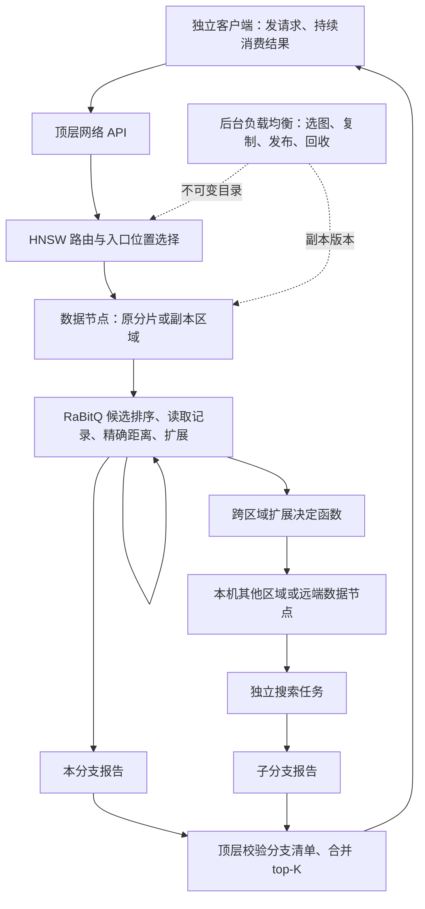
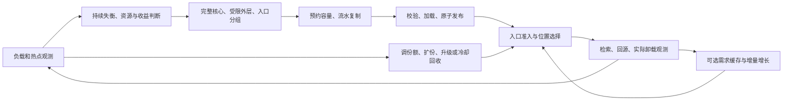

# DHDGS 系统设计

> 整理日期：2026-11-09。本文按模块描述当前设计、已验证优化和采用边界，取代按实验时间连续追加的写法。完整旧文档保存在 [历史设计快照](docs/DESIGN_HISTORY_20261109.md)；实验过程见 [TestLog](TestLog.md)，未解决问题与未来方案见 [Research](Research.md)。

DHDGS（Distributed Hierarchical Disk Graph Search）使用样本 HNSW 选择入口，在多个数据节点的 Vamana 磁盘图上自主搜索，以 RaBitQ 为候选估距，并由顶层合并各分支结果。**负载均衡是主要研究设计：复制完整、可导航的热点子图，在容量与质量约束下把实际搜索工作分流到空闲节点。** 它不是简单地复制热门向量，也不是只追求各节点请求数量相等。

本文区分三种状态：**当前基线**是后续默认使用的路径；**可选实现**有代码和相应验证，但须显式启用；**研究方案**尚未完成对应效果验收。某项功能通过不代表整体负载均衡、召回或百亿规模能力已通过。

## 阅读导航

1. [目标、边界与当前基线](#baseline)
2. [总体结构与查询流程](#architecture)
3. [距离、重叠分片与离线建图](#partition-build)
4. [RaBitQ、磁盘存储与本地搜索](#local-search)
5. [跨节点扩展、区域身份与预算](#branching)
6. [并发运行时、网络与等待优化](#runtime-network)
7. [负载均衡：主要创新设计](#load-balancing)
8. [指标、压测与验证方法](#evaluation)
9. [配置、代码与设计维护](#implementation)

<a id="baseline"></a>
<a id="baseline-original-128-20261105"></a>
<a id="budget-sweep-20261105"></a>
## 1. 目标、边界与当前基线

### 1.1 目标与实验范围

系统目标是在给定 Recall 和存储预算下提高吞吐、降低尾延迟，并明确 CPU、SSD、网络和排队的成本。当前目标为平均 Recall@10 约 95%，不再沿用最初的 99% 目标；预算是性能控制量，不是质量保证。

当前主要实验使用 ESM2_3B 的 2560 维 `seq_2M` 向量及 200K 查询。默认度量是**原始平方 L2**，索引、聚类、估距、精排与 ground truth 必须一致。cosine 路径需要同时归一化数据和查询并重新核验索引/标签；不能从模型名称推断正确的任务度量。ANN Recall 也不等同于生物学功能相似性。

已进行四机实验，常用部署为 Intel-35 运行顶层和独立压测客户端，Intel-31/32/30 分别承载数据节点 0/1/2。物理位置由部署配置决定。2M 暖缓存实验不能证明 200M 或百亿数据的外存性能、容量和长期稳定性，当前也不提供在线向量更新或完整高可用协议。

### 1.2 采用状态

|模块|当前采用方式|需要保留的边界|
|---|---|---|
|查询实现|原生 C++ 顶层和数据运行时，Python 负责配置、构建编排、部署与分析|仍是含 Python/pybind11 的系统，不是完全独立的 C++ 服务|
|搜索策略|原成本分支；`search.max_expansions: 128`|每查询全局预算，所有分支共享；实际 Recall 必须测量|
|查询并行|通常每数据节点 64 个计算线程|一个区域执行器同一时刻只有一个计算执行者；父子分支可并行|
|网络|原生网络模块支持 TCP/RDMA，四机基线使用 RDMA 消息传输|rsockets 消息通信与 verbs 单边 READ 是不同路径|
|普通 READ 与候选同步|关闭并暂停维护，源码与历史配置保留|副本—源限定的 READ＋同步组合也暂不采用|
|负载均衡|有完整的可选复制、控制和路由实现，主模板总开关关闭|不能把局部性能改善写成 R001 整体已解决|
|副本需求增长|用户选定 **indexed** 实现；增长总开关独立、默认关闭|100 槽缓存、top20 热点、β=源索引字节的 10%；持久化流水默认关闭|
|副本动态入口|用户选定 `least_queue` 为默认，启用负载遥测|`fixed`、`cost` 保留显式对照；过期负载保守回源|

配置模板与最佳实测点必须分开：例如主模板 `local_beam: 4`，近期对照普遍使用 beam=11、C1536；不能只改一个参数就声称复现了报告。所有性能结论以对应冻结 YAML、源码身份和实际部署为准。

无副本 D128 的既有两次 600K 对照曾得到 Recall@10=95.1130%、QPS=29,755.84、p99=128.381ms，条件为 C1536、beam11、64 计算线程/节点、暖缓存，见 [预算报告](test/budget_sweep_after_return_20261105/REPORT.md)。它是特定工作点的证据，不是系统性能承诺。

### 1.3 正确性与质量分开验收

- **结构可达**：图边、入口、位置目录和量化依赖正确，可沿实际有向边到达目标区域。
- **协议正确**：身份、预算、任务归属、重试和终止条件一致，不静默漏报告或复制预算。
- **ANN 质量**：有限预算、候选池及不同扩展顺序仍可能遗漏真近邻，必须独立测 Recall。
- **性能收益**：低回源率、短队列或少 RPC 均不是吞吐提升的充分条件，需要整条请求的净成本。

<a id="architecture"></a>
## 2. 总体结构与查询流程

### 2.1 三类角色



|角色|职责|不承担的工作|
|---|---|---|
|顶层路由|HNSW、选择一个首跳、保活/确认、收集分支报告、合并与返回|不逐批接收数据节点候选前沿，不代替扩展函数调度搜索|
|数据节点|本地图搜索、跨区域决策、预算转授、独立报告、维护副本|父节点不收集子节点 top-K，不等待子搜索结束再释放计算线程|
|独立压测客户端|通过网络 API 产生受控负载，持续收包、汇总和采样|不位于服务端搜索热路径中，不以无限堆积结果代替消费|

样本 HNSW 的 level-0 顶点是真实向量，payload 保存原分片位置及可用副本入口；它不是只有 N 个服务器顶点的路由图。一个请求首先进入一个区域，后续可以根据图边分支。

### 2.2 一次查询的完整生命周期

1. 客户端提交向量与请求身份；顶层接纳后由路由线程执行 HNSW，并在有效位置中选择首跳。
2. 顶层建立查询记录和初始预算，异步派发；路由线程提交后即可处理下一请求，ACK 由网络及维护路径接收。
3. 数据节点按 query/token/逻辑区域接纳或合并授权，计算任务进入有界队列。
4. 计算线程循环执行估距、选候选、读记录、精确距离和扩展。仅扩展函数可以批准跨区域动作。
5. 父任务转授预算并异步派发，继续本地搜索；候选耗尽或授权预算用完即完成本地工作，释放计算资源。
6. 每个分支独立上报本地结果与子分支清单。顶层按递归清单、身份及预算检查完整性，报告顺序可以乱序。
7. 全部必需报告齐备后，顶层按全局 ID 去重、合并 top-K 并返回；统计持久化和重型对象回收在独立路径执行。

心跳提供存活和涉及节点信息；**最终终止检测不能只依赖某一时刻的心跳快照**，父报告必须包含其最终子分支声明。重试耗尽或缺报告必须显式失败，不能把部分 top-K 当完整成功结果。

<a id="partition-build"></a>
## 3. 距离、重叠分片与离线建图

### 3.1 几何边界划分

每个向量有一个最近中心作为主归属；只有接近中心间几何边界的向量才获得副归属。平方 L2 下定义：

```text
M：总向量数；N：分片数；c_j：中心；r_j：簇内 RMS 半径

d_j(x) = ||x - c_j||²
主归属 a(x) = argmin_j (d_j(x), j)
h_j(x) = (d_j(x) - d_a(x)) / (2 * ||c_j - c_a||)
s_aj = max((r_a + r_j) / 2, epsilon)
gamma_j(x) = h_j(x) / s_aj

A_tau(x) = {a(x)} ∪ 按 (gamma_j, j) 排序、满足 gamma_j <= tau
                         的至多 max_copies - 1 个副中心
```

`h_j` 是到两个中心等距超平面的垂直距离，`gamma_j` 又按局部尺度归一。它显式考虑中心间距，不把高维下“距离数值很接近”直接当作应该复制；归一后的最优副中心也不一定是原始距离第二小的中心。

主要旋钮 `partition.overlap_fraction = rho` 表示**期望多归属向量比例**。用校准样本 `min_j gamma_j(x)` 的 rho 分位数得到阈值，边界并列使用稳定 ID 哈希处理，最终报告全量实际比例。rho=0 特判为唯一主归属；N=1 不产生复制。退化中心和零尺度必须显式处理。

```text
RF = 所有归属数之和 / M
1 + rho_observed <= RF <= 1 + (max_copies - 1) * rho_observed
```

RF 是初始向量冗余因子，rho 不是跨机搜索概率，也不是后文热点副本的 α、β。k-means 不保证容量或查询工作量均匀，初始 ID 均分也不能消除后续偏斜。

### 3.2 构建与发布

逻辑流程为：**ID 初分 → 各片采样 → 聚类与阈值校准 → 分块计算归属 → 一次主要向量重分布 → 更新样本位置 → 分片建图 → 重叠点边并集 → 连通性检查和发布**。

- ID 使用全局 uint64；分块计算距离，不物化全量 M×N 距离矩阵。
- 分片底图使用 Vamana/RobustPrune，构建优先采用精确距离，查询再使用 RaBitQ。
- 重叠点出边取各持有分片的并集，并同步给其持有者；边保存全局邻居 ID，不能按原度数上限静默截掉跨片出口。
- 本地保护连接与分片间桥接用于可达性修复。发布前检查实际图、入口、ID、owner、编码版本和校验和；连通不等于有限预算下高 Recall。
- “一次重分布”仅指主要向量 shuffle；采样、中心广播、边同步与发布仍需要通信。

**实现边界**：当前构建器是 C++ 内存 Vamana 和 DHDGS 自定义磁盘格式，seq_2M 主实验采用集中构建后分发。完整的流式分布式外存构建仍是扩展方向，不能把现实现等同于上游 DiskANN 外存构建器或已验证的百亿部署。

### 3.3 合并后的构建优化

|优化|目的与约束|
|---|---|
|几何裕量＋比例校准|让冗余集中在分片边界，显式控制 RF；仍需测召回与容量偏斜|
|全局 ID、版本化 owner/编码|副本和跨片边可识别同一顶点，避免复制后重新编码造成距离不一致|
|重叠邻接并集和保护连接|维持跨片可导航性；增加的出度、文件字节与读放大必须计量|
|块式输入和索引 manifest|控制数据准备峰值，校验布局/度量；不代表全构建已达到外存复杂度|

数据格式见 [DATA_INSPECTION](DATA_INSPECTION.md)，硬件见 [HARDWARE](HARDWARE.md)，第三方来源与许可证见 [THIRD_PARTY](THIRD_PARTY.md)。

<a id="local-search"></a>
<a id="614-原生完整搜索循环与固定查询线程"></a>
## 4. RaBitQ、磁盘存储与本地搜索

### 4.1 量化与估距

RaBitQ 用于常驻内存的候选估距，完整向量用于精确距离和最终结果。调用库的范数、旋转及偏差校正接口，不能以符号汉明距离替代 RaBitQ。相同全局 ID 的编码、中心及旋转版本须一致；实际旋转状态随索引保存。

2560 维 float32 原向量占 10,240B；1/2/4/8 bit 的裸编码分别占 320/640/1,280/2,560B，尚未计校正、ID、依赖和对齐。当前模板为 1 bit，维度高并不自动保证量化排序足够准确。误差尺度只用于探索启发式，不作为安全剪枝的确定性下界。

### 4.2 一次读取包含什么

`nodes.bin` 使用页对齐的定长记录：**完整 float32 向量＋uint32 出度＋uint64 全局邻居数组＋填充**。重叠边并集和保护边包含在数组中，owner 目录和 RaBitQ 编码另存。

```text
record_bytes = ceil((4 * dimension + 4 + 8 * 最大实际出度) / page_bytes)
               * page_bytes
record_offset = 对齐文件头字节数 + local_slot * record_bytes
```

现有 2560 维测试索引每条记录为 12,288B，即三个 4KiB 页。同步路径一次 `pread` 通常读一条完整记录；beam 中多条记录通常仍是多次读取，不是一条 SSD 命令。

现有文件访问是 buffered I/O：应用缓存关闭、调用 pread 或 io_uring 均不代表绕过 OS 页缓存。物理设备读取为零可能是工作集已驻留内存。实验须分开记录应用读取量、进程 I/O 和块设备 I/O；部分副本实验核心位于 tmpfs、增量位于 SSD，更不能混称为冷 SSD 检索。

### 4.3 本地搜索循环与已验证优化

循环维护查询私有候选队列、已见集合、top-K 和剩余额度，按本地 beam 选择顶点，读取后精排并扩展原出边。共享的是不可变图、编码和位置目录；重复展开的领取状态按查询/物理节点同步。

|优化|机制|效果边界|
|---|---|---|
|完整 C++ 搜索循环|距离、候选操作、扩展决策留在原生路径，复用一次查询预计算|减少 Python/GIL 和跨语言调用；仍有 I/O、OS 和控制排队|
|避免重复估距|已见邻居不再次执行同一 RaBitQ 计算|减少重复工作，不等同于跨机器全局展开去重|
|ID 直接寻址|在显式内存额度内用直接映射替代部分哈希查找|稀疏或百亿 ID 必须保留受限替代路径|
|精确距离向量化|double 累积、循环外有限性检查、兼容未对齐记录，使用本机编译优化|不启用 fast-math，不直接跨异构主机复制二进制|
|beam 批量调参|摊薄排序、分组、控制检查开销|改变邻居吸收和边界决策频率，需重新验证 Recall；11 是实测点而非普适最优|
|统计局部聚合|减少共享计数器与每顶点观测开销|队列丢失、采样和近似误差必须公开|

证据见 [搜索线程扩展](test/search_scaling_unbounded_20261023/REPORT.md) 及 [无副本吞吐修复](test/no_lb_qps_recovery_20261103/REPORT.md)。

<a id="61212-首阶段实现范围与使用方式2026-10-17"></a>
### 4.4 SSD 并行与聚合的实际范围

|路径|已实现行为|未包含的能力|
|---|---|---|
|当前原生 `sync_pread`|计算线程同步读取，再执行距离和扩展|读取等待期间该线程不自动接手另一查询|
|可选 I/O 后端|独立 I/O 线程池、io_uring 批量提交、配额与完成通知；需使用兼容运行时组合|并非所有原生路径均支持这些后端，启动校验拒绝不兼容组合|
|可暂停的副本专用 READ|保存上下文、让出计算线程，完成后排队续跑|它是远端注册内存读取，不是本机 SSD 聚合|
|后续 SSD 研究|连续区间合并、跨查询同记录在途复用、邻接与向量分离|尚不能写成当前默认或已有稳定收益|

异步提交减少调用开销、增加设备在途深度；连续范围合并才可能减少读请求但会增加读放大；同记录复用才可能减少重复读取，三者分别计量。I/O 层只能操作搜索已选择的记录，不能为了流水提前批准跨机搜索。详细早期方案保存在 [SSD 历史设计](docs/DESIGN_HISTORY_20261109.md#63-ssd-访问聚合范围与当前基线)。

<a id="branching"></a>
<a id="7-跨机扩展选择函数"></a>
<a id="remote-wait-threshold-calibration"></a>
## 5. 跨节点扩展、区域身份与预算

### 5.1 原成本分支选择

边界候选按目的区域聚合、按全局 ID 去重。对本地动作和最佳远端动作比较潜在收益与成本：

```text
ell(v) = estimated_distance(v) - kappa * uncertainty(v)
g(v) = max((T - ell(v)) / query_scale, 0) + exploration
G(action) = sum g(v)，对动作内唯一候选求和
U(action) = G(action) / max(C_ms(action), epsilon)
            * (1 + waiting_ms(action) / max_wait_ms)

P_remote = sigmoid((log(remote_weight) + log(U_remote) - log(U_local))
                   / probability_temperature)
温度=1时：P_remote = remote_weight * U_remote
                       / (U_local + remote_weight * U_remote)
```

`T` 是当前候选结果阈值；尚不足 top-K 时使用有限探索阈值。收益是启发式分数，并非已证明的 Recall 增量。成本实现以本地服务 EWMA、配置 RTT 和估算字节为基础；包含远端实时队列、SSD 和独立 CPU 成本的完整模型仍不是边界选择器的精确在线实现。第 7 章的动态首跳是独立机制。

`remote_weight` 控制**一次有竞争动作时的条件概率**，不是整条查询的跨机率。0 关闭概率路径，但本地耗尽、等待阈值等规则仍可能批准远端；总预算、分支名额、区域权限和驻留约束始终先满足。`max_wait_ms` 是触发阈值，不是网络完成时限；强制派发占比必须单独记录。

<a id="bounded-revisit"></a>
<a id="query-region-tasks"></a>
### 5.2 逻辑区域、唯一执行器与实际去重

原分片为 `base:<node_id>`，副本为 `replica:<version>`。A 的副本 α 位于 B 时，访问 α 不表示访问了 A 原片或 B 原片：`α@B → base:A → base:B` 可以合法发生；`α@B → base:B` 是同机区域交接，不计为跨机 RPC。

当前 `region_tasks` 用 query/token/逻辑区域定位唯一执行器，目录记录 `pending`、`opened` 和源首次启动权限 `reserved`。已有任务可以接收后到候选及合法授权，空闲执行器可以再次排队；同一时刻只执行一份授权。**唯一执行器不等于一个物理节点永远只有一份授权报告。**

- 同物理节点的重复展开由查询共享领取表抑制；祖先实际展开信息随状态传递。
- 已访问区域不代表其所有顶点已展开，不能据此丢弃后来发现的有效入口。
- 当前模式已经取代历史“离开 α 就排除整个 α”的规则；未展开副本顶点仍可在源区域被访问。
- 不同物理节点间没有全局逐顶点原子领取，副本与源仍可能重复展开同一 ID，必须计量。
- 每份授权仍有自己的搜索准备、局部 top-K 和报告；跨授权完整计算状态复用尚未实现。

源权限用于防止其他分支绕过副本的源首次启动安排：副本向外分支时，异步派发链先登记源预约；若源已启动则保留已有任务并允许候选合并。可靠接纳校验决定是否能首次启动，尽力目录广播只加快获知状态。无权首访返回零工作回执，未用信用目前不自动归还父分支。

### 5.3 全局预算与终止

```text
一份授权的获得预算 = 实际使用 + 本地未用 + 转授给所有子授权
根授权预算 = 128；任何候选同步或跨机操作均不能重新生成预算
```

父任务可以分支到多个目标；有其他候选时按 `child_budget_fraction` 或 `replica_child_budget_fraction` 转授，仍有本地候选则保留本地额度，只剩目标候选时可转授剩余额度。分支槽也按比例分账，受 `max_branches` 约束。子任务不携带父节点无关的本地候选，父任务继续搜索。

`min_expansions_after_cross` 限制刚跨区就再次外出的频率；本地候选耗尽可提前跨出并单独计数。已移除副本回源专属的额外驻留门槛，源动作参加相同扩展选择。备用入口在允许的模式下也须共享剩余预算，不按不可知的在线真实 Recall 触发。

完整协议与账目见 [区域任务证据](test/region_tasks_20261027/REPORT.md) 和 [分支预算审计](research/R005_BRANCH_BUDGET_AUDIT_20261104.md)。原策略历史上仍出现同物理节点多份授权报告，不能套用暂停的同步策略所宣称的唯一物理分支语义。

<a id="runtime-network"></a>
<a id="23-固定搜索线程的等待定位与动态控制服务2026-10-20"></a>
## 6. 并发运行时、网络与等待优化

### 6.1 进程与线程分工

当前原生顶层主要在一个服务进程内完成在线职责；早期 Python 多接收进程、跨进程结果枢纽等保留作历史对照，不是当前默认热路径。

|线程/模块|负责内容|释放或等待方式|
|---|---|---|
|顶层路由池|HNSW、入口选择、构造初始派发|异步提交后处理下一 query，不等 ACK|
|网络 reactor 与 handler|收发事件、协议解析、接纳与报告交付|事件/条件变量等待，有界队列与连接复用|
|顶层维护|按节点管理租约、确认、重试、取消与到期状态|不扫描所有历史完成对象，不执行图搜索|
|数据计算池|本地完整搜索、批准远端动作、准备本地终态|授权结束即释放；可暂停路径等待数据时让出线程|
|控制与发送|维护分支清单、派发确认、报告重试与传输|不占着计算线程等子任务|
|顶层合并池与 API|完整性校验后的 top-K 合并、编码、socket 返回|编码按有界批次推进，避免大批阻塞已准备响应|
|维护/回收池|副本规划、复制、热度合并、重型对象析构|有界后台工作，不在查询注册表锁内执行|

线程数量和 CPU 资源不是同一概念。多个池重复绑定同一批核、SMT 共享、NUMA 远访、页缓存位置及内存带宽都可能限制吞吐；增加线程须同时检查每线程 CPU、可运行队列和服务成本。

<a id="query-scoped-admission"></a>
<a id="bounded-query-context-reclamation"></a>
<a id="no-lb-throughput-recovery-20261103"></a>
### 6.2 锁、所有权与上下文回收

只读索引不需要全局搜索锁，但身份创建、任务领取、预算转交、队列和对象生命周期是可变共享状态，不能全部无锁读写。优化原则是**缩小同步范围、转交对象所有权，把慢操作移出锁**。

|曾定位的等待|当前处理|
|---|---|
|全节点接纳锁串行不同 query|节点锁只定位/创建身份，再由查询或区域自己的短锁更新状态|
|接纳时同步嵌套注册|原生控制注册入队，避免跨层长锁链和 Python/GIL 依赖|
|合并路径反复复制报告|不可变报告所有权转交，减少大对象复制与锁内解析|
|注册表 erase 触发大对象析构|锁内摘除身份，锁外分批销毁；可选独立回收池进一步隔离 allocator 停顿|
|到期风暴阻塞 ACK/额度释放|Record、Context、timer、墓碑均有批次上限，优先处理完成与确认|
|每次读副本增量都拿共享锁|indexed 原子发布目录和负命中过滤；临时正命中仍安全 pin|

回收池满时延期回收，不删除仍被搜索/网络持有的对象，不破坏执行器唯一性。相关指标包括到期积压、待回收批次、注册表锁峰值、锁外析构时间和 RSS；进程累计最大锁持有时间不是逐查询 p99。锁顺序与细项统一维护在 [LOCKS.md](LOCKS.md)。

<a id="独立回传通道与报告队列2026-10-20"></a>
<a id="head-return-20261105"></a>
<a id="budget-wait-diagnosis-20261105"></a>
### 6.3 父报告独立、返回路径有界

父报告处理完成后即可发送，不再等待子任务接纳 ACK；子任务直接报告给顶层。最终父清单、预算校验和顶层终止检测保证不会提前返回。迟到的派发失败以独立诊断通知处理，不修改已发送的不可变报告。

进一步将搜索终态准备、控制和发送解耦，保留多连接/多处理通道。报告可能受同分支消息顺序、网络队列、编码和 OS 调度影响，“不等子 ACK”不意味着墙钟零等待。报告中的网络计数可能尚未完结，实验后独立对账，不能为了等统计阻塞用户结果。

顶层返回优化包括：路由/合并池合理共享 CPU 集合；API 完成队列按 `response_batch_size` 小批取出、锁外编码、立即推进 socket；若队列仍非空，不因已消费 eventfd 信号而再次睡眠。既有定位表明约 50ms 的返回路径等待主要来自排队和调度，不是微秒级查询锁。[返回路径报告](test/head_return_20261105/REPORT.md) 验证了局部改善，同时保留端到端 p99 未同步改善的事实。

### 6.4 统一自适应网络模块

`dhnet::Client/Server` 集成发送、接收、handler、连接复用和统计；入口、租约、数据间派发、结果报告保持独立逻辑通道。统一实现不表示所有流量挤在一个线程或一条连接中。

```text
发送：按配置观察 queued 或 pending，统计高压 reactor 占比
接收：观察 handler 等待队列，统计高压 reactor 占比
连续高压样本达到门槛 + 冷却结束 + 资源允许 -> 扩一个 reactor
持续空闲 -> 发送端排空后回收；接收端停止接纳、排空旧连接后回收
```

- 扩容不改变搜索线程、预算或边界决策，也不提前发起远端搜索。
- `queued` 模式避免把单纯等待远端响应全部误判为本地发送能力不足；预热宽限避免新通道还在建连时反复扩容。
- 异步建连与已建立连接收发分开，预热常用连接；连接活动时间只由真实通信更新。
- 连接由 reactor 持有，正在处理的报文不被任意迁移。可选 `rebalance_connections` 将空闲长连接安全转交给连接较少的 reactor，并优先排空待退役循环；仅增加线程仍不会立即消除活动连接上的积压。
- 数量上限按逻辑客户端/监听服务生效，不是整机线程总数；某些配置允许 0 表示无应用层数量上限，仍受队列、FD、QP、内存和 CPU 限制。
- 网络配置多数在服务创建时读取；运行中按设定策略扩缩容，不等于所有配置都可热更新。

记录实际 reactor/handler/连接数量与峰值、queued/pending、扩缩容、拒绝、建连、RTT、字节和端口吞吐。大连接数只能吸收并发，不能保证网络永无瓶颈。部署须配合 NUMA、固定运行库及 allocator，见 [RDMA 默认部署](docs/RDMA_DEFAULT.md)。

### 6.5 RDMA 的两种用途

|用途|实现与采用状态|成本边界|
|---|---|---|
|消息传输|原生网络可切 TCP/rsockets RDMA；四机基线保留 RDMA|仍有编码、发送/接纳、报告和控制 CPU，不能称零源端开销|
|单边数据 READ|可选 verbs 路径，从源注册内存取得顶点/依赖，副本需求增长可使用|不是 RNIC 直接读取 SSD；源 MR、页缓存、CQ 和恢复调度另计|

普通图的“优先拉取＋已有分支候选同步”及副本—源限定组合已实验但因 QPS/p99 代价暂不采用；历史机制及开关集中见 [7.10](#optional-lb)。不能把保留 RDMA 消息传输误解为重新启用了这些策略。

<a id="load-balancing"></a>
<a id="load-balancing-current-20261103"></a>
## 7. 负载均衡：主要创新设计

### 7.1 研究目标、对象与闭环

本模块要解决的是：**空间分片均匀不代表搜索工作均匀，固定副本份额也不能适应副本本身的计算成本。** 因此要同时选择“复制什么”“何时复制”“放在哪里”和“请求如何利用副本”，并观察源节点实际少做了多少工作。

潜在创新是将**可验证的局部图结构、容量受限的复制流水、基于真实搜索需求的增长、负载驱动的入口选择**结合。每个单项都有相关先行工作；这些组合尚不等于论文新颖性或顶会验收已成立，仍需公平基线、消融和质量约束。

|对象|定义|
|---|---|
|源分片|不可变原图；复制不迁走唯一数据，不修改原始所有权|
|区域|源内完整顶点记录、原邻接和导航所需编码依赖的集合|
|物理副本版本|位于某目标上的不可变核心包及其合法增量，绑定 epoch、源和版本|
|副本家族|同源、同内容/入口合同的等价副本，可有多个物理位置|
|入口集合 entries|已有 HNSW 样本中允许在该副本发起搜索的顶点，不是所有区域成员|
|有效卸载|同一请求在源上少消耗的搜索工作，扣除新增维护、READ、目标计算和通信后的整体收益|



<a id="hotness-logical-regions"></a>
### 7.2 如何识别不均衡和热点

**节点压力分开观察三段等待：**

```text
search_ready -> executor_ready：同区域前序授权造成的串行等待
executor_ready -> worker_enter：计算池可运行任务的排队
search_ready -> worker_enter：总就绪等待，两者相加
```

待执行授权数不等于可并行执行器数，不能把三种积压重复相加。窗口直方图按累计差分得到分位桶上界，结合队列深度、服务墙钟和工作线程数估计压力；无开始样本、重启计数回退或过期观测不能当零压力。分位数也不能按上述恒等式直接相加。

**两种热点信号有不同用途：**

1. `hot_entry_community` 从有界请求观测中按原入口分组，要求足够不同 query ID，按这些请求在源上的累计搜索 CPU 排序。它选择“入口关联的高工作量”，不是仅看入口次数。
2. 顶点热度统计成功领取且完成展开的事件，候选发现、估距、预读和失败领取不计入。计算线程局部聚合，经各 lane 的 SPSC 队列交给后台有界 Space-Saving，再发布 top-K 快照：

```text
H_v(t) = H_v(last) * 2^(-(t - last) / half_life) + 新增展开事件
```

热度队列满则丢统计并记账，不阻塞搜索。淘汰后的分数是带误差的热点估计，不能称全量精确 top-K。副本已接走的入口需求仍计入家族热度，防止把成功卸载误认为热点消失。

**触发有两条兼容路径。** 旧动态控制器要求源 CPU/总就绪压力高、目标有余量、差距连续存在，并检查新鲜度、冷却和副本槽。新 `OnlinePolicy` 优先使用 runnable 等待及执行器积压，CPU 辅助判断，在健康观测时间上累计持续/复发证据；观测未知则冻结判断。两者不是同一套已经统一选优的控制公式，需在 YAML 中明确选择。

<a id="complete-hot-entry-region"></a>
<a id="capacity-bounded-hop"></a>
<a id="tiered-replica-ready-pressure"></a>
### 7.3 复制哪些向量：完整核心、受限外层

主路径使用热点入口的真实有向邻域，优先保证副本内部有可走的搜索路径：

1. **选种子**：从历史入口工作量中取有独立样本支撑的热门入口，限制种子数与规划时间。
2. **完整核心**：枚举源内完整 h 跳邻域。社区路径可在遇到其他本轮热门入口时重新启动其 h 跳闭包；快速 `seeded_core` 直接取选定入口完整球的并集。放不下完整核心则拒绝该候选，不删除中间连接点凑容量。
3. **外层扩充**：以依附已有区域的完整源内一跳块为单位扩张。社区路径用局部 PPR 提议边界块；H 路径广度填充，F 路径用带共享依赖成本的最大权闭包/最小割代理优先选块，再整块填充。
4. **结构检查**：保留原始有向边，包括通向区域外、源外的出口；核验成员摘要、核心完整性、外层附着、编码依赖与容量。
5. **入口合同**：认证核心入口与后来开放的成员入口分别记录，不能把成员存在证明冒充任意入口完整 h 跳证明。

内部边保留率 `1 - 出区域边数/区域总出边数` 是外流的结构代理，不是最优标准电导率，也不是实测 Recall。外层按完整块截止后，最终图不一定是更大 h 的完整球；副本有边界，仍可能回源。

### 7.4 放在哪里、复制多大、复制几份

源通常取持续高压力分片；目标须有新鲜低负载、计算/内存/SSD 余量、兼容索引 epoch 和复制槽。自动流水优先采用触发时选择的目标，再按策略考虑更多目标；复制完成后还须复查，不能用构建前的旧空闲状态直接引流。

当前 `capacity_policy.mode: per_region` 将**单次区域大小**与**累计容量**分开：

|限制|含义|
|---|---|
|小图 α=0.3|单个快速小区域包不超过源索引 FILES 字节的 30%，不是所有小图累计只准 30%|
|大布局 α=0.8|一次大布局的物理包合计不超过源索引的 80%；可拆分到多个目标|
|全局/目标/源累计限额|分别控制所有活动、排空和构建中副本；源额外累计限额为0不代表取消其他上限|
|绝对单包、份数和过渡槽|防止单图或替换过程突破部署能力|
|β=0.1|每份需求增长副本额外允许源完整索引字节的 10%，独立于核心 α|

包字节包含完整记录、邻接、依赖编码、ID、目录、证明与元数据；跨目标重复内容按实际物理空间重复收费。源临时打包、注册内存、规划缓存、过渡版本另报峰值。历史 YAML 的聚合 α 语义保留兼容，不能改写老实验口径；S30/D80 的实际份数、总字节和引流参数须查对应报告。

可执行的控制动作包括：不同入口新建小图、同家族增加物理份数、持续/周期热点升级大布局。已有目标有余量时优先调份额；小图目标本身过载才考虑扩份。大图默认需要健康时间持续约300秒，或1800秒内3个独立热周期，并要求入口稳定、新鲜净卸载证据和回本估计。**功能路径已实现，自动选大小/份数在自然长期流量下的收益仍未验收。**

另有 `layout_policy` 成本规划器，根据每条完整请求的 CPU、槽占用和网络字节估算资源容量并搜索布局/份额；它输出建议，不自行发布，与实际 `OnlinePolicy` 接线应分开理解。

<a id="multi-target-fixed-budget"></a>
多目标分组让每个入口只属于一个组，按源 CPU 工作量和新增完整邻域成本贪心分配；成员可跨组重复，重复部分收费。`target_weights` 调工作量目标，不自动变成容量分配比例。这能避免将全部副本工作堆到同一目标，但不是最优图划分。

<a id="replica-pipeline-native"></a>
<a id="subgraph-pipeline-20261103"></a>
<a id="subgraph-growth-stream-20261103"></a>
<a id="automatic-replica-pipeline-20261103"></a>
<a id="lb-long-health-capacity-20261103"></a>
### 7.5 缩短生效流程：后台选图与复制流水

整个过程为 **规划 → 预约 → 复制 → 封口校验 → 原生加载 → 发布 → 首次接流**，分别记录耗时。当前优化消除不必要的串行依赖，但不跳过结构一致性：

|环节|已实现优化|保留的限制|
|---|---|---|
|选图|源端有界异步任务，原生规划，复用有界邻接预取/缓存|不在维护 RPC handler 中长时间阻塞，完整核心不可截断|
|期限|源端一个 monotonic 截止时间，阶段只使用剩余时间，预留封口时间|不跨机器比较绝对 monotonic；规划期限不等于整个发布期限|
|预约|按实际源 FILES 字节和计划包大小预约，计入普通/增长中/活动/排空版本|重复登记去重计费，取消不确定时保留预约|
|计划流水|第一份完整计划复制时，继续规划第二份|目标仍独立验收，不复用源验收来省略检查|
|同图增长复制|完整核心和后续已接纳块经有界 ID/chunk 队列边扩张边复制|半成品不能接流；未接纳的候选不传输|
|原生加载|直接构建目标不可变 overlay，减少 Python 逐记录操作|身份、依赖、范围和校验必须通过|
|压力控制|多个维护槽共享带宽、chunk 和缓冲额度，按搜索压力限速|目标已有流量优先，维护峰值仍需实测|

增长包按接纳顺序追加，用 ID→槽位目录定位，不在结束时重排全向量体。封口后检查序号、范围、哈希、成员和依赖，再原子安装。失败先取消并确认源生产者停止，再清理目标与预约；不是跨重启断点续传，也不提供多个控制器之间的分布式原子预约。

真实源容量、统一期限与自动流水修复曾使一轮5次实际规划均发布，启动至发布17.68–59.48秒，见 [自动流水报告](test/auto_replica_pipeline_20261103/REPORT.md)。该轮查询性能有其他问题，不能把复制成功直接写成负载均衡收益；与回收修复的组合证据见 [组合验证](test/lb_combined_coverage_20261103/REPORT.md)。

<a id="replica-ready-publication"></a>
<a id="combined-coverage-20261103"></a>
<a id="covered-entry-admission-20261104"></a>
<a id="entry-expected-work-20261104"></a>
<a id="entry-threshold-evaluation-20261104"></a>
### 7.6 发布与入口准入

**READY 和质量通过分开。** 不可省略的是文件/布局/依赖/epoch/容量校验及完整加载；可按显式策略选择是否在发布前做独立检索验证：

|发布模式|行为|能证明什么|
|---|---|---|
|`validated + ground_truth`|独立留出请求测真实 Recall 和源/目标成本|只证明该样本和门槛下通过|
|`validated + shadow`|无标签影子对照，测结果重合、驻留与卸载|重合率不是 Recall，重放也占资源|
|`ready`|结构就绪后按显式策略接流|仅结构/协议可用，不能宣称质量已通过|

目录按源、入口、分数范围、版本、TTL 和份额筛选，原子替换快照；旧查询保留版本引用。`entry_admission` 可选扩大可服务入口：封口后将子图成员与源的全部 HNSW 样本求交，开放所有覆盖入口，包括边缘入口；不把任意普通顶点提升为新 HNSW 样本。该模式取代旧“新增入口须完整一跳”的准入要求，但保留认证核心合同。

入口反馈用首次计算回源前的剩余预算评估副本承接了多少前段工作：

```text
N_e = 入口 e 的正常完成请求数
R_e = 其中首次发生副本 -> 源计算分支的请求数
B_e = 这些请求在分账前的剩余预算之和
S_e = B_e / N_e = 回源概率 * 回源条件下平均剩余预算
```

不回源贡献0；READ、影子、失败和不可用回退不计作计算回源。后台每5秒读取，在回源样本数达到门槛且 `S_e` 严格超过阈值时关闭该版本入口；当前模板门槛20次回源、阈值80是配置值，未经稳定选优。写端使用分片原子计数，不在逐查询路径生成日志。

此规则衡量工作承接，不是 Recall 保护。已实现全部覆盖入口的长期闭环，但曾出现整体/命中 Recall 损失和额外 CPU，见 [覆盖入口报告](test/covered_entry_long_20261104/REPORT.md)。当前主模板该功能默认关闭；不能只提高入口覆盖就宣称净卸载成功。

<a id="dynamic-entry-routing-20261109"></a>
### 7.7 接流位置：固定份额、最短队列与成本选择

HNSW 先选同一个入口 e，位置候选是原源和 entries 登记了 e、合同新鲜有效的副本。每条请求只启动一个根任务。首跳选择不改图边、全局预算或后续分支函数。

|策略|选择机制|主要取舍|
|---|---|---|
|`fixed`|同家族按请求哈希划互斥份额，未命中回源|保留对照；份额不随目标实际排队变化|
|`least_queue`（当前默认）|选择计算可运行队列最短的候选，等长随机打散|朴素、低成本；不显式考虑在途请求和每请求服务成本|
|`cost`|估计宿主排队、路由后全路径计算、后继负载及 CPU 压力，再 softmax|能照顾尾延迟，但依赖历史观测且增加模型复杂度|

动态模式下，正 `fraction` 表示可选资格，不再是概率上限；0仍关闭。代价模型为：

```text
B_i = max(queue_i, max(0, outstanding_roots_i - workers_i))
      * mean_compute_wall_ms_i / workers_i

C(a) = B_host + 0.5 * load_rpc_ms
       + a 的平均全路径搜索 CPU ms
       + sum_{j != host} P(a访问j) * B_j
       + cpu_penalty_ms * clamp(util_host - cpu_threshold, 0, 1)

P(a) ∝ exp(-(C(a) - min C) / temperature_ms)
```

`outstanding_roots` 在派发前计入、整查询完成/失败后释放，重试不重复计数。它是尚未完成根任务的保守代理，不是精确的“尚未反映到队列快照”的 ticket 水位；用 max 避免简单相加重复估计。

一个 C++ 后台线程每20ms异步轮询各节点，每节点至多一个请求在途；节点返回常数大小的队列/活动线程/服务计数/epoch，不遍历报告历史。遥测 TTL 默认100ms，计入请求耗时；源负载未知回源，副本旧低负载不得继续当有效证据。全路径成本按副本版本或源分片累计，排除源预约但未执行的报告；不是入口级 EWMA。

**最新匹配对照**（D128/beam11/64线程/C1536，先共同 indexed 学习后封口，相同核心、增量和入口，每策略每布局1.2M有效查询）：

|布局|策略|QPS|p99 ms|Recall@10|
|---|---|---:|---:|---:|
|S30|fixed|22,373|143.16|94.4065%|
|S30|least_queue|27,083|97.37|94.6410%|
|S30|cost|26,824|79.03|94.6418%|
|D80|fixed|29,926|132.41|94.4345%|
|D80|least_queue|31,114|73.02|94.5371%|
|D80|cost|30,401|74.77|94.5176%|

最短队列已显示有效再平衡：S30 QPS提高21.05%，原过载副本宿主的首跳份额46.05%降至37.27%，runnable 等待123.59降至29.45ms/分支。让源多接一部分流量在该状态下反而改善整体。cost没有更高吞吐证据，但S30的p99比least_queue进一步下降约18.8%。

这些组零失败，但全部 Recall 仍低于严格95%；p99是两个有效轮次的1.02倍分桶上界近似均值。共享机器、暖缓存、固定热点循环和封口后图限制仍保留。证据及干扰组取舍见 [入口路由报告](test/entry_routing_20261109/REPORT.md) 与 [负载曲线](test/entry_routing_20261109/load_comparison.png)。

**采用决定（2026-11-09，用户确认）：最短队列作为默认实现。** 主模板与动态副本模板设置如下，其他代价参数保留供显式cost对照使用：

```yaml
load_balance:
  entry_routing:
    mode: least_queue
    telemetry: true
    poll_ms: 20
    ttl_ms: 100
```

这是已有机制的配置采用，不是新性能实验或远端重部署。indexed、全局预算128及普通pull/sync关闭保持不变，负载均衡构建总开关仍独立。历史冻结YAML及缺失整个entry_routing块时的fixed兼容行为保留；后续从旧配置派生实验须显式补齐默认块。完整字段见 [主配置](configs/dhdgs.yaml)。仅选择合法入口位置，不保证副本Recall达到95%。

<a id="replica-demand-growth-20261106"></a>
<a id="indexed-current-baseline-20261109"></a>
<a id="demand-persistence-pipeline-20261109"></a>
### 7.8 需求驱动增长：共享缓存与 indexed 持久增量

这是副本专用的可选学习路径：利用真实查询需要但副本缺失的源顶点扩展副本。它与暂停的普通 pull/sync 组合不同，**不启用普通分支候选同步**。

**读取和计数：** 每份物理副本100槽完整记录缓存。只有既有扩展函数已选源动作、源搜索任务尚未启动/派发、学习期和资源允许时，才提交小批异步单边 READ；并发相同缺页合并。保存上下文并交还计算线程，CQ完成仅将任务放回原计算池。失败、资源不足或源任务已启动时沿原分支回退，不重置预算。

缓存记录可立即参与搜索；访问次数只在成功 claim、完整展开并扣除预算后增加。count=0优先淘汰，其次按最近访问替换count=1；READ中、提升中或被查询pin的记录不可淘汰，不可接纳则回退而非等待空槽。缓存命中探测次数不能替代实际展开复用次数。

**提升和连通：** 用户选定的 `full_hot_batch` 在缓存满且至少20条READY记录被展开两次后，选top20热点提升；连接点另计。保留 `full_no_singleton`（全缓存均已复用）及cache-only作为显式对照。后台按固定 count/last 快照排序，避免直接读取变化中的原子字段破坏排序比较器。

每个持久热点必须有从核心或已提交增量出发的原图有向路径；连接记录缺失由后台补齐，逐边校验，不创造捷径。热点、连接点、编码依赖、证明和提交元数据都占β。预算不足缩减整套连接闭包，连一条也放不下则封口。β按源完整索引字节计算，每份物理副本独立预约；SSD使用实际空间预约，注册内存另计。

**持久化与读取：** 增量是身份头加追加提交帧，顺序为“payload及校验和 → fdatasync → commit标记 → fdatasync → 发布目录”。恢复只装载完整有效提交；未提交尾部截去，已提交损坏拒绝加载。完整向量从文件读取，量化码驻留内存，临时缓存驻RAM。

indexed 使用只追加、原子发布的持久目录和负命中过滤，临时正命中保留短pin锁。网络、路径验证、打包、刷盘和重型释放在搜索目录锁外；维护扫描间隔2ms。封口停止新READ，安全排空已接纳工作后清临时缓存，持久增量继续服务。

|实现|区别|当前决定|
|---|---|---|
|serial|旧目录访问与顺序准备/写入|保留对照|
|indexed|原子发布目录、负命中过滤、合并维护唤醒|**用户选定的当前最佳增长实现**|
|pipeline|在indexed基础上，准备下一批与写入上一批重叠，有界FIFO及β预约|功能通过；未获得稳定额外吞吐收益，默认关闭|

同轮对照中，serial→indexed 的S30 QPS约17,043→22,460，D80约26,805→29,372；pipeline再加上去反而分别约低1.60%/2.07%。封口后零READ/写盘仍存在目录优化收益，说明此前损失不能全部归于SSD刷盘。证据见 [增长报告](test/demand_growth_20261106/REPORT.md) 与 [目录/流水报告](test/demand_pipeline_20261109/REPORT.md)。

**采用边界**：`indexed_directory:true`、`maintenance_interval_ms:2`、`persistence_pipeline:false`、`promotion_trigger:full_hot_batch`；增长总开关仍关闭。启用时须配齐副本单边READ资源。当前需求增长支持staged_v1复制，尚未接入pipeline_v2；质量、独立训练/测试、完整β耗尽后的长期收益仍开放。不要混淆“核心复制流水”和“增量持久化流水”。

<a id="adaptive-replica-lifecycle-correctness"></a>
<a id="online-replica-policy-20261104"></a>
### 7.9 生命周期：扩份、升级和退役

份额调节与物理构建解耦，规划忙时已有副本仍可接流/调份额。短暂目标拥塞按持续门槛退让，不每个采样窗口反复减半；完成但暂时繁忙的小图可零份额保留，避免立即丢弃构建成果。

扩份需源仍拥塞、已有目标余量不足、成本/质量新鲜且容量允许。大布局先整组安装校验，再原子切换目录；未覆盖的旧合格入口保留，失败保留旧布局。冷却使用家族快/慢EWMA、衰减峰值和滞回，观测丢失不推进冷却计时；构建成本和历史回暖影响保留期。

```text
退役顺序：撤去新请求路由 -> 标记退役 -> 等待搜索/暂停上下文引用排空
          -> 删除文件和释放内存 -> 归还预约
```

清理失败标记待清理并保留额度，后台重试。不能在发出retire命令时就假定磁盘已释放，也不能在副本仍被查询引用时删除。自适应衰退和扩份仍为可选实现，长期自然热点中的稳定收益尚未充分验收。

<a id="optional-lb"></a>
<a id="complete-locality-portfolios"></a>
<a id="entry-geometry-directory"></a>
<a id="hop-return-reduction"></a>
<a id="async-rdma-tail-runtime"></a>
<a id="one-sided-replica-read"></a>
<a id="one-sided-missing-codes"></a>
<a id="tail-four-20261102"></a>
<a id="remote-pull-first-20261104"></a>
<a id="candidate-sync-20261104"></a>
<a id="candidate-nonblocking-20261104"></a>
<a id="candidate-registry-reserve-20261105"></a>
<a id="candidate-delivery-metrics-20261105"></a>
<a id="pull-sync-comparison-20261105"></a>
<a id="replica-continuous-sync-20261105"></a>
<a id="replica-pair-scope-20261105"></a>
<a id="replica-pair-skew-20261105"></a>
<a id="replica-boundary-portals-20261106"></a>
<a id="replica-no-dwell-20261104"></a>
### 7.10 保留的对照与未采用机制

|机制|已实现内容|当前状态/原因|
|---|---|---|
|方向性边界增强|按源外出边方向选代表边界或全部可达边界，沿原有有向路径补连接点，独立计额外字节|结构验证通过、局部第三节点路径恢复；整体Recall和净收益不足，默认关闭|
|完整局域/几何目录|预建局域组合、几何归属与入口目录，对照不同区域选择|保留实验实现，不替代当前热点完整核心路径|
|异步尾部READ|符合条件的源动作读取后在副本续跑，另有跨query合批、缺失码过滤、尾池和延迟精排|部分功能有效，综合性能未全面通过；不能描述为全部默认启用|
|普通远端优先拉取＋候选同步|已有目标分支的候选/阈值/远端需求异步交付，保持预算，有唯一物理分支协议|QPS/p99代价高，用户决定关闭并暂停维护|
|仅副本—源READ＋同步|限定上述协议作用域，其余分支走原策略|已对照仍未获得足够净收益，同样暂不采用|
|副本源专属驻留门槛|曾延后回源|已移除；仅保留通用跨区驻留及候选耗尽例外|

边界增强若不计入核心α，也必须计入独立额外上限、目标/源累计预约、全局物理容量与复制流量。全边界S30曾额外增加约1.172GiB、D80约2.009GiB，不能将增加空间后的收益当等容量算法收益，见 [边界报告](test/boundary_portals_20261106/REPORT.md)。

历史协议、公式和逐轮证据保存在 [历史设计](docs/DESIGN_HISTORY_20261109.md#remote-pull-first-20261104)；普通同步暂停不影响当前区域授权收件箱的候选合并，也不影响RDMA消息传输和已选的需求增长读取目录。

<a id="replica-residence-diagnostics"></a>
<a id="replica-branch-metrics-20261105"></a>
<a id="replica-branch-quality-20261105"></a>
### 7.11 如何判断负载均衡有效

必须同时观察：

|维度|指标与解释|
|---|---|
|反应速度|失衡发生/检测/规划/预约/首字节/封口/READY/发布/首条接流；分别计时|
|副本利用|构建与复制次数、成功/失败原因、根入口命中、其他分支命中、实际开放入口、物理版本流量|
|驻留与质量|副本内平均展开、过早退出、top-K贡献、全局与共同命中群体Recall|
|回源与分支|计算回源概率、首回源剩余额度、源授权及实际展开、宿主base/第三节点分支；READ另计|
|真实卸载|相同请求在源上的CPU/展开减少量，目标新增CPU、回源与维护CPU，系统总CPU/query|
|资源与吞吐|各节点runnable队列/CPU、QPS与p99、网络字节、SSD/MR/临时包峰值和α/β账目|

副本低回源不必然提速：固定128预算可能只是把工作集中到更慢或更拥挤的宿主。入口命中高不必然卸载：命中后若立即回源，源仍承担主要工作。队列接近不必然最优：各节点服务时间、NUMA和网络能力不同。

**当前结论**：已验证复制/区域协议、容量预约、查询回收、indexed读取目录和特定热点下动态首跳的局部改善；负载均衡的质量—净吞吐—长期自适应整体目标仍开放。下一步研究集中在副本导航/质量、同容量有效入口、净成本引流与自然流长期反应，完整优先级见 [Research R001](Research.md#r001)，不在本文将计划写成已实现。

<a id="evaluation"></a>
<a id="39-独立网络压测模块与持续结果消费2026-10-22"></a>
## 8. 指标、压测与验证方法

### 8.1 并发和吞吐口径

客户端并发C表示同一时刻**已提交而尚未收完结果的请求上限**，不是每秒到达C条。闭环压测完成一个再补一个；稳定时可近似 `QPS ≈ 平均在途 / 平均端到端秒数`。开放到达率测试须另设速率，不能混用。

独立压测模块通过网络API访问顶层，并持续消费结果；有限队列、批量汇总和采样避免benchmark consumer侵入服务端搜索。全量原始JSON持久化不作为每次查询完成的前置条件，长测以窗口指标和少量可重放样本为主。只写内存而不持续消费的旧方案不再作为高负载测试方法。

吞吐记录成功数、失败数、提交窗口和排空时间；不能忽略尾部未返回请求来抬高QPS。暖机、学习、封口、正式测量与排空分开，受干扰轮次明确记录，不挑选较好数字替代配对比较。

### 8.2 时间拆分与资源计量

|范围|必须记录的内容|
|---|---|
|顶层/客户端|提交、接纳、路由入队/开始/结束、入口发送、报告齐备、合并入队/开始/结束、API编码/发送、客户端首字节/完整帧|
|数据节点|接收与接纳、search_ready/executor_ready/worker_enter、搜索批次、终态准备、报告可发/开始发送、线程释放|
|搜索|展开数、距离计算、RaBitQ、读取次数/字节、图深度、候选/预算停止原因、逻辑与物理分支数|
|通信|派发/ACK/心跳/目录/报告分开统计；连接、重试、排队、收发字节；READ次数、服务和等待另列|
|系统|每角色线程CPU、核/NUMA、RSS、页缓存/块设备、连接/队列峰值、外部作业与负载均衡事件|

同机器monotonic时间可作差；不同机器绝对monotonic不能直接相减，跨机图使用消息关联及各自持续时间。父子并行耗时之和可超过端到端，时延占比应沿关键路径计算；总CPU、累计等待和网络服务时间另报，不能强行相加成100%。

p50/p99图选真实接近相应分位的查询，注明是否跨节点、是否命中副本、是否抽样和直方图精度。网络占比验收同时看均值与p99附近样本，建连、网络队列和控制等待均计入；不能把无法归属的等待自动算进搜索CPU。

### 8.3 每轮实验需要回答什么

1. **功能与协议**：ID/版本、完整性、预算守恒、唯一执行器、重试/取消/乱序、容量预约、发布与恢复是否成立。
2. **质量与公平性**：相同query、索引、预算和核心/增量/入口版本；整体与共同命中群体Recall分别比较，新增空间、CPU核和训练流明确计量。
3. **性能因果**：控制一个变量，正反序/交错重复；排查外部CPU/SSD/端口干扰，确认没有并行压测污染。
4. **长时稳定性**：队列、在途、未确认额度、RSS和副本容量是否回到稳态；失败、断供与清理积压不能隐去。
5. **泛化边界**：自然流与热点流、暖缓存与冷SSD、固定预建与在线复制分别验证；局部微基准不能外推完整服务。

每轮可包含多次独立测试，但 [TestLog](TestLog.md) 只记一条问题级摘要并链接报告；详细变量、代码身份、时间、图表和失败尝试存于轮次记录。具体流程见 [EXPERIMENT_WORKFLOW](test/EXPERIMENT_WORKFLOW.md)。文档整理不记作性能实验。

<a id="implementation"></a>
## 9. 配置、代码与设计维护

### 9.1 YAML 的职责

统一模板为 [configs/dhdgs.yaml](configs/dhdgs.yaml)，schema与跨参数校验在 [config.py](python/dhdgs/config.py)。配置分组如下，具体值以所选运行YAML为准：

|配置组|控制内容|
|---|---|
|`data / partition / build / quantization / routing`|度量、重叠率、建图、量化位数、HNSW|
|`search / scheduler / peer`|全局预算、beam、边界概率、区域/授权、计算线程|
|`storage.io / native_runtime`|I/O后端、原生线程池、控制、回收、返回路径|
|`native_runtime.network_module`|在线传输、网络线程/连接扩缩、预热、队列|
|`load_balance`|观测、选图、容量、流水、发布、入口、扩份与回收|
|`peer.demand_growth`|缓存、提升、β、indexed目录、增量文件及可选流水|
|`experiment / metrics` 与独立API压测配置|并发、样本、汇总、采样和输出|

可在线修改的查询参数经顶层管理入口传播；需要重建运行时的更改先停接纳、排空，再提交/恢复，避免新旧签名混用。网络创建参数、线程绑定和部分协议开关不能任意热改。动态入口mode/代价参数可通过 `NativeHead.entry_routing()` 更新，遥测启用和poll周期需启动设置；同时启用旧LB控制器时须同步模式以避免双写份额。

### 9.2 代码索引

|模块|主要入口|
|---|---|
|重叠分片与底图|[partition.py](python/dhdgs/partition.py)、[index.py](python/dhdgs/index.py)|
|本地搜索与精确距离|[search_loop.hpp](cpp/search_loop.hpp)、[exact_distance.hpp](cpp/exact_distance.hpp)|
|顶层/数据运行时|[native_head.cpp](cpp/native_head.cpp)、[native_runtime.cpp](cpp/native_runtime.cpp)|
|区域身份与预算|[query_regions.hpp](cpp/query_regions.hpp)、[分支审计](research/R005_BRANCH_BUDGET_AUDIT_20261104.md)|
|网络与对外API|[native_network.cpp](cpp/native_network.cpp)、[native_search_api.cpp](cpp/native_search_api.cpp)|
|负载观测与控制|[load_balance.py](python/dhdgs/load_balance.py)、[load_pressure.py](python/dhdgs/load_pressure.py)、[online_replica_policy.py](python/dhdgs/online_replica_policy.py)|
|热点与选图|[decayed_hotness.hpp](cpp/decayed_hotness.hpp)、[replica_community.hpp](cpp/replica_community.hpp)、[replica_planning_graph.hpp](cpp/replica_planning_graph.hpp)|
|容量、复制与加载|[replica_budget.py](python/dhdgs/replica_budget.py)、[automatic_replica.py](python/dhdgs/automatic_replica.py)、[replica_pipeline.py](python/dhdgs/replica_pipeline.py)、[replica_load.hpp](cpp/replica_load.hpp)|
|入口与需求增长|[entry_routing.hpp](cpp/entry_routing.hpp)、[entry_admission.py](python/dhdgs/entry_admission.py)、[demand_growth.cpp](cpp/demand_growth.cpp)|
|独立压测与日志|[network_load.py](tools/network_load.py)、[experiment_log.py](tools/experiment_log.py)|

### 9.3 后续更新方式

- 新实现修改对应模块的机制、配置、状态和证据，不再在文末追加日期章节；被替代机制只保留必要的比较说明和历史链接。
- 已验证局部优化写入本文；失败尝试、未验收假设和下一步计划进入 [Research](Research.md)，轮次详情进入 [TestLog](TestLog.md)。
- 证据被清理时保留报告/图表及清理说明，不把已删原始数据描述成仍可完整复现。
- 本文保留旧入站锚点以兼容研究和报告链接；需要查看某次历史实现的全部细节时使用 [整理前快照](docs/DESIGN_HISTORY_20261109.md)。用户手写 [todo.md](todo.md) 独立维护，不被自动日志覆盖。
