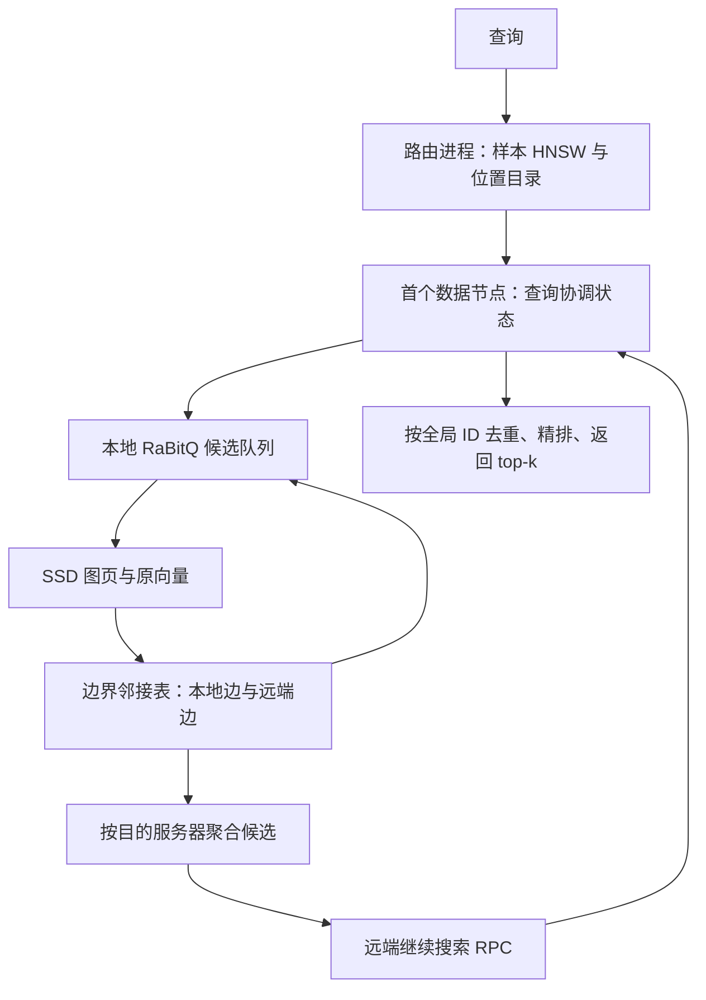
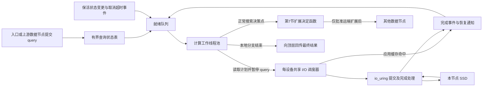

# DHDGS 设计与执行方案

初稿日期：2026-10-15；实现进度更新：2026-10-17。状态：设计提案，已实现端到端小规模 HNSW/RaBitQ/Vamana/磁盘/TCP 原型；外存规模化构建和物理多机性能尚未验证。已实现模块和运行方式见 [README.md](README.md)。

2026-10-17 实现更新：第 6.12 节的首阶段异步独立读取与查询暂停/恢复已实现，提供 io_uring、专用 I/O 线程池和同步基线。实际配置、已实现范围及后续项目见第 6.12.12 节；默认仍保留 blocking，未将异步性能优势视为既定结论。

已确认实验条件：200M 条、2560 维数据向量；200K 条查询；4 台服务器，每台约 1 TB 内存。用户接受高召回 ANN，第一质量目标采用 Recall@10≥0.99，在此约束下优化 QPS 与延迟。距离定义、数据路径/格式、CPU/SSD/网络与部署方式仍待确定。“越高越好”以 recall–QPS–latency 曲线呈现，不预设未经测量的 QPS 承诺。

进一步确认：向量由 ESM2_3B 生成，尚未归一化；允许搜索停滞时使用备用路由入口，并要求统计触发率与额外开销。模型名称不等同于已确定的距离语义，cosine 与原始 L2 的最终选择仍需根据任务或已有 ground truth 确定。

数据规模更新：当前可访问的是 `gene_database/Data/seq_2M/seq_2M` 下正在传输的 2M 轻量子集，配有 200K 库内查询及两套排除自身的 top-100 标签；此前的 200M 作为较大验证规模，长期系统目标为百亿级。格式与只读抽查结果见 [DATA_INSPECTION.md](DATA_INSPECTION.md)。不能把四台服务器的 2M/200M 容量预算直接外推为百亿可部署配置；需要全局 64 位 ID、流式构建、受限缓存/查询状态及显式路由/编码内存预算。

2026-10-16 更新：base 文件长度已达到完整声明，新的随机抽查通过；全量内容 checksum/精确 top-k 仍未验证。实际部署调整为 **3 台数据服务器 + 1 台待就绪的独立路由服务器**。三台数据机硬件与存储/网络实测配置见 [HARDWARE.md](HARDWARE.md)；下文 4 数据分片容量例子保留为早期假设，不作为当前部署配置。2M 三分片平均原向量约 6.83 GB/台，当前可用 SSD 空间支持轻量实验。

## 1. 目标、约束与研究定位

目标是以样本 HNSW 找到数据图入口，在 SSD 上的分布式近邻图中搜索，通过边界副本连接分片，并用 RaBitQ 降低内存占用和估距成本。保持首跳单数据节点，支持必要时跨节点扩展。

必须区分以下性质：

- **可达性**：任意入口能沿有向边到达整个图，需要显式验证和修复。
- **搜索质量**：可达不代表有限 beam、有限跳数下能找到真近邻。HNSW、Vamana 和量化估距都属于 ANN 环节。
- **调度正确性**：被延后的远端候选不能静默丢失；但改变扩展次序，在有限 beam/预算下仍可能改变搜索结果。
- **精确 top-k**：需要覆盖所有可能优于当前结果的数据。全量精确扫描是可靠的校验/兜底路径；候选精排本身不能恢复未访问的真近邻。

“几跳到达最近邻”和“完全不牺牲召回率”应先转化为可测量目标，不能作为任意数据分布上的定理。分别记录图扩展深度、跨服务器串行跳数、并行 RPC 轮数和访问节点总量。

推荐研究问题：在固定召回率下，自适应边界复制与通信成本调度，能否减少 RPC、SSD 读取和 p95/p99？同时测量索引构建时间与额外空间。

## 2. 已核对的代码与文献

| 来源 | 已核对内容 | DHDGS 的使用方式 |
| --- | --- | --- |
| [DiskANN 原论文](https://papers.nips.cc/paper/2019/file/09853c7fb1d3f8ee67a61b6bf4a7f8e6-Paper.pdf)，§3 | 已使用最近多个中心形成重叠分片，独立建 Vamana 后合并出边；内存压缩向量、SSD 原向量与邻接表、beam I/O | 复用算法基础；原论文合并后在单机 SSD 查询，DHDGS 将图保留在多机上查询 |
| [C++ DiskANN](../Reference_Code/DiskANN_cpp/src/pq_flash_index.cpp) | `cached_beam_search` 内通过 `compute_dists` 和 PQ 表估距；SSD 读取已有多扇区处理 | 复用建图和 I/O 经验；需要可暂停搜索状态与量化接口，不能只替换文件后缀 |
| [RaBitQ 原论文](https://arxiv.org/abs/2405.12497)，§3 | 随机正交旋转、无偏估计与概率误差界 | 正确实现估距；理论假设与实际旋转实现分开说明 |
| [多比特 RaBitQ](https://doi.org/10.1145/3725413) | 支持更高精度量化的研究依据 | 1/2/4/8 bit 消融；不预先认定 1 bit 足够 |
| [RaBitQ core API](../Reference_Code/RaBitQ-Library/docs/docs/rabitq/core_api.md) | 本地源码提供独立 C++17 core：requirements / encode / prepare_query / compute，支持紧凑布局 | 直接接入底层估距，不依赖其 IVF 或 HNSW 索引来冒充 DiskANN |
| [旋转实现](../Reference_Code/RaBitQ-Library/docs/docs/rabitq/rotator.md)、[精排说明](../Reference_Code/RaBitQ-Library/docs/docs/rabitq/reranking.md) | FHT/Kac 是均匀随机正交旋转的结构化近似；误差区间不是确定性下界 | 默认高效旋转，保存实际状态；误差区间仅作启发式调度 |
| [Pyramid 论文](https://arxiv.org/abs/1906.10602)，Algorithm 3 | 样本上 k-means，中心构建 meta-HNSW，底层图再划分 | 借鉴层次路由。用户指定的“真实样本构建 HNSW”是不同设计，按用户方案实现 |
| [本地 Pyramid 说明](../Reference_Code/Pyramid/Pyramid_REFERENCE.md) | 第三方 MPI 实现，并非已确认的作者官方实现 | 参考通信流程，不直接作为系统基座；论文细节以论文原文为准 |
| [现有 pyramid_rabitq](../pyramid_rabitq/README.md) | 当前是样本图划分 + RaBitQ-IVF + 共享存储读取节点 | 可参考数据读取与实验工具；DHDGS 独立目录，因为底层检索和节点职责不同 |

实现开始时记录参考源码的提交或内容校验和，并保留许可证。第一阶段没有修改或编译参考代码。第二阶段已经链接 RaBitQ core 并验证端到端原型，参考库仍未修改；使用的版本及许可证见 [THIRD_PARTY.md](THIRD_PARTY.md)。

## 3. 推荐架构与边界



- C++17/20：建图适配、RaBitQ、SSD I/O、候选队列、RPC 数据面。
- Python：数据准备、采样/聚类编排、配置、进程启动、精确 ground truth 与实验分析。
- 第一版：静态数据集、N 个逻辑分片对应 N 台数据服务器、一个路由角色；物理部署允许路由角色独立或共置。
- 用多进程、独立 SSD 文件、真实 TCP RPC 完成单机联调，再迁移多机。多进程结果不当作多机性能。
- 初始建议二进制 gRPC/Protobuf，持久连接和异步请求。备选是 MPI：适合集群批量构建，但在线服务与故障处理约束较多。
- 第一版不实现在线插入删除、过滤、自动迁移和高可用；预留索引版本、逻辑分片与物理位置映射。

路由 HNSW 的 level-0 顶点是**真实样本向量**，每个顶点映射到一个或多个数据节点及该向量的本地 ID。不是将整个 HNSW 底层压缩成 N 个服务器顶点。

按当前条件 N=4，每个分片主数据约 50M 点。k-means 不保证最终分片等量，即使初始 ID 分配均匀；第一版报告实际容量和查询负载偏斜，暂不引入自动负载均衡。

## 4. 距离与可调重叠分片

### 4.1 距离契约

本提案公式采用平方 L2。若目标为 cosine，对非零数据和查询统一 L2 归一化，则 $d_{\mathrm{L2}}^2 = 2 - 2\cos(x,y)$，排序一致；聚类使用该空间的欧氏 k-means。球面 k-means 可作为另一项明确的实验配置。

未经归一化的最大内积不能直接套用本文的 Voronoi 距离和几何解释，需要另行确定聚类与转换方案。零向量、非有限值、重复 ID 必须有显式输入处理策略。

ESM2_3B 数据的推荐实验主方案是 cosine，通过归一化后的平方 L2 实现；原始 L2 作为对照。该推荐不是 ESM2 官方唯一距离约定，也不表示模长一定没有生物学信息。ANN recall 衡量相对于所选距离的精确近邻集合的还原程度，不等于同源性、功能相似性等生物学检索质量；若要比较距离语义，应使用独立的生物学标签或任务指标。

仓库核对结果：`Reference_Code/ERAST/pipeline/emb_optimized.py` 的 ESM 路径对有效残基表示取平均，排除特殊 token，相关输出段未做 L2 归一化；这只是可用生成脚本的行为，尚不能确认当前全部数据由该路径生成。现有 `tools/build_seq_ann_gpu.py` 同时支持 cosine 和 euclidean，CLI 的 `--metric` 默认是 euclidean；`tools/sampled_seq_ann.py` 为两种距离分开保存结果。因此不能依据模型名称或输出目录名称直接复用 ground truth，必须检查其 metric、归一化和 self-exclusion 元数据。

若采用 cosine，在索引构建的数据预处理阶段与在线查询入口执行一致的归一化，之后聚类、HNSW、Vamana、RaBitQ 和精排都使用同一度量空间；源向量文件保持原始值。原始 L2 对照使用独立配置与索引版本，不能直接复用 cosine 图和结果标签。零范数输入默认报告错误，不以任意单位向量替代。

设总向量数为 M、维度 D=2560、中心为 c_1,...,c_N。令：

$$
d_j(x)=\|x-c_j\|_2^2,\qquad a(x)=\arg\min_j(d_j(x),j).
$$

`a(x)` 为主归属；距离并列按中心 ID 决定。即使没有副本，每个向量也恰有一个主归属。

### 4.2 推荐：按几何边界裕量决定副本

对 j≠a(x) 定义：

$$
h_j(x)=\frac{d_j(x)-d_{a(x)}(x)}{2\|c_j-c_{a(x)}\|_2},\qquad
\gamma_j(x)=\frac{h_j(x)}{s_{a(x),j}}.
$$

其中 $s_{ij}=\max((r_i+r_j)/2,\varepsilon_s)$，r_i 是样本主归属簇内向量到中心的 RMS 半径。ε_s 随全局数据尺度确定，防止退化除零。

**解释**：h_j 是 x 到两个中心等距超平面的非负垂直距离。γ 越小，越靠近这个分片边界。相比仅用距离比值，它显式考虑中心间距与局部尺度，避免高维距离集中导致所有分片看起来都相近。

中心相同或极近时不直接除以小数：先重初始化退化/空簇。若不同数据点不足以支撑 N 个有效簇，应报错或经配置减少有效分片，不能静默产生无效中心。

给定阈值 τ：

$$
A_\tau(x)=\{a(x)\}\cup
\operatorname{take}_{C_{max}-1}
\{j\ne a(x):\gamma_j(x)\le\tau\}.
$$

副归属按 `(γ_j,j)` 排序。C_max 是固定安全上限，初始建议 3、且不超过 N；不是需要用户日常调整的主旋钮。中心及尺度固定时，增大 τ 使归属集合嵌套扩大。明显偏向某个中心的向量仍唯一归属，边界向量复制到若干相邻分片。

γ 最小的副中心不一定是原始距离第二小的中心，因为归一化考虑了边界距离和簇尺度；这是明确的几何选择，须与直接距离差基线比较，而不能把两者混称为同一算法。

### 4.3 对用户只暴露一个主要参数：overlap_fraction = ρ

ρ∈[0,1] 表示**目标多归属向量比例**，而不是平均副本数或随机查询的跨机概率。

定义 $b(x)=\min_{j\ne a(x)}\gamma_j(x)$。在独立校准样本上取 b 的 ρ 分位数作为 τ，使：

$$
\Pr_{x\sim\text{数据分布}}(|A_\tau(x)|>1)\approx\rho.
$$

- 推荐确定性划分，不需要每次构建重新掷硬币。概率解释来自数据分布。
- ρ=0 特判为主归属唯一，即使中心距离并列也不复制；ρ=1 且 N≥2 时每点至少双归属。
- 分位点大量并列时，用 `(b(x), hash(seed,global_id))` 做稳定排序；每个副归属用 `(γ_j(x),同一hash)` 与阈值比较，避免阈值处复制率突增。
- 样本校准只能近似达到全量目标。报告实际 `ρ_observed`，不能把配置值当实测值。
- 若要求全量比例严格等于 floor(ρM)/M，增加一轮分布式标量统计/选择确定阈值；不需要再次传输原向量，但需要读取/保存分片分数。固定中心与尺度后仍满足单调性。

定义平均副本因子：

$$
RF=\frac1M\sum_x|A(x)|,\qquad
1+\rho_{observed}\le RF\le1+(C_{max}-1)\rho_{observed}.
$$

例如 C_max=3、实际 20% 的向量多归属，则 RF 在 1.2～1.4 之间。桥接修复采用额外边，不额外复制原向量，因而不改变该关系。N=1 时 RF=1、没有边界。

### 4.4 可选对照方案

| 方法 | 定义 | 取舍 |
| --- | --- | --- |
| 相对距离差 | `(d_j-d_a)/max(d_a,ε)≤τ` | 易实现；受高维距离集中和 d_a≈0 影响，应作为基线 |
| 固定最近 r 个中心 | 每点始终复制到 r 个中心 | 原始 DiskANN 式构建对照；冗余固定，不能区分内部点和边界点 |
| 随机平滑归属 | 主归属必保留，副归属概率 `p_j=exp(-γ_j/τ)` | τ→0 时仅保留几何并列点；τ=0 另行规定唯一主归属。副本量有随机波动，需固定哈希保证可复现；应用上限后概率改变 |

推荐几何裕量 + ρ 校准。若用户所说的“概率”必须指真正的 Bernoulli 随机复制，再采用第三种，并重新校准其实际副本比例。

## 5. 构建流程、通信与连通性

1. 按全局整数 ID 排序并均匀分为 N 个初始范围。全局 ID 使用 uint64，不通过 float 传递；本地紧凑 ID 可在容量允许时用 uint32。
2. 各服务器以固定采样概率做可复现采样，路由端收集样本、训练 N 个中心，并计算簇尺度。校准样本与训练样本建议分开。
3. 广播中心、尺度、版本及采样规则。各服务器分块计算向量到 N 个中心的距离，执行重叠划分；不物化 M×N 距离矩阵。计算量约 O(MND)，中心较多时需评估 BLAS/GPU 的构建加速。
4. 执行**一次逻辑上的大向量 all-to-all shuffle**。向每个归属节点传向量，已在本地的副本不走网络。实际使用有背压的分块流，不要求单条消息容纳全部数据。
5. 接收端建立 `global_id → local_id`，回传样本的新位置。路由 HNSW 用样本原向量构建，位置 payload 在版本发布前完整更新；缺少代表样本的分片补充 medoid 样本。
6. 各分片建 Vamana。默认构建/RobustPrune 使用原始精确距离，查询候选排序使用 RaBitQ，避免把建图量化误差与搜索量化误差混在一起。构建超出 RAM 时使用 DiskANN 的分块构建/合并策略并核算峰值内存。
7. 对多归属顶点 x，收集所有归属节点的出边并按全局 ID 合并：`E(x)=union_{s∈A(x)} E_s(x)`。每份 x 的副本保存相同版本的完整并集。只发到相关副本持有者，不向全 N 台广播。
8. 每条远端边保存目标全局 ID、可用位置、编码引用/必要估距元数据。第一版保留边并集，度数最多约 C_max·R；不能按 R 静默截断跨片边。后续才研究带分片覆盖约束的剪枝。
9. 验证每个本地图的强连通性，并以受保护边连接其 SCC，使图内部可以到达入口及门户。以实际跨片边构建分片图，检查连通性；缺失时用中心距离引导的双向生成树桥接，优先选近边界端点。连通性证据是实际图遍历结果，不是中心图本身。
10. 修复后的完整邻接表再次同步给边界副本持有者；验证从规定入口的可达性、ID/位置有效性、边集一致性、RaBitQ 元数据与校验和后，发布不可变 manifest。

第 9 步中，若每个本地图强连通且分片之间有双向连通的桥边，则全局有向图强连通。修复边单独保存并禁止普通剪枝删除。生成树仅保证可达，不能保证少跳；额外近邻分片桥接应通过实验确定。

采样、广播中心、shuffle、边交换、连通性修复和发布都涉及通信。因此可以做到一次主要的向量重分布，不能宣称整个构建过程只发生一次网络通信。

## 6. RaBitQ 与 SSD 集成

### 6.1 量化契约

建议第一版使用全局共享旋转与每个向量的**主中心**作为编码中心。同一全局 ID 的所有副本与远端编码缓存共用同一编码、中心 ID、校正因子和旋转版本，跨分片估距可比较，也无需重复编码副本。

查询只旋转一次，并按实际使用的中心缓存 query state。数据、中心、查询必须在同一旋转空间。必须保存实际旋转状态，不能仅记录 seed 后假定跨平台完全重现。

接入 `rabitqlib::core` 的紧凑 `SplitPacked` 布局。先做逐向量估距适配，再测不规则图候选的批量处理；FastScan 的 32 向量布局不一定适合稀疏随机邻居，不能预设一定更快。

一位估距的核心形式为：

$$
\widehat d(q,x)=\|q-c\|^2+\|x-c\|^2
-2\|q-c\|\|x-c\|\frac{\langle\bar u_x,u_q\rangle}{\langle\bar u_x,u_x\rangle},
$$

其中 u 是归一化残差，bar-u 是旋转量化后的单位方向映回同一空间。实际使用库中包含范数与偏差校正的实现；仅用符号汉明距离不是 RaBitQ 距离估计。

零残差使用库的专门处理。多比特使用对应编码/估计公式。算法比较包含 1/2/4/8 bit；2560 维有利于误差界中的维度项，但不能仅凭维度保证任意数据上的近邻排序。

### 6.2 空间与页布局

不含校正因子、ID、中心 ID、对齐和图结构时，每点大小为：

| 表示 | 2560 维每点大小 |
| --- | --- |
| float32 原向量 | 10,240 B = 10 KiB |
| RaBitQ 1 bit/dim | 320 B |
| RaBitQ 2 bit/dim | 640 B |
| RaBitQ 4 bit/dim | 1,280 B |
| RaBitQ 8 bit/dim | 2,560 B |

本地库默认按 32 维对齐，2560 不需要为该约束扩展到 4096 维；仍以 `rotator->size()` 实际值为准。共享边界编码与副本也计入内存。

例如 1 亿点的 1-bit 裸编码总量为 32 GB（十进制），尚未乘 RF、尚未加元数据。路由采样比例 p 的原向量内存约 `p·M·10240 B`，不能不看内存预算直接设置很高采样比。

当前 200M 数据的容量预算如下，统一采用十进制 GB/TB，均匀分片、RF=1，未计元数据和构建临时空间：

| 项目 | 全集 | 每台（4 台） |
| --- | --- | --- |
| 原向量 float32 | 2.048 TB | 512 GB |
| 1-bit 编码 | 64 GB | 16 GB |
| 2-bit 编码 | 128 GB | 32 GB |
| 4-bit 编码 | 256 GB | 64 GB |
| 8-bit 编码 | 512 GB | 128 GB |
| R=64、uint32 本地邻接 ID | 51.2 GB | 12.8 GB |

ρ=0.1、C_max=3 时 RF 约 1.1～1.2，原向量平均每台约 563.2～614.4 GB；真实数值受分片偏斜影响，不能据平均值承诺容量足够。3 页节点布局还有对齐空间，边界并集和保护边另计。

该硬件容量可能使完整原向量工作集进入缓存。必须同时报告自然缓存状态和有明确限制的进程/页缓存内存预算下的 SSD 结果；先明确实验方式，不能为了制造磁盘访问而直接修改共享服务器的系统缓存设置。按样本比例 0.1%/0.5%/1% 做路由消融时，分别是 200K/1M/2M 样本，裸原向量约 2.048/10.24/20.48 GB，HNSW 边与管理结构另计。

早期 SSD 提案参考 DiskANN 多扇区固定节点记录，并考虑将边界并集放入 sidecar。**当前实现使用 DHDGS 自定义格式**：`nodes.bin` 内每条记录包含完整 float32 向量、uint32 出度、uint64 全局邻居 ID 数组及填充，边界并集和保护边已经包含在该邻居数组内；位置归属与量化编码另存。文件有一个对齐后的头部，记录长度为 `ceil((4D+4+8R_max)/page_bytes)*page_bytes`，其中 R_max 是分片实际最大出度。当前 2560 维测试索引的记录长度为 12,288 B，不能把它理解为每顶点只读一个 4 KiB 页，也不等同于上游 DiskANN 的原生文件格式。

必须测量这种布局的读放大。第二个候选是邻接页与原向量文件分离：搜索先读邻接表，候选精排时批量读取原向量，代价是改变距离细化时机和额外定位逻辑。两种布局需要相同召回下比较，不能假定分离总是更好。

RAM 保存本地 RaBitQ 码、元数据、有限热图页缓存、有限边界/远端码缓存与查询状态。大规模远端边的编码 sidecar 可按页落盘，缓存必须有字节上限；不能在每条边内重复嵌入 320～2560 B 编码。

实现至少包括量化文件生成/加载、查询预处理、候选估距、scratch 内存、缓存和版本校验；PQ 与 RaBitQ 文件格式不可互相冒充。保留 PQ 对照路径，便于判断质量和速度收益。

### 6.3 SSD 访问聚合：范围与当前基线

2026-10-16 新增，2026-10-17 补充第 6.12 节，**以下 6.3–6.12 保留完整实验设计；2026-10-17 已落实其中异步独立读取阶段，精确实现范围见 6.12.12，其他优化仍为计划**。首先保持 1 bit RaBitQ、现有图、记录格式和跨节点访问链不变，单独研究 I/O。布局重排、图向量分离和改变搜索策略作为后续独立实验，避免无法判断收益来源。

当前路径见 `python/dhdgs/index.py` 的 `Shard.read` 与 `Shard._expand`：每轮选择若干顶点，逐个查询应用 LRU，未命中则同步调用一次 `os.pread(fd, record_bytes, offset)`，解析并计算距离后继续下一条。RaBitQ 编码常驻 RAM。同步基线中一批 4 个未缓存顶点对应 4 次读取、48 KiB 返回数据；新增 resumable 路径也保留这四条独立读取，通过节点内 reactor 异步提交和恢复查询。两者都尚未合并相邻区间或复用不同 query 的在途读取。

必须分别命名三种机制：

| 机制 | 做什么 | 主要希望改善什么 | 不代表什么 |
| --- | --- | --- | --- |
| 异步批量提交 | 一次向内核提交多个独立文件偏移的读取 | 减少提交开销，利用 SSD 并发，缩短同轮串行等待 | 不保证减少读取字节或设备命令数 |
| 连续区间合并 | 将相邻或足够接近的记录读成一个区间，再切片 | 减少应用读请求及固定开销 | 跨间隙合并会多读无关内容 |
| 在途读复用 | 同一不可变记录的一次读取供多个等待者使用 | 减少并发查询间的重复读请求 | 不等于全局去重图扩展或共享查询预算 |

网络种子聚合与上述机制独立。普通 buffered I/O 仍经过 OS 页缓存；一个应用读取区间也不对应固定数量的 SSD 命令，所有收益需要分应用层与设备层观测。

### 6.4 首选路径：已选候选异步取数，搜索按确定顺序消费

推荐先引入数据节点内部的 `read_many` 抽象，输入为已经由搜索选定的一轮顶点，不让 I/O 层自行增添图扩展候选。起步版本不跨轮预取、不等待凑满批、不改变 `search.local_beam`，也不将搜索中间状态发回路由器。

一次本地轮次的拟议流程为：

1. 在搜索侧按原有规则固定候选列表、顺序和预算额度；轮内按全局 ID 去重。给每条记录保留原始序号。
2. 命中应用缓存的记录直接就绪；其余按 `(索引 epoch, 分片, 文件, offset, length)` 查询在途表。键中必须包含文件身份，不能跨分片仅按全局 ID 复用读取。
3. 对仍需读取的记录建立请求，按文件偏移排序只用于规划 I/O；查询候选顺序不随之改变。先支持独立读取，再按 6.5 的条件可选合并。
4. 在设备和查询额度内批量异步提交；额度不足的请求进入有界队列。同一轮的请求数可以大于设备可用额度，分批发出，不能静默丢弃。
5. 完成事件校验长度、记录边界和索引版本，并恢复到原始候选槽位。全部所需记录就绪后，按原先顺序计算精确距离、登记出边并合并候选。
6. 同步保留错误与取消状态；读失败不能当成“空邻居”。统计预算区分预约、完成和取消，记录完成消费后才标记扩展完成。

候选集相同且使用固定消费顺序，可以隔离 I/O 的影响；不过完整分布式系统还有基于墙钟等待的远端触发条件，即使顶点消费顺序不变，读盘变快也可能改变跨机决策。因此分两级验证：固定动作序列回放验证读取等价；在线 adaptive 模式重新测量 recall、访问路径和远端触发原因。不能承诺仅替换 I/O 就使每个在线查询返回完全相同的结果。

第 6.12 节先实现不同 query 之间的 CPU/I/O 流水线，同一 query 仍按固定轮次消费。后续才实验同一 query 内“完成一个就处理一个”：已完成记录的距离计算可以先做，但保持确定性模式的候选提交屏障；提前开放新邻居或启动下一轮属于搜索调度变化，必须单独开关。一个 beam 的数据依赖仍然存在，不能预先知道尚未读出邻接表的下一跳。

后端优先考虑 C++ `io_uring`，通过 Python/C++ 边界一次提交整批，等待时释放 GIL。先使用普通读取语义，记录内核、文件系统及实际后端；buffered 异步读取的底层执行方式也需实测。受限环境保留同步 `pread` 基线，可选有界线程池作为过渡对照；线程池不是原生异步 I/O 的等价性能保证。`preadv` 面向从一个文件偏移开始的连续数据分散到多个缓冲区，不能单凭它实现任意多个不连续文件偏移的读取。

### 6.5 连续区间合并：收益与读放大共同约束

顶点 u 的文件区间为：

$$
I(u)=[H+\operatorname{location}(u)S,\ H+(\operatorname{location}(u)+1)S),
$$

其中 H 为文件头长度，S 为分片固定记录长度。仅在同一文件、同一 epoch 内合并。对按偏移排序的一组未缓存记录 G，定义：

$$
B_{use}(G)=\sum_{u\in G}|I(u)|,\quad
B_{span}(G)=\max_{u\in G}\operatorname{end}(I(u))-
\min_{u\in G}\operatorname{start}(I(u)),\quad
A_{merge}(G)=B_{span}(G)/B_{use}(G).
$$

`B_use` 是本轮确实请求的完整记录字节，包括记录自身填充；`A_merge` 衡量跨间隙合并额外引入的放大，不等于向量有效载荷读放大或设备物理读放大。默认实验先只允许完全连续的记录，即 `max_gap_bytes=0`、`max_read_amplification=1.0`。

合并需同时满足：相邻间隙上限、区间总字节上限、读放大上限以及缓冲池额度。启用跨间隙实验时，再要求基于实测模型的预计完成时间改善超过安全裕量：

$$
\widehat T_{separate}(G\mid QD,\text{cache regime})-
\widehat T_{merged}(G\mid QD,\text{cache regime})>\delta_t.
$$

两侧都用相同在途深度与缓存实验条件下的批完成时间估计；不能拿串行独立读的耗时和并发合并读比较，从而夸大合并收益。OS 页缓存命中通常无法逐请求事前准确获知，模型只使用可观测信息并记录预测误差，不能假定有精确缓存预言器。

例：12 KiB 定长记录中，本地序号 `[100,101,102,103]` 可以从 4 个读取合成一个 48 KiB 读取，应用请求数减少 75%，请求字节不变；但物理设备命令数量和延迟未必同比降低。序号 `[100,102]` 合并为 36 KiB，会替代两个共 24 KiB 的请求，`A_merge=1.5`；在随机 IOPS 紧张时可能有利，也可能因带宽浪费而变慢。序号 `[100,900,1700,2500]` 跨度约 28 MiB，不能为节省三个请求就读取整个区间。

第一版不把间隙中的未请求记录当作新候选，不额外扣图扩展预算，也不默认放入应用缓存。合并缓冲区切成记录后，只缓存已请求记录，防止一次小记录缓存引用长期钉住整个大缓冲区。若选择拷贝，则单独记录拷贝字节、CPU 耗时及峰值内存。文件长度、offset 溢出和短读均需要显式检查。

当前记录按 ID 排列，图邻居未必连续；因此预计异步独立读取比大范围连续合并更普遍适用。空间合并收益首先取决于真实查询 trace 中的文件偏移局部性，不能据邻居在向量空间接近就推断其磁盘位置接近。

### 6.6 设备级额度、跨查询复用与生命周期

每个物理 SSD 设置总在途请求数与总在途字节上限，同时限制每个查询的在途请求数。多个逻辑分片落在同一设备时共享设备额度；单机多节点测试不能给每个进程各自完整设备额度，再把过载结果当作多机性能。实现时可由共享 I/O 服务统一调度，或由实验启动器明确分配保守配额；跨进程的在途读复用需要共享服务等显式进程间机制，不能假定进程内表具有该能力。

缓冲池内存粗略满足 `在途区间字节 + 完成但未消费字节 + 拷贝暂存字节`，此外计入请求对象和等待队列。必须对完成未消费数据背压，而不只限制已提交请求数。每查询采用公平轮转或字节配额，避免一个大 beam 抢占整块 SSD；不同大小合并请求需按字节核算。初版不为跨查询聚合主动延迟请求，只复用已经相遇的在途读取。

同一 epoch 下的相同记录由多个查询请求时，一次文件读取对应的 future 可以挂多个等待者。只有读取结果共享，每个查询仍独立更新 top-k、预算和出边状态；分摊 I/O 字节与等待者数分别记录，避免每个等待者都把完整文件读取计入系统总量。是否实际访问 SSD 仍取决于缓存。复用范围先限进程内，不增加跨节点去重协议。

某个查询超时或取消，只移除其等待关系；还有其他等待者时不能取消共享读取。所有等待者都取消后可以尝试取消，但不能假设内核一定尚未完成 I/O。只有收到完成/取消确认后才能回收 DMA/读取缓冲区；迟到完成不应重新激活已结束查询。索引卸载需等待引用释放，不能提前关闭文件或复用缓冲区。短读、I/O 错误和后端不可用都产生显式状态；后端回退需记录原因，不能把同步回退的实验标成异步结果。

### 6.7 与跨机选择函数、预算及召回率的关系

SSD 聚合属于数据节点内部执行能力，不改变第 7 节的职责：路由节点只负责入口、保活及最终合并；节点 1 派发节点 2 后继续本地搜索，节点 2 不携带节点 1 未完成的本地候选，也不回访已访问服务器。

本地动作的成本模型应从“每顶点平均耗时乘数量”升级为：

$$
\widehat C_L(a)=\widehat t_{queue}(a)+
\widehat t_{batch}(m,B,QD,h)+\widehat t_{CPU}(a),
$$

其中 m 是合并后的读请求数，B 是请求字节，QD 是设备在途深度，h 是应用缓存/在途复用情况。`t_batch` 采用同类批次完成时间的在线估计；启用 CPU/I/O 重叠后改用动作完成时间估计，不能将重叠耗时直接相加。冷启动模型由校准结果初始化，并保留预测误差。适应新的本地成本后，`remote_weight` 的数值和实际跨机率关系也可能变化，需要重新校准。

2026-10-17 按用户明确要求修订：**本机 I/O 调度器没有跨机派发权限，也不得通过定时器或恢复事件提前调用远端扩展决策。** 只有搜索执行器到达正常扩展决策点，调用第 7 节函数并得到允许远端扩展的结果，才能发送新的远端查询分支。等待本地 SSD、设备排队、读取完成或出错、工作线程空闲均不能自行触发远端扩展。控制线程仅继续保活、取消、超时处理和已授权通信的交付。

首阶段同一 query 保持原轮次：选定本地 beam 后，等待本轮读取并完成消费，再到下一正常搜索决策点重新评估；其他 query 可以在此期间执行，不借机提前派发该 query 的远端分支。第 7 节已有等待阈值也仅在正常扩展决策函数内检查，不新增独立的远端定时派发器。派发权限与预算拆分仍需串行化，已预约的本地额度不能再次交给远端；超时取消的预约必须有结算记录。

I/O 批大小、设备队列深度与图搜索 beam 是不同参数。增大前两者不应暗中增大扩展预算；增大 beam 或跨轮预取会改变探索轨迹和无用读比例，单独作为算法实验。仅完成数据读取不算图扩展完成，不能提前写入 `expanded`；父子节点之间现有 seen 快照语义也不会因在途读复用变为实时全局顶点去重。

### 6.8 预计收益、上限与可能退化的情况

对一批 m 个互不依赖的冷读取，现状近似串行等待 `sum(t_i)`；并发提交在设备有余量时可能接近该批最慢读取的完成时间加提交/排队开销。若只有 4 个独立请求且延迟相近，单轮纯 I/O 等待的理想化缩短可接近 4 倍；**这不是 SSD 或查询整体的性能承诺**，也不包含前后图搜索的依赖轮次。

若当前查询端到端延迟中可优化、未被其他工作覆盖的 I/O 等待比例为 f，假定其缩短 s 倍且其余成本不变，则整体加速上限模型为：

$$
Speedup\approx\frac{1}{(1-f)+f/s}.
$$

例如 f=0.6、s=3 时约 1.67 倍；f=0.1 时仅约 1.07 倍。f 必须来自端到端关键路径或受控对照，不能使用多个并行分支的 `pread_ms` 之和除以查询延迟估算。

| 假设 | 可能收益 | 可能退化及验证重点 |
| --- | --- | --- |
| 异步独立读取 | SSD 利用率、冷查询单轮等待、吞吐改善 | 高并发已打满设备时 QPS 不再提升；深队列恶化 p99 |
| 连续区间合并 | 减少提交和处理小请求的固定开销 | 合并减少并行度，或大读拖延小读；需同 QD 对照 |
| 有界跨间隙合并 | IOPS 受限时以少量多读换更少请求 | 带宽、缓存污染、拷贝和内存占用上升 |
| 在途读复用 | 热门入口/邻居的重复读取下降 | 冷且分散的查询复用率低；锁与引用管理反成开销 |
| CPU/I/O 重叠 | 隐藏部分读等待或估距时间 | 顺序与预算复杂度增加，过度预取造成无用读 |

当前小索引及 2M 数据相对于机器 RAM 很小，缓存热态下新增异步队列和缓冲管理可能更慢。必须保留同步基线及缓存快速路径，不能仅凭“用了 io_uring”判定优化成功。跨机网络/结果回传占主导时，SSD 优化对端到端延迟的影响也有限。

### 6.9 拟议 YAML 参数（尚不可直接使用）

所有新参数计划加入现有统一 YAML 的 `storage.io` 下，扩展 schema、校验和实验快照后才能使用；目前配置校验不接受这些新字段。本次仅列出讨论值，不创建第二份配置，不修改当前默认行为。现有 `storage.page_bytes`、`storage.cache_bytes_per_shard`、`search.local_beam` 保留各自语义。

| 拟议参数 | 起步讨论值或扫描范围 | 含义 |
| --- | --- | --- |
| `backend` | `sync_pread` 基线；`io_uring` 对照；可选 `thread_pool` | 实际读取后端，报告实际生效值及回退原因 |
| `direct_io` | false；true 单独实验 | 绕过常规文件数据页缓存的读取方式，需校验文件系统支持与真实对齐要求 |
| `max_submit_requests` | 4；扫描 1/4/8/16 | 每次最多提交多少读区间，不增加搜索 beam |
| `max_inflight_per_query` | 4；扫描 1/4/8 | 单查询最多在途区间数 |
| `max_inflight_per_device` | 扫描 8/16/32/64 | 物理设备共享请求额度，不能按逻辑分片重复放大 |
| `max_inflight_bytes_per_device` | 起步 4 MiB | 在途读取总字节上限，与请求数上限同时生效 |
| `buffer_pool_bytes_per_device` | 起步 16 MiB | 在途及完成未消费缓冲区总预算，额外拷贝暂存需纳入核算 |
| `max_pending_requests_per_device` | 起步 1024 | 有界等待队列；满时背压/显式过载，不能丢候选 |
| `worker_threads` | 线程池后端扫描 2/4/8 | 仅线程池后端使用，不等于设备队列深度 |
| `coalesce` | false 基线 / true | 是否合并文件区间 |
| `max_gap_bytes` | 0；随后扫描 12288/24576 | 最大相邻记录间隙；示例基于当前 12 KiB 记录 |
| `max_read_bytes` | 起步 64 KiB；扫描 64/128/256 KiB | 单个合并区间上限，至少容纳一条记录 |
| `max_read_amplification` | 1.0；随后扫描 1.25/1.5 | 跨间隙合并读放大上限 |
| `min_predicted_saving_us` | 0/5/10，模型校准后使用 | 跨间隙合并的预计收益裕量，无可靠模型时禁用跨间隙合并 |
| `inflight_dedup` | false / true 消融 | 进程内在途读复用 |
| `completion_policy` | `round_ordered`；后续 `as_ready` | 固定轮内消费顺序或完成即推进搜索；后者需独立质量验证 |
| `prefetch_rounds` | 0 | 首阶段禁止跨轮推测性预取 |

初版不设置人为凑批等待；现有候选准备好就提交。实验若涉及共享设备额度，需要同时记录设备映射、进程数与配额分配。配置合法性检查应覆盖单条记录、单次最大读取、在途字节和缓冲预算的相容性；direct I/O 的内存地址、offset 和长度对齐以文件系统要求为准，不能只看到 `page_bytes=4096` 就认为满足所有条件。

### 6.10 实验、指标与共同决策门槛

按照“正确性 → 固定读取轨迹 → 完整搜索 → 多机”的顺序执行，实验记录统一放在 `test/ssd_aggregation_<timestamp>/`，包括完整 YAML 快照、索引/代码版本、设备映射、原始逐 query 指标、汇总和实验结论。本次不运行以下实验。

1. **读取正确性**：同一索引对比原 `pread` 与批量读取的记录字节、向量、邻居、精确距离；覆盖乱序完成、重复 ID、缓存命中、部分批次、最后一条记录、短读/错误、取消、共享等待者及版本切换。核验预算和内存引用生命周期。固定动作回放的结果应一致。
2. **轨迹局部性**：先收集真实查询每轮选定 ID、offset、缓存状态和时序，统计连续记录比例、可合并批大小、间隙分布、在途相同记录重叠率。根据这些数据决定是否值得做跨间隙合并或跨查询复用，避免直接扫描全部参数组合。
3. **I/O 消融**：同步基线；异步独立读；异步 + 仅连续合并；异步 + 受限间隙合并；独立加入在途复用。保持同一记录请求轨迹、数据和缓存条件，先比较请求数、请求字节、批完成时间与 CPU 成本。回放只用于内核收益判断，不代替 ANN 质量实验。
4. **缓存与真实 SSD**：分别报告自然热缓存、应用缓存关闭但 OS 缓存保留、受控冷态或受限文件缓存、direct I/O 对照。只关闭应用缓存不能称为冷 SSD。2M 数据很可能完全驻留页缓存；需要隔离的内存限制或工作集设计，并验证设备读取量。不得直接清空共享服务器系统缓存；若后续环境操作需要权限，再提出具体实验方案。direct I/O 的结果也不等同于部署中的普通 buffered 冷态。
5. **搜索质量与负载**：固定图、1 bit 编码、查询集、随机种子和预算做配对实验，再分别在相同 Recall@10 工作点比较。覆盖 0.70–0.99 曲线，目标 0.99 用独立验证查询及置信区间报告。扫描单查询、并发与固定到达率；报告 offered/completed QPS、超时、拒绝率及成功率，不能只汇总成功查询而隐藏过载。按用户决定的质量/延迟取舍选择参数。
6. **调度交互**：先固定远端动作回放，再开启第 7 节自适应逻辑；比较条件触发/强制触发比例、远端权重、访问链、跨机次数、备用入口率和重复顶点工作。验证本地等待不阻塞保活与取消；远端等待阈值只在正常扩展决策点检查，I/O 或定时事件不得新增、提前调用跨机决策或绕过其结果发送请求。
7. **真实多机复验**：单机多个节点共享同一 SSD 的结论，只适用于共享设备；三台机器各自 NVMe 型号不同，需要按机校准 QD 和成本，报告各节点利用率、队列等待、CPU/NUMA 配额，不能按同一标称配置假定能力相同。

除已有逐 query 延迟、recall、RPC、扩展数和阶段均值外，拟新增下列可归因指标：

| 层次 | 指标与定义 |
| --- | --- |
| 逻辑读取 | 请求记录数、唯一记录数、应用缓存命中数、在途复用等待者数、实际新发起记录数 |
| 区间聚合 | 合并前/后区间数、记录数/区间分布、`B_use`、`B_span`、间隙字节、`sum(B_span)/sum(B_use)`；分母为零时标记不适用 |
| 提交与设备额度 | 提交调用数、每次提交请求数、在途请求/字节时间分布、队列等待均值及 p95/p99、背压和拒绝次数 |
| 时间 | 准备/合并 CPU、提交开销、提交到完成、完成到消费、整轮就绪等待、拷贝、精确计算与 RaBitQ；逐 query 及总体均值同时保留 |
| 无用工作 | 超时/取消后完成的字节、预取未消费字节（启用预取后）、读取但未扩展记录数及原因 |
| 物理设备 | 设备读字节、读 IOPS、延迟/队列/利用率；说明采样来源，块层统计不等于 NAND 内部访问次数 |
| 资源 | 缓冲池峰值、完成未消费峰值、应用缓存占用、CPU 时间、拷贝字节与内存带宽影响 |

保持 `pread_calls` 的原语义，只统计真正的 pread 调用；异步后端新增通用文件读请求和提交指标，不将 SQE 数冒充 syscall 数。跨查询复用的系统实际读只计一次，逐 query 分别报告逻辑需求、等待时间与明确规则下分摊的字节，保证总量可对账。共享设备上的 OS 计数可能包含其他进程流量；记录背景负载，无法精确归因时只报告设备窗口汇总，不捏造逐 query 物理读字节。

并行分支和异步读的累计服务时间可超过端到端延迟。延迟占比使用有明确定义的关键路径/互斥区间统计，累计工作量单列；任何未能可靠归因的部分标为未知或等待，不能通过简单相加生成“磁盘占比”。新增跟踪开销也需要详细 trace 开/关对照。

共同决策时先看正确性与质量是否满足预设门槛，再看相同召回下 p50/p95/p99、QPS、CPU、读字节和内存的变化及置信区间。如果异步只改善冷态，就保留为冷态选项；如果合并减少请求却提高 p99 或大量多读，则缩小间隙/区间上限或关闭。首阶段不承诺具体加速倍数，不因某一次平均延迟下降就修改最终默认值。

### 6.11 推荐实施顺序与后续可选方向

建议讨论后按以下顺序推进，每阶段先提交实验记录再共同确定下一阶段参数：

- **A：基线与观测**。完善读取轨迹与设备映射，核实热缓存/真实 SSD 区别，不改变搜索行为。
- **B：异步独立读取**。按第 6.12 节引入共享 I/O 调度器、有界 `read_many` 和 query 暂停/恢复，保持同一 query 的固定消费顺序，提供同步基线；先验证数据与预算正确，再测计算线程、QD 与查询并发。
- **C：仅连续合并**。保留现有磁盘布局，不多读间隙，比较独立并发读和合并读。跨查询复用作为单独消融，不与其捆绑发布。
- **D：受限间隙与流水线**。仅在轨迹及成本模型支持时实验间隙读取；完成即推进、CPU/I/O 重叠及预取分别验证召回和浪费，不直接扩大 beam。
- **E：布局研究**。若 ID 排列导致局部性很低，再比较分片内按图邻域/聚类重排记录，保持全局 ID 和边集不变，仅重建 ID→offset 映射及发布新索引版本。记录重排成本、临时空间和恢复验证；它不应与 I/O 后端改造混为同一项收益。

图邻接表与完整向量分离属于更大的存储设计实验：先读紧凑图页、只对需要的候选读原向量，可能显著降低 2560 维场景的读取带宽，也可能引入额外随机读并改变精排/停止条件。该方向需要独立布局版本、相同召回对照与容量预算，暂不纳入第一阶段。边界副本、受保护边、RaBitQ 1 bit 和跨服务器不回访规则均不因 I/O 聚合自动改变。

### 6.12 第三种方式的详细设计：跨 query 的不连续请求异步批量提交

2026-10-17，应用户要求补充。本节的“第三种”对应讨论中的三种跨线程聚合方式：**相同记录复用、相邻记录合并、不连续请求批量提交**，指最后一种，不是第 6.3 节表格的第三行。本节以“不连续请求批量提交 + 不同 query 之间的流水线”为首阶段方案；读取复用和区间合并通过独立开关后续加入。

本节保留设计目标与后续扩展方案。首阶段已实现 `io_uring` 和可恢复查询，具体接口及已开放配置以第 6.12.12 节为准；表中其余提议参数尚不能写入严格校验的运行 YAML。

用户确认的边界：本节调度只针对本机请求聚合与流水线。删除此前“等待本地 I/O 时用定时事件唤醒远端派发决策”的提案；跨机扩展由第 7 节函数在正常搜索决策点唯一决定，避免 I/O 调度提前占用网络和远端计算资源。

#### 6.12.1 目标、非目标与三个并发维度

目标是让多个 query 共享数据节点的 SSD 读取能力：计算线程产生读取请求后即可执行其他就绪 query，I/O 完成后再恢复原 query。既提高冷读时的设备利用率，也控制设备排队和完成后等待，按用户已选择的 **p99 优先、QPS 次之** 标准评估。

定义三个独立的容量变量：

| 符号 | 对应资源 | 作用 |
| --- | --- | --- |
| W | 计算工作线程数 | 同时推进多少个就绪查询分支；不包含 I/O reactor 与控制线程 |
| A | 活跃查询上限 | 包含就绪、运行、等待 I/O 等状态；每查询状态占用必须有界 |
| D | 每物理设备的在途读请求上限 | 限制已被内核接受但尚未完成的文件读取，同时受字节与缓冲池额度限制 |

例如 `W=4、A=64、D=32` 表示 4 个计算线程维护最多 64 个查询状态，并允许最多 32 个文件读请求在途；三者不要求相等。这是说明性配置，不是经过多机实验的推荐值。更多 query 只有在到达负载足够、且确有等待可覆盖时才能提供额外并行性。

[线程实验](test/worker_threads_20261016T233213/SUMMARY.md) 中的 1 线程优势仅适用于现有缓存热态 Python 原型；不能推导新状态机或真实多机下 W 也必须为 1。反过来，也不能因为机器核心多就将 W、A、D 一起调大。第一阶段固定图、1 bit 编码、12 KiB 记录、搜索 beam 与预算，不跨轮推测性预取，不修改邻接表与副本布局。

#### 6.12.2 数据节点内的组件与责任边界



- **查询状态表**保存每个 `(query_request_id, branch_id)` 的 frontier、seen、top-k、访问链、预算、轮次及等待状态。不得将这些中间状态交给顶层逐批协调。
- **计算工作线程池**只推进就绪任务，读取未完成时不执行阻塞 `future.get()` 或在 Python 中等待。每个分支由单一执行者修改，可在不同线程之间恢复，但不能同时由两个线程推进。
- **设备 I/O 调度器**接受各查询已选定的读取计划，做缓存检查、公平排队与额度分配；初版不按文件偏移重排查询优先级，也不主动增加读取对象。
- **原生 I/O reactor**拥有 ring、文件注册/引用、请求表和缓冲池，提交 SQE，处理 CQE 并发布有界事件。它不直接维护 Python frontier、不执行 RaBitQ，也不在完成回调中等待网络。
- **控制与传输组件**继续处理保活、取消、结果回传，以及扩展决定函数已经批准的数据节点派发。它们不自行选择远端候选、不通过控制事件提前运行扩展函数。控制事件通过查询 mailbox 参与状态串行化；独立于数据读取队列，但仍共享机器资源，不能承诺零干扰。

初版每个数据节点进程、每个使用的设备配置一个 reactor，减少 ring 所有权和缓冲区回收的复杂度。单机多分片进程共享同一设备时，由启动器分配总和不超过设备预算的进程额度；后续可研究进程间共享 I/O 服务。仅创建多个进程内 ring 不等于已经实现物理设备统一调度。真实三机各自管理本机设备，不跨服务器合并 SSD 请求。

#### 6.12.3 一轮查询的暂停与恢复过程

1. **选择**：工作线程获得分支执行权，按既有调度与 tie-break 选出本轮本地候选，冻结顺序，预约相应扩展预算。首次实现每分支最多一轮未消费的本地读取。
2. **规划**：生成包含 global ID、文件引用、offset、length、原始槽位的 `ReadBatch`；检查本地归属与 epoch。应用缓存命中也进入相同的槽位就绪机制。
3. **提交或背压**：原生接口只做有界的入队操作，返回 `accepted` 或 `backpressure`。被背压的分支进入容量等待状态，而不是让计算线程阻塞；读取计划和已预约预算仍由该分支持有。
4. **暂停**：查询发布本轮 `WAIT_IO` 状态，交还工作线程。工作线程可以推进另一个 query，不能在提交接口后立即同步等待结果。
5. **取数**：reactor 从不同 query 的就绪请求中公平取出一批 SQE；每条仍可以指向完全不同的文件偏移。设备额度不足时只提交能容纳的部分，剩余请求保留。
6. **完成**：CQE 按请求 ID 找到本轮槽位，校验读取长度与文件生命周期。第一阶段整轮全部成功后才发布一次数据就绪事件；失败则发布显式错误并开始回收其余读取。
7. **恢复与消费**：计算线程通过事件获得分支执行权，按冻结顺序解析向量、计算精确距离、登记邻居并做 RaBitQ 估距，更新候选及完成预算。消费完成的记录释放缓冲引用，之后开始下一轮或结束分支。

恢复不是从头重新搜索，不重新路由，也不重新计算已完成的扩展。原 query 的候选、预算和访问链保留。等待数据期间，分支仍可处理取消、保活状态变化和查询超时；不生成远端候选等待到期的派发事件。这些控制事件不得令同一分支重入执行本地消费或提前调用扩展决定函数。

例：Q1 需要 A、B，Q2 需要 X、Y，四条记录在磁盘上不连续。调度器可以先提交 A、X、B、Y；Q2 的两条先完成，则先恢复 Q2，无需等待 Q1。Q1 内部仍按 A、B 消费。两个 query 共提交 4 个读取、48 KiB；减少的是逐条等待和可能的提交开销，并没有变成一次 48 KiB 连续读，也不承诺四个设备命令同时完成。

#### 6.12.4 查询状态、事件关联与一次性唤醒

建议将以下状态落实为显式枚举及可检查的不变量：

| 状态 | 含义 | 下一步 |
| --- | --- | --- |
| `READY` | 已在就绪队列，等待计算资源 | 原子获得执行权后进入 RUNNING |
| `RUNNING` | 唯一执行者正在推进分支 | 交回就绪队列、等待容量、等待 I/O 或结束 |
| `WAIT_CAPACITY` | 读取计划已准备，尚未取得必要资源 | 收到容量通知后重新尝试，不忙轮询 |
| `WAIT_IO` | 存在尚未消费的本地读取轮次 | 处理数据就绪/错误/取消/保活/查询超时，不执行远端扩展决策 |
| `DRAINING` | 已超时、取消或失败，停止发新工作 | 等待不可取消的读取完成并释放资源 |
| `DONE` / `FAILED` / `CANCELLED` | 分支计算终态 | 按原控制协议交付报告，释放引用后回收上下文 |

事件关联至少包含 `(query_id, branch_id, context_generation, round_id, request_id, slot_id, epoch)`。请求 ID 在仍可能收到迟到完成时不得复用；上下文 generation 防止旧事件命中新建查询对象。每个分支最多持有一个执行权、一个就绪队列引用；多个 I/O 完成和定时器事件到达时合并唤醒，不能重复启动该分支。

执行权与本地轮次的 I/O 状态分开保存：WAIT_IO 分支因控制事件暂时获得执行权，并不意味着本地记录已经就绪，也不意味着获得提前跨机扩展的机会。事件处理后若本轮仍未完成，继续等待；若完成事件同时到达，则由当前执行者或下一次唯一唤醒消费，不能漏唤醒或重复消费。

必须处理“读取在提交返回前已经完成”的竞争：先安装 round/slot 和等待计数，再将请求交给 reactor；完成线程只发布事件并更新受保护的槽位状态，分支的执行权交接通过原子状态/锁完成。缓存全命中也走相同规则，允许当前执行者继续推进，但不能递归执行无限多个即时完成回调。

原生 request 表只持有稳定的原生句柄与引用，不把临时 Python 对象指针直接放入 `user_data`。所有 Python 搜索状态变更由计算线程完成；原生完成线程不依赖获得 GIL 才能排空 CQ。C++ 量化对象的只读访问与 scratch 线程安全需要审计，每查询/每工作线程独享可变 query state，不能把共享量化器误当作共享 scratch。

#### 6.12.5 io_uring 的提交、完成与后端边界

建议新增原生接口 `submit_read_batch(plan)`、`drain_completions(limit)`、`cancel_batch(handle)`、`device_stats()`。接口为设计名，尚未实现。`submit_read_batch` 成功只表示调度器接收计划；分别统计排队、写入 SQ、被内核接受、CQE 返回、query 恢复与消费，不能把入队当作读盘完成。

初版由单个 reactor 管理每个 ring 的 SQ/CQ，跨 query 请求通过有界生产者队列进入。每个读 SQE 指定本地 fd、offset、长度和缓冲区。起步使用普通 READ，不设置跨独立 query 的 linked-request 顺序依赖；一个 query 的错误不能级联取消另一个 query 的读取。注册文件/固定缓冲、SQPOLL、IOPOLL 分别作为后续实验，初版不默认启用占用专用 CPU 的轮询模式。

每轮事件循环先回收已完成的请求与额度，再从可执行请求队列取出至多 `max_submit_requests` 个请求提交；没有新请求时用可唤醒等待处理完成、生产者通知和下一定时期限，不持续忙轮询。就绪请求不足批大小时立即提交，不设置凑批等待。一次 submit 可能被内核部分接受，需要按实际接受数记账、继续推进其余 SQE，不能重复提交已接受请求。

CQE 的 `res` 为读取结果；只有长度符合记录要求才可将其交给搜索消费。负错误码、短读、提交失败都进入显式错误路径，初版不把短读补零，也不在不确定已提交状态下盲目重试。对临时背压重试只能作用于确认未被接受的请求；真正 I/O 错误的重试需独立政策和预算，本阶段先以失败可见为准。

普通 buffered I/O 可能由页缓存满足，也可能在内核工作线程执行阻塞部分，`io_uring` API 本身不保证完全由设备异步处理。direct I/O 对照需要检验文件系统、地址、偏移、长度对齐，保留相同查询语义并单独记录缓存差异。后端探测在启动时完成；不可用时按配置明确报错或使用有界线程池后端，报告实际模式。运行中的请求不能未经清理直接切换后端。

线程池兼容后端由专用 I/O 线程执行同步 pread，完成后产生同样的事件；它仍让计算线程释放出来，但会使用额外阻塞线程。`sync_pread` 保留为完整基线，不能把其结果标注为原生异步性能。

#### 6.12.6 公平调度、背压与缓冲池死锁预防

初版采用每 query 队列与按字节计费的 deficit round-robin：每次轮到 query 增加固定 quantum，若首请求长度不超过其额度且设备/查询额度足够则允许提交，扣除相应字节后轮转。各 query 权重初始相同，quantum 起步取一条记录长度或一轮记录字节，作为配置实验。它提供请求调度层公平性，不保证不同 query 完成时间相同。

对设备 d 的在途集合以及查询 q，始终满足：

$$
\sum_q n_{q,d}^{\mathrm{inflight}}\le D_d,
\qquad n_{q,d}^{\mathrm{inflight}}\le D_q,
\qquad \sum_{r\in\mathcal I_d}\mathrm{bytes}(r)\le B_d.
$$

设备在途计数指已经被内核接受、尚未完成的文件读请求，不是 SSD 内部命令数。SQ 容量、等待计划数量与上述在途额度分别受限；不能只扩大 ring 就绕过每 query 上限。容量释放唤醒等待者，不让所有线程反复争抢同一额度。初版不实施在线自动扩队列或 deadline 优先抢占，先用固定额度验证 p99。

**整轮屏障必须防止缓冲池死锁**：如果很多 query 都持有部分已完成记录，并等待剩余读取取得缓冲，而所有缓冲已被这些部分轮次占满，就可能无人完成、无人释放。起步方案是在接纳一轮读取前，为该轮全部输出及必要暂存预留容量；设备在途深度可以小于该轮记录数，但其余读取所需内存已经有保证。内存不足的轮次留在 WAIT_CAPACITY，不先拿少量缓冲后无限等待。

以 `beam=4`、每记录 12 KiB 为例，一轮原始记录需 48 KiB；64 轮同时获准至少需要 3 MiB 原始记录空间，尚未包含复制、请求对象、候选状态、量化 scratch 与缓存。配置必须保证至少一轮能完成。缓存记录使用期间的 pin/reference 也需计入可用内存核算，不能因 LRU 驱逐而产生悬空引用。

完成但未消费的缓冲仍占池额度；只有消费或安全取消完成后才归还。完成队列与恢复队列需要预留可表达所有已接纳请求/轮次的通知容量，或使用可合并的每轮槽位标志；reactor 不能因计算线程暂未消费而阻塞排空 CQ。已接受的完成事件不得丢弃。暂停新读、优先消费完成记录、及时处理取消是背压恢复路径。

计算工作也需要公平：一次取得分支执行权只推进有界的顶点数/一个阶段，然后检查取消和待处理控制事件，必要时重新入队。时间片是检查点间的软上限，不能强制抢占已经运行的原生计算调用；较大的估距批需研究分块及 scratch 复用。该限制用于防止缓存命中 query 长时间占用计算线程，不改变选定候选的消费顺序。

若一轮消费分为多个计算片，保存消费游标、暂存精确距离和邻居集合；保持原轮内顺序，并在整轮准备完成后统一提交新 frontier。让出线程不等于提前公开部分邻居或启动下一轮，否则会把跨 query 流水线悄悄变成同一 query 内的搜索顺序变化。

#### 6.12.7 本机 I/O 与扩展决定函数的边界、预算及终止协议

**只允许搜索执行器在正常扩展决策点调用第 7 节函数，并依据返回结果派发远端分支。** 本机 I/O 调度器只接收本地文件读取计划和发布读取完成/错误事件，没有远端地址选择、远端计算预约或查询派发接口。

若搜索函数本轮选择本地 beam，则 query 按 `选择本地 → 提交读取 → WAIT_IO → 消费本轮 → 下一搜索决策点` 推进。I/O 等待期间，即使已有远端候选、等待时间增加、设备繁忙或有空闲工作线程，也不提前调用扩展函数、不发送新远端分支。保活、取消和查询超时仍可正常处理。I/O 出错按失败/取消协议处理，不自动把查询转移到其他服务器。

若搜索函数在正常决策点批准远端扩展，则通过原传输组件派发，父节点继续本地搜索。已有请求的协议重试沿用原批准动作，不重新运行候选选择或额外占用远端分支预算。建议给每次批准记录 decision ID、原因、目标节点和预算，并将新派发请求关联到该记录；I/O 通知本身不能作为派发理由。

第 7 节既有 `max_wait_ms`、本地耗尽及备用入口规则仍归搜索决定函数管理，本次不增删其算法规则；等待阈值不再解释为独立定时器在 I/O 期间强制派发的实时保证。本节只约束调用位置和权限，不引入新的跨机调度器。

节点 1 派发节点 2 时，本节点已提交的读取仍归节点 1 负责，完成后继续消费。节点 2 丢弃属于节点 1 的待处理本地候选，不接收 fd、ring token、buffer 指针或本地未完成轮次。唯一的继续派发权限与访问链按现有协议传递，不因 I/O 完成或线程恢复而重新生成派发权。

对单个分支收到的扩展额度，建议使用显式账本：

$$
B_{\mathrm{grant}}=
B_{\mathrm{free}}+B_{\mathrm{reserved}}+B_{\mathrm{consumed}}+
B_{\mathrm{delegated}}+B_{\mathrm{retired}}.
$$

- free：尚未使用，可预约或转交。
- reserved：本地已冻结候选的额度，包含等待容量、在途或已完成但未消费的记录。
- consumed：本分支已完成扩展的额度。
- delegated：已经交给直接子分支的额度；不能再被父分支使用。
- retired：终止时不再使用的额度，或按明确规则结算的取消额度。

这是每个分支的守恒式；核算整棵分支链时按子分支报告展开 delegated，不能将父 delegated 和子 consumed 重复计入全局消耗。派发和本地预约由同一执行者原子更新，子分支只获得 free 的一部分。仅仅完成文件读取不将 reserved 记为 consumed；必须完成该顶点的距离及出边登记。终止后的剩余额度结算为 unused/retired，不因为切换工作线程而重置预算。

正常完成要求本地轮次已消费或有明确取消结算、没有未处理的终止相关事件、子分支清单已经登记。顶层仍等待分支报告闭合。查询超时后先停止新搜索并按协议通知终态，后台继续安全排空无法取消的读取；报告应区分查询终止时计数与稍后资源清理计数，不能把仍在途的读取标记为已完成或凭空归零。第一阶段不实现进程崩溃恢复或 exactly-once 持久化协议。

终态搜索报告一经提交保持不可变；迟到的 I/O 清理计数进入以 query/request ID 关联的独立节点诊断账本，不向顶层重发内容改变的同一终态报告。诊断保留期和条目数也需有界，不能为等待诊断导出而无限保留完整搜索上下文。

#### 6.12.8 取消、版本和缓冲区生命周期

取消可以发生在 WAIT_CAPACITY、SQ 待提交、内核执行、CQE 已到但 query 尚未消费等阶段。未提交请求可直接撤销；已提交请求发起取消后，必须等待目标请求的最终完成状态，不能只看到取消操作自身的 CQE 就复用目标缓冲。每个请求的完成/取消只结算一次额度，取消与正常完成竞争时用请求状态确保幂等。

逻辑终态与资源释放分开：迟到完成只释放引用并记录终止后读取字节，不再将 query 放回搜索队列。文件和索引 epoch 引用随请求持有，旧索引卸载必须等待相关请求释放，不能复用 fd 编号后仍按旧 token 解释完成。缓冲区在内核仍可能写入时禁止返回池。

后续启用在途复用时，为同一读取维护独立 waiter：取消 Q1 不影响仍等待该记录的 Q2；所有 waiter 都撤销时才尝试取消底层读取。复用不能让某个查询绕过其逻辑在途/内存额度，设备实际读取只计一次。第一阶段关闭该功能，以便独立验证基础异步状态机。

#### 6.12.9 配置方案与现有参数的兼容

继续只使用现有统一 YAML。第 6.9 节的 `storage.io.*` 控制 I/O 后端与设备额度，本节增加查询执行与恢复调度参数；实现 schema 前以下内容不可直接作为运行配置。已有 `search.execution: peer` 继续表示跨节点协议，不用它表示是否异步读盘。

| 参数 | 首阶段建议/扫描 | 语义与校验 |
| --- | --- | --- |
| `peer.execution_model`（新增） | `blocking` 基线 / `resumable` 候选 | 每 query 占用线程，或按事件暂停恢复；切换时同时记录实际后端 |
| `peer.worker_threads`（已有） | 1/2/4/8/16，必要时扩至32 | W；resumable 模式下仅计算线程，不能按活跃 query 数自动创建线程 |
| `peer.max_active_queries`（已有） | 先保持128，之后64/128/256 | A；现有未确认终态占用也计入入站容量，报告细分状态 |
| `peer.resume_quantum_vertices`（新增） | 起步等于 local_beam | 每次恢复最多消费的顶点数；达到后可让出线程，不提前提交下一轮 |
| `peer.resume_quantum_us`（新增） | 先扫描100/500/1000 | 软检查时间片；不承诺在原生函数中硬抢占 |
| `storage.io.reactor_threads_per_device`（新增） | 固定1作为初版 | ring 唯一所有者，后续才研究多 ring/NUMA 分组 |
| `storage.io.max_submit_requests` | 1/4/8/16 | 一次提交的上限，允许混合 query；不足时立即发 |
| `storage.io.max_inflight_per_query` | 1/2/4/8 | D_q，首阶段最多一轮，不因此扩大 beam |
| `storage.io.max_inflight_per_device` | 8/16/32/64 | D，单机多进程需分配设备总额度 |
| `storage.io.fair_quantum_bytes`（新增） | 起步等于 record_bytes | 按字节轮转的配额；不同记录长度时用同设备统一字节单位 |
| `storage.io.max_completion_events_per_poll`（新增） | 32/64/128 | 每轮处理上限，兼顾提交和取消，不能饿死完成处理 |
| `storage.io.max_batch_wait_us`（新增） | 固定0 | 首阶段不人为等待其他 query 凑批 |
| `storage.io.fallback_backend`（新增） | `error` 或 `thread_pool` | 启动探测失败策略；不得静默改变实验后端 |

第 6.9 节的在途字节、缓冲池、等待队列等上限仍须同时配置和校验，新增参数不覆盖它们。起步 `completion_policy=round_ordered`、`prefetch_rounds=0`、`coalesce=false`、`inflight_dedup=false`，先隔离异步独立读取的收益；之后单独开启复用和连续合并。实验启动快照同时记录 W、A、D、客户端并发、实际后端、物理设备映射、CPU/NUMA 和 BLAS 线程，避免只记录一个“线程数”。

#### 6.12.10 收益假设与 p99 风险

同步实现中，W 个工作线程可能全部阻塞，仍有就绪 query 无法得到计算资源。可恢复模型将“计算占用”和“等待占用”分开：查询等待 SSD 不继续占用计算线程，同时其他 query 能补充后续读取，减少计算与设备相互等待的空隙。多条请求可在一次提交调用中进入内核，但批大小取决于当时已有就绪工作，不能保证每次都形成满批。

若应用文件读请求到达率为 $\lambda_r$、从内核接受到完成的平均驻留时间为 $T_r$，稳态下在途数量的观察关系为：

$$
L_r=\lambda_r\,\mathbb E[T_r].
$$

该式用于理解所需并发和核对统计，不用于无限增加 D：$T_r$ 会随队列深度和缓存状态改变，必须用实测曲线找工作点。文件请求数也不能直接替代 SSD 硬件 IOPS。吞吐最终仍受 CPU、设备带宽、设备随机读能力、数据节点负载偏斜和控制通信限制。

预期改善包括冷态等待隐藏、计算线程利用率、提交开销与有界排队；不连续批量提交本身不减少原始读取字节，也不减少图搜索跳数。热缓存下可能没有收益，甚至因事件队列、锁、缓冲管理和 Python/C++ 转换而退化。后续原生化候选队列是独立优化，不预先计入本方案效果。

对 p99，最需要防止的风险是设备过深排队、完成事件积压、计算线程长时间不让出、等待整轮最慢记录，以及控制事件被延迟。即使平均延迟改善，也必须比较 p99、p99.9、最大值、超时/拒绝率和每轮波动。已有线程实验出现的控制通信错误需要单独归因；不能把它们造成的尾延迟归为 SSD，也不能承诺本方案自动修复控制面。

#### 6.12.11 验证顺序、指标与验收条件

建议先形成可比较的四个版本，所有版本固定图、数据、编码与搜索参数：

| 版本 | 实验内容 | 可归因的收益 |
| --- | --- | --- |
| A | 现有 blocking + sync_pread | 完整基线 |
| B | resumable + 有界阻塞 I/O 线程池 | 查询暂停/恢复与计算等待解耦，单列额外 I/O 线程成本 |
| C | resumable + io_uring，独立不连续读取 | 在同一状态机上验证原生提交与完成处理 |
| D | C 分别加入在途复用、连续合并 | 各项独立消融，最后才评估组合 |

先通过确定性读取回放与故障注入：乱序完成、提交前即时完成、缓存全命中、部分提交、SQ/CQ 压力、读失败、取消竞争、迟到完成、epoch 卸载、整轮缓冲不足，以及本地等待和正常扩展决策的边界。验证字节/距离/邻接一致、每分支单执行者、无丢失唤醒、预算守恒、无重复节点启动，以及有限资源下能继续推进或明确失败。模拟完成事件只能证明状态机正确，真实 io_uring 集成和设备性能需分别验证。

新增权限验收：在扩展函数尚未执行或未批准远端的测试中，反复注入容量释放、部分读取完成、远端候选等待阈值经过、工作线程空闲等事件，新增远端分支请求数必须为零。只有消费本轮并到达正常搜索决策点、函数批准之后，才允许出现对应 decision ID 的派发；协议重试与新派发分别计数。该检查用于阻止本机流水线通过额外跨机工作换取表面上的延迟改善。

再交叉扫描 W 与 D，分层选择 A 和客户端并发，不一次扫描所有参数。先固定到达负载比较 p99，再测接近容量时的 QPS/排队与拒绝；保留现有闭环结果作对照，开环请求延迟需从计划到达或实际 admission 起点明确计时，报告两者差异，避免遗漏发压等待。

指标在第 6.10 节基础上增加：query 就绪等待、WAIT_CAPACITY、WAIT_IO、完成到恢复、控制事件迟到、暂停/恢复次数、每次提交涉及 query 数、批大小分布、各状态查询数、缓冲预约/使用/完成未消费峰值、取消后读取字节及后端回退原因。同步 `pread_ms` 与异步 submit→CQE 驻留时间不同，不能直接替换同名字段；后者包含内核/设备等待且各请求可重叠。CPU 采用实际运行片段累计，不能用跨线程的 `thread_time` 起止相减。记录 request、batch、round、query 四级关联以便追踪关键路径。

每 query 延迟分解采用互斥的状态时间区间；控制事件恢复与 I/O 等待重叠时按明确定义拆分，累计 I/O/CPU 工作量另列。物理读量仍由进程/设备窗口核对；指标不完整时保留成功请求的延迟和召回，资源均值使用完整样本并注明样本数。测试记录继续放在 `test/async_ssd_<timestamp>/`，保存完整 YAML、源码/索引哈希、设备信息与原始逐查询数据。

最后在三台真实数据机上复验：分别校准设备额度和 W，测试正常缓存、可证实的 SSD 读取以及分片负载不均；至少比较无跨机和有跨机查询的分布。按独立校准集冻结候选，再以独立查询验证平均 Recall@10≥0.99 和不确定性；满足质量后优先选择更低且可重复的 p99，再比较 QPS。不将现有 4096 条索引的热态结果外推为全量或多机最优。

验收时应能明确回答：计算线程是否确实在等待 I/O 时执行了其他 query；跨 query 提交批大小是否值得其管理开销；相同读取工作下设备等待与 CPU 空闲是否减少；控制面与跨机预算是否保持正确；提升是否只存在于特定缓存/负载条件。没有这些证据，保留同步基线，不将候选异步配置自动设为最终默认值。

#### 6.12.12 首阶段实现范围与使用方式（2026-10-17）

实际执行链是 `peer_search.branch_steps → resumable.BranchTask → async_io.LocalIO → _native.AsyncReader / ThreadReader`。`branch_steps` 也是原 blocking 驱动使用的搜索循环，因此本次没有复制另一套跨节点选择算法。每次 yield 冻结一轮本地候选；整轮记录到齐并按原顺序完成精排/邻居估距后，才能再次调用扩展决定函数。I/O 层不导入网络或搜索策略模块。

已实现内容：

- **查询暂停/恢复**：等待 I/O 释放计算线程，每次恢复消费一个完整 beam。计算线程数与活跃 query 数、I/O 深度分离；保活沿用独立控制线程。跨节点传输完成通过回调结算，异步计算线程不等待传输 Future。
- **原生后端**：C++/liburing 普通 buffered READ，单 reactor 管理 SQ/CQ；一次提交可包含不同查询、不同偏移的独立读取。跟踪内核实际接受数，未接受 SQ 尾部由后续 submit 继续推进，不重新分配 token。CQE 错误、短读显式失败。通过 eventfd 立即唤醒 reactor；`completion_poll_ms` 是取消/租约检查的最长空闲等待间隔，不是人为凑批时间。未启用 SQPOLL、IOPOLL、固定缓冲或 O_DIRECT。
- **兼容后端**：专用线程池执行 pread，完成事件同样唤醒 reactor。提交到该线程池的请求受设备/查询额度限制，未采用无限制工作队列。仅启动探测失败时允许按配置回退，并报告原因；运行中错误不会切换后端。
- **背压与公平**：一轮开始前预约 `2 × 本轮唯一记录数 × record_bytes`，覆盖原生缓冲到 Python bytes 的暂时双份空间，包括缓存引用的保守额度。完成未消费仍占额度，消费后释放。固定长度记录采用一记录一轮的 round-robin，等价于 quantum 为 record_bytes 的等权字节 DRR。`max_pending_batches` 限制等待、在途、完成未消费的全部已接纳轮次，超出则明确拒绝，避免无界排队。
- **取消/关闭**：取消停止新读取和查询推进；已提交读保留缓冲，最终完成后只清理并记录迟到读取，不恢复该查询。首阶段不发内核 ASYNC_CANCEL；选择排空已有读。后端持有独立 fd 引用，退出时先排空已接受读，再关闭 ring/fd；数据节点关闭等待查询执行片与传输结束。不会因 I/O 失败自动转发远端。
- **派发审计**：搜索决定生成 `decision_id`，子分支、派发事件与决定记录关联；顶层检查最终清单中的每个子分支有唯一的对应批准记录。这是结果审计，顶层仍不参加中间扩展决策。

运行时在同一个完整 YAML 中设置：

```yaml
search:
  execution: peer
network:
  transport: tcp
peer:
  execution_model: resumable
  worker_threads: 1
storage:
  io:
    backend: io_uring
    fallback_backend: error
    worker_threads: 2
    max_submit_requests: 8
    max_inflight_per_query: 4
    max_inflight_per_device: 8
    max_inflight_bytes_per_device: 98304
    buffer_pool_bytes_per_device: 4194304
    max_pending_batches: 128
    max_completion_events_per_poll: 64
    completion_poll_ms: 1
```

这是覆盖项说明，**不是可独立加载的完整配置**；完整字段见 `configs/dhdgs.yaml` 以及测试目录中的 `experiment.yaml` / `resolved.yaml`。`storage.io.worker_threads` 仅作用于 thread_pool。以上三个同机进程合计最多 24 条在途读、288 KiB 在途数据、12 MiB 轮次预约容量。它们是每进程分配的额度，**没有跨进程统一设备信号量**。启动器输出按文件系统设备号汇总的配额；不同分区可能共用物理 SSD，部署者仍须结合挂载信息分配总额度。真实多机分别使用自己的本地配额。

`peer.execution_model: blocking` 保留原同步 pread；`resumable` 必须配合 peer/TCP，不能用进程内 local 模拟冒充异步数据服务。修改这些配置不需要重建索引。旧 v1 YAML 若同时缺少 execution_model 和 storage.io，则加载为 blocking，并从当前唯一默认 YAML 补齐不生效的 I/O 配置；快照记录迁移和实际参数。部分缺失的新配置、未知字段仍报错，历史文件不会被覆盖。

实际 API 为 `LocalIO.submit(ids, epoch, query_key, cancelled) → Future[ReadBatch]`、`ReadBatch.release()`、原生 `submit/poll/close`。完成事件可以乱序，但一个查询的整轮屏障不变。线程池/原生完成通知只排入计算队列，不直接运行搜索生成器。每个生成器始终只有一个执行者，支持全缓存或提交前已完成的即时回调。

节点新增实际后端、回退原因、提交批大小/涉及查询数分布、在途与缓冲峰值、完成未消费字节峰值、迟到读取字节及有界近期迟到记录。近期诊断最多保存 max_pending_batches 条，不保留完整搜索上下文。逐查询新增恢复排队、I/O 等待、执行片 wall/CPU、传输收尾时间；详细 trace 关联 query/branch、轮次、record token、偏移及 submit/completion 时间。字段及并行计时限制见 `METRICS.md`。

仍待独立实现/实验：跨 query 在途去重、连续区间合并、预取、direct I/O、可调整计算子时间片、共享设备服务、注册缓冲池。当前“缓冲池”是字节预约限额和独立分配缓冲，并非预分配复用的固定池。未开放的 proposal 参数包括 `resume_quantum_*`、`fair_quantum_bytes`、`max_batch_wait_us` 等；实际固定为每片一个 beam、每次一记录轮转、零凑批等待。部分提交处理有实现，但尚未通过内核级故障注入穷尽验证；不能将普通读取测试视为所有内核异常路径均获验证。

实验记录见 [test/async_ssd_20261017](test/async_ssd_20261017/SUMMARY.md)。功能正确性、同机热页缓存性能和真实 SSD/多机收益分开评价；后两者不能由前者推断。默认没有切换到异步模式。

## 7. 跨机扩展选择函数

### 7.1 查询状态

顶层 HNSW 仅选择首个入口、维护查询保活、接收最终 top-k 并去重合并；不接收逐批 frontier，不调度数据节点扩展。每个查询对每个数据节点最多启动一次搜索。查询携带有序 `visited_nodes`，下一节点必须尚未访问。

采用一条访问链和可并行的本地搜索：节点 1 派发至节点 2 后，节点 1 继续自己的本地队列，但失去向远端派发的权限；节点 2 可以在需要时继续派发至节点 3。每节点最多一个后继，唯一的继续派发权限随查询传递，因此无需顶层逐次协调，也不会产生兄弟分支竞相启动同一服务器的情况。对 N 台数据服务器，有效跨节点启动至多 N−1 次；重试及保活不计入这一上界。

每次发送 query、目标节点种子、属于其他未访问节点的待处理候选、seen 快照、访问路径、剩余备用入口额度与预算。父节点未扩展的本地候选留在父节点执行，不进入子节点的待处理队列。子节点发现仅属于先前已访问节点的候选时丢弃；当前节点拥有本地副本的顶点可以直接读取，不产生回访 RPC。数据节点按 query ID 再作一次入站去重；相同任务重试只返回 ACK，不重新执行。最终分支清单验证节点唯一性及预算守恒。

查询上下文缓存、实时全局顶点去重尚未实现，父节点派发之后新发现的副本仍可能与子节点重复扩展，这与重复启动数据节点不同。重复顶点工作计入预算并单独记录。父节点先扣除子节点预算再发送，暂不回收本地搜索结束后未使用的额度。备用入口只由仍持有派发权限的节点使用，全查询共享次数上限。

数据节点通过独立控制线程上报涉及的节点 ID 与分支状态，顶层扩展保活范围。各分支结束后提交最终 top-k、预算账本和子分支清单；顶层检查整个分支树已闭合才完成查询。最终诊断数据允许包含扩展 ID 与 trace，不用于顶层逐步控制搜索。控制线程与计算分离，但仍共享 CPU、GIL 和网络资源，不能保证零干扰。协议状态保存在内存中，尚无节点崩溃恢复。

边界点有相同完整邻接并集时，按 `(epoch, global_id)` 去重扩展即可；但必须先保证所有出边已登记为待处理后，才标记该点完成。`discovered`、`expanded`、`queued_remote`、`inflight`、`completed` 状态不能混用。若采用分片私有邻接表，则必须按 `(global_id, shard_id)` 跟踪扩展，否则会漏边。

### 7.2 收益与代价

将一次动作 a 定义为一个本地 SSD beam，或发往同一服务器的一批远端种子。对候选 v 定义：

$$
\ell(v)=\widehat d(q,v)-\kappa\sigma(v),\qquad
g(v)=\left[\frac{T-\ell(v)}{s_q}\right]_+ + \eta.
$$

- T 是当前已精排至少 k 个结果后的第 k 小平方距离；不足 k 时用当前有限候选距离的稳健尺度初始化，并禁止据此终止。
- σ 是同距离单位的估计误差尺度，由独立校准数据或 RaBitQ 因子获得；不把其误认为严格标准差或确定性界。
- s_q>0 是查询候选距离的稳健尺度，避免不同数据尺度下优先级失控。
- κ 控制探索不确定候选，η>0 给暂时看起来不近的桥接点基础探索价值。

动作收益 $G(a)=\sum_{v\in\operatorname{unique}(a)}g(v)$；只在相同目的节点内聚合，同 ID 去重。相邻种子收益相关，可后续加入多样性折扣；初版把该和视为启发式分数，不能称为已证明的期望召回增益。

用实测 EWMA 估计完成成本，统一为毫秒：

$$
C(a)=\begin{cases}
t_{queue,local}+t_{SSD}(pages(a))+t_{CPU}(a),&\text{本地},\\
RTT_s+\frac{bytes_{req}(a)+bytes_{resp}(a)}{BW_s}
+t_{queue,s}+t_{SSD,s}(a)+t_{CPU,s}(a),&\text{远端}.
\end{cases}
$$

网络带宽换算为 bytes/ms，CPU 和 I/O 若并行重叠，以完成时间的实测模型校准，不能机械重复计费。冷查询上下文包含 10 KiB 原向量等开销，热上下文只发送 token 与增量。

最终优先级：

$$
U(a)=\frac{G(a)}{\max(C(a),\epsilon_t)}
\left(1+\frac{wait(a)}{W_{max}}\right).
$$

在默认 `scheduler.mode: adaptive` 下，先取效用最大的远端动作，其效用记为 U_R，本地动作效用记为 U_L。使用用户可调权重 w 与温度 τ 决定发起远端分支的概率：

$$
P_R=\operatorname{sigmoid}\!\left(\frac{\log w+\log U_R-\log U_L}{\tau}\right),
\qquad P_R\big|_{\tau=1}=\frac{wU_R}{U_L+wU_R}.
$$

`remote_weight` 对应 w≥0，`probability_temperature` 对应 τ>0；w=0 时直接定义 P_R=0。U_R=U_L、τ=1 时，w=0.25、1、4 分别产生 20%、50%、80% 的条件触发概率。随机数小于 P_R 时异步派发远端种子，否则先执行一个本地 beam，下轮重新评估。原数据节点在派发后继续本地执行，不等待远端搜索完成，也不再向任何远端派发。`remote_selection: threshold` 提供确定性对照：仅在 wU_R>U_L 时选择远端。

这是尚未派发且同时有可执行本地与未访问远端工作时的条件概率，不是查询跨机率。远端等待达到 `max_wait_ms` 或本地耗尽时仍优先派发，因此 w=0 不意味着完全禁止跨机；分支名额及全局预算始终约束发送。默认 `max_wait_ms: 1.0` 可能使大量决策被强制发送规则接管，需统计决策原因后共同校准这些参数。每次决策记录效用、概率、随机抽样值、目的节点及触发原因。

当前每个目的节点使用固定上限批大小；本地服务成本按每顶点 EWMA 更新，远端成本加配置 RTT 与估算的 query/seen/种子传输量。远端实时排队、独立服务成本、热上下文及多批大小优化仍待实验和实现，以上完整 C(a) 为目标模型。

该函数选择的是“单位时间的潜在搜索收益”，不是严格的最小延迟最优解。参数用验证集选定，测试集只作最终评价。

### 7.3 批处理、终止与召回边界

- 同一服务器的边界候选合并为一次 RPC，按条数/字节设上限。
- 尚未派发的节点上，等待达到 W_max 优先派发；本地队列耗尽时选择未访问的远端。每节点最多派发一次，分支名额和预算始终约束发送。候选等待按本节点实际入队时间计算，随消息传入新节点后重新开始计时。
- 每轮给远端探索保留机会，远端任务不能因本地总有新候选而无限饥饿。并发饱和时 W_max 是触发界，不是无条件完成时限。
- 预算按一次查询全局计算，不能每次跳服务器重置。超时/预算耗尽返回明确原因与实际计数。
- 不能因为 `ell(v)>T` 就永久丢弃该顶点的图扩展：它可能是通往近邻区域的门户，即使距离为精确值也一样。
- 正常结束检查本地、远端待发、在途请求与结果合并。高召回 ANN 模式可以按明确的 beam/预算规则截断，但必须统计截断的待处理量；不能把预算结束包装成“所有有效候选已处理”。
- RPC 使用批次 ID 去重、索引版本校验、显式重试/失败状态；丢失响应不当作空结果。

**三种验证模式**：

1. `reference_order`：固定全局排序、tie-break、beam 轮次和停止规则；只对已确定的一轮工作批量取数，等待整轮后按固定次序合并。应与单进程同图模拟器得到同样结果；跨轮机会调度关闭。
2. `adaptive_ann`：启用上述 U、异步继续搜索、可调预算。追求同召回下更低开销，但不承诺与参考搜索逐查询相同。
3. `exact_scan`：每个主归属数据只精确计算一次并合并 top-k，作为 ground truth 与精确兜底。若不扫描全量而用几何下界跳过分片，必须证明下界覆盖分片内所有数据并正确处理副本。

首跳单节点，用户已确认允许备用入口。路由器保留其他候选入口；若连续若干扩展轮次无候选质量改善、或当前入口工作耗尽但尚未满足搜索停止规则，在全局预算内启用尚未访问的备用入口。触发阈值由校准集确定，不能用在线不可知的真实 recall 判断停滞，也不能因当前结果不足 k 而错误宣布成功。

备用入口与跨机图扩展共享去重状态、索引 epoch 和全局预算。记录 `fallback_trigger_rate`、每查询额外入口数、额外 RPC/字节/SSD 页数以及触发原因。延迟和召回收益通过开启/关闭备用入口的配对实验估计；异步并行期间无法把所有耗时简单相加当作其端到端贡献。

## 8. 实施里程碑与验收

| 阶段 | 实现内容 | 完成标准 |
| --- | --- | --- |
| P0：问题定义 | 明确数据、metric、硬件、质量目标；固定参考版本；生成配置与协议草案 | 训练/校准/测试查询分开，精确 ground truth 可复现，内存/SSD 预算可计算 |
| P1：分片与算法验证 | Python 实现裕量归属、ρ 校准、shuffle 清单、图分片模拟器和调度 trace | 唯一主归属、集合嵌套、重复率/副本界、退化输入、桥接后可达性验证通过 |
| P2：单机 SSD 内核 | C++ Vamana/DiskANN 适配；RaBitQ codec；原向量精排；真实文件 I/O；可暂停搜索 | 2560 维估距与质量测试、保存加载一致性、I/O 计数；PQ/RaBitQ 同条件基线可运行 |
| P3：分布式全局图 | 实际 shuffle、样本位置更新、边界并集、受保护桥接、TCP RPC、全局 ID 去重 | 2/3/4 进程跨节点找到人工构造的真近邻；reference_order 与单进程同图一致 |
| P4：自适应调度 | 本地/远端代价模型、批处理、异步 continuation、公平发送与终止检测 | 不丢任务、不重复扩展、空队列/在途/失败场景正确；形成同召回对照曲线 |
| P5：真实多机实验 | 实际 2560 维数据、SSD 和网络；配置扫描、消融、结果归档 | 给出 recall–latency–QPS–space 曲线与置信区间；报告是否达到事先设定目标 |

依赖顺序为 P0→P1→P2→P3→P4→P5。P1 模拟器和单机多进程只用于正确性，不据此声称已完成高性能分布式数据库。第一条端到端可运行链路在 P3，性能判断在 P5。

建议目录（后续实现，不表示已经存在）：

```text
DHDGS/
  cpp/{quantization,graph,storage,search,rpc,router}/
  python/dhdgs/{partition,build,benchmark}/
  proto/ configs/ tests/ benchmarks/ docs/
  CMakeLists.txt pyproject.toml
```

## 9. 实验与观测

完整的待验证方法、实验对照与决策流程见 [EXPERIMENTS.md](EXPERIMENTS.md)，包含 E01–E20。按用户要求，分片函数、尺度、RaBitQ 位数/旋转、SSD 布局、收益/成本调度及其参数均视为待验证假设。执行时先通过正确性检查，再提供公平对照与实测证据，在距离语义、分片、内核、分布式调度和最终工作点的阶段交流中共同决定；探索性实现不自动成为最终默认方案。

至少包含：随机分片全节点检索、唯一聚类分片、固定两副本、裕量重叠、立即远端扩展、固定本地优先、收益/成本调度、PQ 对比 RaBitQ、不同 bit 数。区分与单机 DiskANN 的容量对照、与同一分布式图的调度对照。

对照应分别固定搜索工作量和固定召回率；批处理改变执行顺序时，不能只拿相同 beam 参数就宣称公平。

采集 Recall@k、QPS、p50/p95/p99、串行跨机跳数、RPC 数/字节、batch 大小、队列等待、SSD 页数/读取字节、cache hit、CPU 时间、全局候选数、精排数、各分片访问频率、RF、边界度数、构建时间与峰值内存。

采用独立查询集。存在相同向量/距离并列时预先约定 ground truth tie policy，避免把合法并列结果计为错误。重复多个 seed；同时报告冷/热缓存与索引工作集超过 RAM 的结果。并发测试记录 offered load 和 completed QPS，避免因闭环负载掩盖尾延迟。

200K 查询对 200M 数据做全量精确 ground truth，涉及 4×10^13 个向量对、约 1.024×10^17 个坐标对处理，不能实现成 Python 双重循环或物化全距离矩阵。先确认是否已有可信 ground truth/GPU；使用分块 BLAS/GPU 精确 top-k 合并，L2 公式的数值误差和临界并列需验证。先对少量独立查询做精确试验，验证流水线后再扩到完整评测规模。

如果 200K 查询是固定测试集，不从中悄悄调参；优先另取校准查询。若没有独立校准集，建议经明确约定划分 10K 校准 + 190K 测试，固定 seed 和 ID 清单。最终每个工作点以 Recall@10≥0.99 为门槛，报告实测值与统计不确定性；未达标的配置保留为曲线上的失败工作点。

预设扫描范围可为 ρ={0,0.05,0.1,0.2,0.3}、RaBitQ bits={1,2,4,8}、SSD beam={2,4,8}；具体参数以数据与资源预算为准。R、构建 L、搜索 L、批大小、等待上限须保留在配置，不写死为性能承诺。

## 10. 需要共同确定的事项

1. 距离：已知 ESM2_3B、未归一化；建议 cosine（归一化后平方 L2）为主方案、原始 L2 为对照。还需核对实际池化方式、已有 ground truth 的 metric，以及应用是否有既定距离要求。
2. 数据：已知 200M 数据与 200K 查询；仍需路径/格式、查询来源、独立校准集、是否有重复 ID/零向量及已有 ground truth。
3. 环境：已知 N=4、每台约 1 TB RAM；仍需 SSD/CPU、网络带宽和 RTT、GPU 可用性，以及能否运行常驻服务。
4. 质量：已选高召回 ANN，采用 Recall@10≥0.99。严格参考模式用于调度验证，不要求在线服务始终返回精确 top-k。
5. 容量：允许 RF 的范围是多少？ρ 默认可从 0.1 试起，但最终由质量和容量共同确定。
6. 运行方式：推荐 C++ 数据面 + Python 工具、TCP RPC；若只运行 Slurm 批量实验，MPI 也是可行选择。
7. 路由策略：已确认允许备用入口，统计触发率与额外开销；触发条件和入口数量在统一全局预算下校准。
8. 第一版是否接受静态不可变索引？若需要在线写入，应提前调整边界副本与邻接表版本协议。

尚未答复的项目保持“提案”状态，不把推荐值写成用户已确认需求。

## 当前原型与目标架构的差异

实现进展与限制以 [README.md](README.md)、第 7.1 节及对应测试记录为准，早期 [PHASE2_RESULTS.md](PHASE2_RESULTS.md) 仅代表当时原型。本设计中外存建图、图向量分离布局、PQ 对照及多机 shuffle 等仍是后续目标；当前使用内存 Vamana 构建、合并邻接表的固定记录及预先物化的分片。查询已采用数据节点自主搜索、单次节点访问链和可并行本地分支，顶层负责入口、保活与最终合并，不再逐批中央协调。SSD 读取仍为同步逐记录 pread，第 6.3–6.12 节仅为聚合优化提案。当前强连通保护采用分片双向环与中心 MST 桥接，不能由此推导有限预算召回保证。
