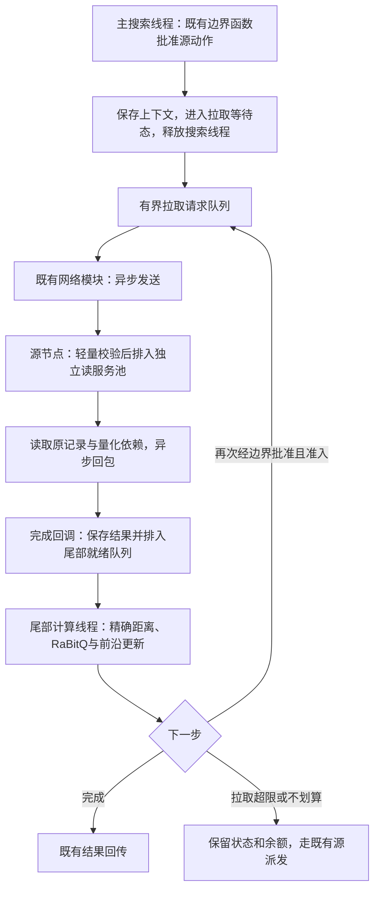

# R001-A29：有界异步RDMA尾部执行

状态：2026-10-31实现与测量完成；正确性通过，综合吞吐/质量/排队验收未通过，默认仍关闭。详见[本轮报告](../test/async_pull_20261031/REPORT.md)。关联[R001-A28报告](../test/replica_tiers_20261031/REPORT.md)、[分级副本策略](R001_TIERED_REPLICA_POLICY.md)及[研究台账](../Research.md#r001-a29-async-pull)。目标是在总小副本α≤.3、保持质量的条件下提高QPS、降低源可运行排队及源每请求工作；不以计算回源率单项作为验收。

## 1. 代码与数据证据

`native_runtime.cpp::fetch()`已经通过`dhnet::Client::submit()`发送，但随后`future.get()`让调用它的搜索线程等待。网络I/O异步，不等于搜索任务已经让出工作线程。`run_region()`直到整个`run()`结束才释放当前执行器；`search_loop.hpp::run_value()`的前沿、top-k、剩余授权、随机流位置等仍在栈内，不能只将fetch换成回调便返回。

源侧`peer_replica_read`在请求处理线程内验证来源/查询状态并同步调用`read_records()`，后者执行pread、邻接依赖整理和打包。不是网络reactor直接执行搜索，也不是单边RDMA直接读取SSD。当前RDMA基于rsockets；应复用既有异步网络完成机制，不假设已有新的verbs/CQ调度接口。`dhwire::Reply::deferred`已有延迟响应机制，可用来释放源侧请求处理线程。

39是边界动作批准后的、派发分割前的剩余展开预算，不是39次拉取。上一轮S30实际配置为每批最多8记录、最多8轮、每批512KiB、每query最多4MiB。批次附带原邻接和相关RaBitQ依赖，未来图邻居常需上一批读完计算后才知道。

|校验块|QPS|发生成功拉取的请求数/60K|成功批数/拉取请求|累计pull_wait/拉取请求|实际拉取展开/拉取请求|
|---|---:|---:|---:|---:|---:|
|S30 τ39 r1|12765.65|10128|1.374|1.543ms|10.737|
|S30 τ39 r2|13008.94|10170|1.376|1.592ms|10.757|

数据来自对应`rapid_summary.json`的`pulled`群体；没有用全体请求的零值稀释。`pull_batches`是成功批数，不等于包含失败/拒绝在内的精确RPC总数；`pull_wait_ms`还包括当前fetch周围解析/安装等开销，不是纯网卡往返时间。

全请求平均pull_wait为.260/.270ms，乘本轮QPS估算该区间平均占用3.32/3.51个搜索槽（均在目标2）。这是工作槽时间核算，含可保留的解析计算，不能当作可全部消除的CPU成本或QPS提升保证。它证明当前有可让出的等待，但没有证明等待是吞吐停滞的唯一主因。源每请求搜索/拉取CPU4.624ms→4.750/4.662ms，未随计算回源减少明显下降；源读服务干扰和执行路径变化需独立验证。

## 2. 推荐结构

采用可暂停的C++搜索上下文、异步拉取通道、有界尾部计算池与源端读服务池。主搜索线程在首次已批准拉取时保存上下文并返回线程池；尾部池只运行有数据、可计算的任务，等待回复时同样释放线程。线程数约束计算并行度，in-flight配额约束网络/内存并发，两者分别配置。

流水重叠发生在不同请求之间：Q1等待远端时，尾部线程计算Q2，源读服务处理Q3，网络发送Q4。每个续跑上下文同一时刻只有一个计算线程修改；跨线程恢复是串行交接。已有跨节点分支语义保持。不同请求不会共享预算、top-k或随机流。

不提前拉取未经扩展函数批准的源动作。初版每个上下文最多一个在途批次；待上一批计算产生新候选、边界再次批准后才能发下一批。独立请求可同时在途；有依赖的单请求39个串行读阶段，其关键路径不会因为增加线程自动缩短。

## 3. 两端职责与资源边界

|执行部分|工作|等待时是否占距离计算线程|
|---|---|---|
|主搜索池|本地搜索，生成已经批准的拉取动作，交接上下文|交接后不占|
|网络发送/接收模块|有界发送、收包、唤醒；完成回调只交付结果|不占|
|尾部计算池|解析/安装回复，精确距离与RaBitQ，更新前沿，继续单线程搜索|无数据时不占|
|源端读服务池|pread、依赖收集与打包，走deferred响应|只占有界读服务槽；第一版pread仍可阻塞该槽|

源读服务也必须解耦，否则目标搜索线程让出后可能更快向源发送请求，加重源请求处理队列。独立读服务池先限制并发pread；跨query合并相同epoch/record读取可作为后续单独消融，不能将不同query的源区域授权合并。读取批量和搜索计算批量分开配置：拿到8条记录不意味着必须一次改变8条记录的候选选择语义。

拉取流量使用逻辑独立队列/连接配额，给搜索派发、结果报告和keep-alive保留容量。现有连接一次处理一个请求/响应，延迟读会占用连接，即使没有占计算线程；仅释放线程仍可能形成连接队首阻塞。是否使用独立Client实例或在共享网络模块增加流量类别，按实施复杂度选择，均限制连接总数和CPU亲和范围。

准入同时限制：每源在途批数、全节点在途字节、暂停上下文数/字节、已返回但未处理的响应字节、尾部就绪队列长度。提交前预留额度和完成队列空间，回包不能因队列满而丢失。过载时拒绝新拉取并保留原合法源派发路径；拉取期间不通过无界排队拖住所有查询。公平调度先采用按query轮转、每次一个计算批次，后续才试成本权重或小任务优先，避免长尾饥饿。

初始实验点（候选，未确认为默认）：尾部计算线程2/4/8、源读线程1/2/4、每源在途批数8/16/32、单上下文在途批数1、暂停上下文上限64；响应与上下文内存分别限额，不能只按线程数估计内存。先固定阈值39、批大小8/字节上限和现有读轮数，不同时扫描阈值。参数实现时加入统一YAML schema；本研究文档不构成可直接加载的运行配置。

## 4. C++续跑与协议不变量

当前工程是C++17，优先显式状态机而非为此引入协程运行时。将原生循环提取为`SearchContext + step()`，step返回`NeedPull / Runnable / Done / Failed`。上下文保存query和prepared RaBitQ、frontier/fallback/top-k、seen/expanded/claims、剩余授权、随机流位置、停滞计数、批准动作及其decision id、拉取缓存/额度、计时与报告状态、overlay/epoch的引用。普通无拉取路径仍可连续执行，避免每个本地批次都强制排队。

暂停不能被当前`run()`尾部误记为完成：不得清空search_context、释放区域执行权、唤醒同区域后续授权、发布最终报告或将region置为unscheduled。区域仍归该上下文所有，只释放物理工作线程；后续同区域候选进入inbox。续跑调度具有单次入队标志，状态转换必须防止“回复先到、暂停尚未发布”和重复完成的竞态。

每个拉取携带query/epoch/region及单调序号。续租和取消在暂停期间继续生效；超时/取消后迟到回复仅释放资源，不重新启动查询、不扣预算、不重复报告。源区域预留和回源派发之间的冲突仍按既有opened/pending/reserved合同处理。失败回退保留尚未消费的候选与授权，不重新从入口启动；销毁运行时时先停止新准入，取消/收齐回调，再关闭可续跑的线程池。

预算仅在实际取得展开权并完成对应展开时消费，申请/传输字节不扣展开预算。取消、回退、重复回包均需检查单次消费；已有本机展开去重与全query预算不放宽。保存上下文的引用保护副本版本，删除/衰退不能使暂停任务悬空。

计时按每个计算片段累加CPU与工作槽墙钟；不能用线程A起点的线程CPU时钟减线程B终点。新增拉取准入队列、网络发送队列、源读服务队列、源pread、打包、回包、完成至resume就绪、resume就绪至worker、尾部计算等字段。I/O等待不再混进compute_slice墙钟；既有总ready、actor串行与runnable等待保留，新resume队列单独计数。

## 5. 召回必须独立解决

旧拉取路径将已批准源动作改为本地action，最多8记录继续使用父任务余额；普通回源路径先分割子授权，remaining39时常得到子grant29，并携带源候选独立搜索。两者的批次大小、候选竞争、逻辑区域及停止路径不同。因此“计算回源下降”已实测，质量和吞吐有效性尚未同时证明；异步调度本身不修复这些语义差异。

第一阶段保持旧拉取的搜索语义，只改变等待/续跑位置，与旧同步拉取比较，判断调度收益。确定性事件回放固定随机数、候选到达顺序、时钟输入和错误注入，检查展开轨迹、预算及结果不变。实时搜索使用墙钟等待阈值且会接收异步候选，不能要求不同调度的实时结果逐位一致；需记录分叉原因并做同query质量对照。

第二阶段独立验证“源尾部执行位置可替换”：先按原回源规则确定源候选集合和子grant，再选择去源执行或在目标用批读执行该逻辑源尾部。只改变数据/计算位置，避免29授权源任务变成39授权父前沿混合竞争。需明确源逻辑owner、源搜索编码/邻接、跨区域去重、原父任务剩余授权及单次完成语义，再通过trace与Recall门控。该方案仍是待验证搜索策略，不和线程异步化一起提交收益结论。

## 6. 快速验证顺序

1. 小规模正确性：无拉取路径、同步/异步确定性回放、乱序/重复/立即回包、取消/超时、队列满、源授权冲突、epoch失效及停机；验证实际展开预算和唯一续跑。模拟长读时其他query能占用释放的线程，完成回调无计算重活。
2. 冻结S30总α≤.3、接流.8、τ39，短块交错比较四组：A无拉取；B现有同步拉取；C只让目标搜索线程可暂停；D目标暂停＋源独立读服务。B/C/D使用同一搜索逻辑。先跑一小批并分析，不预排大矩阵。
3. 先固定8K到达率比较源runnable等待、源每请求CPU和读服务干扰，再并发1024测QPS。固定距离计算线程总数64：试主60+尾4；与不分池、统一64计算线程但异步暂停的方案比较，判断专池是否只是转移排队。读服务和网络线程另记录并保持CPU亲和/配额可比，不能靠无约束加核归因算法收益。
4. 只有尾部就绪排队成为瓶颈才试2/8线程；只有源读队列成为瓶颈且资源有余量才调读线程；只有在途额度常满才增加8/16/32配额。记录请求率、批数、带宽、线程槽时间和内存，避免把一轮等待消除后隐藏到另一队列。
5. 调度方案证明收益后，独立校验源尾部语义和批量策略；入选方案才做200K确认。整体与命中群体Recall均约≥95%作为推荐门槛，分开报告回源率、回源后实际展开/CPU、源全部读+搜索成本、QPS、p99和各节点负载曲线。

成功标准是同到达率源可运行排队和每请求源工作减少，饱和QPS可重复提高，质量和预算不退化；总CPU、带宽和副本时延的代价必须一起公开。若只减少阻塞线程而QPS不升，按新增阶段时间和队列定位原因，优先修复源读/连接或候选语义，不继续盲目增加拉取线程。

## 7. 实施中观察（2026-10-31，未验收）

实施轮 `async_pull_20261031`：首次11项检查通过；补充停机期间取消/释放尾部上下文及指标回归14项通过。实现采用 `LoopFrame`＋`PullRequest` 交出/续跑，独立尾部池需要至少1线程，共享主池方案尚未实现。当前限制上下文数量、每源在途批数及响应容量预留；暂停上下文总字节尚无独立统计/限额。源读池隔离阻塞pread，未实现异步SSD或跨查询读合并。

短批C/D显示4尾部线程饱和：尾部完成队列平均累计等待约25–36ms，远高于网络等待；固定60主＋4尾还让没有尾部工作的源节点闲置4个计算槽。因此追加E：保留主64＋尾8，共享原64个计算CPU，不扩大CPU亲和范围。墙钟候选年龄可能因尾部队列等待增加，改变后续max_wait边界动作；第一阶段保留这一行为并记录变化，不把实时轨迹差异等同于预算错误。后续若调整候选年龄时钟，须单独消融。

旧同步拉取命中Recall约94.5%，异步化并不自动修复质量。只有同期对照证明整体和命中质量达标，且吞吐/排队改善，才推荐开启。

质量独立消融K（未有结论）：普通源派发会从已展开ID和存活前沿重建seen，拉取路径却继承父任务全部曾发现ID。新增默认关闭的`retry_pruned_candidates`，首次成功拉取后仅允许已经被裁剪、未展开且不在存活前沿的候选重新被发现；展开claim、预算、前沿不变。这只是候选发现策略试验，不声称等价于源子授权执行。与J同线程/批量对照后决定是否保留推荐。

## 8. 本轮结论与未解决边界

32块200万正式请求失败0；18项最终定向检查和此前指标回归通过。独立200K：无拉取12,303 QPS、同步τ39为12,807、异步主64＋共享尾16/源读8为12,749。异步相对同步没有吞吐优势证据，但目标主搜索runnable p95从9.843降至3.596ms；新增尾部resume等待平均0.664ms/尝试请求，源队列仍约92ms。平均拉取区间由同步1.557增至异步2.963ms，释放线程槽不是消除请求历时。

相对无拉取，计算回源90.37%→39.39%，每命中源展开40.45→25.71；固定11K源进程CPU约下降6.3%，排队未同步改善。总体Recall96.70%，副本命中94.66%，质量门槛未稳定通过。K（首次成功拉取重建seen）和L（再改4记录/批）仅为短批消融；K一次饱和95.04%但8K块94.78%，不足以推荐。M阈值55在低负载回源23.22%、饱和31.48%，却使目标runnable p95达25.30ms，QPS12,834，未高于J短批12,892。

实现边界：没有共享主池的tail_threads=0模式，没有逐计算批次强制抢占/轮转，没有暂停上下文总字节硬上限，没有源异步SSD/跨query合并，也没有单边RDMA读SSD。尾部CPU亲和共享、源读队列隔离、完整actor归属与失败回退已实现；不将这些正确性能力等同于性能验收。

下一步先完成§5逻辑源尾部的候选/授权等价设计；之后才用源runnable等待、剩余工作、目标主/尾队列及读服务成本共同决定已批准动作的执行位置。节点1仍有余量，进一步副本布局/流量分摊属后续受总α约束的独立问题。R001-A29和R001保持开放。证据、负面结果、快照差异、暖缓存/重复查询限制见[报告](../test/async_pull_20261031/REPORT.md)与[TestLog](../TestLog.md)。

## 9. 副本专池4/8与阈值细化预登记（pull_workers_threshold_20261031）

用户要求保留64主搜索线程，额外增加4–8个拉取线程。仅副本节点2启用尾池、仅源0启用读池8；新增角色列表为集群共用配置，独立CPU列表为节点本地配置，避免执行签名不一致。目标机64物理核/128逻辑CPU，额外SMT线程不代表新增物理核。先在τ39比较共享原计算CPU和额外逻辑CPU，所有同期组网络CPU固定排除候选尾部CPU。无拉取和同步组作为同期基线。

快速筛选使用校验集合30K出现；按尾部队列、阈值拒绝分布和质量选择下一小批，优先τ38/39/40及24/48两侧，不预排全矩阵。入选组合独立200K出现确认和相同到达率负载比较。固定S30总α≤.3、接流.8、驻留144、预算200、8记录/批、8轮、4MiB/query，候选重建false。每组记录源实际展开和搜索+读CPU/命中，回源比例/条件剩余授权/后续实际展开，runnable与actor等待、尾部排队/源读/网络时延、带宽、总体及命中Recall。最高QPS须同时通过无失败和质量门槛；小于3%的单次差异不作为稳定增益。默认仍关闭。

本机SSD不足，原始捕获和运行中元数据暂存tmpfs；服务停止后解析并SHA校验归档，保留配置、代码快照、报告和图片。每轮只有一条TestLog，journal覆盖实现检查、部署、测量及清理。

配置核对更正：上一轮实际CPU以case而非settings.profile为准。目标主CPU8–55及72–87，共64逻辑CPU/48物理核；网络56–63/120–127。长期外部服务0–7，本轮保持原主/网络绑定，尾部额外CPU112–119，仍为SMT共享物理核。

2026-11-02恢复：原A/E8/B各60K全部结束并已SHA归档，tmpfs元数据从Intel32核验恢复；旧journal退出时间未知。新补测遇其他用户循环压测，终止尚未分配服务的E4等待阶段，记录为未测量重试。为快速验证改为共享机短批，平均外部CPU>30核的块按既定噪声规则排除；重复同期同步基线，不以跨日QPS差异归因。本轮末将保留报告/指标/图表至SSD。

短批追加依据：4独立线程τ39约11,749 QPS、尾队列25.9ms，8共享线程约11,868 QPS/21.1ms；8独立线程旧同批12,970，正在同日复验。无拉取门控动作在≤38仅2.22%，≤39为56.66%，≤51为69.33%；因此优先8独立线程τ38/39/40/51，小范围细化和下一拐点，先不扫低预算24/32和所有整数。

针对尾部容量满和max_wait受等待影响的消融：固定8独立线程/τ39，将暂停上下文max_contexts由64降至16，响应预留8MiB，每源inflight16保持。假设避免大批上下文在已饱和的尾池排队、减少墙钟年龄触发的额外拉取；可能代价是更多准入回退。与线程和预算阈值结果分开报告。

确认选择：8独立线程τ39在已测有显著拉取覆盖的异步配置中短批QPS最高，但与同步τ39差异未证实改善、命中质量未过95%；阈值40/51放宽没有获得收益，阈值38基本关闭卸载。按独立测试集合对B同步39、E8异步39、A无拉取各做11K到达120K＋饱和200K确认，顺序B/E8/A；同α、同接流及搜索预算。确认包含4个指定queryID trace，其余请求仍无完整native区间证据。

C16短批将累计尾排队11.92→0.64ms、pull_wait14.93→2.38ms、带宽847→454MiB/s，但QPS12,436→12,073、p99反升。源搜索+读CPU/命中1.436→1.389ms，源展开26.93→27.44。由于约3%吞吐差异与同期波动相近，加入同样11K/饱和独立集合确认，检验这是否只是局部排队转移，不能提前称吞吐有效。

## 10. 4/8专池与阈值实验收尾（2026-11-02）

`pull_workers_threshold_20261031`已完成15组/19块/1,940,000次正式请求，查询失败0；19项定向检查通过。实现target_nodes/source_nodes角色列表、native_runtime.tail_cpu_ids和实际池配置指标：每节点主64不减，只有目标2分配4/8尾线程，只有源0分配读池8。额外CPU112–119为已有物理核的SMT线程，没有新增物理核。角色、亲和、预算、实际同机展开ID及ready分解检查通过；性能完整时间线仅覆盖选中query ID。运行开关仍默认关闭。

短批同日：4独立线程τ39约11,749 QPS/累计尾队列25.90ms；8共享原CPU约11,868/21.08ms；8独立SMT复测12,436/11.92ms。阈值38/39/40/51分别约11,872/12,436/12,009/12,112 QPS，计算回源87.72%/42.70%/43.34%/41.78%。39为资格分布拐点；没有证据支持继续盲目放宽。4线程不足，8共享CPU争用明显；8独立仍近饱和。

独立200K：无拉取12,043、同步τ39为12,587、异步8/额度64为12,569、异步8/额度16为12,609。两个异步组相对同步-0.14%/+0.18%，未证明QPS提升。回源率90.52%/38.69%/40.59%/43.69%，每命中源展开40.57/25.54/26.02/26.93；源搜索＋读CPU约1.898/1.288/1.351/1.324ms。两个异步命中Recall约94.70%，整体96.71%/96.72%，仍未稳定通过预登记群体95%门槛。

上下文64→16的局部效果在确认中重复：累计尾队列6.766→0.689ms，pull_wait9.221→2.237ms，应用层拉取带宽696→467MiB/s。但同11K到达源runnable p95为无拉取79.48、同步30.39、异步64为50.65、异步16为81.31ms；进程源CPU约64.99/59.47/59.23/59.47核当量。尾部等待下降没有保证源等待改善，不能只用CPU下降或回源率下降宣称负载均衡完成。

共享机器/暖缓存（物理读0）/受控重复热点，原短批与恢复后跨日期，同期确认仍只有各一块；小于3%差异不认定稳定收益。其他用户循环压测导致一次未分配服务的等待阶段终止并重试，未停止他人任务；各测量块外部CPU计量保留。已完成的A/E8/B归档恢复通过SHA检查；旧journal退出时间未知，日志不虚构该时刻。

下一步先保持源逻辑子任务的候选/授权/停止条件等价，再让预计源子授权工作、尾部就绪压力和源runnable压力共同决定位置；对max_wait包含暂停时间的反馈单独消融。当前39仅为本轮设置下的异步候选，额度16仅验证局部排队/带宽控制，不是综合默认。R001-A29/R001/R005/R008保持开放。证据：[报告](../test/pull_workers_threshold_20261031/REPORT.md)、[CSV](../test/pull_workers_threshold_20261031/comparison.csv)、[负载曲线](../test/pull_workers_threshold_20261031/load_comparison_paced.png)、[审计](../test/pull_workers_threshold_20261031/audit_final.json)、[日志](../TestLog.md)。

## 11. 既有捕获的时序诊断（2026-11-02，分析预登记）

复用已完成轮次的独立200K饱和确认，优先分析E8并以同步B、上下文16对照。分析单位区分全体请求、副本命中、实际尝试拉取及拉取后回源。真实p50/p99样本按拉取请求端到端时延选择；完整trace不足时明确样本分位误差。核对每次拉取的开始/结束、批计算区间、源回流排队、占槽与CPU；汇总的dispatch/network/resume不得伪装成逐批精确时间线。以CPU容量和每请求工作解释吞吐上限，保留暖缓存、SMT共享、共享机器与有限重复限制。历史分析目录 `test/pull_timeline_20261102`，不冒充新测试；原TestLog和源码快照保持可追溯。

§11分析完成：见[报告](../test/pull_timeline_20261102/REPORT.md)。200K捕获显示源执行器63.84/64槽，尾池7.06/8槽；源搜索＋读CPU的90.86%来自未命中副本群体。实际成功拉取p99请求71.81ms，其中首次runnable18.53ms、尾排队33.86ms、搜索CPU11.12ms；五批中的后四批由16ms max_wait触发，全体后续动作69.13%为max_wait。下一轮先分别验证暂停扣除策略时钟、空闲主槽借用、续跑不变量预解析/回复复制优化，再在α≤0.3内改善源主要CPU负载的副本覆盖。每项短批A/B/A，命中质量约95%及源实际工作/排队与QPS共同验收；本次只有离线分析，优化方向尚未实现/验收，不改DESIGN默认合同。

R001-A29预登记（2026-11-02，pull_policy_help_20261102）：执行用户授权的两个独立优化：策略年龄只扣除本查询交出计算线程至恢复执行的异步暂停，真实超时不变；尾部回复可在主池低水位时有界借用主槽，不提前派发远端、不同时执行同一上下文。固定S30总α≤.3、份额.8、预算200、驻留144、τ39、主64/尾8及网络/CPU布置；先A/B/A短批，再独立H，按证据决定组合与200K确认。记录扣除暂停、主池帮助数/CPU/峰值、尾排队、max_wait比例、实际拉取字节/批数、源真实工作/runnable与整体/命中Recall；质量约95%、QPS>=3%的可重复收益作为综合推荐边界。共享机干扰记录，未预设收益、默认关闭。重型构建与原始结果放tmpfs，停服务后分析归档。本轮唯一TestLog由experiment()包裹启动/测量/清理。

## 12. 暂停年龄与主池帮助的实现及验证（2026-11-02）

`pull_policy_help_20261102`完成7组9块710K正式请求，失败0；25项定向检查通过。新增`exclude_pause_from_age`、`main_help_max_tasks/main_help_reserve_workers/main_help_queue_low`。暂停只调整已有frontier候选的策略时钟；真实deadline不变。帮助仅在回复到达时以atomic额度与现有池锁的原子接纳进入主池，不窃取旧尾队列、不抢占、不提前批准远端、同上下文串行执行。默认false/0；源运行合同详见[DESIGN §62.5](../DESIGN.md#async-rdma-tail-runtime)。

短批A1/B/A2/H/BH为12358/13066/12895/12945/13095 QPS；基线自身漂移4.35%，没有把首尾差异全部归因机制。B将后续max_wait2339→0、平均批数1.73→1.32，H实际借用主池并降低尾排队。随后独立集合CA/CBH分别做11K到达80K和饱和200K，未追加长参数矩阵。

200K确认累计续跑排队4.108→.670ms/尝试、拉取等待6.284→2.486ms、批数1.720→1.384、后续max_wait13351→8，应用层拉取字节率609→504MiB/s。主池帮助24615次、约3.95核当量，专尾约6.98→3.80核当量；全部恢复CPU却6.98→7.75核当量，不能把等待下降说成总计算下降。累计resume CPU现在包括主池帮助，专尾需扣除helper计数。

QPS12480→12606（+1.02%）未达稳定3%目标；整体Recall96.710%→96.698%、命中94.700%→94.671%，仍未过群体95%。命中回源39.414%→39.249%，源展开/命中25.725→25.679；回源者余额约71、源展开约65不变。源剩余CPU约91%来自未命中副本群体，全局源展开117.54不变，源槽占用约63.9/64，因此本轮主要降低尾时延，没有消除最大源负载。

同11K到达源runnable p95为6.550→2.685ms、端到端p99为34.669→26.100ms；三节点总进程CPU约124.22→126.15核当量。饱和目标首次runnable p95反从.167→.378ms，帮助会转移等待。共享机、暖缓存、有限重复、采样时钟不确定度及迟到传输统计未补齐，限制稳定性和网络总成本结论。预算/实际ID/执行器审计通过，完整原生区间仅抽样，不能声称全量时序证明。

本轮交付完成，研究问题保持开放；局部机制验收不等于吞吐/质量综合验收。后续优先保证拉取与源逻辑尾部候选/授权/停止条件一致，定位质量差异；再以α≤.3覆盖主要未命中源工作，按实际CPU净卸载而非单纯回源率优化。只有观察到目标主队列压力后才继续试帮助4/8或源/尾共同门控。[完整报告](../test/pull_policy_help_20261102/REPORT.md)、[CSV](../test/pull_policy_help_20261102/comparison.csv)、[负载曲线](../test/pull_policy_help_20261102/load_comparison_paced.png)、[阶段图](../test/pull_policy_help_20261102/pull_phase_comparison.png)、[审计](../test/pull_policy_help_20261102/audit_final.json)、[唯一日志](../TestLog.md)。

## 13. 更小尾部与跨查询合批（2026-11-02，待验证）

[联合研究记录](../Research.md#r001-a28-a29-tail-layout-batching)：先区分派发前余额R与拟分割源授权G，建立保留普通源子任务语义的执行位置选择，再用尾预算、预计批数/字节和双端队列准入。旧阈值降低会直接回源，不能人为等待余额降低。当前单query批读已有，多query仍逐条RPC；拟在原RDMA网络模块前增加同源同版本合批，独立校验每个子请求并去重记录/依赖，共享不可变响应后逐上下文续跑。聚合等待、慢读阻塞、取消重试、buffer生命周期及各query/全局字节额度必须计量。先检查到达间隔及重复率，再比较立即合队与25或50us窗口；数值为实验候选，尚未实现，不改默认。

## 14. 跨query合批实现及验证中（2026-11-02）

`pull_coalesce_20261102`固定tau39，新增`async.coalesce`有界合批：只接受已批准的源动作，同源同epoch请求逐query验证token/预约，物理记录与邻居码去重，共享不可变回复后在各串行续跑线程收集所需行。单项失败隔离；单query包走旧读取路径；请求与返回字节在query报告中分摊，物理RPC/唯一字节另记。新增一个目标端派发线程，复用原RDMA网络模块，不占用搜索线程等待合批。`max_inflight_per_source`仍限制逻辑查询，响应包生命周期另有字节额度。源仍逐条pread，不声称SSD已合并。

短批A1/B0/A2基线漂移约4.5%，立即合批仅减少约4% RPC；50us窗口短批减少约23.5% RPC，但数据去重约千分之一，拉取等待增加，未证明全局收益。增加单query快路径后做独立固定11K/80K及饱和200K对照。最终性能结论待分析；默认仍关闭。

§14收尾：最终27项检查通过，680K正式请求零失败。独立200K CA/CW为12833.94/12871.04 QPS（+0.29%），46814逻辑读合为35984物理RPC，但去重数据只节省约10.29MB/8.395GB收发。源展开/命中25.737/25.743未下降，命中Recall94.6846%/94.6807%；相同11K源CPU57.120/57.160核、runnable p95 1.040/2.149ms，累计拉取等待1.781/2.594ms。功能可用，源净卸载/QPS未验收，默认不开；停止继续扩大窗口，优先审阅布局覆盖方案。完整[报告及曲线](../test/pull_coalesce_20261102/REPORT.md)、[审计](../test/pull_coalesce_20261102/audit_final.json)、[日志](../TestLog.md)。

## 15. 单边READ与CoTra评估（2026-11-02）

`onesided_pull_20261102`新增原生verbs数据路径，源MR/目录有界，目标CQ推进多个已批准批，保留每批控制授权。功能28项检查和300K查询通过，单边组有真实硬件READ、零完成错误；源数据reader CPU消除不等于源整进程CPU清零。量化码散碎READ成为主要数据阶段；一次链式post消融减少93.33% post/CQ与22% I/O CPU，QPS仅+0.22%，默认关闭。源private_cow注册增加约10.8–10.9GiB RSS，不是冷SSD方案。详见[报告](../test/onesided_pull_20261102/REPORT.md)、[CoTra适用性与下一步](R001_ONE_SIDED_COTRA.md)。授权租约、WRITE队列和Task-Push仍为待验证方案，R001-A29开放。
