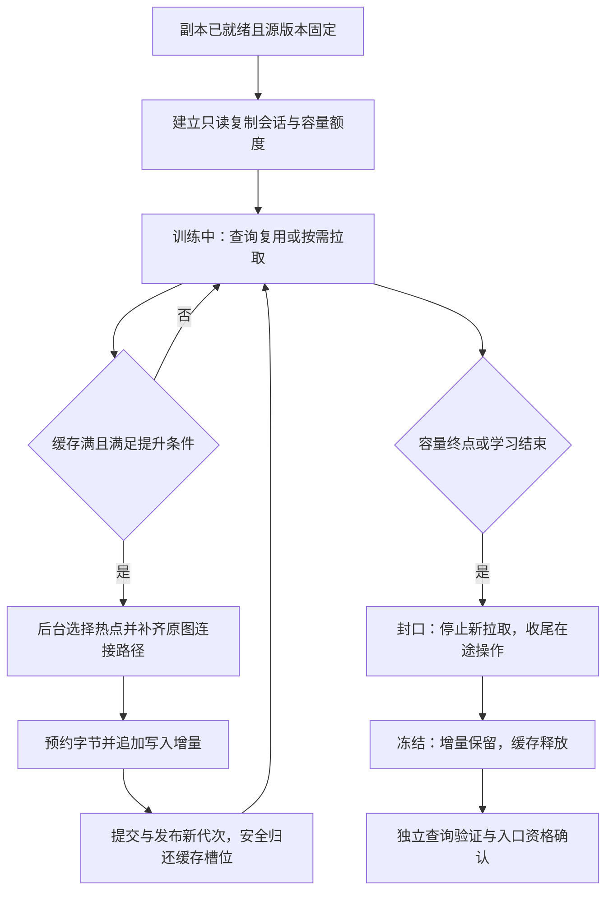

# R001 / F30：通过按需 RDMA 缓存学习副本增量的设计提案

2026-11-06的历史设计提案；**下文保留当时待审阅的设计，不把整篇建议视为当前已实现能力。** 不恢复全局 RDMA 拉取或候选同步，不将预期收益写成测量结论。关联 [Research](../Research.md)、[既有单边读取](R001_ONE_SIDED_COTRA.md)、[最近副本边界实验](../test/boundary_portals_20261106/REPORT.md)。

**后续状态（2026-11-09）：** 用户已批准的100条/份、源索引10%、20热点另加计费连接点、两种触发规则均已实现；四机20组/3600万查询对照完成。hot明显减少回源与源CPU，但相对原副本QPS/p99变差，副本Recall仍不足约95%，默认关闭，详见[最终报告](../test/demand_growth_20261106/REPORT.md)。相应实现与采用边界以[DESIGN](../DESIGN.md#replica-demand-growth-20261106)为准；独立入口准入、入口训练联合收益、同空间对照等仍未验收，下文原计划不冒充本轮已执行内容。

## 1. 已确认的需求与适用范围

目的：通过真实查询学习副本缺少且会被反复使用的源顶点，把短期远端数据访问逐步转化为副本的长期本地访问，降低后续回源计算与排队。最终效果必须在**停止拉取、清空临时缓存后**验证。

|参数/语义|本提案基线|状态|
|---|---|---|
|缓存容量 C|每份物理副本 100 条完整顶点记录，跨查询共享|用户已确认|
|增量容量 β|每份物理副本最多增加源分片索引字节的 10%|用户已确认|
|提升数量 N|一次选择访问次数最高的至多 20 个热点顶点|用户指定；连接记录如何计数见第6节|
|替换规则|满缓存优先替换未使用或仅使用一次的记录|一次使用替换为用户要求；零次使用是取消等情况的补充|
|持久化触发|缓存已满，且没有零次/一次使用记录；忙碌和在途状态单独判断|严格基线，保留用户原意|
|学习来源|仅从该副本的源分片拉取缺失数据|不对普通节点间分支启用拉取|
|搜索参数|沿用原成本分支，全局展开预算 128；候选同步关闭|不靠增加预算换取收益|
|生效范围|原副本入口与边界规则不变，新增记录不自动成为 HNSW 入口|隔离增量学习本身的效果|
|终点|停止新拉取，提交已接受增量，安全释放缓存；缺失数据回源|已持久化增量继续服务|

例如一份 S30 核心约占源分片 30%，新增上限为源分片的 10%，并非 S30 自身的 10%。D80 若有两份物理副本，各自有此上限，合计最多新增约 20%；**仍受已有源副本总额度、目标 SSD 空间等更严格限制**。已有边界增强另行记账，不能藏进 α、β 的分母或绕过总容量。

β 的分母固定为源 epoch 对应的索引 manifest 中、去重后的完整索引文件字节，包括记录、量化信息及必要目录；不包含原始数据集重复文件、日志、旧版本或临时文件。一次学习期间分母不随缓存/副本增长改变。

## 2. 数据层次与计数定义

每份副本有三个层次：不可变核心 S、已提交的增量 P、临时缓存 C。查询按 S/P → C → 源节点的次序查找所需记录。P 是长期索引，C 是有界共享内存，二者不可混算。

缓存键为 `(replica_id, source_epoch, vertex_id)`；同一源图的两份物理副本独立学习。顶点的原始 ID 和 owner 保持不变，缓存与增量都属于该逻辑副本，不能因为数据落在 B 上就把 B 的原生分片标成已搜索。

记录提供器需要单独表达“在本逻辑副本可本地展开”：S/P/C 中的完整记录可以在副本上执行，只有量化码的邻居仍是缺失记录。不能沿用原 owner=A 就继续无条件回源，也不能把拥有邻居量化码误判为拥有完整顶点。

完整记录包含原向量、原有向邻接和记录标识；展开邻居还需要相容的 RaBitQ 码、因子、中心/量化器版本、owner 信息。已有兼容量化依赖可以复用，缺失依赖单独拉取并引用计数。**不能只缓存原向量，也不能把依赖内存当成免费。**

访问次数采用明确的整数语义：

```text
count[v] += 1
当且仅当：一个 query request 在这个物理节点成功领取 v，
并实际展开 v（一次展开消耗一次原有搜索预算）。
```

仅提交 READ、READ 完成、候选入队、失败领取、恢复执行或重复检查，都不计数。同一数据集 query 多次作为不同请求到达属于真实访问频率；单个请求重复检查同一顶点不重复加计。缓存中途淘汰后再次装入，重新统计该次驻留期间的次数，淘汰历史只留聚合指标。

沿用搜索线程局部聚合：线程在展开记录时积累增量，在释放该记录的 pin 前汇入该记录的原子计数；后台读取计数选择候选。这样可避免“第二次访问尚未汇总就被当成一次性记录淘汰”。先按 count 降序，平局按最近访问时间、稳定 ID 排序。原全局热点的指数衰减分数可以保留为独立观测，不能把衰减后的 0.9/1.1 与这里的“一次访问”混用。

## 3. 生命周期



增长和正常搜索并行。每份副本至多有一个提升事务；多份副本共用有界后台执行器，不为每次提升创建线程。状态为 `WAIT_READY → TRAINING → SEALING → FROZEN`，退休/错误可以从任何阶段进入封口。单条缓存记录状态为 `READING → READY → PROMOTING → DURABLE`，另有失败状态。

## 4. 查询的完整操作流程

### 4.1 何时发起拉取

只有搜索决策已经选中一个需要展开的源节点候选、且本分支仍有预算，才进入缓存处理；遇到邻接表里的源 ID 并不立即拉取全部邻居。调度器不提前启动远端搜索，也不改变原来对第三节点的分支决策。

1. 在 S/P 中找到完整记录：按本地记录展开。
2. C 中是 READY：取得稳定引用，按正常预算展开并计数。
3. C 中是 READING：加入该记录已有的有界等待列表，不重复 READ。
4. C 中没有，副本处于 TRAINING：尝试取得缓存槽位、字节额度、网络额度和恢复任务额度。
5. 任一额度不足、源版本不可用、READ 失败，或副本已冻结：走原有源分支/合法交接路径。**不能因缓存满使查询失败，也不让搜索线程等待腾槽。**

同一查询已有源搜索任务时，不再为其启动新的源 READ；需要交接的候选沿既有允许的交接路径处理，不创建第二份源任务、不恢复每10次展开的周期候选同步。此规则不修改原成本分支的历史区域语义，也不把它宣称成全系统严格唯一物理分支协议。

### 4.2 异步执行与恢复

提交拉取前保存搜索帧、候选、实际展开集合和剩余预算，交还计算线程。网络/CQ 推进完成后只发布不可变记录并通知可恢复任务，计算仍在原有计算池执行；同一查询任何时刻至多一个计算执行器。

重复请求合并为一次物理 READ，多个查询共享完成的记录和依赖，不能给每个等待查询重新组装一套大量量化码。按必要的一批记录唤醒一次，不为每条记录创建一次搜索恢复任务。只对已就绪的请求做有界合批，不额外等长窗口凑满100或20条。

恢复任务和新任务在固定计算线程池中公平调度，记录恢复队列长度与任务年龄，给恢复任务保留有界服务份额，不能再次无条件压在所有新请求尾部。进入 READ 前即预约恢复描述符和等待者额度，正常完成不应因为恢复队列满而失败；超出接纳额度的新拉取改走原分支。具体调度份额通过实验决定，不预设已找到最佳值。

这能消除占住搜索线程的同步等待，**不能承诺消除所有排队**。旧热点实验的 READ 等待大部分来自恢复排队，因此本方案必须分别测量 READ 服务和可运行恢复等待，不能只汇报网卡耗时。

### 4.3 缓存满时的严格规则

缓存槽位包含已预约、READING、READY、被查询引用以及 PROMOTING 的记录，总数最多100。已经发起持久化但仍被引用的记录不算已释放。

```text
on_source_miss(v):
    若不在学习期，或此请求已启动源搜索：使用原分支/合法交接
    若存在相同键：复用 READY，或合并到有界 READING 等待列表
    若有空槽及所有字节/网络/恢复额度：预约后异步 READ
    否则：
        从 READY、无 pin、未在提升事务中的记录选择牺牲者
        优先 count=0；其次 count=1，先淘汰最久未访问者
        若能淘汰：回收其依赖引用后预约 v
        若不能淘汰且严格提升条件成立：只通知后台提升一次
        当前缺失请求走原分支，不等待提升完成

after_successful_expansion(v):
    汇总 count 和 last_access，再释放 pin
    若缓存满且满足严格条件：通知后台（合并重复通知）
```

严格条件为：缓存满；不存在未决的 READING 记录；所有驻留候选都已实际访问至少两次；没有进行中的提升事务。被 pin 的热点可以取得只读稳定引用后参与提升，但必须等旧引用释放才能腾槽。

**“没有可淘汰的一次性记录”不等于“没有一次性记录”。** 一次性记录都被 pin，或大量记录尚在 READ 时，不可据此把它们判为热点。暂时不能腾槽时使用普通回源，而非阻塞或无界加大缓存。

## 5. 严格规则可能永远不提升

例如80条记录反复使用，另外20条不断被一次性记录替换。缓存虽一直很忙，“不存在一次性记录”却可能始终不成立。因此 β 只是上限，严格模式不保证持续增长或最终占满它。

建议保留两个可分别验证的触发模式，不把改动混进基线：

|模式|提升条件|取舍|
|---|---|---|
|`full_no_singleton`|第4节严格条件|忠实于用户规则，但可能长期停滞|
|`full_hot_batch`（建议对照，待审阅）|缓存满，count≥2 的 READY 热记录达到20条，且无提升事务|允许保留一次性记录时先提升热点，更容易持续学习|

第二种仍按访问次数 top20，不用低频记录凑数。100条缓存的 top-K 可以在后台对最多100项做选择，无需引入全图热堆或在搜索热路径维护排序锁。

建议学习期与入口训练的显式结束事件相连，并增加可配置的最长学习时间/连续无进展条件。其值尚待讨论和实验，不能编造“最佳训练时长”。结束时允许以未用满 β 的增量封口；残余不足20的热点是否补提一次应作为单独配置，默认严格模式不额外补提。

## 6. 持久化：保证新增记录有原图访问路径

仅把20个高频顶点写到 SSD 不够。例如原路径为 `核心 s → 缓存 x → 热点 v`，只保存 v 而淘汰 x，会使 v 从该路径上失去入口。

建议提升单元是**热点顶点加必要原图连接记录**：

1. 为缓存热点保存实际发现它的有向父边证据，优先保留从 S/P 出发的短路径。路径元数据有界，按预算128限制单次证据链；全局还有每副本元数据额度。
2. 选取至多20个热点，构造从已有持久集合到它们的原有向路径并集，去重中间点和量化依赖。
3. 连接点若已淘汰，后台经同一只读复制会话补取；这是维护复制，不消耗查询展开预算，须单独计 READ 字节和维护 CPU。
4. 校验原父边、源 epoch、记录/量化器完整性。无法证明路径或路径费用超额时，跳过该热点并记录原因，不直接保存孤立点。只有外部种子、没有持久路径证据的缓存点也适用此规则。
5. 保留原始邻接，不新增跨越路径的人工捷径；所有新完整记录与依赖进入增量。

**待审阅的细化：N=20 表示热点种子数，实际一批可能多于20条，因为连接点也要保存。** 若要求物理总数严格≤20，则连接点应占用这20个名额，批内热点数相应下降；这是可行备选。不能既要求20个热点，又把额外连接空间忽略。

结构连通仅保证有原路径，不保证128预算内一定找到这些点。后续仍需验证实际展开、最终 top-K 贡献及源内路径改善。

### 容量预约

采用可直接阅读的公式，所有字节均为物理实际计费：

```text
growth_limit = floor(0.1 × source_index_bytes_at_epoch)
committed_growth_bytes + reserved_growth_bytes ≤ growth_limit

growth_bytes = 新增完整记录 + 新增量化依赖 + 必要连接记录
             + 增量目录/证据/提交元数据 + 文件对齐开销
```

已经在核心或已提交增量中的物理数据不重复计费，但新文件真实复制的字节要计费。每批先算完整依赖并预约再写入，最后一批允许少于20个热点。即使20个热点原记录装得下，其连接和依赖装不下也不能超 β。临时文件、写缓冲、退休快照另受目标空间/内存峰值上限约束，不能用延迟回收绕过硬容量。

### 文件与在线发布

采用不可变核心加追加式增量文件、提交日志、版本目录。后台单写者追加记录和依赖 → 校验并刷盘 → 写入持久提交标记 → 原子发布新目录 → 旧查询引用释放后归还缓存槽位。每批不重建整份副本，不重新加载数 GiB 的 `ReplicaOverlay`，也不更新整个顶层 HNSW。

小批次共用追加文件，避免每20条创建完整独立索引包。可以合并底层写入，但记录每批可见时间；失败或重启按 `(replica_id, source_epoch, batch_seq)` 幂等恢复，未提交尾部不可见，已提交记录重建目录。数据、依赖和 manifest 的持久化顺序及目录 fsync 要一起验证。

查询在批次安全点取得新目录代次，进行中的记录引用仍有效；原图与所有已发布增量不可变，代次单调增长。正常路径采用分段增量目录，避免每20条全量复制越来越大的 ID 表；如需合并目录，也在后台有界执行并计峰值。

## 7. 源只读会话、并发与内存边界

当前高层 pull 路径是按 query 授权、每批控制RPC、查询私有 `pulled_records/pulled_codes`，并通过恢复队列继续搜索。不能直接打开旧开关就称其为共享缓存学习。

建议新增与副本及源 epoch 绑定的只读复制会话，复用低层 `one_sided` QP/MR/CQ。其职责是校验复制范围、固定源映像生命周期和额度，不预约源搜索 actor；共享记录的有效性不依赖第一个发起查询的存活期。会话建立/续期/释放的源 CPU 均须计费。复制范围授权是软件协议，不声称 MR 对每条记录提供硬件隔离。

会话准备放在后台，不增加核心副本发布/接流的前置门槛；会话尚未就绪或注册额度不够时，副本继续按原分支策略服务，只是暂不学习。

READ 本身既不标记源已搜索，也不消耗展开预算；成功领取并展开才消耗原预算。恢复不重置预算；转回源不新赠128次预算。只传递真实展开状态，不能把整个缓存、整个增量或已复制的未展开记录标成已访问。

数据线程只做有界查找、引用和计数。短时同步只保护哈希槽预约、状态切换、容量预约和指针发布；网络等待、SSD写入/fsync、排序、复杂校验、距离计算和大对象析构全部在锁外。共享缓存的同键合并与淘汰需要原子协议或短锁，“只读搜索”并不使可变缓存元数据自动无竞争。

除100条记录，还必须限制依赖码字节、在途网络缓冲、等待者、路径证据、写缓冲及退休代次。超过任一额度都停止新拉取接纳并按原路径搜索，不无限扩大内存。它们的初始字节值需依据最大出度/码宽和实测确定，在配置校验中拒绝明显无法容纳100条完整记录的设置。

**现有 RDMA READ 读取注册 RAM，不直接读取远端 SSD。** 源 MR 可能采用整映像 private-COW 注册，曾有显著 RSS 增量。目标缓存只有100条不代表全系统只增加约1 MiB内存；源 MR、目录副本、锁页和注册时间必须完整报告。源冷数据超出注册容量时，需要另行设计有界注册缓存，不能把本提案外推成百亿规模问题已解决。

## 8. 封口与入口训练

达到 β、剩余容量无法容纳合格增量、入口训练结束、退休或错误时：

1. 原子进入 SEALING，拒绝新的查询驱动 READ 和新提升事务。
2. 收尾已经接纳且已预约的事务；READ 完成可以服务已等待查询，或按剩余预算回退，但迟到回调不能复活结束请求或重开缓存。
3. 最终提交增量并发布；等待 DMA 完成/安全排空以及读者引用释放后才回收内存，不让搜索线程负责等待。超时不能直接重用仍可能被 DMA 写入的缓冲。
4. 转 FROZEN，禁用新缓存访问和 READ；保留 S/P。只有遇到 S/P 缺失的源候选才走普通回源，并非所有命中副本的查询无条件去源节点。
5. 在最后一个用户退出后释放只读会话；若 MR/QP 仍被其他副本使用，按引用生命周期保留。

记录冻结原因与实际 β 使用量。容量终点和所有内存物理释放可能不是同一时刻，分别记录。

入口训练与增长并行，但采用两阶段资格：

- **增长期**：记录代次、缓存命中、拉取、实际回源、源计算节省和查询时延，结果为临时评分。保留有界探索流量，避免入口因初期回源较多被全关，导致永远没有学习数据。探索份额单独配置与计费，不在第一轮悄悄增加正式引流比例。
- **冻结期**：缓存清空、READ关闭，在独立查询上确认持久图的 Recall、源 CPU/排队卸载与净成本；合格后再决定入口份额。当前仅按回源次数和剩余预算的入口策略不足以完成此验证，不能原样套用来宣布通过。

回源下降可能只是“源计算变成 READ”，并不等于收益。训练期须计拉取等待、恢复等待、源授权/注册和副本额外距离计算；最终应看冻结后是否仍改善。

## 9. 量级与预期收益边界

最近源0索引为11,560,619,646 B，记录步长12,288 B，2560维 float32 原向量本身为10,240 B。按此例：

|项目|量级（不是性能测量）|
|---|---|
|100条记录本体|1,228,800 B，约1.17 MiB；不含依赖与其他缓冲|
|一次20条记录本体|245,760 B，约240 KiB；连接点另外计费|
|每份副本 β 上限|约1.156 GB，即1.077 GiB，含全部增量依赖|
|仅按本体估算可增记录|约9.4万条；实际更少|
|只按20条计的批数|约4700批量级；实际随连接和依赖变化|

因此“100条缓存”是很小的学习窗口，可能快速淘汰跨较长间隔才重复的有用点；“每批20条”可能带来很多提交与元数据维护。第一轮固定100/20/0.1，先测是否能学到、是否能留住有用点，再讨论扩大缓存或合并提交。访问频繁也不保证贡献 top-K，未来可研究成本/贡献选点，但不在本次偷偷替换用户的访问次数排序。

预期路径是：训练期一部分查询付出 READ 和提交成本，后续查询复用缓存/增量，冻结后减少源展开与回源等待。若热点消失太快、记录复用不足、增量不可导航或副本计算池拥挤，收益可能无法覆盖训练成本；不能预先保证 QPS 或 Recall 提升。

## 10. 拟议配置（仅示意，尚不是受支持的 YAML 字段）

```yaml
# 待实现：不得直接投入现有运行配置。
replica_demand_growth:
  enabled: false
  scope: replica_source
  cache_records_per_replica: 100
  growth_fraction_of_source_index: 0.10
  promotion_hot_vertices: 20
  promotion_trigger: full_no_singleton
  count_event: successful_claim_and_expansion
  connectivity: original_directed_paths
  candidate_sync: false
  end_with_entry_training: true
```

实现时还需将学习期限、依赖/缓冲/路径字节限额、每源在途 READ、等待者上限、恢复调度份额、提交节流和备用触发模式纳入统一 YAML，并校验其相互约束。数值未确定的资源项不填“无限”，也不在设计阶段宣称某个线程数最优。

## 11. 实施拆分与验证方案（待审阅后执行）

### 工程边界

|模块|拟议工作|已有能力与缺口|
|---|---|---|
|`cpp/search_loop.hpp`|分层记录提供器、实际展开计数、路径证据、共享记录引用|现为 query 私有拉取数据，需新增共享生命周期|
|`cpp/native_runtime.cpp` / `one_sided`|副本只读会话、同键合并、接纳及一次性恢复|可复用低层异步 READ；不能原样继承每query授权/组包|
|新原生缓存/增量模块|100槽状态、引用、提升事务、增量目录、恢复|缓存/在线增量发布需要新增，不声称已有|
|`replica_pack` / `replica_load`|复用格式校验；提供追加增量和代次读取|现有整包构建/发布不适合每20条重载|
|Python控制面/入口训练|生命周期、统一配置、容量总账、冻结验证|不在每次展开或READ完成时调用Python|
|观测与离线报告|分阶段汇总、稀疏轨迹、容量与净收益|沿用独立客户端和每轮一条TestLog|

### 正确性先行

覆盖：同键并发只读一次；首次读取后取消/count=0；pin未释放时不能淘汰；计数汇总后再释放；全缓存忙碌时正常回退；重复提升不重复写；最后一批与连接依赖不超额；有向可达证据；READ/源会话超时与 DMA 安全回收；源epoch变更；查询预算耗尽；已有源任务交接；封口与迟到回调；数据或manifest刷盘前后崩溃恢复。记录/码结果逐字节对照源，实际展开预算沿用原有不变量。

### 实验对照

首先固定 S30 与 D80 的核心、入口、路由份额、原策略D128/beam11、每节点64搜索线程及同一客户端负载；无副本作为系统参考。第一轮不叠加全边界增强等其他新变量。

|组别|目的|
|---|---|
|A：原副本，无学习READ/缓存/增量|主基线|
|B：100条共享缓存，有READ，无持久化|区分临时缓存复用与图增量收益；单独观察增长期|
|C：100/20/0.1，严格提升规则|验证用户原方案|
|D：相同参数，缓存满且≥20热点即提升|待同意的防停滞消融，不默认代替C|
|E：同实际新增字节的非学习扩图|后续空间公平对照，区分多存数据与选点算法收益|

每组分开报告增长期、封口期、冻结后，以及包含全部学习成本的完整运行。基线在对应时间/请求窗口也运行，不能用“训练只算新方案前缀、基线只测稳态”制造收益。按 query ID 拆分学习与独立验证，重复 occurrence 不能跨集合冒充独立；另报自然持续学习的时间顺序结果及其中重复ID占比。

优先复用既有独立历史查询作为学习输入和同一200K热点/自然查询作为验证；若历史查询不够学习，应在实际执行前固定额外训练/验证拆分，记录样本数，不假称完整200K仍全部独立。D80按UUID分流带来实际命中集合变化，仍需共同命中群体配对及重复运行。保持资源/NUMA一致，增长阶段记录源MR注册、内存和后台工作，不只对比冻结后最好片段。

### 必须记录的指标和图

|类别|指标|
|---|---|
|端到端|成功QPS、失败数、p50/p99、Recall@10整体及共同命中群体|
|真实卸载|回源有实际展开的请求数/副本命中请求数；仅派发未展开另列；源展开数、源CPU/query、源排队；所有节点总CPU/query|
|READ|物理READ操作/批次/字节；接纳等待、控制授权、传输、依赖安装、可运行恢复等待；合并命中与失败回退|
|缓存|各状态槽位、命中、count0浪费、一次性淘汰、热点数、提升条件停滞时长、在途/等待者峰值|
|增量|提升次数、热点/连接记录数与字节、刷盘时间、目录发布成本、各代次、实际β、第一次提交及冻结时间|
|持久价值|缓存清空后新增记录实际展开率、实际结果贡献、回源下降是否持续|
|资源|源注册RAM/目标内存及SSD字节、三个数据节点计算队列/CPU、后台复制和提交CPU、网络限额命中|

物理一次READ被多个查询等待时，传输字节只计一次；每个查询的等待可以分别计，但不是多次网络传输。线程CPU、累计分支等待和端到端墙钟分别展示，重叠区间不能直接相加成时延占比。

图表至少包含：容量/热点/提升事件时间线；QPS/p99与复制/冻结标记；源回流率/源CPU与三个节点排队；增长期和冻结后各一个p50/p99路径；冻结后Recall—QPS及同空间对照。仅保留窗口汇总、直方图和有代表性的稀疏轨迹，不保存所有查询的完整原始状态。

验收要求：零协议/预算/容量错误；冻结后目标平均Recall约95%且共同命中质量不能被整体平均掩盖；相对原副本源工作与排队下降，并确认全系统成本和QPS/p99的净变化。若质量未达到目标，只能称局部改善。效果应跨重复运行超过观测波动；学习开销的摊销拐点必须在预期热点生命周期内。不能仅以“回源率下降”宣布负载均衡已解决。

## 12. 审阅重点

已确定100条/份、20个热点、β为源索引10%。建议重点讨论三项细化：是否增加 `full_hot_batch` 防停滞对照；20条是否指热点种子而允许另存计费连接点；学习期未占满β时是否允许随入口训练结束封口。本文以严格规则为基线，其他细化明确标为建议，待讨论后再实现与测试。
