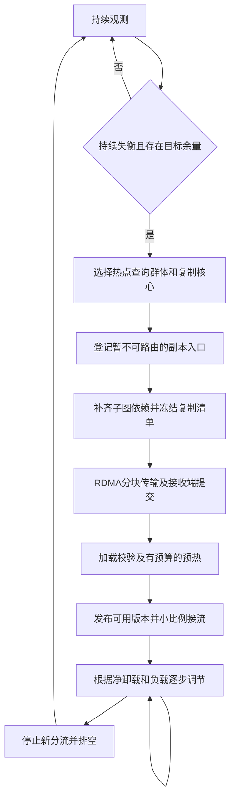

# R001：从负载不均衡检测到子图副本承接流量

日期：2026-10-26（Asia/Shanghai）。状态：**算法审阅稿，未实现、未实验验证**。关联：[Research R001](../Research.md#r001)，尝试R001-A04；总体方案见[设计v0.1](R001_LOAD_BALANCING_PROPOSAL.md)。本文不代表已部署能力，不生成性能实验日志。

H为Intel-35顶层路由，A为热点来源节点，B为目标数据节点。三个数据节点仍为Intel-31/32/30，每节点64搜索线程，全局预算200。以下数值全部是拟议实验起点，未来纳入YAML，不能理解为已验证阈值或实时观测结果。

## 0. 状态机与不变量



每个副本使用唯一build_id/region_id、来源graph_epoch及replica_version标识，不复用失败任务的版本。控制状态由H的低频控制器推进；数据节点执行有界后台任务。各阶段均可暂停或终止，不是检测到失衡后必须一路执行到发布。

必须保持：

1. **暂存入口不是可用入口。** 预热和校验通过前，真实查询仍使用原位置。
2. 原图不删除、原HNSW向量不重复插入；首次实现复制原图记录和依赖，不重建DiskANN拓扑。
3. 查询固定副本版本、距离/量化契约和全局预算；物理节点一次访问规则保持。
4. 搜索扩展函数决定是否发起远端搜索；复制、预热、网络完成事件没有此权限。
5. 数据节点计算线程本地工作结束即释放，不等待复制完成、子分支或最终合并。
6. 后台维护有CPU、RAM、SSD、网络和在途字节预算；新增搜索线程不作为均衡收益来源。

## 1. 判断负载不均衡：OBSERVING → IMBALANCED

**输入与观测。** 各数据节点约每100 ms发送带序号的负载摘要；H每1 s汇总一个窗口。搜索线程内采样访问轨迹，初始采样率1%，统计导出在后台。未收到摘要不等于节点空闲。

| 符号 | 含义与口径 |
|---|---|
| u_j | 搜索CPU秒/窗口秒/该节点已校准可用CPU核当量，不用整机CPU占用或线程数直接替代 |
| busy_j | 搜索工作线程占用比例，包含线程等I/O时的占用，区别于u_j |
| Q95_j | 窗口内已开始任务的计算排队p95 |
| oldest_j | 当前仍排队任务中最老任务的等待时间，避免只看已开始任务而遗漏堵塞 |
| Qstar_j | max(Q95_j, oldest_j)；缺少有效样本时保留未知状态，不补为零 |
| backlog_j | 排队工作与运行任务预计剩余工作，按线程占用时间估算 |
| io_j、net_j | SSD压力、逻辑/物理读取及网络接收/控制排队，用于判定瓶颈类型和余量 |

先针对已有热缓存CPU工作负载使用以下候选门槛：

```text
source_hot(A):
    u_A >= 0.85
    AND Qstar_A >= 5 ms

target_spare(B):
    u_B <= 0.65
    AND Qstar_B <= 2 ms
    AND B没有已知SSD、内存带宽、接收/控制拥塞

imbalanced(A,B):
    source_hot(A) AND target_spare(B)
    AND u_A - u_B >= 0.20
    AND 两端负载摘要年龄 <= 300 ms
```

连续5个有效窗口满足才进入下一阶段。只满足一个窗口时继续观察。若A主要因I/O占用工作线程而CPU低，改用经验证的I/O/占用线程容量模型，不能继续套用CPU阈值；若主要是接收控制等待，则登记R002，不把它当作本算法已识别的计算热点。

**操作。** 选择热点A及一个或多个候选B，记录触发时的负载、队列和数据版本。优先查看是否已有适用的READY/ACTIVE副本：若有，直接进入第7步调节流量，不重复复制。若所有节点都接近饱和，不启动搬运来假装增加容量。

**完成条件。** 持续失衡、摘要有效、存在目标余量、无冲突中的同区域构建且不处于冷却期。

**失败/退出。** 条件消失则回到观察。进入后续阶段后仍持续复核；构建和传输过程不能无限追逐已消失的热点。

## 2. 触发热门向量复制：IMBALANCED → CANDIDATE

这一阶段选“复制什么、给谁、是否值得”，尚不发送大块向量。

**触发条件。** 第1步通过，且存在足够的近期采样轨迹和剩余维护预算。首版仅统计首跳改道能影响的工作；A收到的远端子任务不自动计为可卸载量。

可先要求每个候选群体至少128条不同查询的有效轨迹，再评估候选；这只是避免极少样本触发搬运，不是质量统计已经充分的证明。样本不够时保持观察。

**操作。**

1. 按HNSW入口及在线可得距离特征分组，再按实际搜索工作集合拆分相差很大的查询群体g。
2. 计算群体到达率lambda_g、实际CPU工作、读取/展开集合、候选发现路径、出区工作和热度持续性。采样统计按已知采样概率校正，不把重复同一查询当成更多独立训练样本。
3. 为顶点计算CPU工作热度；排队时间不计入热度。选一组能够通过真实搜索路径连接的热点片段作为核心K。
4. 利用历史轨迹估计增加必要邻域后的空间—覆盖曲线；先排除预算内明显无法承接的区域。
5. 对每个候选B估计源CPU净减少d_A、B新增CPU工作c_B、出区/回源风险及创建时间。模型必须扣除预计回源，不能把覆盖CPU全部当成真实卸载。

```text
预计源卸载速率 = p * lambda_g * d_A       # CPU秒/秒
预计目标新增速率 = p * lambda_g * c_B     # CPU秒/秒
```

d_A/c_B单位为CPU秒/匹配查询，必须标记为预测值。复制后由随机分流对照及分支报告更新。目标I/O、工作线程占用等资源分别约束，不能只用上述CPU式。

**触发创建的条件。** 存在一个p>0，使源预计净卸载为正且有意义、目标各资源仍有余量、额外空间在预算内、质量风险可接受。并满足：

```text
预计热点剩余持续时间 > 预计构建 + 传输 + 预热 + 来源侧回本时间
```

剩余寿命未知时不能冒充已知；允许在严格小预算下做一次探测，标记为探索，并记录失败复制成本。不能只因为某个向量访问次数多就复制。

**操作产物。** ReplicationPlan包含A/B、群体g、核心K、版本、候选入口、预计容量/收益/风险、期限及资源额度。B暂时预留RAM、SSD和临时空间；H全局限制初期同时构建数为1。

**完成/失败。** B确认预留后进入第3步；没有合格区域则保持原系统，记录“无可搬运热点”。预留过期、收益变负或热点消失时取消计划、释放未使用额度。

## 3. 复制入口：CANDIDATE → ENTRY_STAGED

**触发条件。** 候选计划与B的资源预留有效，graph_epoch仍可固定。

**操作。** 选择一组已经存在于顶层HNSW的入口E，使其对应查询主要属于g。必须满足入口原记录可在A取得，并将这些入口及到核心K的必要发现路径加入复制区域。无法在预算内连接的入口不纳入E，相应查询不计入lambda_g。

顶层建立不可路由的描述符：

```text
EntryReplica = {
  entry_id, source=A, destination=B,
  region_id, graph_epoch, replica_version,
  query_group=g, state=STAGING, route_fraction=0
}
```

HNSW仍只有原来的入口向量及边；新增的是该入口的可服务位置元数据。入口记录本身随第5步一起传输，不需要提前独立复制一个HNSW节点到B。原位置始终保留。

**完成条件。** E非空、每个入口都有可校验的原记录、适用查询群体/预算已随入口筛选更新、所有暂存描述符都禁止真实路由。

**失败/退出。** 没有合适HNSW入口时取消该候选，或者另立“新增路由样本”研究；不在本方案中静默改变HNSW图。

## 4. 子图构建：ENTRY_STAGED → PACKAGED

这里的“构建”是形成副本视图和可传输记录集，保留原图的邻接关系。先冻结记录清单，再传输；实现时可以流水打包，不要求A再存一份完整临时图文件。

**触发条件。** E/K确定，固定来源不可变图版本，资源预留未过期。

**操作。**

```text
R = K ∪ E ∪ 从E到K所需的采样发现路径

repeat:
    生成尚未包含的高收益邻域组H
    benefit(H) = 加入H后的预计源卸载增量
    bytes(H)   = 完整记录、编码依赖及目录的新增字节
    选取benefit(H)/bytes(H)较大的可行组
    若没有正收益组或触及RAM/SSD/临时空间预算：停止
    R = R ∪ H
until 达到本轮预设覆盖与出区风险目标
```

此处为启发式，不保证全局最优；采用成组加入以避免把有组合收益的连接路径拆散。覆盖目标，例如90%的历史来源CPU工作，仅作候选筛选，不替代真实召回验证。

记录集包含：R中完整向量/邻接记录；R和出邻居估距需要的RaBitQ编码及校正依赖；原owner和位置；本地定位索引；E及查询适用性摘要。B已有的同版本记录/编码可复用，但必须验证内容兼容，不能仅凭ID相同判断。

对R内每个点复制原始全部出边。指向R外的边保留为出口，只复制必要编码/定位；不递归复制全部邻居。检查每个入口到其声明服务区域的有向可达关系，不能用“所有入口的并集可达”代替逐入口适用性检查。

生成manifest，明确维度、距离/归一化模式、图和量化版本、文件与段长度、记录数、入口、目录格式和校验约定。源端可从固定版本按清单流式读取，在传输时计算分块及最终校验值，避免先生成第二份全量文件。

**完成条件。** 必需依赖完整、所有入口有完整记录、边和ID有效、实际计划容量未超预算、预计收益仍为正，质量校准策略已指定。

**失败/退出。** 若边界依赖导致容量爆炸，则缩小适用群体/区域或放弃；不能为了装下副本删除必要出口或漏掉编码依赖。

## 5. RDMA传输：PACKAGED → TRANSFERRING → VERIFIED

**触发条件。** B确认接收预留和版本，维护通道有额度，前台查询的网络/SSD服务未超过预设干扰门槛。

**操作顺序。**

1. H发PrepareReplica控制命令；A/B按build_id建立可幂等重试的复制任务。A通过RDMA直接发给B，数据不绕过H。
2. 元数据头先发；向量、边、编码和目录按偏移分块发送。每块包含build_id、文件/段编号、offset、length、checksum。
3. B在有界接收缓冲中校验并写入暂存文件；用块位图记录已完成区间，重复块核验后复用，断线重连只补缺块。
4. B仅在数据已被接收端消费并校验写入后归还对应流控额度。接收缓冲未释放时，A不能继续无限堆积。
5. 全部块到齐后，B检查长度、完整覆盖、整体校验、索引格式及依赖，再完成配置要求的文件同步和原子提交。
6. B向H返回Verified(build_id, version, manifest_hash)。此时数据完整，尚未允许真实查询路由。

当前实现的RDMA后端是rsockets，这一提案沿用消息传输接口。它不自动提供SSD写入、对象构造、应用校验或一次写远端内存即可查询的语义。A的发送完成不代表B已可服务。未来直接verbs或单边写属于另一个实现选择。

拟议起点：256 KiB数据块、每任务最多8块在途、复制速率上限256 MiB/s、全局最多1个构建。块加协议头必须小于实际最大帧长；在途有效载荷约2 MiB，序列化、写队列和暂存副本仍须额外计入内存预算。

复制使用单独的低优先级队列和连接额度，复用现有网络模块的动态管理机制；不能让大块复制消息占住查询/心跳/报告连接的发送顺序。动态扩容也受维护速率和在途字节预算约束，不因复制队列长而无限增加后台资源。

若前台接收/控制延迟或SSD队列持续越过本轮YAML的干扰阈值，降低复制额度或暂停，前台恢复后再继续。传输超时、校验错误和磁盘满都有显式失败；有限重试后退出，入口继续保持不可路由。停机恢复是否支持需单独实现验证，不能把进程内块位图当成已具备崩溃恢复能力。

## 6. 副本预热：VERIFIED → WARMING → READY

**触发条件。** 完整数据已校验提交，B负载仍允许预热，图版本有效；过时负载或热点已消失时先暂停/取消，不能无条件继续。

**操作。**

1. 加载或映射ID定位、编码、中心/旋转依赖和邻接目录，核验本地定位能识别选定副本。保持与原图相同的距离契约。
2. 在B预定NUMA域完成目录/编码的必要页触达。副本不得让原图热点页被无预算地挤出。
3. 按采样热度读取入口、核心和必要邻域，先保证所有入口记录可读，再在热页预算内覆盖预计高频工作集。buffered模式可暖页缓存；直接I/O若没有独立缓存，不能将一次读过视为后续必命中。
4. 运行限定数量的独立校验查询，验证实际记录读取、结果合法性、预算和物理节点去重。首轮实验使用有真值的独立校准集检查Recall；在线一般没有即时真值，不能声称能实时判断每条查询的Recall。
5. 如校验需要跨机，必须是由校验查询的正常扩展函数批准的动作，并记入维护成本；单纯预读页或I/O完成回调不能主动创建远端查询。

**完成门槛。** manifest、目录和量化一致性100%通过，必需入口/编码加载完成，预设热工作集准备目标达到且未超时；规定的正确性/质量校准通过，B当前余量及预热干扰仍合格。

不要求把整个副本永久放进RAM，也不能把“连续几次延迟稳定”单独当成成功。页缓存驻留是瞬时状态，因此后续真实流量仍需观察冷读。

**操作产物。** B发送Ready(version, manifest_hash, readiness_lease, resource_summary)。可用租约由后续心跳续期；H只有收到有效READY才能发布。

**失败/退出。** 校验不合格、预热超预算、版本失效或目标被其他业务占满时保持不可路由，修复/重新规划或回收暂存资源。质量验证不能用偷偷增加搜索预算的方式通过。

## 7. 承接流量：READY → CANARY → ACTIVE

### 7.1 原子发布与首次接流

**触发条件。** B的READY租约有效，H重新确认源热点/目标余量，入口适用性和质量门槛已通过。

H将入口位置表发布为新的只读快照：原入口位置A保留，新增B副本位置与确切版本。初始仅向B分配符合条件查询的5%，其余仍去A。只调整新查询，不迁移正在执行的查询。

每条查询的入口选择过程：

```text
e = HNSW入口
若e没有有效READY/ACTIVE副本，或查询不匹配其适用群体：去A
若负载摘要/租约过期，或副本没有本轮接流额度：去A
若预计T_A - T_B < 2 ms：去A
否则以p的比例选择B，其余选择A
```

使用hash(query_id, region_id, routing_epoch)确定比例；不按向量内容哈希。派发线程在发送前扣除分配给自己的小批工作额度；H维护尚未体现在数据节点摘要中的派发预留，并按接纳进度核销，避免很多线程同时将B判为空闲。

送到B的请求携带原入口ID、副本/图版本及原预算。B在接纳前核验版本并固定视图，在原图加所选副本上搜索。原owner用于处理区域外候选，是否跨机由原扩展函数判断；顶层沿原分支协议合并结果。

### 7.2 分流比例的计算与调整

以两节点CPU模型说明候选目标比例，额外节点影响和其他资源仍要检查：

```text
u_A(p) = u_A - (p - p_current) * lambda_g * d_A / C_A
u_B(p) = u_B + (p - p_current) * lambda_g * c_B / C_B

p_equal = p_current + (u_A - u_B)
                      / [lambda_g * (d_A/C_A + c_B/C_B)]

p_cpu_cap = p_current + (u_target - u_B) * C_B / (lambda_g * c_B)

p_target = clip(min(p_equal, p_cpu_cap, p_io_cap,
                    p_worker_cap, p_network_cap, p_max), 0, 1)
```

C_A/C_B为扣除后台资源预留后的可用CPU核当量，d_A>0且c_B>0，lambda_g>0；边界值或模型不足时不使用该式强行增流。u_A/u_B是当前窗口实测值，p_current是该窗口实际改道比例，因此式子使用增量p-p_current，不能对已经卸载的工作再减一次。lambda_g只统计已通过入口与查询匹配筛选的流量。c_B包含每条改道查询新增搜索和可归属的干扰成本；d_A扣除回源。与查询数无关的维护成本单独计容量和生命周期开销，不再次计入c_B。均衡式假定每查询成本近似稳定，并不是NUMA/内存带宽饱和时的精确预测。

u_target初始建议0.80、p_max为0.50。每500 ms复核且必须有足够新完成样本：若净卸载为正、B未拥塞、延迟收益仍满足且质量校准没有失效，将p最多上调0.05至p_target。否则保持或降低。多个区域共享B时共同核算容量，不能让每个区域独立使用完整空闲额度。

**正向完成条件。** 初始可要求累计至少200条完成的改道查询，并连续3个有足够新样本的有效控制窗口满足：A的归一化工作确实下降、B仍满足服务约束、回源/重复计算在预算内、无正确性错误，才标记ACTIVE。对样本不足的窗口等待而不计为通过。固定到达率或随机保留的A对照用于校准净卸载；不能在整体流量下降时把A队列变短全部归功于副本。200条是接流运行门槛，不能代替独立质量测试的样本量要求。

**反向条件。** B拥塞或有效收益消失时减小p，例如每窗口乘0.5；目录/租约失效、正确性错误或已证实质量回退时立即将新分流p设为0。已接纳任务继续按原协议完成/失败，不因降流而删除其数据。

### 7.3 必须显式保留的搜索限制

`B副本 → A剩余区域 → B原分片`仍可能受到物理节点一次访问的限制。第2/4/6步的适用性筛选和质量验证用于限制风险，不能证明风险不存在。记录因此跳过的候选、出区率和回源CPU；若质量不达标则缩小入口适用范围、增大副本或停止该方案。是否改为逻辑任务去重另行讨论。

## 8. 降流与回收：ACTIVE → DRAINING → RETIRED

**触发条件。** 热点长期消失、副本没有净收益、目标资源需要回收或版本替换；正常回收遵守最短驻留期和冷却期，硬错误则立即停止新路由。

初始可采用持续10 s无正向接流收益后停止新分流，最短驻留60 s、同区域重新构建冷却30 s；这些时间控制正常冷热变化，不阻止错误版本立即退出。没有新样本不能直接判定质量成功，但可以依据长期无适用流量执行资源回收。

**操作。** 先将新分流比例降到0，发布不再选择该副本的目录；B停止接纳该副本的新任务。已接纳查询持有版本引用继续执行。迟到但尚未接纳的旧版本请求被明确拒绝；只有确认未接纳才能安全改投A，状态不明的请求不能盲目重跑。

等待在途查询/读取/发送引用排空，再回收副本目录、文件、共享编码引用及预留额度。旧版本标记为不可用，版本ID不复用；不能因为队列暂时为空就释放仍被运行查询引用的数据。

**完成条件。** 无可路由入口、无新接纳、所有该版本引用归零、资源回收确认。记录整个生命周期的字节、阶段耗时、CPU、源净卸载、目标增量、SLO有效查询数和失败原因。

## 9. 控制器伪代码与参数归属

```text
每100 ms接收负载摘要：
    更新版本化负载快照，核销已被摘要覆盖的派发预留

每1 s慢控制：
    检查已有构建的版本、期限、资源及热点是否仍有效
    若已有适用副本：交给快控制，不重复构建
    若持续失衡门槛通过且构建额度可用：
        选择查询群体、核心、候选目标
        预留资源 → 登记不可路由入口 → 冻结子图清单
        异步传输 → 校验提交 → 限额预热 → 等待READY

每500 ms快控制：
    对READY/CANARY/ACTIVE副本重新计算安全接流上限
    有收益且样本充分：有限步增流
    拥塞/收益消失：减流；版本/正确性失效：停止新分流
    热点长期消失：停止接纳 → 排空 → 回收

每条真实查询：
    HNSW → 本地目录匹配 → 负载与额度判断 → 选择一个首跳
    后续扩展、预算、物理去重、结果合并沿既有协议
```

所有采样周期、连续窗口数、队列/利用率门槛、采样最低数量、构建/预热超时、空间预算、块大小、在途块数、维护速率、干扰门槛、接流步长、质量标准及驻留/冷却时间都应纳入YAML。正式实现需明确不支持的配置并拒绝静默忽略，不在算法中埋硬编码常数。

阶段耗时以控制器的同机发送/确认时间及各执行节点本地持续时间分别记录，不直接相减不同机器的单调时钟。状态转移包含条件快照和原因，便于区分“热点没持续”“区域太散”“传输太慢”“预热干扰”“回源过多”等不同失败。

后续实验按[实验流程](../test/EXPERIMENT_WORKFLOW.md)执行，一轮多次测试只记一条TestLog；结果回填R001对应尝试。只有经过同质量、同资源、同负载验证的机制才写入DESIGN并标记具体优化已解决。
