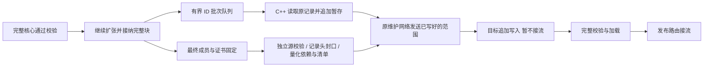

# R001-A13/A28：子图边扩张边复制

2026-11-03，轮次 `subgraph_growth_stream_20261103`。承接[完整计划流水](R001_SUBGRAPH_PIPELINE.md)，不改变 h 跳核心、完整外层块接纳、入口划分或查询扩展函数。

## 实现与适用范围

入口分组及初始完整 h 跳核心仍先计算、校验。随后 `replica_hop_breadth_expand` 在核心通过容量检查后输出核心成员，并在**完整一跳块通过增量容量检查、不可撤销地加入区域后**输出新增成员。未通过检查的候选不复制。新成员按有界批次交给原生记录生产者；它与同一子图剩余扩张同时运行。

逻辑成员与完整性证书仍按 ID 排序，与原算法一致。物理记录改为追加排列：每批内部按源物理位置读，每条记录一经写出便不移动。`ids.npy` 记录物理槽位对应的 ID，`manifest.json` 明确标记 `replica_record_order: admission_v1`。节点记录头、向量、原始边、量化格式不变。原生及 Python 加载器都验证 ID 唯一性，code bank 仍严格排序；查询需要的有序成员集合另行排序，记录查找仍使用 ID→物理槽映射。

因此，最终封口不用把高维向量重新排一次序，不增加第二份重排文件。源端保留一份临时副本文件，目标保留一份待发布文件；源临时空间仍需最多容纳一份子图，不能称为零暂存。

## 流程

1. 顶层先预约本轮所有目标的总容量与副本槽位，计入已有副本、排空副本及未完成预约。实际目标在接收前再次检查本地容量、磁盘余量及量化契约。
2. 源规划线程产生已接纳成员；有界队列满时对维护规划背压。一个源记录生产者在 C++ 中批量读取/写出，释放 GIL；既有维护发送器按原复制速率、前台压力控制及有限在途窗口发送。
3. 目标支持未知最终长度的 `nodes.bin`，按固定大小 chunk 的偏移和 SHA256 去重，乱序到达也不重复计费。接收长度的高水位及其他文件占用不能超过预约。
4. 扩张结束后独立回放完整性证书；核对已追加记录集合与最终计划逐项相同。补齐所有邻接目标的量化依赖。这里只更新文件头的最终行数，记录体不重写。
5. 发完已产生的数据并获得确认后，目标核对连续覆盖、末块长度及布局，再封口。源和目标使用相同最终文件 SHA256，保留目标全记录依赖验证和标准加载。
6. 完成后进入原来的 ready/validated 发布策略；没有将完整性校验替代召回验证，也没有在部分图上提前接流。

## 协议与失败处理

新增能力编号 3，沿用协议 2 的维护网络与 lifecycle，目标必须显式支持。提前协商，不会在部分传输后隐式降级。`pipeline_open(nodes.bin, bytes=0)` 是增长文件声明；`pipeline_seal_nodes` 检查最终长度与记录头；普通文件与最终提交仍复用已有操作。

相同任务 ID、计划序号、文件范围及校验和可重试；冲突请求拒绝。源 `source_adopt` 将顶层收到的最终计划与源端保存的完整声明摘要比较，不能用其他计划接管已复制文件。

规划、复制、校验或发布失败时先取消源生产者，确认它们退出，再撤下本轮已发布路由并排空，回收未发布暂存。写入者仍持有文件或无法确认源停止时不释放容量预约。旧有副本不撤回。增长文件同样受维护期限与目标清理线程管理；不提供进程崩溃后的跨重启自动续传。

## 配置

统一位置：`load_balance.partitioned_regions.pipeline`。

|字段|初始实验值|含义|
|---|---:|---|
|copy_during_expansion|true（实验配置）|启用同一子图的扩张与复制重叠；要求 `enabled: true`|
|growth_batch_rows|1024|每个 ID 批次最多包含的成员数|
|growth_queue_batches|4|等候记录生产者的批次数|

沿用 `chunk_bytes`、`inflight_chunks`、`producer_queue_bytes`、`copy_mib_per_s`、复制压力限速与维护期限；不增加查询线程。无新字段的旧 YAML 保持原行为。当前显式入口为 `LoadBalancer.build_partitioned_online()`，离线纯规划 API/CLI 不创建远程文件；若误开启增长复制则明确报错。

本轮先验证协议与集合等价，再用相同历史、相同 α≤0.3、相同入口和检索设置对照完整计划流水。测量前已发现源节点有其他用户的 fio，保留干扰记录；相关 QPS 不可无条件归因。本轮不声称修改图质量，也不预设稳态 QPS 会提高。

## 可观测性

源端记录增长启动、首批记录就绪、成员输入结束、源封口、首末发送及确认时间；同时记录本地追加耗时、等待成员耗时、两级队列峰值与背压、总发送字节。源端确认在成员封口前收到的字节单独统计（不把本地提交等同于目标写完）。目标记录首末成功写入、增长封口、哈希/fsync/加载/验证阶段。源内时间比较不需要跨机时钟同步。

实际结果和限制见[本轮报告](../test/subgraph_growth_stream_20261103/REPORT.md)；研究主问题 R001 保持开放。

## 快速迭代：源复制工作槽阻塞

第一轮增长复制保留原来唯一的 `replica-build` 工作槽。第一份副本尚在等最终清单或独立验证时，第二份的记录生产者无法启动，导致第二份成员队列约 9.28 秒背压；全部接流 55.26 秒，慢于完整计划流水的 48.35 秒。首份仅从 30.64 秒缩短到 29.20 秒。该负面结果保留，不作为性能成功。

针对这一阻塞增加 `growth_copy_workers`（默认 2，上限 4）。它是每轮增长维护任务的有界工作槽，目标不同的两份副本可同时复制/封口。所有槽共用源端总复制速率预约，`inflight_chunks` 和生产范围队列配额也按槽数分摊，不把每份副本都赋予原来的全部带宽和在途窗口。锁只保护下一个维护发送时刻，等待和 I/O 均在锁外。源端预检本轮暂存空间；最多暂存并发槽数份子图。

首次双槽部署被缓冲总额检查拒绝（两份各使用原 16 个窗口需 132 MiB，超过 128 MiB），未复制、未发布。修正为共享原有 16 个窗口（每份 8 个），同时修复明确启动拒绝后顶层容量预约的释放；不通过扩大网络内存预算掩盖问题。传输确认丢失但不能确定源已停的情况，仍保守保留预约。

## 自动控制接入与源容量修复（2026-11-03）

`automatic_replica.py`已将持续失衡触发接到`build_partitioned_online`内部自动调用路径，公共显式维护接口保留。它选择有余量目标和有独立query证据的CPU热门入口，以源实际容量、已有活动/排空副本和全局余量共同限定新组合；显式容量传给源规划，计划预约传给create，不再使用固定源0整块上限。

源规划使用单一期限和本地单调时钟，扩张在完整块之间软停止，并为证明保留时间；背压队列也受总期限约束。已接纳记录可以提前复制，最终结构验证、量化依赖、哈希和目标安装没有跳过。发布前和目标READY后复查负载/epoch，拒绝时完整清理；检查已覆盖READY后拒绝不泄漏预约。

`auto_replica_pipeline_20261103`自然流10分钟中5份真正规划全部成功发布（17.68–59.48秒），25次容量不足在昂贵规划前拒绝。第一份3.442GB包的约3.129GB在成员封口前已获确认，说明增长复制实际生效；规划34.11秒、源独立证明/封口13.30秒和目标哈希5.05秒仍构成明显串行尾部。本轮实际图均先达到容量限制，未触发软截止。

性能没有通过：成功QPS6625、失败8.96%、副本命中0.85%、命中Recall94.57%，旧检索接纳断供仍出现。3次流内回收和546次份额调整提示需区分需求消退、入口覆盖不足和节流/停顿造成的无命中；不同源方向也未全部启用相同单边拉取路径。这些列为后续实验，不写成已解决能力。总体R001仍开放。[报告](../test/auto_replica_pipeline_20261103/REPORT.md)、[实现规范](../DESIGN.md#automatic-replica-pipeline-20261103)、[Research](../Research.md)、[TestLog](../TestLog.md)。
