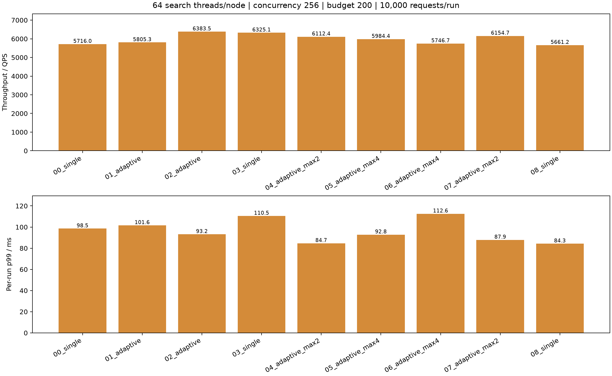
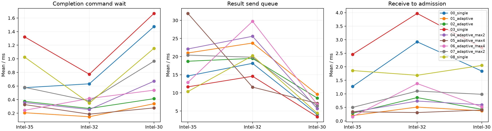

# 数据节点完成控制/结果网络动态扩容实验

固定三机Intel-35/32/30，每节点64查询线程、并发256、搜索预算200、合并线程4、预热32。每轮10000请求（相同2000查询重复5次）。固定顶层路由16线程/每目标连接32，唯一实验变量为数据节点adaptive_control开关。每个控制单元各有一个控制线程与一个结果网络事件循环。

|轮次|路由线程|顶层连接/目标|QPS|p99 ms|平均ms|Recall@10|
|---|---:|---:|---:|---:|---:|---:|
|00_single|16|32|5716.00|98.55|43.93|0.97048|
|01_adaptive|16|32|5805.32|101.61|43.41|0.97028|
|02_adaptive|16|32|6383.55|93.16|39.49|0.97032|
|03_single|16|32|6325.07|110.48|39.84|0.97035|
|04_adaptive_max2|16|32|6112.36|84.68|41.18|0.97032|
|05_adaptive_max4|16|32|5984.43|92.83|42.05|0.97030|
|06_adaptive_max4|16|32|5746.67|112.59|43.86|0.97032|
|07_adaptive_max2|16|32|6154.66|87.90|40.91|0.97024|
|08_single|16|32|5661.25|84.32|44.21|0.97032|

## 分阶段等待

以下为每查询均值，单位ms。发送前排队为RPC提交至网络客户端分配处理的间隔，混合连接容量等待与事件循环调度；响应等待包含远端处理与网络事件循环，不能称为纯网络耗时。派发/响应与数据执行重叠，不能相加为总延迟。

|轮次|路由队列|路由执行|入口发送前排队|入口发送含连接|入口响应等待|数据与控制|计算就绪累计|搜索执行累计|搜索CPU累计|
|---|---:|---:|---:|---:|---:|---:|---:|---:|---:|
|00_single|0.069|0.686|1.428|0.030|2.540|41.560|0.872|11.016|10.898|
|01_adaptive|0.085|0.760|0.219|0.019|0.780|41.240|0.346|10.951|10.849|
|02_adaptive|0.105|0.763|0.468|0.047|0.870|37.400|0.276|11.141|11.035|
|03_single|0.122|0.771|1.759|0.032|3.883|37.844|1.367|10.958|10.855|
|04_adaptive_max2|0.070|0.736|0.565|0.059|1.041|39.368|0.420|11.047|10.947|
|05_adaptive_max4|0.046|0.727|0.199|0.022|0.667|38.909|0.292|11.140|11.040|
|06_adaptive_max4|0.075|0.787|1.183|0.031|0.992|39.908|0.444|11.084|10.984|
|07_adaptive_max2|0.080|0.824|0.769|0.047|1.446|37.759|0.543|11.729|11.633|
|08_single|0.124|0.863|0.343|0.019|2.694|42.269|0.998|11.592|11.494|

## 负载

CPU核数为进程CPU时间除以快照窗口，数据节点窗口包含快照采集时间，不能用作精确瞬时CPU饱和度。

|轮次|Intel-35数据CPU核|Intel-32数据CPU核|Intel-30数据CPU核|顶层CPU核|物理读字节|
|---|---:|---:|---:|---:|---:|---:|
|00_single|17.03|18.00|9.95|12.27|0|
|01_adaptive|17.32|17.76|10.10|13.01|0|
|02_adaptive|12.63|13.74|7.41|13.54|0|
|03_single|18.37|18.71|10.77|13.37|0|
|04_adaptive_max2|17.42|18.52|10.21|13.15|0|
|05_adaptive_max4|17.48|18.57|10.58|13.18|0|
|06_adaptive_max4|12.83|14.08|7.73|13.20|0|
|07_adaptive_max2|19.10|19.74|10.18|13.89|0|
|08_single|19.57|18.00|10.09|13.08|0|

## 验证与边界

全部结果通过零失败、预算/无重复访问/无路由扩展审计，真实数据线程数64，暂存没有触发容量溢出。服务时延以完整原生结果交付Future为终点，后置编码、JSON持久化与统计不计入QPS。每轮仅数秒，是热缓存短测；两轮均值不能证明统计显著性。原始时间戳、有效YAML、源码快照和审计均保存在各轮目录。未修改生产配置或搜索代码。

## 实际扩容及等待

以下为正式查询对应的分支/结果事件均值（ms），不是所有分支之和。不同区间可能重叠。

|轮次|节点|峰值单元|结束单元|进程线程数|完成命令等待|结果发送前队列|接收至接纳|
|---|---:|---:|---:|---:|---:|---:|---:|
|00_single|0|1|1|76|0.575|14.659|1.273|
|00_single|1|1|1|76|0.632|18.143|2.922|
|00_single|2|1|1|76|1.473|4.027|1.841|
|01_adaptive|0|8|8|91|0.207|21.003|0.198|
|01_adaptive|1|8|8|91|0.148|23.741|0.511|
|01_adaptive|2|8|8|91|0.339|9.615|0.373|
|02_adaptive|0|8|8|91|0.374|18.723|0.284|
|02_adaptive|1|8|8|91|0.270|19.504|0.862|
|02_adaptive|2|8|8|91|0.413|8.577|0.426|
|03_single|0|1|1|76|1.322|11.665|2.460|
|03_single|1|1|1|76|0.773|14.580|3.971|
|03_single|2|1|1|76|1.667|3.413|2.706|
|04_adaptive_max2|0|2|2|79|0.356|22.105|0.329|
|04_adaptive_max2|1|2|2|79|0.254|25.602|0.734|
|04_adaptive_max2|2|2|2|79|0.671|5.650|0.596|
|05_adaptive_max4|0|4|4|83|0.327|31.901|0.337|
|05_adaptive_max4|1|4|4|83|0.186|11.588|0.309|
|05_adaptive_max4|2|4|4|83|0.278|7.103|0.402|
|06_adaptive_max4|0|4|4|83|0.243|12.900|0.154|
|06_adaptive_max4|1|4|4|83|0.416|29.725|1.380|
|06_adaptive_max4|2|4|4|83|0.539|6.829|0.517|
|07_adaptive_max2|0|2|2|79|0.580|20.409|0.499|
|07_adaptive_max2|1|2|2|79|0.381|19.815|1.103|
|07_adaptive_max2|2|2|2|79|0.965|6.403|0.983|
|08_single|0|1|1|76|1.024|10.349|1.860|
|08_single|1|1|1|76|0.348|20.240|1.686|
|08_single|2|1|1|76|1.154|4.403|2.051|

## 补充上限扫描与后续模块化

在初始max=8对照后，增加max=2/4逆序复测及末尾关闭对照。全部九轮零失败，召回约97%。三轮关闭均值QPS=5900.77、每轮p99均值97.78 ms；max2两轮6133.51/86.29 ms；max4两轮5865.55/102.71 ms；max8两轮6094.43/97.38 ms。短测波动明显，且上限扫描不属于完全随机化实验，不据此宣称稳定容量提升。

控制单元扩容可以降低完成命令/接纳等待，但多单元也扩大结果连接总量，发送前排队并未一致降低。默认仍关闭。用户进一步要求独立的可复用收发网络模块，因此后续将控制线程扩容和网络资源扩容拆开；新网络模块和本开关禁止同时启用，以免形成两级乘法扩容。
