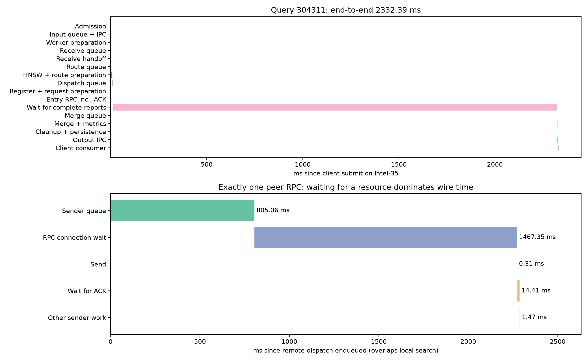
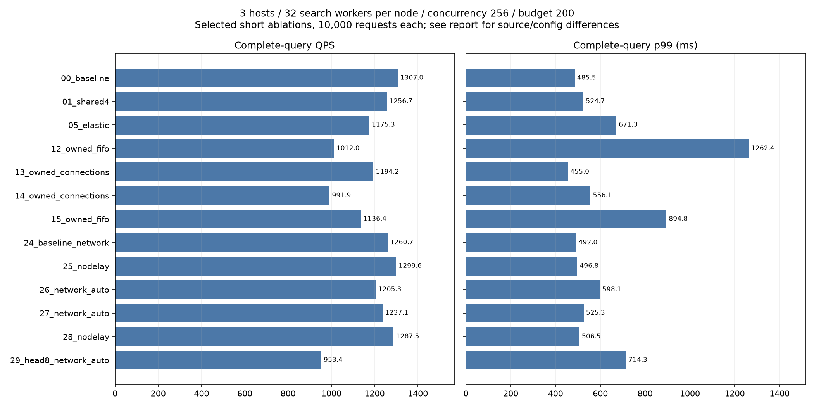
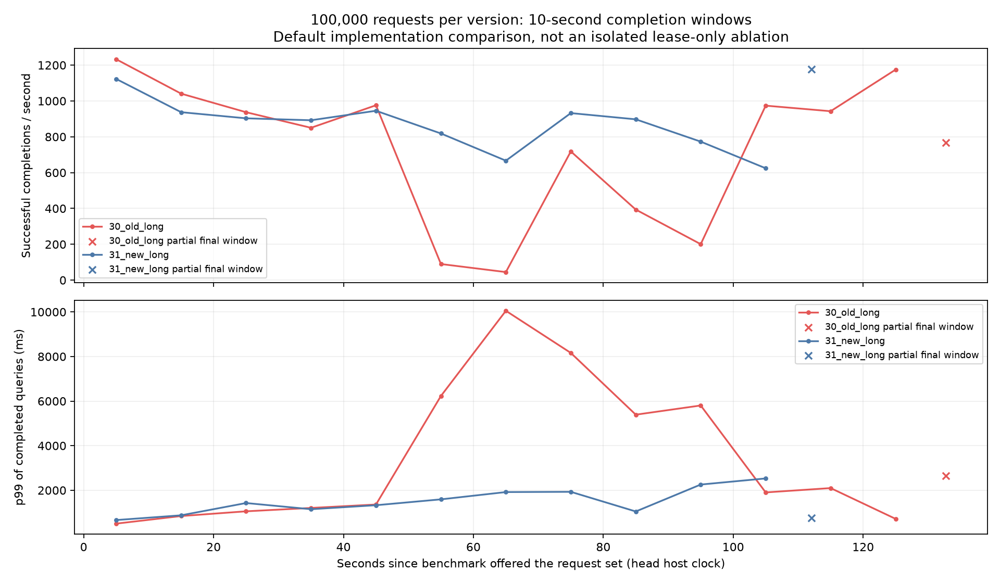
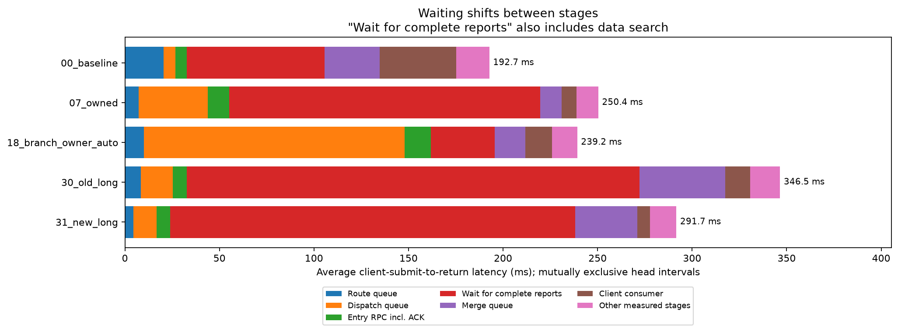
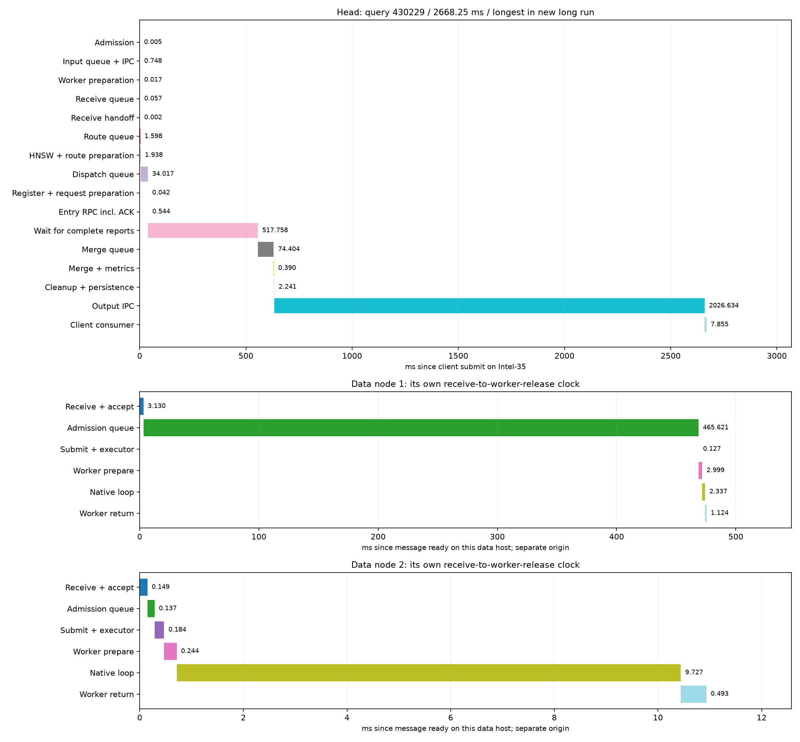

# 固定搜索线程：等待定位与动态资源实验

本轮证明了多个等待发生在搜索线程池以外，但没有证明“搜索本身对吞吐完全没有影响”。接纳状态锁、派发服务、每目标连接容量及顶层处理都可能限制查询推进。单纯增加线程会把等待移到下游，甚至降低QPS。因此，本轮实现的局部伸缩机制保留为默认关闭的实验选项；全链路收益判断与回滚算法已写入设计，尚未接入运行控制。

新旧默认实现的一次持续负载对照中，QPS从737.86提高到876.11（+18.74%），p99从4941.85ms降至1625.66ms（−67.10%）。这是默认实现整体对照的观测收益，仍需重复验证；不是动态扩容已成功的证据。

## 实验条件与可复现性

- 完整seq_2M索引，三数据节点分别在Intel-35、Intel-32、Intel-30；Intel-35还运行顶层。
- 每节点搜索计算线程固定32，搜索预算200，top-k=10，客户端在途并发256，32条预热。默认4个顶层所属进程，29号实验单独提高到8个。
- 22轮有效短测，每轮10000请求；另外进行旧/新默认实现各100000请求的持续对照，合计420000个正式请求。长测均将同一2000条验证查询循环50次，不能将请求总数当成独立查询向量数量。
- 每轮使用独立数据/head进程与冻结源码，按序发压；分析、日志压缩在计时结束后进行。索引不重建，启动时间不计入QPS。
- 三机为热缓存测试，数据进程物理读取增量为0。文件逻辑读取和物理SSD读取分别记录，不能据此评价冷SSD的IO能力。机器未独占，重复次数有限。
- 不相减不同主机的monotonic时间。顶层互斥阶段可加和到端到端延迟；多分支累计CPU、pread和RPC时间可能重叠，不能直接作为端到端时延百分比。

每轮`short/<case>/plan.yaml`、`spec.json`、`loaded_sources.json`、`result.json`记录实际配置与加载路径，节点进程状态及原始查询位于该轮`runs/`。源码快照为`source/`至`source_v6/`，清单为`source_hashes*.json`；各版本消融不能全部称为严格单变量实验。19号在启动阶段中断，保留`interrupted.json`，未计入有效结果；未执行计划也不计入。

## 等待具体发生在哪里

### 接纳队列和共享状态锁

00号原配置在Intel-32的分支测量中：接纳队列平均58.09ms，消费者首次获取队列锁平均0.986ms、最大约51ms；真正提交计算池平均0.123ms，executor等待平均0.607ms，worker启动状态锁区间平均1.584ms，原生搜索约9.636ms。

把接纳消费者从1个加到4个后，队列锁平均等待增加到4.91ms，worker状态锁区间增加到6.62ms，QPS从1307降到1257。动态扩至8个消费者也只把接纳排队移到了提交锁/worker锁，整体更慢。这里应减少串行临界区工作，而不是不断增加争用同一把锁的线程。

指标的边界需要注意：Condition等待空队列后的唤醒/重获锁不包含在首次获取锁的区间中；墙钟等待也不能全算作GIL或CPU忙等。本轮没有精确测出GIL、OS调度和锁竞争各自的独占比例。分支测量汇总见[nodes.csv](nodes.csv)。

### 跨节点派发队列与连接槽位

07号实验移除提交路径中不必要的全局状态锁后，累计就绪等待下降到约1.29ms，但QPS下降到1008、p99达到1438ms。选择其中**仅有一次peer RPC的最长查询304311**追踪（这是诊断样本，不代表典型查询）：

| 区间 | 毫秒 |
|---|---:|
| 客户端提交到完整返回 | 2332.388 |
| 远程发送线程队列 | 805.057 |
| RPC连接池等待 | 1467.353 |
| 发送报文 | 0.306 |
| 等待远端ACK | 14.409 |
| 本地native循环结束到worker可复用 | 0.197 |

本地完成事件约0.094ms便被原生控制消费。因此，搜索线程没有占着线程等两秒；查询终态在等待尚未派发完成的子分支。连接池原来每目标仅2个槽位，使用`notify_all`竞争空闲连接，新请求可以越过旧等待者。

上图两个面板分别使用顶层和派发源节点的本机时钟，不能拼接为跨主机绝对时间线。原始样本见[connection_wait_query.json](connection_wait_query.json)，矢量图见[SVG](connection_wait_timeline.svg)。

已实现FIFO授予连接，以及每目标2–8条连接的有界动态容量。连接只用于扩展函数已批准的请求；扩容不会产生新的图扩展。缩容只关闭多余空闲连接，不撤销已借出的连接。

### 等待也会转移到顶层

00号每查询平均路由队列20.42ms、派发队列6.40ms、等待完整报告72.81ms、合并队列29.12ms、客户端消费40.62ms。18号把worker启动锁区间降至约0.01–0.05ms后，顶层派发队列升至137.83ms。

这些区间由[head_stage_means.csv](head_stage_means.csv)记录。`Wait for complete reports`包含真实搜索和分支/报告推进，不能把整个区间叫纯消息队列等待。改进的评价单位必须是完整查询，不能只汇报被优化的局部队列。

## 短测消融结果

全部有效短测零失败，平均Recall@10约97%，预算200、节点不重访和指标完整性审计通过。完整指标见[full_metrics.csv](full_metrics.csv)。

| 实验 | QPS | p99 ms | 解释 |
|---|---:|---:|---|
| 00 原共享锁、1接纳消费者 | 1307.03 | 485.49 | 早期基线 |
| 01 共享锁、4消费者 | 1256.70 | 524.68 | 争用加重 |
| 02 独立队列锁、1消费者 | 1144.53 | 648.42 | 拆队列锁本身没有带来吞吐收益 |
| 03 独立队列锁、4消费者 | 988.08 | 716.70 | 进一步增加消费者更慢 |
| 04 锁外获取native状态更新 | 1295.31 | 487.07 | 短测接近基线 |
| 05 动态接纳1–8 | 1175.28 | 671.26 | 等待转移到其他状态锁 |
| 06 再动态顶层/远程发送线程 | 1173.42 | 759.15 | 未改善整体吞吐 |
| 07 分支提交绕过状态锁 | 1008.17 | 1438.40 | 暴露远程派发等待 |
| 08 上述提交路径+动态服务 | 1172.73 | 790.29 | 未超过基线 |
| 12 数据FIFO固定2连接 | 1011.95 | 1262.45 | 与13–15交错对照 |
| 13 数据FIFO动态2–8 | 1194.18 | 455.04 | 改善尾延迟 |
| 14 重复动态2–8 | 991.86 | 556.13 | QPS收益不稳定 |
| 15 重复FIFO固定2 | 1136.37 | 894.76 | 动态策略的主要收益在长尾 |
| 16 动态连接、关闭lane重复日志 | 1072.54 | 504.85 | 未观察到明显吞吐收益 |
| 17 新源码、原配置 | 1296.15 | 503.68 | 配置回归对照 |
| 18 分支启动绕锁+动态数据连接 | 1054.43 | 492.53 | 等待转移到顶层派发 |
| 24 最终源码、原配置 | 1260.67 | 491.96 | v6基线 |
| 25 仅Python RPC TCP_NODELAY | 1299.60 | 496.82 | 不能据此断言Nagle为主因 |
| 26 双侧动态连接+动态顶层派发 | 1205.27 | 598.14 | 下游等待加重 |
| 27 重复双侧动态 | 1237.05 | 525.34 | 仍低于固定对照 |
| 28 重复仅TCP_NODELAY | 1287.54 | 506.45 | 与25、26、27交错 |
| 29 动态网络+8个head所属进程 | 953.43 | 714.26 | 增进程不能解决当前链路 |

12–15交错实验中，动态连接两轮的p99中位数约506ms，固定连接约1079ms，降低约53%；QPS中位数只高约1.8%，且两轮差异方向不一致，不构成稳定QPS提升。25–28中动态双侧容量的QPS中位数反而比仅TCP_NODELAY的固定配置低约5.6%。

实际扩缩容事件见[connection_events.json](connection_events.json)和[connection_capacity.png](connection_capacity.png)。顶层池统计保存在`temporary_logs/short/<case>/lane-*.services.json`。每目标容量是**每进程、每目标**的上限；4个head进程各上限8并不等于顶层总共8条连接。

## 持续负载对照

旧lease在runtime.lock下遍历全部保留记录查query_id，成本随历史记录累积增加。协议已有每query每节点至多一个分支的约束，故直接使用`query_visits`定位记录，将查找改为O(1)，保留token校验、取消和过期语义。

30/31各运行100000请求：30的数据/head均使用`source/`，31均使用`source_v6/`。这是**默认实现整体对照**：新版还增加了观测字段及独立pending计数短锁，实验性扩容全部关闭。不能把全部性能差异强归因于lease这一行修改。

| 指标 | 旧默认实现30 | 新默认实现31 |
|---|---:|---:|
| QPS | 737.86 | 876.11 |
| 平均客户端提交到返回 ms | 346.49 | 291.67 |
| p99 ms | 4941.85 | 1625.66 |
| 最大时延 ms | 10113.73 | 2668.25 |
| Recall@10 | 97.0196% | 97.0253% |
| 失败数 | 0 | 0 |
| 每查询累计就绪等待 ms | 210.78 | 189.04 |
| 累计就绪等待p99 ms | 4685.39 | 759.33 |
| 每查询累计搜索线程CPU ms | 11.84 | 11.90 |
| 每查询累计pread ms | 0.731 | 0.779 |
| 每查询累计精确距离计算 ms | 2.383 | 2.358 |
| 每查询累计RaBitQ计算 ms | 3.835 | 3.890 |
| 每查询应用协议字节（非网卡线速字节） | 31730.64 | 31700.33 |
| 每查询跨数据节点分支RPC数 | 0.35026 | 0.35000 |
| 每查询全部协议RPC数 | 3.18978 | 3.06885 |
| 每查询扩展顶点数 | 200 | 200 |
| 每查询最大扩展深度的均值 | 10.859 | 10.856 |
| 每查询逻辑文件读取 bytes | 2457600 | 2457600 |
| 三节点物理读取增量 bytes | 0 | 0 |
| 顶层全部业务进程平均CPU核数 | 3.67 | 4.26 |
| Intel-35数据进程平均CPU核数 | 4.04 | 4.52 |
| Intel-32数据进程平均CPU核数 | 4.61 | 5.55 |
| Intel-30数据进程平均CPU核数 | 2.44 | 2.83 |

客户端并发256的剩余请求还在负载发生器中等待，`client_backlog_ms`及`offered_to_complete_ms`另存原始结果；表中延迟从真正提交单条查询开始，QPS的分母包含整个请求集合排空时间。不能把100000请求同时存入测试列表误称为100000在途并发。

旧版在50–70秒的两个完整窗口只有89.9和45.0QPS；新版对应窗口为818.5和666.7，避免了本次旧版的严重塌陷，但新版100–110秒仍只有624.4QPS。平均值改善不能替代稳态与长尾验收。本次只有一对长测、且主机未独占，不宣称稳定的18.74%收益。

### 新长测中仍然存在的等待

新长测每查询平均互斥顶层区间为：路由队列4.46ms、派发队列12.35ms、入口RPC含ACK 7.03ms、等待完整报告214.22ms、合并队列32.90ms、输出IPC 8.53ms、客户端消费6.84ms，其余阶段约5.33ms。完整阶段表见[head_stage_means.csv](head_stage_means.csv)。

选择新长测最慢查询430229，端到端2668.251ms：

| 顶层区间 | ms |
|---|---:|
| 派发队列 | 34.017 |
| 等待完整报告（含数据搜索与队列） | 517.758 |
| 合并队列 | 74.404 |
| 合并计算及指标 | 0.390 |
| 清理及持久化 | 2.241 |
| 输出IPC区间 | 2026.634 |
| 客户端消费 | 7.855 |

该查询Intel-32分支的接纳队列465.621ms、原生循环2.337ms；Intel-30分支原生循环9.727ms。本地native结束到worker可复用分别约1.124ms、0.493ms。输出IPC区间占该查询约75.95%，说明不能把当前尾延迟都归因于数据搜索。这里“输出IPC”从lane构造结果时间戳到父进程收完并解码为止，包含序列化、发送锁/管道、父进程调度与解码；现有时间戳不足以细分成纯管道传输或断言父进程忙等，也没有对应的顶层GC事件可用于精确归因。后续需补发送前/锁取得/发送完成、接收前后/解码完成及父进程GC时间戳。

各数据面板使用各自消息接收时间为零点，不能跨机器拼接横坐标；分支可以并行，不能将面板时长相加。原始记录见[31_new_long_slowest_query.json](31_new_long_slowest_query.json)、[current_long_query_timeline.json](current_long_query_timeline.json)。

### 数百毫秒的GC暂停会表现为锁等待

新长测Intel-32保留记录中，一次接纳锁等待733.281ms，与同进程generation-2 GC暂停701.938ms完全重叠；该GC的线程CPU为701.212ms。同一实验Intel-30的288.556ms锁等待中，284.801ms与generation-2 GC重叠。旧版Intel-35的539.772ms锁等待中，也有537.878ms与全代GC重叠。即使临界区本身短，Python循环垃圾回收暂停也会让其他Python线程无法推进；增加同进程线程不能绕过这一暂停。

这些时间重叠是具体事件证据，不能推广为“所有等待都是GC”。原始事件见[long_wait_diagnosis.json](long_wait_diagnosis.json)。节点终态保留60秒，旧/新长测分别只保留54114/59016个正式分支trace，不能把节点trace统计当成全100000请求覆盖；GC事件也为有界历史，未发现重叠不代表没有发生。GC累计计数的采集窗口还包含节点统计收集，不应直接除以查询总时长当成停顿占比。

下一步结构优化应减少长期保留的Python查询对象、把历史状态压缩为必要的身份/去重/诊断摘要，并将完整测试记录流式保存；不能直接禁用GC或删除防重放记录来换QPS。这属于后续需独立消融的对象生命周期设计，本轮没有修改GC策略或降低记录完整性。

## 动态算法与实现边界

[DESIGN.md §23](../../DESIGN.md#23-固定搜索线程的等待定位与动态控制服务2026-10-20)给出全部设计。现有局部执行器按最老等待、忙碌数、服务时间EWMA和下游余量有界增长，持续空闲后逐步回收；线程、连接上限与采样参数在[configs/dhdgs.yaml](../../configs/dhdgs.yaml)的`peer.adaptive_services`。默认总开关关闭。

根据消融结果，推荐的系统级算法是：

1. 固定每节点32搜索线程及预算，按阶段观察等待、占用率和完成速率；锁/GC限制阶段先改结构，不自动扩接纳线程，原因未细分的IPC区间也不盲目扩容。
2. 每次只试探一种资源、增加1个线程或连接。发送线程正在等连接时优先试探连接，避免只增加阻塞线程。
3. 稳定窗口后比较多窗口端到端成功QPS、p99和错误；只有收益超过噪声范围、质量/预算/去重约束成立才保留。
4. 无收益或回退则恢复旧容量，并对该资源冷却；低负载时每次减1，验证等待没有恶化。
5. 同一主机的顶层和数据进程共享新增资源预算；缩容不终止在途任务；控制消息和观测本身的成本也要计入实验。

系统级方案的初始窗口/阈值集中在[feedback_design.yaml](feedback_design.yaml)，明确标为`design_not_integrated`。**轻量全局反馈、单项探测状态机、运行中容量更新及收益回滚仍未集成**，不能称为已经上线的自动最优QPS控制器。本轮已完成阶段观测、局部伸缩执行器、FIFO连接及上述消融验证；没有把负收益配置替换到常驻集群。

## 验证和产物

- 完整回归399项通过：[regression_final.log](regression_final.log)。包括资源上限、空闲回收、FIFO/超时/关闭、分支计数、lease索引/鉴权/取消等。
- 请求级延迟、召回、CPU、逻辑读、网络字节和RPC次数：每轮`runs/*/queries.csv`、`queries.jsonl.gz`及`result.json`。
- 汇总：[full_metrics.csv](full_metrics.csv)、[rounds.csv](rounds.csv)、[nodes.csv](nodes.csv)、[head_stage_means.csv](head_stage_means.csv)。
- 按10秒窗口统计的成功完成率/p99：[throughput_windows.csv](throughput_windows.csv)。末尾不足10秒的窗口应单独看待；窗口p99按该窗口完成的查询计算。
- 三个实验端口已关闭，原常驻集群ready且零活动查询；新旧长测配置、源码路径和质量审计检查通过：[final_cluster_check.json](final_cluster_check.json)。
- 本轮临时worker日志压缩后校验解压SHA256才删除对应未压缩重复件，校验记录在每轮`worker_results/checksums.json`。原始数据、索引、常驻服务及历史对照保留。
- 分析复现：在无性能负载时依次运行本目录`analyze.py`、`final_analysis.py`、`long_wait_diagnosis.py`和`final_graphs.py`，不要在计时窗口并行运行大规模解析或绘图。

本轮没有达到“所有等待低于100ms”，也没有获得可推荐为默认的稳定QPS扩容收益。默认实现的一次长测虽有改善，仍需重复验证。后续控制器应以这里保留的负面结果约束自动策略，避免反复把同一批等待移到另一层。
