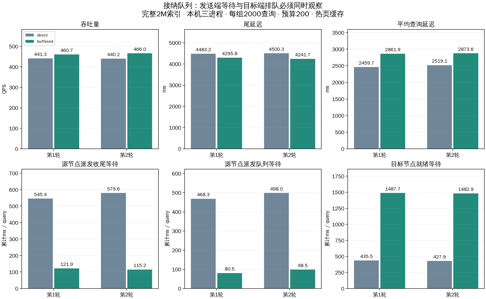

# 有界接纳队列：快速确认与等待转移对照

实现接收线程完成校验、去重、容量预约和入队后立即返回accepted；独立接纳线程负责计算线程池提交。95项回归通过，含真正TCP连接在后台submit阻塞时收到确认、队列容量、重复/冲突、取消/过期、后台提交失败和关闭。设计见 [DESIGN 11.10](../../DESIGN.md)。



## 配置与范围

两种模式都使用optimized通信、native计算循环和同步buffered pread。完整2M×2560索引复用；预算200/frontier64、每节点计算线程池256、派发16、控制16、连接上限8/端点、接纳上限2048。新增queue_capacity=2048，按尚未开始初次计算的总任务数计算，包含已交给计算线程池的任务；不是仅前端deque长度。默认YAML的接纳容量为128，与默认max_active_queries相配，本实验值没有替换默认容量。

同一2000条不同验证查询，排除既有128条校准查询；20客户端进程×100查询线程，每组40次预热不计入查询统计。两轮共8000请求，第一轮direct→buffered，第二轮buffered→direct，全部成功且指标完整。不是持续稳态测试，不是物理三机或冷SSD结果。

direct仍由接收线程直接调用计算线程池submit；buffered由一个独立接纳线程调用submit。计算、派发、控制线程池及扩展函数未重构，未预启动全部工作线程；本轮只隔离接纳队列的效果。第一轮后补齐了resumable初次提交失败的退出通知，该修复不经过本实验native正常执行路径；两份源代码清单和首轮peer.py均保存。

```yaml
peer:
  admission:
    mode: buffered   # direct为同步提交对照
    queue_capacity: 128
```

旧YAML缺少整个admission组时显式迁移为direct，避免历史配置悄然改变行为。接纳确认表示进程内任务已被接纳，不代表计算完成或持久化；后台启动失败仍通过原控制通道回报错误，入口必须等全部分支结果。

## 两轮端到端结果

| 轮次 | 模式 | 成功/失败 | 实际并发峰值 | QPS | 平均ms | p99 ms | Recall@10 |
|---|---|---|---|---|---|---|---|
| 1 | buffered | 2000/0 | 1998 | 460.66 | 2861.86 | 4295.81 | 97.040% |
| 1 | direct | 2000/0 | 2000 | 441.28 | 2459.72 | 4483.16 | 96.985% |
| 2 | buffered | 2000/0 | 2000 | 466.01 | 2873.58 | 4241.68 | 97.025% |
| 2 | direct | 2000/0 | 2000 | 440.24 | 2519.13 | 4500.33 | 97.060% |

## 等待发生在哪里

下表是每查询跨分支累计均值。admission与executor-start是ready的细分，finalize与transfer队列/执行重叠，所有列不可直接相加为端到端延迟。

| 轮次 | 模式 | 派发队列ms | 派发响应阶段ms | 派发收尾ms | 接纳至提交ms | 提交至初次执行ms | ready总ms |
|---|---|---|---|---|---|---|---|
| 1 | buffered | 80.463 | 11.102 | 121.891 | 1481.495 | 6.253 | 1487.748 |
| 1 | direct | 468.346 | 40.044 | 545.390 | 0.054 | 435.429 | 435.483 |
| 2 | buffered | 98.500 | 12.050 | 115.244 | 1476.972 | 5.896 | 1482.868 |
| 2 | direct | 497.952 | 39.602 | 579.582 | 0.053 | 427.863 | 427.916 |

最终第二轮：派发收尾 579.582→115.244ms，目标端ready 427.916→1482.868ms，平均延迟 2519.127→2873.585ms，p99 4500.326→4241.685ms。

接纳确认与计算启动解耦后，源端可以更早归还连接和释放派发线程，从而降低后续派发任务排队。但计算任务没有消失：独立接纳线程仍调用现有ThreadPoolExecutor.submit，仍受提交锁、按需建线程及Python调度约束，等待可以转移到目标端。第一轮平均延迟上升，尽管p99和QPS小幅改善；不能仅以源端等待下降宣称全部查询更快。两轮短窗口不提供统计显著性或最优配置结论。

peer_response_wait_ms是源端发送完成到接收/解码响应的累计墙钟时间，包含目标处理及双方调度，不是纯网络ACK延迟。新接纳队列的目的已由阻塞注入测试确认，但实际吞吐仍取决于计算启动和控制回传路径。

## 节点负载、容量与正确性

| 轮次 | 模式 | 节点 | 平均CPU核当量 | 结束线程数 | RSS GiB | 待初次执行峰值* |
|---|---|---|---|---|---|---|
| 1 | buffered | 0 | 3.044 | 280 | 1.155 | 792 |
| 1 | buffered | 1 | 2.410 | 280 | 1.039 | 431 |
| 1 | buffered | 2 | 1.572 | 185 | 0.794 | 364 |
| 1 | direct | 0 | 3.017 | 262 | 1.147 | 0 |
| 1 | direct | 1 | 2.337 | 228 | 1.026 | 0 |
| 1 | direct | 2 | 1.578 | 171 | 0.782 | 0 |
| 2 | buffered | 0 | 3.046 | 303 | 1.163 | 791 |
| 2 | buffered | 1 | 2.468 | 283 | 1.051 | 423 |
| 2 | buffered | 2 | 1.635 | 191 | 0.800 | 383 |
| 2 | direct | 0 | 2.989 | 285 | 1.147 | 0 |
| 2 | direct | 1 | 2.367 | 244 | 1.026 | 0 |
| 2 | direct | 2 | 1.582 | 164 | 0.785 | 0 |

*峰值包含服务预热，direct不维护该容量计数；direct为0不表示没有排队。测量结束时所有模式pending、接纳deque及未确认分支均为0；没有容量拒绝或控制发送错误。物理读取增量均为0，符合热页缓存范围。

审计8000条记录的唯一身份、冻结查询集合、原始JSONL一致性、召回重算、预算≤200、父子预算守恒、每个远端分支有批准决策、无节点回访、无顶层扩展RPC、固定原生线程，以及ready等于两个新增细分项之和。未在此轮重新计算全库ground truth。所有客户端和数据服务均已停止。

## 后续选择

保留direct/buffered切换。队列容量应随接纳上限和延迟目标校准，不能无限增大；下一步优先测计算任务提交的锁/建线程等待，并验证固定工作线程提前就绪或专用计算任务队列，避免单纯把等待转移到后台。按用户要求继续以平均Recall@10≥.95、无失败为门槛，优先p99、再比较QPS，同时公开平均延迟退化。

- [结果JSON](comparison.json)、[CSV](comparison.csv)、[审计](verification.json)、[回归日志](regression_final.log)。
- [buffered配置](buffered/experiment.yaml)、[direct配置](direct/experiment.yaml)、[负载配置](buffered/load_plan.yaml)。
- [首轮代码清单](sources.json)、[最终代码清单](sources_final.json)、[图表SVG](comparison.svg)。
- 第1轮buffered：[汇总](buffered/runs/20261018T131153/summary.json)、[原始查询](buffered/runs/20261018T131153/queries.jsonl.gz)、[CSV](buffered/runs/20261018T131153/queries.csv)、[阶段均值](buffered/runs/20261018T131153/query_stage_means.csv)、[资源采样](buffered/runs/20261018T131153/resource_samples.json.gz)。
- 第1轮direct：[汇总](direct/runs/20261018T131108/summary.json)、[原始查询](direct/runs/20261018T131108/queries.jsonl.gz)、[CSV](direct/runs/20261018T131108/queries.csv)、[阶段均值](direct/runs/20261018T131108/query_stage_means.csv)、[资源采样](direct/runs/20261018T131108/resource_samples.json.gz)。
- 第2轮buffered：[汇总](buffered/runs/20261018T131352/summary.json)、[原始查询](buffered/runs/20261018T131352/queries.jsonl.gz)、[CSV](buffered/runs/20261018T131352/queries.csv)、[阶段均值](buffered/runs/20261018T131352/query_stage_means.csv)、[资源采样](buffered/runs/20261018T131352/resource_samples.json.gz)。
- 第2轮direct：[汇总](direct/runs/20261018T131437/summary.json)、[原始查询](direct/runs/20261018T131437/queries.jsonl.gz)、[CSV](direct/runs/20261018T131437/queries.csv)、[阶段均值](direct/runs/20261018T131437/query_stage_means.csv)、[资源采样](direct/runs/20261018T131437/resource_samples.json.gz)。

两个模式共享端口，必须顺序运行各自run_load.py。prepare.py拒绝覆盖已执行目录；analyze.py读取已冻结的两轮记录重新生成报告。大体积原始记录保留本机，Git保留代码、配置及紧凑结果。
