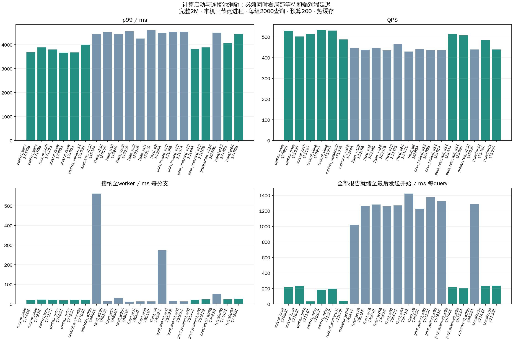

# 等待瓶颈与计算启动优化实验

全部组使用同一2000查询集合、完整seq_2M索引、native搜索预算200、queued独立发送队列；本机三TCP数据进程、客户端并发上限2000、40次预热排除。搜索扩展决策、预算、每节点单次访问和固定分支线程语义保持一致。所有实验在原索引上复测，不重建索引。

## 所有运行

| 配置 | 轮次 | 成功 | Recall@10 | QPS | 平均ms | p99 ms |
|---|---|---|---|---|---|---|
| control_base | 170908 | 2000 | 97.045% | 529.47 | 1928.11 | 3684.29 |
| control_base | 171638 | 2000 | 97.000% | 502.21 | 2001.45 | 3888.46 |
| control_both | 171123 | 2000 | 97.035% | 512.75 | 1858.00 | 3800.26 |
| control_delay | 170953 | 2000 | 96.995% | 532.42 | 1914.77 | 3669.82 |
| control_delay | 171553 | 2000 | 96.975% | 530.89 | 1839.31 | 3673.39 |
| control_workers32 | 171038 | 2000 | 96.990% | 487.95 | 1958.53 | 3998.75 |
| executor_w256 | 145444 | 2000 | 97.005% | 445.47 | 2915.84 | 4451.14 |
| fixed_w128 | 150156 | 2000 | 97.010% | 438.38 | 2915.95 | 4519.87 |
| fixed_w16 | 145940 | 2000 | 97.030% | 445.61 | 2882.73 | 4445.15 |
| fixed_w256 | 145616 | 2000 | 97.075% | 434.85 | 2873.85 | 4559.13 |
| fixed_w32 | 150025 | 2000 | 96.980% | 465.19 | 2847.31 | 4253.16 |
| fixed_w64 | 150110 | 2000 | 97.020% | 429.37 | 3084.32 | 4606.08 |
| fixed_w8 | 145854 | 2000 | 96.990% | 440.12 | 2882.83 | 4494.04 |
| pool_locked_w32 | 151358 | 2000 | 97.050% | 435.61 | 3010.67 | 4533.91 |
| pool_locked_w32 | 151614 | 2000 | 97.020% | 435.62 | 2972.61 | 4543.91 |
| pool_reserved_w32 | 151444 | 2000 | 97.025% | 513.08 | 1978.29 | 3814.40 |
| pool_reserved_w32 | 151529 | 2000 | 97.035% | 507.15 | 1984.54 | 3885.88 |
| prestarted_w256 | 145530 | 2000 | 97.045% | 439.33 | 2923.17 | 4509.20 |
| transfer32 | 171422 | 2000 | 97.010% | 483.86 | 2054.12 | 4062.51 |
| transfer64 | 171508 | 2000 | 97.005% | 439.68 | 2137.70 | 4446.00 |

## 启动等待（分支均值）

| 配置 | 轮次 | 建线程次数 | submit ms | 接纳至worker ms | worker至C++ ms | 服务启动s |
|---|---|---|---|---|---|---|
| control_base | 170908 | 0 | 0.0189 | 19.53 | 0.81 | 16.66 |
| control_base | 171638 | 0 | 0.0190 | 22.11 | 0.81 | 16.79 |
| control_both | 171123 | 0 | 0.0187 | 21.49 | 0.89 | 16.80 |
| control_delay | 170953 | 0 | 0.0186 | 19.28 | 0.77 | 16.75 |
| control_delay | 171553 | 0 | 0.0202 | 21.68 | 0.75 | 16.73 |
| control_workers32 | 171038 | 0 | 0.0192 | 20.69 | 0.94 | 16.77 |
| executor_w256 | 145444 | 682 | 2.5512 | 561.91 | 0.49 | 16.59 |
| fixed_w128 | 150156 | 0 | 0.0237 | 14.51 | 0.62 | 17.07 |
| fixed_w16 | 145940 | 0 | 0.0176 | 30.74 | 0.41 | 16.77 |
| fixed_w256 | 145616 | 0 | 0.0557 | 11.97 | 0.57 | 18.21 |
| fixed_w32 | 150025 | 0 | 0.0205 | 13.48 | 0.66 | 16.79 |
| fixed_w64 | 150110 | 0 | 0.0193 | 13.15 | 0.67 | 16.82 |
| fixed_w8 | 145854 | 0 | 0.0164 | 274.60 | 0.30 | 16.71 |
| pool_locked_w32 | 151358 | 0 | 0.0179 | 15.94 | 0.64 | 16.78 |
| pool_locked_w32 | 151614 | 0 | 0.0206 | 13.47 | 0.60 | 16.70 |
| pool_reserved_w32 | 151444 | 0 | 0.0204 | 21.07 | 0.73 | 16.68 |
| pool_reserved_w32 | 151529 | 0 | 0.0198 | 23.16 | 0.80 | 16.69 |
| prestarted_w256 | 145530 | 0 | 0.0264 | 51.54 | 0.50 | 16.83 |
| transfer32 | 171422 | 0 | 0.0198 | 23.65 | 0.85 | 16.73 |
| transfer64 | 171508 | 0 | 0.0187 | 27.32 | 1.17 | 16.83 |

## 端到端时间的互斥分组（query均值）

用同一单调时钟域的绝对事件切分：客户端开始→根分支接纳→全部分支报告就绪→最后一个结果发送函数开始→API返回。四项之和等于平均查询延迟，不能将其他累计分支耗时再加进来。

| 配置 | 轮次 | 入口到接纳ms | 接纳至报告齐备ms | 报告齐备至发送ms | 发送开始至返回ms |
|---|---|---|---|---|---|
| control_base | 170908 | 1114.72 | 589.15 | 214.95 | 9.29 |
| control_base | 171638 | 1173.65 | 586.87 | 232.90 | 8.03 |
| control_both | 171123 | 1182.12 | 630.17 | 34.49 | 11.22 |
| control_delay | 170953 | 1167.73 | 554.05 | 183.96 | 9.03 |
| control_delay | 171553 | 1201.80 | 430.31 | 198.68 | 8.52 |
| control_workers32 | 171038 | 1290.59 | 619.73 | 37.91 | 10.30 |
| executor_w256 | 145444 | 631.72 | 1229.85 | 1020.90 | 33.37 |
| fixed_w128 | 150156 | 982.96 | 637.52 | 1263.20 | 32.27 |
| fixed_w16 | 145940 | 928.69 | 639.62 | 1280.40 | 34.02 |
| fixed_w256 | 145616 | 965.73 | 620.40 | 1256.29 | 31.43 |
| fixed_w32 | 150025 | 938.59 | 608.54 | 1268.18 | 32.00 |
| fixed_w64 | 150110 | 981.01 | 650.96 | 1420.77 | 31.58 |
| fixed_w8 | 145854 | 714.93 | 908.74 | 1226.89 | 32.27 |
| pool_locked_w32 | 151358 | 959.60 | 642.53 | 1374.52 | 34.02 |
| pool_locked_w32 | 151614 | 1005.43 | 607.95 | 1325.95 | 33.29 |
| pool_reserved_w32 | 151444 | 1125.01 | 629.80 | 215.48 | 8.01 |
| pool_reserved_w32 | 151529 | 1163.92 | 607.53 | 204.50 | 8.59 |
| prestarted_w256 | 145530 | 948.89 | 660.69 | 1282.99 | 30.60 |
| transfer32 | 171422 | 1218.56 | 592.49 | 233.25 | 9.81 |
| transfer64 | 171508 | 1320.55 | 571.20 | 236.77 | 9.18 |

## 结果RPC阶段（每次结果发送均值）

pool_wait包含借用、容量等待与空闲连接健康探测及调度，不是纯容量等待；send/response也不是纯网络时间。

| 配置 | 轮次 | pool ms | connect ms | send ms | response ms |
|---|---|---|---|---|---|
| control_base | 170908 | 0.359 | 2.310 | 11.397 | 16.968 |
| control_base | 171638 | 0.330 | 2.127 | 11.176 | 17.254 |
| control_both | 171123 | 0.556 | 3.013 | 13.516 | 20.190 |
| control_delay | 170953 | 0.277 | 2.247 | 10.608 | 17.615 |
| control_delay | 171553 | 0.165 | 1.965 | 11.742 | 17.166 |
| control_workers32 | 171038 | 0.570 | 2.427 | 13.776 | 19.567 |
| executor_w256 | 145444 | 22.540 | 0.536 | 2.685 | 4.739 |
| fixed_w128 | 150156 | 22.384 | 0.781 | 2.597 | 4.077 |
| fixed_w16 | 145940 | 23.500 | 0.835 | 2.255 | 4.092 |
| fixed_w256 | 145616 | 20.674 | 0.877 | 2.840 | 4.448 |
| fixed_w32 | 150025 | 22.768 | 0.786 | 2.678 | 4.272 |
| fixed_w64 | 150110 | 22.164 | 0.689 | 2.338 | 4.534 |
| fixed_w8 | 145854 | 23.234 | 0.526 | 2.682 | 4.036 |
| pool_locked_w32 | 151358 | 23.999 | 0.605 | 2.700 | 4.281 |
| pool_locked_w32 | 151614 | 23.077 | 0.934 | 2.720 | 4.140 |
| pool_reserved_w32 | 151444 | 0.299 | 1.977 | 11.953 | 16.256 |
| pool_reserved_w32 | 151529 | 0.335 | 2.131 | 10.994 | 16.762 |
| prestarted_w256 | 145530 | 21.414 | 0.435 | 2.478 | 3.942 |
| transfer32 | 171422 | 0.541 | 2.960 | 12.156 | 19.038 |
| transfer64 | 171508 | 0.447 | 2.577 | 12.406 | 19.154 |

所有运行的逐分支、关键路径CSV、固定查询734744原始事件及审计保存在analysis/配置/运行目录。
资源使用、协议字节、服务启动耗时与物理读取增量见comparison.json；完整queries.csv、阶段均值、进程负载见各组runs目录。
本轮是热页缓存突发负载，不代表物理三机、冷SSD或稳态容量；详细trace开销未单独消融。预启动把线程创建成本移至服务启动，不是将其消除。
