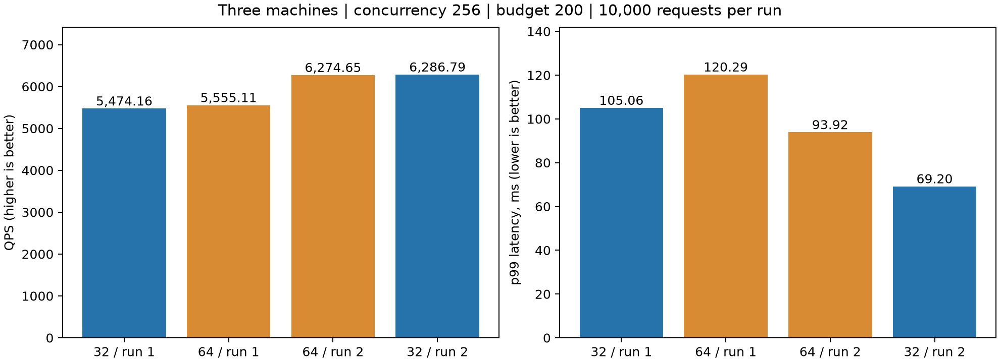
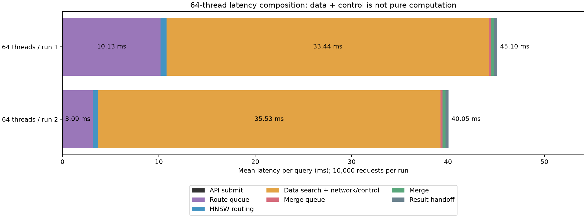
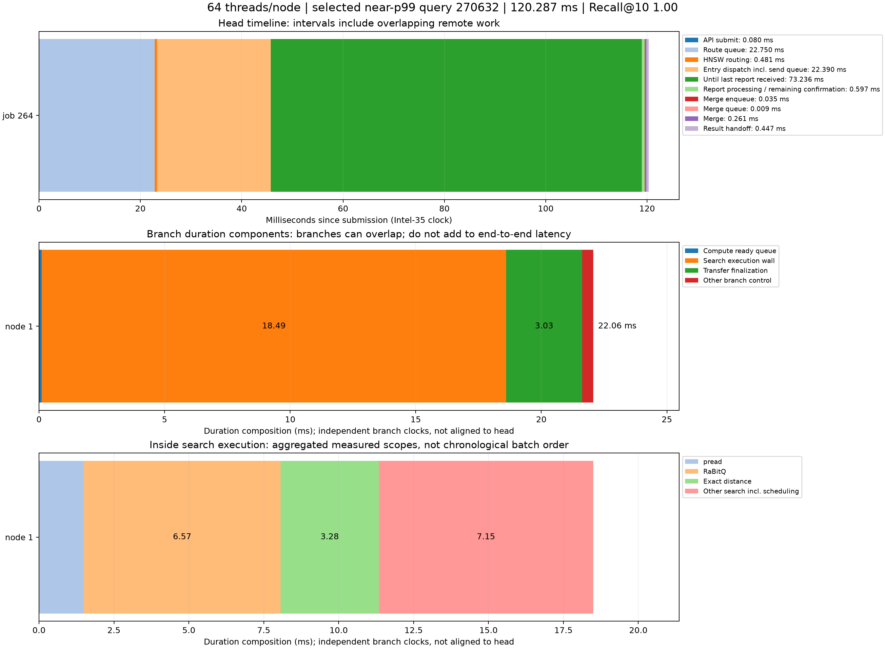

# 每节点 32 / 64 查询线程对照实验

三台服务器 Intel-35 / Intel-32 / Intel-30；Intel-35 同时运行独立顶层路由。固定并发256、预算200、top-k10、路由/合并线程各4、预热32。每轮10000次请求，由固定2000条验证查询重复5次组成。使用相同索引、源码、查询顺序；运行顺序32→64→64→32。

|轮次|每节点线程|QPS|p99(ms)|平均(ms)|Recall@10|
|---|---:|---:|---:|---:|---:|
|00_w32|32|5474.16|105.06|45.75|0.97046|
|01_w64|64|5555.11|120.29|45.10|0.97036|
|02_w64|64|6274.65|93.92|40.05|0.97035|
|03_w32|32|6286.79|69.20|39.98|0.97020|

两轮算术平均：QPS 5880.47 → 5914.88（+0.59%）；每轮p99的算术平均 87.13 → 107.11 ms（+22.93%）。该值不是合并样本的p99。

## 时延与负载

各阶段取每查询平均；data + control包含数据搜索、网络、确认及回报，不能直接当作纯计算。计算就绪队列为分支累计指标，可能重叠，不能与顶层阶段相加。

|轮次|API提交|路由排队|路由计算|数据与控制|合并排队|合并|结果交付|计算就绪累计|搜索线程CPU|
|---|---:|---:|---:|---:|---:|---:|---:|---:|---:|
|00_w32|0.039|3.861|0.637|40.291|0.237|0.333|0.355|4.228|10.170|
|01_w64|0.036|10.131|0.630|33.442|0.204|0.321|0.337|1.297|11.174|
|02_w64|0.040|3.088|0.548|35.533|0.212|0.314|0.316|1.144|10.670|
|03_w32|0.038|14.670|0.587|23.781|0.270|0.308|0.323|3.233|9.642|

|轮次|Intel-35数据CPU核|Intel-32数据CPU核|Intel-30数据CPU核|顶层CPU核|物理读字节|
|---|---:|---:|---:|---:|---:|
|00_w32|14.82|16.09|8.66|11.49|0|
|01_w64|14.73|19.39|9.36|11.33|0|
|02_w64|17.16|18.76|10.82|11.67|0|
|03_w32|16.81|15.44|10.10|11.90|0|

CPU核数为进程CPU时间/快照窗口，数据节点窗口包含快照获取时间，不完全等于查询窗口，不能据此精确判断瞬时饱和。

所有运行零失败，审计通过，真实线程数经admin_status确认；原生结果暂存未触发溢出。QPS和延迟终点为完整结果交付Future，不包含之后的编码、JSON和报告处理，也不是外部HTTP SLA。

查询窗口仅数秒，属于热页缓存短测；两轮重复不能证明长期容量或统计显著性。扩大线程池不保证提速，也不能单独用于证明实现正确或错误。默认配置和常驻服务未修改。

完整配置、查询时间戳、资源快照和结果位于three各轮目录，汇总见comparison.json。

## 64线程时延构成与结论

本次没有观察到稳定提速：平均QPS仅增加0.59%，两轮p99的平均值增加22.93%。每查询累计计算就绪等待从约3.73 ms降到1.22 ms，说明增加工作线程确实减少了这一处队列等待，但没有转化为端到端吞吐提升。线程CPU时间反而从约9.91 ms增加到10.92 ms。路由与数据/控制区间存在明显轮间波动，不能仅凭本次短测断言唯一瓶颈。

下面选择第一轮64线程中最接近p99的查询（query_id=270632，job=264），以可复现规则展示尾延迟，而非声称它代表平均查询。总耗时120.287 ms，Recall@10=1.0。

|顶层观测阶段|耗时ms|
|---|---:|
|API提交|0.080|
|路由排队|22.750|
|HNSW路由|0.481|
|入口派发（含发送前排队）|22.390|
|发送完成至收到最后结果报文|73.236|
|结果处理/剩余确认及入合并队列|0.632|
|合并排队|0.009|
|合并|0.261|
|结果交付|0.447|

入口RPC的pool_wait_ms=19.831，表示从RPC提交到网络客户端开始处理该请求的时间，包含连接池排队及网络事件循环调度；不能仅凭字段名认定是连接数量不足。send_ms=2.540（包含connect_ms=2.521，二者不能相加），response_wait_ms=53.517。响应等待与数据端工作可能重叠，不可再次加到端到端时延上，也不代表CPU在忙等。

此查询只有Intel-32的一个分支：分支总时长22.064 ms，其中计算就绪排队0.107 ms、搜索执行18.492 ms、派发收尾3.026 ms、其他控制0.439 ms。搜索中pread 1.491 ms、RaBitQ 6.570 ms、精确距离3.277 ms、其他搜索7.153 ms。搜索线程CPU为18.042 ms；其他搜索残差包含图维护、堆操作、未细分代码及可能的调度时间，不能全称为等待。

顶层73.236 ms区间不能解释为纯搜索：它包含远端接收、网络/报告路径及控制推进。当前时间戳未将这部分完整分解到每个跨机队列，且不同机器的单调时钟不能直接相减。下一步应针对入口RPC排队与远端接收/报告路径追加同机时间戳对照，而非直接继续加计算线程。

图第一行是真实顶层时间轴；后两行是独立分支内部耗时构成，不与顶层共用时钟，亦不意味着pread、RaBitQ、精排只按图示顺序各执行一次。各阶段精确数值见latency_64_detail.json，原始查询见selected_query_64.json。

测试结束后31751–31753与31810均关闭；常驻三个数据端口与本机127.0.0.1:22091均可达。四轮顶层源码/二进制hash及查询选择一致。未修改生产搜索代码或默认线程配置。
