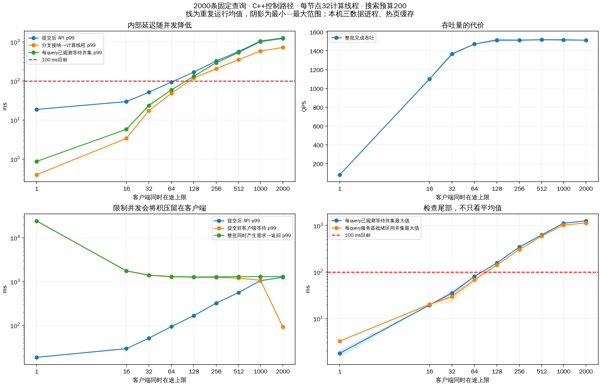
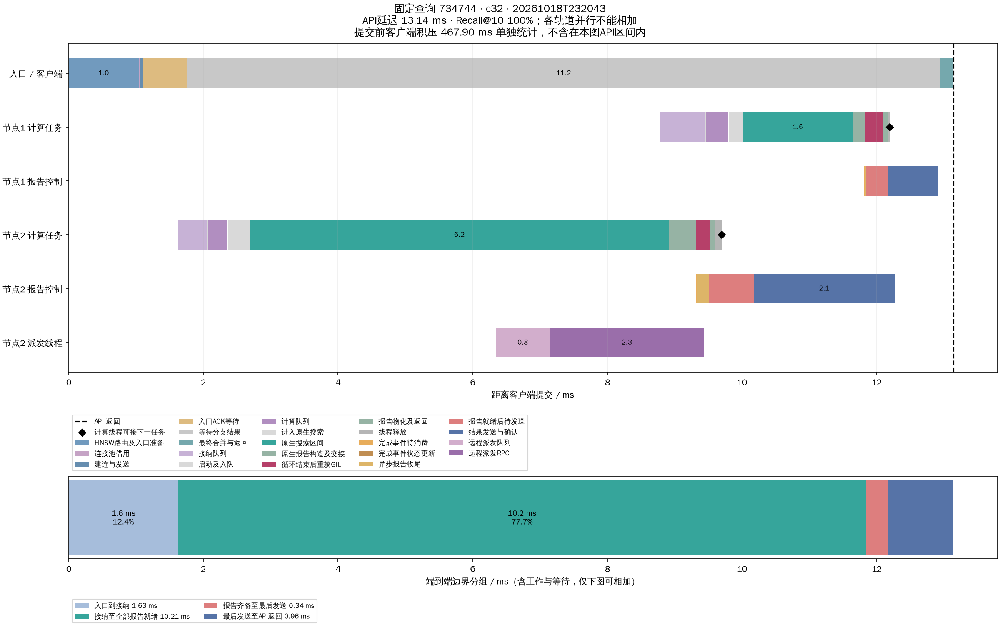

# 同时在途并发数与就绪等待实验

**结论：降低同时在途并发确实降低就绪等待。** 并发32保留并发2000约90.3%的吞吐；API p99 51.43–51.49ms，已观测等待最大值41.83ms。 并发64保留并发2000约97.3%的吞吐；API p99 93.52–94.70ms，已观测等待最大值80.79ms。

如果以本次已观测等待均低于100ms并尽量保持吞吐为标准，64是已测试档位中最高的合格并发；128已有超限。若更重视尾延迟和余量，32更稳妥；16的API p99更低但吞吐约1100QPS；绝对最低API p99出现在并发1，但吞吐仅约81QPS。未扫描65–127，不能称64为精确最大可用并发，也没有修改生产默认值。

所有正式运行采用修正后的客户端驱动；生产搜索代码未修改，启用上一轮已验证的C++完成/报告控制路径。降低并发上限能降低系统内排队，但整批2000条需求若同时产生，尚未提交的查询仍会在客户端等待。

## 条件与口径

- 完整seq_2M已有索引，本机三个TCP数据进程，热页缓存、sync_pread。每节点32计算线程，搜索预算200，top-k=10。
- 各档使用相同2000条验证查询，40条总预热查询不计入结果。固定20个客户端进程，将指定数量的工作线程均分到各进程；并发小于20时部分进程只预热、不执行计时查询。
- 各线程预先获得互不重叠的查询序号，当前请求完成后才提交下一条；没有跨进程取任务锁。所有查询总数均为2000。跨线程不做工作窃取，因此尾部可能出现线程提前结束，实际峰值和平均在途同时记录。
- 并发上限不是固定QPS开放到达模型。本实验测量的是有积压任务时的有界在途服务曲线，不能外推为任意到达率下的延迟SLA。
- 先2000→1，再1→2000反向重复，保持源码/原生模块/各组参数冻结；全体生命周期追踪，仅查询734744保留详细轨迹。两轮范围不等同于置信区间。
- **提交后API延迟**：调用search到返回，不包含下一条查询等待获得线程的时间。**客户端积压**：假定2000条需求在START同时产生，从START到真正调用search。**需求到完成**：从START到该query返回；逐query等于前两者之和。
- **分支就绪等待**：数据节点accepted→worker_enter，包含接纳、提交及计算队列。**query就绪并集**：同query各分支上述区间取并集。**已观测等待并集**沿用此前分析，包含入口连接池及已测队列，扣除与同query路由/原生搜索重叠部分；不是完整纯off-CPU剖析。

## 吞吐与延迟

下表为两轮各自统计量的最小–最大范围，不合并样本后重新计算分位数。

| 并发上限 | 实际峰值 | QPS | API平均 ms | API p99 ms | 分支就绪 p99 ms | query就绪并集 p99 ms | 平均Recall@10 |
|---:|---:|---:|---:|---:|---:|---:|---:|
| 1 | 1–1 | 80.8–82.4 | 12.1–12.4 | 18.4–19.1 | 0.4–0.4 | 0.7–0.7 | 97.080%–97.090% |
| 16 | 16–16 | 1091.4–1109.8 | 14.0–14.0 | 28.7–30.6 | 3.4–3.4 | 3.8–3.9 | 97.000%–97.070% |
| 32 | 32–32 | 1348.2–1384.9 | 21.6–22.3 | 51.4–51.5 | 17.0–18.0 | 18.6–19.5 | 97.000%–97.040% |
| 64 | 64–64 | 1472.7–1473.8 | 38.6–38.9 | 93.5–94.7 | 47.9–48.7 | 50.8–51.2 | 97.005%–97.010% |
| 128 | 128–128 | 1492.7–1537.2 | 72.5–72.9 | 165.6–170.0 | 117.5–121.1 | 123.3–125.7 | 97.030%–97.050% |
| 256 | 256–256 | 1507.4–1520.7 | 140.4–141.1 | 317.8–330.3 | 191.5–220.6 | 274.8–283.1 | 97.015%–97.040% |
| 512 | 512–512 | 1512.1–1525.0 | 264.2–270.2 | 556.1–576.6 | 342.2–362.1 | 515.4–536.0 | 96.980%–97.000% |
| 1000 | 1000–1000 | 1504.2–1530.7 | 478.2–484.7 | 1048.6–1053.7 | 578.5–590.4 | 869.0–882.1 | 97.005%–97.015% |
| 2000 | 1943–1958 | 1513.6–1514.1 | 783.3–794.8 | 1257.6–1259.5 | 718.7–723.0 | 1017.5–1021.7 | 96.980%–97.035% |



## 检查100ms目标及客户端等待

这里用已观测等待并集检查目标，同时列出最大值和超过100ms的数量；p99小于100ms不代表每条都满足。未观测到的等待不能被默认为零。

| 并发 | 已观测等待 p99 ms | 最大值 ms | 超100ms条数/4000 | 提交前客户端等待 p99 ms | 需求到完成 p99 ms | 整批完成秒 |
|---:|---:|---:|---:|---:|---:|---:|
| 1 | 0.9–0.9 | 1.4–2.1 | 0/4000 | 24004.6–24464.9 | 24018.2–24476.9 | 24.272–24.743 |
| 16 | 5.8–5.9 | 19.5–19.6 | 0/4000 | 1748.5–1751.8 | 1762.2–1766.2 | 1.802–1.833 |
| 32 | 21.7–25.8 | 29.1–41.8 | 0/4000 | 1373.6–1421.9 | 1384.0–1435.6 | 1.444–1.483 |
| 64 | 58.3–59.5 | 80.6–80.8 | 0/4000 | 1283.5–1298.8 | 1299.9–1313.3 | 1.357–1.358 |
| 128 | 131.5–132.8 | 156.0–159.8 | 964/4000 | 1243.8–1264.6 | 1266.8–1288.7 | 1.301–1.340 |
| 256 | 288.5–296.5 | 337.9–355.0 | 2095/4000 | 1230.6–1254.4 | 1274.0–1292.9 | 1.315–1.327 |
| 512 | 526.4–547.2 | 613.8–652.0 | 3398/4000 | 1197.1–1216.3 | 1291.6–1301.8 | 1.311–1.323 |
| 1000 | 1014.8–1015.9 | 1119.8–1136.1 | 3808/4000 | 1074.4–1077.5 | 1292.1–1308.6 | 1.307–1.330 |
| 2000 | 1221.3–1221.8 | 1259.4–1276.2 | 3885/4000 | 93.1–93.1 | 1304.7–1307.1 | 1.321–1.321 |

两轮已观测等待最大值均低于100ms的测试档位：[1, 16, 32, 64]。两轮提交后完整API最大值均低于100ms的档位：[1, 16, 32]。这是本次样本结果，不是未来所有请求的硬上界。

## 其他指标

| 并发 | 平均协议RPC/query | 平均协议字节/query | 累计搜索线程CPU ms/query | 文件读取字节/query | 物理读取增量 | 节点平均用核数（0/1/2，两轮均值） |
|---:|---:|---:|---:|---:|---:|---|
| 1 | 3.037–3.039 | 31557–31559 | 9.28–9.41 | 2457600–2457600 | 0 | 0.41/0.32/0.21 |
| 16 | 3.044–3.049 | 31625–31658 | 9.23–9.34 | 2457600–2457600 | 0 | 5.09/3.77/2.40 |
| 32 | 3.042–3.047 | 31598–31649 | 9.41–9.58 | 2457600–2457600 | 0 | 6.36/4.68/2.96 |
| 64 | 3.044–3.047 | 31604–31620 | 9.66–9.71 | 2457600–2457600 | 0 | 7.36/5.23/3.29 |
| 128 | 3.042–3.046 | 31584–31620 | 9.81–9.85 | 2457600–2457600 | 0 | 7.56/5.28/3.26 |
| 256 | 3.044–3.047 | 31602–31614 | 9.89–10.07 | 2457600–2457600 | 0 | 7.65/5.41/3.31 |
| 512 | 3.044–3.049 | 31577–31627 | 9.91–9.98 | 2457600–2457600 | 0 | 7.61/5.41/3.37 |
| 1000 | 3.047–3.047 | 31607–31608 | 10.00–10.06 | 2457600–2457600 | 0 | 7.58/5.47/3.42 |
| 2000 | 3.044–3.047 | 31575–31602 | 10.03–10.24 | 2457600–2457600 | 0 | 7.09/5.13/3.37 |

CPU用核数使用节点metrics采样窗口，包含测量开始/结束取样开销，不能当作精确搜索区间利用率。pread文件字节不等于SSD物理字节；本轮物理读取为0，结论仅适用于热页缓存本机测试。逐query距离计算、读调用、跳数、跨服务器分支数等仍完整记录。

## 正确性与实验完整性

正式18轮、36000条计时请求通过审计。每条成功、指标完整、预算≤200，预算守恒，数据节点不回访，每个远端分支对应批准决策，单分支计算线程不迁移。接纳/计算/发送队列排空，无容量拒绝或原生控制事件错误，所有本轮服务及客户端正常退出。平均召回均≥.95；不声称每条query召回≥.95。

初始驱动使用跨进程共享计数器领取任务，在2000并发配置下产生p99约1796ms的取任务锁等待，实际峰值只有197。该9轮探测已移到各组harness_probe_runs，元数据及初始分析在[harness_probe](harness_probe/README.md)，**完全排除于正式对比**。此问题属于测试端，生产系统未作修改。修正驱动采用预分配序号，九档的2000条覆盖、无重复/遗漏已静态核验；正式审计再次按实际输出核验。

## 文件与复验

- [机器可读比较CSV](comparison.csv)、[JSON](comparison.json)：包含各阶段mean/p99/max、RPC、字节、计算、负载与等待超限数。
- [正式运行清单](final_runs.json)、[审计结果](all_runs_verification.json)、[源码与参数哈希](sources.json)。
- 各c*/experiment.yaml为完整系统参数，load_plan.yaml记录客户端线程分布；输出在c*/runs/时间戳，包含summary、queries、nodes_before/after、资源采样、完整报告和服务清理记录。
- analysis/c*/时间戳/query_latency_and_backlog.csv记录每query的客户端积压、提交后API和需求到完成；query_wait_union.csv记录已观测等待并集。

项目根目录复验（使用相同源码，依次运行，不能重叠占用端口20561–20563）：

```sh
.venv/bin/python test/concurrency_20261018/run_suite.py --groups c2000 c1000 c512 c256 c128 c64 c32 c16 c1 c1 c16 c32 c64 c128 c256 c512 c1000 c2000
.venv/bin/python test/concurrency_20261018/analyze.py --plots
.venv/bin/python test/concurrency_20261018/audit_all.py
.venv/bin/python test/concurrency_20261018/plot_query.py c32
.venv/bin/python test/concurrency_20261018/plot_query.py c64
.venv/bin/python test/concurrency_20261018/plot_query.py c2000
.venv/bin/python test/concurrency_20261018/make_report.py
```

run_suite在每组运行前校验冻结哈希；analyze会重新收集正式runs目录，包含新增复验。需要保存旧报告时请新建实验目录。没有修改生产默认并发，测试推荐值见结论补充。

## 固定查询的提交后时序

沿用查询734744，未按结果选择查询。图以真正提交为零点，提交前客户端积压单独标注；各分支并行，不能把轨道总时长相加。

- [并发32时序图](analysis/c32/20261018T232043/query_timeline.png) · [时间段CSV](analysis/c32/20261018T232043/query_timeline.csv) · [原始查询](analysis/c32/20261018T232043/selected_query.json)
- [并发64时序图](analysis/c64/20261018T232102/query_timeline.png) · [时间段CSV](analysis/c64/20261018T232102/query_timeline.csv) · [原始查询](analysis/c64/20261018T232102/selected_query.json)
- [并发2000时序图](analysis/c2000/20261018T232239/query_timeline.png) · [时间段CSV](analysis/c2000/20261018T232239/query_timeline.csv) · [原始查询](analysis/c2000/20261018T232239/selected_query.json)


