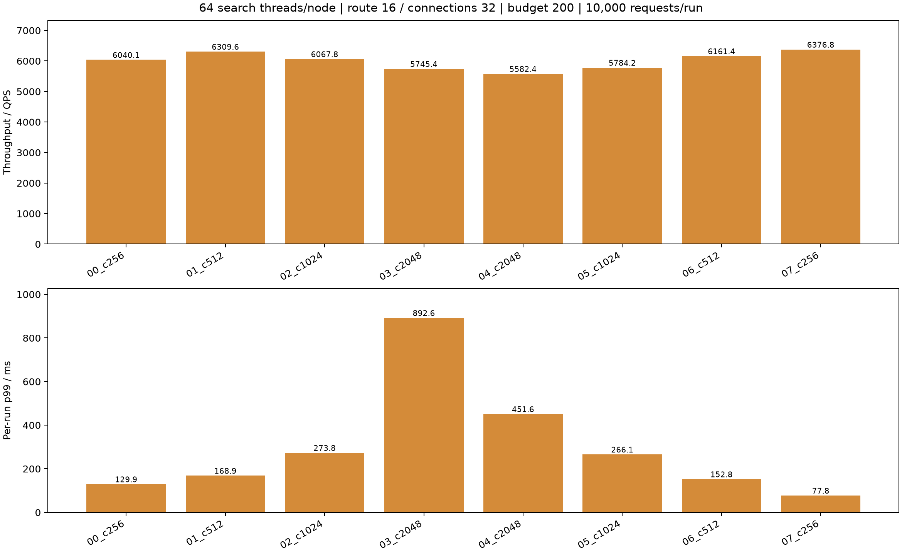
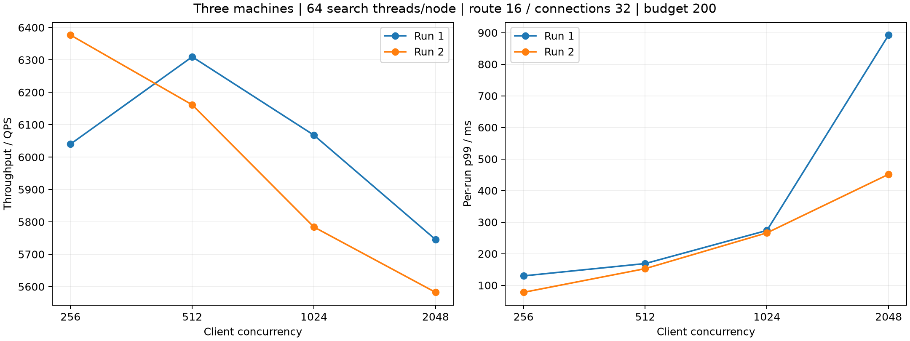
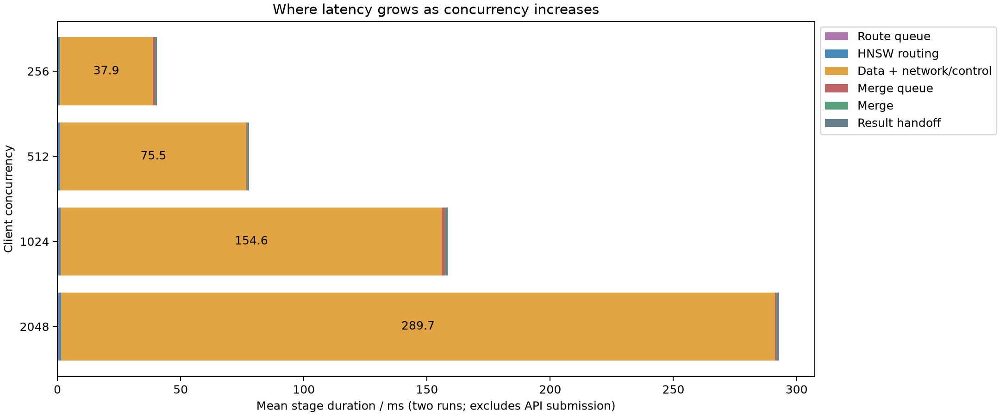

# 三机客户端并发扫描

固定三机Intel-35/32/30，每节点64查询线程、并发256/512/1024/2048、搜索预算200、合并线程4、预热32。每轮10000请求（相同2000查询重复5次）。固定顶层路由16线程、每目标连接32，仅调整客户端并发。数据节点连接上限保持32。顶层连接参数同时用于独立的入口与心跳客户端，不改变事件循环线程数。

|轮次|客户端并发|实际峰值在途|QPS|p99 ms|平均ms|Recall@10|
|---|---:|---:|---:|---:|---:|---:|
|00_c256|256|256|6040.07|129.89|41.28|0.97036|
|01_c512|512|512|6309.61|168.91|76.97|0.97032|
|02_c1024|1024|1024|6067.78|273.81|156.45|0.97033|
|03_c2048|2048|2048|5745.37|892.56|291.11|0.97035|
|04_c2048|2048|2048|5582.40|451.60|294.36|0.97030|
|05_c1024|1024|1024|5784.17|266.09|160.40|0.97037|
|06_c512|512|512|6161.44|152.81|78.81|0.97028|
|07_c256|256|256|6376.75|77.76|39.47|0.97039|

## 分阶段等待

以下为每查询均值，单位ms。发送前排队为RPC提交至网络客户端分配处理的间隔，混合连接容量等待与事件循环调度；响应等待包含远端处理与网络事件循环，不能称为纯网络耗时。派发/响应与数据执行重叠，不能相加为总延迟。

|轮次|路由队列|路由执行|入口发送前排队|入口发送含连接|入口响应等待|数据与控制|计算就绪累计|搜索执行累计|搜索CPU累计|
|---|---:|---:|---:|---:|---:|---:|---:|---:|---:|
|00_c256|0.079|0.875|3.094|0.050|5.241|37.856|1.413|11.419|11.300|
|01_c512|0.283|0.875|4.341|0.045|3.597|74.589|1.871|11.087|10.988|
|02_c1024|0.522|0.866|11.052|0.060|4.610|151.778|2.607|11.272|11.161|
|03_c2048|0.768|0.857|137.719|0.201|7.910|288.048|7.168|12.137|12.008|
|04_c2048|0.456|0.940|9.442|0.096|3.606|291.442|9.532|11.542|11.419|
|05_c1024|0.541|0.874|8.732|0.069|3.703|157.441|2.205|11.085|10.988|
|06_c512|0.333|0.939|3.394|0.037|4.004|76.487|1.640|11.078|10.972|
|07_c256|0.111|0.704|1.522|0.028|3.979|37.924|1.184|10.756|10.644|

## 负载

CPU核数为进程CPU时间除以快照窗口，数据节点窗口包含快照采集时间，不能用作精确瞬时CPU饱和度。

|轮次|Intel-35数据CPU核|Intel-32数据CPU核|Intel-30数据CPU核|顶层CPU核|物理读字节|
|---|---:|---:|---:|---:|---:|---:|
|00_c256|17.48|18.88|10.11|13.81|0|
|01_c512|19.15|18.72|11.26|14.05|0|
|02_c1024|17.83|18.83|10.32|14.05|0|
|03_c2048|18.06|20.36|9.85|13.49|0|
|04_c2048|18.96|17.65|10.51|13.61|0|
|05_c1024|18.08|18.04|10.47|13.36|0|
|06_c512|18.61|18.43|10.50|14.19|0|
|07_c256|17.70|19.31|11.00|12.77|0|

## 验证与边界

全部结果通过零失败、预算/无重复访问/无路由扩展审计，真实数据线程数64，暂存没有触发容量溢出。服务时延以完整原生结果交付Future为终点，后置编码、JSON持久化与统计不计入QPS。每轮仅数秒，是热缓存短测；两轮均值不能证明统计显著性。原始时间戳、有效YAML、源码快照和审计均保存在各轮目录。未修改生产配置或搜索代码。

## 两轮汇总

每组两轮算术平均；p99为每轮p99的均值，不是合并样本p99。

|客户端并发|QPS|相对256|p99 ms|平均延迟ms|Recall@10|
|---:|---:|---:|---:|---:|---:|
|256|6208.41|+0.00%|103.82|40.38|0.97037|
|512|6235.52|+0.44%|160.86|77.89|0.97030|
|1024|5925.97|-4.55%|269.95|158.43|0.97035|
|2048|5663.88|-8.77%|672.08|292.74|0.97033|

## 等待变化

下列为均值，ms；分支累计值与顶层时间可能重叠，不可相加。

|并发|路由排队|入口发送前排队|入口响应等待|数据与控制|计算就绪累计|搜索执行累计|搜索CPU累计|最后结果收到至合并入队|
|---:|---:|---:|---:|---:|---:|---:|---:|---:|
|256|0.095|2.308|4.610|37.890|1.299|11.088|10.972|0.574|
|512|0.308|3.867|3.801|75.538|1.756|11.082|10.980|0.568|
|1024|0.532|9.892|4.156|154.610|2.406|11.178|11.075|0.628|
|2048|0.612|73.581|5.758|289.745|8.350|11.840|11.713|0.651|

本次结果用于比较给定负载下的有限请求测试，不是稳态容量证明。每轮仅10000请求；2048并发约对应5批在途窗口，启动和排空效应较明显。没有通过增加预算或降低召回来换取吞吐。

新增原始分片与report_context已做可逆gzip压缩，SHA256与原名映射见各轮archive_manifest.json。需要重跑原始离线处理时先用gzip -dk恢复分片与report_context原名；已生成的报告和queries.jsonl.gz可直接读取。历史实验文件未改动。

八轮结束后独立测试服务关闭，常驻服务保持可达；各轮源码hash和查询选择相同，有效顶层配置均为16路由线程/32连接，实际数据工作线程64，实际峰值在途分别达到256/512/1024/2048。

## 结论

提高客户端并发没有带来稳定吞吐收益：256→512仅+0.44%，但p99均值增加约55%；1024与2048的QPS分别下降4.55%和8.77%。在优先低p99的目标下，当前测试范围内建议维持256并发，未改动生产默认值。

路由线程16时，路由排队即使在2048并发也仅均值0.612 ms；搜索线程CPU累计仅由10.972升至11.713 ms，无法解释整体均值由40.38升至292.74 ms。已明确观测到入口发送前排队由2.308增至73.581 ms，计算就绪累计由1.299增至8.350 ms。剩余增长位于数据与控制区间，需要进一步拆分远端接收、报告发送及网络事件循环处理。该区间包含多个可能重叠的阶段，不应将其全归为CPU计算或纯网络传输。

全部八轮物理磁盘读取增量为0，属于页缓存命中的短测，不代表冷SSD场景。每档两轮存在明显尾延迟波动，报告保留逐轮值，不将均值当作稳定容量或统计显著性证明。
