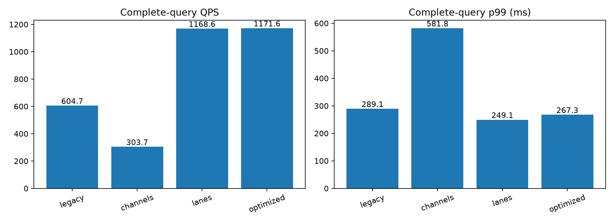
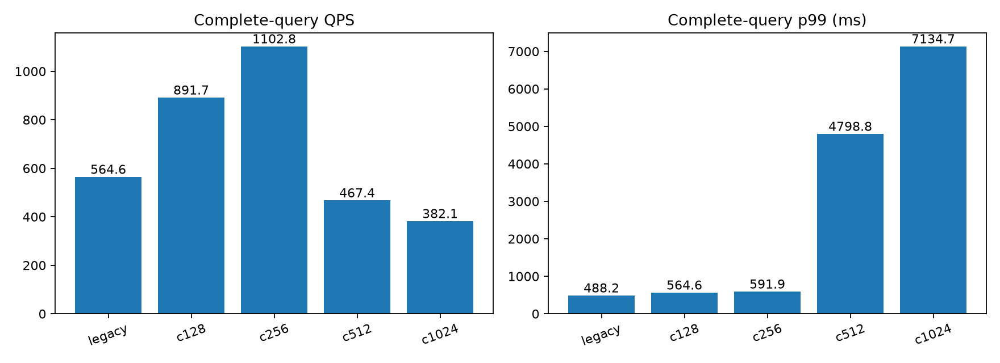
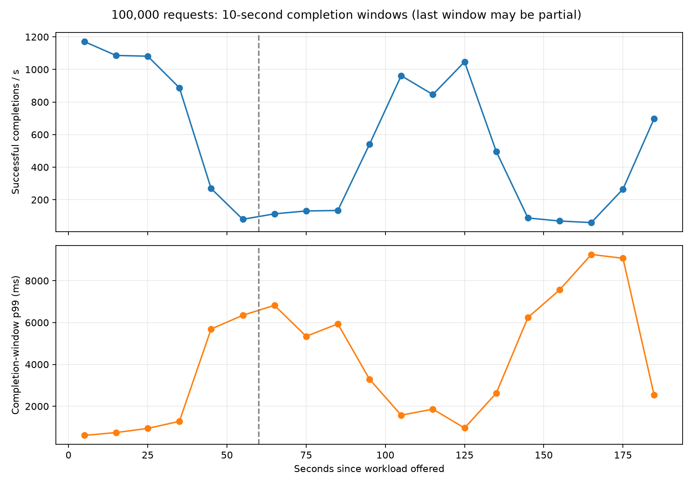
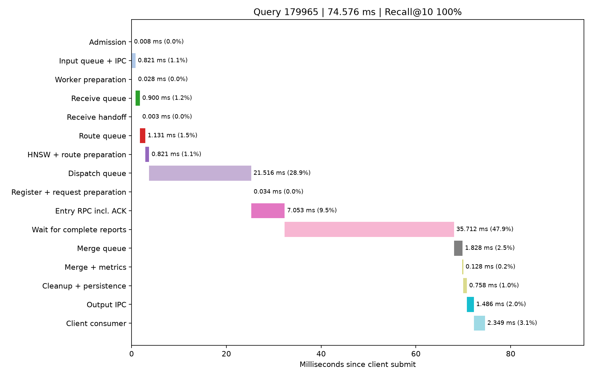

# DHDGS 顶层控制链容量优化：以 QPS 为首要目标

日期：2026-10-20。完整 seq_2M 索引，Intel-35 / Intel-32 / Intel-30 三台数据服务器，每节点 32 个计算线程，top-k=10，全局搜索预算 200。顶层与 data-0 同在 Intel-35。

**结论：短时吞吐提升已验证，持续容量仍有问题。** 10000请求双向扫描选中并发256，QPS中位数1102.84；但同配置100000次连续请求持续189.65秒，全程仅527.28 QPS，存在明显周期性低谷，不能宣称已解决持续吞吐瓶颈。长测Recall@10=97.0204%、零失败。实现和候选配置保留，本轮没有替换原常驻入口。

## 选型标准与实现

用户将优先级调整为 **先提高 QPS**。约束为平均 Recall@10≥0.95、无查询失败、预算及不重复访问等审计通过；完整报告 p99，不再按最低 p99 单独选型。接纳前积压也保留，不以推迟开始计时掩盖等待。

本轮主要实现 `peer.head_lanes`：一个查询在一个顶层执行进程内完成 HNSW 路由、入口派发、keep-alive、分支报告验证和合并记录。主入口只进行一次原始查询 IPC 和一次最终结果 IPC，减少分离接收/确认/结果进程间的中间交接。不同查询分布到四个独立 Python 运行时，避免所有控制工作集中争用同一个 GIL。

每个执行进程使用 1 个路由线程、4 个派发线程、1 个合并线程及独立回调 reactor；搜索仍在数据节点的 C++ 查询线程执行。等待结果时释放路由线程。数据节点是否派生远端分支仍由扩展函数决定，顶层没有新增搜索扩展权限。父分支继续搜索，子分支丢弃既往节点候选，不再次访问已访问节点。

全局在途数和输入队列有界；超时包含输入排队。取消保留容量直至终态/进程失败；进程失败明确使所辖查询失败，不在其他进程重新发起搜索。其他健康进程仍可承接新查询。本版不提供失效进程透明恢复或高峰中动态增减执行进程。原有停流事务式参数更新保留，HNSW ef 更新会更换进程内路由器。

代码：`python/dhdgs/head_lanes.py`、`search.py`、`managed_cluster.py`、`config.py`、`tools/cluster_service.py`。所有已开放的执行进程参数位于 `peer.head_lanes`。候选部署为 [candidate.yaml](candidate.yaml)，操作见 [README.md](README.md)。

## 固定负载的最终对照

每轮 2,000 查询、并发 128、预热 32；每种模式三轮，交错运行，共 **24,000 个计时请求**。以下 QPS 和 p99 是各轮值的中位数，平均延迟和召回为各轮均值，不能将“p99 中位数”理解为合并所有请求后的 p99。

| 顶层/数据接纳方式 | QPS | 平均延迟 ms | p99 ms | Recall@10 | 查询失败 |
|---|---:|---:|---:|---:|---:|
| 较快旧入口：1 接收进程 + 2 续执行线程 | 604.73 | 209.73 | 289.09 | 97.032% | 0 |
| 上轮多通道方案：4 接收进程 + 16 结果进程 | 303.67 | 411.95 | 581.82 | 97.047% | 0 |
| **本轮：4 个查询所属执行进程，保留原数据接纳** | **1168.58** | **109.49** | **249.05** | **97.012%** | **0** |
| 本轮 + 数据接纳队列独立锁 | 1171.64 | 110.13 | 267.34 | 97.015% | 0 |

本轮方案相对较快旧入口提高约 **93.2% QPS**，不能只拿较慢的上轮多通道方案作基线。独立锁版本与保留原接纳方式的中位吞吐差约 0.26%，没有显示可靠收益，因此候选保留原数据节点配置。每轮 QPS 波动明显，新方案三轮为 1236.99 / 1168.58 / 971.88；这不是稳定容量的置信区间，也不是已隔离其他主机负载的专用硬件实验。

原始结果位于 `final/` 和 `final_remaining/`。第一轮矩阵的 `final/09_optimized` 因回调端口 `Address already in use` 在启动阶段失败，没有进入查询压测。保留日志，使用临时出站端口范围以下的显式回调端口补跑余下三轮；没有把失败启动计为成功请求或偷偷剔除低吞吐轮次。完整逐轮结果见 [rounds.csv](final/rounds.csv)。

## QPS 优先的并发扫描

扩大去重保留容量后，旧入口与新入口使用相同的三节点索引及数据节点配置。每轮10000次请求，为固定2000验证查询的五次重复，每次生成新请求身份；预热32。旧入口并发128在扫描前后各运行一轮，新入口128→256→512→1024→1024→512→256→128，合计 **100000个计时请求全部成功**。以下是各轮QPS/p99中位数，以及各轮平均延迟/召回的均值。

| 模式 | 客户端并发 | QPS | 平均延迟 ms | p99 ms | Recall@10 |
|---|---:|---:|---:|---:|---:|
| 旧入口 | 128 | 564.56 | 225.00 | 488.23 | 97.023% |
| 4个所属进程 | 128 | 891.68 | 141.56 | 564.58 | 97.023% |
| **4个所属进程，QPS优先推荐** | **256** | **1102.84** | **229.89** | **591.92** | **97.021%** |
| 4个所属进程 | 512 | 467.39 | 1123.93 | 4798.83 | 97.021% |
| 4个所属进程 | 1024 | 382.14 | 2545.30 | 7134.69 | 97.026% |

同样并发128时，新入口提高约57.9%吞吐，p99有所增加。随后将新入口并发128→256，吞吐再提高约23.7%，平均延迟141.56→229.89ms，p99 564.58→591.92ms。因此按新的 **QPS优先** 标准选择256；若仍按最低p99选型，结论会不同。256的两轮分别为1102.99、1102.70 QPS，支持本次有限候选集内的选择；不宣称256是所有硬件、数据集、进程数和到达模式下的全局最优。

“旧入口564.56→推荐配置1102.84”同时包含架构改进和并发调整，不能把这95.3%的总提升全部归因于架构。同负载短测和较长扫描也必须分开报告。新入口512/1024呈现严重排队，更多在途查询未带来更多有效计算。每查询搜索CPU仍约十余毫秒，而累计就绪等待显著增加，具体归因需后续线程/GC/接纳调度实验，不凭此断言是SSD或网络饱和。

选型规则见 [selection_policy.yaml](selection_policy.yaml)，自动选择记录见 [selection.json](selection.json)；推荐配置和快速复验请求为 [candidate.yaml](candidate.yaml)、[benchmark_request.yaml](benchmark_request.yaml)。所有逐轮数据、负载、协议、逻辑读取和阶段均值见 `throughput_capacity/` 下的CSV及原始记录。10000请求仍是短时闭环测试，进一步的连续运行验收单列记录。

## 100000次请求的连续验收与剩余问题

同一2000查询重复50次、新请求身份、并发256、4个所属进程、预算200；不更改指标或关闭日志。全部100000次成功，预算/不重复访问/指标完整性等审计通过，无控制发送错误，物理读取仍为0。

| 指标 | 结果 |
|---|---:|
| 计时运行时间 | 189.651 s |
| 完整成功请求QPS | **527.284** |
| 平均 / p50 / p95 / p99 | 485.091 / 203.576 / 2188.586 / 6238.228 ms |
| Recall@10 | 97.0204% |
| 每查询累计搜索CPU | 11.787 ms |
| 每查询累计就绪排队 | 364.430 ms；p99为6103.853 ms |
| 全部协议RPC | 3.396 / query；等待变长使控制续租增多 |
| 应用协议字节 | 31767.67 B / query |
| 顶层全部CPU / RSS合计 | 2.64核 / 8.41 GiB |
| 三数据节点CPU | 3.04 / 3.70 / 1.82核 |

每10秒按完成时间分桶：前30秒约1081–1171 QPS，50–60秒降至80 QPS，120–130秒恢复至1047 QPS，160–170秒又降至59.7 QPS。最后不足10秒的窗口明确标记partial。窗口按完成时间分组，会包含此前提交的慢查询，不代表该窗口的新到达请求率。

全体查询的互斥阶段均值见 [sustained/stage_means.csv](sustained/stage_means.csv)：等待完整报告393.21ms，占完整时间81.06%；合并排队37.46ms，占7.72%；派发排队15.58ms，占3.21%；输入IPC 1.78ms、输出IPC 9.19ms、客户端消费9.80ms。上述“完整报告等待”包含数据接纳、实际搜索及回传，不是纯网络等待。若报告先于入口ACK完成，重叠归到入口RPC段，报告等待取零，避免重复累加。

结束时仍保留的分支时间戳中，Intel-32接纳队列均值约1577ms，其原生搜索约13.13ms；Intel-35约108ms/9.66ms，Intel-30约11.58ms/7.88ms。**这些节点细分只覆盖终态保留窗口内的分支**，不是全部100000查询的平均值；已过期的详细节点记录不会通过后采集重新出现。所有查询的顶层时间线及聚合搜索指标仍已保存。详细样本数量在 [sustained/control_windows.csv](sustained/control_windows.csv)。

这使后续优化重点转向数据节点接纳/终态记录处理，而不是继续堆叠顶层进程。仍需用线程时间戳、GC暂停记录和记录保留规模消融，区分接纳线程调度、GIL、记录释放与其他负载的因果关系。吞吐第一次下降早于60秒，不能仅凭保留期就断言是过期清理导致。压测父进程为保存100000条结果RSS达到6.47GiB，也需区分压测工具保留结果与正常逐请求服务的内存行为。

本轮没有对旧入口或其他并发做同长度100000请求的对照，因此**不声称长期吞吐相对旧入口提高，也不声称256是持续负载最优值**。短测胜出配置只是下一轮优化候选；零失败验证通过不等于持续性能目标已达到。另有随机查询完整时序图 [sustained/query_timeline.png](sustained/query_timeline.png)，随机样本不能代替上述尾延迟分布。

## 数据工作量与资源

以下来自固定并发最终对照中新方案的三轮均值：

| 指标 | 值 / 含义 |
|---|---|
| 全局扩展数 | 200 / query |
| 最大图扩展深度 | 平均 10.865；这是深度统计，不是 200 次展开的另一种计数 |
| 跨节点分支提交 | 0.350 / query，不含入口提交 |
| 全部协议 RPC | 3.049 / query，含入口、分支及控制协议 |
| 应用协议字节 | 31,697 B / query，不等同 TCP/IP 实际链路字节 |
| 逻辑文件读取 | 2,457,600 B / query，即 2.344 MiB |
| 物理读取增量 | 0；命中 OS 热页缓存 |
| pread 累计墙钟 | 0.737 ms / query |
| 精确距离累计墙钟 | 2.396 ms / query |
| RaBitQ 累计墙钟 | 3.781 ms / query |
| 搜索线程累计 CPU | 11.624 ms / query |
| 顶层全部进程 CPU | 约 5.05 核；旧入口约 2.27 核 |
| 数据节点 CPU，35 / 32 / 30 | 约 4.77 / 5.16 / 2.81 核 |
| 顶层全部进程 RSS 合计 | 约 2.42 GiB；旧入口约 0.91 GiB |

扩展数、跨节点 RPC 和字节与旧入口基本相同，没有通过降低检索预算或少收分支结果换取吞吐。额外执行进程会加载路由索引/位置表，CPU/RSS 都必须计入成本。RSS 求和可能重复计入共享页。数据节点资源采样窗口含前后采集过程，与顶层计时区间不完全相同，短测均值不能直接当作满负荷 CPU 利用率。

**剩余瓶颈仍存在。** 新方案的 `query_ready_queue_ms` 平均累计约 58.13 ms/query，高于旧入口约 0.76 ms：入口更快后，数据接纳开始承受更高到达率。逐分支原生搜索约 7–12 ms，而数据节点接纳队列部分轮次可超过百毫秒。这说明“数据节点中的纯搜索已成为唯一瓶颈”尚未成立。不同分支可能并行，累计分支等待不能除以端到端延迟后当作互斥占比。数据窗口细节见 [control_windows.csv](final/control_windows.csv)。

## 一个预先随机选定查询的完整时间线

固定随机种子42选中第一轮新方案的job178，即query179965，没有按耗时挑选。该查询Recall@10=100%，从客户端提交到消费返回 **74.576 ms**。下图各段互斥，覆盖完整区间；同机顶层时间可以相减，不将其他物理主机的单调时钟直接拼入。

其中派发排队21.516 ms（28.85%）、入口RPC含ACK 7.053 ms（9.46%）、等待完整报告35.712 ms（47.89%）、合并排队1.828 ms（2.45%）、最终IPC 1.486 ms（1.99%）、客户端消费2.349 ms（3.15%）。其余约4.632 ms覆盖接纳、路由、处理和记录。等待完整报告包含数据排队、实际搜索及回传，不能全部标为网络开销。详细CSV见 [selected_query_timeline.csv](final/selected_query_timeline.csv)，原始记录见 [selected_query.json](final/selected_query.json)。单个随机查询用于说明流程，不代替总体分布。

## 保留的负面实验

- **结果就地合并**：独立报告进程保留 ACK，父侧直接合并以省去结果池 IPC；探索 QPS 约 286–321，旧入口约 565，没有解决控制链容量问题。此配置仅作消融保留。
- **查询所属进程数量**：探索 1/4/8 个分别约 512/1204/1158 QPS；另一轮 2/4/6 个约 811/1196/963。更多进程未必更快，故固定负载正式对照使用 4 个。该扫描较短，不宣称适用于所有并发。
- **直接绕过数据接纳队列**：共享缓冲队列两轮 QPS 中位数 1178.36、p99 中位数 259.11 ms；direct 为 1045.40、615.91 ms。累计就绪排队约 50.12→2.49 ms，但整体变慢，故不采用。
- **独立接纳队列锁**：早期四轮有小幅收益，最终三轮未形成明显优势，不采用额外数据节点部署变更。

探索目录 `pilot/`、`lanes_pilot/`、`refined/`、`data_admission/` 的冻结源码路径曾受到 `cluster_service` 修改 `sys.path` 的影响；这些结果保留用于解释决策，不作为严格冻结源码的因果证据。最终对照和后续并发扫描先固定 `dhdgs` 包导入，再恢复传给 spawn 子进程的路径优先级，逐进程 `source_file` 可核验来自 `verified_source/`；源码 SHA256 存在快照内 `hashes.json`。

## 验证与解释边界

**连续压测暴露的容量失败。** 初始 `throughput/` 复用旧数据节点的 `max_tombstones=4096`、`max_active_queries=2048`、60秒保留期。并发128的10000次请求成功后，紧接的并发256轮次出现6698次 `Peer dedup retention capacity exceeded`，只有3302次成功；将失败计零后的平均Recall仅32.314%。该轮不满足验收，不是可用的吞吐配置，延迟摘要也仅针对成功请求，不能据此选型。

根因是去重保留记录累计达到6144条/节点上限，和同时活动查询上限是两种容量约束。本轮使用独立的 `capacity_data` 服务将 `max_tombstones` 提高到131072、保留期仍为60秒；按最热节点的分支到达率估算 `到达率 × 保留时间 + 活动数` 并留出余量。管理帧上限同步提高至128MiB，用于有界的详细节点快照。重测的旧入口和新入口都使用同一容量设置，不拿更大容量后的结果与失败旧轮次计算提升幅度。完整设置见 [capacity_settings.yaml](capacity_settings.yaml)。

最终生产源码 **388 项回归通过**，含真实 TCP、io_uring、故障进程隔离、预算、参数热更新、身份验证及完整时间覆盖。日志见 [regression_final.log](regression_final.log)。没有改动原生搜索循环或重建数据索引。

另完成32条真实HTTP查询及HTTP管理发起32查询压测，确认4个所属进程、生产源码载入路径、管理采集和正常退出；证据见 [http/verification.json](http/verification.json)。冻结快照中42个文件与当前生产源码全部一致，见 [source_verification.json](source_verification.json)。正式最终对照24000次、扩大容量后并发扫描100000次、连续验收100000次，共224000个计时请求成功；最初去重容量失败轮次单独保留，未混入这224000次。

全部临时head及direct/independent/capacity数据节点已正常停止；原三机常驻入口仍ready、无在途查询。候选不是已上线替换版。运行步骤在README中，持续吞吐问题修复前不将短测QPS写成服务容量承诺。

所有结论均基于完整 2M 索引和热缓存。`pread` 是系统调用经过页缓存读取，物理读取为零，所以本轮不证明 SSD 介质性能或超内存数据规模的吞吐。短时闭环基准、同一查询集重复提交及逐请求指标落盘都有明确边界；实际 HTTP 服务的客户端总延迟还包含 HTTP 接收/响应开销。

原始逐查询记录、节点快照、源码核验、失败启动日志保留。工作进程 JSONL 在计时结束后无损 gzip 压缩，并验证解压 SHA256 一致后移除原文件；压缩不与下一轮计时并行。最终主入口查询记录具有完整返回边界，工作进程日志仅为返回前快照。
