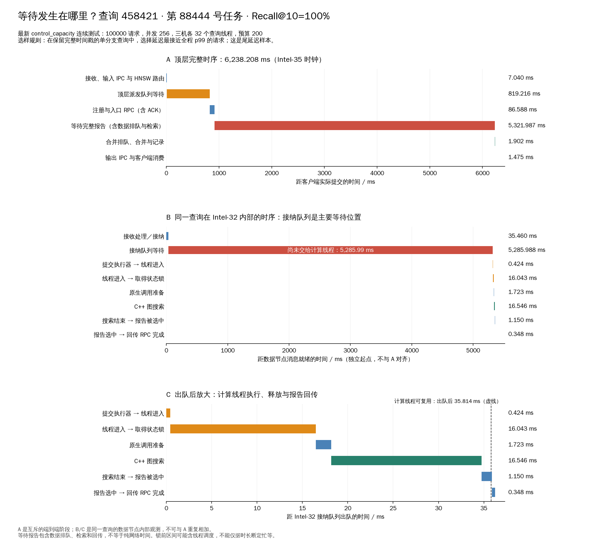

# 单查询等待位置诊断

来源：control_capacity 的 100000 次连续请求测试；本次只分析已有记录，没有重新压测。
请求 `07eef006-c5ba-4fa1-b11a-08405b0e6751`，query 458421，job 88444。
在保留完整节点时间戳的成功单分支请求中，选取 CSV 延迟最接近全程 p99 的样本，
选择条件与样本数见 selection.json。不是随机样本，也不代表所有查询的平均水平。

- 实际提交至客户端消费：6238.208 ms。
- 顶层派发排队：819.216 ms。
- 顶层等待完整报告：5321.987 ms，包含数据接纳、计算及回传。
- Intel-32 接纳入队至出队：5285.988 ms。
- 原生搜索循环：16.546 ms；搜索线程 CPU 16.535 ms。
- 顶层报告齐备至客户端消费：3.378 ms。

数据节点入队时队列深度 228，出队后深度 250。
这说明请求长时间停留在接纳队列；没有证明当时所有计算线程都在忙碌，
也没有证明等待来自 SSD、锁竞争或 GIL 的任何单一原因。
计算线程在出队后 35.814 ms 可复用，报告 RPC 在出队后
36.234 ms 完成；回传由其他控制线程执行。
该请求只访问 Intel-32，无子分支，不能用此样本验证多分支结束行为。

A 仅使用 Intel-35 的时钟；B/C 仅使用 Intel-32 的时钟，分别归零，没有跨机时间戳相减。
B/C 是 A 中相关工作的内部视角，不与 A 累加；不把两台机器的零点当成同时发生。
线程进入至拿到状态锁一段可能包括调度延迟；只读这些边界无法判定占 CPU 忙等。
物理读取在本轮为零，搜索经过热页缓存，不代表冷 SSD 性能。

全量压测任务预先生成后受并发 256 限制，这条任务在实际提交前还有
136657.966 ms 的客户端待发时间，图的零点为实际提交。
该待发时间未计入服务响应延迟，没有将它当作数据节点排队。

head_stages.csv 保留全部 16 个互斥阶段；node_stages.csv 保留节点边界；
query.json、data_trace.json 保留该请求的原始证据。
运行 `gene_database/DHDGS/.venv/bin/python gene_database/DHDGS/test/control_capacity_20261020/plot_wait_detail.py`
可重绘 PNG/SVG/PDF。若选样文件不存在，脚本会从本机原始日志重新选取。
