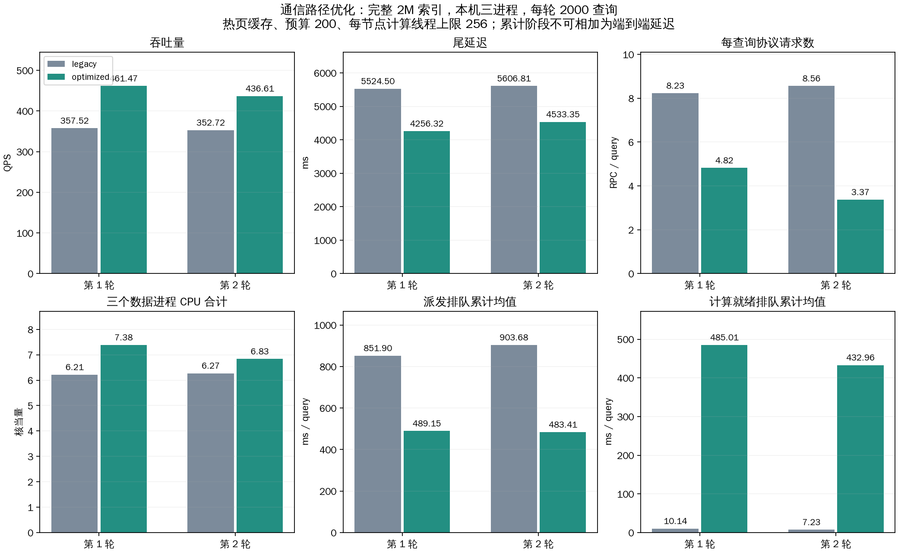

# 通信路径优化：设计、实现与对照实验

设计已写入 [DESIGN 第 11 节](../../DESIGN.md)，实现通过 **87 项回归测试**。两轮新旧模式对照共 8000 次请求，全部成功。最终代码第 2 轮：QPS 352.72 → 436.61（+23.78%），p99 5606.81 → 4533.35 ms（-19.15%）。CPU 尚未满载，通信排队也未消失。



## 实现及保证

- 本地搜索结束后释放计算工作线程，已批准的子分支派发完成后由回调发布最终报告。派发失败、取消或过期不能发布成功。
- 控制回传使用有界并发线程池，每分支最多一个在途控制消息；心跳按到期/节点变化发送，终态优先。
- 心跳响应携带续租，优化模式不再周期主动发送 lease；完整终态正常结束不再发送 cancel，异常结束仍取消。
- 同进程 Engine 共享回调端点；已完成查询保留有界身份和报告摘要墓碑，安全确认重复终态。RPC 使用有界独占借用的持久连接，空闲连接可读/已关闭时丢弃。
- 保留扩展函数、全局预算、单次节点访问、父分支继续/子分支丢弃已访问节点候选及固定原生计算线程。通信线程不能自行创建远端搜索。

新增实现位于 peer.py、peer_rpc.py、head_hub.py；入口接入在 search.py，配置校验/迁移在 config.py，记录字段在 metrics.py。生命周期和连接池仍使用必要的短时状态锁，不持锁等待子分支网络完成；没有取消正确性同步。

## 对照条件与配置

Intel-35 单机三个 TCP 数据进程，共享 128 物理核 / 256 硬件线程；不是三台物理机。完整 2M×2560 索引复用，原始平方 L2、1-bit RaBitQ、排除 self、top-k=10、全局预算 200、frontier=64、local_beam=4。同步 buffered pread，应用缓存=0，详细 trace 开启。测试前已有热页缓存。

每组 20 客户端进程×100查询线程、2000 条固定且不同的验证查询，每进程另预热2条；排除原128条校准查询。数据节点计算线程池上限均为256、接纳上限2048、listen backlog4096、心跳1000ms、租约30s、控制RPC超时5s、派发超时30s。每条只运行一次，负载开始后逐步排空，不是持续稳态压测。

两模式使用相同当前实现，通过 mode 切换旧/新通信行为。legacy 保留每查询回调服务、串行控制发送、3个派发线程和阻塞收尾。optimized 使用以下配置。模式之间除通信组与输出目录外配置一致，未改搜索算法、预算及trace。

```yaml
peer:
  communication:
    mode: optimized
    transfer_workers: 16
    control_workers: 16
    max_pending_control: 64
    reuse_connections: true
    connections_per_endpoint: 8
    max_connection_endpoints: 64
```

新默认 YAML 使用 optimized；旧 YAML 完全缺少该组时显式迁移为 legacy，迁移记录可见。mode=legacy 可作回退对照。上述通信参数是本轮候选工作点，未做逐参数消融，不能宣称16线程或8连接最优。计算线程默认仍为8、默认预算192；本压测的256/200只在实验 YAML 中，不替换默认值。

## 两轮结果

| 轮次 | 模式 | 成功/失败 | 峰值在途 | QPS | 平均ms | p99 ms | Recall@10 | 平均CPU核当量 |
|---|---|---|---|---|---|---|---|---|
| 1 | legacy | 2000/0 | 2000 | 357.52 | 3730.13 | 5524.50 | 97.030% | 6.214 |
| 1 | optimized | 2000/0 | 1997 | 461.47 | 2116.17 | 4256.32 | 97.070% | 7.385 |
| 2 | legacy | 2000/0 | 2000 | 352.72 | 3721.64 | 5606.81 | 97.015% | 6.272 |
| 2 | optimized | 2000/0 | 1998 | 436.61 | 2552.34 | 4533.35 | 97.040% | 6.835 |

每轮先 legacy 后 optimized，只有两轮短窗口，不能据此给出稳态容量或统计显著性。第一轮后增加空闲断开连接检测，第二轮采用最终代码；旧源文件、两份源代码哈希清单均保留。两轮均为完整相同查询集合，时间相关启发式可改变路径，因此召回与分支数略有不同，不要求逐查询结果相同。

## 最终代码第 2 轮详细指标

| 指标 | legacy | optimized |
|---|---|---|
| QPS | 352.722 | 436.606 |
| 平均延迟 ms | 3721.645 | 2552.341 |
| p50 ms | 4106.834 | 2756.118 |
| p95 ms | 5449.866 | 4458.438 |
| p99 ms | 5606.807 | 4533.347 |
| 协议 RPC / query | 8.556 | 3.370 |
| 应用协议 B / query | 69355.693 | 68489.089 |
| 跨节点分支 / query | 0.349 | 0.348 |
| 扩展顶点 / query | 200.000 | 200.000 |
| 最大扩展深度均值 | 10.852 | 10.862 |
| 逻辑读取 B / query | 2457600.000 | 2457600.000 |
| 数据进程总平均CPU核当量 | 6.272 | 6.835 |
| 物理读取增量 B | 0.000 | 0.000 |

应用协议字节包括消息体和帧，不是网卡/TCP实际流量。物理读取为进程 /proc I/O 计数增量；本轮为0不表示未调用 pread，而是没有观测到缓存未命中的设备读取。

### 端到端互斥阶段

| 阶段 | legacy平均ms | optimized平均ms | optimized占内部wall |
|---|---|---|---|
| head_merge_and_lifecycle_ms | 336.682 | 1.955 | 0.08% |
| peer_execution_and_control_wait_ms | 3303.152 | 2505.536 | 98.18% |
| routing_wall_ms | 81.501 | 44.580 | 1.75% |

### 分支累计工作时间

以下按每个查询跨分支累计后取均值，不是端到端互斥阶段，不能相加或画成延迟占比。派发收尾与派发队列/传输时间重叠；优化后收尾仍有等待，但已经不占用计算工作线程。

| 字段/含义 | legacy平均ms | optimized平均ms |
|---|---|---|
| query_ready_queue_ms：计算就绪排队 | 7.226 | 432.965 |
| query_compute_slice_wall_ms：计算执行区间wall | 15.547 | 17.739 |
| server_thread_cpu_ms：搜索线程CPU | 11.768 | 12.054 |
| query_transfer_finalize_wait_ms：派发收尾等待 | 921.846 | 563.858 |
| peer_transfer_queue_ms：派发线程池排队 | 903.682 | 483.410 |
| peer_pool_wait_ms：连接池借用等待 | 0.000 | 33.308 |
| peer_connect_ms：新建连接 | 0.351 | 0.062 |
| peer_send_ms：序列化与发送 | 0.174 | 0.706 |
| peer_response_wait_ms：等待响应与解码 | 19.539 | 41.119 |
| peer_transfer_wall_ms：派发执行wall，不含派发队列 | 20.192 | 83.916 |
| pread_ms：pread调用 | 0.697 | 0.686 |
| exact_distance_ms：精确距离wall | 1.847 | 1.893 |
| rabitq_ms：RaBitQ wall | 3.524 | 3.567 |

线程与队列的等待没有全部消失。更快地接纳请求、释放父分支工作线程，会改变计算/派发队列的压力分布；第一轮计算就绪等待明显上升。这是实测现象，不能把所有差异都归因于GIL或网络。socket响应阶段含目标节点处理、Python调度和消息编解码，不是纯网络RTT。新建连接减少也不保证每个连接的等待更小。

### 控制消息与复用

| 类型 | legacy总次数 | optimized总次数 |
|---|---|---|
| heartbeat | 2639 | 1348 |
| result | 2698 | 2696 |
| lease | 6379 | 0 |
| cancel | 2698 | 0 |

优化模式节点控制发送的前后快照差值：发送 4044，错误 0，新建连接 187，复用 3857（复用占比 95.38%）。发送线程池累计排队 441620.221 ms，发送执行累计 164588.612 ms；这些是多任务累计量。逐查询 peer_connections_* 仅统计数据节点之间的派发连接，不能代替全部控制连接。

心跳计数有明显轮间波动：第一轮 legacy→optimized 为2392→4239，第二轮为2639→1348。并发发送、终态时机及涉及节点变更都会影响心跳次数，不能把心跳减少单独视作稳定收益。两轮均消除了主动lease和成功cancel，并未实现跨查询心跳打包。返回给用户后的迟到终态重试由墓碑确认，不追加到已冻结的逐查询统计；节点累计发送计数是检查这类重试的补充。本轮窗口内控制发送错误为0。

### 每节点负载（最终代码）

| 模式 | 节点 | 平均CPU核当量 | 快照窗口s | 结束线程数 | RSS GiB | 物理读取B |
|---|---|---|---|---|---|---|
| legacy | 0 | 2.646 | 5.941 | 254 | 1.139 | 0 |
| legacy | 1 | 2.150 | 5.943 | 263 | 1.031 | 0 |
| legacy | 2 | 1.475 | 5.944 | 216 | 0.788 | 0 |
| optimized | 0 | 2.932 | 4.857 | 283 | 1.155 | 0 |
| optimized | 1 | 2.321 | 4.859 | 225 | 1.007 | 0 |
| optimized | 2 | 1.582 | 4.861 | 164 | 0.802 | 0 |

CPU核当量=user+system秒增量/快照窗口秒数；窗口略宽于查询计时。线程数包含计算、控制、派发、接收等线程，不代表同时执行数量。整机利用率还包含客户端及其他任务，不能全部归因于数据服务。

## 尚存瓶颈与下一步实验

本轮证据支持“解除部分通信等待、减少重复控制请求可降低p99并提高吞吐”，不支持“CPU已跑满”或“SSD瓶颈已解决”。优先进行独立消融：固定计算线程与负载，扫描派发线程/连接上限；单独关闭详细trace，测量大报告的序列化与回传代价；对控制发送加入细分CPU/排队测量，再考虑跨查询心跳合包。每组以平均Recall@10≥.95、无失败为门槛，优先p99，再比较QPS。

原生查询在SSD等待时暂停/恢复、每计算线程轮转多个query仍需独立C++状态机实现。本轮未执行该改造，未在通信调度层增加远端扩展。物理三机网络、冷缓存/工作集超过RAM、长时间稳态和故障注入也尚未由本实验验证。

## 核验、原始记录和复现

87项回归涵盖只有一个计算worker时派发等待不阻塞下一query、立即完成/失败/取消的终态处理、慢控制端点、多查询隔离、错误token、重复/冲突终态、连接容量及断开检测、旧YAML迁移、原生搜索及io_uring。未声称穷尽所有网络故障时序。

审计全部8000条记录：唯一请求ID、冻结查询集合、排除校准集、召回重算、JSONL一致性、预算≤200、父子预算守恒、每个子分支来自批准决策、无节点回访、无顶层扩展RPC、固定原生计算线程。另独立复算每组32条查询的top10距离，共1280个距离；这不是重算全库ground truth。所有测试进程均退出，所有分支终态获得确认。

- [参数与结果对照 CSV](comparison.csv)、[JSON](comparison.json)、[审计](verification.json)、[回归日志](regression_final.log)。
- [新模式 YAML](optimized/experiment.yaml)、[旧模式 YAML](legacy/experiment.yaml)、[负载参数](optimized/load_plan.yaml)。
- [第一轮源码哈希](sources.json)、[最终源码哈希](sources_final.json)、[图表 SVG](comparison.svg)。
- 第1轮legacy：[汇总](legacy/runs/20261018T120130/summary.json)、[逐查询](legacy/runs/20261018T120130/queries.csv)、[原始JSONL](legacy/runs/20261018T120130/queries.jsonl.gz)、[完整报告](legacy/runs/20261018T120130/report.json.gz)、[资源采样](legacy/runs/20261018T120130/resource_samples.json.gz)、[阶段均值](legacy/runs/20261018T120130/query_stage_means.csv)。
- 第1轮optimized：[汇总](optimized/runs/20261018T120216/summary.json)、[逐查询](optimized/runs/20261018T120216/queries.csv)、[原始JSONL](optimized/runs/20261018T120216/queries.jsonl.gz)、[完整报告](optimized/runs/20261018T120216/report.json.gz)、[资源采样](optimized/runs/20261018T120216/resource_samples.json.gz)、[阶段均值](optimized/runs/20261018T120216/query_stage_means.csv)。
- 第2轮legacy：[汇总](legacy/runs/20261018T120902/summary.json)、[逐查询](legacy/runs/20261018T120902/queries.csv)、[原始JSONL](legacy/runs/20261018T120902/queries.jsonl.gz)、[完整报告](legacy/runs/20261018T120902/report.json.gz)、[资源采样](legacy/runs/20261018T120902/resource_samples.json.gz)、[阶段均值](legacy/runs/20261018T120902/query_stage_means.csv)。
- 第2轮optimized：[汇总](optimized/runs/20261018T120948/summary.json)、[逐查询](optimized/runs/20261018T120948/queries.csv)、[原始JSONL](optimized/runs/20261018T120948/queries.jsonl.gz)、[完整报告](optimized/runs/20261018T120948/report.json.gz)、[资源采样](optimized/runs/20261018T120948/resource_samples.json.gz)、[阶段均值](optimized/runs/20261018T120948/query_stage_means.csv)。

在仓库父目录运行（需要本机TCP权限，两个模式共享端口，必须依次执行）：

```sh
gene_database/DHDGS/.venv/bin/python gene_database/DHDGS/test/control_path_20261018/legacy/run_load.py
gene_database/DHDGS/.venv/bin/python gene_database/DHDGS/test/control_path_20261018/optimized/run_load.py
gene_database/DHDGS/.venv/bin/python gene_database/DHDGS/test/control_path_20261018/analyze.py
```

run_load.py保存新时间戳目录；分析脚本审核所有已存配对轮次。prepare.py仅供首次生成，重复运行会改写配置与来源清单，历史实验不应覆盖。大体积原始数据保留在本机test目录，不纳入Git。
