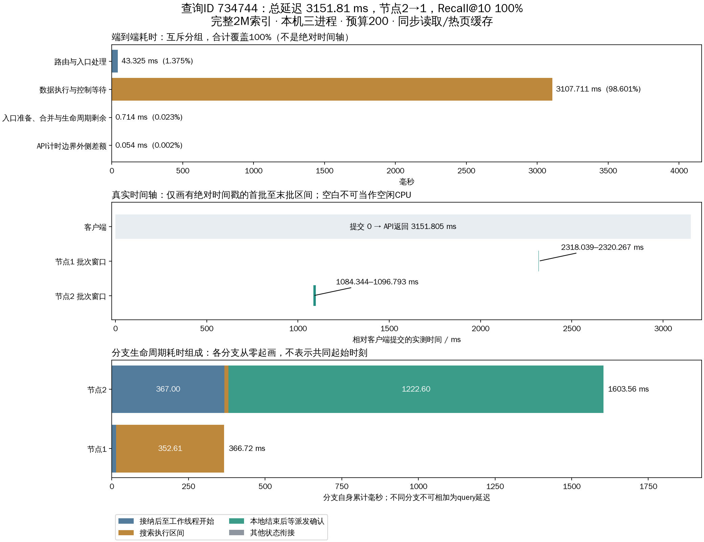

# 单查询从提交到完成的时间拆分

查询ID **734744**，query_row=73656，request_id=`0234097c-3e3e-4489-a2b0-041cb94617c9`。从最终优化实验中682条多节点查询按固定种子20261018随机抽取，未按延迟筛选；不能用一条查询代表总体。总延迟 **3151.805058 ms**，Recall@10=100%，路径节点2→1，全局200次扩展（153+47）。

## 覆盖全部端到端时间的分组

从客户端调用search前的monotonic_ns，到search返回后的monotonic_ns；不含调用前预处理/排队及返回后真值比较、文件写出。以下字段互斥且合计等于总延迟。

| 分组 | 耗时ms | 占比 |
|---|---|---|
| 路由与入口处理 | 43.325289 | 1.3746% |
| 数据执行与控制等待 | 3107.711373 | 98.6010% |
| 入口准备、合并与生命周期剩余 | 0.713980 | 0.0227% |
| API计时边界外侧差额 | 0.054416 | 0.0017% |

“入口准备、合并与生命周期剩余”由总API时间减去路由和执行区间得到，含派发前的状态准备，不能把它全部画在执行结束后。API外侧差额也未记录为单个连续区间。

## 用绝对时间戳定位的完整顺序

本机进程共享单调时钟域，批次时间戳落在客户端调用边界内。此表按已记录的首/末批次切分全部时间；未细分区间保留原状，没有将网络、GIL或线程池等待虚构成独立实测值。

| 起点ms | 终点ms | 区间 | 耗时ms |
|---|---|---|---|
| 0.000000 | 1084.343904 | 提交至首个本地批次开始 | 1084.343904 |
| 1084.343904 | 1096.792815 | 节点2首批开始至末批结束 | 12.448911 |
| 1096.792815 | 2318.039291 | 两个节点批次窗口之间（未细分） | 1221.246476 |
| 2318.039291 | 2320.267370 | 节点1首批开始至末批结束 | 2.228079 |
| 2320.267370 | 3151.805058 | 最后一个本地批次结束至API返回 | 831.537688 |

这两个批次窗口互不重叠，合计约14.677ms。窗口包含批次间代码及等待，不等于纯CPU时间，也不覆盖首批之前和末批之后的搜索适配/报告处理。

## 每个分支的生命周期

| 阶段 | 节点2 ms | 节点1 ms |
|---|---|---|
| 接纳后至工作线程开始 | 367.000040 | 14.049370 |
| 搜索执行区间 | 13.923143 | 352.610012 |
| 本地结束后等派发确认 | 1222.599479 | 0.019360 |
| 其他状态衔接 | 0.034857 | 0.038644 |
| 分支生命周期合计 | 1603.557519 | 366.717387 |

就绪计时从创建接纳记录到_run开始，包含提交线程池前等待，不能等同于纯工作队列等待。计算执行区间含Python适配/C++报告转换和相关等待。节点2派发后继续本地搜索；其本地结束后的派发确认等待已释放计算线程。分支生命周期结束在最终报告准备好时，不包含之后全部结果回传等待。

## 搜索执行区间进一步分解

| 区间 | 节点2 ms | 节点1 ms |
|---|---|---|
| pread调用 | 0.469319 | 0.162803 |
| 精确距离 | 1.751908 | 0.499486 |
| RaBitQ估距 | 2.248346 | 0.725977 |
| 批次内其他 | 0.923811 | 0.248873 |
| C++循环其余区间 | 7.135269 | 0.673897 |
| 适配、报告转换与其他外围等待 | 1.394490 | 350.298976 |

上述六项分别相加为各节点搜索执行区间13.923143ms与352.610012ms。批次内其他包括邻接解析、候选数据收集等；C++其余区间包含查询预处理、候选维护、扩展选择、派发回调及调度等待。最后一项是外围执行区间与C++内部计时之差，含进入原生循环之前的准备、返回时的GIL等待和Python报告构造等，无法再精确拆分。

| 辅助指标（不再相加） | 节点2 ms | 节点1 ms |
|---|---|---|
| C++内部搜索计时 | 12.528653 | 2.311036 |
| 搜索线程实际CPU时间 | 8.799384 | 3.766300 |

节点1外围差额约350.30ms，但搜索线程CPU只有3.77ms。这说明352.61ms不能称为纯计算耗时。现有插桩不能断定这350.30ms全部发生在返回阶段，也不能全部归为GIL。

## 节点2→1派发耗时

| 阶段 | ms |
|---|---|
| 派发线程池等待 | 1159.383945 |
| 借用连接 | 46.236280 |
| 新建连接（本次复用） | 0.000000 |
| 编码/发送 | 0.095276 |
| 等待接纳响应/解码 | 22.161974 |
| 派发执行总时长，不含线程池排队 | 68.560674 |

派发执行的其余状态/函数边界时间为0.067144ms。线程池等待+派发执行为1227.944619ms，与父分支搜索及派发收尾存在重叠，不可重复加进总延迟。等待响应包括目标端处理，不等于纯网络时间。

节点2在已扩展105个顶点后批准派发，给节点1预算47，自己最终扩展153。没有绕过扩展函数。

## 尚不能拆开的时间

- 初始入口提交的借连接/发送/接纳时长未保留到该查询输出；只能放在端到端执行区间中。
- 真正任务入队、取出、GIL等待、状态锁等待没有逐查询时间戳。
- 结果/心跳发送队列、编码、接收、ACK仅有节点累计计数，没有本查询的完整事件链。
- pread是文件调用wall，含页缓存和调度；本轮物理读取增量0，不能给出本查询纯SSD耗时。
- 不能把最后831.538ms全归因于结果网络传输，它还可包括报告构造、控制排队、调度和入口唤醒。

“所有时间”在端到端总量和上述时间轴中完整覆盖；每个内部子阶段还没有完整可观测性，需要额外插桩才能继续拆分。

- [原始查询](selected_query.json)、[抽样依据](selection.json)、[结构化拆分](breakdown.json)。
- [完整时间轴CSV](timeline.csv)、[每次pread/精排/RaBitQ区间CSV](record_spans.csv)、[SVG图](timeline.svg)。
- 本目录plot_query.py从冻结原始实验重新选取、校验并生成全部图表；不执行新查询或修改产品代码。
