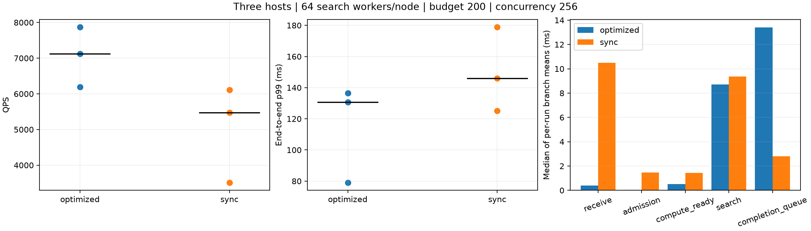
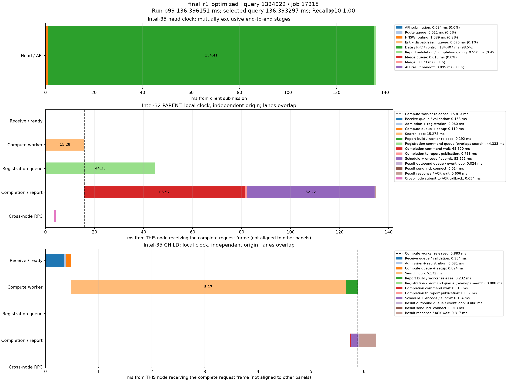

# 固定64搜索线程：控制注册与顶层报告优化

本次不构成硬件吞吐上限证明。固定搜索线程，先隔离接纳路径的控制状态锁等待，再减少顶层报告深拷贝；结果按同一阶段的交替对照报告，不用不同时段的最好/最坏值拼接收益。

## 最终三轮对照

三台机器 intel-35、intel-32、intel-30，每节点64搜索线程；intel-35同时运行独立顶层进程。并发256，搜索预算200，top10，seq_2M全量索引，固定2000条验证向量重复到每轮20,000查询，warmup200。网络与线程布局固定：数据RX8×handler1、发送各4；顶层route16、merge4、RX4×handler4、发送各4；每逻辑发送器每目标总连接额度128。

|实现|QPS中位数|QPS范围|每轮p99中位数 ms|Recall@10范围|
|---|---:|---:|---:|---:|
|原同步注册、报告复制|5469.30|3512.71–6108.23|145.965|0.97010–0.97026|
|注册入队、报告所有权转交|7119.75|6192.31–7867.49|130.678|0.97026–0.97037|

同阶段中位数变化：QPS +30.18%，p99 -10.47%。全部测量请求成功，预算、禁止节点重访、禁止顶层图扩展以及指标完整性审计均通过；内存结果捕获未发生溢出。

|轮次|原实现QPS|优化QPS|配对变化|原p99 ms|优化p99 ms|
|---|---:|---:|---:|---:|---:|
|0|3512.71|6192.31|+76.28%|178.806|130.678|
|1|6108.23|7119.75|+16.56%|125.051|136.396|
|2|5469.30|7867.49|+43.85%|145.965|79.063|

## 等待是否转移

以下为每轮平均值的三轮中位数。节点阶段以查询分支为单位，顶层阶段以完整查询为单位；不同主机时间不相减，重叠阶段不可累加成端到端延迟。

|阶段|原实现 ms|优化 ms|
|---|---:|---:|
|完整报文收到→接纳前（包含解码/校验）|10.498|0.388|
|接纳及注册提交|1.469|0.048|
|其中runtime状态锁等待|1.219|0.019|
|计算队列及启动设置|1.425|0.507|
|搜索循环|9.349|8.696|
|完成命令排队|2.804|13.389|
|报告发送队列|0.357|0.200|
|报告响应/ACK|1.035|0.594|
|顶层路由队列|0.078|0.928|
|顶层合并队列|4.238|0.129|
|顶层合并执行及生命周期|0.364|0.218|

优化后的控制注册命令平均排队（三轮中位数）为 12.684ms；该等待与搜索可以重叠，不阻止接纳线程继续处理下一请求。完成命令的等待另行统计。

|节点|原实现平均占用搜索线程|优化平均占用搜索线程|优化占64线程比例|
|---|---:|---:|---:|
|intel-35|33.29|38.62|60.3%|
|intel-32|30.62|34.30|53.6%|
|intel-30|14.49|19.24|30.1%|

占用量由所有测量分支的worker_enter→compute_released区间总和除以本机测量窗口得到，含线程被抢占和同步pread等待，**不是CPU利用率**。平均未占满64线程不能独立证明搜索还有多少可用算力，但排队位于接纳/控制/合并路径时，也不能断言搜索计算已达峰值。

## 分阶段证据与未采用的配置

第一阶段只切换queued_control_registration，三轮QPS中位数由 6601.59 到 6773.17，约提高 2.60%；接纳前等待从 8.685 到 0.288 ms，但顶层合并队列从 4.609 到 17.158 ms。故单独解除入口锁等待不足以显著改善整体吞吐。

只增加顶层合并线程的筛选：

|合并线程|QPS|p99 ms|
|---|---:|---:|
|merge8|6572.54|142.107|
|merge16|2334.31|298.345|

这两组各只有一轮，且共享机器存在其他负载，不能把退化幅度全部归因于线程数；但结果不足以支持增加到8/16线程，因此最终验证保留4个合并线程。

## 实现与安全边界

- `native_runtime.queued_control_registration`：短身份预留锁同步去重；注册入控制FIFO后返回Ticket，start/child/complete保持先后顺序。接纳路径不再嵌套等待controller状态锁。
- `native_runtime.move_head_reports`：顶层接收和最终合并时转移Value所有权，减少两次完整报告深拷贝。保留消息摘要、报告内容、时间戳、预算/路径校验和重试规则。
- 不改变搜索图、RaBitQ、搜索预算与远端扩展决策，也未通过减少指标记录提速。
- 57项控制、原生端到端与网络测试通过；包含并发重复身份、到期后重新注册、关闭、取消、晚到子分支失败及父报告提前返回。

## p99时序

代表轮次选择该实现QPS最接近三轮中位数的轮次；在该轮跨节点查询中选服务延迟最接近全体查询p99的真实记录。每个主机独立时间原点，计算线程释放后的控制等待不占用该计算线程。

原实现时序见[p99/sync/REPORT.md](p99/sync/REPORT.md)，优化时序见[p99/optimized/REPORT.md](p99/optimized/REPORT.md)。

## 限制、后续方向与复现

这些是并发256、固定查询集重复的短时热缓存测试。运行期间共享主机存在其他进程负载，原实现跨时段QPS也有明显变化；仅三轮不能宣称统计显著或已找到全局最优，更不能外推至冷SSD或百亿向量。后续优先针对剩余控制命令积压进行有时间预算的批处理/按查询分片，再测连接分配与接收通道负载；不应绕过远端扩展决定函数预发查询。

14轮有效测试合计280,000查询。三个启动兼容性失败发生在测量前，保留在startup_failed_*中，不计入性能结果。第一阶段同机同二进制切换注册开关；最终阶段同机同二进制切换两个开关。数据二进制保持第一阶段版本，顶层第二阶段版本的源码/二进制哈希分别见deployed_provenance.json、head_v2_hashes.json及各case/head_source.json。

完整配置见各case/plan.yaml、head_effective.yaml和layout.yaml；所有原指标汇总保存在case/result.json，逐查询与节点时间戳见case/runs。共享NVMe剩余容量较小，后续cases/runs通过符号链接归档在本机 `/var/tmp/dhdgs_control_registration_20261022` 系统盘，**移动实验时需要一并复制链接目标**。未压缩的冗余捕获分片仍在 `/tmp/dhdgs_control_registration_20261022/cases`，分析所需记录已有压缩副本与SHA256清单。

复现程序：run_comparison.py（注册隔离）、run_merge_screen.py（线程筛选）、run_final.py（最终对照）；既有case不会被覆盖。离线分析：`.venv/bin/python test/control_registration_20261022/analyze.py --progress final_progress.json --output final_comparison`。

两个开关已在configs/dhdgs.yaml启用；历史YAML缺失这些字段仍沿用旧语义。配置覆盖片段见[runtime_overrides.yaml](runtime_overrides.yaml)，完整数据计划与顶层有效配置分别见recommended_plan.yaml与recommended_head_effective.yaml。这些是runtime构造级开关，切换需要重建对应runtime。

优化代表轮次中的p99附近样例（query_id=1334922）延迟136.393ms。intel-32父分支接纳前等待0.163ms、搜索15.278ms、计算线程15.813ms释放；其后完成命令排队65.570ms、报告发布到网络队列提交52.221ms。实际网络发送队列0.024ms。说明尾延迟仍受控制命令消费/派发准备影响；不能把这52.221ms认定为纯网络传输或纯序列化CPU时间，需进一步细分。控制注册排队44.333ms与搜索/完成命令等待重叠，不可重复累加。

工作量核对：最终六轮每条查询均扩展200个向量，平均逻辑文件读取量均为2,457,600字节；并未减少搜索工作量。每轮RPC及协议字节均值见work_equivalence_audit.json。逻辑文件读取不等于物理SSD读取，本轮属于热缓存实验。
