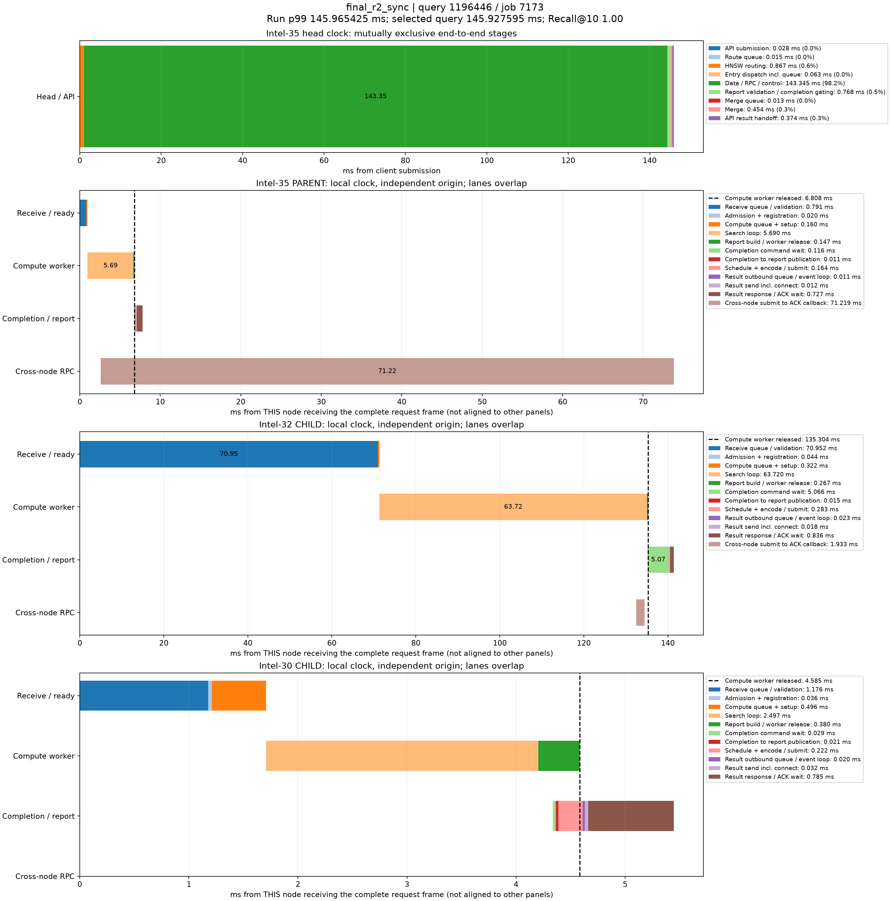

# p99真实查询时序分解

来源：final_r2_sync，20000条查询。在跨节点查询中选择最接近本轮全体查询p99的记录；这不是跨节点子集的p99。

本轮p99为145.965424710ms；query_id=1196446、job=7173，延迟145.927595000ms，相差0.037829710ms，Recall@10=1.00。

顶层面板使用同一主机时钟，阶段互斥且总和等于端到端服务延迟。每个数据节点单独以收到完整报文为零点，不能跨主机直接对齐时间轴或相加。节点内计算、控制、派发存在重叠；虚线表示计算线程释放时刻，之后的控制/网络等待不占用该计算线程。结果ACK时刻与用户Future完成时刻也不同。

|顶层阶段|耗时ms|占服务延迟|
|---|---:|---:|
|API submission|0.028140|0.02%|
|Route queue|0.015440|0.01%|
|HNSW routing|0.867108|0.59%|
|Entry dispatch incl. queue|0.063489|0.04%|
|Data / RPC / control|143.345091|98.23%|
|Report validation / completion gating|0.767520|0.53%|
|Merge queue|0.012984|0.01%|
|Merge|0.454175|0.31%|
|API result handoff|0.373648|0.26%|

## Intel-35 / PARENT

|阶段|本节点相对起点ms|耗时ms|
|---|---:|---:|
|Receive queue / validation|0.000000|0.791090|
|Admission + registration|0.791090|0.019782|
|Compute queue + setup|0.810872|0.160255|
|Search loop|0.971127|5.690219|
|Report build / worker release|6.661346|0.146971|
|Completion command wait|6.747255|0.115650|
|Completion to report publication|6.862905|0.010656|
|Schedule + encode / submit|6.873561|0.163740|
|Result outbound queue / event loop|7.037301|0.011052|
|Result send incl. connect|7.048353|0.011511|
|Result response / ACK wait|7.059864|0.726973|
|Cross-node submit to ACK callback|2.592094|71.218586|

## Intel-32 / CHILD

|阶段|本节点相对起点ms|耗时ms|
|---|---:|---:|
|Receive queue / validation|0.000000|70.951760|
|Admission + registration|70.951760|0.044046|
|Compute queue + setup|70.995806|0.322216|
|Search loop|71.318022|63.719663|
|Report build / worker release|135.037685|0.266619|
|Completion command wait|135.171794|5.066032|
|Completion to report publication|140.237826|0.015091|
|Schedule + encode / submit|140.252917|0.283408|
|Result outbound queue / event loop|140.536325|0.023234|
|Result send incl. connect|140.559559|0.017880|
|Result response / ACK wait|140.577439|0.836076|
|Cross-node submit to ACK callback|132.494965|1.932759|

## Intel-30 / CHILD

|阶段|本节点相对起点ms|耗时ms|
|---|---:|---:|
|Receive queue / validation|0.000000|1.175930|
|Admission + registration|1.175930|0.036366|
|Compute queue + setup|1.212296|0.495757|
|Search loop|1.708053|2.496897|
|Report build / worker release|4.204950|0.380418|
|Completion command wait|4.337485|0.028854|
|Completion to report publication|4.366339|0.021416|
|Schedule + encode / submit|4.387755|0.222256|
|Result outbound queue / event loop|4.610011|0.019826|
|Result send incl. connect|4.629837|0.031555|
|Result response / ACK wait|4.661392|0.784876|

结果RPC排队起点由 sender_enter_ns - round(pool_wait_ms * 1e6) 还原；pool_wait_ms来自底层同一主机时钟的queued_ns与send_start_ns之差。旧message_ready_ns是在异步提交成功后记录，网络线程可能已开始发送，不能用它直接计算发送前队列。还原数值保存在stages.json/CSV，未改写原始时间戳。

接收队列/验证、完成控制和发送前等待均为观测区间，可能包含OS调度及状态锁等待，不能据图将其全部认定为锁、CPU计算或纯链路传输。单条p99附近查询用于定位现象，不代表所有尾延迟样本。selected.json保留完整源记录，stages.json/CSV保存精确阶段数值。
