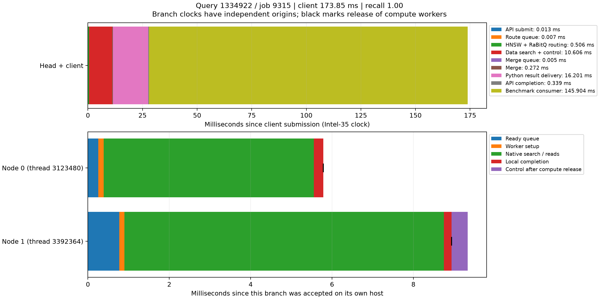

# DHDGS 在线查询运行时迁移至 C++：实现与三机测试

日期：2026-10-20。实验计划见 [PLAN.md](PLAN.md)，系统设计见 [DESIGN.md 第25节](../../DESIGN.md)，锁的职责见 [LOCKS.md 第11节](../../LOCKS.md)。

主要在线查询工作已迁入 C++，并完成 Intel-35/32/30 三机验证。两个后端均保留完整查询指标、相同检索预算和防重放窗口。四轮正式实验共40000次请求全部成功，Recall@10 约97%；两轮 QPS 的中位值从1145.41提高至1371.10，两轮客户端 p99 的中位值从428.59ms下降至256.47ms。

原生服务内部排队明显降低，但客户端仍有较长的结果消费等待。不能将原生完成 p99 的37–53ms当作客户端端到端延迟，也不能宣布全部等待低于100ms。本轮是短测和热缓存实验，不构成长期容量保证。

## 1. 实际迁移范围

| 工作 | 本轮实现 |
|---|---|
| 顶层路由 | C++ HNSW、样本 RaBitQ、入口与预算选择、有界路由池 |
| 入口与跨节点通信 | C++ MessagePack、非阻塞 TCP、连接复用、入口/子分支发送、ACK及重试 |
| 数据节点调度 | C++ 身份校验、去重、容量限制、有界计算队列、固定计算线程池 |
| 图搜索 | 抽取纯原生 `run_value`，与旧适配器共用算法；新路径没有中途 Python callback |
| 控制与完成 | 原生心跳、租约、取消、子分支确认、报告校验、全局终止判定与 top-k 合并 |
| 管理和外部边界 | 保留 Python YAML、索引初始化编排、配置事务、HTTP/API、部署与离线报告 |
| 离线构建 | 本轮没有迁移其 Python 编排，也没有重建索引 |

核心文件为 [native_runtime.cpp](../../cpp/native_runtime.cpp)、[native_head.cpp](../../cpp/native_head.cpp)、[native_server.cpp](../../cpp/native_server.cpp) 和 [runtime_bindings.hpp](../../cpp/runtime_bindings.hpp)。Python 适配集中在 [cpp_runtime.py](../../python/dhdgs/cpp_runtime.py) 与 [cpp_head.py](../../python/dhdgs/cpp_head.py)。项目仍是通过 pybind11 加载的 C++ 扩展，尚非独立纯 C++ 可执行程序。

每个分支在一个计算线程上执行，不同查询并行。扩展函数授权跨机后，父分支继续本地搜索，子分支不携带父节点本地候选；已访问节点禁止重访。本地预算或候选耗尽后，计算线程提交完成事件就释放，后续确认与报告由独立控制器处理。

共享身份表、工作队列和每查询结果表保留必要的短临界区。搜索、pread、距离计算及网络等待不持有数据身份表锁；空队列通过条件变量休眠。迁移消除查询热路径对 Python/GIL 的依赖，并不等于删除全部同步。

## 2. 测试条件与对照口径

| 项目 | 条件 |
|---|---|
| 数据及索引 | seq_2M 全量2,000,000条，2560维，L2，RaBitQ 1-bit |
| 索引身份 | epoch `b133c73b-75e9-49a6-af66-0a725cb302c8`，HNSW样本20,003条 |
| 机器 | Intel-35：顶层与数据0，独立进程；Intel-32：数据1；Intel-30：数据2 |
| 数据计算线程 | 每节点32个，三个节点合计96个 |
| 查询 | top-k10，全局预算200，客户端并发256，每轮预热32次 |
| 正式负载 | 每轮10000次；固定2000条验证查询循环5次，不是10000条独立查询 |
| 真值 | 完整数据库上的既有精确真值，沿用排除自身的检索定义 |
| Python 对照顶层 | 4个 lane 进程，各1个路由线程 |
| C++ 顶层 | 单进程；4路由线程、4合并线程、4原生接收线程 |
| I/O | `sync_pread`、应用LRU为0、OS页缓存热；无direct I/O |
| 动态资源调度 | 两后端均关闭 `adaptive_services` |
| 记录方式 | 完整结果在计时期间流式写入临时MessagePack，计时结束后生成JSON/CSV；两后端相同 |

沿用已建成的同一套分片、图和路由索引，没有改变召回预算来换取吞吐。原 Python 路径本身已经使用 C++ 搜索和原生完成控制器，因此表中的“Python”指控制与编排路径，并非纯 Python 图搜索。

迁移同时替换顶层进程拓扑、接收及连接组织，不能称为仅改变语言的单变量消融。原生入口/派发客户端每目标32连接，完成控制器仍使用 `peer.communication.connections_per_endpoint=2`；旧顶层有4个 lane endpoint，新顶层为单 endpoint，返回连接总容量也不同。

首轮 Python 在一次仅影响新运行时配置切换引用生命周期的修正前构建；最后一轮 Python 使用最终版本重新对照。每轮的 `source_hashes.json`、`deployed_provenance.json`、`plan.yaml` 与结果均保留，不假称四轮每一个源码文件完全相同。最终三机源文件摘要一致，二进制分别按当地 Python ABI 编译。

## 3. 吞吐、召回与端到端延迟

按实际执行顺序：

| 案例 | 请求数 | 计时秒数 | QPS | 平均延迟 ms | p99 ms | Recall@10 | 失败 |
|---|---:|---:|---:|---:|---:|---:|---:|
| [00 Python](three/00_python/result.json) | 10000 | 8.795 | 1137.00 | 220.76 | 362.93 | 97.017% | 0 |
| [01 C++](three/01_cpp/result.json) | 10000 | 7.828 | 1277.47 | 198.75 | 279.44 | 97.024% | 0 |
| [02 C++](three/02_cpp/result.json) | 10000 | 6.827 | 1464.74 | 173.52 | 233.50 | 97.012% | 0 |
| [03 Python](three/03_python/result.json) | 10000 | 8.667 | 1153.81 | 220.10 | 494.24 | 97.043% | 0 |

两轮 QPS 中位值提升约19.7%；两轮 p99 的中位值下降约40.2%。后者是两个分位数的中位值，不是合并全部样本后重新计算的p99。每后端只有两轮，运行时间约7–9秒，尚不足以评估长期稳定性或给出统计显著性结论。

先前本地探索为单机3数据进程、每节点6计算线程、并发128、各2000次请求：

| 案例 | QPS | 平均延迟 ms | p99 ms | Recall@10 |
|---|---:|---:|---:|---:|
| [本地 Python](local/01_python/result.json) | 1109.01 | 113.52 | 244.64 | 97.035% |
| [本地 C++](local/02_cpp/result.json) | 1427.44 | 88.24 | 194.60 | 97.060% |

正式与本地探索合计44000次请求均成功，`metrics_complete`、`no_node_revisit`、`budget_respected`、`no_router_expansion` 四项审计全部通过。本地配置与三机配置不同，不直接用这两张表判断网络本身的损耗。

## 4. 等待降低在哪里

| 指标（ms） | Python 00 | C++ 01 | C++ 02 | Python 03 |
|---|---:|---:|---:|---:|
| 每查询累计分支就绪等待均值 | 15.939 | 0.317 | 0.414 | 97.335 |
| 同项 p99 | 200.957 | 4.638 | 5.802 | 435.056 |
| 原生提交至合并完成均值 | — | 13.817 | 13.673 | — |
| 同项 p99 | — | 52.697 | 37.154 | — |
| 原生完成至 Python API交付均值 | — | 7.655 | 10.422 | — |
| 同项 p99 | — | 23.039 | 28.882 | — |
| 完成结果在压测消费队列等待均值 | 171.325 | 177.180 | 149.335 | 87.915 |

分支就绪等待按query内各分支累计，不能作为互斥的端到端阶段直接相加。新增的原生时间戳在旧路径没有同口径值，表中用“—”表示，而非0。

第二轮 C++ 的顶层阶段均值如下；这部分是同一顶层时钟上的顺序分解：

| 阶段 | 平均 ms |
|---|---:|
| API提交 | 0.062 |
| 路由排队 | 0.563 |
| HNSW与样本RaBitQ路由 | 0.651 |
| 数据搜索与控制确认 | 11.955 |
| 合并排队 | 0.039 |
| 合并及原生完成 | 0.466 |
| Python最终结果交付 | 10.422 |
| 已完成结果等待压测消费 | 149.335 |

仍有少量 API completion 与观测边界开销，不能强行把上表凑成精确总和。`api_future_done_ns` 在Future完成回调记录，`benchmark_consumer_wait_ms` 则从该时刻计至压测循环实际取出并读取结果。压测中的提交、消费和完整指标归档仍由Python执行，因此已完成的结果也会等待。

这段等待纳入 `client_wall_ms` 和QPS计时，没有在原生完成时提前停止客户端时钟。原生 p99 较低表明服务内部推进已显著改善，但当前吞吐仍受到外层客户端消费及结果处理的约束，不能当作原生服务的极限QPS；也不能把149–177ms全部归因于一把锁或单一GIL区间，尚需细分其内部工作。

## 5. 一条跨节点查询的完整时序

使用固定随机种子20261020，从跨节点查询中均匀选取样本，不按延迟挑选。第二轮 C++ 选中 query_id **1334922**，job **9315**，Recall@10=1.0。



[可缩放SVG](three/02_cpp/query_timeline.svg) · [完整查询记录](three/02_cpp/selected_query.json) · [阶段CSV](three/02_cpp/selected_head_stages.csv)

| 阶段 | 时间 ms |
|---|---:|
| API提交 | 0.013 |
| 路由排队 | 0.007 |
| HNSW + RaBitQ路由 | 0.506 |
| 数据搜索 + 控制 | 10.606 |
| 合并排队 | 0.005 |
| 原生合并 | 0.272 |
| Python结果交付 | 16.201 |
| API completion | 0.339 |
| 压测完成队列消费等待 | 145.904 |
| **客户端总时间** | **173.854** |

这条查询的原生完成时间为11.397ms；主要长等待发生在结果已经完成之后。图下半以每个数据节点自己的分支接纳时刻为0，不能把两行当成已同步的跨机绝对时序。黑色标记表示计算线程已释放，标记之后的控制处理没有继续占用该计算线程。紫色为释放后的报告控制区间。

第二轮三个数据节点“搜索循环结束至释放计算线程”的平均时间分别为0.207/0.262/0.206ms。原生接纳锁申请至取得的p99分别为2.752/3.595/2.164ms。这些墙钟间隔可含OS调度，不能解释为等量CPU忙等；原生计算线程也没有等待整棵分支树完成才归还线程池。

## 6. 网络、磁盘、计算与负载

第二轮 C++ 每查询统计：

| 指标 | 平均值 | p99 |
|---|---:|---:|
| 累计搜索线程CPU | 10.567 ms | 18.925 ms |
| 累计pread墙钟时间 | 0.733 ms | 0.983 ms |
| 累计RaBitQ墙钟时间 | 3.556 ms | 6.333 ms |
| 累计精确距离墙钟时间 | 1.949 ms | 4.325 ms |
| 逻辑读取次数 | 200 | 200 |
| 逻辑读取字节 | 2,457,600 | 2,457,600 |
| 协议层字节 | 31,744.5 | 57,981.3 |
| 全部协议RPC次数 | 3.051 | 5 |
| 其中数据间分支派发RPC | 0.350 | 1 |
| 图扩展顶点数 | 200 | 200 |
| 最大已扩展图深度 | 10.872 | 21 |
| 跨分片深度 | 0.349 | 1 |
| 分支数 | 1.350 | 2 |

每次逻辑读取为12,288字节。三个数据进程的 `storage_read_bytes` 增量均为0：这些读取命中OS页缓存，不能称为冷SSD随机读性能。协议字节是应用协议计数，不含TCP/IP头部等完整网卡开销；这里没有将网络等待从搜索和控制总墙钟中伪造拆出。CPU时间与多个分支的墙钟累计有重叠，也不能相加后当作端到端的互斥占比。

各服务的平均CPU核占用如下（CPU秒数/观测窗口秒数；不是配置线程数）：

| 案例 | Intel-35数据0 | Intel-32数据1 | Intel-30数据2 | 顶层所有相关进程合计 |
|---|---:|---:|---:|---:|
| Python 00 | 5.127 | 5.776 | 3.521 | 4.684 |
| C++ 01 | 4.889 | 5.756 | 3.159 | 3.829 |
| C++ 02 | 5.612 | 6.281 | 3.618 | 4.101 |
| Python 03 | 5.231 | 6.041 | 3.609 | 4.786 |

节点快照窗口包括采集边界开销，不能把核占用差异全部解释为检索效率变化。节点负载仍不均衡，且远未占满32个计算线程对应的CPU容量；仅凭当前QPS不能认定数据节点纯搜索已成为唯一瓶颈。各轮原始结果还保存RSS、线程数、I/O字节及资源采样。

## 7. 正确性与部署状态

最终 [回归日志](release_regression.log)：**运行418项，416通过、2跳过**。验证内容包括：

- 新旧后端互通、搜索与预算/聚合对照、NumPy PCG64及子分支种子逐值兼容。
- 持有Python GIL时，原生路由、数据搜索、通信和合并仍能完成；最终Python对象交付单独计时。
- TCP分帧、重复/冲突身份、容量、token、预算/路径、乱序清单与失败终态。
- 既有原生控制的丢ACK重试、取消、租约过期和关闭，以及新服务无响应/拒绝连接处理。
- 管理在线配置事务、结果拉取、关闭ACK、HTTP适配及旧YAML兼容。

新模块已在三机独立目录编译和导入，源文件一致性证明见 [deployed_provenance.json](deployed_provenance.json)、[source_hashes.json](source_hashes.json) 和 [sync_verify_release.log](sync_verify_release.log)。原生构建新增OpenSSL Crypto依赖；本机Python 3.12、远端Python 3.10分别构建，不能直接混用扩展二进制。

常驻220xx服务没有替换。本轮数据服务使用30551/30552/30553，顶层结果端口30610，实验结束通过管理接口关闭。最终端口状态记录在 [final_cluster_check.json](final_cluster_check.json)。

## 8. 使用方式与复现

所有参数继续用YAML配置。完整已测配置见 [three/02_cpp/plan.yaml](three/02_cpp/plan.yaml)，模板参数见 [configs/dhdgs.yaml](../../configs/dhdgs.yaml)。模板保持旧默认行为，需要显式开启 `native_runtime.data_enabled` 与 `head_enabled`。

新路径当前要求 `TCP + peer + native search/control + optimized communication + sync_pread`，并关闭旧 `head_lanes/head_direct/head_pipeline`、`head_receiver_processes/head_query_workers`。第一版不接入原Python自适应线程池，也不支持原生运行时下的异步 `io_uring/thread_pool` 后端；这些已有I/O后端仍可通过旧运行时使用。

使用已编译、已同步的本轮部署目录，可在项目根目录运行独立复测，案例名必须使用尚不存在的目录：

```sh
cd /sharenvme/usershome/xulihan/gene_database/DHDGS
.venv/bin/python test/cpp_runtime_20261020/experiment.py three/recheck_cpp_01 cpp --topology three --count 10000 --concurrency 256 --threads 32
.venv/bin/python test/cpp_runtime_20261020/experiment.py three/recheck_python_01 python --topology three --count 10000 --concurrency 256 --threads 32
.venv/bin/python test/cpp_runtime_20261020/analyze.py three/recheck_cpp_01 three/recheck_python_01
```

实验脚本自动创建独立数据服务、校验配置、启动顶层、执行基准、拉取指标并关闭服务；新结果写到本目录的新案例下。不要并行执行两个占用相同端口的案例。该复测直接调用顶层API，经过真实跨机数据TCP，不是客户端HTTP吞吐基准；HTTP边界另外做了功能回归。若修改查询源码，须重新构建并同步独立部署目录后再对照，不能只修改本机文件就声称三机已更新。

## 9. 尚未验证的部分

还需用长于终态保留窗口的持续负载验证RSS、过期清理、连接重试与吞吐稳定性；本轮没有用短测代替此前长测暴露的问题。冷SSD、原生异步I/O、多租户资源隔离、客户端HTTP极限吞吐和离线构建加速也未在本轮验证。

接下来最有依据的优化位置是原生最终结果到Python对象的转换，以及压测消费、完整记录序列化和归档之间的交接。应继续保留原生完成、Future完成、客户端消费三个时间戳，在完整指标和相同负载下比较；不能通过提前停止计时、删除记录或降低并发制造“等待达标”。
