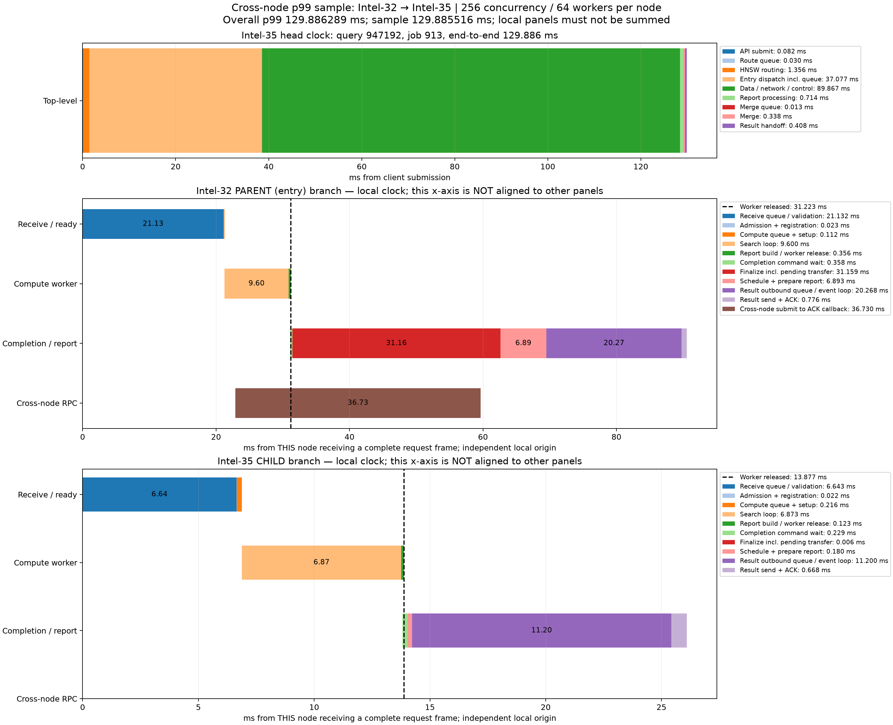

# 跨数据节点p99查询时序

同一轮256并发、每数据节点64搜索线程、顶层16路由线程/32连接、预算200测试。严格筛选实际peer_branch_rpc_count>=1且涉及至少两节点的查询，选择端到端服务延迟最接近全体查询p99的一个；不是跨节点子集p99，也不是任意高延迟样本。

整体p99=129.886289320 ms，选中query_id=947192、job=913，延迟=129.885516000 ms，差值=0.000773320 ms，Recall@10=1.0。跨节点候选共3446条。

查询路径：顶层Intel-35 → 父分支Intel-32 → 子分支Intel-35。数据节点0的子分支与顶层路由在同一机器不同进程。只有一次数据节点间扩展RPC，此外父分支有心跳、两分支各自回传结果。父分支扩展21个本地向量后派发子分支，子分支预算89。

图第一面板是顶层时钟；后两面板均以各自收到完整请求报文为零点，横轴不能跨面板直接对齐或相加。父子RPC的因果关系由branch_id/parent_branch_id/fork_events确认，不依赖跨机时钟相减。结果ACK终点与用户结果交付终点不同。

## parent / node 1

计算线程在本地相对31.223 ms释放，结果RPC确认完成于90.546 ms。

|阶段|相对开始ms|耗时ms|
|---|---:|---:|
|Receive queue / validation|0.000000|21.132184|
|Admission + registration|21.132184|0.022764|
|Compute queue + setup|21.154948|0.111569|
|Search loop|21.266517|9.600103|
|Report build / worker release|30.866620|0.356008|
|Completion command wait|31.093192|0.357852|
|Finalize incl. pending transfer|31.451044|31.158720|
|Schedule + prepare report|62.609764|6.892626|
|Result outbound queue / event loop|69.502390|20.267786|
|Result send + ACK|89.770176|0.775795|
|Cross-node submit to ACK callback|22.904572|36.729640|

## child / node 0

计算线程在本地相对13.877 ms释放，结果RPC确认完成于26.093 ms。

|阶段|相对开始ms|耗时ms|
|---|---:|---:|
|Receive queue / validation|0.000000|6.643315|
|Admission + registration|6.643315|0.022202|
|Compute queue + setup|6.665517|0.215567|
|Search loop|6.881084|6.873189|
|Report build / worker release|13.754273|0.122644|
|Completion command wait|13.810266|0.228940|
|Finalize incl. pending transfer|14.039206|0.006117|
|Schedule + prepare report|14.045323|0.179775|
|Result outbound queue / event loop|14.225098|11.199726|
|Result send + ACK|25.424824|0.668328|

## 解释

父节点搜索9.600 ms、子节点搜索6.873 ms。父节点跨机派发至ACK回调为36.730 ms，其中RPC发送前排队28.579 ms，发送（含连接）1.271 ms，响应等待6.851 ms。完整peer_transfer_wall_ms计时范围稍宽为37.008 ms，不能与36.730 ms混用。

父节点完成命令被处理后至报告就绪31.159 ms，期间跨机派发尚未确认，ACK回调于本地59.634 ms到达，报告于62.610 ms就绪。这不是计算线程忙等：计算线程早在31.223 ms释放。该区间包含未完成派发确认及控制命令调度，不能等同于子节点搜索完成等待。

父/子节点结果组包后至开始网络处理分别20.268/11.200 ms。该区间含网络提交、连接等待和事件循环调度；不是纯线缆传输，也不能直接断言由某把锁造成。接收后21.132/6.643 ms也混合服务端排队、校验和调度，需要更细时间戳才能独立归因。

接纳状态锁申请至取得父/子节点约0.0021 ms，不能解释此样本的长尾。跨机RPC横条与本地搜索、完成控制重叠，所有条形不能直接相加。现有记录足以定位明显等待区间，但不是每把锁或每条网络队列的完整归因。

selected.json保留完整查询、两节点生命周期和心跳/结果事件；stages.json与plot.py提供精确阶段数值及复现方式。
