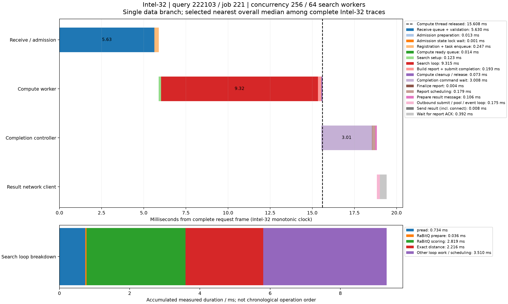

# 数据节点单查询时序

来源：256客户端并发、每节点64搜索线程、顶层16路由线程/32连接、预算200的三机测试。选择Intel-32中时间戳完整、仅一个数据分支且端到端时延最接近全体p50的查询，query_id=222103，job=221，Recall@10=1。不是随机抽样或所有查询的平均。

端到端服务时延38.554 ms；本图从Intel-32完整请求报文时间戳到结果RPC完成确认共19.408 ms。全部时间使用同一Intel-32单调时钟，不与顶层跨机时钟相减。包含结果确认的终点可能晚于顶层交付，不能将19.408直接从38.554相减当作其余路径耗时。

|执行环节|相对开始ms|耗时ms|
|---|---:|---:|
|Receive queue + validation|0.000000|5.629931|
|Admission preparation|5.629931|0.013425|
|Admission state lock wait|5.643356|0.000984|
|Registration + task enqueue|5.644340|0.246527|
|Compute ready queue|5.890867|0.014178|
|Search setup|5.905045|0.122879|
|Search loop|6.027924|9.315329|
|Build report + submit completion|15.343253|0.192533|
|Compute cleanup / release|15.535786|0.072587|
|Completion command wait|15.535786|3.007669|
|Finalize report|18.543455|0.004350|
|Report scheduling|18.547805|0.179406|
|Prepare result message|18.727211|0.105840|
|Outbound submit / pool / event loop|18.833051|0.174555|
|Send result (incl. connect)|19.007606|0.008357|
|Wait for report ACK|19.015963|0.391940|

搜索线程在15.608 ms释放，完成命令到18.543 ms才被控制器处理，说明计算线程并未一直等到结果报告完成。图中计算收尾与控制等待存在重叠，不应把所有横条时长相加。

接收至接纳5.630 ms包含服务端排队、解码/校验及处理线程调度，现有时间戳不能精确拆成纯排队。接纳状态锁申请至取得0.000984 ms，仅代表此查询此锁的观测区间；注册段0.247 ms仍可能含控制器锁等待。完成命令等待3.008 ms由complete调用处时间戳到控制线程处理该命令，包含提交、锁等待、命令队列与线程调度，不应全称为纯队列等待。报告发送前0.175 ms包含提交、连接分配与事件循环处理。ACK等待0.392 ms不占用已释放的计算线程。

搜索主循环9.315 ms，其中pread 0.734 ms、RaBitQ准备0.036 ms/估距2.819 ms、精确距离2.216 ms、剩余3.510 ms为图维护、堆操作、未细分代码与可能的调度。分项是累计耗时，不是实际发生顺序，不能把残差全算作等待。该轮物理读增量为0，pread是热页缓存读取而非冷SSD时延。

图中结果发送完成时间由同一数据节点sender_enter_ns加RPC记录send_ms恢复。全部原始查询、节点trace、控制事件与绘图脚本保留在本目录。
