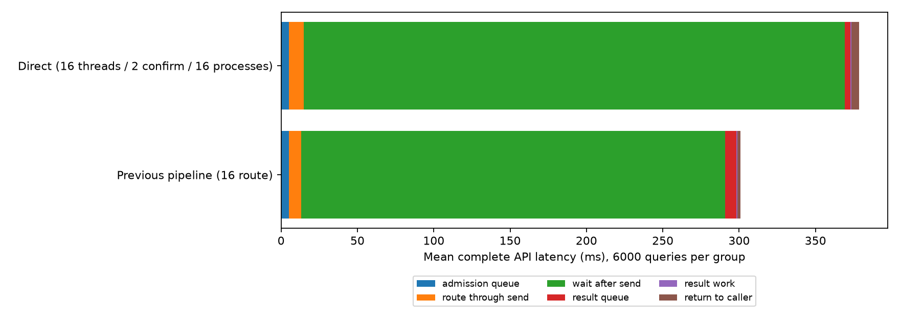
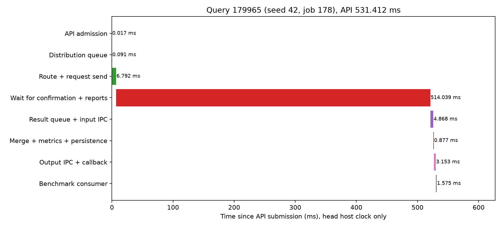

# 直接分发、异步确认与结果进程池：三机对照

2026-10-20。用户最终确认的配置是 **16个分发线程、2个确认线程、16个结果处理进程**，并非16个分发进程。

## 结论

方案已实现并完成三机测试，但本轮没有减少完整查询的等待和积压。相对原16路由线程流水线，新方案QPS中位数从414.21降至325.41（下降21.4%），p99从632.67ms升至1264.55ms（约增加99.9%）。两组各6000查询全部成功，Recall@10约97%，没有为了提速减少预算、减少并发或提前返回。

新方案分发队列均值4.90ms，结果队列与输入IPC3.64ms，结果处理0.90ms，结果返回IPC3.89ms；最大区间仍是发送请求后等待确认和完整结果报告，均值354.30ms。取消路由后的派发队列、把top-k和统计移到16个进程，没有解决回传链路的主要积压。结果进程并不繁忙，16个进程合计只使用约0.49个CPU核，不宜将它解释为结果计算进程不足。

此模式保留为可切换实验路径，未替换当前更快的双进程常驻入口。三个数据节点无程序重部署、无索引重建，全部临时入口已退出。

## 实现的分工

- **分发线程池（16）**：接收/接纳请求→向量准备→HNSW→RaBitQ入口估距→初始请求构造→注册身份与状态→建立连接并发送完整报文。发送后把socket交给确认线程，不调用recv、不等ACK，随即处理下一个请求。HTTP解析和路由使用同一池，已在分发线程内的查询直接执行，不再重复投入路由队列。线程池本身仍有有界请求接纳容量；不能把超出16个执行槽位的请求等待隐藏掉。
- **确认线程（2）**：每线程运行一个异步事件循环，处理众多请求的ACK等待、超时、重传、主动心跳以及数据节点报告接收。每线程有一个回调端口，查询注册时分配，子分支沿用该查询的端口。没有每查询独占的ACK线程。异步socket等待释放执行机会，不忙轮询等待报文。
- **结果处理进程池（16）**：从结果消息队列领取完整分支报告，合并和去重top-k、计算指标、写入各进程独立JSONL、产生返回数据。主入口将返回对象完成到客户端Future；HTTP响应传输仍由入口响应线程发送，结果进程不接管客户端socket。进程池使用spawn，全部16进程完成模块初始化和BLAS线程限制后才开始计时，不复制整个HNSW索引。
- **主入口控制**：保留管理接口、有限请求状态、Future和结果IPC的收发。没有原来的独立路由就绪队列和路由后派发队列；保留结果队列与HTTP管理/响应队列。进程数与线程数调整需要重启顶层，原搜索预算、路由ef、数据节点线程数等热配置继续有效，不需要重建索引。

分发完成以“完整报文已交给本地socket发送”为边界，不等于对端已接纳。ACK超时后由确认模块沿用相同request_id、branch_id、token、预算和请求内容重传；不能生成新分支身份。数据节点仍按身份和内容执行幂等接纳。明确拒绝或错误报文直接失败；不把参数错误当成丢ACK重传。只有入口成功确认和完整分支树验证都满足，才投递结果消息；某个子分支先返回不能让查询提前完成。

本实现初始入口请求每次建立一条连接；分发线程移交该socket后不再占用它，确认线程读完ACK后关闭。它没有复用旧版入口连接池，这是本轮架构对照的一项差异。数据节点向顶层的结果控制连接仍复用。每个确认端口对每个数据节点的控制连接上限仍为2，两个端口可能总计4条；不能把整个结果归因于单独“去队列”或“增加进程”。

## 配置

`candidate.yaml`是完整可启动配置；规范配置`configs/dhdgs.yaml`新增以下可选节，默认关闭以保留原模式。

```yaml
peer:
  head_receiver_processes: 0
  head_query_workers: 0
  head_pipeline:
    enabled: false
  head_direct:
    enabled: true
    distribution_threads: 16
    confirmation_threads: 2
    result_processes: 16
    ack_timeout_ms: 1000
    submit_retries: 1
    result_queue_capacity: 2048
    startup_timeout_seconds: 60.0
    save_results: true
    results_directory: /path/to/test/run/worker_results
```

查询接纳容量继续由`peer.max_active_queries`限制；结果进程队列额外由`result_queue_capacity`限制。满容量明确拒绝，不无界积压。入口的新字段不参与数据执行签名，与现有三台数据服务兼容。主动心跳间隔、租约及全局查询期限继续使用原peer参数。确认线程通过异步读取及时处理ACK，不必等到下一次周期心跳才读取。

## 同负载对照

完整seq_2M，Intel-35顶层与data-0、Intel-32 data-1、Intel-30 data-2。每数据节点32计算线程、并发128、预算200、top-k10；固定2000查询、32预热，按旧/新/新/旧/旧/新交错。各轮使用独立回调端口范围，正式计时为内部异步API，包含提交、所有内部等待和结果消费时间；不包含外部HTTP往返。新方案按用户要求在计时路径由结果进程保存逐查询记录；旧版主要在批次完成后集中保存，这也是完整方案对照的一项差异。

|指标|原16路由线程流水线|新16分发/2确认/16结果进程|
|---|---:|---:|
|QPS（三轮中位数）|414.21|325.41|
|p99（三轮中位数，ms）|632.67|1264.55|
|API平均延迟，ms|300.90|378.40|
|原路由队列均值，ms|0.806|已移除|
|新分发队列均值，ms|不适用|4.901|
|新结果队列/输入IPC均值，ms|不适用|3.641|
|新结果处理均值，ms|不适用|0.903|
|其中写JSONL均值，ms|不适用|0.559|
|新结果返回IPC均值，ms|不适用|3.894|
|数据计算就绪队列累计均值，ms|0.552|1.093|
|数据本地分支生命周期累计均值，ms|13.285|14.076|
|顶层全部业务进程平均CPU核数|1.542|2.064|
|顶层全部业务进程RSS之和，GiB|0.893|1.467|
|Recall@10|97.022%|97.022%|
|失败|0/6000|0/6000|

RSS按进程求和，可能重复计入共享页，并非PSS。CPU/RSS包含新方案16个结果进程；不能仅看主进程。每数据节点的CPU、内存、逻辑I/O、图跳数、跨机次数、协议字节与各查询完整指标保存在`cases/*/runs/*`；汇总见`metrics.csv`、`analysis.json`。



图内阶段互斥、完整覆盖API，使用顶层同一主机单调时钟。发送后等待包含ACK、数据搜索、跨节点分支、报告发送排队和报告处理，不能全部标为纯网络耗时；数据分支累计指标不能再相加到这张图。

|轮次|QPS|p99 ms|平均ms|
|---|---:|---:|---:|
|00 原|409.52|627.87|306.90|
|01 新|325.41|1081.24|382.67|
|02 新|338.91|1294.43|367.15|
|03 原|414.21|632.67|297.69|
|04 原|420.39|637.81|298.10|
|05 新|322.31|1264.55|385.38|

18个节点测量窗口控制传输错误增量均为0，正式查询结果事件无失败；入口重传次数为0；预算、节点不重访和指标完整性审计通过。所有正式查询返回结果均与结果工作进程保存的记录一致。物理读取增量仍为0，本次只反映热页缓存负载，不代表冷SSD性能。

## 等待仍在哪里

依据正式查询ID筛选数据主机控制事件，以下均是同一数据主机内的差值，按结果事件平均，不与API阶段均值直接相加。

|结果回传阶段|原方案，ms|新方案，ms|
|---|---:|---:|
|控制发送等待连接/发送机会|197.410|229.215|
|开始发送至收到ACK|8.918|19.921|
|报告准备好至控制调度选中|47.748|57.034|

结果进程平均只处理约0.9ms，结果队列平均约3.6ms，表明16个结果进程的计算能力不是此处的主要限制。确认线程仍在同一个顶层Python进程内执行：socket事件调度、MessagePack解码、分支状态更新/验证、ACK生成，以及把完整报告送入进程池；它们仍与分发准备及IPC管理线程共享GIL。移出top-k合并没有移出这段结果接收处理。观察到的数据与该入口控制链路容量不足一致，但本轮没有精确测出GIL、OS调度和每把锁的分别占比，不能把全部19.9ms都称为GIL或链路时延。

新方案入口发送开始到读到ACK平均54.21ms，旧版约2.04ms；这段异步等待不占分发线程。其差异同时包含新建连接、异步接管/读取调度和对端处理，不能直接视作网络RTT。新方案的发送至线程返回平均0.392ms，实际无等待ACK的recv调用；专项测试也验证了ACK被阻塞时分发线程能继续处理其他查询。

这轮不再增加结果进程数量。后续若继续优化，应针对“确认/报告处理”做独立消融，例如保留两线程但将收包解析、报告状态和ACK处理移入原生代码，或对结果报告采用有界入队后确认并由所属结果进程维护分支状态；同时独立评估初始连接复用和控制连接数量。这些尚未实施，不能作为本轮收益。

## 随机查询的完整时序

固定随机种子42，从首轮新方案的2000查询中选择job178，对应query179965，没有按快慢挑选。API总时延531.412ms。



|阶段|ms|
|---|---:|
|API接纳|0.017|
|分发队列|0.091|
|路由准备及请求发送|6.792|
|等待确认及完整报告|514.039|
|结果队列与输入IPC|4.868|
|合并、统计及保存记录|0.877|
|输出IPC及完成回调|3.153|
|压测消费者取得结果|1.575|

原始查询、纳秒时刻和分解CSV见`selected_query.json`、`selected_query_timeline.csv`。

## 正确性与退出验证

最终313项回归全部通过，包含原搜索路径、公共合并函数提取、热配置/恢复、异步I/O、新分发池与取消、ACK丢失和重传。真实数据节点的故障注入测试确认第二次相同身份提交返回`duplicate: true`，没有新建重复搜索分支。初次该测试误把管理协议的嵌套`result.duplicate`按顶层字段读取，已修正断言，失败日志保留。

真实HTTP再验证32查询（16并发）和HTTP管理接口发起32查询压测，全部成功；确认16个分发线程配置、2个确认线程、16个结果进程，拉取结果与退出也成功，见`http_final/verification.json`。这64条是功能验收，不用于宣称HTTP吞吐。

初次HTTP功能请求成功，但服务退出超时。栈诊断定位到Python 3.12的`Server.wait_closed()`还会等待持久回调连接，而原代码先等服务器关闭，后关连接，导致接近120秒的连接超时等待。已改成先关闭连接/取消连接任务，再等待服务器关闭，并新增持久回调连接退出回归。此修复不在正式查询计时区间内，未将其包装成QPS收益。原失败HTTP与关闭栈日志完整保留。

性能矩阵后的源码差异仅为：关闭顺序修复、HTTP接纳容量保护、CSV新增直接分发指标并避免重复列。关闭和HTTP路径经最终回归/HTTP验收；没有重新宣称性能提升。冻结与最终源码分别在`snapshot/`、`validated_sources/`，差异在`validated_source_hashes.json`。结果工作进程的JSONL是返回前快照，最终写盘/IPC时长以主入口收集的`queries.jsonl.gz`为准。

## 工件与启动

`experiment.yaml`固定所有负载参数；`candidate.yaml`启用16/2/16模式；`benchmark.yaml`固定2000查询/128并发/32预热。`run_scan.py`交错对照；`analyze.py`从原始查询和节点快照重建统计及图表。正式轮次目录不可覆盖，重测应使用新的输出目录和回调端口范围，避免旧连接复用干扰。

启动命令和热配置说明见本目录[README.md](README.md)。新候选顶层只需在Intel-35启动，复用已有Intel-35/32/30数据节点；本轮没有变更常驻入口。
