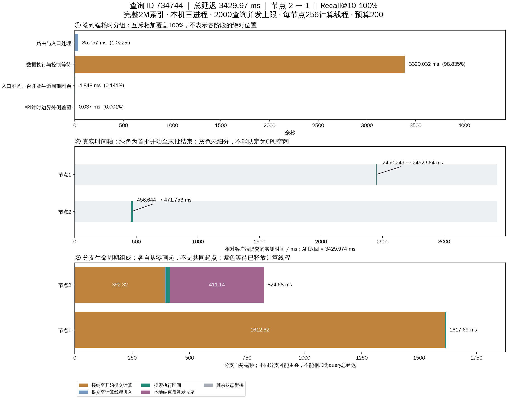
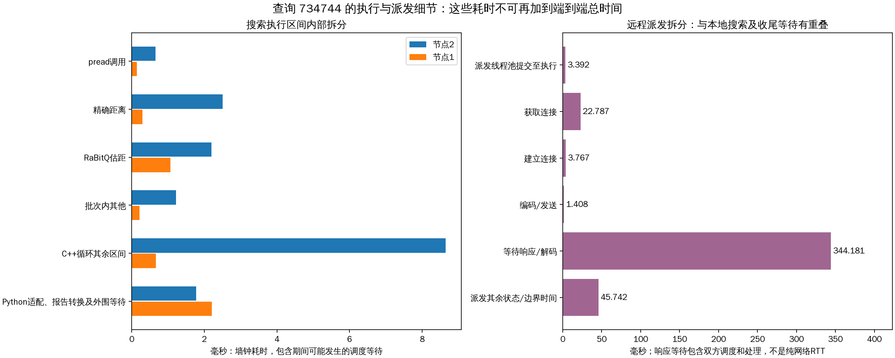

# 接纳与远程派发队列：新一轮实验及单查询耗时分解

本轮实际运行现有buffered接纳队列和optimized远程派发线程池；没有更换为新的专用派发队列或事件循环。生产搜索代码未修改。

## 实验条件

- 完整seq_2M索引：2M×2560，raw L2，1-bit RaBitQ，top-10排除自身；复用已构建索引。
- Intel-35本机三个TCP数据进程，共享CPU及SSD；不是物理三机实验。
- 2000条不同验证查询；20客户端进程×100线程，并发上限2000；40次预热不计入结果。
- 每节点计算线程上限256、远程派发16、控制发送16；连接上限8/目标；接纳容量与活动查询上限均2048。
- 预算200、frontier64、local_beam4；同步buffered pread，应用缓存0，详细trace开启。
- 同一冻结查询集合，排除128条历史校准查询；复用全库真值缓存，本轮未重新扫描全库计算真值。
- 一次突发负载并排空，不是持续稳态吞吐测试，也不是容量最优性实验。

## 总体结果

| 指标 | 结果 |
|---|---|
| 成功 / 失败 | 2000 / 0 |
| 平均Recall@10 | 96.975% |
| QPS | 462.91 |
| 测量窗口 | 4.320 s |
| 实际并发峰值 | 2000 |
| 平均延迟 | 2773.740 ms |
| p50 | 3284.195 ms |
| p95 | 4210.244 ms |
| p99 | 4270.010 ms |
| 最大延迟 | 4311.019 ms |

以下为每query跨分支累计均值，含重叠阶段，不能相加为端到端延迟。

| 阶段 | 平均ms/query |
|---|---|
| 接纳至开始提交计算 | 1494.706 |
| 提交至计算线程进入 | 6.353 |
| 搜索执行区间 | 34.426 |
| 本地结束后派发收尾 | 113.925 |
| 派发队列等待 | 85.049 |
| 派发响应等待 | 11.470 |
| pread调用 | 0.696 |
| 精确距离 | 1.895 |
| RaBitQ估距 | 3.645 |

## 随机查询与图表

从684条成功跨节点查询中，按query_row排序，使用固定种子20261018随机抽取，未按耗时挑选。
查询ID **734744**，query_row=73656，request_id=`fd4f8063-0fc9-4e27-ac3e-899f713c9931`。路径节点2 → 1，总延迟 **3429.974 ms**，Recall@10=100%。
固定种子此次再次抽中了早先control_path示例中的同一query；本报告所有计时来自新运行，不复用旧测量。

端到端分组互斥覆盖全部耗时；真实时间轴只定位已记录的批次窗口；分支生命周期按各自起点展示，不能把不同分支相加。

| 端到端分组 | 耗时ms | 占总延迟 |
|---|---|---|
| 路由与入口处理 | 35.056903 | 1.0221% |
| 数据执行与控制等待 | 3390.032347 | 98.8355% |
| 入口准备、合并及生命周期剩余 | 4.848018 | 0.1413% |
| API计时边界外侧差额 | 0.037161 | 0.0011% |

入口准备、合并及生命周期剩余是差额，可能出现在数据执行之前或之后，不能全部放在结果返回之后。

## 覆盖客户端提交至返回的时间轴

本机所有批次记录共享单调时钟域。窗口外区间可能包含接纳、任务派发、计算提交、报告转换及控制回传，不能归因于单一等待。

| 开始ms | 结束ms | 区间 | 耗时ms | 占总延迟 |
|---|---|---|---|---|
| 0.000 | 456.644 | 批次窗口外（未细分） | 456.644 | 13.313% |
| 456.644 | 471.753 | 节点2批次窗口 | 15.109 | 0.441% |
| 471.753 | 2450.249 | 批次窗口外（未细分） | 1978.495 | 57.683% |
| 2450.249 | 2452.564 | 节点1批次窗口 | 2.315 | 0.067% |
| 2452.564 | 3429.974 | 批次窗口外（未细分） | 977.411 | 28.496% |

## 分支生命周期

| 阶段 | 节点2 ms | 节点1 ms |
|---|---|---|
| 接纳至开始提交计算 | 392.316803 | 1612.619380 |
| 提交至计算线程进入 | 4.173949 | 0.446172 |
| 搜索执行区间 | 17.000623 | 4.586948 |
| 本地结束后派发收尾 | 411.136300 | 0.006529 |
| 其余状态衔接 | 0.050737 | 0.033608 |
| 分支合计 | 824.678412 | 1617.692636 |

接纳至提交包含在接纳队列中的等待；提交至计算线程进入还包含submit内部同步、建线程及调度，不等于纯线程池队列时间。
本地结束后的派发收尾不占用计算线程：optimized模式保存结果并返回，由future回调完成收尾。此处等待远端接纳确认，不是等待远端搜索完成。

## 搜索执行与远程派发细分

| 阶段 | 节点2 ms | 节点1 ms |
|---|---|---|
| pread调用 | 0.651343 | 0.143156 |
| 精确距离 | 2.502722 | 0.294672 |
| RaBitQ估距 | 2.199172 | 1.061264 |
| 批次内其他 | 1.219325 | 0.211586 |
| C++循环其余区间 | 8.649836 | 0.667072 |
| Python适配、报告转换及外围等待 | 1.778225 | 2.209198 |

| 阶段 | 节点2 ms | 节点1 ms |
|---|---|---|
| 执行区间合计 | 17.000623 | 4.586948 |
| 搜索线程CPU时间（辅助，不再相加） | 10.422665 | 2.737570 |

pread为文件读取调用墙钟时间；精确距离为原始向量精排；RaBitQ为量化估距。批次内其他包含邻接解析、候选整理等。C++其余区间包含预处理、候选维护、扩展选择、派发回调及调度等待。外围差额包含Python适配和报告构造，不能全部归因于GIL。

| 远程派发阶段 | ms |
|---|---|
| 派发线程池提交至执行 | 3.392263 |
| 获取连接 | 22.787396 |
| 建立连接 | 3.766795 |
| 编码/发送 | 1.407539 |
| 等待响应/解码 | 344.181193 |
| 派发其余状态/边界时间 | 45.741515 |

派发任务从提交到完成共421.277ms，其中派发执行417.884ms。
响应等待包含目标端接收、处理及双方调度；仅凭该计时不能定位为网络拥塞或接纳队列阻塞。入队确认与实际执行已解耦，但并不保证ACK零延迟。

## 该查询的其他指标

| 指标 | 值 |
|---|---|
| 节点扩展数 | 节点2=155，节点1=45 |
| 唯一/重复向量扩展 | 198 / 2 |
| 最大扩展深度 / 最大跨节点深度 | 12 / 1 |
| 服务器之间搜索派发 / 节点回访 | 1 / 0 |
| 全部协议RPC（含控制） | 5 |
| 应用协议字节（含控制，不含TCP/IP报头） | 82135 |
| 逻辑文件读取字节 / pread次数 | 2457600 / 200 |

副本向量可能在两个不同节点各扩展一次；重复向量扩展与重复访问服务器是不同指标。

## 节点负载与结束状态

| 节点 | 平均CPU核当量 | 结束线程数 | RSS GiB | 接纳待启动峰值* | 物理读取增量bytes |
|---|---|---|---|---|---|
| 0 | 3.066 | 303 | 1.153 | 754 | 0 |
| 1 | 2.366 | 282 | 1.031 | 412 | 0 |
| 2 | 1.597 | 185 | 0.794 | 421 | 0 |

*峰值包含预热。CPU核当量来自进程CPU时间/采样墙钟；256是计算线程上限，不表示256核持续工作。
三进程物理读取增量均为0，本轮为热页缓存读取；不能报告纯SSD延迟占比。各节点结束时队列、待启动任务、未确认分支均为0，无接纳拒绝和控制发送错误；三个服务与20个客户端进程全部停止。

## 解释边界与后续优化依据

该查询中目标节点接纳至计算提交等待明显大于执行区间。接纳与派发解耦减少计算线程被网络确认占用，但没有消除提交和调度瓶颈。现有数据不足以把剩余时间精确划分为GIL、状态锁、线程池锁或OS调度。
节点1没有子分支，其约0.007ms派发收尾只是完成检查开销，不代表一次远程等待。
当前只有批次区间具备可对齐的绝对时间戳；接纳/派发/控制回传主要记录时长。不能用累计时长倒推出所有阶段的绝对起止，也不能把最后批次至API返回全归为网络回传。
本轮复测已有实现，不是新旧算法配对对照，不据此宣称新的性能提升或最佳队列容量。

## 文件与复现

- [配置](buffered/experiment.yaml)、[负载参数](buffered/load_plan.yaml)、[随机抽样参数](analysis.yaml)。
- [原始选中查询](query_latency/selected_query.json)、[选择依据](query_latency/selection.json)、[结构化拆分](query_latency/breakdown.json)。
- [完整时间轴CSV](query_latency/timeline.csv)、[读取/距离计算事件CSV](query_latency/record_spans.csv)、[时间分解SVG](query_latency/timeline.svg)。
- [总体汇总](buffered/runs/20261018T132941/summary.json)、[阶段均值](buffered/runs/20261018T132941/query_stage_means.csv)、[逐查询CSV](buffered/runs/20261018T132941/queries.csv)、[原始记录](buffered/runs/20261018T132941/queries.jsonl.gz)。
- [审计](verification.json)、[源代码与配置哈希](sources.json)、[执行日志](execution_unrestricted.log)。
- `buffered/run_load.py`执行新测试；`analyze.py`校验本轮记录并重画图，不发起查询。
- 首次沙箱内启动被禁止建立TCP服务，保留其日志；沙箱外获准运行完成，失败启动不计入2000查询。
