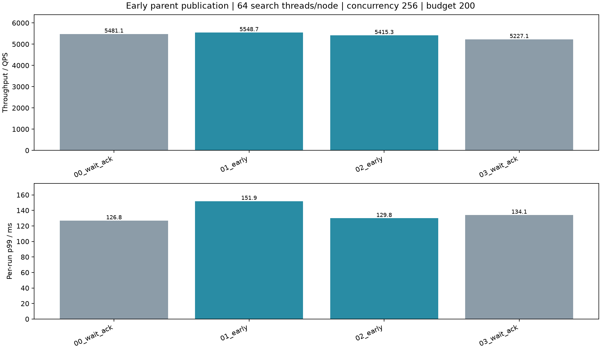
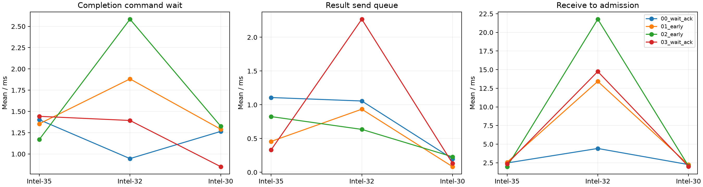

# 父分支本地报告提前发布三机实验

本轮已实现父报告与子任务接纳ACK解耦，模板配置`native_runtime.early_parent_report: true`。子节点独立回传，顶层根据心跳/父报告中的子分支清单等待完整分支树再合并；父报告不会收集或合并子节点结果。

**结论：消除了指定的协议等待，但尚未证明整体性能稳定提升。** 父分支完成命令处理至报告就绪均值从5.57–10.76ms降至约0.0085ms；两轮提前组共1671个父报告实际发送早于子任务ACK。平均QPS增加2.39%，各轮p99均值却增加8.01%。保留用户要求的新报告语义，不把此次结果宣称为p99优化成功。

Intel-35/32/30，每节点64搜索线程、路由16线程、合并4线程、并发256、预算200，每轮10000请求（同样2000查询重复5次），预热32。收发模块启用并固定各一个事件循环，搜索/路由/合并线程数均不变。连接128、结果通道pending上限1024、接收上限4096固定。唯一实验变量为early_parent_report：关闭时等待子分支接纳ACK后发布父报告，开启时本地完成即发布。两组均使用本轮相同的源码和二进制。

|轮次|提前发布|结果pending上限|QPS|p99 ms|平均 ms|Recall@10|
|---|---:|---:|---:|---:|---:|---:|
|00_wait_ack|False|1024|5481.12|126.81|45.95|0.97034|
|01_early|True|1024|5548.69|151.93|45.01|0.97035|
|02_early|True|1024|5415.27|129.83|46.14|0.97033|
|03_wait_ack|False|1024|5227.14|134.06|47.78|0.97012|

## 两轮均值

|父报告发布策略|QPS|各轮p99均值 ms|平均延迟 ms|
|---|---:|---:|---:|
|wait_ack|5354.13|130.43|46.87|
|early|5481.98|140.88|45.57|

## 入口及后续等待

以下为每查询均值，ms；各阶段不全互斥，不能直接相加。RPC响应等待包含远端处理与调度，不等于链路RTT。

|轮次|入口发送排队|入口发送/建连|入口响应等待|数据及控制|合并队列|路由队列|搜索累计|计算就绪累计|
|---|---:|---:|---:|---:|---:|---:|---:|---:|
|00_wait_ack|0.461|0.089|4.878|42.750|1.208|0.095|11.503|1.258|
|01_early|0.305|0.057|7.387|43.134|0.293|0.082|11.851|1.377|
|02_early|0.026|0.026|8.609|43.159|1.280|0.111|12.084|1.546|
|03_wait_ack|0.214|0.052|6.776|45.372|0.743|0.095|11.623|1.147|

## CPU及IO

数据节点CPU为进程快照区间平均核数，包含快照时间。

|轮次|Intel-35|Intel-32|Intel-30|顶层CPU|物理读字节|每query协议字节|每query协议RPC|
|---|---:|---:|---:|---:|---:|---:|---:|
|00_wait_ack|18.12|17.43|9.75|13.10|2945024|32031|3.05|
|01_early|16.28|18.29|9.22|12.34|1318912|31981|3.05|
|02_early|15.73|18.29|9.11|12.66|1597440|31989|3.06|
|03_wait_ack|15.32|17.43|8.97|12.31|1339392|32026|3.05|

全部请求要求零失败、Recall≥95%、协议审计通过且内存暂存无溢出。计时截至原生结果交付Future，JSON归档与统计在之后执行。每轮约数秒、热缓存，两轮均值不是统计显著性结论；各轮p99平均不等于合并样本p99。连接按需建立，上限扩大并不意味着预先创建全部连接。

## 固定网络线程下的控制及接纳等待

以下为正式查询对应的分支/结果事件均值（ms），不是所有分支之和。不同区间可能重叠。

|轮次|节点|结果发送峰值循环|结束循环|进程线程数|完成命令等待|结果发送前队列|接收至接纳|
|---|---:|---:|---:|---:|---:|---:|---:|
|00_wait_ack|0|1|1|79|1.403|1.107|2.475|
|00_wait_ack|1|1|1|79|0.946|1.056|4.419|
|00_wait_ack|2|1|1|79|1.265|0.199|2.258|
|01_early|0|1|1|79|1.355|0.457|2.575|
|01_early|1|1|1|79|1.883|0.934|13.424|
|01_early|2|1|1|79|1.291|0.083|2.234|
|02_early|0|1|1|79|1.171|0.825|1.980|
|02_early|1|1|1|79|2.585|0.635|21.775|
|02_early|2|1|1|79|1.327|0.229|2.067|
|03_wait_ack|0|1|1|79|1.443|0.331|2.363|
|03_wait_ack|1|1|1|79|1.394|2.268|14.751|
|03_wait_ack|2|1|1|79|0.851|0.133|2.008|

## 有子分支的父节点：报告是否真正提前发出

以本机时钟比较报告发送开始与子任务接纳ACK回调；不跨机器相减。只统计children非空的父分支。

|轮次|父分支数|发布等待均值 ms|发布等待p99 ms|报告就绪早于子ACK|报告发送早于子ACK|交付时指标未齐|离线后指标未齐|
|---|---:|---:|---:|---:|---:|---:|---:|
|00_wait_ack|3514|5.5734|102.1245|0|0|0|0|
|01_early|3510|0.0083|0.0242|1641|584|1797|0|
|02_early|3517|0.0087|0.0268|1753|1087|1876|0|
|03_wait_ack|3515|10.7571|83.4462|0|0|0|0|

发布等待定义为local_done_dequeued_ns至report_ready_ns；不包含完成命令排队。指标未齐按查询计数。离线补齐仅更新网络计数，不修改交付时刻或端到端延迟。所有有子分支父报告的最终RPC次数及收发字节均与节点最终快照一致。

## p99样本及剩余等待

四轮均已生成全体查询中最接近本轮p99的真实样本，见[p99目录](p99)。第二轮提前组query 1261403/job 7240恰好为跨节点查询，延迟129.832886ms（本轮p99=129.834071ms），Recall@10=1.0。

父节点Intel-32：接收至接纳51.167621ms、接纳注册0.528124ms、计算就绪0.127964ms、搜索循环墙钟72.313129ms；本地完成命令排队1.236967ms、处理后至报告就绪0.028141ms、调度/编码/提交1.158910ms、结果出站排队0.037783ms。子节点Intel-30搜索墙钟4.574080ms，报告发布0.008617ms。各面板只比较本机时钟，不能相加或直接跨机器对齐。搜索墙钟不等于纯CPU计算。

这一p99样本中子ACK本来就在父节点搜索结束前返回，因此它用于展示剩余长尾，不能单独证明提前发送。直接证据来自上表全部父分支统计，以及[parent_comparison.json](parent_comparison.json)：例如02_early的query 1497268/job 7478父报告发送比派发ACK回调早117.524167ms。01_early/02_early分别有584/1087个这样的父分支，旧路径均为零。

接收至接纳、完成命令调度、同分支在途心跳和网络队列仍可影响结果发送；本轮没有消除这些等待，也没有进一步判定51ms接纳间隔是纯锁等待或纯线程调度。下一步应分别测量接收handler排队、接纳锁及搜索墙钟中的CPU/IO/调度，避免继续将长尾统称为报告生成。

## 正确性、指标与可复现性

- 全回归[regression.log](regression.log)：450项，448通过、2跳过；其后新增[离线指标测试](metrics_tests.log)2项均通过。
- [真实TCP故障测试](proxy_verified.log)：扣住子任务ACK不妨碍已齐报告完成；扣住子任务请求时父报告不能提前完成查询；迟到拒绝导致缺失子报告时显式失败。
- 报告不可变重传；迟到派发失败走独立通知，顶层以合法子报告作为执行依据，缺失到期则失败。旧路径本来也在本地计算结束后释放搜索线程，本轮不是消除了之前由搜索线程承担的ACK阻塞。
- 在线指标未齐的1797/1876条查询均由查询结束后的节点快照补齐网络计数；原始交付结果与时间戳不变。所有父报告最终派发RPC次数和收发字节与快照一致，四轮最终均无指标不完整。
- [源码校验](source_hashes.json)、[三机部署校验](deployed_provenance.json)、[部署路径](deployment.json)和各轮spec/plan均保留；远端原生扩展分别本机编译。隔离端口37751–37753、37810；未替换原220xx服务。
- 每轮10000请求均零失败、协议审计通过、内存暂存无溢出，Recall@10约97%。主要热缓存、约两秒计时窗口、两次重复不足以支持统计显著性或长期吞吐结论；物理读非零也不能据此称为冷SSD测量。
- 原始JSON按SHA256验证后无损压缩，映射见各轮`archive_manifest.json`。最终`queries.jsonl.gz`含离线补齐结果；原始捕获`queries.part-*.json.gz`保留交付时的原貌。需要重新运行归档程序时，先在容量充足位置按映射解压原始文件。

分析复现顺序：`analyze.py`、`control_analysis.py`、`parent_analysis.py`；各轮图用`plot_p99.py --case three/<轮次> --output p99/<轮次>`（从项目根调用时补全实验目录前缀）。本节为实验结论，不由基础统计脚本自动生成。协议及锁设计见[DESIGN.md第29节](../../DESIGN.md)和[LOCKS.md第15节](../../LOCKS.md)。

## 补充：为何p99样本的接收与搜索区间都很长

对同一份原始记录继续核对，诊断脚本为[diagnose_p99.py](diagnose_p99.py)，数值输出为[p99_wait_diagnosis.json](p99_wait_diagnosis.json)。没有更改在线实现或重新运行性能实验。

接收至接纳51.167621ms包括接收handler排队、解码、校验等，不是纯网络传输。该时刻有136个更早收到、尚未达到accepted时间戳的请求。节点只有4个接收handler，本轮队列峰值199。样本自身申请接纳锁至取得仅0.464650ms，而且位于accepted时间戳之后，因此不能直接算进前面的51ms。

但前面请求的锁等待会阻塞handler并传导到后面请求：在该51ms窗口内完整记录的137次接纳临界区，持锁观测时间累计46.532441ms；其中控制状态注册等待state_mu累计42.677310ms，实际持有该控制锁登记累计1.187161ms。源码DataRuntime::accept在持有运行时mu时调用Controller::register_value，后者再申请Engine::state_mu；因此一个handler等待控制状态时仍占有接纳锁，其他handler无法接纳任务。持锁时间戳在锁释放后记录，存在调度误差；这里的累计值不是严格独占的CPU归因。控制器本身在state_mu内执行命令、定时器和dispatch（含编码/提交），需要进一步细分其占锁者，不能把42.68ms全部称为编码时间。

搜索循环墙钟72.316076ms（包含起始边界约0.003ms，与图中的72.313129ms略有差异），线程CPU37.199546ms，差值35.116530ms。这个差值可包含未获CPU调度、阻塞、缺页等，不能单凭差值断言是某一把锁。pread共121次累计2.295090ms，不能解释全部35ms；RaBitQ区间28.093877ms也是墙钟，可能包括抢占，不能与非CPU时间相加。CPU37.20ms本身也明显增加，可能涉及缓存/内存访问停顿、额外内核工作等，尚无perf/缺页/scheduler样本来确定原因。

同一轮同一query的job3240/5240/9240与该样本均扩展121点、估距3647次，搜索墙钟分别9.643772/10.999433/7.816458ms，CPU9.642632/10.985306/7.796055ms。这排除了仅因扩展点数增加就变成72ms的解释。同轮Intel-32全部分支搜索墙钟中位数9.676723ms，72ms是长尾样本，不代表常态。该时间附近100ms进程采样约使用33–36个CPU核，不能以整轮18.29核均值断言当时无竞争；也没有当时全机可运行线程和CPU亲和性记录可证明全机CPU饱和。日志未见该窗口Python GC事件，在线原生线程本来也不依赖GIL。

优先验证接纳注册的两阶段实现：短锁内预留身份和额度，锁外登记控制状态，再短锁提交任务；必须保留重复请求一致性、关闭/取消竞态处理。同步缩短控制器state_mu内编码/提交范围，或以单所有者命令实现注册，不能只把阻塞挪到另一个确认队列。搜索侧需补线程CPU分段、调度等待、缺页和硬件计数，再决定绑核、NUMA或内存访问优化；单纯增加接收线程可能只是增加同一把锁前的等待者。
