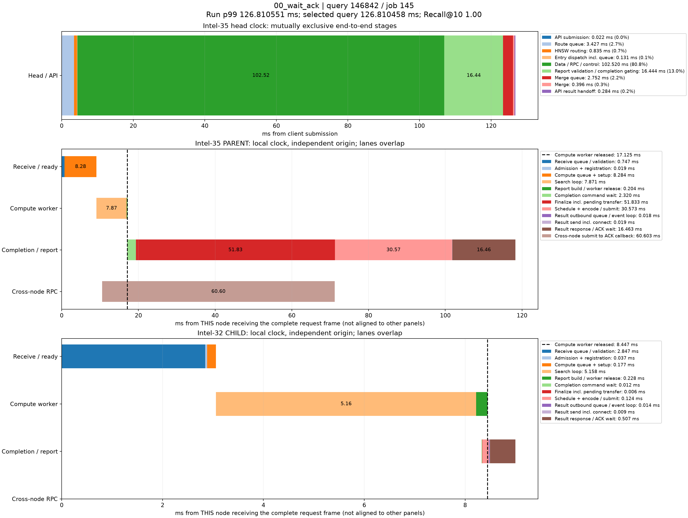

# p99真实查询时序分解

来源：00_wait_ack，10000条查询。选择全体查询中服务延迟最接近本轮p99的记录；不筛选跨节点条件，也不使用多轮p99均值选择样本。

本轮p99为126.810550790ms；query_id=146842、job=145，延迟126.810458000ms，相差0.000092790ms，Recall@10=1.00。

顶层面板使用同一主机时钟，阶段互斥且总和等于端到端服务延迟。每个数据节点单独以收到完整报文为零点，不能跨主机直接对齐时间轴或相加。节点内计算、控制、派发存在重叠；虚线表示计算线程释放时刻，之后的控制/网络等待不占用该计算线程。结果ACK时刻与用户Future完成时刻也不同。

|顶层阶段|耗时ms|占服务延迟|
|---|---:|---:|
|API submission|0.021529|0.02%|
|Route queue|3.427184|2.70%|
|HNSW routing|0.835387|0.66%|
|Entry dispatch incl. queue|0.130715|0.10%|
|Data / RPC / control|102.520097|80.85%|
|Report validation / completion gating|16.443904|12.97%|
|Merge queue|2.751649|2.17%|
|Merge|0.396474|0.31%|
|API result handoff|0.283519|0.22%|

## Intel-35 / PARENT

|阶段|本节点相对起点ms|耗时ms|
|---|---:|---:|
|Receive queue / validation|0.000000|0.747147|
|Admission + registration|0.747147|0.019357|
|Compute queue + setup|0.766504|8.283988|
|Search loop|9.050492|7.870852|
|Report build / worker release|16.921344|0.204047|
|Completion command wait|17.053851|2.319964|
|Finalize incl. pending transfer|19.373815|51.833215|
|Schedule + encode / submit|71.207030|30.572597|
|Result outbound queue / event loop|101.779627|0.018198|
|Result send incl. connect|101.797825|0.019230|
|Result response / ACK wait|101.817055|16.462549|
|Cross-node submit to ACK callback|10.549395|60.603169|

## Intel-32 / CHILD

|阶段|本节点相对起点ms|耗时ms|
|---|---:|---:|
|Receive queue / validation|0.000000|2.846818|
|Admission + registration|2.846818|0.037138|
|Compute queue + setup|2.883956|0.176645|
|Search loop|3.060601|5.157987|
|Report build / worker release|8.218588|0.228110|
|Completion command wait|8.325048|0.011935|
|Finalize incl. pending transfer|8.336983|0.005516|
|Schedule + encode / submit|8.342499|0.124303|
|Result outbound queue / event loop|8.466802|0.014195|
|Result send incl. connect|8.480997|0.008996|
|Result response / ACK wait|8.489993|0.507155|

结果RPC排队起点由 sender_enter_ns - round(pool_wait_ms * 1e6) 还原；pool_wait_ms来自底层同一主机时钟的queued_ns与send_start_ns之差。旧message_ready_ns是在异步提交成功后记录，网络线程可能已开始发送，不能用它直接计算发送前队列。还原数值保存在stages.json/CSV，未改写原始时间戳。

接收队列/验证、完成控制和发送前等待均为观测区间，可能包含OS调度及状态锁等待，不能据图将其全部认定为锁、CPU计算或纯链路传输。单条p99附近查询用于定位现象，不代表所有尾延迟样本。selected.json保留完整源记录，stages.json/CSV保存精确阶段数值。
