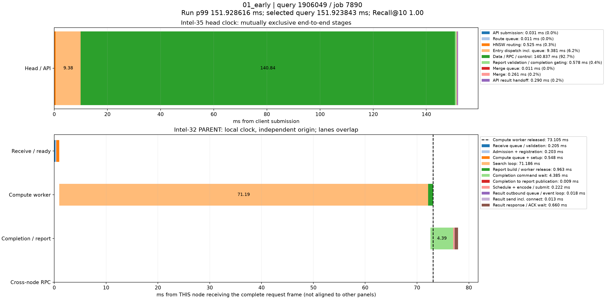

# p99真实查询时序分解

来源：01_early，10000条查询。选择全体查询中服务延迟最接近本轮p99的记录；不筛选跨节点条件，也不使用多轮p99均值选择样本。

本轮p99为151.928616010ms；query_id=1906049、job=7890，延迟151.923843000ms，相差0.004773010ms，Recall@10=1.00。

顶层面板使用同一主机时钟，阶段互斥且总和等于端到端服务延迟。每个数据节点单独以收到完整报文为零点，不能跨主机直接对齐时间轴或相加。节点内计算、控制、派发存在重叠；虚线表示计算线程释放时刻，之后的控制/网络等待不占用该计算线程。结果ACK时刻与用户Future完成时刻也不同。

|顶层阶段|耗时ms|占服务延迟|
|---|---:|---:|
|API submission|0.031233|0.02%|
|Route queue|0.010822|0.01%|
|HNSW routing|0.524817|0.35%|
|Entry dispatch incl. queue|9.380679|6.17%|
|Data / RPC / control|140.836590|92.70%|
|Report validation / completion gating|0.578444|0.38%|
|Merge queue|0.010668|0.01%|
|Merge|0.261036|0.17%|
|API result handoff|0.289554|0.19%|

## Intel-32 / PARENT

|阶段|本节点相对起点ms|耗时ms|
|---|---:|---:|
|Receive queue / validation|0.000000|0.204896|
|Admission + registration|0.204896|0.202528|
|Compute queue + setup|0.407424|0.547974|
|Search loop|0.955398|71.186276|
|Report build / worker release|72.141674|0.963026|
|Completion command wait|72.605823|4.385294|
|Completion to report publication|76.991117|0.009218|
|Schedule + encode / submit|77.000335|0.222079|
|Result outbound queue / event loop|77.222414|0.017912|
|Result send incl. connect|77.240326|0.012939|
|Result response / ACK wait|77.253265|0.660092|

结果RPC排队起点由 sender_enter_ns - round(pool_wait_ms * 1e6) 还原；pool_wait_ms来自底层同一主机时钟的queued_ns与send_start_ns之差。旧message_ready_ns是在异步提交成功后记录，网络线程可能已开始发送，不能用它直接计算发送前队列。还原数值保存在stages.json/CSV，未改写原始时间戳。

接收队列/验证、完成控制和发送前等待均为观测区间，可能包含OS调度及状态锁等待，不能据图将其全部认定为锁、CPU计算或纯链路传输。单条p99附近查询用于定位现象，不代表所有尾延迟样本。selected.json保留完整源记录，stages.json/CSV保存精确阶段数值。
