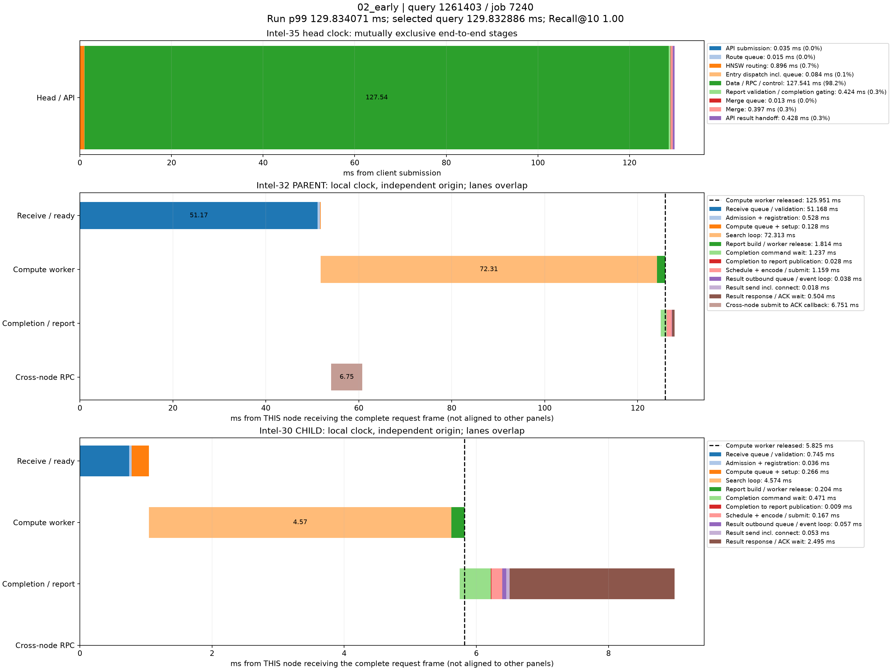

# p99真实查询时序分解

来源：02_early，10000条查询。在跨节点查询中选择最接近本轮全体查询p99的记录；这不是跨节点子集的p99。

本轮p99为129.834071320ms；query_id=1261403、job=7240，延迟129.832886000ms，相差0.001185320ms，Recall@10=1.00。

顶层面板使用同一主机时钟，阶段互斥且总和等于端到端服务延迟。每个数据节点单独以收到完整报文为零点，不能跨主机直接对齐时间轴或相加。节点内计算、控制、派发存在重叠；虚线表示计算线程释放时刻，之后的控制/网络等待不占用该计算线程。结果ACK时刻与用户Future完成时刻也不同。

|顶层阶段|耗时ms|占服务延迟|
|---|---:|---:|
|API submission|0.035199|0.03%|
|Route queue|0.015500|0.01%|
|HNSW routing|0.895755|0.69%|
|Entry dispatch incl. queue|0.083960|0.06%|
|Data / RPC / control|127.540946|98.23%|
|Report validation / completion gating|0.424080|0.33%|
|Merge queue|0.012622|0.01%|
|Merge|0.397017|0.31%|
|API result handoff|0.427807|0.33%|

## Intel-32 / PARENT

|阶段|本节点相对起点ms|耗时ms|
|---|---:|---:|
|Receive queue / validation|0.000000|51.167621|
|Admission + registration|51.167621|0.528124|
|Compute queue + setup|51.695745|0.127964|
|Search loop|51.823709|72.313129|
|Report build / worker release|124.136838|1.813894|
|Completion command wait|124.956671|1.236967|
|Completion to report publication|126.193638|0.028141|
|Schedule + encode / submit|126.221779|1.158910|
|Result outbound queue / event loop|127.380689|0.037783|
|Result send incl. connect|127.418472|0.018384|
|Result response / ACK wait|127.436856|0.503918|
|Cross-node submit to ACK callback|54.030525|6.751184|

## Intel-30 / CHILD

|阶段|本节点相对起点ms|耗时ms|
|---|---:|---:|
|Receive queue / validation|0.000000|0.745343|
|Admission + registration|0.745343|0.036019|
|Compute queue + setup|0.781362|0.265508|
|Search loop|1.046870|4.574080|
|Report build / worker release|5.620950|0.203834|
|Completion command wait|5.746404|0.471446|
|Completion to report publication|6.217850|0.008617|
|Schedule + encode / submit|6.226467|0.167125|
|Result outbound queue / event loop|6.393592|0.057273|
|Result send incl. connect|6.450865|0.053427|
|Result response / ACK wait|6.504292|2.495258|

结果RPC排队起点由 sender_enter_ns - round(pool_wait_ms * 1e6) 还原；pool_wait_ms来自底层同一主机时钟的queued_ns与send_start_ns之差。旧message_ready_ns是在异步提交成功后记录，网络线程可能已开始发送，不能用它直接计算发送前队列。还原数值保存在stages.json/CSV，未改写原始时间戳。

接收队列/验证、完成控制和发送前等待均为观测区间，可能包含OS调度及状态锁等待，不能据图将其全部认定为锁、CPU计算或纯链路传输。单条p99附近查询用于定位现象，不代表所有尾延迟样本。selected.json保留完整源记录，stages.json/CSV保存精确阶段数值。
