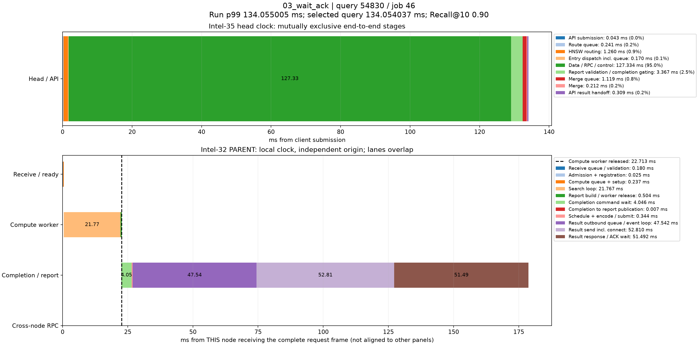

# p99真实查询时序分解

来源：03_wait_ack，10000条查询。选择全体查询中服务延迟最接近本轮p99的记录；不筛选跨节点条件，也不使用多轮p99均值选择样本。

本轮p99为134.055004980ms；query_id=54830、job=46，延迟134.054037000ms，相差0.000967980ms，Recall@10=0.90。

顶层面板使用同一主机时钟，阶段互斥且总和等于端到端服务延迟。每个数据节点单独以收到完整报文为零点，不能跨主机直接对齐时间轴或相加。节点内计算、控制、派发存在重叠；虚线表示计算线程释放时刻，之后的控制/网络等待不占用该计算线程。结果ACK时刻与用户Future完成时刻也不同。

|顶层阶段|耗时ms|占服务延迟|
|---|---:|---:|
|API submission|0.043024|0.03%|
|Route queue|0.240650|0.18%|
|HNSW routing|1.259850|0.94%|
|Entry dispatch incl. queue|0.169870|0.13%|
|Data / RPC / control|127.333712|94.99%|
|Report validation / completion gating|3.367171|2.51%|
|Merge queue|1.118715|0.83%|
|Merge|0.212287|0.16%|
|API result handoff|0.308758|0.23%|

## Intel-32 / PARENT

|阶段|本节点相对起点ms|耗时ms|
|---|---:|---:|
|Receive queue / validation|0.000000|0.179694|
|Admission + registration|0.179694|0.025417|
|Compute queue + setup|0.205111|0.236920|
|Search loop|0.442031|21.766775|
|Report build / worker release|22.208806|0.504106|
|Completion command wait|22.484338|4.046080|
|Completion to report publication|26.530418|0.007115|
|Schedule + encode / submit|26.537533|0.343844|
|Result outbound queue / event loop|26.881377|47.541985|
|Result send incl. connect|74.423362|52.809973|
|Result response / ACK wait|127.233335|51.492377|

结果RPC排队起点由 sender_enter_ns - round(pool_wait_ms * 1e6) 还原；pool_wait_ms来自底层同一主机时钟的queued_ns与send_start_ns之差。旧message_ready_ns是在异步提交成功后记录，网络线程可能已开始发送，不能用它直接计算发送前队列。还原数值保存在stages.json/CSV，未改写原始时间戳。

接收队列/验证、完成控制和发送前等待均为观测区间，可能包含OS调度及状态锁等待，不能据图将其全部认定为锁、CPU计算或纯链路传输。单条p99附近查询用于定位现象，不代表所有尾延迟样本。selected.json保留完整源记录，stages.json/CSV保存精确阶段数值。
