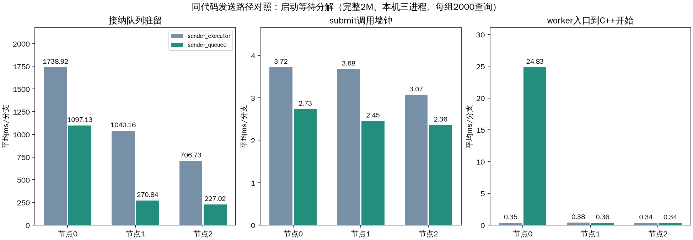
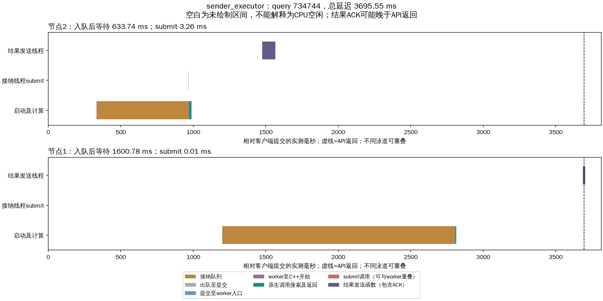
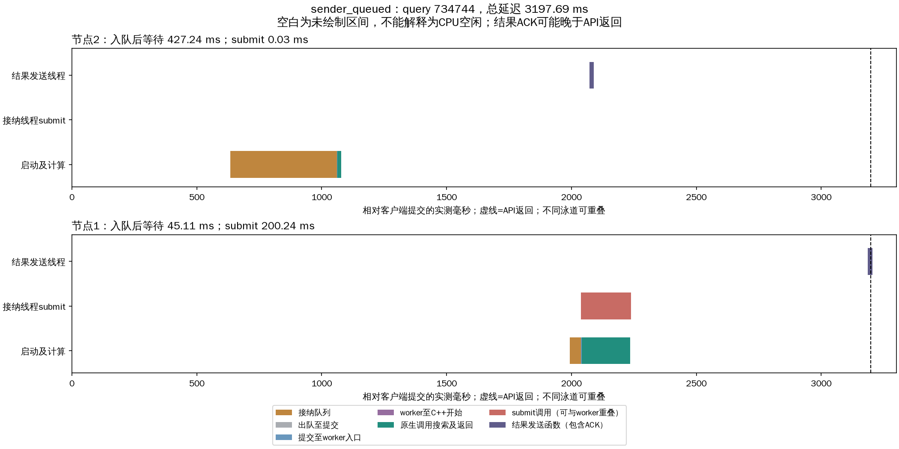

# 启动时间戳诊断与通信发送解耦实验

先运行仅增加六阶段时间戳的现有实现，再用同一最终代码对比executor发送线程池与queued预启动发送队列。生产计算线程池未替换；没有改变扩展函数、搜索预算或每分支固定计算线程语义。

## 实验条件与总体结果

完整seq_2M（2M×2560），raw L2、1-bit RaBitQ、top10排除自身，预算200/frontier64/localbeam4；Intel-35本机三个TCP数据进程共享CPU/SSD。每节点计算线程上限256，派发16、控制16、接纳上限2048；queued远端等待队列2048，control排队+在途上限64。20客户端进程×100线程，每组2000条相同冻结验证查询，40次预热不计入结果；排除128条历史校准查询。每组为一次突发并排空，不代表稳态容量；只有一个顺序对照，不能声明统计显著性或最优参数。

同步buffered pread、应用缓存0、详细trace开启；物理读取增量0，属热页缓存。复用既有全库真值缓存，没有重复扫描全库。

| 组 | 成功/失败 | Recall@10 | QPS | 平均ms | p99 ms |
|---|---|---|---|---|---|
| baseline_1 | 2000/0 | 97.050% | 450.64 | 2833.12 | 4395.17 |
| baseline_2 | 2000/0 | 97.015% | 450.16 | 2927.02 | 4386.85 |
| sender_executor | 2000/0 | 97.045% | 457.23 | 2865.15 | 4319.70 |
| sender_queued | 2000/0 | 96.990% | 491.70 | 2779.10 | 4026.80 |

baseline_1是上一条被中断工作已启动并完成的测试，baseline_2为本轮诊断复测；两次均保留并重新审计。sender_executor与sender_queued才是同代码、同插桩的发送模式对照。

## 启动等待实际发生在哪里

以下均为测量查询的分支平均值；不含预热。队列驻留使用真实enqueue/dequeue，submit墙钟与submit到worker可重叠，不能相加。

| 组 | 节点 | 分支数 | 队列ms | 出队至submit ms | submit墙钟ms | submit CPU ms | submit→worker ms | worker→C++ ms | 队列等待被前序submit覆盖 |
|---|---|---|---|---|---|---|---|---|---|
| baseline_1 | 0 | 1036 | 1733.895 | 0.010 | 3.761 | 0.080 | 5.530 | 0.352 | 99.57% |
| baseline_1 | 1 | 981 | 893.611 | 0.011 | 3.136 | 0.271 | 4.980 | 0.389 | 99.50% |
| baseline_1 | 2 | 680 | 599.377 | 0.011 | 2.921 | 0.084 | 3.928 | 0.361 | 99.46% |
| baseline_2 | 0 | 1037 | 1656.929 | 0.009 | 3.672 | 0.074 | 5.976 | 0.331 | 99.57% |
| baseline_2 | 1 | 979 | 998.718 | 0.010 | 3.339 | 0.081 | 5.031 | 0.393 | 99.55% |
| baseline_2 | 2 | 681 | 686.947 | 0.010 | 2.995 | 0.082 | 4.044 | 0.353 | 99.49% |
| sender_executor | 0 | 1038 | 1738.918 | 0.010 | 3.720 | 0.085 | 5.483 | 0.347 | 99.54% |
| sender_executor | 1 | 979 | 1040.163 | 0.011 | 3.678 | 0.103 | 4.903 | 0.384 | 99.54% |
| sender_executor | 2 | 681 | 706.733 | 0.011 | 3.069 | 0.091 | 4.042 | 0.343 | 99.48% |
| sender_queued | 0 | 1036 | 1097.126 | 0.009 | 2.733 | 0.062 | 25.910 | 24.830 | 98.93% |
| sender_queued | 1 | 981 | 270.838 | 0.010 | 2.453 | 0.077 | 6.173 | 0.357 | 99.33% |
| sender_queued | 2 | 681 | 227.024 | 0.011 | 2.357 | 0.080 | 4.862 | 0.341 | 99.30% |

每个接纳线程逐个submit，一次submit迟迟未返回会阻止后续出队。将每个任务的enqueue→dequeue区间与同节点前序submit区间求交，可量化这种阻挡。交集是多个查询的等待累计，不是CPU利用率；未被覆盖的部分包括接纳线程调度、队列状态锁及其他处理。

## submit内部与按需建线程

通过覆盖_adjust_thread_count并调用标准库原实现记录边界；未重写submit。进入adjust前已完成线程池提交锁获取、Future/工作项创建及入队，所以这一差值不能全部命名为“锁等待”。adjust中可能检查空闲线程或新建线程，按工作线程数是否增加分组。

| 组 | 节点 | 创建线程? | 次数 | submit均值ms | 进入adjust前ms | adjust区间ms |
|---|---|---|---|---|---|---|
| sender_executor | 0 | True | 225 | 5.617 | 0.812 | 4.798 |
| sender_executor | 0 | False | 813 | 3.196 | 3.187 | 0.005 |
| sender_executor | 1 | True | 220 | 5.223 | 0.805 | 4.411 |
| sender_executor | 1 | False | 759 | 3.230 | 3.220 | 0.006 |
| sender_executor | 2 | True | 149 | 4.513 | 0.763 | 3.744 |
| sender_executor | 2 | False | 532 | 2.665 | 2.656 | 0.005 |
| sender_queued | 0 | True | 250 | 11.274 | 0.013 | 11.255 |
| sender_queued | 0 | False | 786 | 0.016 | 0.012 | 0.004 |
| sender_queued | 1 | True | 252 | 9.482 | 0.016 | 9.459 |
| sender_queued | 1 | False | 729 | 0.024 | 0.017 | 0.005 |
| sender_queued | 2 | True | 195 | 8.169 | 0.019 | 8.143 |
| sender_queued | 2 | False | 486 | 0.026 | 0.017 | 0.007 |

submit线程CPU明显小于墙钟只能说明存在非CPU执行时间，尚不能把差额严格分配给GIL、标准库锁、线程启动握手或OS调度。最终因果判断需要这些机制的独立消融；当前证据已足以把主要启动瓶颈定位到串行提交路径。

## 计算线程与TCP收发隔离

接收线程处理来自入口/数据节点的请求和ACK；transfer发送线程处理扩展函数批准的搜索请求；control发送线程处理心跳、完成结果及错误回报。queued模式启动服务前创建发送线程，计算线程只进行短临界区入队，不调用发送线程池submit、不执行TCP、不等待ACK。结果与远端派发分别排队，不用一个阻塞发送线程串行处理所有连接。

新模式仍有阶段退化：节点0的worker入口到C++开始从约0.35ms增加到24.83ms。下面将进入查询状态临界区前的等待单独列出，包含获取运行机会和获得状态锁，不是已经测得的纯锁等待。

| 模式 | 节点 | worker进入状态临界区平均ms | p99 ms |
|---|---|---|---|
| sender_executor | 0 | 0.009 | 0.018 |
| sender_executor | 1 | 0.009 | 0.019 |
| sender_executor | 2 | 0.009 | 0.019 |
| sender_queued | 0 | 24.488 | 235.487 |
| sender_queued | 1 | 0.008 | 0.018 |
| sender_queued | 2 | 0.009 | 0.019 |

因此不能宣称所有等待都消失；后续计算工作线程预启动及队列/状态锁隔离需要独立实验。

| 模式 | 远端任务数 | 入队调用平均ms | p99 ms | 最大ms |
|---|---|---|---|---|
| sender_executor | 698 | 10.884 | 34.921 | 269.373 |
| sender_queued | 698 | 0.024 | 0.050 | 0.466 |

入队仍需要Python执行和短队列锁，并不承诺零等待。网络回复仍由接收连接线程发送，属于通信线程而非计算线程；入口首次派发在路由调用者执行，也不属于数据节点计算线程。legacy模式保留历史对照语义。

## 固定查询的绝对时间线

初始基线从684条多节点查询按固定种子20261018随机抽取query 734744（row=73656），两种发送模式展示同一数据query的新执行。

所有绝对时间只在本机共同单调时钟域对齐；submit返回可能晚于worker开始。结果发送泳道包含等待入口ACK，API返回可早于发送方收到ACK。没有将不同泳道相加为总延迟。入口接收与调用线程唤醒的逐事件链仍未全部插桩，空白不等于CPU空闲。

## 验证与复现

103项回归通过，覆盖真实TCP接纳确认、提交返回晚于worker执行、C++时间戳包围批次、预启动发送不再建线程、队列满明确失败、取消/关闭、错误后继续服务、resumable发送失败撤销pending计数，以及禁止ThreadPoolExecutor.submit时计算线程仍可提交远端请求和回报结果。8000查询全部成功，预算与唯一批准派发、无节点回访、固定计算线程和源代码哈希审计通过；最终两组另外核验TCP发送线程身份。所有服务与客户端均已停止；结束队列与待确认任务为0，无容量拒绝或控制发送错误。

- [汇总JSON](comparison.json)、[审计](verification.json)、[回归](regression_final.log)、[固定查询选择](selection.json)。
- `*_branches.csv`保存每分支启动拆分；每个运行目录的nodes_after.json保存完整事件，可按query_request_id和branch_id关联。
- [初始基线源代码哈希](sources.json)对应source_snapshot；[发送对照哈希](sources_senders.json)对应sender_source_snapshot中的冻结版本。当前工作区另有后续计算执行器改动，本报告不将其算入发送对照。冻结文件逐字节匹配实验前哈希，详见[snapshot来源](snapshot_provenance.json)。
- 各组run_load.py执行新实验；analyze.py验证已有记录并重画图。所有实验参数在各组experiment.yaml/load_plan.yaml，抽样参数在analysis.yaml。
- baseline_1：[配置](buffered/experiment.yaml)、[汇总](buffered/runs/20261018T134609/summary.json)、[节点事件](buffered/runs/20261018T134609/nodes_after.json)、[逐查询阶段均值](buffered/runs/20261018T134609/query_stage_means.csv)。
- baseline_2：[配置](buffered/experiment.yaml)、[汇总](buffered/runs/20261018T134716/summary.json)、[节点事件](buffered/runs/20261018T134716/nodes_after.json)、[逐查询阶段均值](buffered/runs/20261018T134716/query_stage_means.csv)。
- sender_executor：[配置](sender_executor/experiment.yaml)、[汇总](sender_executor/runs/20261018T135428/summary.json)、[节点事件](sender_executor/runs/20261018T135428/nodes_after.json)、[逐查询阶段均值](sender_executor/runs/20261018T135428/query_stage_means.csv)。
- sender_queued：[配置](sender_queued/experiment.yaml)、[汇总](sender_queued/runs/20261018T135602/summary.json)、[节点事件](sender_queued/runs/20261018T135602/nodes_after.json)、[逐查询阶段均值](sender_queued/runs/20261018T135602/query_stage_means.csv)。
