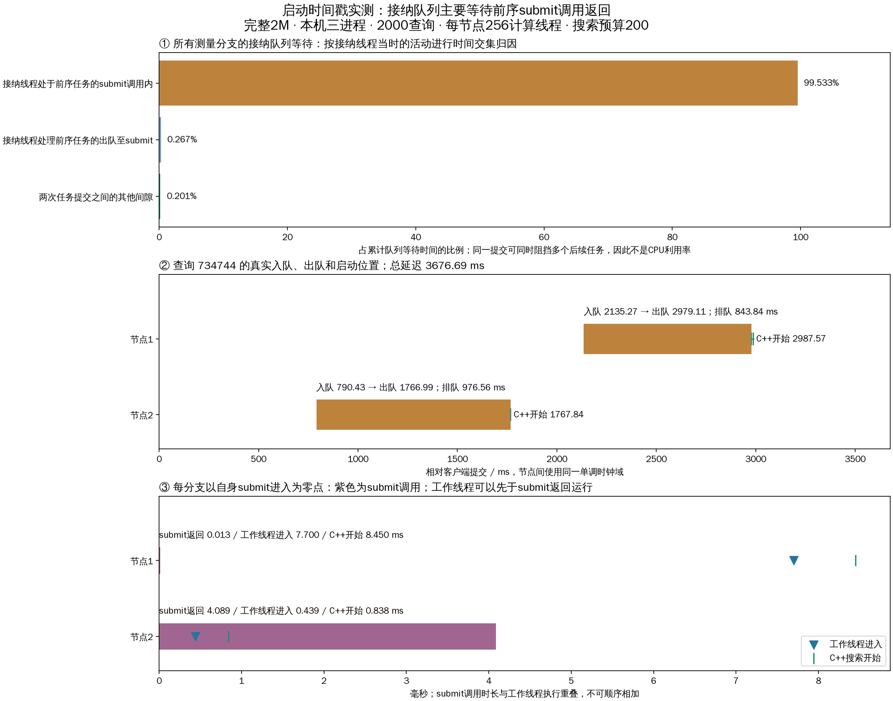

# 任务从入队到C++开始：时间戳定位实验

2000查询全部成功，共2697个测量分支，六个关键事件及辅助事件全部可关联。累计接纳队列等待的 **99.533%** 与前序任务的submit调用区间重叠。该结果定位到单个接纳线程的串行提交通道；尚不能把submit内部等待细分为线程池锁、GIL、线程创建或OS调度。

## 条件与范围

与dispatch_timeline上一轮相同：完整seq_2M索引，raw L2、1-bit RaBitQ、top10排除自身；本机三个TCP数据进程，20客户端进程×100线程、2000个不同验证查询、40次预热不计入。每节点计算线程上限256、派发16、控制16、接纳容量2048；预算200/frontier64/local_beam4。只增加观测，不改变队列或调度机制。
同步buffered pread、应用缓存0、详细trace开启。本轮物理读取增量为0，属于热页缓存突发负载，不是物理三机或稳态吞吐。复用已有全库真值缓存。

## 总体结果

| 指标 | 值 |
|---|---|
| 成功 / 失败 | 2000 / 0 |
| Recall@10 | 97.050% |
| QPS | 450.64 |
| 平均延迟ms | 2833.122 |
| p99 ms | 4395.167 |
| 实际并发峰值 | 1999 |

## 从时间戳计算的阶段分布

以下以2697个测量分支为样本，不是每query跨分支累计均值。submit调用与工作线程执行可重叠，嵌套指标也不可相加。

| 阶段 | 平均ms | p50 ms | p99 ms | 最大ms |
|---|---|---|---|---|
| 接纳队列驻留 | 1142.204005 | 992.258034 | 2709.979797 | 2727.033431 |
| 出队至进入submit | 0.010593 | 0.009280 | 0.027432 | 0.763210 |
| 其中提交前状态锁等待 | 0.000942 | 0.000852 | 0.002338 | 0.034181 |
| submit调用墙钟 | 3.321609 | 2.442397 | 15.677284 | 345.302261 |
| submit线程CPU时间 | 0.150346 | 0.051037 | 0.364786 | 185.105267 |
| 进入submit至工作线程进入 | 4.925778 | 3.761221 | 22.115045 | 346.050508 |
| 工作线程进入至状态锁获得 | 0.009553 | 0.008989 | 0.022661 | 0.251179 |
| 工作线程进入至调用原生函数 | 0.236760 | 0.194656 | 0.729365 | 4.726706 |
| 原生调用至C++函数入口 | 0.009292 | 0.008459 | 0.019184 | 0.438919 |
| C++入口至释放GIL后搜索开始 | 0.121939 | 0.076561 | 0.697468 | 1.711591 |
| 工作线程进入至C++搜索开始 | 0.367991 | 0.314594 | 1.071853 | 6.877216 |
| 接纳入队至C++搜索开始 | 1147.508366 | 995.174335 | 2716.440498 | 2729.593612 |

## 排队时间归因

对每个任务的[enqueued,dequeued]区间，与同节点所有前序任务的[submit_enter,submit_return]区间求交，再累计交集。也统计前序任务出队至submit进入的区间，剩余为两次任务之间的间隙。使用包含预热的完整保留记录，避免漏掉前序任务；统计对象仅限2000条测量查询。每节点仅一个接纳线程，已校验提交区间互不重叠。

| 接纳线程活动 | 累计交集ms | 占队列等待 |
|---|---|---|
| 接纳线程处于前序任务的submit调用内 | 3066125.585 | 99.5326% |
| 接纳线程处理前序任务的出队至submit | 8214.564 | 0.2667% |
| 两次任务提交之间的其他间隙 | 6184.052 | 0.2007% |

submit调用平均墙钟3.322ms，提交线程CPU平均0.150ms。CPU/墙钟总量比例为4.53%；CPU计时边界略包围墙钟边界，不能对微小调用逐条强求CPU≤wall。大部分调用时间不是提交线程在执行CPU指令，但无法据此区分GIL、锁或线程启动等待。
有405/2697个分支在submit返回前进入工作线程，因此submit返回不能作为搜索开始的前置时刻。
从出队到submit进入约0.01ms、显式提交前状态锁等待很短；这排除了该节点状态锁在这个已测位置作为主要来源。不能据此排除submit内部全局锁或其他位置的锁。
结论是单个接纳线程长时间停留在前序submit调用中，形成串行吞吐瓶颈。扩大接纳队列或仅增加计算线程不能绕过此步骤；下一步可比较预启动固定工作线程直接消费专用队列的实现，但本轮未实施。

## 沿用同一个查询定位

使用上一轮查询ID734744，不按本轮耗时筛选；总延迟3676.691ms，Recall@10=100%。详细绝对纳秒与客户端相对时刻可由selected_timestamps.json复算。

| 事件 | 节点2，相对客户端ms | 节点1，相对客户端ms |
|---|---|---|
| 接纳入队 | 790.428021 | 2135.265771 |
| 接纳出队 | 1766.987508 | 2979.110512 |
| 进入submit | 1767.000080 | 2979.119552 |
| submit返回 | 1771.089045 | 2979.132207 |
| 工作线程进入 | 1767.439512 | 2986.819723 |
| C++释放GIL后搜索开始 | 1767.838396 | 2987.569503 |

| 指标 | 节点2 | 节点1 |
|---|---|---|
| 入队后队列深度（含自身） | 357 | 303 |
| 队列驻留ms | 976.559487 | 843.844741 |
| 其中前序submit调用覆盖ms | 970.796764 | 838.998375 |
| 自身submit调用ms | 4.088965 | 0.012655 |
| 自身submit进入至工作线程ms | 0.439432 | 7.700171 |
| 工作线程至C++搜索ms | 0.398884 | 0.749780 |

## 记录方式与审计

- 由metrics.detailed_trace开关控制；Python使用monotonic_ns，C++使用CLOCK_MONOTONIC，记录clock_domain，跨物理主机不可直接相减。
- 原始六事件及辅助事件位于节点peer_lifecycle.execution_timestamps；使用(query_request_id,branch_id,node_id)关联。submit返回可能晚于结果发布，因此保存在节点诊断记录中，避免修改已经发送的报告。
- native_timestamps随分支报告保存C++入口、释放GIL后开始及Python调用/返回。阻塞Python模式只有提交侧事件；resumable不声明具备同一组完整事件。
- 节点诊断数据随现有分支保留策略过期，不是永久追踪存储；长运行应定期导出。本轮完整覆盖全部测量分支。
- 97项回归通过，含submit返回晚于任务完成、报告不可变、C++事件顺序和关闭详细trace。
- 校验2000请求唯一身份、冻结查询列表、存储真值召回、全局预算、唯一批准派发、无节点回访、固定计算线程、全部时间戳与批次边界。服务及客户端均停止；无队列拒绝或控制错误。
- 保留实验准备时源码哈希；分析时检测到工作区后续改动：python/dhdgs/resumable.py, python/dhdgs/peer.py, python/dhdgs/config.py。这些文件当前mtime晚于本次完整报告，其余文件哈希一致；没有用当前工作区哈希替换运行前清单。97项测试对应本次插桩完成时的版本，不证明外部后续改动已通过验证。
- 新增观测会带来时钟调用和少量报告字节；单轮前后性能差异不能归因为插桩开销，也不能视为优化收益。

## 文件

- [配置](../../buffered/experiment.yaml)、[原始事件CSV](execution_timestamps.csv)、[每分支时长CSV](branch_timings.csv)、[分布与归因JSON](timing_summary.json)。
- [选中查询](selected_query.json)、[选中查询事件](selected_timestamps.json)、[审计](verification.json)、[回归日志](../../regression.log)。
- [运行汇总](../../buffered/runs/20261018T134609/summary.json)、[逐查询阶段均值](../../buffered/runs/20261018T134609/query_stage_means.csv)、[完整运行报告](../../buffered/runs/20261018T134609/report.json.gz)。
- analyze.py只读本轮数据，重新执行审计与绘图；buffered/run_load.py实际启动测试。
