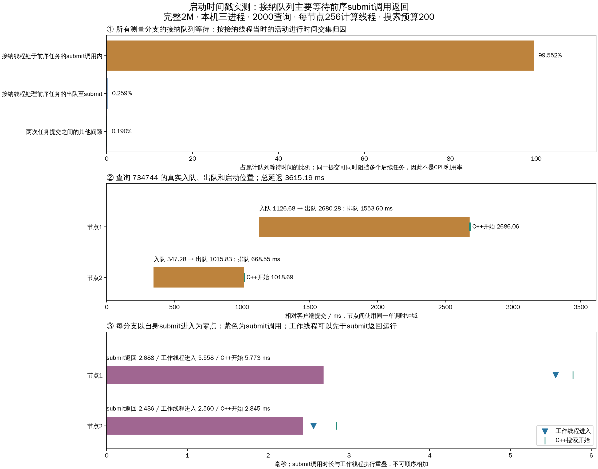

# 任务从入队到C++开始：时间戳定位实验

2000查询全部成功，共2697个测量分支，六个关键事件及辅助事件全部可关联。累计接纳队列等待的 **99.552%** 与前序任务的submit调用区间重叠。该结果定位到单个接纳线程的串行提交通道；尚不能把submit内部等待细分为线程池锁、GIL、线程创建或OS调度。

## 条件与范围

与dispatch_timeline上一轮相同：完整seq_2M索引，raw L2、1-bit RaBitQ、top10排除自身；本机三个TCP数据进程，20客户端进程×100线程、2000个不同验证查询、40次预热不计入。每节点计算线程上限256、派发16、控制16、接纳容量2048；预算200/frontier64/local_beam4。只增加观测，不改变队列或调度机制。
同步buffered pread、应用缓存0、详细trace开启。本轮物理读取增量为0，属于热页缓存突发负载，不是物理三机或稳态吞吐。复用已有全库真值缓存。

## 总体结果

| 指标 | 值 |
|---|---|
| 成功 / 失败 | 2000 / 0 |
| Recall@10 | 97.015% |
| QPS | 450.16 |
| 平均延迟ms | 2927.015 |
| p99 ms | 4386.850 |
| 实际并发峰值 | 2000 |

## 从时间戳计算的阶段分布

以下以2697个测量分支为样本，不是每query跨分支累计均值。submit调用与工作线程执行可重叠，嵌套指标也不可相加。

| 阶段 | 平均ms | p50 ms | p99 ms | 最大ms |
|---|---|---|---|---|
| 接纳队列驻留 | 1173.078223 | 1060.683011 | 2608.055978 | 2618.673917 |
| 出队至进入submit | 0.009522 | 0.008764 | 0.022928 | 0.102969 |
| 其中提交前状态锁等待 | 0.000826 | 0.000779 | 0.002030 | 0.010726 |
| submit调用墙钟 | 3.380175 | 2.268063 | 16.189888 | 361.392963 |
| submit线程CPU时间 | 0.078813 | 0.049123 | 0.404751 | 2.009176 |
| 进入submit至工作线程进入 | 5.145261 | 3.902242 | 20.663697 | 362.403779 |
| 工作线程进入至状态锁获得 | 0.009271 | 0.008539 | 0.020416 | 0.289202 |
| 工作线程进入至调用原生函数 | 0.234190 | 0.191069 | 0.711546 | 15.537792 |
| 原生调用至C++函数入口 | 0.008875 | 0.007488 | 0.019299 | 0.361031 |
| C++入口至释放GIL后搜索开始 | 0.116051 | 0.075224 | 0.635447 | 1.212524 |
| 工作线程进入至C++搜索开始 | 0.359116 | 0.299083 | 1.089632 | 15.636009 |
| 接纳入队至C++搜索开始 | 1178.592121 | 1064.591306 | 2613.293996 | 2621.969941 |

## 排队时间归因

对每个任务的[enqueued,dequeued]区间，与同节点所有前序任务的[submit_enter,submit_return]区间求交，再累计交集。也统计前序任务出队至submit进入的区间，剩余为两次任务之间的间隙。使用包含预热的完整保留记录，避免漏掉前序任务；统计对象仅限2000条测量查询。每节点仅一个接纳线程，已校验提交区间互不重叠。

| 接纳线程活动 | 累计交集ms | 占队列等待 |
|---|---|---|
| 接纳线程处于前序任务的submit调用内 | 3149608.880 | 99.5517% |
| 接纳线程处理前序任务的出队至submit | 8185.573 | 0.2587% |
| 两次任务提交之间的其他间隙 | 5997.513 | 0.1896% |

submit调用平均墙钟3.380ms，提交线程CPU平均0.079ms。CPU/墙钟总量比例为2.33%；CPU计时边界略包围墙钟边界，不能对微小调用逐条强求CPU≤wall。大部分调用时间不是提交线程在执行CPU指令，但无法据此区分GIL、锁或线程启动等待。
有393/2697个分支在submit返回前进入工作线程，因此submit返回不能作为搜索开始的前置时刻。
从出队到submit进入约0.01ms、显式提交前状态锁等待很短；这排除了该节点状态锁在这个已测位置作为主要来源。不能据此排除submit内部全局锁或其他位置的锁。
结论是单个接纳线程长时间停留在前序submit调用中，形成串行吞吐瓶颈。扩大接纳队列或仅增加计算线程不能绕过此步骤；下一步可比较预启动固定工作线程直接消费专用队列的实现，但本轮未实施。

## 沿用同一个查询定位

使用上一轮查询ID734744，不按本轮耗时筛选；总延迟3615.188ms，Recall@10=100%。详细绝对纳秒与客户端相对时刻可由selected_timestamps.json复算。

| 事件 | 节点2，相对客户端ms | 节点1，相对客户端ms |
|---|---|---|
| 接纳入队 | 347.280744 | 1126.683706 |
| 接纳出队 | 1015.827780 | 2680.280527 |
| 进入submit | 1015.841405 | 2680.288331 |
| submit返回 | 1018.277409 | 2682.976219 |
| 工作线程进入 | 1018.401766 | 2685.846578 |
| C++释放GIL后搜索开始 | 1018.686545 | 2686.061599 |

| 指标 | 节点2 | 节点1 |
|---|---|---|
| 入队后队列深度（含自身） | 169 | 393 |
| 队列驻留ms | 668.547036 | 1553.596821 |
| 其中前序submit调用覆盖ms | 665.365016 | 1547.645688 |
| 自身submit调用ms | 2.436004 | 2.687888 |
| 自身submit进入至工作线程ms | 2.560361 | 5.558247 |
| 工作线程至C++搜索ms | 0.284779 | 0.215021 |

## 记录方式与审计

- 由metrics.detailed_trace开关控制；Python使用monotonic_ns，C++使用CLOCK_MONOTONIC，记录clock_domain，跨物理主机不可直接相减。
- 原始六事件及辅助事件位于节点peer_lifecycle.execution_timestamps；使用(query_request_id,branch_id,node_id)关联。submit返回可能晚于结果发布，因此保存在节点诊断记录中，避免修改已经发送的报告。
- native_timestamps随分支报告保存C++入口、释放GIL后开始及Python调用/返回。阻塞Python模式只有提交侧事件；resumable不声明具备同一组完整事件。
- 节点诊断数据随现有分支保留策略过期，不是永久追踪存储；长运行应定期导出。本轮完整覆盖全部测量分支。
- 97项回归通过，含submit返回晚于任务完成、报告不可变、C++事件顺序和关闭详细trace。
- 校验2000请求唯一身份、冻结查询列表、存储真值召回、全局预算、唯一批准派发、无节点回访、固定计算线程、全部时间戳与批次边界。服务及客户端均停止；无队列拒绝或控制错误。
- 保留实验准备时源码哈希；分析时检测到工作区后续改动：python/dhdgs/resumable.py, python/dhdgs/peer.py, python/dhdgs/config.py。这些文件当前mtime晚于本次完整报告，其余文件哈希一致；没有用当前工作区哈希替换运行前清单。97项测试对应本次插桩完成时的版本，不证明外部后续改动已通过验证。
- 新增观测会带来时钟调用和少量报告字节；单轮前后性能差异不能归因为插桩开销，也不能视为优化收益。

## 文件

- [配置](../../buffered/experiment.yaml)、[原始事件CSV](execution_timestamps.csv)、[每分支时长CSV](branch_timings.csv)、[分布与归因JSON](timing_summary.json)。
- [选中查询](selected_query.json)、[选中查询事件](selected_timestamps.json)、[审计](verification.json)、[回归日志](../../regression.log)。
- [运行汇总](../../buffered/runs/20261018T134716/summary.json)、[逐查询阶段均值](../../buffered/runs/20261018T134716/query_stage_means.csv)、[完整运行报告](../../buffered/runs/20261018T134716/report.json.gz)。
- analyze.py只读本轮数据，重新执行审计与绘图；buffered/run_load.py实际启动测试。
