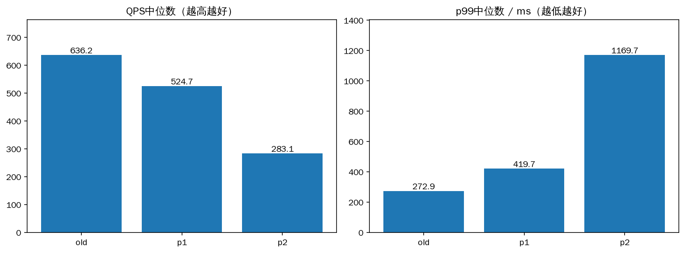
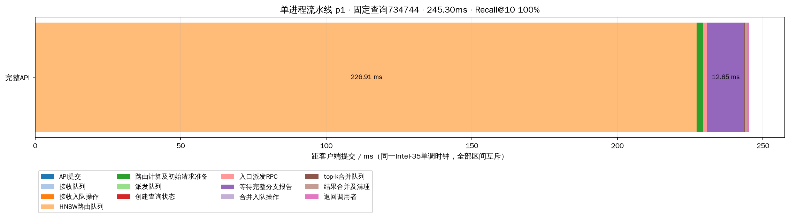
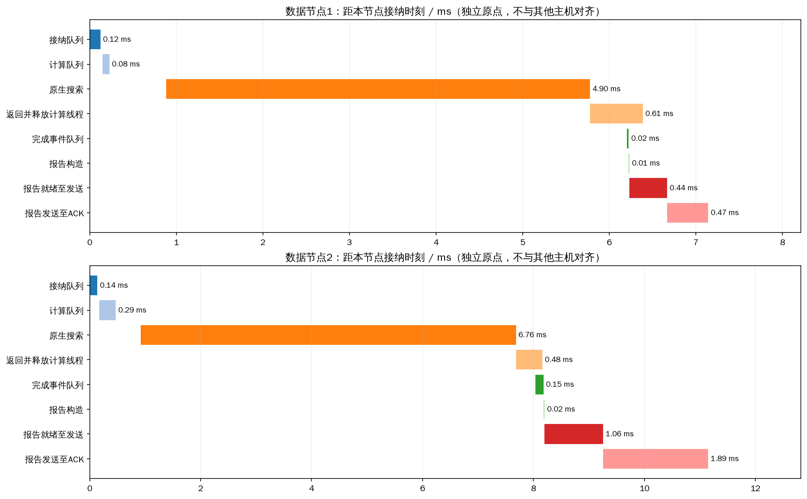

# 单进程顶层流水线：三机同负载对照

> 预备实验：复用回调端口引入少量原生控制旧连接重试，应用层指标完整审计不能证明发送从未重试。最终排除此干扰的结论见 [最终报告](../head_pipeline_final_20261020/REPORT.md)。

完整seq_2M索引，Intel-35为顶层及data-0，Intel-32为data-1，Intel-30为data-2；每数据节点32计算线程，并发128、搜索预算200、top-k10。每轮相同2000查询、32预热，组间交错、各重复3次。没有重建索引或更改数据节点程序/搜索参数。

old是已部署的单HNSW主进程加1个报告接收进程、2个共享路由/合并工作线程；p1/p2/p4是单进程流水线，分别1/2/4个路由线程。最终复验的q1和i1均为1个路由线程，分别采用排队ACK和立即尝试非阻塞ACK。单进程方案均有独立1个合并线程、4个派发线程、1至4个动态接收线程、1个非阻塞回调线程及1个主动心跳线程。当前HTTP服务另有单管理线程和单响应线程；本矩阵由内部异步调用压测，不经过HTTP解析/响应线程。

流水线压测以完成通知维持128个在途槽位，替代旧版128个同步调用线程。排队状态仍占槽位，所有队列等待及结果消费等待计入API。这是完整架构对照，不是单独IPC开销的消融。

## 重复结果

|模式|轮数|查询数|QPS中位数|p99中位数ms|平均延迟中位数ms|平均Recall@10|API>100ms|
|---|---:|---:|---:|---:|---:|---:|---:|
|old|3|6000|636.21|272.93|190.77|97.037%|5943|
|p1|3|6000|524.71|419.67|235.36|97.015%|5947|
|p2|3|6000|283.10|1169.72|434.98|97.035%|5799|

按p99选出的单进程配置为 **p1**。相对本窗口旧版，p99变化 **+53.8%**，QPS变化 **-17.5%**。所有正式查询成功，预算、节点不重复访问和指标完整审计均通过。等待低于100ms尚未达成。

## 固定查询734744

选取推荐线程数组的首次正式结果，沿用之前的固定query，不按快慢挑选。表内时间互斥、完整覆盖API；不同主机单调时钟不相减。

|阶段|ms|
|---|---:|
|API提交|0.020|
|接收队列|0.334|
|接收入队操作|0.004|
|HNSW路由队列|226.908|
|路由计算及初始请求准备|2.054|
|派发队列|0.099|
|创建查询状态|0.033|
|入口派发RPC|1.359|
|等待完整分支报告|12.846|
|合并入队操作|0.007|
|top-k合并队列|0.024|
|结果合并及清理|0.720|
|返回调用者|0.892|

API 245.300ms，Recall@10 100%。分支原始时间点在selected_node_events.json，独立数据节点时间区间在selected_node_timeline.csv；不能把跨分支区间相加当作端到端时间。

## 推荐单进程配置的全部查询指标

|指标|均值|p99|
|---|---:|---:|
|head_receive_queue_ms|0.727|7.773|
|head_route_queue_ms|173.919|281.763|
|head_dispatch_queue_ms|8.918|120.105|
|head_merge_queue_ms|0.272|1.692|
|query_ready_queue_ms|0.756|6.147|
|server_thread_cpu_ms|11.681|20.987|
|coordinator_thread_cpu_ms|1.095|2.055|
|pread_ms|0.675|1.093|
|exact_distance_ms|2.438|4.662|
|rabitq_ms|3.776|7.160|
|expanded|200.000|200.000|
|max_expanded_depth|10.861|21.000|
|max_cross_shard_depth|0.348|1.000|
|peer_branch_rpc_count|0.350|1.000|
|control_rpc_count|1.695|3.000|
|all_protocol_rpc_count|3.045|5.000|
|all_protocol_bytes|31713.971|58263.240|
|file_read_bytes|2457600.000|2457600.000|

查询状态表在派发线程创建，先注册再发送。终态必须同时满足入口派发成功和完整分支树验证；任一分支报告不会提前完成全局查询。合并与路由使用不同队列，数据计算线程仍在本地结束时释放。结果ACK使用原协议续租，独立心跳线程另向已知且尚未完成的参与节点发送peer_lease；主动续租与重试都纳入网络统计。

报告控制、查询CPU和pread等跨分支累加指标不是互斥端到端份额。pread是逻辑读取，不能等同SSD硬件时间；纯网络/物理SSD份额无法可靠分离，原记录保留null。

## 逐轮性能及进程负载

|轮次|QPS|平均ms|p99 ms|Recall@10|失败|实际峰值并发|
|---|---:|---:|---:|---:|---:|---:|
|00_old|640.41|188.92|409.81|97.040%|0|128|
|01_p1|515.95|238.30|307.38|97.010%|0|128|
|02_p2|273.52|438.28|1484.11|97.055%|0|128|
|03_p2|480.35|259.44|549.85|97.055%|0|128|
|04_p1|524.71|235.36|537.51|97.020%|0|128|
|05_old|636.21|191.20|272.93|96.995%|0|128|
|06_old|618.67|190.77|267.78|97.075%|0|128|
|07_p1|552.53|221.70|419.67|97.015%|0|128|
|08_p2|283.10|434.98|1169.72|96.995%|0|128|

|轮次|角色|CPU核数|RSS MiB|物理读bytes|
|---|---|---:|---:|---:|
|00_old|data-0|3.454|1203.1|0|
|00_old|data-1|3.355|1247.4|0|
|00_old|data-2|1.903|999.6|0|
|00_old|hnsw_head|1.469|925.5|0|
|00_old|report_receiver|0.682|36.0|0|
|01_p1|data-0|2.494|1223.1|0|
|01_p1|data-1|2.639|1283.0|0|
|01_p1|data-2|1.457|1036.6|0|
|01_p1|hnsw_head|1.426|958.4|0|
|02_p2|data-0|1.506|1249.8|0|
|02_p2|data-1|1.584|1332.5|0|
|02_p2|data-2|0.760|1060.6|0|
|02_p2|hnsw_head|1.933|986.5|118784|
|03_p2|data-0|2.180|1260.8|0|
|03_p2|data-1|2.717|1334.2|0|
|03_p2|data-2|1.298|1067.6|0|
|03_p2|hnsw_head|1.494|980.4|0|
|04_p1|data-0|2.369|1299.7|0|
|04_p1|data-1|2.934|1336.0|0|
|04_p1|data-2|1.432|1083.6|0|
|04_p1|hnsw_head|1.414|1008.9|0|
|05_old|data-0|2.826|1306.9|0|
|05_old|data-1|2.962|1341.1|0|
|05_old|data-2|1.703|1085.6|0|
|05_old|hnsw_head|1.530|951.4|0|
|05_old|report_receiver|0.833|38.0|0|
|06_old|data-0|2.802|1299.5|0|
|06_old|data-1|2.914|1380.5|0|
|06_old|data-2|1.675|1095.6|0|
|06_old|hnsw_head|1.515|945.8|0|
|06_old|report_receiver|0.773|38.0|0|
|07_p1|data-0|2.475|1307.5|0|
|07_p1|data-1|2.674|1318.5|0|
|07_p1|data-2|1.494|1087.5|0|
|07_p1|hnsw_head|1.422|993.3|0|
|08_p2|data-0|1.604|1384.6|0|
|08_p2|data-1|1.606|1343.9|0|
|08_p2|data-2|0.873|1095.5|0|
|08_p2|hnsw_head|1.756|967.6|0|

数据节点物理读取增量合计0字节。本轮为热页缓存测试。原构建时间保留在每轮build_stages.csv，当前测试未重建索引。

## 复现与记录

- experiment.yaml：全部矩阵参数；cases/*/plan.yaml：该轮完整YAML。
- cases/*/runs/*/queries.jsonl.gz、queries.csv：每query全部指标。
- cases/*/runs/*/nodes_before/after.json.gz：数据进程指标与生命周期。
- source_hashes.json及snapshot/：该矩阵冻结源码；不覆盖此前负面结果。
- production_before/after.json：常驻服务状态；本矩阵使用临时顶层，完成后关闭，数据进程不重启。
- comparison.csv、summary.json、metrics.json、process_load.csv：汇总与负载。
- selected_query.json、selected_timeline.csv、selected_node_timeline.csv：可复算图表。

设计与代码中的所有布局参数位于peer.head_pipeline，启用需重启顶层，不需要重建索引。搜索预算等原有参数继续支持在线事务更新。
