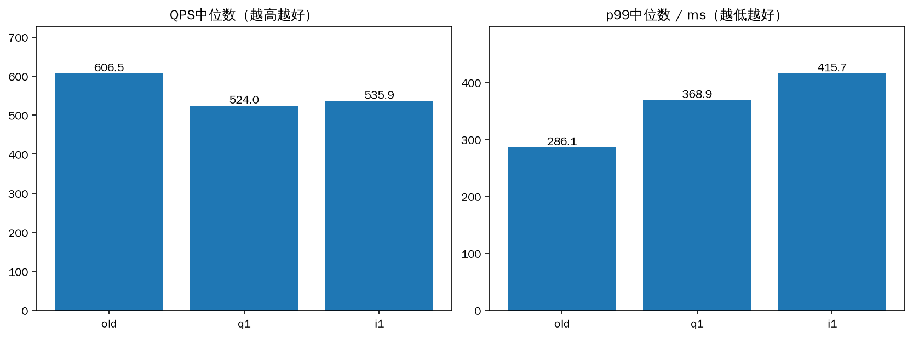
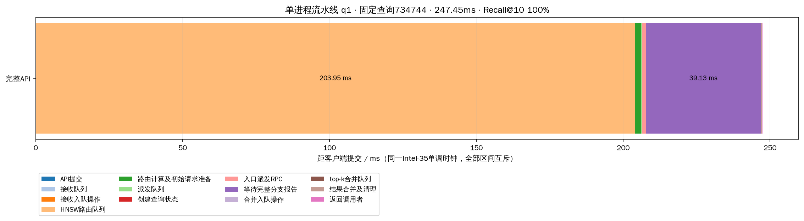
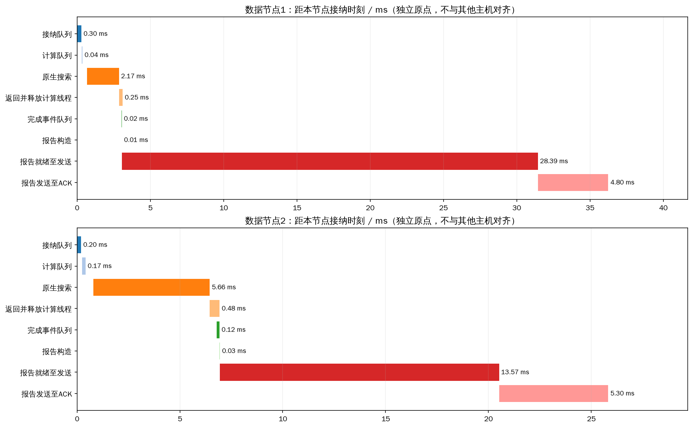

# 单进程顶层流水线：三机同负载对照

## 结论与保留的限制

**单进程方案已按要求实现，但本轮没有降低完整顶层延迟。** 按p99优先选出的单进程q1配置为1个路由线程、1个合并线程、4个派发线程、1至4个动态接收线程、1个结果接收线程、1个主动心跳线程。最佳单进程组的p99中位数368.89ms，旧双进程组286.14ms，增加28.9%；QPS为523.95与606.48，下降13.6%。i1立即非阻塞ACK的p99中位数415.67ms，没有证明优于q1。

保持已部署的旧双进程常驻服务不变；新方案保存在candidate.yaml，可按README独立启动。测试中的临时顶层均已关闭，数据节点持续运行。不能把局部合并队列改善称作整体提速，也不能宣称达到等待低于100ms。

同一最终矩阵中，旧版首次/合并就绪队列均值83.923/83.716ms；q1的接收、路由、派发、合并队列均值分别0.967/193.083/3.380/0.270ms。独立合并线程解决了合并与路由共用队列的问题，但更多等待集中到单个路由线程。增加到2/4路由线程的预备扫描没有更好p99。数据节点计算就绪队列均值由1.030变为0.645ms，计算线程CPU累计仍约11.4–11.6ms，并非数据线程等待其他分支未释放。

数据节点报告发送到ACK的均值范围由旧版约1.34–1.97ms变为q1约3.24–4.74ms；报告就绪到发送也增加（详见control_transport.csv）。它包含链路、接收解码/状态处理、ACK及两端调度，不能全部归因于网络或GIL。单进程把路由、合并、编解码和状态管理放到同一个Python运行时，删除IPC也失去了独立接收进程的运行时隔离；现有证据与调度/串行处理竞争一致，但尚未分离GIL和内核调度的各自贡献。

预备12组24000查询和ACK复测9组18000查询全部成功，但重复使用回调端口使数据节点复用了已关闭的旧连接，每轮各节点出现少量控制传输重试；保留在前两个目录。最终本页9组18000查询使用独立回调端口，27个节点窗口控制传输错误增量均为0，正式查询对应的控制事件失败次数均为0，排除了该干扰。原有metrics_complete不能单独证明原生发送从未重试，因此另检查原始控制事件；前两轮应用层协议字节不能当作完整物理网络流量。

最终298项回归全部通过。真实HTTP验证32查询、16客户端并发成功，另经HTTP管理接口启动32查询benchmark成功；实测接收线程峰值2、没有接收子进程。短HTTP测试仅验证功能，不用于宣称高负载性能；正式矩阵是同负载内部API对照。

性能矩阵冻结源码见snapshot/。矩阵之后仅调整max_active_queries=1时完成回调立即提交下一查询的容量释放顺序，以及增加CSV顶层排队列；这两项经过最终回归与真实HTTP验证，没有为其另行宣称性能增益。最终可运行源码快照及与矩阵的差异在validated_sources/、validated_source_hashes.json。

完整seq_2M索引，Intel-35为顶层及data-0，Intel-32为data-1，Intel-30为data-2；每数据节点32计算线程，并发128、搜索预算200、top-k10。每轮相同2000查询、32预热，组间交错、各重复3次。没有重建索引或更改数据节点程序/搜索参数。

old是已部署的单HNSW主进程加1个报告接收进程、2个共享路由/合并工作线程；p1/p2/p4是单进程流水线，分别1/2/4个路由线程。最终复验的q1和i1均为1个路由线程，分别采用排队ACK和立即尝试非阻塞ACK。单进程方案均有独立1个合并线程、4个派发线程、1至4个动态接收线程、1个非阻塞回调线程及1个主动心跳线程。当前HTTP服务另有单管理线程和单响应线程；本矩阵由内部异步调用压测，不经过HTTP解析/响应线程。

流水线压测以完成通知维持128个在途槽位，替代旧版128个同步调用线程。排队状态仍占槽位，所有队列等待及结果消费等待计入API。这是完整架构对照，不是单独IPC开销的消融。

## 重复结果

|模式|轮数|查询数|QPS中位数|p99中位数ms|平均延迟中位数ms|平均Recall@10|API>100ms|
|---|---:|---:|---:|---:|---:|---:|---:|
|old|3|6000|606.48|286.14|202.35|97.018%|5966|
|q1|3|6000|523.95|368.89|234.77|97.045%|5932|
|i1|3|6000|535.93|415.67|232.42|97.015%|5969|

按p99选出的单进程配置为 **q1**。相对本窗口旧版，p99变化 **+28.9%**，QPS变化 **-13.6%**。所有正式查询成功，预算、节点不重复访问和指标完整审计均通过。等待低于100ms尚未达成。

## 固定查询734744

选取推荐线程数组的首次正式结果，沿用之前的固定query，不按快慢挑选。表内时间互斥、完整覆盖API；不同主机单调时钟不相减。

|阶段|ms|
|---|---:|
|API提交|0.024|
|接收队列|0.041|
|接收入队操作|0.003|
|HNSW路由队列|203.947|
|路由计算及初始请求准备|2.072|
|派发队列|0.255|
|创建查询状态|0.036|
|入口派发RPC|1.370|
|等待完整分支报告|39.128|
|合并入队操作|0.022|
|top-k合并队列|0.083|
|结果合并及清理|0.295|
|返回调用者|0.171|

API 247.445ms，Recall@10 100%。分支原始时间点在selected_node_events.json，独立数据节点时间区间在selected_node_timeline.csv；不能把跨分支区间相加当作端到端时间。

## 推荐单进程配置的全部查询指标

|指标|均值|p99|
|---|---:|---:|
|head_receive_queue_ms|0.967|14.262|
|head_route_queue_ms|193.083|283.032|
|head_dispatch_queue_ms|3.380|80.177|
|head_merge_queue_ms|0.270|1.848|
|query_ready_queue_ms|0.645|4.184|
|server_thread_cpu_ms|11.438|20.893|
|coordinator_thread_cpu_ms|1.111|2.081|
|pread_ms|0.716|1.261|
|exact_distance_ms|2.405|4.644|
|rabitq_ms|3.645|7.002|
|expanded|200.000|200.000|
|max_expanded_depth|10.854|21.000|
|max_cross_shard_depth|0.348|1.000|
|peer_branch_rpc_count|0.349|1.000|
|control_rpc_count|1.699|3.000|
|all_protocol_rpc_count|3.048|5.000|
|all_protocol_bytes|31707.480|58262.000|
|file_read_bytes|2457600.000|2457600.000|

查询状态表在派发线程创建，先注册再发送。终态必须同时满足入口派发成功和完整分支树验证；任一分支报告不会提前完成全局查询。合并与路由使用不同队列，数据计算线程仍在本地结束时释放。结果ACK使用原协议续租，独立心跳线程另向已知且尚未完成的参与节点发送peer_lease；主动续租与重试都纳入网络统计。

报告控制、查询CPU和pread等跨分支累加指标不是互斥端到端份额。pread是逻辑读取，不能等同SSD硬件时间；纯网络/物理SSD份额无法可靠分离，原记录保留null。

## 逐轮性能及进程负载

|轮次|QPS|平均ms|p99 ms|Recall@10|失败|实际峰值并发|
|---|---:|---:|---:|---:|---:|---:|
|00_old|606.48|203.94|312.15|97.005%|0|128|
|01_q1|534.71|229.67|368.89|97.005%|0|128|
|02_i1|523.26|237.88|415.67|97.015%|0|128|
|03_i1|536.88|232.42|421.45|97.035%|0|128|
|04_q1|523.95|235.07|459.47|97.100%|0|128|
|05_old|624.47|196.08|286.14|97.040%|0|128|
|06_old|606.26|202.35|269.73|97.010%|0|128|
|07_q1|518.11|234.77|305.65|97.030%|0|128|
|08_i1|535.93|229.87|295.64|96.995%|0|128|

|轮次|角色|CPU核数|RSS MiB|物理读bytes|
|---|---|---:|---:|---:|
|00_old|data-0|3.061|1278.8|0|
|00_old|data-1|3.407|1344.0|0|
|00_old|data-2|1.803|1058.0|0|
|00_old|hnsw_head|1.510|859.9|0|
|00_old|report_receiver|0.782|38.0|0|
|01_q1|data-0|2.396|1302.8|0|
|01_q1|data-1|2.800|1367.9|0|
|01_q1|data-2|1.495|1058.0|0|
|01_q1|hnsw_head|1.425|978.8|0|
|02_i1|data-0|2.247|1368.4|0|
|02_i1|data-1|2.578|1344.8|0|
|02_i1|data-2|1.355|1059.0|0|
|02_i1|hnsw_head|1.410|980.6|0|
|03_i1|data-0|2.215|1382.6|0|
|03_i1|data-1|2.855|1334.1|0|
|03_i1|data-2|1.354|1069.0|0|
|03_i1|hnsw_head|1.412|1001.3|0|
|04_q1|data-0|2.187|1413.0|0|
|04_q1|data-1|2.853|1382.6|0|
|04_q1|data-2|1.390|1071.0|0|
|04_q1|hnsw_head|1.422|969.3|0|
|05_old|data-0|2.668|1336.6|0|
|05_old|data-1|3.319|1383.4|0|
|05_old|data-2|1.609|1071.0|0|
|05_old|hnsw_head|1.533|899.3|0|
|05_old|report_receiver|0.811|38.0|0|
|06_old|data-0|2.654|1266.1|0|
|06_old|data-1|2.840|1370.4|0|
|06_old|data-2|1.608|1071.0|0|
|06_old|hnsw_head|1.515|917.3|0|
|06_old|report_receiver|0.755|38.0|0|
|07_q1|data-0|2.249|1328.2|0|
|07_q1|data-1|2.460|1383.9|0|
|07_q1|data-2|1.416|1073.0|0|
|07_q1|hnsw_head|1.432|993.4|0|
|08_i1|data-0|2.338|1335.2|0|
|08_i1|data-1|2.591|1390.0|0|
|08_i1|data-2|1.482|1073.0|0|
|08_i1|hnsw_head|1.434|999.2|0|

数据节点物理读取增量合计0字节。本轮为热页缓存测试。原构建时间保留在每轮build_stages.csv，当前测试未重建索引。

## 复现与记录

- experiment.yaml：全部矩阵参数；cases/*/plan.yaml：该轮完整YAML。
- cases/*/runs/*/queries.jsonl.gz、queries.csv：每query全部指标。
- cases/*/runs/*/nodes_before/after.json.gz：数据进程指标与生命周期。
- source_hashes.json及snapshot/：该矩阵冻结源码；不覆盖此前负面结果。
- production_before/after.json：常驻服务状态；本矩阵使用临时顶层，完成后关闭，数据进程不重启。
- comparison.csv、summary.json、metrics.json、process_load.csv：汇总与负载。
- selected_query.json、selected_timeline.csv、selected_node_timeline.csv：可复算图表。

设计与代码中的所有布局参数位于peer.head_pipeline，启用需重启顶层，不需要重建索引。搜索预算等原有参数继续支持在线事务更新。
