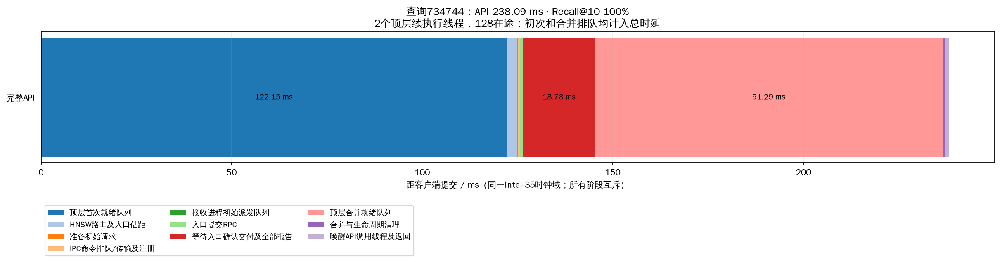
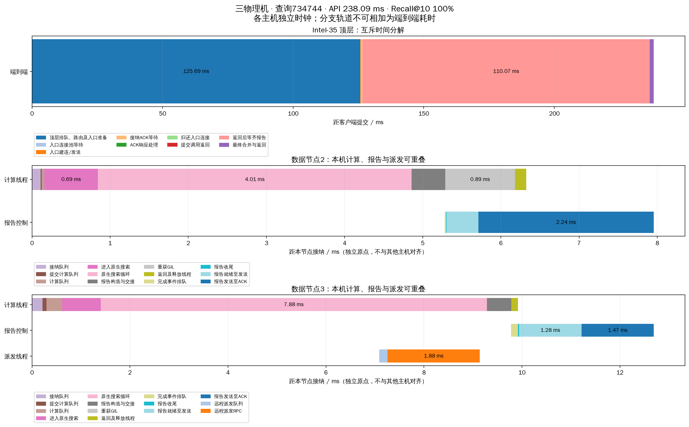
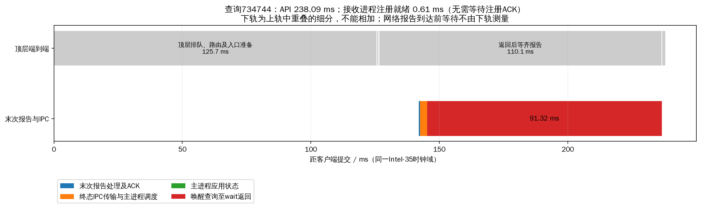
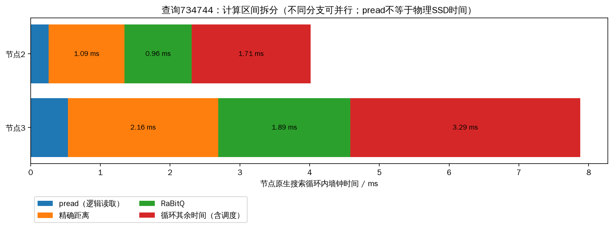

# 注册确认与事件续执行：三机发布复验

版本 `48ce87a4c06579b884d8`，三台机器各核验625个源码文件一致。Intel-35运行1个HNSW主进程、1个独立接收进程和data-0；Intel-32运行data-1；Intel-30运行data-2。主进程2个就绪阶段工作线程，接收进程4个初始派发线程，独立控制/终态IPC通道。数据节点各32查询线程，并发128、预算200、top-k10、相同2000查询、预热32，复用完整seq_2M索引。新服务ready后停止旧接收版集群，测试后保留新版服务。

## 三轮结果

|轮次|QPS|平均ms|p50 ms|p99 ms|Recall@10|失败|API>100ms/2000|
|---:|---:|---:|---:|---:|---:|---:|---:|
|1|600.25|203.52|199.64|262.31|97.055%|0|1990|
|2|643.76|191.96|186.95|261.43|97.015%|0|2000|
|3|642.21|190.64|189.30|242.43|97.030%|0|1997|

QPS中位数642.21，p99中位数261.43ms。6000条查询全部成功、预算与访问审计通过，数据进程PID和索引fd保持，接收进程PID保持。最终接收状态：[{'index': 0, 'pid': 1593395, 'endpoint': ['192.168.33.35', 22080], 'alive': True, 'error': None, 'command_queue_depth': 0, 'active_queries': 0}]。

严格受控消融另见 [优化实验报告](../head_continuation_20261019/REPORT.md)：同一数据进程上，旧同步路径与2个续执行线程的QPS中位数571.13→603.33，p99为334.98→259.61ms，注册实际就绪82.51→1.12ms，终态IPC22.93→3.25ms。1、4个续执行线程没有更优p99。单独分通道虽降低注册等待却恶化p99，未单独发布。

本页是同版本重新部署后的独立复验；不同实验窗口的差值不等于单独的优化因果效果。**系统等待低于100ms仍未达成**，主要剩余等待在顶层首次和合并就绪队列。

## 固定查询734744完整分解

沿用先前固定查询，第1轮正式结果，不按快慢挑选。

|阶段|ms|
|---|---:|
|顶层首次就绪队列|122.146|
|HNSW路由及入口估距|2.646|
|准备初始请求|0.260|
|IPC命令排队/传输及注册|0.573|
|接收进程初始派发队列|0.060|
|入口提交RPC|0.819|
|等待入口确认交付及全部报告|18.775|
|顶层合并就绪队列|91.288|
|合并与生命周期清理|0.445|
|唤醒API调用线程及返回|1.080|

总API **238.093ms**，Recall@10 **100%**。注册实际就绪0.606ms；registration_ms=0表示没有同步注册ACK阻塞，不表示注册无延迟。上表所有阶段互斥并精确覆盖client_wall，初次和恢复排队均已计入。

不同数据节点用各自接纳时刻作为独立原点。顶层及其接收子进程核对同一clock_domain后才进行跨进程相减；网络报告发送到顶层收到之间没有跨机器单调时间差。计算线程本地完成即释放，不等其他分支或顶层合并。API同步调用线程仍会阻塞等待返回并释放CPU/GIL；内部就绪阶段工作线程不等待IPC或数据结果。

## 等待与其余指标

|轮次|注册实际就绪均值ms|终态IPC均值ms|主进程应用状态均值ms|
|---:|---:|---:|---:|
|1|1.165|3.143|0.041|
|2|1.706|2.959|0.050|
|3|1.503|2.845|0.043|

|指标（6000查询）|均值|p99|
|---|---:|---:|
|head_stage_queue_ms|84.817|148.462|
|head_stage_resume_queue_ms|84.498|147.818|
|query_ready_queue_ms|0.754|5.562|
|coordinator_thread_cpu_ms|1.308|2.836|
|server_thread_cpu_ms|11.481|20.775|
|pread_ms|0.750|1.288|
|exact_distance_ms|2.415|4.620|
|rabitq_ms|3.694|6.912|
|expanded|200.000|200.000|
|max_expanded_depth|10.864|21.000|
|max_cross_shard_depth|0.347|1.000|
|peer_branch_rpc_count|0.349|1.000|
|control_rpc_count|1.698|3.000|
|all_protocol_rpc_count|3.047|5.000|
|all_protocol_bytes|31688.246|57673.940|
|file_read_bytes|2457600.000|2457600.000|

注册后在接收进程继续初始派发，注册尚未完成时不会发送数据查询；终态Future同时要求入口派发成功与所有分支报告齐备。等待中的查询始终占据128在途名额，未通过改变实际并发、减少搜索预算或省略计时阶段获得收益。数据间扩展仍仅由原扩展函数批准。

累加的分支CPU/pread时间与并行等待不等同于端到端占比。纯网络与物理SSD份额无法可靠分离，保留null。注册/终态IPC是本机开销，不混入跨机协议字节。除新的顶层队列和注册指标外，原召回、网络/读取/计算、跳数、跨节点通信次数均保留在每查询记录。

## 进程负载

|轮次|角色|平均CPU核数|RSS MiB|
|---:|---|---:|---:|
|1|hnsw_head|1.551|864.4|
|1|report_receiver|0.756|36.0|
|1|data-0|3.018|845.3|
|1|data-1|3.145|888.1|
|1|data-2|1.826|664.7|
|2|hnsw_head|1.544|843.2|
|2|report_receiver|0.852|36.0|
|2|data-0|2.907|961.3|
|2|data-1|3.601|1033.3|
|2|data-2|1.855|779.7|
|3|hnsw_head|1.551|868.6|
|3|report_receiver|0.838|36.0|
|3|data-0|2.694|1093.3|
|3|data-1|2.868|1178.1|
|3|data-2|1.743|895.7|

三个数据节点×三轮物理读取增量：[0, 0, 0, 0, 0, 0, 0, 0, 0]字节。本轮属于热页缓存测试，pread不代表物理SSD服务时间。CPU核数按各进程观测窗口计算，窗口略有采样差异。没有重新构建索引，原构建阶段资料保留在runs/*/build_stages.csv及seq2m_full原目录；发布编译不能当作索引构建时间。

## 工件与复现

README.md给出部署、复测及热配置指令。cluster.yaml保存所有可调参数；benchmark_request.yaml保持2000/128/32。日常复测使用cluster_ctl benchmark，run_test.py只用于首次新旧服务切换。

- runs/*/queries.jsonl.gz与queries.csv：每query原始指标。
- runs/*/nodes_before/after.json.gz、process_load.csv：数据节点生命周期/CPU/磁盘。
- selected_flow_timeline.csv、selected_query.json、selected_events.json：可复算单查询分解。
- receiver_stage_means.csv、head_stage_means.csv、head_process_load.json：注册/IPC/负载。
- verification.json、version_audit.json、verified_status.json：版本及排空核验。
- collection.json：三节点指标统一回收位置（Intel-35的本目录内）。

发布前282项回归280通过、2跳过，包括共享/分离通道、报告早于入口ACK、无报告超时、进程死亡、取消清理、预算热更新及一个工作线程管理多个挂起查询。日志在../head_registration_20261019/regression_final.log。

未采用cProfile异常轮次评估性能或CPU函数占比。该工具的冲突与不一致输出保留在../head_continuation_20261019/profile*/；剩余阶段诊断使用stage_timers/的直接线程CPU/墙钟计时。所有正式对照和本页复验均未启用该剖析器。
