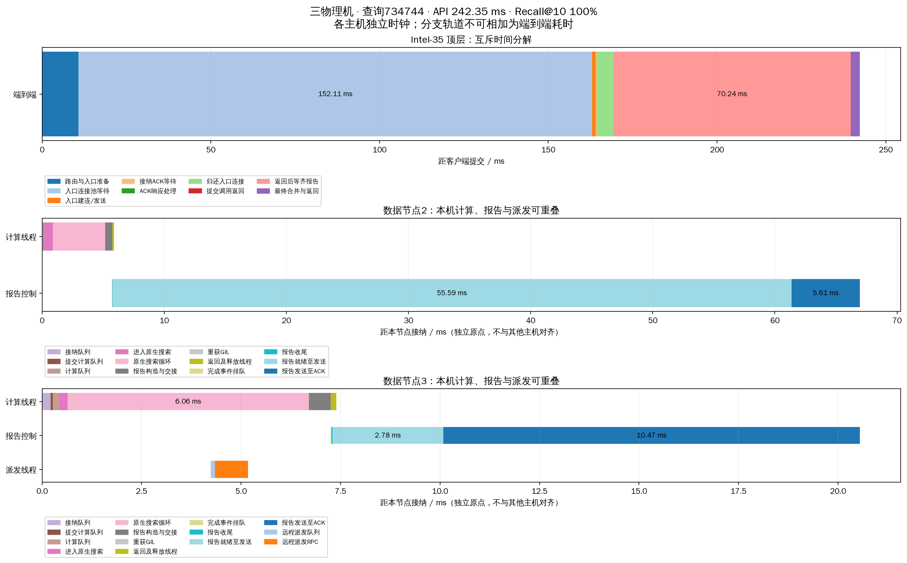
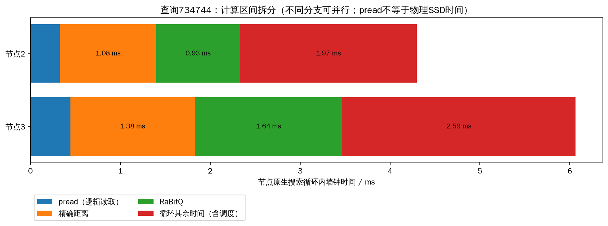

# FIFO入口优化版三机发布与复测

已将入口FIFO优化版同步到Intel-35、Intel-32、Intel-30，源码摘要为`44b6d3aa4029a18f8a40`。每台逐文件核对623个发布源码文件，均与发布清单一致；新版服务保持运行，旧三机服务已正常停止。

常驻服务3轮共6000条正式查询全部成功，QPS中位数467.62，p99中位数577.69ms，Recall@10为97.000%–97.015%。相比上一轮常驻三机基线的303.01 QPS和3062.50ms p99，吞吐约提高54.3%，p99约降低81.1%。**这是入口长尾的明显改善，尚未解决所有等待，也未达到系统等待低于100ms。**

## 改动与验证范围

`peer.connection_pool.head_scheduling: fifo`为每个目标维护FIFO队列，归还连接时先预约名额给指定等待者、再只唤醒该等待者，避免旧共享Condition的notify_all唤醒竞争和后来者抢占。保留短锁保护连接所有权；网络I/O、健康探测和socket关闭在锁外。新增连接归还总时长和状态锁等待计时。数据节点之间的派发、C++完成回传池、候选扩展和搜索预算不变。

正式发布前先在同一三机数据服务上做broadcast/fifo交替对照，12000条查询全部成功，QPS中位数293.07→490.28，p99 3127.57→580.10ms，入口等待均值331.51→33.38ms。此对照始终保持每目标2连接，没有用增加连接或减少并发解释为算法收益。详见[同条件消融报告](../entry_fifo_20261019/REPORT.md)。

最终回归共247项，245通过、2跳过，涵盖FIFO、异目标前进、超时/关闭/探测失败及预约回收、真实RPC和执行签名兼容。首个诊断尝试在预热前因新head字段进入旧执行签名而被拒绝，已修复并单独归档，没有混入正式数据。

本轮正式发布后，三个数据节点和独立head均运行新版本，配置仍为完整seq_2M、L2、每节点32查询线程、并发128、预算200、top-k10、remote_weight=1、每目标2连接、native搜索/native完成控制、sync_pread。每轮2000条固定validation查询、32条预热。沿用已有索引，不重新划分或建图。

| 角色 | 主机 | PID | 端口 |
|---|---|---:|---:|
| HNSW head | Intel-35 | 1306569 | 管理21681 / 回调21680 |
| 数据节点1 / ID0 | Intel-35 | 1306565 | 21651 |
| 数据节点2 / ID1 | Intel-32 | 3078335 | 21652 |
| 数据节点3 / ID2 | Intel-30 | 939724 | 21653 |

## 常驻服务复测

| 指标 | 第1轮 | 第2轮 | 第3轮 |
|---|---:|---:|---:|
| 成功 / 失败 | 2000 / 0 | 2000 / 0 | 2000 / 0 |
| 实际并发峰值 | 128 | 128 | 128 |
| QPS | 448.63 | 474.33 | 467.62 |
| Recall@10 | 97.015% | 97.010% | 97.000% |
| 平均延迟 | 257.34 ms | 246.80 ms | 252.80 ms |
| p50 | 251.32 ms | 248.14 ms | 268.24 ms |
| p95 | 433.83 ms | 478.50 ms | 459.01 ms |
| p99 | 605.88 ms | 577.69 ms | 558.85 ms |
| 最大延迟 | 751.73 ms | 652.97 ms | 611.94 ms |

各轮均通过预算、无节点重访、指标完整、head不扩展候选审计，测试前后数据进程PID/fd不变。表格保留三轮全部结果；中位数分别针对三轮对应指标取值。历史常驻服务与本轮非交替执行，因果判断优先参考前述同条件消融，而非将两次发布结果的全部差异单独归因。

## 等待改善与尚存瓶颈

| 平均阶段（ms） | 第1轮 | 第2轮 | 第3轮 |
|---|---:|---:|---:|
| 获取入口连接 | 75.04 | 68.25 | 43.23 |
| 获得连接后的入口RPC | 2.90 | 2.89 | 2.67 |
| 归还连接 | 1.454 | 1.464 | 0.986 |
| 其中：归还时获取状态锁 | 1.427 | 1.438 | 0.965 |
| 入口返回后等齐报告 | 162.73 | 161.00 | 191.03 |

“其中”是包含关系，不能重复相加；完整head阶段均值见[head_stage_means.csv](head_stage_means.csv)，新增借还连接计时见[entry_transport.csv](entry_transport.csv)。三轮入口池等待p99仍为317.70/397.94/336.88ms。归还锁等待包含调度延迟，不意味着某个线程独占锁这么长时间。

6000条查询的数据就绪队列累计均值0.597ms、p99为3.569ms；计算切片累计均值11.711ms、p99为21.857ms。下一处主要等待仍在结果回传和head完成处理路径；“入口返回后等齐报告”包含计算、分支依赖、回传池、网络及head处理，不能全部记为网络传播延迟。

FIFO改善了最慢请求的饥饿问题，但不是每条查询都更快：上一轮常驻基线p50三轮中位数约67.11ms，本轮251.32ms；交替消融中API超过100ms的比例也上升。公平排队将旧版少数查询的很长等待重新分配给更多查询。当前主要收益是吞吐、p99和最大时延，不应将它包装为所有延迟指标都改善。

## 同一查询734744的完整时延图

继续使用实验前固定的query 734744、第1轮记录，未为展示效果改选查询。本轮API为242.35ms，Recall@10为100%，路径为HNSW→Intel-30节点3，并由扩展函数批准派发到Intel-32节点2。两分支合计扩展200个顶点，最大扩展深度11，1次数据间派发，总应用协议RPC为5、字节82,134。

| 顶层互斥阶段 | 本轮耗时 |
|---|---:|
| 路由与入口准备 | 10.829 ms |
| 入口连接池等待 | 152.114 ms |
| 入口建连/发送 | 1.074 ms |
| 接纳ACK等待 | 0.332 ms |
| ACK响应处理 | 0.001 ms |
| 归还入口连接 | 4.981 ms |
| 提交调用返回 | 0.006 ms |
| 返回后等齐报告 | 70.243 ms |
| 合并与返回 | 2.772 ms |

该固定查询上一轮为158.68ms，本轮变慢，报告如实保留。它的ACK后至入口提交返回从48.32ms降到约4.99ms，但入口池等待及后续等齐报告时间更大；不能用单查询代表总体改善，也不能只展示变快的阶段。

节点2本地原生搜索4.299ms，接纳后5.875ms工作线程已释放，随后报告就绪至发送仍等待约55.59ms。节点3原生搜索6.063ms，接纳后7.391ms工作线程已释放。报告与派发轨道不占用已释放的计算线程，计算线程未等待其他分支完成。

各数据节点横轴从自身接纳起算，与head以及其他节点均不对齐；只在同一主机内相减时间戳。报告发送至ACK含本机网络调度及head处理，不等于纯网络RTT。

| 节点 | 原生循环 | pread | 精确距离 | RaBitQ | 其余控制/调度等 |
|---|---:|---:|---:|---:|---:|
| 节点2 / Intel-32 | 4.299 ms | 0.328 ms | 1.075 ms | 0.928 ms | 1.968 ms |
| 节点3 / Intel-30 | 6.063 ms | 0.446 ms | 1.384 ms | 1.639 ms | 2.594 ms |

## 其余指标与节点负载

6000条正式查询的逐query平均值如下，均保留分布及原始记录：

| 指标 | 均值 | p99 |
|---|---:|---:|
| 应用协议总RPC数 | 2.995 | 5 |
| 数据节点间派发次数 | 0.350 | 1 |
| 应用协议字节 | 31,684 B | 57,452 B |
| pread累计墙钟时间 | 0.734 ms | 1.256 ms |
| 精确距离累计时间 | 2.413 ms | 4.663 ms |
| RaBitQ累计时间 | 3.743 ms | 6.924 ms |
| 数据服务线程CPU累计时间 | 11.536 ms | 20.971 ms |
| 最大已扩展图深度 | 10.873 | 21 |

每query扩展200个顶点、逻辑pread为200次、读取2,457,600字节。所有正式节点窗口物理读取增量为0，仍是热OS页缓存实验，pread耗时不代表物理SSD访问成本。协议字节不含TCP/IP头、重传或测试后管理快照回收；head→Intel-35本地节点仍是同机TCP。跨分支CPU/读/计算可并行重叠，不用它们除以API时延伪造可相加的网络/磁盘/计算百分比。

| 数据节点 | 第1/2/3轮平均CPU核当量 | 末轮RSS | 三轮物理读取增量 |
|---|---|---:|---:|
| Intel-35 | 2.372 / 2.300 / 2.096 | 1.113 GiB | 0 B |
| Intel-32 | 2.359 / 2.623 / 2.308 | 1.170 GiB | 0 B |
| Intel-30 | 1.417 / 1.432 / 1.339 | 0.875 GiB | 0 B |

CPU核当量按本机快照窗口计算，包含快照边界开销；RSS不包含全部OS页缓存。完整线程数/内存/CPU及物理读写在`runs/*/process_load.csv`及[node_load.csv](node_load.csv)。索引原构建约2510.91秒（41.85分钟），本轮没有重建；每轮build_stages.csv导出的是历史构建阶段，不能称为本轮构建耗时。

## 结果位置与当前服务

- [完整YAML](cluster.yaml)、[部署/复测命令](README.md)
- [源码三机核验](version_audit.json)、[最终状态](verified_status.json)、[查询审计](verification.json)
- [逐轮结果](comparison.csv)、[指标分布](metric_summary.json)、[入口借还连接](entry_transport.csv)
- [单查询原始记录](selected_query.json)、[时间轴CSV](selected_timeline.csv)、[计算拆分](selected_compute.json)
- `runs/`：head回收的每query延迟、召回、网络、磁盘、计算、图深度/跨节点次数及全部节点快照

源码同版本、三节点32线程、客户端并发128、预算200已核验。部署和实验文件位于本目录；旧版结果全部保留。本轮没有修改搜索算法或扩大连接容量，没有实现尚待研究的单head原生完成处理。
