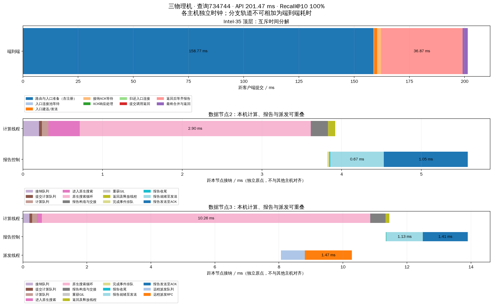
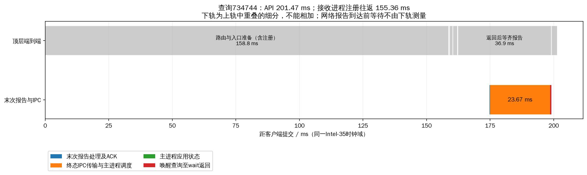
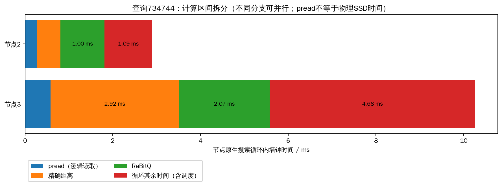

# 独立报告接收进程版：三机常驻复验

源码release `e95ae9a20cb21654c601` 已同步Intel-35/32/30，三台各核验624个源码文件一致。Intel-35：一个HNSW主进程、一个报告接收子进程、独立data-0；Intel-32：data-1；Intel-30：data-2。三个数据节点每节点32查询线程，客户端并发128，预算200，top-k10，完整2M×2560D索引、同一2000查询，32条预热。旧FIFO集群在新服务ready后正常停止，新服务测试后保留运行。配置和命令见README.md。

## 三轮结果

|轮次|QPS|平均ms|p50 ms|p99 ms|Recall@10|失败|API>100ms|
|---:|---:|---:|---:|---:|---:|---:|---:|
|1|564.69|211.91|211.49|346.95|97.060%|0|1951|
|2|564.23|213.30|212.86|350.04|97.010%|0|1951|
|3|602.04|199.13|200.26|310.91|97.005%|0|1955|

6000条查询全部成功，所有预算守恒、无重复节点访问、无顶层搜索扩展、指标完整性审计通过。QPS中位数564.69，p99中位数346.95ms。数据节点PID和索引fd前后不变，接收进程PID也保持不变；末次状态没有活动查询。当前接收进程PID：1525258。

同负载15组消融见 [接收进程数报告](../head_receivers_20261019/REPORT.md)：0→1个额外接收进程的p99中位数544.03→318.20ms，QPS473.89→586.14。2/4/8进程均没有优于1进程，因此发布1进程。消融扫描使用原有三数据进程；本页是新release常驻服务复验，两者分别报告，不能把独立时段差值当作严格因果收益。

## 固定查询734744的完整时间图

继续使用先前已选定的查询，不因慢而更换样本。选取本轮第1次正式测试。

|顶层互斥阶段|ms|
|---|---:|
|路由与入口准备（含注册）|158.771|
|入口连接池等待|0.240|
|入口建连/发送|1.348|
|接纳ACK等待|1.874|
|ACK响应处理|0.002|
|归还入口连接|0.013|
|提交调用返回|0.005|
|返回后等齐报告|36.870|
|最终合并与返回|2.350|

API总计 **201.471ms**，Recall@10 **100%**；接收进程注册往返 **155.356ms**（已含在上表入口准备中，不另行相加）。

上图两轨同属Intel-35有效时钟域；下轨与端到端轨道重叠，不能相加。终态IPC包含序列化、通道排队、主进程调度和解码，不是纯内核通信时间。远端数据节点继续各用接纳时刻作为独立原点，不跨机器相减单调时钟。

|数据节点（内部ID）|本地原生循环ms|接纳后释放查询线程ms|
|---|---:|---:|
|1|2.898|3.920|
|2|10.262|11.451|

计算线程按本地候选耗尽/预算完成释放，不等远端子分支或顶层merge。pread是逻辑文件读取，包含热页缓存及调用调度，本次不能称为物理SSD耗时。

## 接收进程新增等待

|轮次|注册均值ms|终态IPC均值ms|主进程应用状态均值ms|查询恢复残余均值ms|
|---:|---:|---:|---:|---:|
|1|106.339|23.866|0.047|0.581|
|2|103.735|24.482|0.062|0.613|
|3|94.806|22.871|0.039|0.614|

新增接收进程降低了数据回传拥塞，但注册往返和主进程终态处理仍有明显等待。**系统等待低于100ms仍未达成**。异步通知、批量注册等下一步方案需先定位注册入队/出队与确认处理的等待，不能仅靠继续增加接收进程；尚未擅自采用未确认注册后提前派发查询的语义。

## 其余指标

下表对6000查询统计，保留原指标含义。并行分支累计时间不是端到端时间份额。

|指标|均值|p99|
|---|---:|---:|
|query_ready_queue_ms|1.541|18.762|
|server_thread_cpu_ms|11.324|20.113|
|pread_ms|0.735|1.269|
|exact_distance_ms|2.348|4.478|
|rabitq_ms|3.699|6.693|
|expanded|200.000|200.000|
|max_expanded_depth|10.866|21.000|
|max_cross_shard_depth|0.348|1.000|
|peer_branch_rpc_count|0.349|1.000|
|control_rpc_count|1.699|3.000|
|all_protocol_rpc_count|3.048|5.000|
|all_protocol_bytes|31703.057|58386.000|
|file_read_bytes|2457600.000|2457600.000|

每查询逐阶段占比、图跳数、派发次数、网络字节、逻辑读/计算时间及召回均保存在runs/*/queries.jsonl.gz、queries.csv与汇总CSV。纯网络/物理SSD延迟占比仍不可从现有测量可靠分离，保留null，不把整个RPC或pread算成物理服务时间。

## 负载与构建

|轮次|进程|平均占用CPU核数|RSS MiB|
|---:|---|---:|---:|
|1|hnsw_head|1.694|874.7|
|1|report_receiver|0.480|36.0|
|1|data-0|2.742|851.9|
|1|data-1|3.291|889.6|
|1|data-2|1.725|668.2|
|2|hnsw_head|1.743|850.1|
|2|report_receiver|0.527|36.0|
|2|data-0|2.761|981.9|
|2|data-1|2.598|1033.2|
|2|data-2|1.627|767.2|
|3|hnsw_head|1.727|896.3|
|3|report_receiver|0.533|36.0|
|3|data-0|2.615|1093.8|
|3|data-1|2.740|1139.4|
|3|data-2|1.655|874.2|

三数据节点×三轮物理读取增量：[0, 0, 0, 0, 0, 0, 0, 0, 0]字节。本轮是热页缓存测试。CPU平均核数按各进程采样窗口计算，不能直接解释成整机CPU百分比；负载表记录新增接收进程，未漏计这部分资源。索引复用，未重新构建；历史构建阶段见runs/*/build_stages.csv（若该轮导出）及原seq2m_full构建目录，部署编译时间不是索引构建时间。

## 工件与验证

- cluster.yaml：完整YAML配置；benchmark_request.yaml：测试请求体。
- version_audit.json、verification.json、verified_status.json：版本、三机拓扑与服务状态核对。
- head_stage_means.csv、receiver_stage_means.csv、entry_transport.csv：逐阶段、注册/IPC与入口池计时。
- selected_query.json、selected_events.json、selected_timeline.csv、selected_receiver_timeline.csv：可复查的单查询原始时间点。
- node_load.csv、head_process_load.json、metric_summary.json：数据/顶层进程负载与其余指标。
- collection.json指向统一拉回Intel-35的三节点结果快照。
- ../head_receivers_20261019/regression.log：完整260项回归258通过、2跳过；receiver_final.log额外确认9项接收专项全部通过。

保持错误记录：首次prepare缺少新部署token失败，补齐独立token后完成部署；失败部署日志不进入正式查询性能结果。旧数据、旧测试结果与索引均保留。
