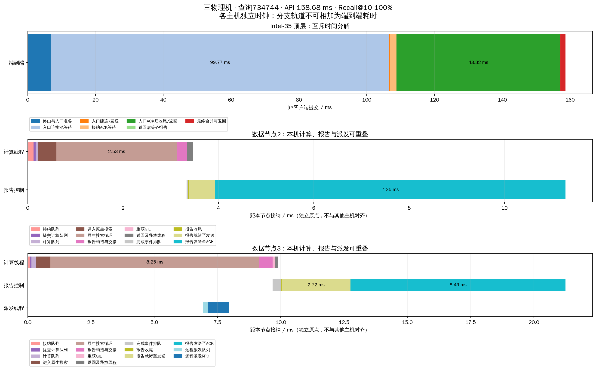
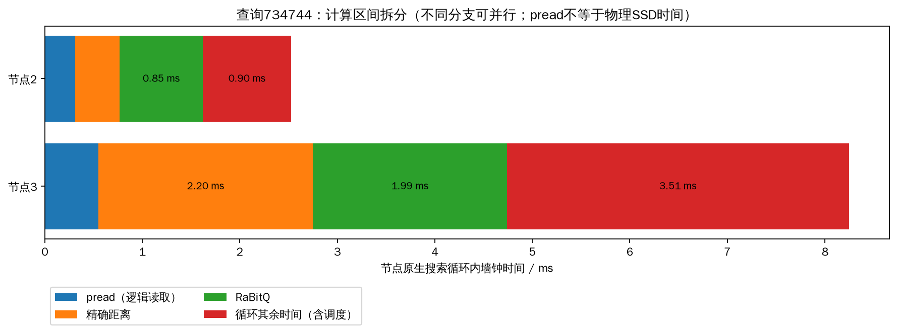

# seq_2M 三物理机、32线程/节点、并发128测试

已完成Intel-35、Intel-32、Intel-30三个独立数据节点的全量索引测试，Intel-35另外运行独立HNSW head。三轮共6000条正式查询全部成功，Recall@10约97%，QPS中位数303.01，单轮p99中位数3062.50ms。**三机功能和指标回收通过，当前秒级尾延迟仍未解决；后两轮约92%的客户端延迟总和出现在顶层入口连接池等待。**

## 配置、部署与实验口径

| 用户节点 | 内部ID | 主机 | 数据进程PID | 查询工作线程 |
|---|---:|---|---:|---:|
| 节点1 | 0 | Intel-35 | 1273365 | 32 |
| 节点2 | 1 | Intel-32 | 3074511 | 32 |
| 节点3 | 2 | Intel-30 | 897347 | 32 |

完整2M×2560D、L2、top-k10、预算200、remote_weight=1，客户端总并发128，每轮2000条固定validation查询、预热32条，重复3轮。入口发生器保持一个持久head；每目标入口、数据间派发及原生回传连接仍为2。本轮没有改变搜索或调度算法，也没有把此前入口64连接的诊断配置混入基线。

三个节点使用同一源码摘要`05b5f3cf0079fd9ca3dd`。Intel-32的完整shard_1逐文件SHA256与Intel-35原分片一致；其余分片原位复用，所有索引epoch相同。新三机服务就绪后才停止旧两机空闲集群，正式测试期间没有同时运行旧集群压测。三个数据进程前后PID/fd一致，测试后保持ready及空闲状态，可通过head继续更改查询配置和拉取结果。

Intel-35和Intel-32均为4插槽Xeon Gold 6448H，128物理核/256逻辑CPU；Intel-30为2插槽Xeon Platinum 8358P，64物理核/128逻辑CPU。硬件、Python及网卡详情保存在[hardware.json](hardware.json)。32仅指每个进程的查询线程，辅助线程另计。

## 三轮性能

| 指标 | 第1轮 | 第2轮 | 第3轮 |
|---|---:|---:|---:|
| 成功 / 失败 | 2000 / 0 | 2000 / 0 | 2000 / 0 |
| 实际并发峰值 | 128 | 128 | 128 |
| QPS | 374.46 | 303.01 | 299.51 |
| Recall@10 | 97.035% | 97.005% | 96.985% |
| 平均API延迟 | 285.10 ms | 338.82 ms | 346.62 ms |
| p50 | 228.68 ms | 59.09 ms | 67.11 ms |
| p95 | 924.97 ms | 1755.34 ms | 1690.13 ms |
| p99 | 1932.14 ms | 3062.50 ms | 3072.62 ms |
| 最大延迟 | 2949.48 ms | 5966.87 ms | 5592.47 ms |

QPS取完整正式查询窗口，不含预热和结果归档。各轮不是独立大规模统计样本，报告保留全部波动，不只挑第一轮最高吞吐。6000条查询均通过指标完整、预算不超过200、无节点重访、head不扩展候选的审计。

此前同一单head、每目标2连接的两机对照QPS中位数为293.53；本轮303.01约高3.2%。两次实验没有在同一时间交替运行，且本轮波动明显，因此不能据此宣称三机稳定提升3.2%，也不能与历史20入口进程的约1400 QPS直接比较。先前布局控制实验见[吞吐瓶颈报告](../qps_topology_20261019/REPORT.md)。

## 各阶段平均时间与主要等待

以下均为head同一时钟或本机RPC计时的平均值，单位ms；每列相加等于该轮平均API延迟。

| 互斥阶段 | 第1轮 | 第2轮 | 第3轮 |
|---|---:|---:|---:|
| HNSW路由 | 3.77 | 2.55 | 2.62 |
| 获取入口连接 | 140.68 | 311.46 | 319.23 |
| 获得连接后的入口RPC | 2.78 | 1.94 | 1.98 |
| 入口收到ACK至提交函数返回 | 2.91 | 5.75 | 6.12 |
| 提交函数返回至等齐报告 | 124.41 | 14.08 | 12.98 |
| 报告齐备后合并 | 3.85 | 1.34 | 1.37 |
| 其他入口准备/收尾 | 6.70 | 1.70 | 2.32 |

入口池等待分别占延迟总和49.34%、91.92%、92.10%。第一轮较多等待落在提交后的报告区间，后两轮集中到入口池，显示各阶段排队分布并不稳定。报告区间包含数据执行、分支依赖、回传以及head处理，不能全部记为纯网络时间。

6000条查询的数据节点就绪队列累计均值仅0.535ms、p99为1.999ms；计算切片累计均值12.211ms、p99为22.239ms。它们是分支求和的工作量统计，可能相互重叠，不能直接与head互斥分解相加。这些数据支持主要瓶颈仍在入口/控制路径，而不是数据节点因32个查询线程全部被计算占满。没有达到系统等待低于100ms的目标。

## 指定查询734744的时延图

按实验前固定的选择规则，使用第1轮query 734744。该查询从Intel-35的HNSW进入Intel-30节点3，再由扩展函数批准派发到Intel-32节点2；节点3继续本地搜索。两分支合计扩展200个顶点，最大扩展深度11，1次数据节点间派发，Recall@10为100%。API延迟158.68ms。

| 顶层互斥阶段 | 耗时 | API占比 |
|---|---:|---:|
| 路由与入口准备 | 6.895 ms | 4.35% |
| 入口连接池等待 | 99.766 ms | 62.87% |
| 入口建连/发送 | 0.193 ms | 0.12% |
| 接纳ACK等待 | 1.937 ms | 1.22% |
| 收到入口ACK至提交函数返回 | 48.316 ms | 30.45% |
| 提交函数返回后等齐报告 | 0.053 ms | 0.03% |
| 最终合并与返回 | 1.516 ms | 0.96% |

上图第一行可以相加为完整API延迟；下方每节点的横轴独立从该节点接纳时刻起算，**不能将各面板的0点视为同一时刻**。未跨主机相减单调时钟，也没有将分支重叠误算成串行延迟。

该查询收到入口ACK之后的48.316ms发生在提交函数尚未返回的区间，涵盖RPC收尾、连接归还及调用线程调度；不能说它仍在等待远端接纳ACK，也不能全部解释为等待数据搜索。分支可以在此期间继续计算和异步回传。当前时间戳未进一步隔离该区间内各操作和失去CPU调度的份额。

节点2的本地原生循环为2.526ms，接纳后3.464ms工作线程已释放；节点3分别为8.247ms和9.904ms。报告发送、确认及汇总由其他线程继续处理，计算线程没有等到顶层返回才释放。图中的“报告发送至ACK”包含本机连接池及发送调度、TCP和head接收处理，不能当作纯链路RTT。

| 节点 | 原生循环 | pread | 精确距离 | RaBitQ | 循环其余时间 |
|---|---:|---:|---:|---:|---:|
| 节点2 / Intel-32 | 2.526 ms | 0.313 ms | 0.456 ms | 0.854 ms | 0.904 ms |
| 节点3 / Intel-30 | 8.247 ms | 0.552 ms | 2.197 ms | 1.992 ms | 3.506 ms |

“循环其余时间”含候选队列、启发式/批次控制、计时及线程调度等未独立分类的墙钟区间，不能全称为计算或忙等。表中每行可加总到该节点原生循环；两行不能加总为API耗时。逐事件原始数据和毫秒值见[selected_query.json](selected_query.json)、[selected_events.json](selected_events.json)、[selected_timeline.csv](selected_timeline.csv)。

## 网络、磁盘、图搜索与计算指标

以下为6000条正式查询合并后的逐查询统计，未额外加入预热：

| 指标 | 均值 | p99 |
|---|---:|---:|
| 全部应用协议RPC数 | 3.032 | 5 |
| 数据节点间分支派发次数 | 0.349 | 1 |
| 控制RPC数（含结果/心跳等） | 1.683 | 3 |
| 全部应用协议字节 | 31,659 B | 57,408 B |
| 逻辑pread次数 | 200 | 200 |
| 逻辑文件读取量 | 2,457,600 B | 2,457,600 B |
| pread累计墙钟耗时 | 0.774 ms | 1.361 ms |
| 精确距离累计耗时 | 2.455 ms | 4.595 ms |
| RaBitQ累计耗时 | 4.024 ms | 7.791 ms |
| 数据服务线程CPU累计时间 | 12.087 ms | 22.052 ms |
| 图顶点扩展数 | 200 | 200 |
| 最大已扩展顶点深度 | 10.847 | 21 |
| 最大跨节点路径深度 | 0.347 | 1 |

三台数据服务器各不相同，因此数据节点间派发都跨物理机；head→Intel-35节点1仍是同机TCP。全部协议字节不含TCP/IP头和内核重传，也不含测试后管理快照回收流量，不能称为网卡实际字节。最大图深度不是200次候选扩展的串行跳数；二者分别记录。详细计数分布见[metric_summary.json](metric_summary.json)。

各节点正式测试窗口的物理存储读取增量全部为0，本轮为**热OS页缓存**。pread仍从文件接口读取，命中页缓存时不会产生物理SSD读取；不能用0.774ms代表真实SSD访问成本。现有插桩无法独立给出纯网络传播或物理SSD在API中的精确占比，因此保留可测的RPC、pread和计算时长，不虚构三者互斥百分比。

## 各服务器负载与构建时间

| 节点 | 第1/2/3轮平均CPU核当量 | 末轮快照RSS | 进程总线程 | 三轮物理读取增量 |
|---|---|---:|---:|---:|
| Intel-35 data-0 | 2.015 / 1.609 / 1.521 | 1.052 GiB | 59 | 0 B |
| Intel-32 data-1 | 2.224 / 1.880 / 1.601 | 1.188 GiB | 60 | 0 B |
| Intel-30 data-2 | 1.173 / 0.938 / 0.935 | 0.846 GiB | 59 | 0 B |

CPU核当量=进程CPU秒增量/本机快照窗口墙钟秒；窗口包含快照边界，不是严格等于QPS计时窗口。RSS只代表数据进程，不包含所有OS页缓存，也不是整机内存使用率。原始节点快照、采样与逐轮表保存在`runs/`及[node_load.csv](node_load.csv)。

本轮复用完整索引，没有重新建图。原集中构建的阶段墙钟总计约2510.91秒（41.85分钟），构建过程及阶段耗时由原manifest导入每轮`build_stages.csv`，不能解释为本轮三机分布式构建时间。本次部署/编译和启动日志另存`deployment_logs/`及`execution.log`。

## 文件与后续操作

- [部署与复测命令](README.md)、[完整配置](cluster.yaml)、[实验计划](PLAN.md)
- [逐轮对照](comparison.csv)、[head阶段均值](head_stage_means.csv)、[分析汇总](analysis.json)
- `runs/`：每查询延迟/召回/网络/磁盘/计算/图深度与分支记录，阶段均值、有效配置、节点快照、历史构建时间
- [分片校验](shard_1_verification.json)、[最终服务状态](final_status.json)、[核验结论](verification.json)

三个数据节点及独立head保持运行，参数仍为32线程/节点、并发128、预算200。原两机服务已正常停止。本轮没有实施入口池及head原生化的新优化；后续应优先验证按目标公平排队/定向唤醒及单head完成处理能力，而非继续增加数据节点线程数。
