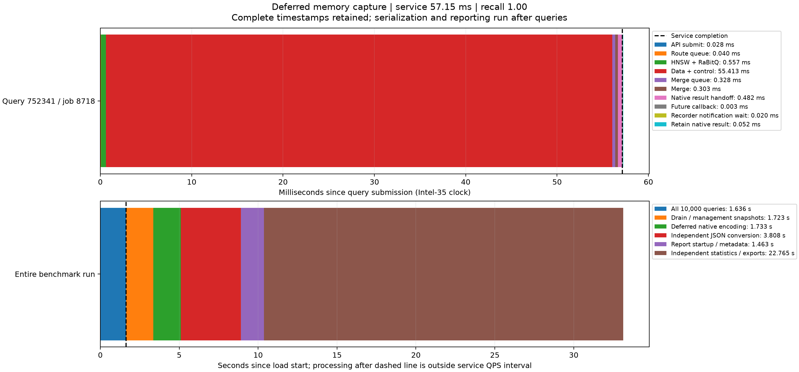

# Intel-35 内存结果暂存与独立报告程序

2026-10-20。本轮实现将完整查询结果先保存在Intel-35内存，正常情况下等所有查询结束后才编码、计算召回、生成JSON与统计报告。主路径保存C++原生对象，不创建完整Python结果树；容量不足时批量排空并产生JSON分片。设计见 [DESIGN.md 第26节](../../DESIGN.md)，计划见 [PLAN.md](PLAN.md)。

三机最终短测10000请求全部成功，Recall@10=97.035%。按Future完成边界重算，两版QPS从1400.17变为6112.22；记录队列平均等待从161.308ms降至0.030ms。最终原生完成至内存结果交付平均0.303ms、p99 0.806ms，没有用将等待移到交付阶段的中间方案作为最终结果。

## 1. 最终实现

```text
图搜索及原生合并完成
  -> 完整C++结果所有权句柄 + 时间戳
  -> Future完成，查询工作结束
  -> 轻量通知；补充下一条查询；保留原生对象

全部查询结束 / 达到暂存容量
  -> C++对象逐条编码至Linux memfd，同时释放对应原生对象
  -> 独立程序继承memfd，解码并写标准JSON数组分片
  -> 独立程序读取分片，生成召回/延迟统计、JSONL.gz及CSV
```

独立进程不能直接解引用父进程的C++指针，因此先在拥有对象的进程中编码成可传递表示，再通过内存文件描述符交接。正常容量下，这一步也发生在所有查询结束以后，编码时释放GIL。普通查询API继续返回原有Python结果；原生压测使用独立的 `search_capture_async` 所有权交接接口。

代码入口：

- [benchmark_archive.py](../../python/dhdgs/benchmark_archive.py)：原生对象暂存、内存计费、memfd、容量排空、超大单条与失败保留。
- [benchmark_process.py](../../python/dhdgs/benchmark_process.py)：独立进程解码、JSON分片、完整统计和导出。
- [process_benchmark_results.py](../../tools/process_benchmark_results.py)：离线程序入口。
- [cpp_head.py](../../python/dhdgs/cpp_head.py) 与 [runtime_bindings.hpp](../../cpp/runtime_bindings.hpp)：原生结果所有权交接及保守内存计费。
- [managed_cluster.py](../../python/dhdgs/managed_cluster.py)：只在收集阶段占用benchmark排他区，报告阶段允许普通查询与配置更新继续进行；另用独立锁限制同时只有一个benchmark/归档任务。

结果包含原始top-k、全部分支报告、预算/跳数/RPC/磁盘/计算指标和时间戳，没有通过减少记录换取QPS。原有压缩JSONL、CSV、节点负载与构建profile导出保留。本轮沿用已有全量索引，没有重新构建索引。

## 2. YAML与容量

主配置 [configs/dhdgs.yaml](../../configs/dhdgs.yaml) 增加：

```yaml
benchmark_results:
  memory_limit_bytes: 4294967296
  json_shard_bytes: 67108864
  processor_timeout_seconds: 1800
```

默认保留预算4GiB，JSON分片目标64MiB。主预算是原生对象的保守计费与已编码帧之和：计入STL容量、map节点、字符串容量和分配余量，每条记录另预留4096字节覆盖句柄、元信息和容器条目。它不是整个服务RSS上限，服务原有终态/索引、在途/完成通知窗口、当前记录的编码临时空间、分析进程等另外占用内存。

追加记录将超过预算时，先排空已有批次，成功后复用缓冲区。单条原生对象超限时立即单独处理；若编码帧也超限，则通过有界OS管道传给处理器，不扩大保留缓冲。JSON不会切断单条查询；单条超大JSON允许独占超过目标大小的分片。

没有无限后台队列。容量排空期间允许显式背压，可能降低压测补发速率；计算线程不等待这些文件处理。报告保存 `peak_buffer_bytes`、`peak_native_accounted_bytes`、`peak_encoded_buffer_bytes`、`overflow_batches`、`overflow_wall_ms`、超限单条数及每批时间戳。`overflow_wall_ms`是收集阶段容量排空的累计时间，最后若已有查询全部完成但尚有通知待收集，它仍可能计入，不能把它作为查询窗口的独占耗时直接相加或相减。

## 3. 三机对照条件

Intel-35承担顶层和数据0，Intel-32为数据1，Intel-30为数据2。每数据节点32计算线程，顶层4路由/4合并线程，并发256，全局预算200，top-k10。沿用seq_2M全量2,000,000条2560维L2/RaBitQ索引及完整库真值。

每轮预热32次，固定2000条验证查询循环5次构成10000请求，**不是10000个独立查询**。旧头部使用上一轮冻结版本，数据节点在所有三机案例中使用同一冻结的原生运行时，只改变Intel-35的结果处理路径。使用独立30751–30753/30810端口，没有替换220xx常驻服务。

本轮有两个保留诊断结果的中间版本：

| 案例 | 行为 | 原记录QPS | Future完成延迟 p99 | 结果交付均值 | 记录队列等待均值 |
|---|---|---:|---:|---:|---:|
| [00 旧路径](three/00_legacy_capture/result.json) | Python结果处理、流式临时归档 | 1389.75 | 72.07 ms | 7.91 ms | 161.31 ms |
| [01 内存编码包](three/01_memory_capture/result.json) | 查询完成交接前逐条编码 | 1831.12 | 180.27 ms | 123.88 ms | 0.032 ms |
| [02 批量编码包](three/02_batched_memory/result.json) | 批量跨越GIL边界编码 | 2021.07 | 150.80 ms | 100.84 ms | 10.35 ms |
| [03 最终原生对象暂存](three/03_deferred_memory/result.json) | 查询时只转交所有权，编码后移 | **6112.22** | **89.85 ms** | **0.303 ms** | **0.030 ms** |

中间版本只是将等待转移到结果交付，所以最终实现进一步移除了查询交接中的编码工作。中间文件和源摘要保留，避免只展示最好的一次结果。

## 4. 同边界比较与计时解释

旧版 `client_wall_ms`包含完成队列消费等待，新版以Future完成为查询结束。旧文件已记录 `api_future_done_ns`，因此可重新计算同边界指标：

| 指标 | 旧路径 | 最终路径 |
|---|---:|---:|
| 同Future边界QPS | 1400.17 | **6112.22** |
| Future完成延迟均值 | 21.61 ms | 41.03 ms |
| Future完成延迟 p99 | 72.07 ms | 89.85 ms |
| 负载循环观察到结果的延迟均值 | 182.92 ms | 41.06 ms |
| 同项 p99 | 269.48 ms | 90.13 ms |
| 完成通知队列等待均值 | 161.308 ms | **0.030 ms** |
| 同项 p99 | 250.341 ms | **0.284 ms** |
| 原生完成至结果交付均值 | 7.908 ms | **0.303 ms** |
| 同项 p99 | 29.827 ms | **0.806 ms** |
| Recall@10 | 97.038% | 97.035% |
| 失败 | 0 / 10000 | 0 / 10000 |

QPS约为旧路径的4.37倍；旧原始QPS与重算值仅相差约0.75%，所以收益并非主要来自更早停止计时。但**服务自身p99没有下降**：去除记录阻塞改变了实际提交节奏，吞吐提升后原生执行区间变长。最终原生提交至合并完成平均40.69ms、p99 89.65ms；每查询累计分支就绪等待平均3.47ms、p99 20.16ms。不能据此断言数据节点纯计算已成为唯一瓶颈。

这里的Future完成边界是完整内存结果的交接，未计入外部HTTP/JSON响应传输，不是外部客户端端到端SLA。新版本仍保留 `benchmark_observed_end_ns` 和 `benchmark_consumer_wait_ms` 供对照，没有删除或伪装等待。编码时间另存 `result_encoding_timestamps`，最终路径标记 `result_encoding_phase=deferred_archive`，不能将它计入查询阶段占比。

每种方案只执行一轮，最终查询窗口仅1.636秒；这是热缓存短测，不能宣称稳定6112QPS或长期尾延迟保证。最大查询延迟仍有128.37ms，不是全部查询都低于100ms。

## 5. 内存与独立处理验证

最终10000请求：

- 原生暂存保守计费峰值 **2,574,477,660字节，约2.40GiB**，低于4GiB。
- 编码后memfd峰值 **203,785,210字节，约194.34MiB**。
- 容量排空0次，超大单条0条；正常结束时统一排空。
- 原生句柄入缓存累计约19.07ms，平均每条约1.91微秒；此值不含服务端原生对象计费/交付成本。
- 逐条核验：**最早的结果编码开始时间不早于最后一条查询Future完成时间**。
- 独立处理产生4个标准JSON数组分片，共253,642,353字节；manifest中的处理器PID与顶层PID不同。
- 归档处理之后仍输出全部10000条原始查询记录与既有汇总文件。

整个运行的阶段如下，后五项发生在查询窗口之后：

| 阶段 | 时间 |
|---|---:|
| 10000次查询完成 | 1.636 s |
| 收尾与管理快照 | 1.723 s |
| 原生对象编码至memfd | 1.733 s |
| 独立进程解码、召回与JSON分片 | 3.808 s |
| 报告上下文准备与进程启动 | 1.463 s |
| 独立统计、压缩JSONL及CSV导出 | 22.765 s |

报告成本没有消失，只是移出查询测量与计算线程。最终又补充了查询接纳门的释放：报告期间普通查询和安全配置事务可继续进行，一个benchmark管理请求仍等待自己的报告完成；第二个benchmark需等前一个报告结束，避免多份大暂存同时叠加。此最后的管理生命周期调整用真实TCP集成测试验证，三机吞吐数字来自其前一版本的相同查询/暂存循环；每案例源码摘要及最终 [release_sources.json](release_sources.json) 分别保留。

## 6. 极小内存下的分片验证

[local/04_overflow](local/04_overflow/result.json) 使用同一全量索引，本机3节点、每节点6计算线程、并发128，2000请求，暂存预算刻意压到8MiB：

| 指标 | 结果 |
|---|---:|
| 保留区计费峰值 | 8,388,098字节，未超过8,388,608字节 |
| 编码缓冲峰值 | 665,408字节 |
| 容量排空 | 62次 |
| 容量排空累计墙钟 | 8.661 s |
| 成功/失败 | 2000 / 0 |
| Recall@10 | 97.070% |
| QPS | 240.56 |
| 完成通知队列等待均值 | 526.86 ms |

这验证了有界分片与完整性，也表明**内存过小会把压力变成落盘背压**。累计排空时间可包含末尾已完成结果的收集，所以不应与查询窗口作互斥相加。此案例不是三机性能对照，不应与6112QPS直接计算加速比。当前每批启动独立处理程序，频繁小批还会承担进程启动成本；没有把这些开销隐藏成免费的后台工作。

## 7. 一条查询与整个运行的时序图

用种子20261020，在跨节点查询中做均匀蓄水池抽样，选中query_id **752341**、job **8718**，Recall@10=1.0；未按速度筛选。



[SVG](three/03_deferred_memory/query_timeline.svg) · [完整样本](three/03_deferred_memory/selected_query.json) · [阶段时间戳](three/03_deferred_memory/selected_stages.json)

该查询在57.15ms完成，其中数据搜索与控制55.41ms，原生结果交付0.482ms，完成通知等待0.020ms，随后保留句柄约0.052ms。上图下半是整个10000请求运行的时间轴，不是把整批离线报告时间算进这条查询。所有绘制的绝对时间来自Intel-35；未相减不同机器的monotonic时钟。

## 8. 其他指标

最终三机每查询平均：搜索线程CPU累计9.56ms、pread 0.783ms、RaBitQ 3.314ms、精确距离1.647ms；逻辑读取2,457,600字节，预算200个扩展；协议RPC约2.933次，其中数据间分支派发0.349次，协议字节约31,740，最大图扩展深度均值10.87。累计跨分支工作可重叠，不能当作端到端互斥占比。

三个数据进程的物理读取增量均为0，查询读取命中OS页缓存，未验证冷SSD。平均CPU核占用约16.28/15.75/10.01，顶层约11.51；节点快照窗口包含收集边界开销，不等同于查询窗口内的瞬时利用率。查询记录、原始节点快照、资源CSV和全部阶段时间戳均随案例保存。

## 9. 正确性、失败与离线使用

最终回归 [release_regression.log](release_regression.log)：**437项，435通过、2跳过**。覆盖正常API兼容、原生对象保留、编码后移、所有时间戳、容量/超大单条、分片完整性、处理失败保留原始帧，以及报告阶段允许新查询/配置更新、禁止第二个并行benchmark。四轮三机加低内存本地测试共42000请求全部成功，四项协议/预算审计均通过。

处理器失败、帧截断、缺失/重复job或磁盘错误会使benchmark明确失败。尽可能保留尚未处理的原始编码帧；不承诺纯内存数据在SIGKILL、断电或主机故障后仍存在。

离线程序支持从已持久化分片重新生成报告，输出目录必须不存在：

```sh
.venv/bin/python tools/process_benchmark_results.py \
  --directory <包含capture_manifest.json和report_context.json的运行目录> \
  --output-directory test/memory_capture_20261020/report_rebuild
```

本轮已在搜索服务关闭后，用2000条溢出案例验证离线重建；原始查询记录解压后的SHA-256与重建输出一致，QPS、延迟、召回和audit相同。见 [offline_replay_verification.json](offline_replay_verification.json)。

最终 [端口核验](final_cluster_check.json) 确认实验服务关闭，220xx原有服务仍可连接。新顶层C++扩展需新进程加载，本轮没有替换常驻服务。原生捕获需要当前的C++顶层，旧Python路径兼容内存文件/独立报告，但仍有它原来的Python结果转换成本。
