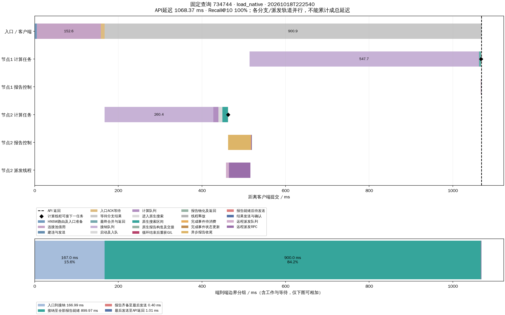

# C++ 完成报告与发送路径：实现及验证

已实现可选`peer.control.scheduler: native`。本地C++搜索在释放GIL期间构造并提交完整报告；独立C++事件线程处理完成/派发结算，原生MessagePack和非阻塞TCP reactor发送结果并处理ACK。计算线程不等远端ACK或子分支完成。入口接纳、计算提交、远程派发及头节点merge仍由Python执行。

本轮明确结论：报告控制队列的长等待已大幅减少，同负载端到端p99约降低25.9%，QPS约提高32.8%；系统等待低于100ms仍未达成，主要残余是接纳队列。没有把移除某一个等待阶段当作整体达标。

## 固定条件与可复现性

- 完整seq_2M已有索引，本机三个独立TCP数据进程；不重建索引，不复制数据集。
- 每节点32固定计算线程，远程派发16线程；native控制为1事件线程+1reactor，event控制发送为16线程。
- 同一组2000查询，20客户端进程×100线程同时释放，预算200，top-k=10；40条总预热查询不计入结果。两组只改变控制scheduler及输出目录。
- 接纳shared/1消费者，连接池reserved/每目标2连接，GIL切换0.1ms。全体生命周期追踪，只为固定查询734744保存详细批次轨迹。
- 热页缓存、同步buffered pread；所有负载轮物理read_bytes增量均为0。本轮不代表冷SSD及物理三机性能。
- 依次event/native/native/event，单请求对照在前。源码与原生模块冻结于[sources.json](sources.json)及[snapshot/](snapshot/)，每组运行前核验哈希。
- 正式六轮清单[final_runs.json](final_runs.json)。`single_native/runs/20261018T220139`是较早构建的烟测，不纳入最终比较。

2000是同时释放的工作线程数量；实际峰值在途如下，未降低客户端负载。使用相同的全库真值来源，平均Recall@10超过.95，不代表每条query均达到.95。只有两次负载重复，不主张统计显著性或普遍最优。

| 路径/时间戳 | 成功/失败 | 平均API ms | API p99 ms | QPS | Recall@10 | 实际峰值在途 |
|---|---:|---:|---:|---:|---:|---:|
| event 222500 | 2000/0 | 1373.98 | 1731.30 | 1118.72 | 97.000% | 1989 |
| native 222520 | 2000/0 | 776.32 | 1257.43 | 1516.39 | 97.000% | 1946 |
| native 222540 | 2000/0 | 779.58 | 1286.67 | 1479.79 | 97.005% | 1945 |
| event 222559 | 2000/0 | 1349.12 | 1700.46 | 1138.03 | 97.010% | 1992 |

单请求无预热，仍为查询734744：event 41.29ms，native 39.00ms，均Recall@10=1。单次样本只验证无排队路径，不能证明低负载普遍加速。单查询QPS包含启动释放间隔，不用它衡量稳态吞吐。

## 等待是否消除

以下按**分支**统计，两轮范围；不能把均值或p99直接相加成查询延迟。原生报告提前发出后，Python工作线程可能稍后才可复用。

| 阶段 | event平均 ms | native平均 ms | event p99 ms | native p99 ms |
|---|---:|---:|---:|---:|
| 接纳队列 | 409.23–460.71 | 417.77–426.84 | 837.87–863.77 | 734.48–735.23 |
| 计算队列 | 0.49–29.74 | 1.36–1.55 | 13.78–310.51 | 12.88–14.50 |
| 完成事件入队→消费 | 133.16–178.78 | 0.071–0.079 | 312.41–557.47 | 0.635–0.767 |
| 报告就绪→发送槽 | 280.91–298.56 | 0.412–0.661 | 611.38–712.23 | 0.693–13.928 |
| 搜索循环结束→工作线程释放 | 1.93–4.28 | 1.91–2.18 | 19.31–30.00 | 12.56–19.29 |
| 搜索循环结束→最终报告就绪 | 249.13–292.06 | 6.87–7.98 | 528.77–628.59 | 88.06–108.96 |

最后一行还包含已批准派发的确认，不能用来判断完成事件队列是否拥塞。native原生报告构造平均约0.113ms、p99约0.25ms；这一步与GIL恢复分开计时。完成事件队列最大1.77ms、报告就绪→发送最大86.73ms。线程释放最大29.69ms，没有计算线程等待子分支的证据。

已观测队列按query取并集，扣除与同query路由/原生搜索重叠后：event平均1221.50–1241.71ms、p99 1667.18–1700.58ms；native平均745.43–747.91ms、p99 1212.10–1240.87ms。native分别1929/2000及1893/2000条超过100ms。该值不是完整off-CPU profile，也不等于CPU忙轮询，但足以判定当前整体目标未达成。

直接证据支持下一步检查Python接纳/提交、入口连接池和远程派发；不能仅依据本地距离计算很短就断言线程有空，服务吞吐还受每任务的接收、状态登记、GIL调度与消息处理约束。本轮未将这些尚待验证的瓶颈一并改写。

## 固定查询734744的时序

使用此前就选定的查询，不按结果挑选最优样本。以下为native第二轮，API1068.37ms，Recall@10=1。



| 事件或区间 | 相对提交时间/耗时 |
|---|---:|
| 入口路由与提交准备 | 5.26ms |
| 入口连接池借用 | 152.61ms |
| 节点2接纳→出队 | 166.99→427.37ms，等待260.38ms |
| 节点2原生搜索 | 449.18→462.00ms，12.81ms |
| 节点2计算线程释放 | 462.84ms |
| 节点2报告完成事件等待 | 0.087ms |
| 节点2控制路径等待派发结算等 | 54.57ms |
| 节点2报告就绪→发送 | 1.406ms |
| 节点1接纳→出队 | 513.84→1061.57ms，等待547.73ms |
| 节点1原生搜索 | 1063.63→1066.70ms，3.07ms |
| 节点1报告完成事件等待 | 0.013ms |
| 节点1报告就绪→发送 | 0.397ms |
| 节点1计算线程释放 | 1067.38ms |
| API返回 | 1068.37ms |

父节点释放早于子节点开始约601ms，说明计算线程没有拿着资源等子分支。剩余大块等待位于接纳和入口连接池；其中池借用包含容量与调度，不是纯网络传输时间。

本查询200次pread共2457600文件字节（2.344MiB），pread累计0.677ms、RaBitQ累计3.029ms、精确距离累计2.353ms；这些是跨分支工作量，不能独立拼成端到端时延。原生搜索区间也包括回调和线程调度，不是纯CPU算术。完整数值在[时序CSV](analysis/load_native/20261018T222540/query_timeline.csv)、[查询记录](analysis/load_native/20261018T222540/selected_query.json)。

[同查询event对照图](analysis/load_event/20261018T222559/query_timeline.png)；[单请求native图](analysis/single_native/20261018T222448/query_timeline.png)。

## 网络、磁盘和CPU

四个负载轮都维持每query平均200扩展/200次pread/2457600文件字节。物理读取为0表示命中OS页缓存，不能描述为SSD执行了这些读取。

平均协议RPC：event 2.727–2.746，native 3.046–3.049；平均协议字节：event31484.73–31497.50，native31592.60–31614.36。native没有实现网络聚合，也没有减少RPC。原因可由消息计数核验：native及时发送了697/699次心跳，event仅96/59次；结果RPC与分支数2697–2699一致，没有重复分支搜索。派发涉及节点的保活通知更加及时，Python排队中的通知有更多机会与后来的结果合并。

节点平均使用核数（CPU秒/metrics取样窗口）：event节点0/1/2约5.34–5.46/4.17–4.34/2.74–2.88；native约6.90–7.09/5.20–5.31/3.40–3.45。窗口含取样与结束回收，不能当作精确搜索期间利用率。平均搜索线程CPU工作量约从10.38–10.51ms变为10.06–10.15ms，端到端收益主要来自控制等待减少，不是距离计算突然提速。全部逐query指标、资源记录保留在各run目录。

## 正确性与边界

[regression_final.log](regression_final.log)：222项回归通过，包括GIL被持有100ms而独立入口仍收到原生报告、ACK丢失重发冻结结果、取消/到期、心跳在途完成、派发失败/顺序、重复身份拒绝、超大消息、关闭及保留期。

[audit.log](audit.log)和[all_runs_verification.json](all_runs_verification.json)：正式8002条请求全部成功；无指标缺失、预算超额、节点重复访问或计算线程迁移，每个child对应批准的远端决策。队列/发送/原生事件排空，失败与容量拒绝为0，服务和客户端均正常退出。图顶点副本可跨节点重复扩展，计入预算；“节点不重复访问”不等同于“全局顶点完全无重复”。

原生内部仍使用必要的队列/状态短锁、条件变量和原子取消状态，未承诺无锁或硬实时。命令队列有观测而无独立硬容量。正常接纳受已有容量约束。原生发送配置仅支持同步pread/TCP等明确组合；异步SSD仍使用旧控制路径。入口接纳和远程派发没有原生化，是明确的后续范围。

## 使用及复验

完整运行参数见[load_native/experiment.yaml](load_native/experiment.yaml)，生产说明见[DESIGN §11.15](../../DESIGN.md#1115-c-完成事件报告控制和非阻塞发送已实现2026-10-18)。项目根目录编译现有配置：

```sh
cmake --build build-full -j 4
.venv/bin/python test/native_control_20261018/run_suite.py --tests --test-log regression_repeat.log
.venv/bin/python test/native_control_20261018/run_suite.py --groups single_event single_native load_event load_native load_native load_event
```

runner会拒绝源码哈希变化，避免无意比较不同构建；有意修改代码时应新建实验目录/manifest。新运行不会自动进入本报告固定的final_runs.json，以免覆盖已经归档的结论。

```sh
.venv/bin/python test/native_control_20261018/audit_all.py
.venv/bin/python test/native_control_20261018/wait_breakdown.py
.venv/bin/python test/native_control_20261018/summarize.py
.venv/bin/python test/native_control_20261018/plot_query.py load_native --run 20261018T222540
```

机器可读总表：[comparison.csv](comparison.csv)、[comparison.json](comparison.json)。原始report为gzip，节点时间戳/控制事件在node_process_load中，逐query结果另存queries.jsonl.gz和queries.csv。图中ACK可能晚于API返回，分支轨道并行，不应累计为总时长。
