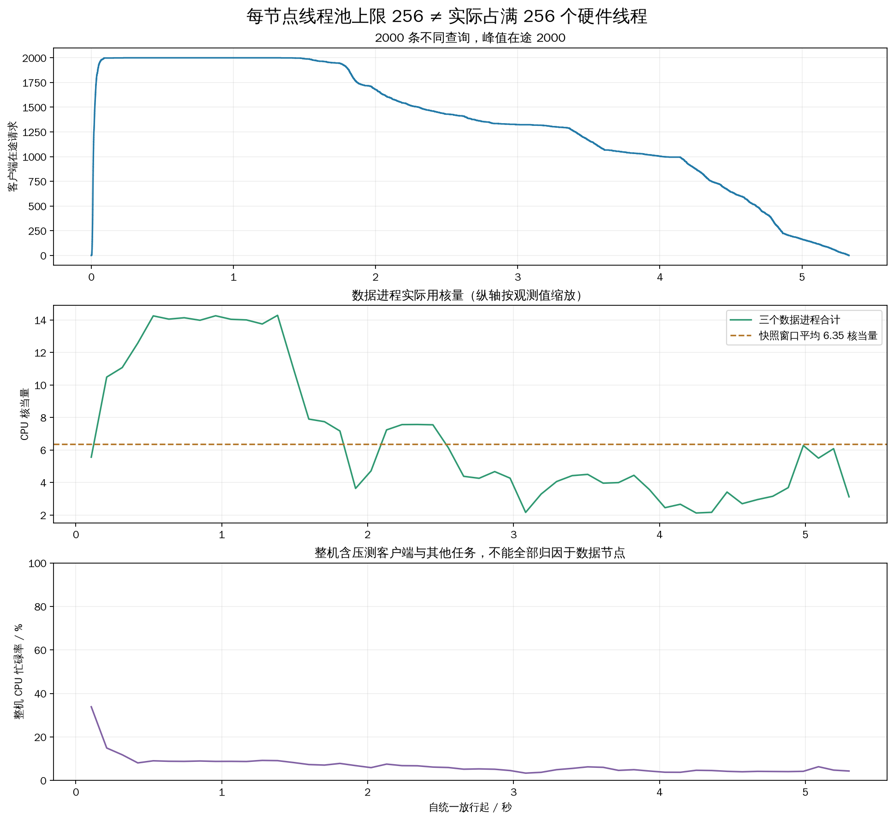

# 256 线程池上限、2000 条查询测试

完成 2000 条不同查询测试，实际客户端并发峰值 **2000**。三个数据进程合计平均使用 **6.347 CPU 核当量**，相当于整机 256 个硬件线程的 **2.48%**；采样峰值约 **14.284 核当量**。**本次没有实现 CPU 满载，不能把线程池配置成 256 称为跑满。**

## 配置与测试范围

2026-10-18，Intel-35 本机三个 TCP 数据服务；整机 4 路 Xeon Gold 6448H、128 个物理核、256 个硬件线程，所有测试进程可调度到 CPU 0–255。未绑定 CPU、未做 NUMA 内存绑定。三个进程共享这台机器，不是三个各有 256 硬件线程的物理节点。

每个数据节点 peer.worker_threads=256，三进程线程池上限合计 768。线程池按需创建线程，768 不是实际运行线程数或硬件核数；该设置允许某个较忙分片使用较多线程，整体仍由 OS 在 256 个硬件线程上调度。查询在每个分支内由固定计算线程执行，不让多个线程共同计算一个分支。未增加无关的忙循环或后台负载来制造满载。

完整 200 万条 × 2560 维索引，未归一化 L2、1-bit RaBitQ、top-k 10、全局扩展预算 200、frontier 64、local_beam 4、sync_pread、应用缓存 0、详细 trace 开启。索引复用，未重新构建。

20 个客户端进程 × 100 个查询工作线程，共 2000 个并发槽；每进程共享只读路由元数据，各预热 2 条，共 40 次预热不计入测试。2000 条不同查询只执行一次：保留此前 1024 条验证查询，再用固定种子 202610182000 从剩余查询补充 976 条，排除此前 128 条校准查询。总查询数有限，因此并发只在开始阶段接近满额，随后下降，不是稳态满载实验。

为了避免上轮容量拒绝遮蔽计算表现，本次实验 YAML 调整如下；生产代码与默认配置未改。

| 参数 | 上轮 | 本轮 |
|---|---|---|
| peer.worker_threads | 32 | 256 |
| peer.max_active_queries | 128 | 2048 |
| network.listen_backlog | 128 | 4096 |
| peer.control_timeout_seconds | 1 | 5 |
| peer.handoff_timeout_seconds | 5 | 30 |
| peer.lease_timeout_ms | 5000 | 30000 |
| peer.heartbeat_interval_ms | 250 | 1000 |
| 客户端并发 | 3000 | 2000 |
| 查询总数 | 6144 | 2000 |

控制超时和租约放宽是为减小高并发下的过早失败，不能视为性能优化收益。本轮改变多个参数，不能单独用来证明增加工作线程的因果效果。

## 查询结果

| 指标 | 结果 |
|---|---|
| 成功 / 失败 | 2000 / 0 |
| 成功 QPS | 375.169 |
| 全部完成 QPS（含失败） | 375.169 |
| 计时窗口 / 秒 | 5.331 |
| 成功平均延迟 / ms | 3588.497 |
| 成功 p50 / ms | 4007.153 |
| 成功 p95 / ms | 5125.966 |
| 成功 p99 / ms | 5270.134 |
| 成功最大延迟 / ms | 5324.759 |
| 成功请求平均 Recall@10 | 97.0250% |
| 全部请求平均 Recall@10（失败记0） | 97.0250% |
| 成功且指标完整 | 2000 |
| 成功但指标不完整 | 0 |

错误分类：`{}`。外层延迟包含调用返回前的失败清理；原始失败内部 stats.latency_ms 可能在清理前记录，因此保留两者，避免低估失败等待。

## CPU 利用率、工作线程与节点负载

| 节点 | 平均 CPU 核当量 | 快照窗口 / 秒 | 成功分支使用过的计算线程数* | 结束 RSS / GiB | 物理读取 B |
|---|---|---|---|---|---|
| 0 | 2.685 | 5.735 | 250 | 1.126 | 0 |
| 1 | 2.182 | 5.737 | 256 | 1.028 | 0 |
| 2 | 1.479 | 5.739 | 209 | 0.800 | 0 |

*计算线程数按成功分支的原生 compute_thread_id 去重，表示整个窗口用过多少线程，不表示同时忙碌数量；失败分支可能缺少对应记录。线程是否一直占用 CPU 应查看 CPU 时间增量，不能用 OS 线程数量或在途查询数代替。

CPU 核当量定义为进程 user+system CPU 秒 / 快照窗口秒；一个硬件线程持续执行约为 1 核当量。占全机比例按 256 个逻辑 CPU 归一化，超线程共享物理核心资源，不代表线性算力倍数。每 0.1 秒左右采样数据进程和整机计数，实际间隔受调度影响；峰值基于实际采样间隔计算。

整机各逻辑 CPU 窗口平均忙碌率的均值为 6.59%，其中窗口平均忙碌率 ≥80% 的逻辑 CPU 有 0 个。整机统计还包含压测器和其他用户进程，不归因于 DHDGS 数据服务。详见 [逐逻辑 CPU CSV](logical_cpu_utilization.csv)。

## 时间消耗与未跑满的原因

| 成功请求阶段 | 平均 ms | 占内部端到端时间 |
|---|---|---|
| 结果合并与生命周期清理 | 347.576 | 9.69% |
| 数据执行与控制等待 | 3152.968 | 87.87% |
| 路由与入口 | 87.639 | 2.44% |

以下均值仅来自指标完整的成功请求，是跨分支累加的时间，不可与上表相加：

| 累计时间 | 平均 ms |
|---|---|
| 就绪排队 | 6.957 |
| 分支执行区间 | 14.326 |
| 派发收尾等待 | 868.658 |
| 搜索线程 CPU | 11.573 |
| 文件读取调用 | 0.686 |
| 精确距离 | 1.840 |
| RaBitQ 估距 | 3.500 |

本轮验证的是“放大线程池和接纳上限后是否自然用满 CPU”。结果表明当前完整检索路径仍不足以持续供给 256 个硬件线程：2000 条查询中的相当一部分时间消耗在查询生命周期、控制回传及等待，而不是搜索线程持续计算。每查询预算只有 200，单个 C++ 搜索分支的计算任务较短。

本轮还有一个明确的独立并发限制：search.max_inflight 仍为 3，PeerRuntime 用它配置每节点的跨节点派发线程池。计算工作线程完成原生搜索后，会等待自己提交的派发 future 完成；这部分属于 query_transfer_finalize_wait_ms，包含派发排队及执行完成等待，不是 CPU 计算。本轮该项每查询跨分支累计平均约 868.658 ms，明显高于分支执行区间的 14.326 ms。此处是值得优先隔离验证的等待点；未实测调大派发池的收益，不能直接宣称已确定唯一瓶颈。

从现有代码看，每查询创建回调监听线程、服务端逐条发送控制/结果消息、Python 入口和协议处理仍是潜在限制；放大数据线程池不会自动并行化这些路径。该机制解释不能代替各瓶颈的独立剖析，本次没有将全部等待武断归为 GIL 或网络。要进一步实现真实 CPU 满载，应先优化并验证派发/入口/控制路径的并发处理，再以持续负载观察吞吐和尾延迟，而不是继续单纯增加线程数。

## 网络、磁盘和搜索工作量

完整成功请求子集均值如下；失败或控制计数不完整请求不外推网络总量。

| 指标 | 平均 / 完整成功请求 |
|---|---|
| 全部协议 RPC 次数 | 8.212 |
| 应用协议字节 | 69212.310 |
| 跨节点扩展次数 | 0.348 |
| 最大已扩展图深度 | 10.842 |
| 扩展顶点数 | 200.000 |
| 逻辑读取字节 | 2457600.000 |

三个数据进程物理读取增量合计 0 B；buffered pread 保留页缓存，不能把本轮当作冷 SSD 测试。逻辑读取包含失败查询也可能已经执行的工作，和返回成功请求累加量不必相等。

## 审计、记录与复现

核验全部 2000 个查询身份唯一、冻结选择与排除校准集合、召回重算、原始记录一致性和源代码哈希。对成功查询核验预算 ≤200、父子预算守恒、远端扩展批准、无数据节点回访、固定原生计算线程，并独立复算 32 条成功查询的 320 个距离。失败查询没有完整分支状态，不声称其全部内部过程已审计。20 个客户端正常退出，三个测试服务均正常 SIGTERM 停止。

- [实验 YAML](experiment.yaml)；[驱动参数](load_plan.yaml)；[CPU 汇总](cpu_summary.json)；[核验记录](verification.json)。
- [查询明细](runs/20261018T101438/queries.csv)；[原始逐查询记录](runs/20261018T101438/queries.jsonl.gz)；[完整报告数据](runs/20261018T101438/report.json.gz)。
- [资源采样](runs/20261018T101438/resource_samples.json.gz)；[逐查询阶段耗时](runs/20261018T101438/per_query_stage_means.csv)。
- [CPU 时间序列](cpu_timeseries.csv)；[图表 SVG](cpu_load.svg)。
- 本目录 run_load.py 执行测试，analyze.py 重做记录审计与图表。所有实验参数放在 YAML 中；测试需要本机 TCP 权限，索引通过本目录 index 符号链接复用。
