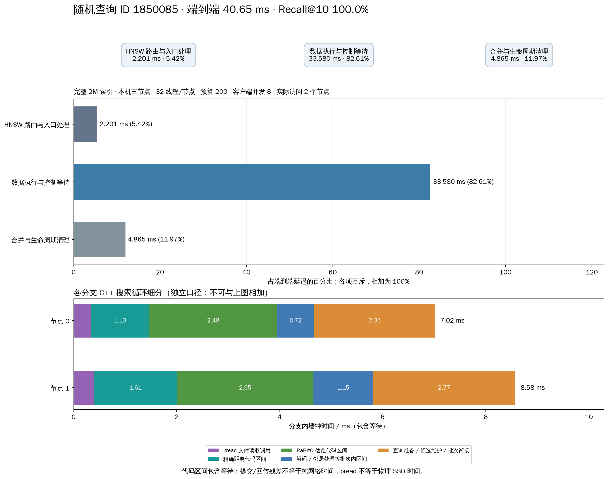
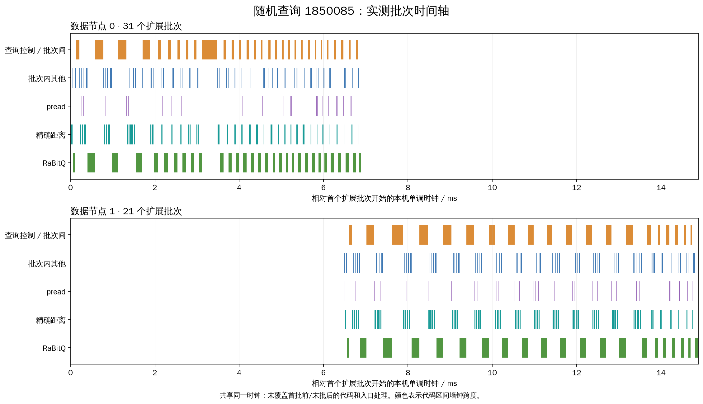

# DHDGS：32 线程、搜索预算 200 测试报告

2026-10-18，完整 200 万条索引、1,024 条固定验证查询。全部成功，平均 Recall@10 **97.4512%**、QPS **152.96**、平均延迟 **52.14 ms**、p99 **258.84 ms**。平均召回达到 95% 目标，但并非每个查询都达到该目标。

## 配置与实验范围

Intel-35 本机三个独立 TCP 数据进程（127.0.0.1:19731–19733），不是三台物理服务器。每节点最多 32 个计算工作线程，客户端并发 8；每个查询在每个访问节点上由一个固定 C++ 计算线程执行，跨节点分支可并行。全局顶点扩展预算 200，在父子分支间分配，不是每个节点分别扩展 200。

完整索引：2,000,000 × 2560 float32，未归一化的 L2；1-bit RaBitQ，top-k=10、排除自身、frontier=64、local_beam=4、remote_weight=1、child_budget_fraction=0.5、备用入口开启（最多 2）。本次仅改变实验 YAML，不修改搜索实现或项目默认值。

同步 buffered pread；应用缓存为 0，Linux 页缓存保留。详细 trace 开启，BLAS 线程 1。未启用 io_uring，也未在本轮测试跨查询异步读取聚合。

CPU：4 × Xeon Gold 6448H，128 物理核 / 256 逻辑 CPU；可见内存约 2.1 TiB。索引所在设备 /dev/nvme2n1，NVMe 3.5 TiB，运行前可用约 19 GiB；复用索引符号链接，无额外复制。完整信息见 [environment.txt](environment.txt)。

冻结验证集来自 200K 查询，与此前 128 条校准查询不重叠；真值通过 FullTruth 验证完整数据身份、查询和 L2 定义。每个客户端先预热 2 条，共 16 次预热不计入结果；正式每条一次，共 1,024 次，计时窗口 **6.694 秒**。QPS=成功请求数/整个计时窗口。该窗口较短、无重复轮次，p99 和吞吐仅作为一次实测，不给统计显著性结论。

## 总体延迟与召回

| 指标 | 结果 |
|---|---|
| QPS | 152.965 |
| 成功 / 失败 | 1024 / 0 |
| 平均 Recall@10 | 0.974512 |
| 延迟 mean / ms | 52.137 |
| 延迟 p50 / ms | 40.605 |
| 延迟 p90 / ms | 54.537 |
| 延迟 p95 / ms | 104.359 |
| 延迟 p99 / ms | 258.843 |
| 延迟 max / ms | 637.799 |
| 单查询达到 Recall@10 ≥ 0.95 的比例 | 91.6016% |

Recall@10 以 0.1 为步长，因此单查询达到 0.95 实际要求 1.0。平均值不会反映全部困难查询；本轮存在 8 条 Recall@10=0 的查询，后续应单独分析这些查询的路由和搜索路径。

| 单查询 Recall@10 | 查询数 |
|---|---|
| 0.0 | 8 |
| 0.1 | 3 |
| 0.2 | 1 |
| 0.3 | 1 |
| 0.4 | 2 |
| 0.5 | 3 |
| 0.6 | 4 |
| 0.7 | 6 |
| 0.8 | 20 |
| 0.9 | 38 |
| 1.0 | 938 |

## 查询各阶段平均耗时

下面采用“所有查询该阶段耗时之和 / 所有查询端到端耗时之和”计算占比，三阶段互斥、合计 100%。

| 阶段 | 平均 ms / query | 占总延迟 |
|---|---|---|
| HNSW 路由与入口处理 | 3.7246 | 7.14% |
| 数据节点执行与控制等待 | 35.2838 | 67.68% |
| 顶层结果合并与生命周期清理 | 13.1283 | 25.18% |

以下是每个查询跨分支累计的工作时间。分支可能并行，这些值与上表口径不同，不能直接除以端到端延迟作为互斥的占比；CPU 时间也不能与墙钟代码区间相加。

| 累计时间口径 | 平均 ms / query |
|---|---|
| pread 调用墙钟 | 0.6371 |
| 精确距离区间 | 1.8641 |
| RaBitQ 候选估距区间 | 3.7158 |
| 扩展批次 service 总时间（包含前三项） | 7.3287 |
| 数据搜索线程累计 CPU | 11.5381 |
| 分支就绪队列等待 | 0.4207 |
| 计算执行区间墙钟（包含同步读取） | 11.9689 |
| 分支传输 / 最终处理等待 | 0.1023 |
| 分支状态其他区间 | 0.0499 |

`query_io_wait_ms=0` 表示本轮未走异步挂起状态；同步 pread 时间计入执行区间，并非没有读文件。RaBitQ 查询准备属于分支准备区间，不包含在候选估距统计中。纯网络等待、物理 SSD 等待、GIL 等待没有独立可靠计时，报告不为它们捏造占比。

## 网络、磁盘、搜索深度与计算量

| 指标 | 平均 / query | p99 | 最大 |
|---|---|---|---|
| 全部协议 RPC 次数 | 6.282 | 11.000 | 14.000 |
| 路由器初始提交 RPC | 1.000 | 1.000 | 1.000 |
| 数据节点间分支提交 RPC | 0.351 | 1.000 | 2.000 |
| 控制 / 结果 RPC | 4.932 | 9.000 | 11.000 |
| 实际跨节点搜索扩展次数 | 0.351 | 1.000 | 2.000 |
| 全部应用协议字节 | 68954.617 | 92389.330 | 103777.000 |
| 控制 / 结果协议字节 | 51890.435 | 55380.170 | 59382.000 |
| 逻辑文件读取字节 | 2457600.000 | 2457600.000 | 2457600.000 |
| pread 调用次数 | 200.000 | 200.000 | 200.000 |
| 扩展顶点数 | 200.000 | 200.000 | 200.000 |
| 去重扩展顶点数 | 196.247 | 200.000 | 200.000 |
| 副本重复扩展次数 | 3.753 | 43.000 | 55.000 |
| 单查询最大已扩展图深度 | 10.808 | 21.000 | 28.000 |
| 单查询最大跨节点深度 | 0.351 | 1.000 | 2.000 |
| RaBitQ 估距次数 | 6359.245 | 8371.000 | 8928.000 |
| 精确距离次数 | 200.000 | 200.000 | 200.000 |

全部应用协议流量合计 67.338 MiB；不包含 TCP/IP 头或 TCP 重传，是本机 loopback 上的应用层计量。控制 RPC 分类总数：`{'heartbeat': 1251, 'result': 1383, 'lease': 1033, 'cancel': 1383}`。result 包含 top-k 和详细统计/trace，因此详细追踪会增加回传字节和序列化成本。heartbeat/lease/cancel 不是重新执行图搜索。

354/1024（34.57%）查询访问了多个节点；实际跨节点扩展共 359 次。分支数分布：`{1: 670, 2: 349, 3: 5}`。路由器中间扩展 RPC 为 0，数据节点回访为 0。跨分片副本仍会导致相同向量被不同节点扩展，与节点回访是两回事。备用入口触发查询占比 7.52%。

本轮逻辑读取总计 2.34375 GiB，每查询 200 次 pread × 12 KiB = 2.34375 MiB。每条记录含向量和邻接信息；本次路径逐记录同步读，没有跨查询异步聚合。三个服务在计量窗口内的 `/proc` 物理读取增量之和为 **0 B**。这说明读请求由热页缓存满足，本次无法评价真实 SSD 随机读延迟、IOPS 或冷缓存性能。

图深度是搜索发现链上的最大深度，不等于扩展顶点总数，也不等于串行网络往返次数。

## 各数据节点负载

| 节点 | 执行分支数 | 扩展顶点总数 | 平均 CPU 核当量 | 结束时 RSS / GiB | 峰值活动分支* | 物理读取 B |
|---|---|---|---|---|---|---|
| 0 | 534 | 89821 | 1.099 | 1.023 | 6 | 0 |
| 1 | 495 | 59966 | 0.810 | 0.958 | 5 | 0 |
| 2 | 354 | 55013 | 0.591 | 0.743 | 4 | 0 |

三个数据进程平均 CPU 核当量合计 **2.500**，不包含客户端/入口进程。扩展负载最大值/均值 1.316，变异系数 0.225。RSS 不包含全部共享页缓存，不能把 RSS 当作整个系统的内存占用。

峰值活动分支从服务启动开始统计，可能包含预热，且不等于同一时刻真正使用 CPU 的线程数。客户端最多 8 个查询在途，每查询每节点最多一个活动分支；因此本轮无法让单节点的 32 个工作线程同时忙于 32 条查询。这是 32 线程配置的并发 8 测试，不是 32 线程饱和吞吐测试。

## 构建、启动与正确性

本次复用现有 26.42 GiB 索引，未重新构建。原构建记录为 2510.979 秒（约 41.85 分钟），build_stages.csv 是历史构建指标。此次三个服务启动耗时 16.813 秒；客户端各自加载路由/元数据约 8.20–8.30 秒。它们均不计入查询 QPS 窗口。

核验通过：1,024 个冻结 query row；逐查询召回重算；JSONL 与总报告一致；全部预算 ≤200；父子预算守恒；每次子分支有扩展函数批准；无节点回访、无计算线程迁移、无控制错误；源码与原生模块哈希未变。另使用原始 float32 向量转 float64，独立复算 32 条查询的 320 个返回距离。三个测试服务均已停止，退出码 -15 是测试框架的正常 SIGTERM 清理。详见 [verification.json](verification.json)。

初次在沙箱启动被禁止 TCP socket，未执行查询；失败尝试的日志保留在 execution.log 和较早的 runs 目录中。授权后的正式运行完整成功。此次仅参数测试，不重复运行此前已通过的 79 项实现回归。

## 随机查询：阶段耗时与时间轴

测试前固定种子 2026101832200，从按 query_row 排序的全部 1,024 条请求中均匀抽取，不按召回、延迟或分支数筛选。选中 query ID **1850085**（row 184901），Recall@10=1.0，延迟 **40.646 ms**。



| 端到端阶段 | ms | 占比 |
|---|---|---|
| HNSW 路由与入口处理 | 2.2014 | 5.42% |
| 数据执行与控制等待 | 33.5795 | 82.61% |
| 合并与生命周期清理 | 4.8653 | 11.97% |

该查询由节点 0 进入，完成 37 次本地扩展后批准节点 1 分支，将 81 个剩余扩展预算交给节点 1；节点 0 继续本地执行。最终节点 0 扩展 119 个、节点 1 扩展 81 个，合计 200；重复副本扩展 5 次。两个分支分别耗时如下，属于分支内部口径，不可相加当作端到端延迟。

| C++ 循环区间 | 节点 0 / ms | 节点 1 / ms |
|---|---|---|
| pread 文件读取调用 | 0.3363 | 0.3937 |
| 精确距离代码区间 | 1.1313 | 1.6106 |
| RaBitQ 估距代码区间 | 2.4826 | 2.6501 |
| 解码 / 邻居处理等批次内区间 | 0.7178 | 1.1527 |
| 查询准备 / 候选维护 / 批次衔接 | 2.3489 | 2.7695 |
| 循环总墙钟 | 7.0169 | 8.5766 |



时间轴根据实际 trace 绘制，已核验所有进程共享单调时钟域、单分支批次互斥以及细分区间与累计字段一致。横轴以首批次开始为零，未包含首批前/末批后或入口端代码；不能据此把未显示区间统称为网络等待。分支 CPU 字段还包括 Python 边界和报告处理，与 C++ 循环墙钟范围不同，不直接计算二者比值。

这条查询共 8 次协议 RPC：1 次初始提交、1 次数据节点间派发、2 次结果回传、1 次 heartbeat、1 次 lease、2 次清理 cancel。共 82,213 应用协议字节；pread 累计 0.7300 ms。

## 与上一轮结果的关系

| 配置 | QPS | 平均 ms | p99 ms | Recall@10 |
|---|---|---|---|---|
| 前轮 8线程 / 预算192 | 157.04 | 50.75 | 236.66 | 97.2852% |
| 本轮 32线程 / 预算200 | 152.96 | 52.14 | 258.84 | 97.4512% |

观察值：QPS 变化 -2.59%、p99 变化 +9.37%。两轮同时改变线程数和预算，预热条件/运行时间也不同，且均为短窗口单次测量；不能据此认定 32 线程造成退化。本轮没有展示出超过前轮的性能收益。

按你优先最低 p99 的标准，目前不能据此推荐把默认工作线程提升到 32。下一步若要隔离原因，应固定预算 200，比较 8/16/32 工作线程，在客户端并发 8 和 32 下重复较长窗口；另把 trace 开关作为独立变量，核验结果回传和生命周期耗时。真实 SSD 性能应另做明确缓存条件的独立实验；本次未自动清空系统页缓存。

## 文件与复现

- [实验 YAML](experiment.yaml)：全部运行参数。
- [逐查询 CSV](runs/20261018T093134_053520/queries.csv)：每条请求的延迟、召回和开销。
- [逐查询阶段均值](runs/20261018T093134_053520/per_query_stage_means.csv)；[全体阶段均值](runs/20261018T093134_053520/query_stage_means.csv)。本轮每条一次，逐查询均值等于本次观测。
- [节点资源](runs/20261018T093134_053520/process_load.csv)；[原始完整报告](runs/20261018T093134_053520/report.json.gz)；[逐查询原始记录](runs/20261018T093134_053520/queries.jsonl.gz)。
- [随机选择记录](query_latency/selection.json)；[原始随机查询](query_latency/selected_query.json)；[图表数值](query_latency/breakdown.json)。
- 图表同时保留 PNG 和 SVG；[耗时图 SVG](query_latency/latency_breakdown.svg)、[时间轴 SVG](query_latency/local_timeline.svg)。
- source_manifest.json 保存运行前源码/原生模块/配置哈希，artifact_manifest.json 保存最终实验产物哈希。大体积原始记录仅保留本机。

从工作区根目录运行（需要允许本机 TCP socket）：

```sh
gene_database/DHDGS/.venv/bin/python gene_database/DHDGS/test/native_search_20261018/run_config.py --config gene_database/DHDGS/test/native_w32_b200_20261018/experiment.yaml
gene_database/DHDGS/.venv/bin/python gene_database/DHDGS/test/native_w32_b200_20261018/analyze.py
```

重新测试请先复制 YAML 并更换 paths.output，防止把多个轮次混入本报告；analyze.py 对本实验目录要求只有一个成功轮次。只重画本次图表和重做审计，直接运行第二条命令。
