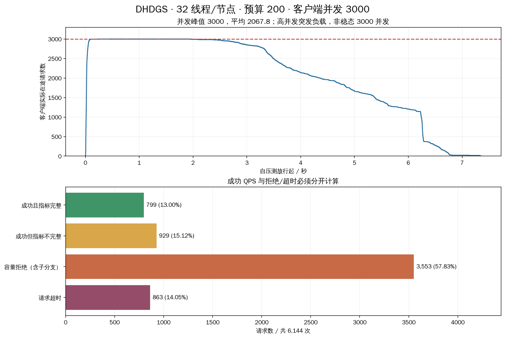

# 3000 客户端并发：32 线程、预算 200 压测

本次达到真实客户端在途请求峰值 **3000**。共 6,144 次请求，成功 **1728**、失败 **4416（71.88%）**。成功 QPS **234.96**，成功请求平均延迟 **2.860 秒**、p99 **6.728 秒**。当前配置不能稳定承受该压力。

## 配置、范围与并发定义

完整 2M × 2560 索引，Intel-35 本机三个独立 TCP 数据进程；每节点 32 个 C++ 计算工作线程，全局扩展预算 200、frontier 64、top-k 10、原始 L2、RaBitQ、sync_pread、应用缓存 0、详细 trace 开启。服务端参数与上一轮一致：max_active_queries=128/节点、listen_backlog=128、handoff_timeout=5秒、control_timeout=1秒、heartbeat_interval=250ms、lease_timeout=5秒。未调大接纳限制或修改生产搜索代码。

旧驱动逐客户端完整复制 Engine 会创建 3000 份路由/位置字典。此次使用实验目录中的独立驱动，30 个客户端进程 × 每进程 100 个工作线程；每进程共享一份只读 Engine，查询状态仍逐请求独立，正常调用原有 Engine.search。原生 HNSW 固定 ef 后可并发只读搜索，RaBitQ score 使用局部查询状态。每个进程预热 2 次（共 60 次，不计时），所有 3000 个工作线程就绪后统一放行。

沿用前轮冻结的 1024 条验证 query row，每条重复 6 次，共 6144 请求；每线程最多一个查询在途。任务按 job % 30 分配到进程，各进程线程从本地任务队列领取；末尾部分进程先耗尽任务，因此并发会下降。既有全量真值按请求 query ID / row 核验，未重做全库暴力扫描。

计时窗口 **7.354 秒**，包含放行后请求调度及最后一次搜索调用返回，排除引擎加载、预热、结果压缩收尾和真值核验。实际在途按 Engine.search 调用进入至返回（含失败清理）的单调时钟区间重建：峰值 3000、均值 2067.78；≥2500 请求持续 3.464 秒，恰为 3000 持续 1.622 秒。客户端在途不等于服务端已接纳分支数或同时占用的 CPU 数。

这是一次有限请求集的高并发突发/过载测试，不能视为长期保持 3000 并发的稳态吞吐。压测器/入口处理与数据节点在同一物理机器上运行，争用同一主机资源。与前轮相比，客户端从单进程 8 份 Engine 改成 30 进程共享元数据，预热和请求总数也变化，不能把差异全部归因于并发数。

## 吞吐、延迟与召回

| 指标 | 结果 |
|---|---|
| 成功请求数 | 1728 |
| 失败请求数 | 4416 |
| 成功率 | 28.12% |
| 成功 QPS | 234.965 |
| 全部完成 QPS（含拒绝/超时） | 835.429 |
| 成功且指标完整的请求数 | 799 |
| 成功且指标完整的 QPS | 108.644 |
| 成功请求平均 Recall@10 | 97.9977% |
| 所有请求平均 Recall@10（失败记 0） | 27.5618% |

“成功且指标完整”是更严格的统计口径，不要求单条召回达标。失败请求不从总分母中删除；成功请求子集可能存在选择偏差，其较高召回不能解释为并发提升了质量。

| 延迟 / ms | 成功请求 | 失败请求 | 全部请求 |
|---|---|---|---|
| mean | 2859.725 | 2324.606 | 2475.108 |
| p50 | 2365.130 | 1620.023 | 1870.901 |
| p90 | 5599.225 | 6234.807 | 6231.087 |
| p95 | 6580.200 | 6247.275 | 6250.263 |
| p99 | 6727.652 | 6260.015 | 6674.222 |
| max | 6785.705 | 7342.352 | 7342.352 |

延迟以客户端外层完整调用计时，包含异常后的清理。原始失败 stats.latency_ms 可能在异常清理前取值，因此本报告失败延迟和总体延迟使用 client_wall_ms；原始值仍完整保留。

## 失败与指标不完整

| 错误 | 次数 |
|---|---|
| TimeoutError: timed out | 863 |
| RuntimeError: Peer branch capacity exceeded | 3073 |
| RuntimeError: RuntimeError: Peer branch capacity exceeded | 480 |

容量拒绝共 3553 次：3073 次直接返回容量错误，480 次经分支执行异常向上返回。另有 863 次请求超时；日志只记录 timed out，不能把它们全部归为某一种 socket 阶段。

1,728 次成功请求中，**929 次指标不完整**：其原因为控制 RPC 失败或分支传输重试。成功请求观察到的控制超时合计：`{'lease': 1034, 'cancel': 326}`；有 12 个成功请求发生分支提交重试。返回 top-k 成功不代表控制通信没有异常。

容量检查使用尚未 ack 的分支数，包含排队、执行中以及完成但结果尚未确认的分支，不仅是正在计算的线程。因此 32 个线程未全部占满时，也可能先耗尽 128 个接纳名额。服务端当前的控制线程逐条发送心跳/结果并等待响应，高压下的回传延迟、客户端控制连接超时可能让名额释放滞后。这是代码路径支持的机制解释；本轮没有独立分离其耗时或证实它是唯一瓶颈。

## 成功请求各阶段延迟

以下 1728 条成功请求都有入口端阶段计时。占比采用阶段总耗时 / 成功请求内部总耗时；控制指标不完整并不取消入口端墙钟记录。

| 阶段 | 平均 ms | 占成功请求内部总延迟 |
|---|---|---|
| 结果合并与生命周期清理 | 276.222 | 9.66% |
| 数据执行与控制等待 | 2550.932 | 89.21% |
| HNSW 路由与入口 | 32.382 | 1.13% |

内部阶段合计平均 2859.537 ms；外层调用平均 2859.725 ms，平均差值 0.188 ms 为计时边界/返回开销。数据执行与控制等待占比约 89.21%，不应解读为纯 CPU 计算时间或纯网络耗时。

下表只使用 **799 条指标完整的成功请求**，是跨分支累计工作时间，分支可并行，不能与上表相加，也不能外推全部 6144 请求。

| 累计工作区间 | 平均 ms / 完整请求 |
|---|---|
| 分支就绪排队 | 281.625 |
| 分支计算区间（含同步读取） | 11.452 |
| 分支派发收尾等待 | 27.863 |
| pread 调用 | 0.656 |
| 精确距离代码 | 1.727 |
| RaBitQ 估距代码 | 3.107 |
| 搜索线程 CPU | 10.019 |

## 网络、磁盘与节点负载

失败请求缺少完整分支计数，部分成功请求控制计数也不完整，因此不能给出可信的“全部请求网络总字节数”。下面报告完整成功子集的均值，并保留所有原始数据。

| 完整成功子集指标 | 平均 / query |
|---|---|
| 全部协议 RPC | 7.991 |
| 应用层协议字节 | 64262.801 |
| 跨节点扩展次数 | 0.090 |
| 最大已扩展图深度 | 10.358 |
| 扩展顶点数 | 200.000 |
| pread 次数 | 200.000 |
| 逻辑读取字节 | 2457600.000 |

全部协议 RPC 含入口提交、数据节点之间派发、结果和心跳/租约/清理；不是图搜索跨机次数。应用协议字节不含 TCP/IP 头。

| 节点 | 平均 CPU 核当量 | 结束 RSS / GiB | 逻辑读取 GiB* | 物理读取 B | 未 ack 分支** |
|---|---|---|---|---|---|
| 0 | 2.451 | 1.106 | 2.540 | 0 | 19 |
| 1 | 1.095 | 0.924 | 0.478 | 0 | 1 |
| 2 | 1.478 | 0.803 | 1.660 | 0 | 0 |

数据进程合计平均约 5.024 核当量，资源快照窗口约 8.090 秒，稍长于查询计时窗口。*进程计数包含失败/取消查询实际发生的工作，不能只与成功请求累加值比较。**停止服务前快照仍有未 ack 的终态分支，均无 queued/running 分支；随后终止测试服务清理。

客户端采样峰值线程总数 6059（除 3000 工作线程外，还包括逐查询回调监听/处理等线程）；采样 RSS 合计峰值 14.450 GiB。这些是 0.5 秒间隔采样得到的峰值下界，未作为服务端 CPU 指标。

三个数据进程物理读取增量均为 0 B，仍是 Linux 热页缓存测试。数据量和索引未变，未测冷 SSD，也未启用异步跨查询 SSD 聚合。

## 与并发 8 的前轮对照

| 指标 | 并发 8：前轮 | 并发 3000：本轮 |
|---|---|---|
| 请求总数 | 1024 | 6144 |
| 失败率 | 0% | 71.88% |
| 成功 QPS | 152.96 | 234.96 |
| 成功平均延迟 ms | 52.14 | 2859.72 |
| 成功 p99 ms | 258.84 | 6727.65 |
| 全请求平均 Recall@10 | 97.4512% | 27.5618% |

成功 QPS 增加伴随着大量失败和秒级尾延迟，不满足稳定检索目标。下一步适合先确认目标负载下的接纳/排队策略，以及逐查询监听线程和串行控制回传路径的扩展能力；不能仅把 max_active_queries 调大就认定问题已解决。保留所有默认服务端参数，未擅自修改超时、接纳上限或搜索逻辑。

## 审计与文件

原始记录完整性审计通过，不等于本次系统压力测试通过。核验了 6144 个唯一请求 ID、每个冻结查询恰好重复六次、召回重算、逐请求外层计时、JSONL/总报告一致和源码哈希。对所有成功请求核验全局预算 ≤200、预算守恒、扩展批准、无节点回访、C++ 固定计算线程；独立复算 32 条成功请求的 320 个返回距离。失败请求无完整图状态，不声称其预算或路径已逐条核验。

30 个客户端进程均正常退出，三个本轮启动的数据服务均已停止（正常 SIGTERM，退出码 -15）。复用历史索引，未重新构建；前轮已记录构建约 2510.98 秒。

- [实验参数](experiment.yaml)；[压测器参数](load_plan.yaml)；[独立驱动](run_load.py)。
- [汇总原始值](runs/20261018T094441/summary.json)；[逐查询指标 CSV](runs/20261018T094441/queries.csv)；[外层延迟/并发时序 CSV](runs/20261018T094441/client_timing.csv)。
- [逐查询 JSONL](runs/20261018T094441/queries.jsonl.gz)；[完整报告数据](runs/20261018T094441/report.json.gz)；[资源采样](runs/20261018T094441/resource_samples.json.gz)。
- [阶段均值](runs/20261018T094441/query_stage_means.csv)；[逐 query 阶段均值](runs/20261018T094441/per_query_stage_means.csv)。后者按 row 汇总六次请求，阶段均值仅使用成功样本，失败数单列。
- [审计结果](verification.json)；[图表 SVG](load_result.svg)。

工作区根目录复现：先运行本目录 prepare.py，再运行 run_load.py（需要本机 TCP 权限）；运行 analyze.py 可重做本轮审计/图表。若要新增独立轮次，复制实验目录脚本并更新 paths.output；不要覆盖本次参数和原始记录。
