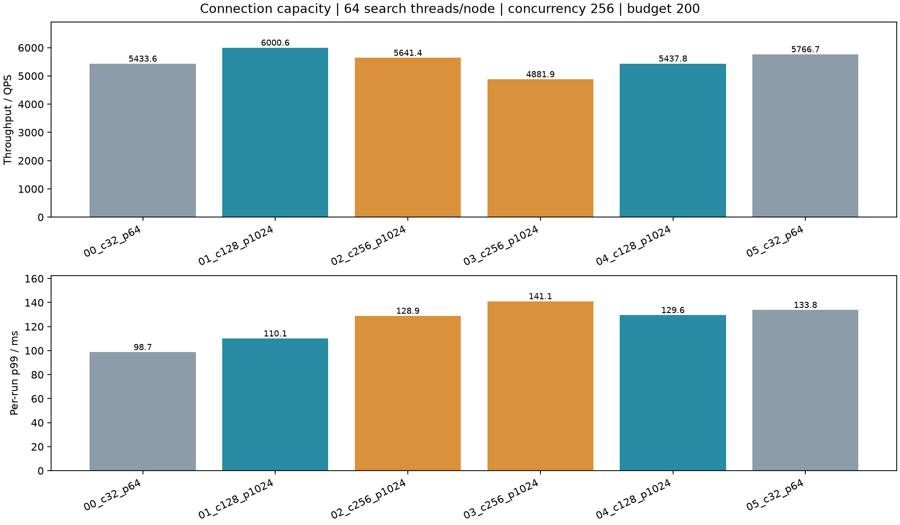
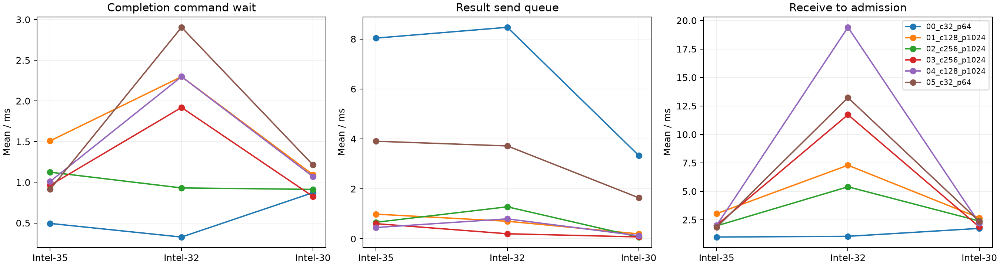
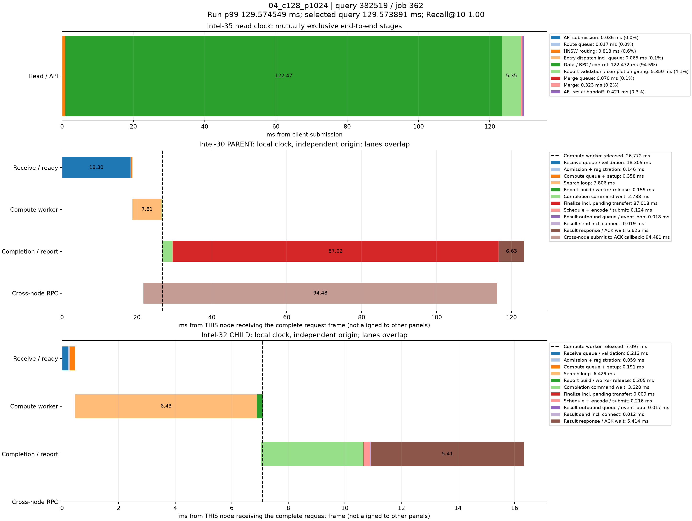

# 网络连接容量三机实验

Intel-35/32/30，每节点64搜索线程、路由16线程、合并4线程、并发256、预算200，每轮10000请求（同样2000查询重复5次），预热32。收发模块启用并固定各一个事件循环，搜索/路由/合并线程数均不变。扩大组同时提高结果控制通道pending上限，属于容量组合实验，不把全部变化归因于连接数。接收连接总上限保持4096。

|轮次|每目标连接上限|结果pending上限|QPS|p99 ms|平均 ms|Recall@10|
|---|---:|---:|---:|---:|---:|---:|
|00_c32_p64|32|64|5433.59|98.74|46.47|0.97025|
|01_c128_p1024|128|1024|6000.58|110.11|41.77|0.97026|
|02_c256_p1024|256|1024|5641.39|128.95|44.68|0.97021|
|03_c256_p1024|256|1024|4881.88|141.12|51.67|0.97013|
|04_c128_p1024|128|1024|5437.78|129.57|45.91|0.97018|
|05_c32_p64|32|64|5766.75|133.84|43.29|0.97035|

## 两轮均值

|每目标连接上限|QPS|各轮p99均值 ms|平均延迟 ms|
|---|---:|---:|---:|
|32|5600.17|116.29|44.88|
|128|5719.18|119.84|43.84|
|256|5261.64|135.04|48.17|

## 入口及后续等待

以下为每查询均值，ms；各阶段不全互斥，不能直接相加。RPC响应等待包含远端处理与调度，不等于链路RTT。

|轮次|入口发送排队|入口发送/建连|入口响应等待|数据及控制|合并队列|路由队列|搜索累计|计算就绪累计|
|---|---:|---:|---:|---:|---:|---:|---:|---:|
|00_c32_p64|0.147|0.023|1.922|44.145|0.291|0.128|13.104|4.991|
|01_c128_p1024|0.207|0.094|5.266|39.631|0.467|0.115|11.920|1.658|
|02_c256_p1024|0.152|0.064|4.809|42.384|0.565|0.104|11.463|1.111|
|03_c256_p1024|0.342|0.205|6.941|48.970|0.544|0.101|13.155|1.402|
|04_c128_p1024|0.446|0.355|8.707|43.566|0.666|0.092|11.960|1.283|
|05_c32_p64|5.024|0.034|5.808|41.044|0.551|0.103|11.571|1.528|

## CPU及IO

数据节点CPU为进程快照区间平均核数，包含快照时间。

|轮次|Intel-35|Intel-32|Intel-30|顶层CPU|物理读字节|每query协议字节|每query协议RPC|
|---|---:|---:|---:|---:|---:|---:|---:|
|00_c32_p64|19.15|19.46|9.76|13.71|1344983040|31730|2.89|
|01_c128_p1024|18.06|19.06|10.13|13.34|15429632|31733|3.05|
|02_c256_p1024|17.70|18.65|10.22|13.10|10760192|31767|3.05|
|03_c256_p1024|19.11|17.90|8.82|13.50|10919936|31741|3.06|
|04_c128_p1024|16.59|18.93|9.28|12.60|2564096|31739|3.05|
|05_c32_p64|16.71|19.47|9.95|13.01|2510848|31739|2.99|

全部请求要求零失败、Recall≥95%、协议审计通过且内存暂存无溢出。计时截至原生结果交付Future，JSON归档与统计在之后执行。每轮约数秒、热缓存，两轮均值不是统计显著性结论；各轮p99平均不等于合并样本p99。连接按需建立，上限扩大并不意味着预先创建全部连接。

## 实际扩容及等待

以下为正式查询对应的分支/结果事件均值（ms），不是所有分支之和。不同区间可能重叠。

|轮次|节点|结果发送峰值循环|结束循环|进程线程数|完成命令等待|结果发送前队列|接收至接纳|
|---|---:|---:|---:|---:|---:|---:|---:|
|00_c32_p64|0|1|1|79|0.494|8.036|0.987|
|00_c32_p64|1|1|1|79|0.327|8.469|1.052|
|00_c32_p64|2|1|1|79|0.872|3.338|1.746|
|01_c128_p1024|0|1|1|79|1.509|0.988|3.042|
|01_c128_p1024|1|1|1|79|2.298|0.704|7.292|
|01_c128_p1024|2|1|1|79|1.094|0.198|2.669|
|02_c256_p1024|0|1|1|79|1.124|0.663|1.970|
|02_c256_p1024|1|1|1|79|0.931|1.282|5.399|
|02_c256_p1024|2|1|1|79|0.913|0.071|2.392|
|03_c256_p1024|0|1|1|79|0.964|0.607|2.022|
|03_c256_p1024|1|1|1|79|1.920|0.203|11.729|
|03_c256_p1024|2|1|1|79|0.826|0.076|1.877|
|04_c128_p1024|0|1|1|79|1.010|0.453|2.009|
|04_c128_p1024|1|1|1|79|2.299|0.799|19.403|
|04_c128_p1024|2|1|1|79|1.071|0.125|2.208|
|05_c32_p64|0|1|1|79|0.914|3.907|1.840|
|05_c32_p64|1|1|1|79|2.905|3.720|13.229|
|05_c32_p64|2|1|1|79|1.214|1.644|2.355|

## 配置选择与限制

采用128条每目标连接、结果通道pending上限1024作为扩大后的容量配置，已写入configs/dhdgs.yaml。相对32组，QPS均值增加2.13%，各轮p99均值增加3.05%，没有证据支持尾延迟改善。256组吞吐下降且尾延迟更高，未采用。128是本轮扩大容量的选择，不是已证明的全局最优值。

32组各节点结果发送前等待均值1.644–8.469ms；128组0.125–0.988ms。发送队列已明显缩短，但剩余接收/控制/响应等待不能通过继续提高连接上限来保证消除。

模板网络模块仍默认关闭，其新连接配置在启用时生效；原生入口/派发及控制结果通道的独立连接配置也已同步增大。expanded_plan.yaml复现本轮固定收发各一个事件循环、连接128的三机配置。已有运行进程不会自动重读网络配置；需要排空重启。本轮未替换原220xx服务。

## 结果发送等待的p99

下表按节点事件统计，并非整条query的互斥分解。

|轮次|节点|发送排队均值 ms|发送排队p99 ms|响应等待均值 ms|
|---|---:|---:|---:|---:|
|00_c32_p64|0|8.036|14.603|9.246|
|00_c32_p64|1|8.469|15.902|9.261|
|00_c32_p64|2|3.338|11.804|9.687|
|01_c128_p1024|0|0.988|47.086|15.335|
|01_c128_p1024|1|0.704|38.256|15.375|
|01_c128_p1024|2|0.198|9.743|15.122|
|02_c256_p1024|0|0.663|30.120|18.368|
|02_c256_p1024|1|1.282|56.351|19.080|
|02_c256_p1024|2|0.071|0.329|18.440|
|03_c256_p1024|0|0.607|31.796|19.674|
|03_c256_p1024|1|0.203|0.084|19.409|
|03_c256_p1024|2|0.076|0.702|19.004|
|04_c128_p1024|0|0.453|21.778|13.162|
|04_c128_p1024|1|0.799|44.538|13.501|
|04_c128_p1024|2|0.125|0.331|13.102|
|05_c32_p64|0|3.907|12.603|6.321|
|05_c32_p64|1|3.720|13.561|6.351|
|05_c32_p64|2|1.644|8.747|6.626|

## 接收容量与部署限制

|轮次|节点|结束快照连接数|拒绝数|错误数|
|---|---:|---:|---:|---:|
|00_c32_p64|0|42|0|0|
|00_c32_p64|1|62|0|0|
|00_c32_p64|2|47|0|0|
|01_c128_p1024|0|136|0|0|
|01_c128_p1024|1|185|0|0|
|01_c128_p1024|2|76|0|0|
|02_c256_p1024|0|76|0|0|
|02_c256_p1024|1|207|0|0|
|02_c256_p1024|2|80|0|0|
|03_c256_p1024|0|90|0|0|
|03_c256_p1024|1|258|0|0|
|03_c256_p1024|2|71|0|0|
|04_c128_p1024|0|94|0|0|
|04_c128_p1024|1|243|0|0|
|04_c128_p1024|2|103|0|0|
|05_c32_p64|0|47|0|0|
|05_c32_p64|1|97|0|0|
|05_c32_p64|2|55|0|0|

连接数是结束快照，不是运行期间峰值；接收上限保持4096，没有请求失败或接收容量拒绝。远端SSH会话nofile软上限1024、硬上限1048576，记录于environment.json。扩大后的服务启动前建议执行 `ulimit -n 65536`，为多个通道/循环及管理连接留出余量；同一shell再运行cluster_service.py。该命令不修改机器全局配置。当前未自动重启常驻服务。

最终配置通过load_config校验，20项真实TCP网络及原生控制回归通过（regression.log）。全部60000正式请求无失败且审计通过。

## p99查询时延图（实验完成后补充）

最新128连接复测（04_c128_p1024）的10000条查询中，最接近整体p99的真实记录为query_id=382519、job=362：延迟129.573891ms，本轮p99=129.574549ms。该查询实际经过Intel-30父分支→Intel-32子分支，Recall@10=1.0。

此样本的主要观测如下：

- 顶层路由排队0.017ms、HNSW计算0.818ms、合并排队0.070ms。
- 父节点接收/验证18.305ms，搜索7.806ms；子节点搜索6.429ms。
- 父节点完成命令处理后至报告就绪87.018ms，与尚未完成的子分支派发确认区间重叠。
- 跨节点RPC发送排队0.019ms、发送0.018ms、响应等待94.259ms；从派发调用到ACK回调共94.481ms。响应等待不能直接解释为纯链路RTT。
- 父节点计算线程在本地相对26.772ms已释放，派发ACK回调在116.205ms到达；这段等待没有继续占用该搜索线程。
- 父/子结果发送排队分别0.0185/0.0169ms。由此可见，此样本的主要长等待不是发送连接池排队。

各数据节点使用自己的本地时钟和零点，图中父子横轴不能直接对齐或相加。父节点控制等待与派发RPC重叠，不能重复计入总延迟。接收/验证及响应等待仍包含处理与调度，现有图不能唯一定位到某把锁或纯网络传输。

[该样本完整分解、原始记录与精确数值](p99/04_c128_p1024/REPORT.md)。结果事件message_ready_ns记录于异步提交后，可能晚于实际网络发送；图中发送队列使用RPC内部pool_wait_ms还原，避免错误的负等待或截断为零。

plot_p99.py支持任意本轮case；run_sweep.py已增加每轮实验结束后自动选择p99附近真实查询并生成PNG、SVG、CSV和JSON，不需要重新运行查询来绘图。

|轮次|本轮p99 ms|样本延迟 ms|query_id|时序图|
|---|---:|---:|---:|---|
|00_c32_p64|98.744214|98.738528|520133|[图表](p99/00_c32_p64/timeline.png)|
|01_c128_p1024|110.108192|110.107315|120308|[图表](p99/01_c128_p1024/timeline.png)|
|02_c256_p1024|128.949105|128.948950|487854|[图表](p99/02_c256_p1024/timeline.png)|
|03_c256_p1024|141.124223|141.123982|582229|[图表](p99/03_c256_p1024/timeline.png)|
|04_c128_p1024|129.574549|129.573891|382519|[图表](p99/04_c128_p1024/timeline.png)|
|05_c32_p64|133.842678|133.839543|1690816|[图表](p99/05_c32_p64/timeline.png)|
