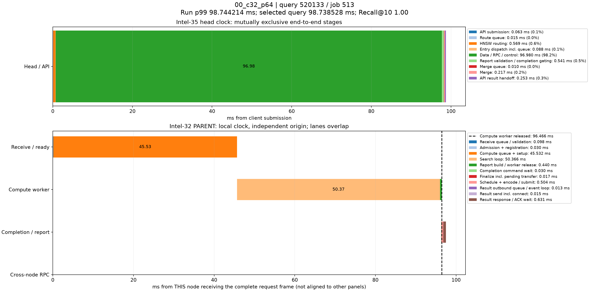

# p99真实查询时序分解

来源：00_c32_p64，10000条查询。选择全体查询中服务延迟最接近本轮p99的记录；不筛选跨节点条件，也不使用多轮p99均值选择样本。

本轮p99为98.744214380ms；query_id=520133、job=513，延迟98.738528000ms，相差0.005686380ms，Recall@10=1.00。

顶层面板使用同一主机时钟，阶段互斥且总和等于端到端服务延迟。每个数据节点单独以收到完整报文为零点，不能跨主机直接对齐时间轴或相加。节点内计算、控制、派发存在重叠；虚线表示计算线程释放时刻，之后的控制/网络等待不占用该计算线程。结果ACK时刻与用户Future完成时刻也不同。

|顶层阶段|耗时ms|占服务延迟|
|---|---:|---:|
|API submission|0.063438|0.06%|
|Route queue|0.015092|0.02%|
|HNSW routing|0.569374|0.58%|
|Entry dispatch incl. queue|0.088045|0.09%|
|Data / RPC / control|96.980353|98.22%|
|Report validation / completion gating|0.541226|0.55%|
|Merge queue|0.010461|0.01%|
|Merge|0.217495|0.22%|
|API result handoff|0.253044|0.26%|

## Intel-32 / PARENT

|阶段|本节点相对起点ms|耗时ms|
|---|---:|---:|
|Receive queue / validation|0.000000|0.097949|
|Admission + registration|0.097949|0.030034|
|Compute queue + setup|0.127983|45.532144|
|Search loop|45.660127|50.365970|
|Report build / worker release|96.026097|0.440275|
|Completion command wait|96.269187|0.029953|
|Finalize incl. pending transfer|96.299140|0.017267|
|Schedule + encode / submit|96.316407|0.504091|
|Result outbound queue / event loop|96.820498|0.013441|
|Result send incl. connect|96.833939|0.014525|
|Result response / ACK wait|96.848464|0.631310|

结果RPC排队起点由 sender_enter_ns - round(pool_wait_ms * 1e6) 还原；pool_wait_ms来自底层同一主机时钟的queued_ns与send_start_ns之差。旧message_ready_ns是在异步提交成功后记录，网络线程可能已开始发送，不能用它直接计算发送前队列。还原数值保存在stages.json/CSV，未改写原始时间戳。

接收队列/验证、完成控制和发送前等待均为观测区间，可能包含OS调度及状态锁等待，不能据图将其全部认定为锁、CPU计算或纯链路传输。单条p99附近查询用于定位现象，不代表所有尾延迟样本。selected.json保留完整源记录，stages.json/CSV保存精确阶段数值。
