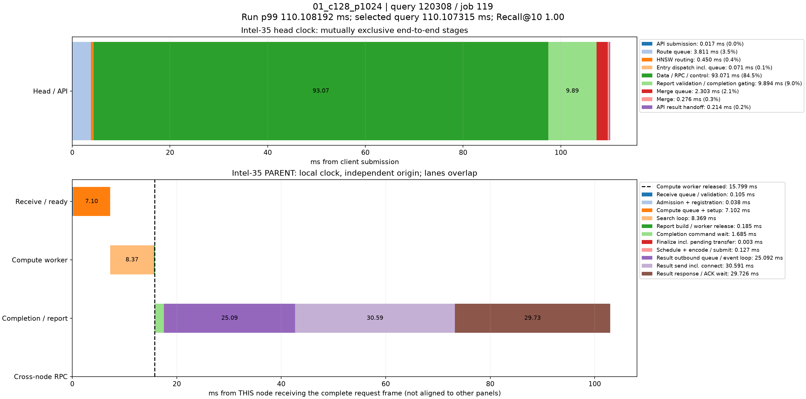

# p99真实查询时序分解

来源：01_c128_p1024，10000条查询。选择全体查询中服务延迟最接近本轮p99的记录；不筛选跨节点条件，也不使用多轮p99均值选择样本。

本轮p99为110.108192130ms；query_id=120308、job=119，延迟110.107315000ms，相差0.000877130ms，Recall@10=1.00。

顶层面板使用同一主机时钟，阶段互斥且总和等于端到端服务延迟。每个数据节点单独以收到完整报文为零点，不能跨主机直接对齐时间轴或相加。节点内计算、控制、派发存在重叠；虚线表示计算线程释放时刻，之后的控制/网络等待不占用该计算线程。结果ACK时刻与用户Future完成时刻也不同。

|顶层阶段|耗时ms|占服务延迟|
|---|---:|---:|
|API submission|0.017302|0.02%|
|Route queue|3.811400|3.46%|
|HNSW routing|0.449952|0.41%|
|Entry dispatch incl. queue|0.070923|0.06%|
|Data / RPC / control|93.070516|84.53%|
|Report validation / completion gating|9.894300|8.99%|
|Merge queue|2.302614|2.09%|
|Merge|0.276383|0.25%|
|API result handoff|0.213925|0.19%|

## Intel-35 / PARENT

|阶段|本节点相对起点ms|耗时ms|
|---|---:|---:|
|Receive queue / validation|0.000000|0.105413|
|Admission + registration|0.105413|0.037623|
|Compute queue + setup|0.143036|7.101841|
|Search loop|7.244877|8.369466|
|Report build / worker release|15.614343|0.185064|
|Completion command wait|15.741999|1.685366|
|Finalize incl. pending transfer|17.427365|0.002937|
|Schedule + encode / submit|17.430302|0.127488|
|Result outbound queue / event loop|17.557790|25.092082|
|Result send incl. connect|42.649872|30.591226|
|Result response / ACK wait|73.241098|29.725877|

结果RPC排队起点由 sender_enter_ns - round(pool_wait_ms * 1e6) 还原；pool_wait_ms来自底层同一主机时钟的queued_ns与send_start_ns之差。旧message_ready_ns是在异步提交成功后记录，网络线程可能已开始发送，不能用它直接计算发送前队列。还原数值保存在stages.json/CSV，未改写原始时间戳。

接收队列/验证、完成控制和发送前等待均为观测区间，可能包含OS调度及状态锁等待，不能据图将其全部认定为锁、CPU计算或纯链路传输。单条p99附近查询用于定位现象，不代表所有尾延迟样本。selected.json保留完整源记录，stages.json/CSV保存精确阶段数值。
