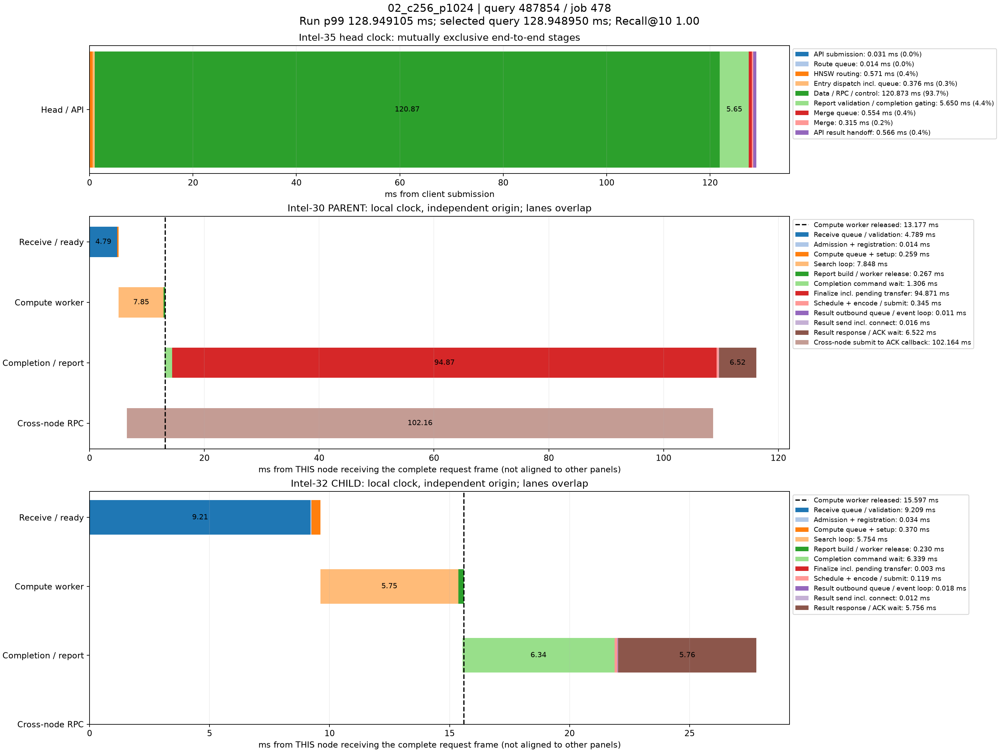

# p99真实查询时序分解

来源：02_c256_p1024，10000条查询。选择全体查询中服务延迟最接近本轮p99的记录；不筛选跨节点条件，也不使用多轮p99均值选择样本。

本轮p99为128.949105040ms；query_id=487854、job=478，延迟128.948950000ms，相差0.000155040ms，Recall@10=1.00。

顶层面板使用同一主机时钟，阶段互斥且总和等于端到端服务延迟。每个数据节点单独以收到完整报文为零点，不能跨主机直接对齐时间轴或相加。节点内计算、控制、派发存在重叠；虚线表示计算线程释放时刻，之后的控制/网络等待不占用该计算线程。结果ACK时刻与用户Future完成时刻也不同。

|顶层阶段|耗时ms|占服务延迟|
|---|---:|---:|
|API submission|0.031281|0.02%|
|Route queue|0.013854|0.01%|
|HNSW routing|0.570705|0.44%|
|Entry dispatch incl. queue|0.375548|0.29%|
|Data / RPC / control|120.872593|93.74%|
|Report validation / completion gating|5.650080|4.38%|
|Merge queue|0.553723|0.43%|
|Merge|0.314925|0.24%|
|API result handoff|0.566241|0.44%|

## Intel-30 / PARENT

|阶段|本节点相对起点ms|耗时ms|
|---|---:|---:|
|Receive queue / validation|0.000000|4.788536|
|Admission + registration|4.788536|0.013811|
|Compute queue + setup|4.802347|0.259120|
|Search loop|5.061467|7.848473|
|Report build / worker release|12.909940|0.266690|
|Completion command wait|13.085868|1.305626|
|Finalize incl. pending transfer|14.391494|94.871133|
|Schedule + encode / submit|109.262627|0.345017|
|Result outbound queue / event loop|109.607644|0.010671|
|Result send incl. connect|109.618315|0.016355|
|Result response / ACK wait|109.634670|6.521562|
|Cross-node submit to ACK callback|6.489372|102.164152|

## Intel-32 / CHILD

|阶段|本节点相对起点ms|耗时ms|
|---|---:|---:|
|Receive queue / validation|0.000000|9.208706|
|Admission + registration|9.208706|0.034055|
|Compute queue + setup|9.242761|0.370392|
|Search loop|9.613153|5.754119|
|Report build / worker release|15.367272|0.229711|
|Completion command wait|15.533234|6.339047|
|Finalize incl. pending transfer|21.872281|0.003289|
|Schedule + encode / submit|21.875570|0.119464|
|Result outbound queue / event loop|21.995034|0.017789|
|Result send incl. connect|22.012823|0.012023|
|Result response / ACK wait|22.024846|5.756213|

结果RPC排队起点由 sender_enter_ns - round(pool_wait_ms * 1e6) 还原；pool_wait_ms来自底层同一主机时钟的queued_ns与send_start_ns之差。旧message_ready_ns是在异步提交成功后记录，网络线程可能已开始发送，不能用它直接计算发送前队列。还原数值保存在stages.json/CSV，未改写原始时间戳。

接收队列/验证、完成控制和发送前等待均为观测区间，可能包含OS调度及状态锁等待，不能据图将其全部认定为锁、CPU计算或纯链路传输。单条p99附近查询用于定位现象，不代表所有尾延迟样本。selected.json保留完整源记录，stages.json/CSV保存精确阶段数值。
