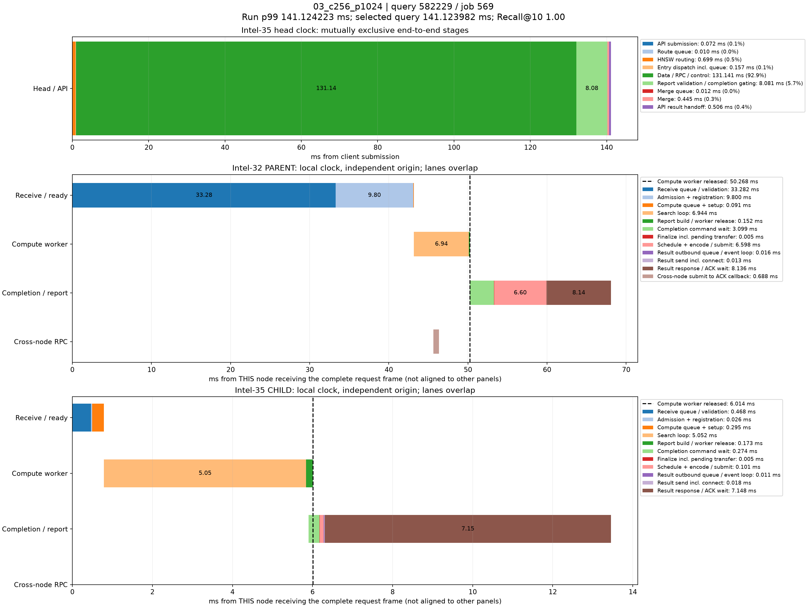

# p99真实查询时序分解

来源：03_c256_p1024，10000条查询。选择全体查询中服务延迟最接近本轮p99的记录；不筛选跨节点条件，也不使用多轮p99均值选择样本。

本轮p99为141.124222730ms；query_id=582229、job=569，延迟141.123982000ms，相差0.000240730ms，Recall@10=1.00。

顶层面板使用同一主机时钟，阶段互斥且总和等于端到端服务延迟。每个数据节点单独以收到完整报文为零点，不能跨主机直接对齐时间轴或相加。节点内计算、控制、派发存在重叠；虚线表示计算线程释放时刻，之后的控制/网络等待不占用该计算线程。结果ACK时刻与用户Future完成时刻也不同。

|顶层阶段|耗时ms|占服务延迟|
|---|---:|---:|
|API submission|0.072120|0.05%|
|Route queue|0.010275|0.01%|
|HNSW routing|0.699294|0.50%|
|Entry dispatch incl. queue|0.156916|0.11%|
|Data / RPC / control|131.140677|92.93%|
|Report validation / completion gating|8.080915|5.73%|
|Merge queue|0.012262|0.01%|
|Merge|0.445411|0.32%|
|API result handoff|0.506112|0.36%|

## Intel-32 / PARENT

|阶段|本节点相对起点ms|耗时ms|
|---|---:|---:|
|Receive queue / validation|0.000000|33.281734|
|Admission + registration|33.281734|9.799877|
|Compute queue + setup|43.081611|0.090707|
|Search loop|43.172318|6.944439|
|Report build / worker release|50.116757|0.151607|
|Completion command wait|50.205385|3.099386|
|Finalize incl. pending transfer|53.304771|0.004520|
|Schedule + encode / submit|53.309291|6.597601|
|Result outbound queue / event loop|59.906892|0.016331|
|Result send incl. connect|59.923223|0.013080|
|Result response / ACK wait|59.936303|8.135893|
|Cross-node submit to ACK callback|45.632454|0.687644|

## Intel-35 / CHILD

|阶段|本节点相对起点ms|耗时ms|
|---|---:|---:|
|Receive queue / validation|0.000000|0.467887|
|Admission + registration|0.467887|0.026217|
|Compute queue + setup|0.494104|0.294800|
|Search loop|0.788904|5.052128|
|Report build / worker release|5.841032|0.172986|
|Completion command wait|5.897076|0.274421|
|Finalize incl. pending transfer|6.171497|0.004862|
|Schedule + encode / submit|6.176359|0.100876|
|Result outbound queue / event loop|6.277235|0.011284|
|Result send incl. connect|6.288519|0.017566|
|Result response / ACK wait|6.306085|7.147994|

结果RPC排队起点由 sender_enter_ns - round(pool_wait_ms * 1e6) 还原；pool_wait_ms来自底层同一主机时钟的queued_ns与send_start_ns之差。旧message_ready_ns是在异步提交成功后记录，网络线程可能已开始发送，不能用它直接计算发送前队列。还原数值保存在stages.json/CSV，未改写原始时间戳。

接收队列/验证、完成控制和发送前等待均为观测区间，可能包含OS调度及状态锁等待，不能据图将其全部认定为锁、CPU计算或纯链路传输。单条p99附近查询用于定位现象，不代表所有尾延迟样本。selected.json保留完整源记录，stages.json/CSV保存精确阶段数值。
